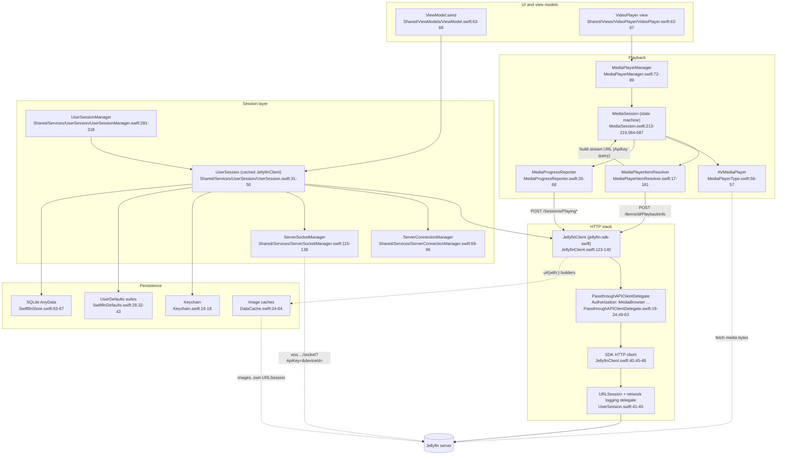
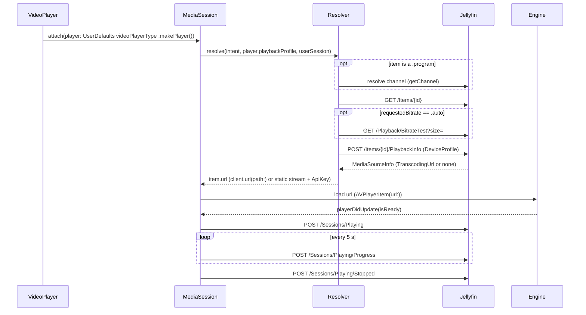

# 00 - Index: Swiftfin Jellyfin API use and media playback spec

> **Jellyfin SDK source.** A citation `jellyfin-sdk-swift@3.3.0:PATH:LINE` points into [jellyfin/jellyfin-sdk-swift](https://github.com/jellyfin/jellyfin-sdk-swift) at tag `3.3.0` (commit `8ce10a167ad0b4145b2bc005acf8bebcfe6ebe46`). Open it as `https://github.com/jellyfin/jellyfin-sdk-swift/blob/8ce10a167ad0b4145b2bc005acf8bebcfe6ebe46/PATH#LLINE`; for a range `A-B`, use `#LA-LB`. There is no local copy of the SDK.

Goal: an engineer can rebuild this client's Jellyfin API use and media playback from these files alone.

Citation format: app files are repo-relative (`Shared/Services/UserSession/UserSession.swift:42`). Jellyfin SDK citations are `jellyfin-sdk-swift@3.3.0:Sources/...:LINE`. iOS code is in top-level `Views/`, `Components/`, `Extensions/`, `Objects/`, `App/`; tvOS is in `Swiftfin tvOS/` (path has a space); shared code is in `Shared/`.

Conflict rule: where explorers disagreed, each file keeps both versions marked **CONFLICT**, unless the source settled it. Each file has its own conflict section (listed in section 6 below).

---

## 1. Table of contents

| File | Covers | Key sections |
|---|---|---|
| [00-INDEX.md](00-INDEX.md) | This file: contents, overview, architecture, glossary, conflict map | - |
| [01-endpoints.md](01-endpoints.md) | All 122 REST endpoints from `Paths.*` (groups A-K), SDK-composed requests (Part B), playback wire details (Part C): verb, path, query keys, body, response, call sites | "Endpoint index", Part A, Part B, Part C |
| [02-networking.md](02-networking.md) | Layering (VM to `JellyfinClient` to the SDK's HTTP client to `URLSession`), client construction, `Authorization` header, URL building, errors, WebSocket, network logging | 1 Layering, 2 Client construction, 4 Headers, 10 WebSocket |
| [03-auth-session.md](03-auth-session.md) | Client identity, token transport, server discovery, multi-URL connections, sign-in, Quick Connect, PIN, session lifecycle | 1 Client identity, 3 Discovery, 6 Sign-in flows, 9 Session lifecycle |
| [04-models.md](04-models.md) | DTOs, domain models, JSON key mapping | 1 Wire rules, 4 Playback models |
| [05-playback.md](05-playback.md) | `PlaybackInfo`, `DeviceProfile`, play-method inference, bitrate test, stream URL building | 1 Core fact, 2 Resolution flow, 6 DeviceProfile, 8 Stream URL |
| [06-vlc.md](06-vlc.md) | Player engines. There is no VLC. AVPlayer, plus a second, non-AVPlayer engine that is out of scope. File name kept for numbering only | 1 No VLC, 2 Engine selection, 7 AVPlayer |
| [07-reporting.md](07-reporting.md) | `Sessions/Playing`, `Progress`, `Stopped`, resume points, watched state | 2 Endpoints, 5 Lifecycle, 7 Resume, 8 Watched |
| [08-images-subtitles-audio.md](08-images-subtitles-audio.md) | Image URLs, subtitle delivery methods, audio/subtitle track selection and switching | 2 Image URLs, 4 Subtitle delivery, 6 Initial selection, 7 Switching |
| [09-state-cache-persistence.md](09-state-cache-persistence.md) | Keychain, `UserDefaults`, a SQLite store, image caches, temp files, offline behaviour | 2 Storage map, 3 Keychain, 6 Database, 9 Image caches |
| [10-errors-edge-cases.md](10-errors-edge-cases.md) | Error vocabulary, timeout/retry/cancel matrices, playback failure paths, silent failures, crash traps | 3 Timeouts, 4 Retry, 5 Cancellation, 8 Playback, 14 Silent failures |
| [11-sequence-flows.md](11-sequence-flows.md) | Login, browse, play, seek, track switch, resume, stop, remote control as sequences | 1 Login ... 8 Remote control |
| [12-gaps.md](12-gaps.md) | Open questions and unknowns carried from every file (every file links to it) | - |
| [13-jellyos-decisions.md](13-jellyos-decisions.md) | jellyOS v1 decisions (Apple only, AVPlayer, HEVC HLS, sign-out, reporting, Now Playing) and the server tests that support them. Not part of the Swiftfin reverse-engineering | - |

Reading order for a rebuild: 02 -> 03 -> 01 (groups A, B) -> 04 -> 05 -> 06 -> 07 -> 08 -> 09 -> 10, with 11 as the integration check.

---

## 2. System overview

Swiftfin is a SwiftUI client with three layers relevant here: view models and services call a cached `JellyfinClient`; the client builds typed `Paths.*` requests and hands them to the SDK's HTTP client; players, the image pipeline and a private `URLSession` fetch media bytes from URLs the client only builds (`AVPlayerItem(url: item.url)` at `Shared/Objects/MediaPlayerManager/Players/AVMediaPlayer.swift:107`; the image loader with its own `URLSessionConfiguration.swiftfin` at `Shared/Extensions/Nuke/ImagePipeline.swift:70-78`; temp-file downloads on a private `URLSession` at `Shared/Objects/MediaPlayerManager/PlaybackTemporaryFiles.swift:17`).

1. **HTTP is built by jellyfin-sdk-swift.** All typed REST calls go through `JellyfinClient.send` (`jellyfin-sdk-swift@3.3.0:Sources/JellyfinClient.swift:123-140`); view models reach it through `ViewModel.send` (`Shared/ViewModels/ViewModel.swift:63-68`). Details: [02-networking.md](02-networking.md), endpoint tables in [01-endpoints.md](01-endpoints.md).
2. **One client per signed-in session.** `UserSession.client` is cached and rebuilt only when `server.effectiveServerURL` changes (`Shared/Services/UserSession/UserSession.swift:31-50`). Session requests use `URLSessionConfiguration.swiftfin`, a `.default` configuration with `timeoutIntervalForRequest = 20` (`Shared/Extensions/URLSessionConfiguration.swift:15-17`).
3. **Auth is one header.** `Authorization: MediaBrowser ...` with keys `DeviceId`, `Device`, `Client`, `Version`, plus `Token` only when an access token exists (`jellyfin-sdk-swift@3.3.0:Sources/PassthroughAPIClientDelegate.swift:49-63`). Two URL kinds carry `ApiKey=<accessToken>` in the query instead: direct static stream URLs built with `client.url(with:queryAPIKey: true)` (`Shared/Objects/MediaPlayerManager/MediaPlayerItem/MediaPlayerItemResolver.swift:256,274`; the SDK appends `ApiKey` only when `queryAPIKey` is true, default false, `jellyfin-sdk-swift@3.3.0:Sources/JellyfinClient.swift:254-266`), and the socket URL (`jellyfin-sdk-swift@3.3.0:Sources/JellyfinClient.swift:316-336`). Swiftfin also has a Chromecast path, out of scope here, whose URL also gets `ApiKey` (`Shared/Objects/MediaPlayerManager/RemotePlaybackURL.swift:20-26`). On the local engines a server `TranscodingUrl` goes through `client.url(path:)` and gets no `ApiKey` (`Shared/Objects/MediaPlayerManager/MediaPlayerItem/MediaPlayerItemResolver.swift:232`, `jellyfin-sdk-swift@3.3.0:Sources/JellyfinClient.swift:285-311`). The app sends no `X-Emby-*` header; the only occurrence of the string is a comment (`Shared/Objects/MediaPlayerManager/PlaybackTemporaryFiles.swift:100`). See [03-auth-session.md](03-auth-session.md).
4. **Client identity.** `Client` is `"Swiftfin \(UIDevice.platform)"`, `DeviceId` is `"\(UIDevice.platform)_\(UIDevice.vendorUUIDString)"`, `Version` is `CFBundleShortVersionString` or `"0.0.1"` (`Shared/Extensions/JellyfinAPI/JellyfinClient.swift:21,28,29`). Platform literals are `"iOS"`, `"iPadOS"`, `"tvOS"` (`Shared/Strings/ProperNouns.swift:137-140`).
5. **On the local engines the client does not choose the play method.** It posts a `DeviceProfile` to `POST /Items/{id}/PlaybackInfo` and infers transcode only from `MediaSourceInfo.TranscodingUrl != nil` (`Shared/Objects/MediaPlayerManager/MediaPlayerItem/MediaPlayerItem.swift:146`, `Shared/Objects/MediaPlayerManager/MediaPlayerItem/MediaPlayerItemResolver.swift:229`). With no `TranscodingUrl` it builds `/Videos/{id}/stream?static=true&...&ApiKey=` or the `/Audio/{id}/stream` equivalent (`Shared/Objects/MediaPlayerManager/MediaPlayerItem/MediaPlayerItemResolver.swift:229-281`). Swiftfin's Chromecast path, out of scope here, is the exception: it forces an HLS transcode (`Shared/Objects/MediaPlayerManager/MediaPlayerItem/MediaPlayerItemResolver.swift:59-65,142-146`). See [05-playback.md](05-playback.md).
6. **There is no VLC.** `grep -rniI vlc --include='*.swift' --include='*.pbxproj' --include='*.resolved' .` with `docs/`, `fastlane/`, `Tools/`, `SwiftfinMacros/` and `Translations/` excluded returns 0 lines (re-run in round 3). Swiftfin has two local engines: `MediaPlayerType.avPlayer` (`AVMediaPlayer`) and a second, non-AVPlayer engine that is the default and is out of scope here (`Shared/Objects/MediaPlayerType/MediaPlayerType.swift:14-15,56-59`). The choice is the user default `"videoPlayerType"` (`Shared/Services/SwiftfinDefaults.swift:301-303`), read in `onAppear` only when `mediaSession.player == nil` and `mediaSession.state != .stopped` (`Shared/Views/VideoPlayer/VideoPlayer.swift:63-67`). There is no fallback to the other engine on failure (`Shared/Views/VideoPlayer/VideoPlayer.swift:83-95`). See [06-vlc.md](06-vlc.md).
7. **Reporting is engine-agnostic.** One `MediaProgressReporter` per `MediaSession` sends `POST /Sessions/Playing`, `/Sessions/Playing/Progress` (self-rearming 5 s timer), `/Sessions/Playing/Stopped` (`Shared/Objects/MediaPlayerManager/MediaSession.swift:87,209-211`, `Shared/Objects/MediaPlayerManager/MediaProgressReporter.swift:41-47`, `Shared/Objects/PokeIntervalTimer.swift:21`). Each report is enqueued on a `MediaPlaybackReportQueue`, which runs reports one after another: each new task awaits the previous one (`Shared/Objects/MediaPlayerManager/MediaProgressReporter.swift:118,166-168,172-178`). A progress report is dropped while another progress report is still pending (`Shared/Objects/MediaPlayerManager/MediaProgressReporter.swift:107-111,121`). A send error is only logged as a warning; it is not retried (`Shared/Objects/MediaPlayerManager/MediaProgressReporter.swift:130-134`). The client makes no separate resume-point or played-state call at the end of playback: the `Stopped` report carries `PositionTicks` from `observedSeconds` (`Shared/Objects/MediaPlayerManager/MediaProgressReporter.swift:55-67`). How the server turns that into played and resume state is server-side behaviour that this repo cannot show (see [12-gaps.md](12-gaps.md)). Manual played toggles call `Paths.markPlayedItem` / `Paths.markUnplayedItem` (`Shared/Services/UserSession/UserSession+Items.swift:84-88`). See [07-reporting.md](07-reporting.md).
8. **WebSocket.** `wss`/`ws` URL `{base}/socket?ApiKey=<token>&deviceId=<id>` (`jellyfin-sdk-swift@3.3.0:Sources/JellyfinClient.swift:316-336`). The app manager sets a 10 s `responseTimeout` and passes `supportsMediaControl: true`, `playableMediaTypes: [.video]` and eight `supportedCommands` to `client.socket(...)` (`Shared/Services/ServerSocketManager.swift:124-138`; `.connect(responseTimeout: .seconds(10))` at 138). The SDK does not send these over the socket: it builds `Paths.PostCapabilitiesParameters` (`jellyfin-sdk-swift@3.3.0:Sources/JellyfinSocket/JellyfinSocket.swift:179-185`) and sends them as HTTP `POST /Sessions/Capabilities`, ignoring any error (`jellyfin-sdk-swift@3.3.0:Sources/JellyfinSocket/JellyfinSocket.swift:495-496`). `UserDataChanged` merges into the item store (`Shared/Services/UserSession/UserSession+ItemChanges.swift:24-29`). See [02-networking.md](02-networking.md) section 10.
9. **No offline media store and no persistent API response store.** There is no offline media store: the `Experimental.downloads` key has no consumer (`Shared/Services/SwiftfinDefaults.swift:414-416`; grep for `Experimental.downloads` in `*.swift` outside `docs/` returns 0 hits). The only app-level store for typed REST responses is in memory: `UserSession.send` merges item records from responses into the `ItemStore` (`Shared/Services/UserSession/UserSession.swift:20`, `Shared/Services/UserSession/UserSession+Items.swift:41-60`, `Shared/Objects/ItemStore/ItemStore.swift:15`). The only image-related `URLCache` use is the image cache's `other` pipeline (`Shared/Extensions/Nuke/ImagePipeline.swift:96`). HTTP-level caching is not turned off: `.swiftfin` is `URLSessionConfiguration.default` with only the request timeout changed (`Shared/Extensions/URLSessionConfiguration.swift:15-17`), so `URLCache.shared` applies. Only `PlaybackTemporaryFiles` sets `urlCache = nil` (`Shared/Objects/MediaPlayerManager/PlaybackTemporaryFiles.swift:28-29`). Persistence is Keychain (`"<userID>-accessToken"`, `"<userID>-pin"`), `UserDefaults`, a SQLite store, image caches and temp files under `Folder.temporary/playback/<UUID>/` (`Shared/Objects/MediaPlayerManager/PlaybackTemporaryFiles.swift:16,125-127`) (`Shared/SwiftfinStore/SwiftinStore+UserState.swift:32,55`, `Shared/Services/SwiftfinDefaults.swift:28`, `Shared/SwiftfinStore/SwiftfinStore.swift:63-67`, `Shared/Extensions/Nuke/DataCache.swift:24-64`). See [09-state-cache-persistence.md](09-state-cache-persistence.md).
10. **No automatic sign-out on 401.** The only `signOut(reason:)` reasons are `.backgroundTimeout` and `.explicit`, called from the background-interval check and two explicit UI buttons (`Shared/Services/UserSession/UserSessionManager.swift:39-43,194`, `Shared/Views/SettingsView/SettingsView.swift:86`, `Views/AdminDashboardView/ServerBackup/ServerBackupDetailsView/ServerBackupDetailsView.swift:102`). Non-2xx throws an unacceptable-status-code error carrying only the status code (`jellyfin-sdk-swift@3.3.0:Sources/PassthroughAPIClientDelegate.swift:29-37`). Requests are not retried: `shouldRetry` returns `actualDelegate?...shouldRetry ?? false` (`jellyfin-sdk-swift@3.3.0:Sources/PassthroughAPIClientDelegate.swift:39-41`), and the app passes no actual delegate, only a `sessionDelegate` (`Shared/Services/UserSession/UserSession.swift:41-45`). Restoring a stored session (`Shared/Services/UserSession/UserSessionManager.swift:92`, failure path 93-100, `320-333`) makes no token-validation call. `ServerConnectionManager.willStart` always calls `resolveActiveConnection` (`Shared/Services/ServerConnectionManager.swift:255-259`). Probing runs only when both the user default `Experimental.serverConnectionAutoSwitch` (default `false`, `Shared/Services/SwiftfinDefaults.swift:418-420`) and `userSession.server.isAutoSwitchEnabled` are true (`Shared/Services/ServerConnectionManager.swift:246-250`); otherwise `_resolveActiveConnection` returns at once (`Shared/Services/ServerConnectionManager.swift:207`). The probe uses the access token and `GET /System/Info/Public` (`Shared/Services/ServerConnectionManager.swift:69-88,214-218`); `ServerSocketManager.didStart` also opens the socket on restore (`Shared/Services/ServerSocketManager.swift:227-229`). See [10-errors-edge-cases.md](10-errors-edge-cases.md).

### 2.1 Endpoint inventory by group

The endpoint index lists 122 REST endpoints deduplicated by method and path (`01-endpoints.md`, section "Endpoint index"). Counts per group from that table:

| Group | Topic | Endpoints |
|---|---|---|
| A | Server, connection, auth, branding | 7 |
| B | Library browsing and item data | 22 |
| C | Playback, streaming, reporting | 10 |
| D | Images | 11 |
| E | Subtitles | 4 |
| F | Metadata editing, identify, localization | 11 |
| G | Live TV | 16 |
| H | Sessions, devices, remote control | 8 |
| I | Admin: users | 8 |
| J | Admin: plugins, packages, repositories | 11 |
| K | Admin: tasks, logs, backup, API keys, server control | 14 |

Part B of that file covers requests the SDK composes (password and Quick Connect sign-in, capabilities, socket, UDP discovery, transcoding URL, subtitle sidecar URL, chapter and trickplay downloads, WKWebView plugin page) and B12 lists what the app never calls (`01-endpoints.md` Part B headings B1-B12).

---

## 3. Architecture diagram

Each node carries the file and line that establishes it.

Edge citations:

- `VM --> US --> JC`: `ViewModel.send` calls `requireUserSession().send` (`Shared/ViewModels/ViewModel.swift:63-68`), which calls `client.send` (`Shared/Services/UserSession/UserSession+Items.swift:47`); the client is built at `Shared/Services/UserSession/UserSession.swift:41-45`.
- `JC --> PD --> HC --> URLS`: the SDK init creates a `PassthroughAPIClientDelegate` and an HTTP client with that delegate, the session configuration and the session delegate (`jellyfin-sdk-swift@3.3.0:Sources/JellyfinClient.swift:40,45-48`); the delegate adds `Authorization` (`jellyfin-sdk-swift@3.3.0:Sources/PassthroughAPIClientDelegate.swift:19-24`).
- `USM --> US`: `Shared/Services/UserSession/UserSessionManager.swift:281-318`.
- `US --> SCM` and `US --> SSM`: lazy `serverConnectionManager` and `serverSocketManager`, both listed in `services` (`Shared/Services/UserSession/UserSession.swift:52-61`).
- `SSM -. socket`: `Shared/Services/ServerSocketManager.swift:124-138`, URL from `jellyfin-sdk-swift@3.3.0:Sources/JellyfinClient.swift:316-336`.
- `VP --> MPM --> MS --> RES`: `VideoPlayer` attaches a player (`Shared/Views/VideoPlayer/VideoPlayer.swift:63-67`); `MediaPlayerManager.play` stops the old session and creates a `MediaSession` (`Shared/Objects/MediaPlayerManager/MediaPlayerManager.swift:72-89`); the session calls `resolveItem` (`Shared/Objects/MediaPlayerManager/MediaSession.swift:409`).
- `RES` edges: `PlaybackInfo` request built and sent at `Shared/Objects/MediaPlayerManager/MediaPlayerItem/MediaPlayerItemResolver.swift:78-86`; stream URL built at 229-281.
- `MS --> AVP`: `makePlayer()` returns `AVMediaPlayer()` or the second, out-of-scope engine (`Shared/Objects/MediaPlayerType/MediaPlayerType.swift:56-59`), passed to `MediaSession.attach(player:)` (`Shared/Views/VideoPlayer/VideoPlayer.swift:67`, `Shared/Objects/MediaPlayerManager/MediaSession.swift:231,240`).
- `AVP -. fetch media bytes`: `Shared/Objects/MediaPlayerManager/Players/AVMediaPlayer.swift:107`.
- `MS --> REP`: the session owns one reporter (`Shared/Objects/MediaPlayerManager/MediaSession.swift:87,209`); reports at `Shared/Objects/MediaPlayerManager/MediaProgressReporter.swift:41-47`.
- `JC -. url(with:) .-> IMG`: image URLs come from `Paths.getItemImage` passed to `client.url(with:)` (`Shared/Extensions/JellyfinAPI/BaseItemDto/BaseItemDto+Images.swift:48-54`; the SDK method is public through `public extension JellyfinClient`, `jellyfin-sdk-swift@3.3.0:Sources/JellyfinClient.swift:170,254`).
- `IMG -. own URLSession`: the `posters` pipeline uses its own data loader with the `.swiftfin` configuration (`Shared/Extensions/Nuke/ImagePipeline.swift:67-78`).
- `US --> KC`: the client config reads `user.accessToken` (`Shared/Services/UserSession/UserSession.swift:42`), stored in Keychain as `"<id>-accessToken"` (`Shared/SwiftfinStore/SwiftinStore+UserState.swift:30-42`).
- `US --> DEF` and `US --> DB`: user values such as `data` go through `StoredValues` (`Shared/SwiftfinStore/SwiftinStore+UserState.swift:44-51`), stored in `UserDefaults` or SQLite `AnyData`, tvOS forced to `.defaults` (`Shared/SwiftfinStore/StoredValue/StoredValue.swift:107-111`); the per-user `UserDefaults` suite is chosen by `lastSignedInUserID` (`Shared/Services/SwiftfinDefaults.swift:32-43`).

Short names: `UserSession.swift` is `Shared/Services/UserSession/UserSession.swift`; `MediaPlayerManager.swift`, `MediaSession.swift`, `MediaProgressReporter.swift` are under `Shared/Objects/MediaPlayerManager/`; `MediaPlayerItemResolver.swift` is under `Shared/Objects/MediaPlayerManager/MediaPlayerItem/`; `MediaPlayerType.swift` is `Shared/Objects/MediaPlayerType/MediaPlayerType.swift`; `Keychain.swift` and `SwiftfinDefaults.swift` are under `Shared/Services/`; `SwiftfinStore.swift` is `Shared/SwiftfinStore/SwiftfinStore.swift`; `DataCache.swift` is `Shared/Extensions/Nuke/DataCache.swift`; SDK paths are `jellyfin-sdk-swift@3.3.0:Sources/...`.

### 3.1 Playback resolution at a glance

Citations: `Shared/Views/VideoPlayer/VideoPlayer.swift:63-67`, `Shared/Objects/MediaPlayerManager/MediaPlayerItem/MediaPlayerItemResolver.swift:40,78-86,96,130,229-281` (channel resolved first for a `.program` item at 25-31; GET /Items/{id} via `getFullItem` at 40; `getMaxBitrate` at 49 sends `Paths.getBitrateTestBytes(size:)` only when `requestedBitrate == .auto`, 187-191; request built 78, sent 86; `mediaSources` and `playSessionID` read at 96 and 130), `Shared/Objects/MediaPlayerManager/MediaSession.swift:409` (`resolveItem(resolvedIntent, player.playbackProfile, userSession)`), `Shared/Objects/MediaPlayerManager/MediaSession.swift:564-587`, `Shared/Objects/MediaPlayerManager/MediaProgressReporter.swift:41-47,67,158-160`; engine load: `Shared/Objects/MediaPlayerManager/Players/AVMediaPlayer.swift:107`. Full flow: [05-playback.md](05-playback.md) section 2 and [11-sequence-flows.md](11-sequence-flows.md) section 3.

---

## 4. Glossary

| Term | Meaning in this client | Citation |
|---|---|---|
| `Paths.*` | jellyfin-sdk-swift request values, one per endpoint, sent through `JellyfinClient.send`. Grep finds no literal `"/Items`, `"/Users`, `"/Videos`, `"/Audio` or `"/Sessions` path string in `Shared/`, `Views/` or `Swiftfin tvOS/`. Server-supplied paths go through `client.url(path:)`. The app hand-adds two query items: `ApiKey` in `RemotePlaybackURL` (the only one on a REST or media URL), and `name=<configurationPage.name>` on the plugin web page route `"configurationpage"`, which `JellyfinWebView` puts into the URL fragment (a web page, not REST). The helper `URLComponents.addingQueryItem` has no callers | `jellyfin-sdk-swift@3.3.0:Sources/JellyfinClient.swift:123-140`, `Shared/Objects/MediaPlayerManager/MediaPlayerItem/MediaPlayerItemResolver.swift:232`, `Shared/Extensions/JellyfinAPI/MediaStream.swift:29`, `Shared/Objects/MediaPlayerManager/RemotePlaybackURL.swift:24`, `Views/AdminDashboardView/Plugins/PluginDetailsView/PluginDetailsView.swift:44-47`, `Views/JellyfinWebView.swift:29-36`, `Shared/Extensions/URLComponents.swift:13-22` |
| `JellyfinClient` | SDK type holding `Configuration` and the SDK's HTTP client; also builds URLs without a network call (`url(with:)`, `url(path:)`, `socketURL`) | `jellyfin-sdk-swift@3.3.0:Sources/JellyfinClient.swift:32-63,254-311,316-336` |
| `.swiftfin` session config | `URLSessionConfiguration.default` with 20 s request timeout | `Shared/Extensions/URLSessionConfiguration.swift:15-17` |
| Network logging | a network logging delegate passed as the session delegate | `Shared/Services/UserSession/UserSession.swift:44` |
| `UserSession` | signed-in server+user pair with a cached client (28-50), an item store (20) and lazy service managers (52-61) | `Shared/Services/UserSession/UserSession.swift:20,28-61` |
| `UserSessionManager` | owns `currentSession`; serialises session transitions | `Shared/Services/UserSession/UserSessionManager.swift:281-318` |
| `effectiveServerURL` | `activeServerConnection?.url ?? currentURL`; used to build the cached client | `Shared/SwiftfinStore/SwiftfinStore+ServerState.swift:85-87`, `Shared/Services/UserSession/UserSession.swift:33-37` |
| `ApiKey` | query key carrying the access token on direct stream URLs (`queryAPIKey: true`), the socket URL, and remote playback URLs | `jellyfin-sdk-swift@3.3.0:Sources/JellyfinClient.swift:254-266,316-336`, `Shared/Objects/MediaPlayerManager/RemotePlaybackURL.swift:20-26` |
| `Authorization: MediaBrowser` | the single REST auth header | `jellyfin-sdk-swift@3.3.0:Sources/PassthroughAPIClientDelegate.swift:60-63` |
| Quick Connect | login by code; SDK poll defaults poll 5, max 200, failureTolerance 5 | `jellyfin-sdk-swift@3.3.0:Sources/QuickConnect.swift:52-56` |
| `DeviceProfile` | capability description sent in `PlaybackInfo`; built per engine | `Shared/Extensions/JellyfinAPI/DeviceProfile.swift:21,62-63,98-103` |
| `PlaybackInfo` | `POST /Items/{id}/PlaybackInfo`; returns `MediaSourceInfo` list and `PlaySessionId` | `Shared/Objects/MediaPlayerManager/MediaPlayerItem/MediaPlayerItemResolver.swift:78-86,96,130` |
| `MediaSourceInfo` | server's per-source answer; only `TranscodingUrl` drives the client's branch | `Shared/Objects/MediaPlayerManager/MediaPlayerItem/MediaPlayerItem.swift:146` |
| `TranscodingUrl` | server-supplied relative stream path; both local engines' transcoding profiles ask for HLS for video and HTTP `mp3` for audio; used via `client.url(path:)` with no `ApiKey` added on local engines (remote playback adds it) | `Shared/Objects/MediaPlayerManager/MediaPlayerItem/MediaPlayerItemResolver.swift:229-232`, `Shared/Objects/MediaPlayerType/MediaPlayerType.swift:35-42`, `Shared/Objects/MediaPlayerType/MediaPlayerType+MPV.swift:72-86`, `Shared/Objects/MediaPlayerType/MediaPlayerType+AVPlayer.swift:113-128`, `Shared/Objects/MediaPlayerManager/RemotePlaybackURL.swift:20-26` |
| Direct play (client view) | `TranscodingUrl` absent, request `static=true` stream URL | `Shared/Objects/MediaPlayerManager/MediaPlayerItem/MediaPlayerItemResolver.swift:239-260` |
| `MediaTrackIndexMap` | maps Jellyfin stream indexes to engine track indexes; `.directPlay` versus `.transcode` (transcode branch is 40-45, direct-play branch from 46) | `Shared/Objects/MediaPlayerManager/MediaTrackIndexMap.swift:12-48` |
| `MediaPlaybackConfiguration` | per-request snapshot of bitrate, compatibility mode, track indexes, start position | `Shared/Objects/MediaPlayerManager/MediaPlaybackConfiguration.swift:15-43` |
| `PlaybackProfile` | `.local(.avPlayer)`, plus a second local engine and a Chromecast profile (iOS only), both out of scope; gates secondary subtitles | `Shared/Objects/MediaPlayerManager/PlaybackProfile.swift:14-26` |
| `MediaPlayerManager` | creates one `MediaSession` per play request; stops the previous first | `Shared/Objects/MediaPlayerManager/MediaPlayerManager.swift:72-89` |
| `MediaSession` | playback state machine: resolve, load, seek, stop, queue; state-driven code is the lifecycle observation and `playerDidUpdate`/`beginPlayback` | `Shared/Objects/MediaPlayerManager/MediaSession.swift:213-219,564-587` |
| `MediaPlayer` | protocol the engines implement; calls back into the session | `Shared/Objects/MediaPlayerManager/Players/MediaPlayer.swift:16-36` |
| AVPlayer | AVFoundation engine (`AVMediaPlayer`) | `Shared/Objects/MediaPlayerType/MediaPlayerType.swift:56-57` |
| `MediaProgressReporter` | sends start, progress, stopped for every engine | `Shared/Objects/MediaPlayerManager/MediaProgressReporter.swift:35-68` |
| Ticks | Jellyfin time unit, 100 ns; `Duration.ticks(n)` = `n / 10` microseconds | `Shared/Extensions/Duration.swift:19-21,55-57` |
| `PlaySessionId` | id from `PlaybackInfoResponse`, echoed as `PlaySessionId` and `SessionId` in reports | `Shared/Objects/MediaPlayerManager/MediaProgressReporter.swift:79-81` |
| `ItemStore` | in-memory item cache, filled from typed REST responses and merged by socket `UserDataChanged`; not persisted | `Shared/Objects/ItemStore/ItemStore.swift:15`, `Shared/Services/UserSession/UserSession+Items.swift:41-60`, `Shared/Services/UserSession/UserSession+ItemChanges.swift:24-29` |
| `AppKey` / `UserKey` | app-wide versus per-user `UserDefaults` suites | `Shared/Services/SwiftfinDefaults.swift:28,32-43,48-58` |
| `StoredValues` | typed key/value layer over `UserDefaults` or SQLite `AnyData` (tvOS forced to `.defaults`) | `Shared/SwiftfinStore/StoredValue/StoredValue.swift:107-111` |
| `AnyData` | generic key/value SQLite store entity (`ownerID`, `field`, `key`, optional `data: Data?`) | `Shared/SwiftfinStore/V3Schema/V3AnyData.swift:32-45` |
| Trickplay / chapter sheets | images downloaded to `Folder.temporary/playback/<UUID>/` with a quoted-`Token` `Authorization` | `Shared/Objects/MediaPlayerManager/PlaybackTemporaryFiles.swift:16,101,125-127` |
| `JellyfinSocket` | SDK WebSocket session with reconnect and 20 s keep-alive | `jellyfin-sdk-swift@3.3.0:Sources/JellyfinSocket/JellyfinSocket.swift:52-56` |
| `ServerSocketManager` | app owner of one socket per `UserSession` | `Shared/Services/ServerSocketManager.swift:115-138` |

---

## 5. Platform and scope notes

| Note | Citation |
|---|---|
| `UIDevice.platform` is `L10n.tvOS` on tvOS, else `L10n.iPadOS` on iPad, else `L10n.iOS` | `Shared/Extensions/UIDevice.swift:49-59` |
| `identifierForVendor!` is force-unwrapped for the device id | `Shared/Extensions/UIDevice.swift:13-15` |
| Only one playback session at a time | `Shared/Objects/MediaPlayerManager/MediaPlayerManager.swift:72-77` |
| Secondary subtitle, audio/subtitle offset and sidecar loading exist only on Swiftfin's second, non-AVPlayer engine (out of scope). `AVMediaPlayer` conforms to neither `MediaPlayerOffsetProviding` nor `MediaPlayerSecondarySubtitleProviding`, its only track hook is `setStream`, and it has no sidecar subtitle loading | `Shared/Objects/MediaPlayerManager/Players/MediaPlayer.swift:83-93`, `Shared/Objects/MediaPlayerManager/Players/MPVMediaPlayer.swift:18`, `Shared/Objects/MediaPlayerManager/Players/AVMediaPlayer.swift:19,224`, `Shared/Objects/MediaPlayerManager/PlaybackProfile.swift:19-26`, `Shared/Objects/MediaPlayerManager/Players/MPVMediaPlayer.swift:182-245` (setStream, secondary subtitle, offset), `Shared/Objects/MediaPlayerManager/Players/MPVMediaPlayer.swift:403-413` (sidecar loading loop) |
| Out of scope for these files: `fastlane/`, `Tools/`, `SwiftfinMacros/`, `Translations/` (BRIEF) | `06-vlc.md` section 1 |

---

## 6. Conflict and gap map

Each content file keeps its own register. The headline resolutions below are settled by source.

| File and section | Example resolved item | Citation |
|---|---|---|
| [01-endpoints.md](01-endpoints.md) "Conflict register" | explorer value-source line numbers can be off by a few lines; hand-checked examples listed there | `01-endpoints.md:11` ("How to read this file"), register at `01-endpoints.md:6491` |
| [02-networking.md](02-networking.md) section 13 | **CONFLICT** connect-to-server timeout: explorers say "URLSession default" versus "60s". Source: no `sessionConfiguration` passed, so SDK `.default` | `Shared/ViewModels/ConnectToServerViewModel.swift:75-78`, `jellyfin-sdk-swift@3.3.0:Sources/JellyfinClient.swift:35` |
| [02-networking.md](02-networking.md) section 13 | **CONFLICT** chapter image path: `imageIndex` is a query key, not a path segment | `jellyfin-sdk-swift@3.3.0:Sources/Paths/GetItemImageAPI.swift:15,85` |
| [02-networking.md](02-networking.md) section 13 | **CONFLICT** `Authorization` shape: REST is unquoted multi-field; temp-file downloads send quoted `Token` only | `jellyfin-sdk-swift@3.3.0:Sources/PassthroughAPIClientDelegate.swift:60-63`, `Shared/Objects/MediaPlayerManager/PlaybackTemporaryFiles.swift:101` |
| [03-auth-session.md](03-auth-session.md) section 10 | **CONFLICT** timeout for `/QuickConnect/Authorize` and `/Users/Password`: explorer "default" versus session client 20 s. Source: 20 s | `Shared/Services/UserSession/UserSession.swift:41-45` |
| [05-playback.md](05-playback.md) section 10 | **CONFLICT** direct-play mode transcoding list: "empty" versus "nil". Source: `TranscodingProfiles` omitted | `Shared/Extensions/JellyfinAPI/DeviceProfile.swift:21,62-63,98-103`, `Shared/Extensions/JellyfinAPI/DeviceProfile+CodecLimits.swift:16` |
| [05-playback.md](05-playback.md) section 10 | **CONFLICT** query key `static` versus `Static`. Source: `static` | `jellyfin-sdk-swift@3.3.0:Sources/Paths/GetVideoStreamAPI.swift:177`, `jellyfin-sdk-swift@3.3.0:Sources/Paths/GetAudioStreamAPI.swift:171` |
| [11-sequence-flows.md](11-sequence-flows.md) section 9 | **CONFLICT** resume start formula: source is `max(.zero, startSeconds ?? ((item.startSeconds ?? .zero) - resumeOffset))` | `Shared/Objects/MediaPlayerManager/MediaPlaybackConfiguration.swift:120` |
| [10-errors-edge-cases.md](10-errors-edge-cases.md) section 15 | Further settled explorer disagreements on errors | `10-errors-edge-cases.md` section 15 |

Gaps: every file has an "Unknowns" or "gaps" section (02 section 15, 03 section 11, 05 section 13, 06 section 15, 09 section 18, 10 section 16, 11 section 10) that feeds [12-gaps.md](12-gaps.md).
