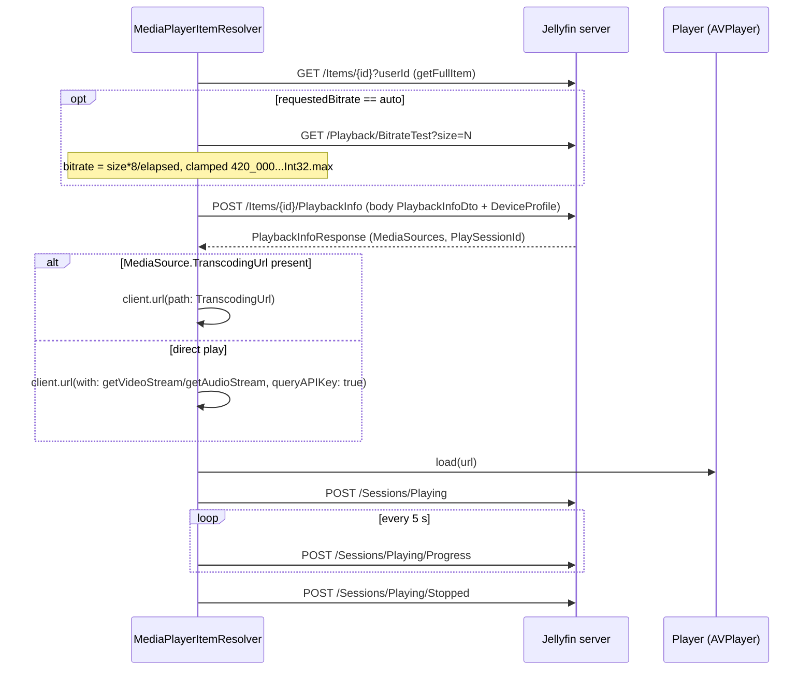

# 01 - Jellyfin endpoints used by Swiftfin

> **Jellyfin SDK source.** A citation `jellyfin-sdk-swift@3.3.0:PATH:LINE` points into [jellyfin/jellyfin-sdk-swift](https://github.com/jellyfin/jellyfin-sdk-swift) at tag `3.3.0` (commit `8ce10a167ad0b4145b2bc005acf8bebcfe6ebe46`). Open it as `https://github.com/jellyfin/jellyfin-sdk-swift/blob/8ce10a167ad0b4145b2bc005acf8bebcfe6ebe46/PATH#LLINE`; for a range `A-B`, use `#LA-LB`. There is no local copy of the SDK.

Scope: every Jellyfin server endpoint the client calls, with request templates, example requests, the response fields the app reads, call sites, error handling and the flows that use each one. The app has no VLC (a case-insensitive grep for `vlc` over `Shared/`, `Views/`, `Components/`, `Extensions/`, `Objects/`, `App/` and `Swiftfin tvOS/` finds zero hits); this spec covers the AVPlayer engine (`AVPlayerItem(url: item.url)` at Shared/Objects/MediaPlayerManager/Players/AVMediaPlayer.swift:107). Swiftfin also has a second, non-AVPlayer engine, which is out of scope (Shared/Objects/MediaPlayerManager/Players/MPVMediaPlayer.swift:18). HTTP is built by `jellyfin-sdk-swift@3.3.0` (`Paths.*`, `JellyfinClient`).

Related spec files: [00-INDEX.md](00-INDEX.md), [02-networking.md](02-networking.md), [03-auth-session.md](03-auth-session.md), [04-models.md](04-models.md), [05-playback.md](05-playback.md), [06-vlc.md](06-vlc.md) (player engines; AVPlayer, no VLC), [07-reporting.md](07-reporting.md), [08-images-subtitles-audio.md](08-images-subtitles-audio.md), [09-state-cache-persistence.md](09-state-cache-persistence.md), [10-errors-edge-cases.md](10-errors-edge-cases.md), [11-sequence-flows.md](11-sequence-flows.md), [12-gaps.md](12-gaps.md).

## How to read this file

- Citation format: app files are repo-relative (`Shared/Services/UserSession/UserSession.swift:42`); dependency files are `jellyfin-sdk-swift@3.3.0:Sources/...:LINE`. `tvOS` code lives under `Swiftfin tvOS/` (path contains a space; for example `Swiftfin tvOS/Objects/CinematicSelectionContentGroup.swift`, cited below).
- **Call sites** were produced mechanically (`endpoints-mechanical.json`: the SDK-usage grep) and by explorer agents. Each explorer-cited call site was checked: when the endpoint name appears within 30 lines of the cited line it is listed as a direct site; otherwise it is listed under "Indirect / entry-point sites". Exception: the image sections (getSplashscreen, getItemImage, getUserImage, getPluginImage) were re-verified by hand and list only lines that build that exact request. This paragraph describes the document's method, not application behaviour. All cited paths exist and all cited line numbers are within the file length (checked by script over this whole document).
- **Value-source citations inside tables** come from the explorer agents. Where an explorer wrote a bare line number such as `(167)`, it was resolved against that explorer entry's caller file and rewritten as `[file:167]`. These were range-checked by script and spot-sampled by hand; every trailing `[file:N]` value-source cite in the "Query parameters the app sets" tables was re-resolved (this is a process note, not a source claim): where line N did not contain the parameter assignment, it was replaced with the line of the real assignment (`parameters.<key> = ...` or `<key>:` init argument) in that same file, and cites that named a send call or an unrelated line were dropped or reworded. Rows that say "not set" or "not passed" cite the call site that builds the request. Parenthesised cites inside a cell are explorer-provided and were range-checked only. The conflict register lists the hand-checked disagreements.
- Parameter tables list the keys **the app actually sets** (union over all call sites, because one endpoint such as `GET /Items` is called from many places with different parameter sets), then list the SDK keys the app never sets. The **Required** column is the explorer judgement of whether the app always supplies the key; the Jellyfin SDK declares nearly every query key optional.
- **CONFLICT** marks places where explorers disagreed. Each one keeps both versions with citations unless the source settles it, in which case the source citation is given. The full list is in the Conflict register at the end.
- The app wire format for query keys is the SDK `asQuery` key (for example Swift `userID` becomes `userId`); see "Transport conventions".

## Transport conventions (apply to every request sent with `client.send` below)

| Aspect | Behaviour | Citation |
|---|---|---|
| Client construction | One `JellyfinClient` per `UserSession`, cached by `server.effectiveServerURL`; built with `.swiftfinConfiguration(url:accessToken:)`, `sessionConfiguration: .swiftfin`, and a network logging delegate. No client delegate is passed, so the SDK passthrough delegate has no inner delegate. | Shared/Services/UserSession/UserSession.swift:32-50 |
| Client identity | `client = "Swiftfin \(UIDevice.platform)"`; `deviceName = UIDevice.current.name` diacritic-folded and filtered to `CharacterSet.urlQueryAllowed` scalars; `deviceID = "\(UIDevice.platform)_\(UIDevice.vendorUUIDString)"`; `version = CFBundleShortVersionString` or `"0.0.1"`. | Shared/Extensions/JellyfinAPI/JellyfinClient.swift:21-29 |
| Auth header | Every request sent with `client.send` gets `Authorization: MediaBrowser DeviceId=<deviceID>, Device=<deviceName>, Client=<client>, Version=<version>[, Token=<accessToken>]`. Values are **unquoted**, joined by `", "`, built from a Swift `Dictionary`, so field order is unspecified; `Token` is present only when an access token is set. | jellyfin-sdk-swift@3.3.0:Sources/PassthroughAPIClientDelegate.swift:19-23, jellyfin-sdk-swift@3.3.0:Sources/PassthroughAPIClientDelegate.swift:48-64 |
| JSON | Decoder date strategy `.formatted(OpenISO8601DateFormatter)`; encoder uses the same formatter and `outputFormatting = .prettyPrinted`. Request bodies use the SDK entity coding keys (PascalCase, for example `PlaySessionId`). | jellyfin-sdk-swift@3.3.0:Sources/JellyfinClient.swift:49-58 |
| Query encoding | Built by SDK `URLQueryEncoder` (default `explode: true`): arrays become **repeated keys** (`fields=A&fields=B`); `Bool` becomes `true`/`false`; `nil` values are omitted; `Date` uses ISO-8601 by default. | jellyfin-sdk-swift@3.3.0:Sources/Extensions/URLQueryEncoder.swift:68, jellyfin-sdk-swift@3.3.0:Sources/Extensions/URLQueryEncoder.swift:124, jellyfin-sdk-swift@3.3.0:Sources/Extensions/URLQueryEncoder.swift:218-226, jellyfin-sdk-swift@3.3.0:Sources/Extensions/URLQueryEncoder.swift:179-181 |
| Success test | Any status outside `200..<300` throws an unacceptable-status-code error with `code`; there is no per-status handling in the SDK. | jellyfin-sdk-swift@3.3.0:Sources/PassthroughAPIClientDelegate.swift:29-37 |
| Retry | None. `shouldRetry` returns `false` when no inner delegate exists, and the app passes none. | jellyfin-sdk-swift@3.3.0:Sources/PassthroughAPIClientDelegate.swift:39-41 |
| Timeouts | `.swiftfin` session = `.default` with `timeoutIntervalForRequest = 20` (resource timeout left at default). The first-connect client in `ConnectToServerViewModel` passes **no** `sessionConfiguration`, so it uses the URLSession `.default` request timeout. The connection probe uses a copy of `.swiftfin` with request 8 s, resource 12 s, `waitsForConnectivity = false`. The trickplay/chapter downloader uses its own ephemeral session with request 20 s. A grep of app code for `timeoutInterval`/`waitsForConnectivity` finds only these five assignments, so no endpoint sets its own timeout. Per-endpoint `timeout`, `retry` and `cancellation` bullets below appear only where a call site adds something to these defaults. | Shared/Extensions/URLSessionConfiguration.swift:15-17, Shared/ViewModels/ConnectToServerViewModel.swift:75-78, Shared/Services/ServerConnectionManager.swift:74-77, Shared/Objects/MediaPlayerManager/PlaybackTemporaryFiles.swift:28-30 |
| Item-aware send | `UserSession.send(_:)` validates the item store, sends via `client.send`, validates again; for `BaseItemPatchProvider` responses it re-parses the raw JSON with `JSONSerialization` and merges patches into the item store. `ViewModel.send` forwards to `requireUserSession().send`. | Shared/Services/UserSession/UserSession+Items.swift:16-20 (public `send(_:)`, scope `.partial`), Shared/Services/UserSession/UserSession+Items.swift:41-61 (private `send(_:itemScope:)`), Shared/Services/UserSession/UserSession+Items.swift:63-67 (`Void` send), Shared/ViewModels/ViewModel.swift:63-69 |
| Building URLs without sending | `client.url(with: request, queryAPIKey:)` returns the server URL plus the request path and query, appending `ApiKey=<accessToken>` only when `queryAPIKey` is true; `client.url(path:)` appends a server-relative path (with its own query) to the configured server URL, keeping any base path. Images use `queryAPIKey` default false (no token). | jellyfin-sdk-swift@3.3.0:Sources/JellyfinClient.swift:254-274, jellyfin-sdk-swift@3.3.0:Sources/JellyfinClient.swift:285-311, Shared/Extensions/JellyfinAPI/BaseItemDto/BaseItemDto+Images.swift:54 |
| Image pipeline | The image loader uses `.swiftfin` configuration (20 s request timeout) and sends no `Authorization` header. | Shared/Extensions/Nuke/ImagePipeline.swift:71, Shared/Extensions/Nuke/ImagePipeline.swift:86 |

Example of the headers every `client.send` call carries (placeholders). URL-only requests (images, direct-play streams) and the trickplay/chapter downloader do not carry them: images and streams are only built with `client.url(with:)` and never sent through `client.send` (Shared/Extensions/JellyfinAPI/BaseItemDto/BaseItemDto+Images.swift:54, Shared/Objects/MediaPlayerManager/MediaPlayerItem/MediaPlayerItemResolver.swift:256, Shared/Objects/MediaPlayerManager/MediaPlayerItem/MediaPlayerItemResolver.swift:274), and the downloader builds a plain `URLRequest` whose only header is its own `Authorization` (Shared/Objects/MediaPlayerManager/PlaybackTemporaryFiles.swift:96-101). See their sections:

```http
GET /System/Info/Public HTTP/1.1
Host: <server>
Accept: application/json
Authorization: MediaBrowser DeviceId=iPhone_<vendorUUID>, Device=<deviceName>, Client=Swiftfin iPhone, Version=<CFBundleShortVersionString>, Token=<accessToken>
```

Token placement summary (what authenticates which kind of request):

| Request kind | Token carried as | Citation |
|---|---|---|
| All `client.send(...)` REST calls | `Authorization: MediaBrowser ... Token=<token>` header | jellyfin-sdk-swift@3.3.0:Sources/PassthroughAPIClientDelegate.swift:56-58 |
| Direct-play stream URLs (`/Videos/{id}/stream`, `/Audio/{id}/stream`) | `ApiKey=<token>` query item (URL handed to the player; no headers set by the app) | Shared/Objects/MediaPlayerManager/MediaPlayerItem/MediaPlayerItemResolver.swift:256, Shared/Objects/MediaPlayerManager/MediaPlayerItem/MediaPlayerItemResolver.swift:274 |
| Transcoding URL for local players | Whatever the server put in `TranscodingUrl`; the app appends nothing (see Part B) | Shared/Objects/MediaPlayerManager/MediaPlayerItem/MediaPlayerItemResolver.swift:229-236 |
| Transcoding URL for remote playback (`requiresHLS`) | `ApiKey=<token>` appended only if no `api_key`/`apikey` query item with a non-empty value exists | Shared/Objects/MediaPlayerManager/RemotePlaybackURL.swift:15-28 |
| Trickplay / chapter image downloads (`PlaybackTemporaryFiles`) | `Authorization: MediaBrowser Token="<token>"` (token field only, **quoted**) | Shared/Objects/MediaPlayerManager/PlaybackTemporaryFiles.swift:101 |
| Item / user / splash images via the image loader | none | Shared/Extensions/JellyfinAPI/BaseItemDto/BaseItemDto+Images.swift:54 |
| WebSocket | header `Authorization` plus query `ApiKey` and `deviceId` | jellyfin-sdk-swift@3.3.0:Sources/JellyfinClient.swift:316-336 (URL with `ApiKey`, `deviceId`); jellyfin-sdk-swift@3.3.0:Sources/JellyfinSocket/JellyfinSocket.swift:498-506 (`Authorization` header) |

## Endpoint index

122 REST endpoints from `Paths.*` (deduplicated by method + path), plus the SDK-composed and non-REST requests in Part B. Source of this table: `docs/jellyfin-spec/_work/endpoints-mechanical.json`, which has 122 entries with 122 distinct method + path pairs; the "Mechanical call sites" column is the length of each entry's `call_sites` array (checked by script against every row). It is a grep count, not a code line, so it is not cited per row.

| Group | Method | Path | SDK name | Mechanical call sites |
|---|---|---|---|---|
| A | GET | `/System/Info/Public` | [getPublicSystemInfo](#getPublicSystemInfo) | 4 |
| A | GET | `/Users/Me` | [getCurrentUser](#getCurrentUser) | 2 |
| A | GET | `/Users/Public` | [getPublicUsers](#getPublicUsers) | 1 |
| A | GET | `/QuickConnect/Enabled` | [getQuickConnectEnabled](#getQuickConnectEnabled) | 1 |
| A | POST | `/QuickConnect/Authorize` | [authorizeQuickConnect](#authorizeQuickConnect) | 1 |
| A | GET | `/Branding/Configuration` | [getBrandingOptions](#getBrandingOptions) | 1 |
| A | GET | `/Branding/Splashscreen` | [getSplashscreen](#getSplashscreen) | 1 |
| B | GET | `/Items/{itemID}` | [getItem](#getItem) | 1 |
| B | GET | `/Items` | [getItems](#getItems) | 10 |
| B | GET | `/Items/Latest` | [getLatestMedia](#getLatestMedia) | 1 |
| B | GET | `/UserItems/Resume` | [getResumeItems](#getResumeItems) | 2 |
| B | GET | `/Shows/NextUp` | [getNextUp](#getNextUp) | 2 |
| B | GET | `/Shows/{seriesID}/Episodes` | [getEpisodes](#getEpisodes) | 2 |
| B | GET | `/Shows/{seriesID}/Seasons` | [getSeasons](#getSeasons) | 1 |
| B | GET | `/Items/{itemID}/Similar` | [getSimilarItems](#getSimilarItems) | 1 |
| B | GET | `/Items/{itemID}/SpecialFeatures` | [getSpecialFeatures](#getSpecialFeatures) | 1 |
| B | GET | `/Items/{itemID}/LocalTrailers` | [getLocalTrailers](#getLocalTrailers) | 3 |
| B | GET | `/Videos/{itemID}/AdditionalParts` | [getAdditionalPart](#getAdditionalPart) | 1 |
| B | GET | `/UserViews` | [getUserViews](#getUserViews) | 2 |
| B | GET | `/Genres` | [getGenres](#getGenres) | 2 |
| B | GET | `/Studios` | [getStudios](#getStudios) | 1 |
| B | GET | `/Persons` | [getPersons](#getPersons) | 2 |
| B | GET | `/Items/Filters2` | [getQueryFilters](#getQueryFilters) | 1 |
| B | GET | `/Items/Filters` | [getQueryFiltersLegacy](#getQueryFiltersLegacy) | 2 |
| B | GET | `/Library/MediaFolders` | [getMediaFolders](#getMediaFolders) | 1 |
| B | POST | `/UserFavoriteItems/{itemID}` | [markFavoriteItem](#markFavoriteItem) | 1 |
| B | DELETE | `/UserFavoriteItems/{itemID}` | [unmarkFavoriteItem](#unmarkFavoriteItem) | 1 |
| B | POST | `/UserPlayedItems/{itemID}` | [markPlayedItem](#markPlayedItem) | 1 |
| B | DELETE | `/UserPlayedItems/{itemID}` | [markUnplayedItem](#markUnplayedItem) | 1 |
| C | POST | `/Items/{itemID}/PlaybackInfo` | [getPostedPlaybackInfo](#getPostedPlaybackInfo) | 1 |
| C | GET | `/Playback/BitrateTest` | [getBitrateTestBytes](#getBitrateTestBytes) | 1 |
| C | GET | `/Videos/{itemID}/stream` | [getVideoStream](#getVideoStream) | 1 |
| C | GET | `/Audio/{itemID}/stream` | [getAudioStream](#getAudioStream) | 1 |
| C | POST | `/LiveStreams/Close` | [closeLiveStream](#closeLiveStream) | 2 |
| C | POST | `/Sessions/Playing` | [reportPlaybackStart](#reportPlaybackStart) | 1 |
| C | POST | `/Sessions/Playing/Progress` | [reportPlaybackProgress](#reportPlaybackProgress) | 1 |
| C | POST | `/Sessions/Playing/Stopped` | [reportPlaybackStopped](#reportPlaybackStopped) | 1 |
| C | GET | `/MediaSegments/{itemID}` | [getItemSegments](#getItemSegments) | 1 |
| C | GET | `/Videos/{itemID}/Trickplay/{width}/{index}.jpg` | [getTrickplayTileImage](#getTrickplayTileImage) | 1 |
| D | GET | `/Items/{itemID}/Images/{imageType}` | [getItemImage](#getItemImage) | 3 |
| D | GET | `/UserImage` | [getUserImage](#getUserImage) | 1 |
| D | GET | `/Items/{itemID}/Images` | [getItemImageInfos](#getItemImageInfos) | 1 |
| D | GET | `/Items/{itemID}/RemoteImages/Providers` | [getRemoteImageProviders](#getRemoteImageProviders) | 1 |
| D | GET | `/Items/{itemID}/RemoteImages` | [getRemoteImages](#getRemoteImages) | 1 |
| D | POST | `/Items/{itemID}/RemoteImages/Download` | [downloadRemoteImage](#downloadRemoteImage) | 1 |
| D | POST | `/Items/{itemID}/Images/{imageType}` | [setItemImage](#setItemImage) | 1 |
| D | DELETE | `/Items/{itemID}/Images/{imageType}` | [deleteItemImage](#deleteItemImage) | 1 |
| D | DELETE | `/Items/{itemID}/Images/{imageType}/{imageIndex}` | [deleteItemImageByIndex](#deleteItemImageByIndex) | 1 |
| D | POST | `/UserImage` | [postUserImage](#postUserImage) | 1 |
| D | DELETE | `/UserImage` | [deleteUserImage](#deleteUserImage) | 1 |
| E | GET | `/Items/{itemID}/RemoteSearch/Subtitles/{language}` | [searchRemoteSubtitles](#searchRemoteSubtitles) | 1 |
| E | POST | `/Items/{itemID}/RemoteSearch/Subtitles/{subtitleID}` | [downloadRemoteSubtitles](#downloadRemoteSubtitles) | 1 |
| E | POST | `/Videos/{itemID}/Subtitles` | [uploadSubtitle](#uploadSubtitle) | 1 |
| E | DELETE | `/Videos/{itemID}/Subtitles/{index}` | [deleteSubtitle](#deleteSubtitle) | 1 |
| F | POST | `/Items/{itemID}` | [updateItem](#updateItem) | 2 |
| F | DELETE | `/Items/{itemID}` | [deleteItem](#deleteItem) | 1 |
| F | POST | `/Items/{itemID}/Refresh` | [refreshItem](#refreshItem) | 1 |
| F | POST | `/Items/RemoteSearch/Movie` | [getMovieRemoteSearchResults](#getMovieRemoteSearchResults) | 1 |
| F | POST | `/Items/RemoteSearch/Series` | [getSeriesRemoteSearchResults](#getSeriesRemoteSearchResults) | 1 |
| F | POST | `/Items/RemoteSearch/BoxSet` | [getBoxSetRemoteSearchResults](#getBoxSetRemoteSearchResults) | 1 |
| F | POST | `/Items/RemoteSearch/Person` | [getPersonRemoteSearchResults](#getPersonRemoteSearchResults) | 1 |
| F | POST | `/Items/RemoteSearch/Apply/{itemID}` | [applySearchCriteria](#applySearchCriteria) | 1 |
| F | GET | `/Localization/Countries` | [getCountries](#getCountries) | 1 |
| F | GET | `/Localization/Cultures` | [getCultures](#getCultures) | 1 |
| F | GET | `/Localization/ParentalRatings` | [getParentalRatings](#getParentalRatings) | 1 |
| G | GET | `/LiveTv/Channels` | [getLiveTvChannels](#getLiveTvChannels) | 1 |
| G | GET | `/LiveTv/Programs` | [getLiveTvPrograms](#getLiveTvPrograms) | 4 |
| G | GET | `/LiveTv/Programs/Recommended` | [getRecommendedPrograms](#getRecommendedPrograms) | 1 |
| G | GET | `/LiveTv/Programs/{programID}` | [getProgram](#getProgram) | 1 |
| G | GET | `/LiveTv/Recordings` | [getRecordings](#getRecordings) | 1 |
| G | GET | `/LiveTv/Timers` | [getTimers](#getTimers) | 1 |
| G | GET | `/LiveTv/Timers/{timerID}` | [getTimer](#getTimer) | 1 |
| G | GET | `/LiveTv/Timers/Defaults` | [getDefaultTimer](#getDefaultTimer) | 2 |
| G | POST | `/LiveTv/Timers` | [createTimer](#createTimer) | 1 |
| G | POST | `/LiveTv/Timers/{timerID}` | [updateTimer](#updateTimer) | 1 |
| G | DELETE | `/LiveTv/Timers/{timerID}` | [cancelTimer](#cancelTimer) | 1 |
| G | GET | `/LiveTv/SeriesTimers` | [getSeriesTimers](#getSeriesTimers) | 1 |
| G | GET | `/LiveTv/SeriesTimers/{timerID}` | [getSeriesTimer](#getSeriesTimer) | 1 |
| G | POST | `/LiveTv/SeriesTimers` | [createSeriesTimer](#createSeriesTimer) | 1 |
| G | POST | `/LiveTv/SeriesTimers/{timerID}` | [updateSeriesTimer](#updateSeriesTimer) | 1 |
| G | DELETE | `/LiveTv/SeriesTimers/{timerID}` | [cancelSeriesTimer](#cancelSeriesTimer) | 1 |
| H | GET | `/Sessions` | [getSessions](#getSessions) | 1 |
| H | POST | `/Sessions/{sessionID}/Command/{command}` | [sendGeneralCommand](#sendGeneralCommand) | 1 |
| H | POST | `/Sessions/{sessionID}/Message` | [sendMessageCommand](#sendMessageCommand) | 1 |
| H | POST | `/Sessions/{sessionID}/Playing` | [play](#play) | 1 |
| H | POST | `/Sessions/{sessionID}/Playing/{command}` | [sendPlaystateCommand](#sendPlaystateCommand) | 1 |
| H | GET | `/Devices` | [getDevices](#getDevices) | 1 |
| H | DELETE | `/Devices` | [deleteDevice](#deleteDevice) | 1 |
| H | POST | `/Devices/Options` | [updateDeviceOptions](#updateDeviceOptions) | 1 |
| I | GET | `/Users` | [getUsers](#getUsers) | 2 |
| I | GET | `/Users/{userID}` | [getUserByID](#getUserByID) | 3 |
| I | POST | `/Users/New` | [createUserByName](#createUserByName) | 1 |
| I | DELETE | `/Users/{userID}` | [deleteUser](#deleteUser) | 1 |
| I | POST | `/Users` | [updateUser](#updateUser) | 1 |
| I | POST | `/Users/{userID}/Policy` | [updateUserPolicy](#updateUserPolicy) | 1 |
| I | POST | `/Users/Configuration` | [updateUserConfiguration](#updateUserConfiguration) | 1 |
| I | POST | `/Users/Password` | [updateUserPassword](#updateUserPassword) | 1 |
| J | GET | `/Plugins` | [getPlugins](#getPlugins) | 2 |
| J | POST | `/Plugins/{pluginID}/Manifest` | [getPluginManifest](#getPluginManifest) | 1 |
| J | GET | `/Plugins/{pluginID}/{version}/Image` | [getPluginImage](#getPluginImage) | 1 |
| J | POST | `/Plugins/{pluginID}/{version}/Enable` | [enablePlugin](#enablePlugin) | 1 |
| J | POST | `/Plugins/{pluginID}/{version}/Disable` | [disablePlugin](#disablePlugin) | 1 |
| J | DELETE | `/Plugins/{pluginID}/{version}` | [uninstallPluginByVersion](#uninstallPluginByVersion) | 1 |
| J | GET | `/web/ConfigurationPages` | [getConfigurationPages](#getConfigurationPages) | 1 |
| J | GET | `/Packages` | [getPackages](#getPackages) | 1 |
| J | POST | `/Packages/Installed/{name}` | [installPackage](#installPackage) | 1 |
| J | GET | `/Repositories` | [getRepositories](#getRepositories) | 1 |
| J | POST | `/Repositories` | [setRepositories](#setRepositories) | 1 |
| K | GET | `/ScheduledTasks` | [getTasks](#getTasks) | 1 |
| K | POST | `/ScheduledTasks/Running/{taskID}` | [startTask](#startTask) | 1 |
| K | DELETE | `/ScheduledTasks/Running/{taskID}` | [stopTask](#stopTask) | 1 |
| K | POST | `/ScheduledTasks/{taskID}/Triggers` | [updateTask](#updateTask) | 1 |
| K | GET | `/System/ActivityLog/Entries` | [getLogEntries](#getLogEntries) | 1 |
| K | GET | `/System/Logs` | [getServerLogs](#getServerLogs) | 1 |
| K | GET | `/Backup` | [listBackups](#listBackups) | 1 |
| K | POST | `/Backup/Create` | [createBackup](#createBackup) | 1 |
| K | POST | `/Backup/Restore` | [startRestoreBackup](#startRestoreBackup) | 1 |
| K | GET | `/Auth/Keys` | [getKeys](#getKeys) | 1 |
| K | POST | `/Auth/Keys` | [createKey](#createKey) | 1 |
| K | DELETE | `/Auth/Keys/{key}` | [revokeKey](#revokeKey) | 1 |
| K | POST | `/System/Restart` | [restartApplication](#restartApplication) | 1 |
| K | POST | `/System/Shutdown` | [shutdownApplication](#shutdownApplication) | 1 |

# Part A - REST endpoints (`Paths.*`)

## A. Server, connection, auth and branding

<a id="getPublicSystemInfo"></a>
### `GET /System/Info/Public`  (`getPublicSystemInfo`)

- SDK request builder: `Paths.getPublicSystemInfo` at jellyfin-sdk-swift@3.3.0:Sources/Paths/GetPublicSystemInfoAPI.swift:14.
- Request body type (SDK): none. Response type (SDK): `Request<PublicSystemInfo>` (jellyfin-sdk-swift@3.3.0:Sources/Paths/GetPublicSystemInfoAPI.swift:14).

**Query parameters**: none (SDK defines none, jellyfin-sdk-swift@3.3.0:Sources/Paths/GetPublicSystemInfoAPI.swift:14).

**Headers**: `Authorization: MediaBrowser ...` injected by the SDK delegate on every request (see Transport conventions; jellyfin-sdk-swift@3.3.0:Sources/PassthroughAPIClientDelegate.swift:19-23). `Token` is present only on the reachability probe, which passes the user access token (Shared/Services/ServerConnectionManager.swift:79-86, :216). The add-server client and `ServerState.client` have no token (Shared/ViewModels/ConnectToServerViewModel.swift:75-78; Shared/SwiftfinStore/SwiftfinStore+ServerState.swift:29-35).

**Request body**: none.

**Example request** (placeholders; array values are sent as repeated keys, see Transport conventions)

```http
GET /System/Info/Public HTTP/1.1
Host: <server>
Accept: application/json
Authorization: MediaBrowser DeviceId=<deviceID>, Device=<deviceName>, Client=<client>, Version=<version>[, Token=<accessToken>]
```

**Response**: `PublicSystemInfo` (jellyfin-sdk-swift@3.3.0:Sources/Paths/GetPublicSystemInfoAPI.swift:14)

Fields the app reads: `serverName` and `id`, both required when adding a server (Shared/ViewModels/ConnectToServerViewModel.swift:82-87); `id`, which must equal the stored server id in the probe (Shared/Services/ServerConnectionManager.swift:91-93); `serverName` on refresh, falling back to the stored name (Shared/SwiftfinStore/SwiftfinStore+ServerState.swift:173); the whole value is stored as `StoredValues[.Server.publicInfo(id:)]` (Shared/SwiftfinStore/SwiftfinStore+ServerState.swift:184); `version`, read from that stored copy by `isVersionCompatible` (Shared/SwiftfinStore/SwiftfinStore+ServerState.swift:120-128).

**Error / status handling**: any status outside `200..<300` throws an unacceptable-status-code error (jellyfin-sdk-swift@3.3.0:Sources/PassthroughAPIClientDelegate.swift:33-35); no retry (jellyfin-sdk-swift@3.3.0:Sources/PassthroughAPIClientDelegate.swift:39-41).
  - non-2xx -> an unacceptable-status-code error (no actualDelegate; app passes none) jellyfin-sdk-swift@3.3.0:Sources/PassthroughAPIClientDelegate.swift:33 [Shared/Services/ServerConnectionManager.swift:88]
  - SDK default: non-2xx throws an unacceptable-status-code error (jellyfin-sdk-swift@3.3.0:Sources/PassthroughAPIClientDelegate.swift:33-35), when no actualDelegate is set [Shared/ViewModels/ConnectToServerViewModel.swift:80]
  - any error -> TestState.failure(error.localizedDescription); id mismatch throws ErrorMessage(L10n.connectionServerMismatch) [Shared/Services/ServerConnectionManager.swift:88]
  - 2xx only; others throw an unacceptable-status-code error (jellyfin-sdk-swift@3.3.0:Sources/PassthroughAPIClientDelegate.swift:33-35) [Shared/ViewModels/ConnectToServerViewModel.swift:80]
  - 2xx ok; any other code throws an unacceptable-status-code error(code); no per-code handling in app [Shared/Services/ServerConnectionManager.swift:88]
  - none; errors propagate (throws) [Shared/SwiftfinStore/SwiftfinStore+ServerState.swift:98]
  - 200..<300 accepted; anything else throws an unacceptable-status-code error(code) (no per-code handling here) [Shared/ViewModels/ConnectToServerViewModel.swift:80]
  - SDK: 200..<300 else an unacceptable-status-code error (jellyfin-sdk-swift@3.3.0:Sources/PassthroughAPIClientDelegate.swift:33-35) [Shared/ViewModels/ConnectToServerViewModel.swift:80]

- retry: none (shouldRetry -> false) jellyfin-sdk-swift@3.3.0:Sources/PassthroughAPIClientDelegate.swift:40 / none (PassthroughAPIClientDelegate.shouldRetry returns false with nil actualDelegate, jellyfin-sdk-swift@3.3.0:Sources/PassthroughAPIClientDelegate.swift:39-41; app never passes delegate)
- timeout: add-server client: no `sessionConfiguration` is passed (Shared/ViewModels/ConnectToServerViewModel.swift:75-78), so the SDK default `.default` applies (jellyfin-sdk-swift@3.3.0:Sources/JellyfinClient.swift:35) / reachability probe: copy of `.swiftfin` with request 8 s, resource 12 s, `waitsForConnectivity = false` (Shared/Services/ServerConnectionManager.swift:74-77) / `ServerState.client`: `.swiftfin`, request 20 s (Shared/SwiftfinStore/SwiftfinStore+ServerState.swift:32; Shared/Extensions/URLSessionConfiguration.swift:16)
- cancellation: ServerConnectionManager loops check Task.isCancelled (Shared/Services/ServerConnectionManager.swift:127); connect() action has .cancel transition to initial (Shared/ViewModels/ConnectToServerViewModel.swift:32)

**Call sites** (cited line is within 30 lines of `Paths.getPublicSystemInfo`/`getPublicSystemInfo(`, or taken from the mechanical SDK-usage table): `Shared/SwiftfinStore/SwiftfinStore+ServerState.swift:100`; `Shared/ViewModels/ConnectToServerViewModel.swift:80`; `Shared/ViewModels/ConnectToServerViewModel.swift:126`; `Shared/Services/ServerConnectionManager.swift:88`; `Shared/ViewModels/ConnectToServerViewModel.swift:136`; `Shared/SwiftfinStore/SwiftfinStore+ServerState.swift:98-104`; `Shared/SwiftfinStore/SwiftfinStore+ServerState.swift:172`; `Shared/SwiftfinStore/SwiftfinStore+ServerState.swift:98`; `Shared/SwiftfinStore/SwiftfinStore+ServerState.swift:100-101`

**Indirect / entry-point sites** (cited by explorers; the file and line exist but the endpoint name is not within 30 lines, so the site reaches the call through a helper): `Shared/Views/EditServerConnectionView.swift:176`; `Shared/Views/EditServerConnectionView.swift:248`

**Flows**: connection-probe, refresh-server-info, connect-to-server, Test connection button, server-connection-probe, server-info-refresh

**Notes**

- Path at jellyfin-sdk-swift@3.3.0:Sources/Paths/GetPublicSystemInfoAPI.swift:15. Server id mismatch -> ErrorMessage(L10n.connectionServerMismatch) (Shared/Services/ServerConnectionManager.swift:91-93). Probe client built with .swiftfinConfiguration(url: connection.url, accessToken:) (:79-86).
- Base URL is the user-typed URL, trimmed of whitespace, U+FFFC and '/', with 'http://' prepended if the input has no '://' (Shared/ViewModels/ConnectToServerViewModel.swift:59-62), then normalizedServerConnectionURL. Redirect detection: response.response.url compared on scheme and host; if different, Paths.getPublicSystemInfo.url suffix trimmed (:116-132). Duplicate check by id against StoredValues[.Server.servers] (:102-109). Saves servers and StoredValues[.Server.publicInfo(id:)] (:134-143).
- EditServerConnectionView.test -> ServerConnectionViewModel.testConnection (Shared/ViewModels/ServerConnectionViewModel.swift:125) -> ServerConnectionManager.test(connection:accessToken:matchingServerID: server.id). jellyfin-sdk-swift@3.3.0:Sources/Paths/GetPublicSystemInfoAPI.swift:14.
- Used for (1) adding a server (Shared/ViewModels/ConnectToServerViewModel.swift:80): requires serverName and id non-nil else logger.critical + ErrorMessage(L10n.unknownError) (Shared/ViewModels/ConnectToServerViewModel.swift:82-87); (2) the per-connection reachability probe (Shared/Services/ServerConnectionManager.swift:88), response id must equal stored server.id else ErrorMessage(L10n.connectionServerMismatch) (Shared/Services/ServerConnectionManager.swift:91-93); (3) `ServerState.getPublicSystemInfo` for save/refresh (Shared/SwiftfinStore/SwiftfinStore+ServerState.swift:98-104, 172). Result stored at StoredValues[.Server.publicInfo(id:)] (Shared/ViewModels/ConnectToServerViewModel.swift:142; Shared/SwiftfinStore/SwiftfinStore+ServerState.swift:184). isVersionCompatible compares publicInfo.version majorMinor >= client.version.majorMinor (Shared/SwiftfinStore/SwiftfinStore+ServerState.swift:120-128).
- ConnectToServerViewModel:126 uses Paths.getPublicSystemInfo.url?.absoluteString only to trim the suffix from a redirected response URL (processConnectionURL :116-132). URL scheme 'http://' prepended if no '://' (:62). Redirect detection compares scheme/host of response.response.url.
- Probe failure is logged at info and next candidate tried (Shared/Services/ServerConnectionManager.swift:136-144). Server id mismatch throws ErrorMessage(L10n.connectionServerMismatch) [Shared/Services/ServerConnectionManager.swift:91-93].
- Client built per access via ServerState.client (Shared/SwiftfinStore/SwiftfinStore+ServerState.swift:29-35) using URL effectiveServerURL (active ServerConnection url, else currentURL); unauthenticated (no accessToken). Result stored to StoredValues[.Server.publicInfo(id:)] and server name updated.
- ConnectToServer compares response.response.url scheme/host with the typed URL to detect redirects (Shared/ViewModels/ConnectToServerViewModel.swift:116-131).
- Goes through Paths.*, listed because each site builds a distinct JellyfinClient/session config. Connect input: trim whitespace, objectReplacement, '/' at both ends, 'http://' prepended if !contains('://') (Shared/ViewModels/ConnectToServerViewModel.swift:59-62); host must be non-nil; normalizedServerConnectionURL lowercases scheme+host and trims trailing '/' of path (Shared/Extensions/URL.swift:89-100). Redirect: if response URL scheme or host differs from input, new base = response URL string with Paths.getPublicSystemInfo.url?.absoluteString trimmed as suffix (Shared/ViewModels/ConnectToServerViewModel.swift:116-132). Probe: server id must equal expected else ErrorMessage(L10n.connectionServerMismatch) (Shared/Services/ServerConnectionManager.swift:91-93); token = userSession.user.accessToken (:216).

<a id="getCurrentUser"></a>
### `GET /Users/Me`  (`getCurrentUser`)

- SDK request builder: `Paths.getCurrentUser` at jellyfin-sdk-swift@3.3.0:Sources/Paths/GetCurrentUserAPI.swift:14.
- Request body type (SDK): none. Response type (SDK): `Request<UserDto>` (jellyfin-sdk-swift@3.3.0:Sources/Paths/GetCurrentUserAPI.swift:14).

**Query parameters**: none (SDK defines none, jellyfin-sdk-swift@3.3.0:Sources/Paths/GetCurrentUserAPI.swift:14).

**Headers**: `Authorization: MediaBrowser ...` injected by the SDK delegate on every request (see Transport conventions; jellyfin-sdk-swift@3.3.0:Sources/PassthroughAPIClientDelegate.swift:19-23).

**Request body**: none.

**Example request** (placeholders; array values are sent as repeated keys, see Transport conventions)

```http
GET /Users/Me HTTP/1.1
Host: <server>
Accept: application/json
Authorization: MediaBrowser DeviceId=<deviceID>, Device=<deviceName>, Client=<client>, Version=<version>, Token=<accessToken>
```

**Response**: `UserDto` (jellyfin-sdk-swift@3.3.0:Sources/Paths/GetCurrentUserAPI.swift:14)

Fields the app reads: `configuration.myMediaExcludes`, default `[]` (Shared/Objects/Libraries/UserViewLibrary.swift:43); `name`, falling back to the stored username (Shared/SwiftfinStore/SwiftinStore+UserState.swift:143); the whole `UserDto` is stored as `StoredValues[.User.data(id:)]` (Shared/SwiftfinStore/SwiftinStore+UserState.swift:152) after the users list is updated (Shared/SwiftfinStore/SwiftinStore+UserState.swift:151); `primaryImageTag` is later read from that stored copy for the profile image (Shared/SwiftfinStore/SwiftinStore+UserState.swift:163).

**Error / status handling**: any status outside `200..<300` throws an unacceptable-status-code error (jellyfin-sdk-swift@3.3.0:Sources/PassthroughAPIClientDelegate.swift:33-35); no retry (jellyfin-sdk-swift@3.3.0:Sources/PassthroughAPIClientDelegate.swift:39-41).
  - none here; errors propagate via throws [Shared/Objects/Libraries/UserViewLibrary.swift:41]
  - refresh path: the error is caught and logged at error level "Unable to refresh server and user information"; nothing else happens (Shared/Services/UserSession/UserSessionManager.swift:246-256)
  - no 401 handling: the catch does not inspect the status and does not sign out, so the user stays signed in (Shared/Services/UserSession/UserSessionManager.swift:251-256)
  - none; errors propagate [Shared/SwiftfinStore/SwiftinStore+UserState.swift:124]
  - 2xx else an unacceptable-status-code error [Shared/SwiftfinStore/SwiftinStore+UserState.swift:124-135]
  - 2xx else throw [Shared/SwiftfinStore/SwiftinStore+UserState.swift:131-134]

- retry: none; the refresh runs again only when `lastServerInformationRefreshDate` is older than 24 h (Shared/Services/UserSession/UserSessionManager.swift:242-243) or on explicit sign-in (Shared/Services/UserSession/UserSessionManager.swift:240-241)
- timeout: both clients use `.swiftfin`, request timeout 20 s (Shared/SwiftfinStore/SwiftinStore+UserState.swift:127; Shared/Services/UserSession/UserSession.swift:43; Shared/Extensions/URLSessionConfiguration.swift:16)
- cancellation: loop in PagingLibraryViewModel.loadPage checks Task.isCancelled; no per-request cancel (Shared/Objects/PagingLibrary/PagingLibraryViewModel.swift:348)

**Call sites** (cited line is within 30 lines of `Paths.getCurrentUser`/`getCurrentUser(`, or taken from the mechanical SDK-usage table): `Shared/SwiftfinStore/SwiftinStore+UserState.swift:131`; `Shared/Objects/Libraries/UserViewLibrary.swift:41`; `Shared/SwiftfinStore/SwiftinStore+UserState.swift:142`; `Shared/SwiftfinStore/SwiftinStore+UserState.swift:124`; `Shared/SwiftfinStore/SwiftinStore+UserState.swift:131-132`; `Shared/SwiftfinStore/SwiftinStore+UserState.swift:124-135`; `Shared/SwiftfinStore/SwiftinStore+UserState.swift:131-134`

**Indirect / entry-point sites** (cited by explorers; the file and line exist but the endpoint name is not within 30 lines, so the site reaches the call through a helper): `Shared/Services/UserSession/UserSessionManager.swift:247-248`

**Flows**: server-info-refresh, user-data-refresh, refresh-user-data, user-refresh

**Notes**

- Paths.getCurrentUser (static var). Only configuration.myMediaExcludes ([String]? -> JSON 'MyMediaExcludes', jellyfin-sdk-swift@3.3.0:Sources/Entities/UserConfiguration.swift:85) read, default []. Failure of either async let throws and fails the page. SDK path jellyfin-sdk-swift@3.3.0:Sources/Paths/GetCurrentUserAPI.swift:15.
- Run by UserSessionManager.refreshServerInformationIfNeeded after Public info refresh; failure logged 'Unable to refresh server and user information' and swallowed (Shared/Services/UserSession/UserSessionManager.swift:246-256). A 401 here is not treated as token invalidation.
- UserState.getUserData builds a fresh JellyfinClient with accessToken (:125-129). UserViewLibrary runs it concurrently with getUserViews (async let).
- This is the closest thing to token validation at startup, and it does not sign out on 401 (Shared/Services/UserSession/UserSessionManager.swift:246-256).
- `getUserData` builds a fresh `JellyfinClient` on `server.effectiveServerURL` with a network logging delegate (Shared/SwiftfinStore/SwiftinStore+UserState.swift:125-129); `updateUserData` is `@MainActor` (Shared/SwiftfinStore/SwiftinStore+UserState.swift:137).
- Builds a throwaway JellyfinClient with accessToken from keychain (Shared/SwiftfinStore/SwiftinStore+UserState.swift:126). updateUserData stores username (userData.name ?? old) and UserDto (Shared/SwiftfinStore/SwiftinStore+UserState.swift:138-153).
- Client built ad hoc: JellyfinClient(configuration: .swiftfinConfiguration(url: server.effectiveServerURL, accessToken: accessToken), sessionConfiguration: .swiftfin, sessionDelegate: <network logging delegate>) at :125-129. effectiveServerURL = activeServerConnection?.url ?? currentURL (Shared/SwiftfinStore/SwiftfinStore+ServerState.swift:85-87).

<a id="getPublicUsers"></a>
### `GET /Users/Public`  (`getPublicUsers`)

- SDK request builder: `Paths.getPublicUsers` at jellyfin-sdk-swift@3.3.0:Sources/Paths/GetPublicUsersAPI.swift:14.
- Request body type (SDK): none. Response type (SDK): `Request<[UserDto]>` (jellyfin-sdk-swift@3.3.0:Sources/Paths/GetPublicUsersAPI.swift:14).

**Query parameters**: none (SDK defines none, jellyfin-sdk-swift@3.3.0:Sources/Paths/GetPublicUsersAPI.swift:14).

**Headers**: `Authorization: MediaBrowser ...` injected by the SDK delegate on every request (see Transport conventions; jellyfin-sdk-swift@3.3.0:Sources/PassthroughAPIClientDelegate.swift:19-23). Sent with `server.client` (Shared/ViewModels/UserSignInViewModel.swift:274), which has no access token (Shared/SwiftfinStore/SwiftfinStore+ServerState.swift:29-35), so the header has no `Token` field (jellyfin-sdk-swift@3.3.0:Sources/PassthroughAPIClientDelegate.swift:56-58).

**Request body**: none.

**Example request** (placeholders; array values are sent as repeated keys, see Transport conventions)

```http
GET /Users/Public HTTP/1.1
Host: <server>
Accept: application/json
Authorization: MediaBrowser DeviceId=<deviceID>, Device=<deviceName>, Client=<client>, Version=<version>
```

**Response**: `[UserDto]` (jellyfin-sdk-swift@3.3.0:Sources/Paths/GetPublicUsersAPI.swift:14)

Fields the app reads: the whole `[UserDto]` is returned as the public user list (Shared/ViewModels/UserSignInViewModel.swift:274-276, :113).

**Error / status handling**: any status outside `200..<300` throws an unacceptable-status-code error (jellyfin-sdk-swift@3.3.0:Sources/PassthroughAPIClientDelegate.swift:33-35); no retry (jellyfin-sdk-swift@3.3.0:Sources/PassthroughAPIClientDelegate.swift:39-41).
  - none [Shared/ViewModels/UserSignInViewModel.swift:273]
  - 2xx only [Shared/ViewModels/UserSignInViewModel.swift:273]


**Call sites** (cited line is within 30 lines of `Paths.getPublicUsers`/`getPublicUsers(`, or taken from the mechanical SDK-usage table): `Shared/ViewModels/UserSignInViewModel.swift:273`; `Shared/ViewModels/UserSignInViewModel.swift:273-276`

**Flows**: sign-in-public-data

**Notes**

- Run concurrently with branding and quickconnect-enabled via async let (Shared/ViewModels/UserSignInViewModel.swift:108-110); any failure fails the action.
- Fetched in parallel with Branding/Configuration and QuickConnect/Enabled via async let; any throw fails the whole getPublicData (Shared/ViewModels/UserSignInViewModel.swift:108-114). Uses server.client (no token).

<a id="getQuickConnectEnabled"></a>
### `GET /QuickConnect/Enabled`  (`getQuickConnectEnabled`)

- SDK request builder: `Paths.getQuickConnectEnabled` at jellyfin-sdk-swift@3.3.0:Sources/Paths/GetQuickConnectEnabledAPI.swift:14.
- Request body type (SDK): none. Response type (SDK): `Request<Data>` (jellyfin-sdk-swift@3.3.0:Sources/Paths/GetQuickConnectEnabledAPI.swift:14).

**Query parameters**: none (SDK defines none, jellyfin-sdk-swift@3.3.0:Sources/Paths/GetQuickConnectEnabledAPI.swift:14).

**Headers**: `Authorization: MediaBrowser ...` injected by the SDK delegate on every request (see Transport conventions; jellyfin-sdk-swift@3.3.0:Sources/PassthroughAPIClientDelegate.swift:19-23). Sent with `server.client` (Shared/ViewModels/UserSignInViewModel.swift:290), which has no access token (Shared/SwiftfinStore/SwiftfinStore+ServerState.swift:29-35), so the header has no `Token` field (jellyfin-sdk-swift@3.3.0:Sources/PassthroughAPIClientDelegate.swift:56-58).

**Request body**: none.

**Example request** (placeholders; array values are sent as repeated keys, see Transport conventions)

```http
GET /QuickConnect/Enabled HTTP/1.1
Host: <server>
Accept: application/json
Authorization: MediaBrowser DeviceId=<deviceID>, Device=<deviceName>, Client=<client>, Version=<version>
```

**Response**: `Data` (jellyfin-sdk-swift@3.3.0:Sources/Paths/GetQuickConnectEnabledAPI.swift:14); the app decodes the raw body as `Bool` with `try?`, and a decode failure means false (Shared/ViewModels/UserSignInViewModel.swift:292-293)

Fields the app reads: the raw body is decoded as `Bool` with `try? JSONDecoder()`, and a decode failure means false (Shared/ViewModels/UserSignInViewModel.swift:290-293).

**Error / status handling**: any status outside `200..<300` throws an unacceptable-status-code error (jellyfin-sdk-swift@3.3.0:Sources/PassthroughAPIClientDelegate.swift:33-35); no retry (jellyfin-sdk-swift@3.3.0:Sources/PassthroughAPIClientDelegate.swift:39-41).
  - none [Shared/ViewModels/UserSignInViewModel.swift:289]
  - 2xx only [Shared/ViewModels/UserSignInViewModel.swift:290]


**Call sites** (cited line is within 30 lines of `Paths.getQuickConnectEnabled`/`getQuickConnectEnabled(`, or taken from the mechanical SDK-usage table): `Shared/ViewModels/UserSignInViewModel.swift:289`; `Shared/ViewModels/UserSignInViewModel.swift:289-293`; `Shared/ViewModels/UserSignInViewModel.swift:290`

**Flows**: sign-in-public-data

**Notes**

- try? decode; failure becomes false (Shared/ViewModels/UserSignInViewModel.swift:292-293).
- try? JSONDecoder().decode(Bool.self) ?? false (Shared/ViewModels/UserSignInViewModel.swift:292-293). Gates the Quick Connect button (Shared/Views/UserSignInView.swift:195).

<a id="authorizeQuickConnect"></a>
### `POST /QuickConnect/Authorize`  (`authorizeQuickConnect`)

- SDK request builder: `Paths.authorizeQuickConnect` at jellyfin-sdk-swift@3.3.0:Sources/Paths/AuthorizeQuickConnectAPI.swift:14.
- Request body type (SDK): none. Response type (SDK): `Data` (jellyfin-sdk-swift@3.3.0:Sources/Paths/AuthorizeQuickConnectAPI.swift:14).

**Query parameters the app sets** (union across call sites; SDK key names)

| Key | Type | Required | Default | Source of value (call site) |
|---|---|---|---|---|
| `code` | String | True | - | action authorize(code:) argument; no trimming [Shared/ViewModels/QuickConnectAuthorizeViewModel.swift:55] / user-typed code, @State code in QuickConnectAuthorizeView, truncated to 6 chars via .onChange (Views/QuickConnectAuthorizeView.swift:119-121); authorize button enabled only if code.count == 6 (Views/QuickConnectAuthorizeView.swift:110) [Shared/ViewModels/QuickConnectAuthorizeViewModel.swift:55] / user-entered code [Shared/ViewModels/QuickConnectAuthorizeViewModel.swift:55] / user-typed code passed to _authorize(code) [Shared/ViewModels/QuickConnectAuthorizeViewModel.swift:55] / user-entered code [Shared/ViewModels/QuickConnectAuthorizeViewModel.swift:55] |
| `userId` | String?, String | False | - | user.id of the view model's UserDto (:50-55) [Shared/ViewModels/QuickConnectAuthorizeViewModel.swift:55] / QuickConnectAuthorizeViewModel.user.id (UserDto passed to init; origin: userSession.user.data from Shared/Views/SettingsView/LocalUserSettings/LocalUserSettingsView.swift:64) [Shared/ViewModels/QuickConnectAuthorizeViewModel.swift:55] / UserDto.id of viewModel.user (Shared/ViewModels/QuickConnectAuthorizeViewModel.swift:50-55) [Shared/ViewModels/QuickConnectAuthorizeViewModel.swift:55] / user.id of the UserDto the view model was built with (Shared/ViewModels/QuickConnectAuthorizeViewModel.swift:50) [Shared/ViewModels/QuickConnectAuthorizeViewModel.swift:55] / user.id (nil throws ErrorMessage(L10n.unknownError)) [Shared/ViewModels/QuickConnectAuthorizeViewModel.swift:55] |

**Headers**: `Authorization: MediaBrowser ...` injected by the SDK delegate on every request (see Transport conventions; jellyfin-sdk-swift@3.3.0:Sources/PassthroughAPIClientDelegate.swift:19-23).

**Request body**: none.

**Example request** (placeholders; array values are sent as repeated keys, see Transport conventions)

```http
POST /QuickConnect/Authorize?code=<code>&userId=<userId> HTTP/1.1
Host: <server>
Accept: application/json
Authorization: MediaBrowser DeviceId=<deviceID>, Device=<deviceName>, Client=<client>, Version=<version>, Token=<accessToken>
```

**Response**: `Data` (jellyfin-sdk-swift@3.3.0:Sources/Paths/AuthorizeQuickConnectAPI.swift:14); the app decodes the raw body as `Bool` with `try?`, and a decode failure means false (Shared/ViewModels/QuickConnectAuthorizeViewModel.swift:58-59)

Fields the app reads: the raw body is decoded as `Bool` with `try?`, a decode failure means false, and false throws `ErrorMessage("Authorization unsuccessful")` (Shared/ViewModels/QuickConnectAuthorizeViewModel.swift:58-63).

**Error / status handling**: any status outside `200..<300` throws an unacceptable-status-code error (jellyfin-sdk-swift@3.3.0:Sources/PassthroughAPIClientDelegate.swift:33-35); no retry (jellyfin-sdk-swift@3.3.0:Sources/PassthroughAPIClientDelegate.swift:39-41).
  - none specific; non-true -> ErrorMessage('Authorization unsuccessful') (hardcoded English) [Shared/ViewModels/QuickConnectAuthorizeViewModel.swift:61-63]
  - non-decodable or false body -> ErrorMessage("Authorization unsuccessful") [Shared/ViewModels/QuickConnectAuthorizeViewModel.swift:58-63]; nil user.id -> logger.critical + ErrorMessage(L10n.unknownError) [Shared/ViewModels/QuickConnectAuthorizeViewModel.swift:50-53]
  - false/decode failure -> ErrorMessage("Authorization unsuccessful") [Shared/ViewModels/QuickConnectAuthorizeViewModel.swift:58-63]
  - non-2xx throws from the send [Shared/ViewModels/QuickConnectAuthorizeViewModel.swift:56]; decode failure or false throws ErrorMessage("Authorization unsuccessful") [Shared/ViewModels/QuickConnectAuthorizeViewModel.swift:58-63]

- cancellation: Cancel button calls viewModel.cancel() (transition .to(.initial)) then focuses code field (Views/QuickConnectAuthorizeView.swift:77-80); state loop(.authorizing)

**Call sites** (cited line is within 30 lines of `Paths.authorizeQuickConnect`/`authorizeQuickConnect(`, or taken from the mechanical SDK-usage table): `Shared/ViewModels/QuickConnectAuthorizeViewModel.swift:55`; `Shared/ViewModels/QuickConnectAuthorizeViewModel.swift:55-59`; `jellyfin-sdk-swift@3.3.0:Sources/Paths/AuthorizeQuickConnectAPI.swift:13-18`; `Shared/ViewModels/QuickConnectAuthorizeViewModel.swift:55-63`; `Shared/ViewModels/QuickConnectAuthorizeViewModel.swift:56`

**Indirect / entry-point sites** (cited by explorers; the file and line exist but the endpoint name is not within 30 lines, so the site reaches the call through a helper): `Views/QuickConnectAuthorizeView.swift:95`

**Flows**: quickconnect-authorize, Quick Connect authorize (authorize another device), quick-connect-authorize

**Notes**

- SDK: jellyfin-sdk-swift@3.3.0:Sources/Paths/AuthorizeQuickConnectAPI.swift:14. Decode failure means false (Shared/ViewModels/QuickConnectAuthorizeViewModel.swift:59). nil user.id logs critical, throws unknownError (Shared/ViewModels/QuickConnectAuthorizeViewModel.swift:50-53).
- Request<Data> so app decodes Bool manually: (try? decoder.decode(Bool.self, from: response.value)) ?? false (Shared/ViewModels/QuickConnectAuthorizeViewModel.swift:58-59). On success events .authorized -> success haptic + alert L10n.quickConnectSuccessMessage; dismiss closes route (Views/QuickConnectAuthorizeView.swift:122-146). Entry is iOS-only ChevronButton(L10n.quickConnect) in LocalUserSettingsView (Shared/Views/SettingsView/LocalUserSettings/LocalUserSettingsView.swift:63, inside the `#if os(iOS)` block at :28-72).
- Authorizes another device's code. nil user.id -> logger.critical + unknownError [Shared/ViewModels/QuickConnectAuthorizeViewModel.swift:50-53].
- Decode at Shared/ViewModels/QuickConnectAuthorizeViewModel.swift:58-59.
- Alert via .errorMessage (Views/QuickConnectAuthorizeView.swift:147).

<a id="getBrandingOptions"></a>
### `GET /Branding/Configuration`  (`getBrandingOptions`)

- SDK request builder: `Paths.getBrandingOptions` at jellyfin-sdk-swift@3.3.0:Sources/Paths/GetBrandingOptionsAPI.swift:14.
- Request body type (SDK): none. Response type (SDK): `Request<BrandingOptionsDto>` (jellyfin-sdk-swift@3.3.0:Sources/Paths/GetBrandingOptionsAPI.swift:14).

**Query parameters**: none (SDK defines none, jellyfin-sdk-swift@3.3.0:Sources/Paths/GetBrandingOptionsAPI.swift:14).

**Headers**: `Authorization: MediaBrowser ...` injected by the SDK delegate on every request (see Transport conventions; jellyfin-sdk-swift@3.3.0:Sources/PassthroughAPIClientDelegate.swift:19-23). Sent with `server.client` (Shared/ViewModels/UserSignInViewModel.swift:281), which has no access token (Shared/SwiftfinStore/SwiftfinStore+ServerState.swift:29-35), so the header has no `Token` field (jellyfin-sdk-swift@3.3.0:Sources/PassthroughAPIClientDelegate.swift:56-58).

**Request body**: none.

**Example request** (placeholders; array values are sent as repeated keys, see Transport conventions)

```http
GET /Branding/Configuration HTTP/1.1
Host: <server>
Accept: application/json
Authorization: MediaBrowser DeviceId=<deviceID>, Device=<deviceName>, Client=<client>, Version=<version>
```

**Response**: `BrandingOptionsDto` (jellyfin-sdk-swift@3.3.0:Sources/Paths/GetBrandingOptionsAPI.swift:14)

Fields the app reads: `loginDisclaimer`, used only when non-empty, else nil (Shared/ViewModels/UserSignInViewModel.swift:283-285).

**Error / status handling**: any status outside `200..<300` throws an unacceptable-status-code error (jellyfin-sdk-swift@3.3.0:Sources/PassthroughAPIClientDelegate.swift:33-35); no retry (jellyfin-sdk-swift@3.3.0:Sources/PassthroughAPIClientDelegate.swift:39-41).
  - none [Shared/ViewModels/UserSignInViewModel.swift:280]
  - 2xx only [Shared/ViewModels/UserSignInViewModel.swift:280]


**Call sites** (cited line is within 30 lines of `Paths.getBrandingOptions`/`getBrandingOptions(`, or taken from the mechanical SDK-usage table): `Shared/ViewModels/UserSignInViewModel.swift:280`

**Flows**: sign-in-public-data

**Notes**

- Empty or nil disclaimer yields nil (Shared/ViewModels/UserSignInViewModel.swift:283-285).
- loginDisclaimer used only if non-empty else nil (Shared/ViewModels/UserSignInViewModel.swift:283-285).
- Sent with `server.client` (Shared/ViewModels/UserSignInViewModel.swift:281), which is built without an access token (Shared/SwiftfinStore/SwiftfinStore+ServerState.swift:29-35).

<a id="getSplashscreen"></a>
### `GET /Branding/Splashscreen`  (`getSplashscreen`)

- SDK request builder: `Paths.getSplashscreen` at jellyfin-sdk-swift@3.3.0:Sources/Paths/GetSplashscreenAPI.swift:14.
- Request body type (SDK): none. Response type (SDK): `Data` (jellyfin-sdk-swift@3.3.0:Sources/Paths/GetSplashscreenAPI.swift:14).

**Path parameters**: none (path literal `/Branding/Splashscreen`, jellyfin-sdk-swift@3.3.0:Sources/Paths/GetSplashscreenAPI.swift:15).

**Query parameters the app sets**: none. `Paths.getSplashscreen()` is called with no arguments (Shared/SwiftfinStore/SwiftfinStore+ServerState.swift:146), so the SDK keys `tag` and `format` are omitted (jellyfin-sdk-swift@3.3.0:Sources/Paths/GetSplashscreenAPI.swift:14-22).

**Headers**: none set by the app, and no SDK headers. The app only builds the URL with `client.url(with: Paths.getSplashscreen())` (Shared/SwiftfinStore/SwiftfinStore+ServerState.swift:145-147); the request never goes through `JellyfinClient.send`, so the SDK `Authorization` header is not added. The image loader fetches the URL with `.swiftfin` configuration and a network logging delegate only (Shared/Extensions/Nuke/ImagePipeline.swift:85-92). The app sets request headers in only three places, none of them on this path (Shared/ViewModels/ImageViewModel/ItemImageViewModel.swift:118, Shared/ViewModels/ImageViewModel/UserImageViewModel.swift:66, Shared/Objects/MediaPlayerManager/PlaybackTemporaryFiles.swift:101).

**Request body**: none.

**Example request** (placeholders; array values are sent as repeated keys, see Transport conventions)

```http
GET /Branding/Splashscreen HTTP/1.1
Host: <server>
```

**Response**: SDK type `Request<Data>` (jellyfin-sdk-swift@3.3.0:Sources/Paths/GetSplashscreenAPI.swift:14); the app never sends it, it only builds the URL for the image loader (Shared/SwiftfinStore/SwiftfinStore+ServerState.swift:145-147).

**Error / status handling**: no SDK status validation, because the request is not sent by `JellyfinClient` (Shared/SwiftfinStore/SwiftfinStore+ServerState.swift:145-147). On an image load error the image view drops the current source and tries the next one (Shared/Components/ImageView.swift:39-43).

- timeout: 20s via URLSessionConfiguration.swiftfin (Shared/Extensions/Nuke/ImagePipeline.swift:70-72,85-87) / timeoutIntervalForRequest = 20 (Shared/Extensions/URLSessionConfiguration.swift:15-17)

**Call sites** (each cited line is a `Paths.getSplashscreen(` call or the `client.url(with:)` of the request it builds; checked by reading each line): `Shared/SwiftfinStore/SwiftfinStore+ServerState.swift:146`

**Indirect / entry-point sites** (cited by explorers; the file and line exist but the endpoint name is not within 30 lines, so the site reaches the call through a helper): `Shared/Views/UserSignInView.swift:316`; `Shared/Views/SelectUserView/SelectUserView.swift:83`; `Shared/Extensions/Nuke/DataCache.swift:51-59`

**Flows**: select-user-splash, splashscreen, image-pipeline, images

**Notes**

- The call is `Paths.getSplashscreen()` with no arguments, and only the URL is built (Shared/SwiftfinStore/SwiftfinStore+ServerState.swift:146).
- tag and format params exist in SDK but are not passed; client built from ServerState.client with NO access token (Shared/SwiftfinStore/SwiftfinStore+ServerState.swift:29-35). Cached in the local image data cache keyed '<serverID>-splashscreen'.sha1 (Shared/Extensions/Nuke/DataCache.swift:51-60), a Documents/Caches/org.jellyfin.swiftfin.local directory (Shared/Extensions/Nuke/DataCache.swift:40-44). Select-user view shuffles sources and uses the local image pipeline (Shared/Views/SelectUserView/SelectUserView.swift:167-168).
- URL built with server's own JellyfinClient (ServerState.client, Shared/SwiftfinStore/SwiftfinStore+ServerState.swift:31-32, unauthenticated .swiftfinConfiguration(url: effectiveServerURL)). Sent with no query string at all. SDK: jellyfin-sdk-swift@3.3.0:Sources/Paths/GetSplashscreenAPI.swift:15.
- Cache-key logic matches on url.path containing 'Splashscreen' and trims suffix '/Branding/Splashscreen?' (Shared/Extensions/Nuke/DataCache.swift:51-54). Path literal is from that trimming string; verb/other params not read.
- client.url(with:) nil => ImageSource nil (Shared/Extensions/JellyfinAPI/BaseItemDto/BaseItemDto+Images.swift:54). It returns configuration.url (server root) when request.url?.path is nil (jellyfin-sdk-swift@3.3.0:Sources/JellyfinClient.swift:256). Shared/ViewModels/AdminDashboard/Plugins/PluginDetailsViewModel+Poster.swift:42 also loads third-party package?.imageURL via same pipeline. Cache key strips maxWidth, = sha1(path+query)+'-'+maxWidth (Shared/Extensions/Nuke/ImagePipeline.swift:19-39); pathAndQuery = path + (query ?? '') with no '?' (Shared/Extensions/URL.swift:71-73).

## B. Library browsing and item data

<a id="getItem"></a>
### `GET /Items/{itemID}`  (`getItem`)

- SDK request builder: `Paths.getItem` at jellyfin-sdk-swift@3.3.0:Sources/Paths/GetItemAPI.swift:14.
- Request body type (SDK): none. Response type (SDK): `BaseItemDto` (jellyfin-sdk-swift@3.3.0:Sources/Paths/GetItemAPI.swift:14).

**Path parameters**

| Param | Type | Source of value (call site) |
|---|---|---|
| `itemID` | String | `id` argument of `getFullItem(id:occurrence:)`, rejected with `ItemStore.StoreError.invalidItemID` when nil or blank (Shared/Services/UserSession/UserSession+Items.swift:28, :31). Callers pass `item.id` (Shared/Services/UserSession/UserSession+Items.swift:22-23) or `log.itemID` from the activity entry (Shared/ViewModels/AdminDashboard/ServerActivityDetailViewModel.swift:57, :69). |

**Query parameters the app sets** (union across call sites; SDK key names)

| Key | Type | Required | Default | Source of value (call site) |
|---|---|---|---|---|
| `userId` | String? | True | - | `user.id` of the `UserSession` (Shared/Services/UserSession/UserSession+Items.swift:31); the activity detail reaches it via `userSession.getFullItem(id:)` (Shared/ViewModels/AdminDashboard/ServerActivityDetailViewModel.swift:69) |

**Headers**: `Authorization: MediaBrowser ...` injected by the SDK delegate on every request (see Transport conventions; jellyfin-sdk-swift@3.3.0:Sources/PassthroughAPIClientDelegate.swift:19-23).

**Request body**: none.

**Example request** (placeholders; array values are sent as repeated keys, see Transport conventions)

```http
GET /Items/<itemID>?userId=<userId> HTTP/1.1
Host: <server>
Accept: application/json
Authorization: MediaBrowser DeviceId=<deviceID>, Device=<deviceName>, Client=<client>, Version=<version>, Token=<accessToken>
```

**Response**: `BaseItemDto`; `BaseItemDto (patched into ItemStore with scope .fullItem)`; BaseItemDto (also raw JSON parsed via JSONSerialization for patches); BaseItemDto -> merged into ItemStore as .fullItem scope (Shared/Services/UserSession/UserSession+Items.swift:31,41-60); BaseItemDto (also JSONSerialization-parsed into patches when it conforms to BaseItemPatchProvider)

Fields the app reads: the whole response is re-parsed with `JSONSerialization` and merged into the item store with scope `.fullItem` (Shared/Services/UserSession/UserSession+Items.swift:32, Shared/Services/UserSession/UserSession+Items.swift:51-54); the first merged record must have a value, else `itemUnavailable` (Shared/Services/UserSession/UserSession+Items.swift:34-36); `playlistItemID` (Shared/Services/UserSession/UserSession+Items.swift:38); `mediaSources[].id` (Shared/Services/UserSession/UserSessionManager+SocketCommands.swift:198); `remoteTrailers[].url` (Shared/Services/UserSession/UserSessionManager+SocketCommands.swift:245).

**Error / status handling**: any status outside `200..<300` throws an unacceptable-status-code error (jellyfin-sdk-swift@3.3.0:Sources/PassthroughAPIClientDelegate.swift:33-35); no retry (jellyfin-sdk-swift@3.3.0:Sources/PassthroughAPIClientDelegate.swift:39-41).
  - throws ItemStore.StoreError.invalidItemID if id blank; .itemUnavailable if no record [Shared/ViewModels/AdminDashboard/ServerActivityDetailViewModel.swift:69]
  - non-2xx throws; invalid id -> ItemStore.StoreError.invalidItemID; no record -> itemUnavailable [Shared/Services/UserSession/UserSession+Items.swift:31]
  - blank id -> ItemStore.StoreError.invalidItemID (:28); no record/value -> StoreError.itemUnavailable (:34-36) [Shared/Services/UserSession/UserSession+Items.swift:31]
  - throws ItemStore.StoreError.invalidItemID / .itemUnavailable [Shared/Services/UserSession/UserSession+Items.swift:31]
  - error logged at debug: "Unable to refresh current program: ..." unless cancelled [Shared/Objects/MediaPlayerManager/NowPlayable/NowPlayableObserver.swift:258-262]
  - 2xx; empty merge result throws ItemStore.StoreError.itemUnavailable (Shared/Services/UserSession/UserSession+Items.swift:34-36) [Shared/Services/UserSession/UserSession+Items.swift:27-39]

- retry: Loop: repeats forever while task alive. Delay = max(endDate.timeIntervalSinceNow + 1, minimumDelay) where minimumDelay is 1 s before first refresh and 30 s after; if no endDate, 30 s [Shared/Objects/MediaPlayerManager/NowPlayable/NowPlayableObserver.swift:245-246].
- cancellation: items.validate() before/after at Shared/ViewModels/AdminDashboard/ServerActivityDetailViewModel.swift:56,61 / items.validate() before/after send (Shared/Services/UserSession/UserSession+Items.swift:45,48) / programRefreshTask cancelled by stop() and item change [Shared/Objects/MediaPlayerManager/NowPlayable/NowPlayableObserver.swift:150-151, Shared/Objects/MediaPlayerManager/NowPlayable/NowPlayableObserver.swift:389]; Task.sleep failure returns [Shared/Objects/MediaPlayerManager/NowPlayable/NowPlayableObserver.swift:248-252]

**Call sites** (cited line is within 30 lines of `Paths.getItem`/`getItem(`, or taken from the mechanical SDK-usage table): `Shared/Services/UserSession/UserSession+Items.swift:31`; `Shared/ViewModels/AdminDashboard/ServerActivityDetailViewModel.swift:69`; `Shared/Services/UserSession/UserSession+Items.swift:32`; `Shared/Services/UserSession/UserSession+Items.swift:31-32`; `Shared/Services/UserSession/UserSession+Items.swift:27-39`

**Indirect / entry-point sites** (cited by explorers; the file and line exist but the endpoint name is not within 30 lines, so the site reaches the call through a helper): `Shared/Services/UserSession/UserSession+ItemChanges.swift:46`; `Shared/Services/UserSession/UserSessionManager+SocketCommands.swift:196`; `Shared/Services/UserSession/UserSessionManager+SocketCommands.swift:244`; `Shared/Views/ItemContentGroupView/ItemContentGroupProvider.swift:79`; `Shared/Views/ItemContentGroupView/ItemContentGroupProvider.swift:369`; `Shared/Objects/MediaPlayerManager/NowPlayable/NowPlayableObserver.swift:238-267`; `Shared/Objects/MediaPlayerManager/NowPlayable/NowPlayableObserver.swift:257`

**Flows**: activity-detail, server-activity, item-fetch, socket-play-command, library-changed-refresh, makeGroups full item fetch, live-tv-program-refresh, user-session-send

**Notes**

- Via userSession.getFullItem(id:) -> send(itemScope: .fullItem), merging into item store (Shared/Services/UserSession/UserSession+Items.swift:27-39,41-61). In the activity detail it is fetched concurrently with the user via `async let`, and the pair is awaited with `try?`, so any failure leaves both nil (Shared/ViewModels/AdminDashboard/ServerActivityDetailViewModel.swift:57-63). Outside-shard endpoint but called from shard.
- Run in parallel with user fetch (async let). Both combined with try? so failures yield nil item and nil user (Shared/ViewModels/AdminDashboard/ServerActivityDetailViewModel.swift:57-63).
- Path jellyfin-sdk-swift@3.3.0:Sources/Paths/GetItemAPI.swift:15. Sent with ItemPatch.Scope .fullItem and merged into ItemStore (Shared/Services/UserSession/UserSession+Items.swift:41-61). Comment: id not validated against response since plugins may return different id (:30).
- Via userSession.getFullItem(item) (Shared/Services/UserSession/UserSession+Items.swift:22); items.validate()/beginRequest() at 45-48. jellyfin-sdk-swift@3.3.0:Sources/Paths/GetItemAPI.swift:14.
- Comment :30: do not validate id, plugins may return a different item ID.
- Only for item.baseItem.isLiveStream [Shared/Objects/MediaPlayerManager/NowPlayable/NowPlayableObserver.swift:228]. Purpose: refresh currentProgram so Now Playing metadata updates when program ends. Path from jellyfin-sdk-swift@3.3.0:Sources/Paths/GetItemAPI.swift:14-15.
- Comment in code: 'Don't validate id, plugins may return a different item ID' (Shared/Services/UserSession/UserSession+Items.swift:30). `userId` is a query key of `GET /Items/{itemID}` (jellyfin-sdk-swift@3.3.0:Sources/Paths/GetItemAPI.swift:20).

> **CONFLICT** query key spelled `userID` by explorer topic-networking (Shared/Services/UserSession/UserSession+Items.swift:27-39) but the wire key is `userId`; settled by SDK source: jellyfin-sdk-swift@3.3.0:Sources/Paths/GetItemAPI.swift:20.

<a id="getItems"></a>
### `GET /Items`  (`getItems`)

- SDK request builder: `Paths.getItems` at jellyfin-sdk-swift@3.3.0:Sources/Paths/GetItemsAPI.swift:14.
- Request body type (SDK): none. Response type (SDK): `BaseItemDtoQueryResult` (jellyfin-sdk-swift@3.3.0:Sources/Paths/GetItemsAPI.swift:14).

**Query parameters the app sets** (union across call sites; SDK key names)

| Key | Type | Required | Default | Source of value (call site) |
|---|---|---|---|---|
| `ids` | [String] | True | nil | program.channelID wrapped as single-element array (Optional.flatMap) [Shared/Extensions/JellyfinAPI/BaseItemDto/BaseItemDto.swift:291] / BaseItemDto.getChannel: [program.channelID] [Shared/Extensions/JellyfinAPI/BaseItemDto/BaseItemDto.swift:291] |
| `enableUserData` | Bool | False | - | literal true (Shared/Objects/Libraries/ItemLibrary.swift:165) [Shared/Objects/Libraries/ItemLibrary.swift:165] / literal true [Shared/Objects/Libraries/RecentlyAddedLibrary.swift:21] / true [Shared/Objects/MediaPlayerManager/Supplements/ShuffleMediaPlayerQueue.swift:172] [Shared/Objects/MediaPlayerManager/Supplements/ShuffleMediaPlayerQueue.swift:172] / ItemLibrary/RecentlyAdded (value `true`) [Shared/Objects/Libraries/ItemLibrary.swift:165] |
| `fields` | [ItemFields] | False | - | PosterSubtitleField.itemFields [Shared/Objects/Libraries/ItemLibrary.swift:166] [Shared/Objects/Libraries/ItemLibrary.swift:166] / PosterSubtitleField.itemFields [Shared/Objects/Libraries/RecentlyAddedLibrary.swift:22] / PosterSubtitleField.itemFields = [.mediaStreams, .genres, .studios] [Shared/Objects/MediaPlayerManager/Supplements/ShuffleMediaPlayerQueue.swift:173] [Shared/Objects/MediaPlayerManager/Supplements/ShuffleMediaPlayerQueue.swift:173] / PosterSubtitleField.itemFields (Shared/ViewModels/SearchViewModel.swift:112; definition not read) [Shared/ViewModels/SearchViewModel.swift:112] / PosterSubtitleField.itemFields [Shared/Objects/Libraries/ItemLibrary.swift:166] |
| `includeItemTypes` | [BaseItemKind], [BaseItemKind]? | False | nil | parent.supportedItemTypes(for: environment.grouping) [Shared/Objects/Libraries/ItemLibrary.swift:167]; replaced by filters.itemTypes if non-empty [Shared/Objects/Libraries/ItemLibrary.swift:250-252] [Shared/Objects/Libraries/ItemLibrary.swift:167,251] / [.movie,.series] [Shared/Objects/Libraries/RecentlyAddedLibrary.swift:23] / BaseItemKind.supportedCases = [boxSet,movie,musicVideo,series,video] (Shared/Extensions/JellyfinAPI/BaseItemKind.swift:21-29); for livetv userView: [.tvProgram,.liveTvProgram] [Shared/Objects/Libraries/UserViewLibrary.swift:362] / [.episode, .movie, .video, .musicVideo, .trailer] [Shared/Objects/MediaPlayerManager/Supplements/ShuffleMediaPlayerQueue.swift:168]; [.boxSet] for collections listing [Shared/Objects/MediaPlayerManager/Supplements/ShuffleMediaPlayerQueue.swift:210] [Shared/Objects/MediaPlayerManager/Supplements/ShuffleMediaPlayerQueue.swift:168,210] / [.movie, .series] (:113) [Shared/ViewModels/SearchViewModel.swift:113] / [.episode] (Shared/Views/ItemContentGroupView/ItemContentGroupProvider.swift:407) [Shared/Views/ItemContentGroupView/ItemContentGroupProvider.swift:407] / [.movie,.series] (Shared/Views/ItemContentGroupView/ItemContentGroupProvider.swift:435) [Shared/Views/ItemContentGroupView/ItemContentGroupProvider.swift:435] / ItemLibrary: parent.supportedItemTypes(for: grouping) or filters.itemTypes; RecentlyAdded [.movie,.series]; Search [.movie,.series]; firstAvailable [.episode]; randomBackdrop [.movie,.series] [Shared/Objects/Libraries/ItemLibrary.swift:167,251] |
| `recursive` | Bool?, Bool | False | nil | parent.isRecursiveCollection(for: grouping) [Shared/Objects/Libraries/ItemLibrary.swift:168]; nil when parent.isFolderCollection [Shared/Objects/Libraries/ItemLibrary.swift:176] [Shared/Objects/Libraries/ItemLibrary.swift:168,176] / true [Shared/Objects/Libraries/RecentlyAddedLibrary.swift:24] / literal true [Shared/Objects/Libraries/UserViewLibrary.swift:363] / true [Shared/Objects/MediaPlayerManager/Supplements/ShuffleMediaPlayerQueue.swift:166]; false for the boxSet listing query [Shared/Objects/MediaPlayerManager/Supplements/ShuffleMediaPlayerQueue.swift:208] [Shared/Objects/MediaPlayerManager/Supplements/ShuffleMediaPlayerQueue.swift:166,208] / true (:114) [Shared/ViewModels/SearchViewModel.swift:114] / true [Shared/Views/ItemContentGroupView/ItemContentGroupProvider.swift:409] [Shared/Views/ItemContentGroupView/ItemContentGroupProvider.swift:409] / true [Shared/Views/ItemContentGroupView/ItemContentGroupProvider.swift:436] [Shared/Views/ItemContentGroupView/ItemContentGroupProvider.swift:436] / ItemLibrary parent.isRecursiveCollection (nil for folder collections); RecentlyAdded true; Search suggestions true; firstAvailable true; randomBackdrop true [Shared/Objects/Libraries/ItemLibrary.swift:168,176] |
| `sortBy` | [ItemSortBy] | False | nil | ItemLibrary pages: `filters.sortBy` (Shared/Objects/Libraries/ItemLibrary.swift:234), which overwrites the `[.name]` set in `makeBaseItemParameters` (Shared/Objects/Libraries/ItemLibrary.swift:169) because every caller wraps it in `attachFilters` (Shared/Objects/Libraries/ItemLibrary.swift:110-111, :128-129, :148-149); the filter default is `[.sortName]` (Shared/Objects/ItemFilter/ItemFilterCollection.swift:19), or the remembered sort when enabled (Shared/Objects/Libraries/ItemLibrary.swift:40-44). So the wire default is `SortName`. Random element: `[.random]` (Shared/Objects/Libraries/ItemLibrary.swift:133). RecentlyAdded: `[.dateCreated]` (Shared/Objects/Libraries/RecentlyAddedLibrary.swift:26). User-view tiles: `[.random]` (Shared/Objects/Libraries/UserViewLibrary.swift:366). Shuffle queue: `[.random]` (Shared/Objects/MediaPlayerManager/Supplements/ShuffleMediaPlayerQueue.swift:174). Search suggestions: `[.random]` (Shared/ViewModels/SearchViewModel.swift:116). Random backdrop: `[.random]` (Shared/Views/ItemContentGroupView/ItemContentGroupProvider.swift:438). |
| `sortOrder` | [SortOrder] | False | - | ItemLibrary pages: `filters.sortOrder` (Shared/Objects/Libraries/ItemLibrary.swift:235), overwriting the `[.ascending]` from Shared/Objects/Libraries/ItemLibrary.swift:170; filter default `[.ascending]` (Shared/Objects/ItemFilter/ItemFilterCollection.swift:20). RecentlyAdded: `[.descending]` (Shared/Objects/Libraries/RecentlyAddedLibrary.swift:27). First-available child: `[.ascending]` (Shared/Views/ItemContentGroupView/ItemContentGroupProvider.swift:412). |
| `parentId` | String, String? | False | nil | parent.id (188; also 175 for folder collections); not set when libraryType is person/studio [Shared/Objects/Libraries/ItemLibrary.swift:175] / userView item.itemID unless collectionType == .livetv or favorites [Shared/Objects/Libraries/UserViewLibrary.swift:365] / parent.itemID (the shuffled library/folder/collection) or, in boxset mode, collection.itemID [Shared/Objects/MediaPlayerManager/Supplements/ShuffleMediaPlayerQueue.swift:165, Shared/Objects/MediaPlayerManager/Supplements/ShuffleMediaPlayerQueue.swift:228] [Shared/Objects/MediaPlayerManager/Supplements/ShuffleMediaPlayerQueue.swift:165,228] / item.id [Shared/Views/ItemContentGroupView/ItemContentGroupProvider.swift:411] [Shared/Views/ItemContentGroupView/ItemContentGroupProvider.swift:411] / item.id when libraryType is boxSet/collectionFolder/userView or default [Shared/Views/ItemContentGroupView/ItemContentGroupProvider.swift:442-447] [Shared/Views/ItemContentGroupView/ItemContentGroupProvider.swift:447] / ItemLibrary parent.id (folder collections and default type); content group item.id [Shared/Objects/Libraries/ItemLibrary.swift:175] |
| `personIds` | [String], [String]? | False | - | [parent.id] when parent.libraryType == .person [Shared/Objects/Libraries/ItemLibrary.swift:182] [Shared/Objects/Libraries/ItemLibrary.swift:182] / [item.id] when libraryType == .person [Shared/Views/ItemContentGroupView/ItemContentGroupProvider.swift:444-445] [Shared/Views/ItemContentGroupView/ItemContentGroupProvider.swift:445] / [parentID] when libraryType == .person [Shared/Objects/Libraries/ItemLibrary.swift:182] |
| `studioIds` | [String] | False | - | [parent.id] when libraryType == .studio [Shared/Objects/Libraries/ItemLibrary.swift:185] [Shared/Objects/Libraries/ItemLibrary.swift:185] / [parentID] when libraryType == .studio [Shared/Objects/Libraries/ItemLibrary.swift:185] |
| `audioLanguages` | [String] | False | - | filters.audioLanguages.map(\.value) [Shared/Objects/Libraries/ItemLibrary.swift:230] [Shared/Objects/Libraries/ItemLibrary.swift:230] / filters.audioLanguages [Shared/Objects/Libraries/ItemLibrary.swift:230] |
| `filters` | [ItemTrait] | False | nil | ItemLibrary pages: `filters.traits` (Shared/Objects/Libraries/ItemLibrary.swift:231). User-view tiles: `[.isFavorite]` for the favorites tile, else nil (Shared/Objects/Libraries/UserViewLibrary.swift:350-351, :361). |
| `genres` | [String] | False | - | filters.genres.map(\.value) [Shared/Objects/Libraries/ItemLibrary.swift:232] [Shared/Objects/Libraries/ItemLibrary.swift:232] / filters.genres values [Shared/Objects/Libraries/ItemLibrary.swift:232] |
| `officialRatings` | [String] | False | - | filters.officialRatings.map(\.value) [Shared/Objects/Libraries/ItemLibrary.swift:233] [Shared/Objects/Libraries/ItemLibrary.swift:233] / filters.officialRatings [Shared/Objects/Libraries/ItemLibrary.swift:233] |
| `subtitleLanguages` | [String] | False | - | filters.subtitleLanguages.map(\.value) [Shared/Objects/Libraries/ItemLibrary.swift:236] [Shared/Objects/Libraries/ItemLibrary.swift:236] / filters.subtitleLanguages [Shared/Objects/Libraries/ItemLibrary.swift:236] |
| `tags` | [String] | False | - | filters.tags.map(\.value) [Shared/Objects/Libraries/ItemLibrary.swift:237] [Shared/Objects/Libraries/ItemLibrary.swift:237] / filters.tags [Shared/Objects/Libraries/ItemLibrary.swift:237] |
| `years` | [Int] | False | - | filters.years.compactMap{Int($0.value)} [Shared/Objects/Libraries/ItemLibrary.swift:238] [Shared/Objects/Libraries/ItemLibrary.swift:238] / filters.years Int [Shared/Objects/Libraries/ItemLibrary.swift:238] |
| `isMovie` | Bool? | False | - | categories.contains(.movies) ? true : nil [Shared/Objects/Libraries/ItemLibrary.swift:240] [Shared/Objects/Libraries/ItemLibrary.swift:240] |
| `isSeries` | Bool? | False | - | categories.contains(.series) ? true : nil [Shared/Objects/Libraries/ItemLibrary.swift:241] [Shared/Objects/Libraries/ItemLibrary.swift:241] |
| `isNews` | Bool? | False | - | categories.contains(.news) ? true : nil [Shared/Objects/Libraries/ItemLibrary.swift:242] [Shared/Objects/Libraries/ItemLibrary.swift:242] |
| `isKids` | Bool? | False | - | categories.contains(.kids) ? true : nil [Shared/Objects/Libraries/ItemLibrary.swift:243] [Shared/Objects/Libraries/ItemLibrary.swift:243] |
| `isSports` | Bool? | False | - | categories.contains(.sports) ? true : nil [Shared/Objects/Libraries/ItemLibrary.swift:244] [Shared/Objects/Libraries/ItemLibrary.swift:244] |
| `searchTerm` | String? | False | - | filters.query [Shared/Objects/Libraries/ItemLibrary.swift:247]; search path: filterViewModel.staticFilters.query ?? query [Shared/Objects/Libraries/ItemLibrary.swift:154] [Shared/Objects/Libraries/ItemLibrary.swift:154,247] / filters.query; library search: filterViewModel.staticFilters.query ?? query [Shared/Objects/Libraries/ItemLibrary.swift:154,247] |
| `nameLessThan` | String | False | - | "A" when filters.letter.first.value == "#" [Shared/Objects/Libraries/ItemLibrary.swift:256] [Shared/Objects/Libraries/ItemLibrary.swift:256] / "A" when letter filter is "#" [Shared/Objects/Libraries/ItemLibrary.swift:256] |
| `nameStartsWith` | String | False | - | letter.value otherwise [Shared/Objects/Libraries/ItemLibrary.swift:258] [Shared/Objects/Libraries/ItemLibrary.swift:258] / letter filter value otherwise [Shared/Objects/Libraries/ItemLibrary.swift:258] |
| `limit` | Int, Int? | False | nil | pageState.pageSize (Shared/Objects/PagingLibrary/PagingLibrary.swift:18; default 50 Shared/Objects/PagingLibrary/PagingLibraryViewModel.swift:15); literal 1 for random element [Shared/Objects/Libraries/ItemLibrary.swift:132] [Shared/Objects/Libraries/ItemLibrary.swift:132,270] / pageState.pageSize (Shared/Objects/PagingLibrary/PagingLibrary.swift:18; default 50 Shared/Objects/PagingLibrary/PagingLibraryViewModel.swift:15) [Shared/Objects/Libraries/RecentlyAddedLibrary.swift:25] / literal 3 [Shared/Objects/Libraries/UserViewLibrary.swift:364] / pageSize = 20 [Shared/Objects/MediaPlayerManager/Supplements/ShuffleMediaPlayerQueue.swift:20, Shared/Objects/MediaPlayerManager/Supplements/ShuffleMediaPlayerQueue.swift:175] [Shared/Objects/MediaPlayerManager/Supplements/ShuffleMediaPlayerQueue.swift:175] / 10 (:115) [Shared/ViewModels/SearchViewModel.swift:115] / 1 [Shared/Views/ItemContentGroupView/ItemContentGroupProvider.swift:410] [Shared/Views/ItemContentGroupView/ItemContentGroupProvider.swift:410] / 1 [Shared/Views/ItemContentGroupView/ItemContentGroupProvider.swift:437] [Shared/Views/ItemContentGroupView/ItemContentGroupProvider.swift:437] / pageState.pageSize (default 50); random 1; suggestions 10; firstAvailable 1 [Shared/Objects/Libraries/ItemLibrary.swift:132,270] |
| `startIndex` | Int | False | - | pageState.pageOffset (Shared/Objects/PagingLibrary/PagingLibrary.swift:17); not set for random element [Shared/Objects/Libraries/ItemLibrary.swift:271] / pageState.pageOffset (Shared/Objects/PagingLibrary/PagingLibrary.swift:17) [Shared/Objects/Libraries/RecentlyAddedLibrary.swift:28] / pageState.pageOffset [Shared/Objects/Libraries/ItemLibrary.swift:271] |
| `userId` | String, String? | False | nil | pageState.userSession.user.id (String) [Shared/Objects/Libraries/ItemLibrary.swift:116] / pageState.userSession.user.id (String) [Shared/Objects/Libraries/RecentlyAddedLibrary.swift:29] / userSession.user.id from Container.shared.currentUserSession() [Shared/Objects/Libraries/UserViewLibrary.swift:367] / userSession.user.id (Shared/Objects/MediaPlayerManager/Supplements/ShuffleMediaPlayerQueue.swift:164) [Shared/Objects/MediaPlayerManager/Supplements/ShuffleMediaPlayerQueue.swift:164] / authenticatedUser.id [Shared/Views/ItemContentGroupView/ItemContentGroupProvider.swift:439] [Shared/Views/ItemContentGroupView/ItemContentGroupProvider.swift:439] / ItemLibrary/RecentlyAdded/UserViewLibrary/Shuffle: session user.id; ItemContentGroupProvider.randomBackdropItem: authenticatedUser.id; others unset [Shared/Objects/Libraries/ItemLibrary.swift:116] |
| `mediaTypes` | [MediaType] | False | - | [.video] [Shared/Objects/MediaPlayerManager/Supplements/ShuffleMediaPlayerQueue.swift:167]; nil for boxSet listing [Shared/Objects/MediaPlayerManager/Supplements/ShuffleMediaPlayerQueue.swift:209] [Shared/Objects/MediaPlayerManager/Supplements/ShuffleMediaPlayerQueue.swift:167,209] |
| `collapseBoxSetItems` | Bool | False | - | false [Shared/Objects/MediaPlayerManager/Supplements/ShuffleMediaPlayerQueue.swift:169] [Shared/Objects/MediaPlayerManager/Supplements/ShuffleMediaPlayerQueue.swift:169] |
| `isMissing` | Bool, Bool? | False | - | false [Shared/Objects/MediaPlayerManager/Supplements/ShuffleMediaPlayerQueue.swift:170] [Shared/Objects/MediaPlayerManager/Supplements/ShuffleMediaPlayerQueue.swift:170] / false [Shared/Views/ItemContentGroupView/ItemContentGroupProvider.swift:408] [Shared/Views/ItemContentGroupView/ItemContentGroupProvider.swift:408] (ItemLibrary.swift never sets isMissing) |
| `isPlaceHolder` | Bool | False | - | false [Shared/Objects/MediaPlayerManager/Supplements/ShuffleMediaPlayerQueue.swift:171] [Shared/Objects/MediaPlayerManager/Supplements/ShuffleMediaPlayerQueue.swift:171] |
| `excludeItemIds` | [String] | False | - | Array(excludedIDs) of already-fetched item IDs [Shared/Objects/MediaPlayerManager/Supplements/ShuffleMediaPlayerQueue.swift:177]; collections.excludedIDs for boxSet listing [Shared/Objects/MediaPlayerManager/Supplements/ShuffleMediaPlayerQueue.swift:211] [Shared/Objects/MediaPlayerManager/Supplements/ShuffleMediaPlayerQueue.swift:177,211] |
| `isMovie/isSeries/isNews/isKids/isSports` | - | - | - | true when filters.categories contains matching case else nil [Shared/Objects/Libraries/ItemLibrary.swift:240-244] |

SDK-supported keys the app never sets (from SDK `asQuery`, jellyfin-sdk-swift@3.3.0:Sources/Paths/GetItemsAPI.swift:288-379): `maxOfficialRating`, `hasThemeSong`, `hasThemeVideo`, `hasSubtitles`, `hasSpecialFeature`, `hasTrailer`, `adjacentTo`, `indexNumber`, `parentIndexNumber`, `hasParentalRating`, `isHd`, `is4K`, `locationTypes`, `excludeLocationTypes`, `isUnaired`, `minCommunityRating`, `minCriticRating`, `minPremiereDate`, `minDateLastSaved`, `minDateLastSavedForUser`, `maxPremiereDate`, `hasOverview`, `hasImdbId`, `hasTmdbId`, `hasTvdbId`, `excludeItemTypes`, `isFavorite`, `imageTypes`, `isPlayed`, `imageTypeLimit`, `enableImageTypes`, `person`, `personTypes`, `studios`, `artists`, `excludeArtistIds`, `artistIds`, `albumArtistIds`, `contributingArtistIds`, `albums`, `albumIds`, `videoTypes`, `minOfficialRating`, `isLocked`, `hasOfficialRating`, `minWidth`, `minHeight`, `maxWidth`, `maxHeight`, `is3D`, `seriesStatus`, `nameStartsWithOrGreater`, `genreIds`, `enableTotalRecordCount`, `enableImages`.

**Headers**: `Authorization: MediaBrowser ...` injected by the SDK delegate on every request (see Transport conventions; jellyfin-sdk-swift@3.3.0:Sources/PassthroughAPIClientDelegate.swift:19-23).

**Request body**: none.

**Example request** (placeholders; array values are sent as repeated keys, see Transport conventions)

```http
GET /Items?ids=<id1>&ids=<id2>&enableUserData=true&fields=<field1>&fields=<field2>&includeItemTypes=<includeItemType1>&includeItemTypes=<includeItemType2>&recursive=true&sortBy=<sortBy1>&sortBy=<sortBy2>&sortOrder=<sortOrder1>&sortOrder=<sortOrder2>&parentId=<parentId>&personIds=<personId1>&personIds=<personId2>&studioIds=<studioId1>&studioIds=<studioId2>&audioLanguages=<audioLanguage1>&audioLanguages=<audioLanguage2>&filters=<filter1>&filters=<filter2>&genres=<genre1>&genres=<genre2>&officialRatings=<officialRating1>&officialRatings=<officialRating2> HTTP/1.1
Host: <server>
Accept: application/json
Authorization: MediaBrowser DeviceId=<deviceID>, Device=<deviceName>, Client=<client>, Version=<version>, Token=<accessToken>
```
(example truncated: 19 more optional keys)

**Response**: `BaseItemDtoQueryResult`; BaseItemDtoQueryResult; response.items mapped to ItemEntry(item:) (Shared/Objects/MediaPlayerManager/Supplements/ShuffleMediaPlayerQueue.swift:62-65)

Fields the app reads: library pages read `items` (its count is the server item count) and `totalRecordCount`, then turn every item into an item-store patch (Shared/Objects/PagingLibrary/PagingLibrary.swift:36-40) (Shared/Objects/Libraries/ItemLibrary.swift:119-121; Shared/Objects/Libraries/RecentlyAddedLibrary.swift:32-34); `collectionType` filtered by `CollectionType.supportedCases` (Shared/Objects/Libraries/ItemLibrary.swift:196); `playlistItemID` as the entry occurrence (Shared/Objects/Libraries/ItemLibrary.swift:203); the first patch for the random element (Shared/Objects/Libraries/ItemLibrary.swift:137-139); `items ?? []` as search suggestions (Shared/ViewModels/SearchViewModel.swift:119-121); `items` mapped to image sources for user-view tiles (Shared/Objects/Libraries/UserViewLibrary.swift:370-373); merged item records for the shuffle queue (Shared/Objects/MediaPlayerManager/Supplements/ShuffleMediaPlayerQueue.swift:63-64); `items?.first` for the live-TV channel, the first-available child and the random backdrop (Shared/Extensions/JellyfinAPI/BaseItemDto/BaseItemDto.swift:294-296; Shared/Views/ItemContentGroupView/ItemContentGroupProvider.swift:415-417, :451-453).

**Error / status handling**: any status outside `200..<300` throws an unacceptable-status-code error (jellyfin-sdk-swift@3.3.0:Sources/PassthroughAPIClientDelegate.swift:33-35); no retry (jellyfin-sdk-swift@3.3.0:Sources/PassthroughAPIClientDelegate.swift:39-41).
  - errors thrown to caller (try await) [Shared/Extensions/JellyfinAPI/BaseItemDto/BaseItemDto.swift:294]
  - none in library; errors propagate (async throws) [Shared/Objects/Libraries/ItemLibrary.swift:118]
  - none in library; errors propagate (async throws) [Shared/Objects/Libraries/RecentlyAddedLibrary.swift:31]
  - none here; errors propagate via throws [Shared/Objects/Libraries/UserViewLibrary.swift:369]
  - CancellationError -> state .content and rethrown; other errors -> state .error and rethrown [Shared/Objects/MediaPlayerManager/Supplements/ShuffleMediaPlayerQueue.swift:187-193] [Shared/Objects/MediaPlayerManager/Supplements/ShuffleMediaPlayerQueue.swift:63]
  - none [Shared/ViewModels/SearchViewModel.swift:119]
  - none specific [Shared/Views/ItemContentGroupView/ItemContentGroupProvider.swift:414]
  - errors swallowed: caller uses try? [Shared/Views/ItemContentGroupView/ItemContentGroupProvider.swift:88] [Shared/Views/ItemContentGroupView/ItemContentGroupProvider.swift:450]

- retry: loadMore repeat-loop reissues until at least one new playable item appended or isExhausted [Shared/Objects/MediaPlayerManager/Supplements/ShuffleMediaPlayerQueue.swift:162, Shared/Objects/MediaPlayerManager/Supplements/ShuffleMediaPlayerQueue.swift:185]
- cancellation: loop in PagingLibraryViewModel.loadPage checks Task.isCancelled; no per-request cancel (Shared/Objects/PagingLibrary/PagingLibraryViewModel.swift:348) / refillTask cancelled in observe cleanup [Shared/Objects/MediaPlayerManager/Supplements/ShuffleMediaPlayerQueue.swift:125]; refillTask nilled via defer [Shared/Objects/MediaPlayerManager/Supplements/ShuffleMediaPlayerQueue.swift:135]

**Call sites** (cited line is within 30 lines of `Paths.getItems`/`getItems(`, or taken from the mechanical SDK-usage table): `Shared/ViewModels/SearchViewModel.swift:118`; `Shared/Objects/Libraries/RecentlyAddedLibrary.swift:31`; `Shared/Objects/Libraries/ItemLibrary.swift:118`; `Shared/Objects/Libraries/ItemLibrary.swift:136`; `Shared/Objects/Libraries/ItemLibrary.swift:157`; `Shared/Objects/Libraries/UserViewLibrary.swift:369`; `Shared/Objects/MediaPlayerManager/Supplements/ShuffleMediaPlayerQueue.swift:63`; `Shared/Extensions/JellyfinAPI/BaseItemDto/BaseItemDto.swift:293`; `Shared/Views/ItemContentGroupView/ItemContentGroupProvider.swift:414`; `Shared/Views/ItemContentGroupView/ItemContentGroupProvider.swift:450`; `Shared/Extensions/JellyfinAPI/BaseItemDto/BaseItemDto.swift:290-296`; `Shared/Extensions/JellyfinAPI/BaseItemDto/BaseItemDto.swift:294`; `Shared/ViewModels/SearchViewModel.swift:111-121`; `Shared/ViewModels/SearchViewModel.swift:119`

**Indirect / entry-point sites** (cited by explorers; the file and line exist but the endpoint name is not within 30 lines, so the site reaches the call through a helper): `Shared/Views/ItemContentGroupView/ItemContentGroupProvider.swift:352`; `Shared/Views/ItemContentGroupView/ItemContentGroupProvider.swift:359`; `Shared/Views/ItemContentGroupView/ItemContentGroupProvider.swift:88`

**Flows**: live-tv-program-channel-lookup, Library page load, shuffle-queue, search-suggestions, resolvePlaybackIntent fallback first episode, makeGroups: random backdrop for person/musicArtist/boxSet header

**Notes**

- Only runs when self.type == .program, else returns nil (Shared/Extensions/JellyfinAPI/BaseItemDto/BaseItemDto.swift:288). Sent via userSession.send(request). Paths.getItems at jellyfin-sdk-swift@3.3.0:Sources/Paths/GetItemsAPI.swift:14. Note `self` is not used for the id; program param is.
- Three call sites: page 118, random element 136, search 157. SDK wire key for isRecursive is "recursive" (jellyfin-sdk-swift@3.3.0:Sources/Paths/GetItemsAPI.swift:325). SDK def: jellyfin-sdk-swift@3.3.0:Sources/Paths/GetItemsAPI.swift:15
- Recently added via /Items sorted DateCreated desc, not /Items/Latest. SDK def: jellyfin-sdk-swift@3.3.0:Sources/Paths/GetItemsAPI.swift:15
- Used for random artwork on user-view tiles and the Favorites tile. Sent via UserSession.send (items merged into ItemStore as partial scope, Shared/Services/UserSession/UserSession+Items.swift:16-20). Images built from item.imageSources(for: .landscape, size: .custom(width: 200)) [Shared/Objects/Libraries/UserViewLibrary.swift:373]. Throws UserSessionError.missingCurrentSession if no session [Shared/Objects/Libraries/UserViewLibrary.swift:342]. Errors swallowed with try? -> [] [Shared/Objects/Libraries/UserViewLibrary.swift:329, Shared/Objects/Libraries/UserViewLibrary.swift:332]. Key names SDK jellyfin-sdk-swift@3.3.0:Sources/Paths/GetItemsAPI.swift:290-336.
- Query keys per jellyfin-sdk-swift@3.3.0:Sources/Paths/GetItemsAPI.swift:288-377 (userId, parentId, recursive, mediaTypes, includeItemTypes, collapseBoxSetItems, isMissing, isPlaceHolder, enableUserData, fields, sortBy, limit, excludeItemIds). No startIndex: random sort has no stable offset so IDs are excluded instead [Shared/Objects/MediaPlayerManager/Supplements/ShuffleMediaPlayerQueue.swift:176]. Non-collection exhaustion: isExhausted = page.count < 20 [Shared/Objects/MediaPlayerManager/Supplements/ShuffleMediaPlayerQueue.swift:199]. BoxSet mode (parent.collectionType == .boxsets, Shared/Objects/MediaPlayerManager/Supplements/ShuffleMediaPlayerQueue.swift:69): page boxSets non-recursively (includeItemTypes [.boxSet], mediaTypes nil, recursive false), then query each collection's children with parentID=collection; collection re-queued while page.count==20 and new items exist [Shared/Objects/MediaPlayerManager/Supplements/ShuffleMediaPlayerQueue.swift:203-239]. Client-side filter keeps mediaType == .video, isPlayable, isFolder != true [Shared/Objects/MediaPlayerManager/Supplements/ShuffleMediaPlayerQueue.swift:182-184]. PAGE_LIMIT thresholds: refillThreshold = 10 remaining items triggers refresh() [Shared/Objects/MediaPlayerManager/Supplements/ShuffleMediaPlayerQueue.swift:21, Shared/Objects/MediaPlayerManager/Supplements/ShuffleMediaPlayerQueue.swift:117].
- firstAvailableItem; no sortBy set, sortOrder ascending only. SDK query keys at jellyfin-sdk-swift@3.3.0:Sources/Paths/GetItemsAPI.swift:290-377
- Only when item.type is .person/.musicArtist/.boxSet [Shared/Views/ItemContentGroupView/ItemContentGroupProvider.swift:430]; else nil with no request. Used by Shared/Views/ItemView/Components/Headers/RegularEnhancedHeaderContentGroup.swift:58-66.
- Params assembled at Shared/Objects/Libraries/ItemLibrary.swift:163-192 (makeBaseItemParameters), Shared/Objects/Libraries/ItemLibrary.swift:225-263 (attachFilters) and Shared/Objects/Libraries/ItemLibrary.swift:265-273 (attachPage: limit = pageSize, startIndex = pageOffset). ShuffleMediaPlayerQueue builds every key itself (Shared/Objects/MediaPlayerManager/Supplements/ShuffleMediaPlayerQueue.swift:163-177; boxset variant at :207-211 and :227-228); its default loadPage only sends (Shared/Objects/MediaPlayerManager/Supplements/ShuffleMediaPlayerQueue.swift:62-65). Shared/Objects/Libraries/UserViewLibrary.swift:344-367 builds parentID/filters/includeItemTypes/isRecursive/limit 3/sortBy [.random]/userId. getChannel fires one request with only `ids` set (Shared/Extensions/JellyfinAPI/BaseItemDto/BaseItemDto.swift:290-294).
- Unused parent hook: the `LibraryParent` protocol declares `setParentParameters(_: Paths.GetItemsParameters)` (Shared/Objects/LibraryParent/LibraryParent.swift:25). Its default body (Shared/Objects/LibraryParent/LibraryParent.swift:41-66) returns the input unchanged when `id` is nil (:43), sets `includeItemTypes = supportedItemTypes` (:46), and then switches on `libraryType`: `parentID = id` for `.boxSet`, `.collectionFolder`, `.userView` (:49-50); `parentID = id` with `isRecursive = nil` for `.folder` (:52-54); `personIDs = [id]` for `.person` (:56-57); `studioIDs = [id]` for `.studio` (:59-60). The default `supportedItemTypes` appends `.folder` and `.collectionFolder` to `BaseItemKind.supportedCases` for a `.folder` library (Shared/Objects/LibraryParent/LibraryParent.swift:30-39). A grep of the app finds no call to `setParentParameters` outside its own file, so it never shapes a request. The live parent parameters come from `ItemLibrary.makeBaseItemParameters` (Shared/Objects/Libraries/ItemLibrary.swift:163-192), which uses `parent.supportedItemTypes(for:)` (Shared/Objects/Libraries/ItemLibrary.swift:167).

<a id="getLatestMedia"></a>
### `GET /Items/Latest`  (`getLatestMedia`)

- SDK request builder: `Paths.getLatestMedia` at jellyfin-sdk-swift@3.3.0:Sources/Paths/GetLatestMediaAPI.swift:14.
- Request body type (SDK): none. Response type (SDK): `[BaseItemDto]` (jellyfin-sdk-swift@3.3.0:Sources/Paths/GetLatestMediaAPI.swift:14).

**Query parameters the app sets** (union across call sites; SDK key names)

| Key | Type | Required | Default | Source of value (call site) |
|---|---|---|---|---|
| `enableUserData` | Bool | False | - | literal true [Shared/Objects/Libraries/LatestInLibrary.swift:31] / true [Shared/Objects/Libraries/LatestInLibrary.swift:31] |
| `fields` | [ItemFields] | False | - | PosterSubtitleField.itemFields [Shared/Objects/Libraries/LatestInLibrary.swift:32] |
| `limit` | Int | False | - | pageState.pageSize (Shared/Objects/PagingLibrary/PagingLibrary.swift:18; default 50 Shared/Objects/PagingLibrary/PagingLibraryViewModel.swift:15) [Shared/Objects/Libraries/LatestInLibrary.swift:33] / pageState.pageSize [Shared/Objects/Libraries/LatestInLibrary.swift:33] |
| `parentId` | String? | False | - | library.id via parent.id (Shared/Objects/Libraries/LatestInLibrary.swift:21,34) [Shared/Objects/Libraries/LatestInLibrary.swift:34] / library parent.id [Shared/Objects/Libraries/LatestInLibrary.swift:34] |
| `userId` | String | False | - | pageState.userSession.user.id (String) [Shared/Objects/Libraries/LatestInLibrary.swift:35] / user.id [Shared/Objects/Libraries/LatestInLibrary.swift:35] |

SDK-supported keys the app never sets (from SDK `asQuery`, jellyfin-sdk-swift@3.3.0:Sources/Paths/GetLatestMediaAPI.swift:57-71): `includeItemTypes`, `isPlayed`, `enableImages`, `imageTypeLimit`, `enableImageTypes`, `groupItems`.

**Headers**: `Authorization: MediaBrowser ...` injected by the SDK delegate on every request (see Transport conventions; jellyfin-sdk-swift@3.3.0:Sources/PassthroughAPIClientDelegate.swift:19-23).

**Request body**: none.

**Example request** (placeholders; array values are sent as repeated keys, see Transport conventions)

```http
GET /Items/Latest?enableUserData=true&fields=<field1>&fields=<field2>&limit=<limit:int>&parentId=<parentId>&userId=<userId> HTTP/1.1
Host: <server>
Accept: application/json
Authorization: MediaBrowser DeviceId=<deviceID>, Device=<deviceName>, Client=<client>, Version=<version>, Token=<accessToken>
```

**Response**: `[BaseItemDto]` (jellyfin-sdk-swift@3.3.0:Sources/Paths/GetLatestMediaAPI.swift:14)

Fields the app reads: library pages use the array count as both server item count and total rows, then turn every item into a patch (Shared/Objects/PagingLibrary/PagingLibrary.swift:42-46) (Shared/Objects/Libraries/LatestInLibrary.swift:38-40).

**Error / status handling**: any status outside `200..<300` throws an unacceptable-status-code error (jellyfin-sdk-swift@3.3.0:Sources/PassthroughAPIClientDelegate.swift:33-35); no retry (jellyfin-sdk-swift@3.3.0:Sources/PassthroughAPIClientDelegate.swift:39-41).
  - none in library; errors propagate (async throws) [Shared/Objects/Libraries/LatestInLibrary.swift:37]

**Call sites** (cited line is within 30 lines of `Paths.getLatestMedia`/`getLatestMedia(`, or taken from the mechanical SDK-usage table): `Shared/Objects/Libraries/LatestInLibrary.swift:37`

**Flows**: Library page load

**Notes**

- No includeItemTypes sent. hasNextPage=false. Uses items(from: Response<[BaseItemDto]>) (Shared/Objects/PagingLibrary/PagingLibrary.swift:42). SDK def: jellyfin-sdk-swift@3.3.0:Sources/Paths/GetLatestMediaAPI.swift:15

<a id="getResumeItems"></a>
### `GET /UserItems/Resume`  (`getResumeItems`)

- SDK request builder: `Paths.getResumeItems` at jellyfin-sdk-swift@3.3.0:Sources/Paths/GetResumeItemsAPI.swift:14.
- Request body type (SDK): none. Response type (SDK): `BaseItemDtoQueryResult` (jellyfin-sdk-swift@3.3.0:Sources/Paths/GetResumeItemsAPI.swift:14).

**Query parameters the app sets** (union across call sites; SDK key names)

| Key | Type | Required | Default | Source of value (call site) |
|---|---|---|---|---|
| `enableUserData` | Bool | False | nil | literal true [Shared/Objects/Libraries/ResumeItemsLibrary.swift:33] / true [Shared/Objects/Libraries/ResumeItemsLibrary.swift:33] |
| `fields` | [ItemFields] | False | nil | PosterSubtitleField.itemFields = [.mediaStreams,.genres,.studios] (Shared/Objects/PosterSubtitleField.swift:24) [Shared/Objects/Libraries/ResumeItemsLibrary.swift:34] / PosterSubtitleField.itemFields [Shared/Objects/Libraries/ResumeItemsLibrary.swift:34] |
| `limit` | Int, Int? | False | nil | pageState.pageSize (LibraryPageState.pageSize; PagingLibraryViewModel default defaultPagingLibraryPageSize=50) [Shared/Objects/Libraries/ResumeItemsLibrary.swift:35] / literal 1 (Shared/Views/ItemContentGroupView/ItemContentGroupProvider.swift:396) [Shared/Views/ItemContentGroupView/ItemContentGroupProvider.swift:396] / pageSize; ItemContentGroupProvider: 1 [Shared/Objects/Libraries/ResumeItemsLibrary.swift:35] |
| `mediaTypes` | [MediaType] | False | nil | ResumeItemsLibrary.mediaTypes (init default [.video]) [Shared/Objects/Libraries/ResumeItemsLibrary.swift:36] / library mediaTypes (default [.video]) [Shared/Objects/Libraries/ResumeItemsLibrary.swift:36] |
| `startIndex` | Int | False | nil | pageState.pageOffset (nextOffset from LibraryPageState.progress) [Shared/Objects/Libraries/ResumeItemsLibrary.swift:37] / pageOffset [Shared/Objects/Libraries/ResumeItemsLibrary.swift:37] |
| `userId` | String | False | nil | pageState.userSession.user.id [Shared/Objects/Libraries/ResumeItemsLibrary.swift:38] / user.id [Shared/Objects/Libraries/ResumeItemsLibrary.swift:38] |
| `parentId` | String? | False | - | item.id of series/season (Shared/Views/ItemContentGroupView/ItemContentGroupProvider.swift:397) [Shared/Views/ItemContentGroupView/ItemContentGroupProvider.swift:397] / ItemContentGroupProvider: item.id [Shared/Views/ItemContentGroupView/ItemContentGroupProvider.swift:397] (ResumeItemsLibrary never sets parentID: Shared/Objects/Libraries/ResumeItemsLibrary.swift:33-38) |

SDK-supported keys the app never sets (from SDK `asQuery`, jellyfin-sdk-swift@3.3.0:Sources/Paths/GetResumeItemsAPI.swift:69-87): `searchTerm`, `imageTypeLimit`, `enableImageTypes`, `excludeItemTypes`, `includeItemTypes`, `enableTotalRecordCount`, `enableImages`, `excludeActiveSessions`.

**Headers**: `Authorization: MediaBrowser ...` injected by the SDK delegate on every request (see Transport conventions; jellyfin-sdk-swift@3.3.0:Sources/PassthroughAPIClientDelegate.swift:19-23).

**Request body**: none.

**Example request** (placeholders; array values are sent as repeated keys, see Transport conventions)

```http
GET /UserItems/Resume?enableUserData=true&fields=<field1>&fields=<field2>&limit=<limit:int>&mediaTypes=<mediaType1>&mediaTypes=<mediaType2>&startIndex=<startIndex:int>&userId=<userId>&parentId=<parentId> HTTP/1.1
Host: <server>
Accept: application/json
Authorization: MediaBrowser DeviceId=<deviceID>, Device=<deviceName>, Client=<client>, Version=<version>, Token=<accessToken>
```

**Response**: `BaseItemDtoQueryResult` (jellyfin-sdk-swift@3.3.0:Sources/Paths/GetResumeItemsAPI.swift:14)

Fields the app reads: library pages read `items` (its count is the server item count) and `totalRecordCount`, then turn every item into an item-store patch (Shared/Objects/PagingLibrary/PagingLibrary.swift:36-40) (Shared/Objects/Libraries/ResumeItemsLibrary.swift:41-43); `items?.first` in the content-group provider (Shared/Views/ItemContentGroupView/ItemContentGroupProvider.swift:400-402).

**Error / status handling**: any status outside `200..<300` throws an unacceptable-status-code error (jellyfin-sdk-swift@3.3.0:Sources/PassthroughAPIClientDelegate.swift:33-35); no retry (jellyfin-sdk-swift@3.3.0:Sources/PassthroughAPIClientDelegate.swift:39-41).
  - none here; errors propagate via throws [Shared/Objects/Libraries/ResumeItemsLibrary.swift:40]
  - none specific [Shared/Views/ItemContentGroupView/ItemContentGroupProvider.swift:399]

- cancellation: loop in PagingLibraryViewModel.loadPage checks Task.isCancelled; no per-request cancel (Shared/Objects/PagingLibrary/PagingLibraryViewModel.swift:348)

**Call sites** (cited line is within 30 lines of `Paths.getResumeItems`/`getResumeItems(`, or taken from the mechanical SDK-usage table): `Shared/Objects/Libraries/ResumeItemsLibrary.swift:40`; `Shared/Views/ItemContentGroupView/ItemContentGroupProvider.swift:399`

**Indirect / entry-point sites** (cited by explorers; the file and line exist but the endpoint name is not within 30 lines, so the site reaches the call through a helper): `Shared/Views/ItemContentGroupView/ItemContentGroupProvider.swift:349`; `Shared/Views/ItemContentGroupView/ItemContentGroupProvider.swift:356`

**Flows**: resolvePlaybackIntent for .series (after next-up) and .season

**Notes**

- Client-side includes() drops entries whose confirmedUserData does not match [.isResumable] [Shared/Objects/Libraries/ResumeItemsLibrary.swift:46-48]; shouldRefreshForUserDataChange=true [Shared/Objects/Libraries/ResumeItemsLibrary.swift:24-26]. SDK path jellyfin-sdk-swift@3.3.0:Sources/Paths/GetResumeItemsAPI.swift:15.
- jellyfin-sdk-swift@3.3.0:Sources/Paths/GetResumeItemsAPI.swift:14

<a id="getNextUp"></a>
### `GET /Shows/NextUp`  (`getNextUp`)

- SDK request builder: `Paths.getNextUp` at jellyfin-sdk-swift@3.3.0:Sources/Paths/GetNextUpAPI.swift:14.
- Request body type (SDK): none. Response type (SDK): `BaseItemDtoQueryResult` (jellyfin-sdk-swift@3.3.0:Sources/Paths/GetNextUpAPI.swift:14).

**Query parameters the app sets** (union across call sites; SDK key names)

| Key | Type | Required | Default | Source of value (call site) |
|---|---|---|---|---|
| `enableRewatching` | Bool | False | - | environment.enableRewatching; default UserDefaults `Customization.Home.resumeNextUp` (Shared/Objects/Libraries/NextUpLibrary.swift:21,38) [Shared/Objects/Libraries/NextUpLibrary.swift:38] / environment.enableRewatching (UserDefaults Customization.Home.resumeNextUp) [Shared/Objects/Libraries/NextUpLibrary.swift:38] |
| `enableUserData` | Bool | False | - | literal true [Shared/Objects/Libraries/NextUpLibrary.swift:39] / true [Shared/Objects/Libraries/NextUpLibrary.swift:39] |
| `fields` | [ItemFields] | False | - | PosterSubtitleField.itemFields [Shared/Objects/Libraries/NextUpLibrary.swift:40] |
| `limit` | Int | False | - | pageState.pageSize (Shared/Objects/PagingLibrary/PagingLibrary.swift:18; default 50 Shared/Objects/PagingLibrary/PagingLibraryViewModel.swift:15) [Shared/Objects/Libraries/NextUpLibrary.swift:41] / pageSize [Shared/Objects/Libraries/NextUpLibrary.swift:41] |
| `startIndex` | Int | False | - | pageState.pageOffset (Shared/Objects/PagingLibrary/PagingLibrary.swift:17) [Shared/Objects/Libraries/NextUpLibrary.swift:42] / pageOffset [Shared/Objects/Libraries/NextUpLibrary.swift:42] |
| `nextUpDateCutoff` | Date? | False | - | Date.now.addingTimeInterval(-environment.maxNextUp) only if maxNextUp > 0 [Shared/Objects/Libraries/NextUpLibrary.swift:44-45]; maxNextUp TimeInterval default UserDefaults `Customization.Home.maxNextUp` [Shared/Objects/Libraries/NextUpLibrary.swift:45] [Shared/Objects/Libraries/NextUpLibrary.swift:45] / Date.now - environment.maxNextUp seconds if maxNextUp > 0 (UserDefaults Customization.Home.maxNextUp) [Shared/Objects/Libraries/NextUpLibrary.swift:45] |
| `seriesId` | String? | False | - | item.id of the series BaseItemDto (Shared/Views/ItemContentGroupView/ItemContentGroupProvider.swift:382) [Shared/Views/ItemContentGroupView/ItemContentGroupProvider.swift:382] / ItemContentGroupProvider.nextUpItem: item.id [Shared/Views/ItemContentGroupView/ItemContentGroupProvider.swift:382] (NextUpLibrary never sets seriesID: Shared/Objects/Libraries/NextUpLibrary.swift:38-45) |

SDK-supported keys the app never sets (from SDK `asQuery`, jellyfin-sdk-swift@3.3.0:Sources/Paths/GetNextUpAPI.swift:66-83): `userId`, `parentId`, `enableImages`, `imageTypeLimit`, `enableImageTypes`, `enableTotalRecordCount`, `enableResumable`.

**Headers**: `Authorization: MediaBrowser ...` injected by the SDK delegate on every request (see Transport conventions; jellyfin-sdk-swift@3.3.0:Sources/PassthroughAPIClientDelegate.swift:19-23).

**Request body**: none.

**Example request** (placeholders; array values are sent as repeated keys, see Transport conventions)

```http
GET /Shows/NextUp?enableRewatching=true&enableUserData=true&fields=<field1>&fields=<field2>&limit=<limit:int>&startIndex=<startIndex:int>&nextUpDateCutoff=<nextUpDateCutoff>&seriesId=<seriesId> HTTP/1.1
Host: <server>
Accept: application/json
Authorization: MediaBrowser DeviceId=<deviceID>, Device=<deviceName>, Client=<client>, Version=<version>, Token=<accessToken>
```

**Response**: `BaseItemDtoQueryResult` (jellyfin-sdk-swift@3.3.0:Sources/Paths/GetNextUpAPI.swift:14)

Fields the app reads: library pages read `items` (its count is the server item count) and `totalRecordCount`, then turn every item into an item-store patch (Shared/Objects/PagingLibrary/PagingLibrary.swift:36-40) (Shared/Objects/Libraries/NextUpLibrary.swift:49-51); `items?.first`, discarded when `isMissing` (Shared/Views/ItemContentGroupView/ItemContentGroupProvider.swift:385-391).

**Error / status handling**: any status outside `200..<300` throws an unacceptable-status-code error (jellyfin-sdk-swift@3.3.0:Sources/PassthroughAPIClientDelegate.swift:33-35); no retry (jellyfin-sdk-swift@3.3.0:Sources/PassthroughAPIClientDelegate.swift:39-41).
  - none in library; errors propagate (async throws) [Shared/Objects/Libraries/NextUpLibrary.swift:48]
  - none specific; thrown error propagates from makeGroups [Shared/Views/ItemContentGroupView/ItemContentGroupProvider.swift:384]

**Call sites** (cited line is within 30 lines of `Paths.getNextUp`/`getNextUp(`, or taken from the mechanical SDK-usage table): `Shared/Objects/Libraries/NextUpLibrary.swift:48`; `Shared/Views/ItemContentGroupView/ItemContentGroupProvider.swift:384`

**Indirect / entry-point sites** (cited by explorers; the file and line exist but the endpoint name is not within 30 lines, so the site reaches the call through a helper): `Shared/Views/ItemContentGroupView/ItemContentGroupProvider.swift:347`

**Flows**: Library page load, resolvePlaybackIntent for .series

**Notes**

- userId NOT sent by this library. shouldRefreshForUserDataChange always true [Shared/Objects/Libraries/NextUpLibrary.swift:29-31]. SDK def: jellyfin-sdk-swift@3.3.0:Sources/Paths/GetNextUpAPI.swift:15
- Sent via ViewModel.send -> UserSession.send (Shared/ViewModels/ViewModel.swift:63, Shared/Services/UserSession/UserSession+Items.swift:16). Returns nil if first item isMissing [Shared/Views/ItemContentGroupView/ItemContentGroupProvider.swift:387]. `userId` is not set; only `seriesID` is (Shared/Views/ItemContentGroupView/ItemContentGroupProvider.swift:380-383). jellyfin-sdk-swift@3.3.0:Sources/Paths/GetNextUpAPI.swift:15
- `userId` is not set in either: the library sets only `enableRewatching`, `enableUserData`, `fields`, `limit`, `startIndex` and an optional `nextUpDateCutoff` (Shared/Objects/Libraries/NextUpLibrary.swift:37-46); the content-group lookup sets only `seriesID` (Shared/Views/ItemContentGroupView/ItemContentGroupProvider.swift:380-383).

<a id="getEpisodes"></a>
### `GET /Shows/{seriesID}/Episodes`  (`getEpisodes`)

- SDK request builder: `Paths.getEpisodes` at jellyfin-sdk-swift@3.3.0:Sources/Paths/GetEpisodesAPI.swift:14.
- Request body type (SDK): none. Response type (SDK): `BaseItemDtoQueryResult` (jellyfin-sdk-swift@3.3.0:Sources/Paths/GetEpisodesAPI.swift:14).

**Path parameters**

| Param | Type | Source of value (call site) |
|---|---|---|
| `seriesID` | String | season BaseItemDto.id (Shared/Objects/Libraries/EpisodeLibrary.swift:27,39): season id is passed as seriesID path param [Shared/Objects/Libraries/EpisodeLibrary.swift:39]; String = item.seriesID of currently playing episode (Shared/Objects/MediaPlayerManager/Supplements/EpisodeMediaPlayerQueue.swift:133,144) [Shared/Objects/MediaPlayerManager/Supplements/EpisodeMediaPlayerQueue.swift:145] |
| `seriesID` slot filled with `seasonID` | String | `seasonID = parent.id` (Shared/Objects/Libraries/EpisodeLibrary.swift:27), passed as `seriesID:` (Shared/Objects/Libraries/EpisodeLibrary.swift:38-41) |

**Query parameters the app sets** (union across call sites; SDK key names)

| Key | Type | Required | Default | Source of value (call site) |
|---|---|---|---|---|
| `enableUserData` | Bool | False | - | literal true [Shared/Objects/Libraries/EpisodeLibrary.swift:32] / EpisodeLibrary literal (value `true`) [Shared/Objects/Libraries/EpisodeLibrary.swift:32] / sent via EpisodeLibrary(season:) built at Shared/Objects/MediaPlayerManager/Supplements/EpisodeMediaPlayerQueue.swift:96; the queue itself sets no enableUserData [Shared/Objects/Libraries/EpisodeLibrary.swift:32] |
| `fields` | [ItemFields] | False | - | PosterSubtitleField.itemFields + [.overview] = [.mediaStreams,.genres,.studios,.overview] (Shared/Objects/PosterSubtitleField.swift:24; Shared/Objects/Libraries/EpisodeLibrary.swift:33) [Shared/Objects/Libraries/EpisodeLibrary.swift:33] / PosterSubtitleField.itemFields + [.overview] [Shared/Objects/Libraries/EpisodeLibrary.swift:33] / PosterSubtitleField.itemFields + [.overview]; itemFields = [.mediaStreams, .genres, .studios] (Shared/Objects/PosterSubtitleField.swift:24) [Shared/Objects/Libraries/EpisodeLibrary.swift:33] (EpisodeLibrary built at Shared/Objects/MediaPlayerManager/Supplements/EpisodeMediaPlayerQueue.swift:96; the queue sets no fields) |
| `isMissing` | Bool? | False | nil if UserDefaults `Customization.shouldShowMissingEpisodes` else false | UserDefaults `Customization.shouldShowMissingEpisodes` ? nil : false (Shared/Objects/Libraries/EpisodeLibrary.swift:34) [Shared/Objects/Libraries/EpisodeLibrary.swift:34] / false when UserDefaults `Customization.shouldShowMissingEpisodes` is false, else nil [Shared/Objects/Libraries/EpisodeLibrary.swift:34] (EpisodeLibrary built at Shared/Objects/MediaPlayerManager/Supplements/EpisodeMediaPlayerQueue.swift:96; the queue sets no isMissing) |
| `seasonId` | String | False | - | season BaseItemDto.id (Shared/Objects/Libraries/EpisodeLibrary.swift:35) [Shared/Objects/Libraries/EpisodeLibrary.swift:35] / seasonID (the season item id) [Shared/Objects/Libraries/EpisodeLibrary.swift:35] / item.seasonID from the playing episode (Shared/Objects/MediaPlayerManager/Supplements/EpisodeMediaPlayerQueue.swift:85,95) [Shared/Objects/Libraries/EpisodeLibrary.swift:35] (EpisodeLibrary built at Shared/Objects/MediaPlayerManager/Supplements/EpisodeMediaPlayerQueue.swift:96 with season id from Shared/Objects/MediaPlayerManager/Supplements/EpisodeMediaPlayerQueue.swift:85,95) |
| `userId` | String | False | - | pageState.userSession.user.id (String) [Shared/Objects/Libraries/EpisodeLibrary.swift:36] / session.user.id from mediaSession.userSession (Shared/Objects/MediaPlayerManager/Supplements/EpisodeMediaPlayerQueue.swift:139) [Shared/Objects/MediaPlayerManager/Supplements/EpisodeMediaPlayerQueue.swift:139] / EpisodeLibrary: pageState.userSession.user.id; queue: session.user.id [Shared/Objects/Libraries/EpisodeLibrary.swift:36] / session.user.id [Shared/Objects/MediaPlayerManager/Supplements/EpisodeMediaPlayerQueue.swift:139] / pageState.userSession.user.id [Shared/Objects/MediaPlayerManager/Supplements/EpisodeMediaPlayerQueue.swift:139] |
| `adjacentTo` | String | False | - | item.id! of the current episode (Shared/Objects/MediaPlayerManager/Supplements/EpisodeMediaPlayerQueue.swift:140) [Shared/Objects/MediaPlayerManager/Supplements/EpisodeMediaPlayerQueue.swift:140] (EpisodeLibrary sets no adjacentTo: Shared/Objects/Libraries/EpisodeLibrary.swift:32-36) / current item id [Shared/Objects/MediaPlayerManager/Supplements/EpisodeMediaPlayerQueue.swift:140] |
| `limit` | Int | False | 3 | literal 3 (Shared/Objects/MediaPlayerManager/Supplements/EpisodeMediaPlayerQueue.swift:141) [Shared/Objects/MediaPlayerManager/Supplements/EpisodeMediaPlayerQueue.swift:141] (EpisodeLibrary sets no limit: Shared/Objects/Libraries/EpisodeLibrary.swift:32-36) / Shared/Objects/MediaPlayerManager/Supplements/EpisodeMediaPlayerQueue.swift:141 [Shared/Objects/MediaPlayerManager/Supplements/EpisodeMediaPlayerQueue.swift:141] |

SDK-supported keys the app never sets (from SDK `asQuery`, jellyfin-sdk-swift@3.3.0:Sources/Paths/GetEpisodesAPI.swift:66-83): `season`, `startItemId`, `startIndex`, `enableImages`, `imageTypeLimit`, `enableImageTypes`, `sortBy`.

**Headers**: `Authorization: MediaBrowser ...` injected by the SDK delegate on every request (see Transport conventions; jellyfin-sdk-swift@3.3.0:Sources/PassthroughAPIClientDelegate.swift:19-23).

**Request body**: none.

**Example request** (placeholders; array values are sent as repeated keys, see Transport conventions)

```http
GET /Shows/<seriesID>/Episodes?enableUserData=true&fields=<field1>&fields=<field2>&isMissing=true&seasonId=<seasonId>&userId=<userId>&adjacentTo=<adjacentTo>&limit=<limit:int> HTTP/1.1
Host: <server>
Accept: application/json
Authorization: MediaBrowser DeviceId=<deviceID>, Device=<deviceName>, Client=<client>, Version=<version>, Token=<accessToken>
```

**Response**: `BaseItemDtoQueryResult`; BaseItemDtoQueryResult via UserSession.send (Shared/Services/UserSession/UserSession+Items.swift:16-19,41-60)

Fields the app reads: library pages read `items` (its count is the server item count) and `totalRecordCount`, then turn every item into an item-store patch (Shared/Objects/PagingLibrary/PagingLibrary.swift:36-40) (Shared/Objects/Libraries/EpisodeLibrary.swift:42-44); the episode queue reads `items` (needs more than one), compares `items[i].id` with the current item and takes the neighbours as previous/next (Shared/Objects/MediaPlayerManager/Supplements/EpisodeMediaPlayerQueue.swift:145-170).

**Error / status handling**: any status outside `200..<300` throws an unacceptable-status-code error (jellyfin-sdk-swift@3.3.0:Sources/PassthroughAPIClientDelegate.swift:33-35); no retry (jellyfin-sdk-swift@3.3.0:Sources/PassthroughAPIClientDelegate.swift:39-41).
  - none in library; errors propagate (async throws) [Shared/Objects/Libraries/EpisodeLibrary.swift:38]
  - none specific; thrown error propagates to Task -> swallowed [Shared/Objects/MediaPlayerManager/Supplements/EpisodeMediaPlayerQueue.swift:145]
  - thrown error is lost: Task<Void, Error> is stored via asAnyCancellable and never awaited, so next/previous simply stay nil [Shared/Objects/MediaPlayerManager/Supplements/EpisodeMediaPlayerQueue.swift:145]
  - state mapped initial/refreshing/content/error (Shared/Objects/MediaPlayerManager/Supplements/EpisodeMediaPlayerQueue.swift:108-117) [Shared/Objects/MediaPlayerManager/Supplements/EpisodeMediaPlayerQueue.swift:96]

- retry: refresh() re-triggers [Shared/Objects/MediaPlayerManager/Supplements/EpisodeMediaPlayerQueue.swift:71-73]
- cancellation: currentAdjacentEpisodesTask replaced/niled on each item change (Shared/Objects/MediaPlayerManager/Supplements/EpisodeMediaPlayerQueue.swift:57,65-68); Task.isCancelled checked before publishing [Shared/Objects/MediaPlayerManager/Supplements/EpisodeMediaPlayerQueue.swift:182] / currentAdjacentEpisodesTask = nil cancels on item change [Shared/Objects/MediaPlayerManager/Supplements/EpisodeMediaPlayerQueue.swift:57]; guard !Task.isCancelled before publish [Shared/Objects/MediaPlayerManager/Supplements/EpisodeMediaPlayerQueue.swift:182] / resetSeason calls seasonLibrary?.core.cancelAll() [Shared/Objects/MediaPlayerManager/Supplements/EpisodeMediaPlayerQueue.swift:126]

**Call sites** (cited line is within 30 lines of `Paths.getEpisodes`/`getEpisodes(`, or taken from the mechanical SDK-usage table): `Shared/Objects/Libraries/EpisodeLibrary.swift:38`; `Shared/Objects/MediaPlayerManager/Supplements/EpisodeMediaPlayerQueue.swift:144`; `Shared/Objects/MediaPlayerManager/Supplements/EpisodeMediaPlayerQueue.swift:145`; `Shared/Objects/MediaPlayerManager/Supplements/EpisodeMediaPlayerQueue.swift:84-122`

**Indirect / entry-point sites** (cited by explorers; the file and line exist but the endpoint name is not within 30 lines, so the site reaches the call through a helper): `Shared/Objects/MediaPlayerManager/Supplements/EpisodeMediaPlayerQueue.swift:65-68`; `Shared/Objects/MediaPlayerManager/Supplements/EpisodeMediaPlayerQueue.swift:96`

**Flows**: Library page load, episode-queue-adjacent, playback-queue, episode-queue-season-list

**Notes**

- No limit/startIndex sent; hasNextPage=false [Shared/Objects/Libraries/EpisodeLibrary.swift:14]. Missing id throws. SDK def: jellyfin-sdk-swift@3.3.0:Sources/Paths/GetEpisodesAPI.swift:15
- Query keys from jellyfin-sdk-swift@3.3.0:Sources/Paths/GetEpisodesAPI.swift:66-80 (userId, adjacentTo, limit). Result interpretation: count<=1 -> nothing; count==2 and items[0].id==item.id -> next=items[1]; else previous=items[0]; count 3 -> previous=items[0], next=items[2] [Shared/Objects/MediaPlayerManager/Supplements/EpisodeMediaPlayerQueue.swift:154-171]. Intents built with requestedBitrate = mediaSession.playbackBitrate ?? UserDefaults `VideoPlayer.Playback.appMaximumBitrate` and startSeconds = .zero [Shared/Objects/MediaPlayerManager/Supplements/EpisodeMediaPlayerQueue.swift:173-180]. Task result thrown errors are not surfaced (Task closure line 65-67 returns try result; no catch).
- EpisodeLibrary passes seriesID: seasonID (the season id in the {seriesID} path slot, :38-41) AND seasonId query. Queue uses seriesID: item.seriesID with only userId, adjacentTo, limit.
- Request issued in EpisodeLibrary.swift (read only for confirmation of parameters at lines 25-46, out of this shard; cite there). Season stub: BaseItemDto(id: seasonID, name: item.seasonName, seriesID: item.seriesID, type: .season) [Shared/Objects/MediaPlayerManager/Supplements/EpisodeMediaPlayerQueue.swift:95]. Reused when seasonID unchanged [Shared/Objects/MediaPlayerManager/Supplements/EpisodeMediaPlayerQueue.swift:91].

<a id="getSeasons"></a>
### `GET /Shows/{seriesID}/Seasons`  (`getSeasons`)

- SDK request builder: `Paths.getSeasons` at jellyfin-sdk-swift@3.3.0:Sources/Paths/GetSeasonsAPI.swift:14.
- Request body type (SDK): none. Response type (SDK): `BaseItemDtoQueryResult` (jellyfin-sdk-swift@3.3.0:Sources/Paths/GetSeasonsAPI.swift:14).

**Path parameters**

| Param | Type | Source of value (call site) |
|---|---|---|
| `seriesID` | String | String = parent.id (SeasonLibrary.parent BaseItemDto); throws ErrorMessage(L10n.unknownError) if nil [Shared/Objects/Libraries/SeasonLibrary.swift:58] |

**Query parameters the app sets** (union across call sites; SDK key names)

| Key | Type | Required | Default | Source of value (call site) |
|---|---|---|---|---|
| `fields` | [ItemFields] | False | nil | PosterSubtitleField.itemFields = [.mediaStreams,.genres,.studios] (Shared/Objects/PosterSubtitleField.swift:24) [Shared/Objects/Libraries/SeasonLibrary.swift:54] / PosterSubtitleField.itemFields [Shared/Objects/Libraries/SeasonLibrary.swift:54] |
| `isMissing` | Bool | False | nil | UserDefaults `Customization.shouldShowMissingSeasons` ? nil : false (user pref; nil=show missing, false=exclude missing) [Shared/Objects/Libraries/SeasonLibrary.swift:55] / nil if UserDefaults Customization.shouldShowMissingSeasons else false [Shared/Objects/Libraries/SeasonLibrary.swift:55] |
| `userId` | String | False | nil | pageState.userSession.user.id [Shared/Objects/Libraries/SeasonLibrary.swift:56] / user.id [Shared/Objects/Libraries/SeasonLibrary.swift:56] |

SDK-supported keys the app never sets (from SDK `asQuery`, jellyfin-sdk-swift@3.3.0:Sources/Paths/GetSeasonsAPI.swift:51-63): `isSpecialSeason`, `adjacentTo`, `enableImages`, `imageTypeLimit`, `enableImageTypes`, `enableUserData`.

**Headers**: `Authorization: MediaBrowser ...` injected by the SDK delegate on every request (see Transport conventions; jellyfin-sdk-swift@3.3.0:Sources/PassthroughAPIClientDelegate.swift:19-23).

**Request body**: none.

**Example request** (placeholders; array values are sent as repeated keys, see Transport conventions)

```http
GET /Shows/<seriesID>/Seasons?fields=<field1>&fields=<field2>&isMissing=true&userId=<userId> HTTP/1.1
Host: <server>
Accept: application/json
Authorization: MediaBrowser DeviceId=<deviceID>, Device=<deviceName>, Client=<client>, Version=<version>, Token=<accessToken>
```

**Response**: `BaseItemDtoQueryResult` (jellyfin-sdk-swift@3.3.0:Sources/Paths/GetSeasonsAPI.swift:14)

Fields the app reads: library pages read `items` (its count is the server item count) and `totalRecordCount`, then turn every item into an item-store patch (Shared/Objects/PagingLibrary/PagingLibrary.swift:36-40) (Shared/Objects/Libraries/SeasonLibrary.swift:59-61).

**Error / status handling**: any status outside `200..<300` throws an unacceptable-status-code error (jellyfin-sdk-swift@3.3.0:Sources/PassthroughAPIClientDelegate.swift:33-35); no retry (jellyfin-sdk-swift@3.3.0:Sources/PassthroughAPIClientDelegate.swift:39-41).
  - none here; errors propagate via throws [Shared/Objects/Libraries/SeasonLibrary.swift:58]

- cancellation: loop in PagingLibraryViewModel.loadPage checks Task.isCancelled; no per-request cancel (Shared/Objects/PagingLibrary/PagingLibraryViewModel.swift:348)

**Call sites** (cited line is within 30 lines of `Paths.getSeasons`/`getSeasons(`, or taken from the mechanical SDK-usage table): `Shared/Objects/Libraries/SeasonLibrary.swift:58`

**Notes**

- hasNextPage=false. SDK path jellyfin-sdk-swift@3.3.0:Sources/Paths/GetSeasonsAPI.swift:15 (query key 'isMissing' at jellyfin-sdk-swift@3.3.0:Sources/Paths/GetSeasonsAPI.swift:56). No limit/startIndex sent.

<a id="getSimilarItems"></a>
### `GET /Items/{itemID}/Similar`  (`getSimilarItems`)

- SDK request builder: `Paths.getSimilarItems` at jellyfin-sdk-swift@3.3.0:Sources/Paths/GetSimilarItemsAPI.swift:14.
- Request body type (SDK): none. Response type (SDK): `BaseItemDtoQueryResult` (jellyfin-sdk-swift@3.3.0:Sources/Paths/GetSimilarItemsAPI.swift:14).

**Path parameters**

| Param | Type | Source of value (call site) |
|---|---|---|
| `itemID` | String | String = SimilarItemsLibrary.itemID [Shared/Objects/Libraries/SimilarItemsLibrary.swift:38] |

**Query parameters the app sets** (union across call sites; SDK key names)

| Key | Type | Required | Default | Source of value (call site) |
|---|---|---|---|---|
| `fields` | [ItemFields] | False | nil | PosterSubtitleField.itemFields = [.mediaStreams,.genres,.studios] (Shared/Objects/PosterSubtitleField.swift:24); if itemType in [.liveTvProgram,.program,.tvProgram] then itemFields + [.channelInfo] [Shared/Objects/Libraries/SimilarItemsLibrary.swift:34-36] [Shared/Objects/Libraries/SimilarItemsLibrary.swift:35] / PosterSubtitleField.itemFields (+ .channelInfo for program types) [Shared/Objects/Libraries/SimilarItemsLibrary.swift:35] |
| `limit` | Int | False | nil | pageState.pageSize (LibraryPageState.pageSize; PagingLibraryViewModel default defaultPagingLibraryPageSize=50) [Shared/Objects/Libraries/SimilarItemsLibrary.swift:31] / pageSize [Shared/Objects/Libraries/SimilarItemsLibrary.swift:31] |
| `userId` | String | False | nil | pageState.userSession.user.id [Shared/Objects/Libraries/SimilarItemsLibrary.swift:32] / user.id [Shared/Objects/Libraries/SimilarItemsLibrary.swift:32] |

SDK-supported keys the app never sets (from SDK `asQuery`, jellyfin-sdk-swift@3.3.0:Sources/Paths/GetSimilarItemsAPI.swift:31-38): `excludeArtistIds`.

**Headers**: `Authorization: MediaBrowser ...` injected by the SDK delegate on every request (see Transport conventions; jellyfin-sdk-swift@3.3.0:Sources/PassthroughAPIClientDelegate.swift:19-23).

**Request body**: none.

**Example request** (placeholders; array values are sent as repeated keys, see Transport conventions)

```http
GET /Items/<itemID>/Similar?fields=<field1>&fields=<field2>&limit=<limit:int>&userId=<userId> HTTP/1.1
Host: <server>
Accept: application/json
Authorization: MediaBrowser DeviceId=<deviceID>, Device=<deviceName>, Client=<client>, Version=<version>, Token=<accessToken>
```

**Response**: `BaseItemDtoQueryResult` (jellyfin-sdk-swift@3.3.0:Sources/Paths/GetSimilarItemsAPI.swift:14)

Fields the app reads: library pages read `items` (its count is the server item count) and `totalRecordCount`, then turn every item into an item-store patch (Shared/Objects/PagingLibrary/PagingLibrary.swift:36-40) (Shared/Objects/Libraries/SimilarItemsLibrary.swift:42-44).

**Error / status handling**: any status outside `200..<300` throws an unacceptable-status-code error (jellyfin-sdk-swift@3.3.0:Sources/PassthroughAPIClientDelegate.swift:33-35); no retry (jellyfin-sdk-swift@3.3.0:Sources/PassthroughAPIClientDelegate.swift:39-41).
  - none here; errors propagate via throws [Shared/Objects/Libraries/SimilarItemsLibrary.swift:38]

- cancellation: loop in PagingLibraryViewModel.loadPage checks Task.isCancelled; no per-request cancel (Shared/Objects/PagingLibrary/PagingLibraryViewModel.swift:348)

**Call sites** (cited line is within 30 lines of `Paths.getSimilarItems`/`getSimilarItems(`, or taken from the mechanical SDK-usage table): `Shared/Objects/Libraries/SimilarItemsLibrary.swift:38`

**Notes**

- hasNextPage=false. itemType is init arg BaseItemKind?. SDK path jellyfin-sdk-swift@3.3.0:Sources/Paths/GetSimilarItemsAPI.swift:15. excludeArtistIds not sent.

<a id="getSpecialFeatures"></a>
### `GET /Items/{itemID}/SpecialFeatures`  (`getSpecialFeatures`)

- SDK request builder: `Paths.getSpecialFeatures` at jellyfin-sdk-swift@3.3.0:Sources/Paths/GetSpecialFeaturesAPI.swift:14.
- Request body type (SDK): none. Response type (SDK): `[BaseItemDto]` (jellyfin-sdk-swift@3.3.0:Sources/Paths/GetSpecialFeaturesAPI.swift:14).

**Path parameters**

| Param | Type | Source of value (call site) |
|---|---|---|
| `itemID` | String | String = SpecialFeaturesLibrary.itemID [Shared/Objects/Libraries/SpecialFeaturesLibrary.swift:23] |

**Query parameters the app sets**: none found by any explorer. SDK-supported keys (never set): `userId` (jellyfin-sdk-swift@3.3.0:Sources/Paths/GetSpecialFeaturesAPI.swift:14).

**Headers**: `Authorization: MediaBrowser ...` injected by the SDK delegate on every request (see Transport conventions; jellyfin-sdk-swift@3.3.0:Sources/PassthroughAPIClientDelegate.swift:19-23).

**Request body**: none.

**Example request** (placeholders; array values are sent as repeated keys, see Transport conventions)

```http
GET /Items/<itemID>/SpecialFeatures HTTP/1.1
Host: <server>
Accept: application/json
Authorization: MediaBrowser DeviceId=<deviceID>, Device=<deviceName>, Client=<client>, Version=<version>, Token=<accessToken>
```

**Response**: `[BaseItemDto]` (jellyfin-sdk-swift@3.3.0:Sources/Paths/GetSpecialFeaturesAPI.swift:14)

Fields the app reads: library pages use the array count as both server item count and total rows, then turn every item into a patch (Shared/Objects/PagingLibrary/PagingLibrary.swift:42-46) (Shared/Objects/Libraries/SpecialFeaturesLibrary.swift:24-26).

**Error / status handling**: any status outside `200..<300` throws an unacceptable-status-code error (jellyfin-sdk-swift@3.3.0:Sources/PassthroughAPIClientDelegate.swift:33-35); no retry (jellyfin-sdk-swift@3.3.0:Sources/PassthroughAPIClientDelegate.swift:39-41).
  - none here; errors propagate via throws [Shared/Objects/Libraries/SpecialFeaturesLibrary.swift:23]

- cancellation: loop in PagingLibraryViewModel.loadPage checks Task.isCancelled; no per-request cancel (Shared/Objects/PagingLibrary/PagingLibraryViewModel.swift:348)

**Call sites** (cited line is within 30 lines of `Paths.getSpecialFeatures`/`getSpecialFeatures(`, or taken from the mechanical SDK-usage table): `Shared/Objects/Libraries/SpecialFeaturesLibrary.swift:23`

**Notes**

- userID NOT passed (Paths.getSpecialFeatures(itemID:) only), so no userId query. hasNextPage=false. No fields param. Response is a bare array; LibraryPageState.items(from: Response<[BaseItemDto]>) sets serverItemCount=totalRows=count (Shared/Objects/PagingLibrary/PagingLibrary.swift:42-46). SDK jellyfin-sdk-swift@3.3.0:Sources/Paths/GetSpecialFeaturesAPI.swift:14-26.
- `userId` is not set: the request is `Paths.getSpecialFeatures(itemID: itemID)` with no user argument (Shared/Objects/Libraries/SpecialFeaturesLibrary.swift:23).

<a id="getLocalTrailers"></a>
### `GET /Items/{itemID}/LocalTrailers`  (`getLocalTrailers`)

- SDK request builder: `Paths.getLocalTrailers` at jellyfin-sdk-swift@3.3.0:Sources/Paths/GetLocalTrailersAPI.swift:14.
- Request body type (SDK): none. Response type (SDK): `[BaseItemDto]` (jellyfin-sdk-swift@3.3.0:Sources/Paths/GetLocalTrailersAPI.swift:14).

**Path parameters**

| Param | Type | Source of value (call site) |
|---|---|---|
| `itemID` | String | parent.id; returns [] if nil (Shared/Objects/Libraries/LocalTrailersLibrary.swift:25) [Shared/Objects/Libraries/LocalTrailersLibrary.swift:27]; String [Shared/Views/ItemContentGroupView/ItemContentGroupProvider.swift:423] |

**Query parameters the app sets** (union across call sites; SDK key names)

| Key | Type | Required | Default | Source of value (call site) |
|---|---|---|---|---|
| `userId` | String? | False | - | pageState.userSession.user.id (String) [Shared/Objects/Libraries/LocalTrailersLibrary.swift:29] / userSession.user.id Shared/Services/UserSession/UserSessionManager+SocketCommands.swift:236 [Shared/Services/UserSession/UserSessionManager+SocketCommands.swift:236] / authenticatedUser.id (UserState from userSession.user) (Shared/Views/ItemContentGroupView/ItemContentGroupProvider.swift:423) [Shared/Views/ItemContentGroupView/ItemContentGroupProvider.swift:423] / pageState.userSession.user.id \| userSession.user.id \| authenticatedUser.id [Shared/Objects/Libraries/LocalTrailersLibrary.swift:29] |

**Headers**: `Authorization: MediaBrowser ...` injected by the SDK delegate on every request (see Transport conventions; jellyfin-sdk-swift@3.3.0:Sources/PassthroughAPIClientDelegate.swift:19-23).

**Request body**: none.

**Example request** (placeholders; array values are sent as repeated keys, see Transport conventions)

```http
GET /Items/<itemID>/LocalTrailers?userId=<userId> HTTP/1.1
Host: <server>
Accept: application/json
Authorization: MediaBrowser DeviceId=<deviceID>, Device=<deviceName>, Client=<client>, Version=<version>, Token=<accessToken>
```

**Response**: `[BaseItemDto]` (jellyfin-sdk-swift@3.3.0:Sources/Paths/GetLocalTrailersAPI.swift:14)

Fields the app reads: library pages use the array count as both server item count and total rows, then turn every item into a patch (Shared/Objects/PagingLibrary/PagingLibrary.swift:42-46) (Shared/Objects/Libraries/LocalTrailersLibrary.swift:31-33); the whole array in the content-group provider (Shared/Views/ItemContentGroupView/ItemContentGroupProvider.swift:424-426); `first?.id` for the socket play-trailers command (Shared/Services/UserSession/UserSessionManager+SocketCommands.swift:237-239).

**Error / status handling**: any status outside `200..<300` throws an unacceptable-status-code error (jellyfin-sdk-swift@3.3.0:Sources/PassthroughAPIClientDelegate.swift:33-35); no retry (jellyfin-sdk-swift@3.3.0:Sources/PassthroughAPIClientDelegate.swift:39-41).
  - none in library; errors propagate (async throws) [Shared/Objects/Libraries/LocalTrailersLibrary.swift:27]
  - any error logged only (Shared/Services/UserSession/UserSessionManager+SocketCommands.swift:260-265) [Shared/Services/UserSession/UserSessionManager+SocketCommands.swift:236]
  - errors swallowed: caller uses try? [Shared/Views/ItemContentGroupView/ItemContentGroupProvider.swift:87], falls back to [] [Shared/Views/ItemContentGroupView/ItemContentGroupProvider.swift:423]


**Call sites** (cited line is within 30 lines of `Paths.getLocalTrailers`/`getLocalTrailers(`, or taken from the mechanical SDK-usage table): `Shared/Objects/Libraries/LocalTrailersLibrary.swift:27`; `Shared/Views/ItemContentGroupView/ItemContentGroupProvider.swift:423`; `Shared/Services/UserSession/UserSessionManager+SocketCommands.swift:236`; `Shared/Services/UserSession/UserSessionManager+SocketCommands.swift:237`

**Indirect / entry-point sites** (cited by explorers; the file and line exist but the endpoint name is not within 30 lines, so the site reaches the call through a helper): `Shared/Views/ItemContentGroupView/ItemContentGroupProvider.swift:87`

**Flows**: Library page load, socket-play-trailers, makeGroups

**Notes**

- Struct is named LocalTrailerLibrary (Shared/Objects/Libraries/LocalTrailersLibrary.swift:11). hasNextPage=false. SDK def: jellyfin-sdk-swift@3.3.0:Sources/Paths/GetLocalTrailersAPI.swift:15
- Sent via UserSession.send(_:) scope .partial (Shared/Services/UserSession/UserSession+Items.swift:16-20). Empty -> getFullItem(itemID).remoteTrailers.first.url opened externally (Shared/Services/UserSession/UserSessionManager+SocketCommands.swift:244-259). jellyfin-sdk-swift@3.3.0:Sources/Paths/GetLocalTrailersAPI.swift:15
- jellyfin-sdk-swift@3.3.0:Sources/Paths/GetLocalTrailersAPI.swift:14. Trailers menu (Shared/Views/ItemView/Components/ActionButtons/TrailersActionButton.swift:49-56) plays them via getPlaybackIntent(userSession: nil).
- Socket handler falls back to entry.remoteTrailers.first.url (Shared/Services/UserSession/UserSessionManager+SocketCommands.swift:244-245).

<a id="getAdditionalPart"></a>
### `GET /Videos/{itemID}/AdditionalParts`  (`getAdditionalPart`)

- SDK request builder: `Paths.getAdditionalPart` at jellyfin-sdk-swift@3.3.0:Sources/Paths/GetAdditionalPartAPI.swift:14.
- Request body type (SDK): none. Response type (SDK): `BaseItemDtoQueryResult` (jellyfin-sdk-swift@3.3.0:Sources/Paths/GetAdditionalPartAPI.swift:14).

**Path parameters**

| Param | Type | Source of value (call site) |
|---|---|---|
| `itemID` | String | AdditionalPartsLibrary.itemID String (Shared/Objects/Libraries/AdditionalPartsLibrary.swift:15) [Shared/Objects/Libraries/AdditionalPartsLibrary.swift:23] |

**Query parameters the app sets** (union across call sites; SDK key names)

| Key | Type | Required | Default | Source of value (call site) |
|---|---|---|---|---|
| `userId` | String? | False | - | library does not pass it (nil); SDK param default nil [Shared/Objects/Libraries/AdditionalPartsLibrary.swift:23] |

**Headers**: `Authorization: MediaBrowser ...` injected by the SDK delegate on every request (see Transport conventions; jellyfin-sdk-swift@3.3.0:Sources/PassthroughAPIClientDelegate.swift:19-23).

**Request body**: none.

**Example request** (placeholders; array values are sent as repeated keys, see Transport conventions)

```http
GET /Videos/<itemID>/AdditionalParts?userId=<userId> HTTP/1.1
Host: <server>
Accept: application/json
Authorization: MediaBrowser DeviceId=<deviceID>, Device=<deviceName>, Client=<client>, Version=<version>, Token=<accessToken>
```

**Response**: `BaseItemDtoQueryResult` (jellyfin-sdk-swift@3.3.0:Sources/Paths/GetAdditionalPartAPI.swift:14)

Fields the app reads: library pages read `items` (its count is the server item count) and `totalRecordCount`, then turn every item into an item-store patch (Shared/Objects/PagingLibrary/PagingLibrary.swift:36-40) (Shared/Objects/Libraries/AdditionalPartsLibrary.swift:24-26).

**Error / status handling**: any status outside `200..<300` throws an unacceptable-status-code error (jellyfin-sdk-swift@3.3.0:Sources/PassthroughAPIClientDelegate.swift:33-35); no retry (jellyfin-sdk-swift@3.3.0:Sources/PassthroughAPIClientDelegate.swift:39-41).
  - none in library; errors propagate (async throws) [Shared/Objects/Libraries/AdditionalPartsLibrary.swift:23]

**Call sites** (cited line is within 30 lines of `Paths.getAdditionalPart`/`getAdditionalPart(`, or taken from the mechanical SDK-usage table): `Shared/Objects/Libraries/AdditionalPartsLibrary.swift:23`

**Flows**: Library page load

**Notes**

- hasNextPage=false [Shared/Objects/Libraries/AdditionalPartsLibrary.swift:13]; libraryItemTypes [.video]. SDK def: jellyfin-sdk-swift@3.3.0:Sources/Paths/GetAdditionalPartAPI.swift:15
- `userId` is not set: the request is `Paths.getAdditionalPart(itemID: itemID)` with no user argument (Shared/Objects/Libraries/AdditionalPartsLibrary.swift:23).

<a id="getUserViews"></a>
### `GET /UserViews`  (`getUserViews`)

- SDK request builder: `Paths.getUserViews` at jellyfin-sdk-swift@3.3.0:Sources/Paths/GetUserViewsAPI.swift:14.
- Request body type (SDK): none. Response type (SDK): `BaseItemDtoQueryResult` (jellyfin-sdk-swift@3.3.0:Sources/Paths/GetUserViewsAPI.swift:14).

**Query parameters the app sets** (union across call sites; SDK key names)

| Key | Type | Required | Default | Source of value (call site) |
|---|---|---|---|---|
| `userId` | String | False, True | nil | pageState.userSession.user.id via GetUserViewsParameters(userID:) [Shared/Objects/Libraries/UserViewLibrary.swift:37] / userSession.user.id (Shared/ViewModels/ContentGroupViewModel/DefaultContentGroupProvider.swift:25) [Shared/ViewModels/ContentGroupViewModel/DefaultContentGroupProvider.swift:25] / user.id [Shared/Objects/Libraries/UserViewLibrary.swift:37] |

SDK-supported keys the app never sets (from SDK `asQuery`, jellyfin-sdk-swift@3.3.0:Sources/Paths/GetUserViewsAPI.swift:36-43): `includeExternalContent`, `presetViews`, `includeHidden`.

**Headers**: `Authorization: MediaBrowser ...` injected by the SDK delegate on every request (see Transport conventions; jellyfin-sdk-swift@3.3.0:Sources/PassthroughAPIClientDelegate.swift:19-23).

**Request body**: none.

**Example request** (placeholders; array values are sent as repeated keys, see Transport conventions)

```http
GET /UserViews?userId=<userId> HTTP/1.1
Host: <server>
Accept: application/json
Authorization: MediaBrowser DeviceId=<deviceID>, Device=<deviceName>, Client=<client>, Version=<version>, Token=<accessToken>
```

**Response**: `BaseItemDtoQueryResult` (jellyfin-sdk-swift@3.3.0:Sources/Paths/GetUserViewsAPI.swift:14)

Fields the app reads: library pages read `items` (its count is the server item count) and `totalRecordCount`, then turn every item into an item-store patch (Shared/Objects/PagingLibrary/PagingLibrary.swift:36-40), then keeps patches whose `collectionType` (default `.folders`) is supported and whose `id` is not in `myMediaExcludes` (Shared/Objects/Libraries/UserViewLibrary.swift:44-49); the home provider subtracts `latestItemsExcludes` by `id` and keeps `collectionType` in homevideos, movies, musicvideos, tvshows (Shared/ViewModels/ContentGroupViewModel/DefaultContentGroupProvider.swift:27-40).

**Error / status handling**: any status outside `200..<300` throws an unacceptable-status-code error (jellyfin-sdk-swift@3.3.0:Sources/PassthroughAPIClientDelegate.swift:33-35); no retry (jellyfin-sdk-swift@3.3.0:Sources/PassthroughAPIClientDelegate.swift:39-41).
  - none here; errors propagate via throws [Shared/Objects/Libraries/UserViewLibrary.swift:38]
  - none [Shared/ViewModels/ContentGroupViewModel/DefaultContentGroupProvider.swift:27]

- cancellation: loop in PagingLibraryViewModel.loadPage checks Task.isCancelled; no per-request cancel (Shared/Objects/PagingLibrary/PagingLibraryViewModel.swift:348)

**Call sites** (cited line is within 30 lines of `Paths.getUserViews`/`getUserViews(`, or taken from the mechanical SDK-usage table): `Shared/ViewModels/ContentGroupViewModel/DefaultContentGroupProvider.swift:26`; `Shared/Objects/Libraries/UserViewLibrary.swift:38`; `Shared/ViewModels/ContentGroupViewModel/DefaultContentGroupProvider.swift:26-27`; `Shared/ViewModels/ContentGroupViewModel/DefaultContentGroupProvider.swift:27`

**Flows**: home-content-groups

**Notes**

- Only when pageOffset==0 [Shared/Objects/Libraries/UserViewLibrary.swift:35]. Sent concurrently with GET /Users/Me via async let [Shared/Objects/Libraries/UserViewLibrary.swift:40-41]. Filter: CollectionType.supportedCases.contains(collectionType ?? .folders) and id not in currentUser.configuration.myMediaExcludes [Shared/Objects/Libraries/UserViewLibrary.swift:43-49]. SDK jellyfin-sdk-swift@3.3.0:Sources/Paths/GetUserViewsAPI.swift:15. Other params unset (includeExternalContent, presetViews, includeHidden).
- Sent via UserSession.send (Shared/Services/UserSession/UserSession+Items.swift:16-19,41-60), merging BaseItemDto patches into item store. Client-side: drop ids in user.data.configuration.latestItemsExcludes, keep collectionType in {homevideos, movies, musicvideos, tvshows} (:28-40).

<a id="getGenres"></a>
### `GET /Genres`  (`getGenres`)

- SDK request builder: `Paths.getGenres` at jellyfin-sdk-swift@3.3.0:Sources/Paths/GetGenresAPI.swift:14.
- Request body type (SDK): none. Response type (SDK): `BaseItemDtoQueryResult` (jellyfin-sdk-swift@3.3.0:Sources/Paths/GetGenresAPI.swift:14).

**Query parameters the app sets** (union across call sites; SDK key names)

| Key | Type | Required | Default | Source of value (call site) |
|---|---|---|---|---|
| `searchTerm` | String? | False | nil when empty | user term; empty -> nil (Shared/ViewModels/ItemAdministration/ItemEditorViewModel/GenreComponentEditor.swift:50) [Shared/ViewModels/ItemAdministration/ItemEditorViewModel/GenreComponentEditor.swift:50] (GenresLibrary sets only limit :21 and startIndex :22, no searchTerm) |
| `limit` | Int | False | - | pageState.pageSize (Shared/Objects/PagingLibrary/PagingLibrary.swift:18; default 50 Shared/Objects/PagingLibrary/PagingLibraryViewModel.swift:15) [Shared/Objects/Libraries/GenresLibrary.swift:21] / pageState.pageSize [Shared/Objects/Libraries/GenresLibrary.swift:21] |
| `startIndex` | Int | False | - | pageState.pageOffset (Shared/Objects/PagingLibrary/PagingLibrary.swift:17) [Shared/Objects/Libraries/GenresLibrary.swift:22] / pageState.pageOffset (GenresLibrary) [Shared/Objects/Libraries/GenresLibrary.swift:22] |

SDK-supported keys the app never sets (from SDK `asQuery`, jellyfin-sdk-swift@3.3.0:Sources/Paths/GetGenresAPI.swift:78-99): `parentId`, `fields`, `excludeItemTypes`, `includeItemTypes`, `isFavorite`, `imageTypeLimit`, `enableImageTypes`, `userId`, `nameStartsWithOrGreater`, `nameStartsWith`, `nameLessThan`, `sortBy`, `sortOrder`, `enableImages`, `enableTotalRecordCount`.

**Headers**: `Authorization: MediaBrowser ...` injected by the SDK delegate on every request (see Transport conventions; jellyfin-sdk-swift@3.3.0:Sources/PassthroughAPIClientDelegate.swift:19-23).

**Request body**: none.

**Example request** (placeholders; array values are sent as repeated keys, see Transport conventions)

```http
GET /Genres?searchTerm=<searchTerm>&limit=<limit:int>&startIndex=<startIndex:int> HTTP/1.1
Host: <server>
Accept: application/json
Authorization: MediaBrowser DeviceId=<deviceID>, Device=<deviceName>, Client=<client>, Version=<version>, Token=<accessToken>
```

**Response**: `BaseItemDtoQueryResult` (jellyfin-sdk-swift@3.3.0:Sources/Paths/GetGenresAPI.swift:14)

Fields the app reads: library pages read `items` (its count is the server item count) and `totalRecordCount`, then turn every item into an item-store patch (Shared/Objects/PagingLibrary/PagingLibrary.swift:36-40) (Shared/Objects/Libraries/GenresLibrary.swift:25-27); the editor reads `items[].name` (Shared/ViewModels/ItemAdministration/ItemEditorViewModel/GenreComponentEditor.swift:52-54).

**Error / status handling**: any status outside `200..<300` throws an unacceptable-status-code error (jellyfin-sdk-swift@3.3.0:Sources/PassthroughAPIClientDelegate.swift:33-35); no retry (jellyfin-sdk-swift@3.3.0:Sources/PassthroughAPIClientDelegate.swift:39-41).
  - none in scope [Shared/ViewModels/ItemAdministration/ItemEditorViewModel/GenreComponentEditor.swift:52]
  - none in library; errors propagate (async throws) [Shared/Objects/Libraries/GenresLibrary.swift:24]

- cancellation: search action calls await cancel() (Shared/ViewModels/ItemAdministration/ItemEditorViewModel/ItemComponentEditorViewModel.swift:89)

**Call sites** (cited line is within 30 lines of `Paths.getGenres`/`getGenres(`, or taken from the mechanical SDK-usage table): `Shared/ViewModels/ItemAdministration/ItemEditorViewModel/GenreComponentEditor.swift:51`; `Shared/Objects/Libraries/GenresLibrary.swift:24`; `Shared/ViewModels/ItemAdministration/ItemEditorViewModel/GenreComponentEditor.swift:52`

**Flows**: item-component-edit, Library page load

**Notes**

- Debounce 0.5s (Shared/ViewModels/ItemAdministration/ItemEditorViewModel/ItemComponentEditorViewModel.swift:72); empty query clears matches without request (76-80). No other params. SDK jellyfin-sdk-swift@3.3.0:Sources/Paths/GetGenresAPI.swift:14,82.
- No userId/parentId sent. SDK def: jellyfin-sdk-swift@3.3.0:Sources/Paths/GetGenresAPI.swift:15

<a id="getStudios"></a>
### `GET /Studios`  (`getStudios`)

- SDK request builder: `Paths.getStudios` at jellyfin-sdk-swift@3.3.0:Sources/Paths/GetStudiosAPI.swift:14.
- Request body type (SDK): none. Response type (SDK): `BaseItemDtoQueryResult` (jellyfin-sdk-swift@3.3.0:Sources/Paths/GetStudiosAPI.swift:14).

**Query parameters the app sets** (union across call sites; SDK key names)

| Key | Type | Required | Default | Source of value (call site) |
|---|---|---|---|---|
| `searchTerm` | String? | False | nil when empty | user term (Shared/ViewModels/ItemAdministration/ItemEditorViewModel/StudioComponentEditor.swift:54) [Shared/ViewModels/ItemAdministration/ItemEditorViewModel/StudioComponentEditor.swift:54] / searchTerm or nil if empty [Shared/ViewModels/ItemAdministration/ItemEditorViewModel/StudioComponentEditor.swift:54] |

SDK-supported keys the app never sets (from SDK `asQuery`, jellyfin-sdk-swift@3.3.0:Sources/Paths/GetStudiosAPI.swift:75-95): `startIndex`, `limit`, `parentId`, `fields`, `excludeItemTypes`, `includeItemTypes`, `isFavorite`, `enableUserData`, `imageTypeLimit`, `enableImageTypes`, `userId`, `nameStartsWithOrGreater`, `nameStartsWith`, `nameLessThan`, `enableImages`, `enableTotalRecordCount`.

**Headers**: `Authorization: MediaBrowser ...` injected by the SDK delegate on every request (see Transport conventions; jellyfin-sdk-swift@3.3.0:Sources/PassthroughAPIClientDelegate.swift:19-23).

**Request body**: none.

**Example request** (placeholders; array values are sent as repeated keys, see Transport conventions)

```http
GET /Studios?searchTerm=<searchTerm> HTTP/1.1
Host: <server>
Accept: application/json
Authorization: MediaBrowser DeviceId=<deviceID>, Device=<deviceName>, Client=<client>, Version=<version>, Token=<accessToken>
```

**Response**: `BaseItemDtoQueryResult` (jellyfin-sdk-swift@3.3.0:Sources/Paths/GetStudiosAPI.swift:14)

Fields the app reads: `items[].id` and `items[].name`, mapped to `NameIDPair` (Shared/ViewModels/ItemAdministration/ItemEditorViewModel/StudioComponentEditor.swift:56-60).

**Error / status handling**: any status outside `200..<300` throws an unacceptable-status-code error (jellyfin-sdk-swift@3.3.0:Sources/PassthroughAPIClientDelegate.swift:33-35); no retry (jellyfin-sdk-swift@3.3.0:Sources/PassthroughAPIClientDelegate.swift:39-41).
  - none in scope [Shared/ViewModels/ItemAdministration/ItemEditorViewModel/StudioComponentEditor.swift:56]


**Call sites** (cited line is within 30 lines of `Paths.getStudios`/`getStudios(`, or taken from the mechanical SDK-usage table): `Shared/ViewModels/ItemAdministration/ItemEditorViewModel/StudioComponentEditor.swift:55`; `Shared/ViewModels/ItemAdministration/ItemEditorViewModel/StudioComponentEditor.swift:56`

**Flows**: item-component-edit

**Notes**

- Mapped to NameIDPair(id:,name:) [Shared/ViewModels/ItemAdministration/ItemEditorViewModel/StudioComponentEditor.swift:58-60]. SDK jellyfin-sdk-swift@3.3.0:Sources/Paths/GetStudiosAPI.swift:14,79.

<a id="getPersons"></a>
### `GET /Persons`  (`getPersons`)

- SDK request builder: `Paths.getPersons` at jellyfin-sdk-swift@3.3.0:Sources/Paths/GetPersonsAPI.swift:14.
- Request body type (SDK): none. Response type (SDK): `BaseItemDtoQueryResult` (jellyfin-sdk-swift@3.3.0:Sources/Paths/GetPersonsAPI.swift:14).

**Query parameters the app sets** (union across call sites; SDK key names)

| Key | Type | Required | Default | Source of value (call site) |
|---|---|---|---|---|
| `searchTerm` | String? | False | nil when empty | user term (Shared/ViewModels/ItemAdministration/ItemEditorViewModel/PeopleComponentEditor.swift:63) [Shared/ViewModels/ItemAdministration/ItemEditorViewModel/PeopleComponentEditor.swift:63] / environment.query (Shared/Objects/Libraries/PeopleLibrary.swift:15,37) [Shared/Objects/Libraries/PeopleLibrary.swift:37] / environment.query; editor: searchTerm or nil if empty [Shared/Objects/Libraries/PeopleLibrary.swift:37] |
| `limit` | Int | False | - | pageState.pageSize (Shared/Objects/PagingLibrary/PagingLibrary.swift:18; default 50 Shared/Objects/PagingLibrary/PagingLibraryViewModel.swift:15) [Shared/Objects/Libraries/PeopleLibrary.swift:35] / pageSize (PeopleLibrary) [Shared/Objects/Libraries/PeopleLibrary.swift:35] |
| `startIndex` | Int | False | - | pageState.pageOffset (Shared/Objects/PagingLibrary/PagingLibrary.swift:17) [Shared/Objects/Libraries/PeopleLibrary.swift:36] / pageOffset [Shared/Objects/Libraries/PeopleLibrary.swift:36] |

SDK-supported keys the app never sets (from SDK `asQuery`, jellyfin-sdk-swift@3.3.0:Sources/Paths/GetPersonsAPI.swift:78-99): `nameStartsWith`, `nameLessThan`, `nameStartsWithOrGreater`, `fields`, `filters`, `isFavorite`, `enableUserData`, `imageTypeLimit`, `enableImageTypes`, `excludePersonTypes`, `personTypes`, `parentId`, `appearsInItemId`, `userId`, `enableImages`.

**Headers**: `Authorization: MediaBrowser ...` injected by the SDK delegate on every request (see Transport conventions; jellyfin-sdk-swift@3.3.0:Sources/PassthroughAPIClientDelegate.swift:19-23).

**Request body**: none.

**Example request** (placeholders; array values are sent as repeated keys, see Transport conventions)

```http
GET /Persons?searchTerm=<searchTerm>&limit=<limit:int>&startIndex=<startIndex:int> HTTP/1.1
Host: <server>
Accept: application/json
Authorization: MediaBrowser DeviceId=<deviceID>, Device=<deviceName>, Client=<client>, Version=<version>, Token=<accessToken>
```

**Response**: `BaseItemDtoQueryResult` (jellyfin-sdk-swift@3.3.0:Sources/Paths/GetPersonsAPI.swift:14)

Fields the app reads: library pages read `items` (its count is the server item count) and `totalRecordCount`, then turn every item into an item-store patch (Shared/Objects/PagingLibrary/PagingLibrary.swift:36-40) (Shared/Objects/Libraries/PeopleLibrary.swift:40-42); the editor maps `items[].id` and `items[].name` to `BaseItemPerson` (Shared/ViewModels/ItemAdministration/ItemEditorViewModel/PeopleComponentEditor.swift:65-69).

**Error / status handling**: any status outside `200..<300` throws an unacceptable-status-code error (jellyfin-sdk-swift@3.3.0:Sources/PassthroughAPIClientDelegate.swift:33-35); no retry (jellyfin-sdk-swift@3.3.0:Sources/PassthroughAPIClientDelegate.swift:39-41).
  - none in scope [Shared/ViewModels/ItemAdministration/ItemEditorViewModel/PeopleComponentEditor.swift:65]
  - none in library; errors propagate (async throws) [Shared/Objects/Libraries/PeopleLibrary.swift:39]


**Call sites** (cited line is within 30 lines of `Paths.getPersons`/`getPersons(`, or taken from the mechanical SDK-usage table): `Shared/ViewModels/ItemAdministration/ItemEditorViewModel/PeopleComponentEditor.swift:64`; `Shared/Objects/Libraries/PeopleLibrary.swift:39`; `Shared/ViewModels/ItemAdministration/ItemEditorViewModel/PeopleComponentEditor.swift:65`

**Flows**: item-component-edit, Library page load

**Notes**

- Mapped to BaseItemPerson(id:,name:) only [Shared/ViewModels/ItemAdministration/ItemEditorViewModel/PeopleComponentEditor.swift:67-69]. SDK jellyfin-sdk-swift@3.3.0:Sources/Paths/GetPersonsAPI.swift:14,82.
- userId NOT sent. SDK def: jellyfin-sdk-swift@3.3.0:Sources/Paths/GetPersonsAPI.swift:15

<a id="getQueryFilters"></a>
### `GET /Items/Filters2`  (`getQueryFilters`)

- SDK request builder: `Paths.getQueryFilters` at jellyfin-sdk-swift@3.3.0:Sources/Paths/GetQueryFiltersAPI.swift:14.
- Request body type (SDK): none. Response type (SDK): `QueryFilters` (jellyfin-sdk-swift@3.3.0:Sources/Paths/GetQueryFiltersAPI.swift:14).

**Query parameters the app sets** (union across call sites; SDK key names)

| Key | Type | Required | Default | Source of value (call site) |
|---|---|---|---|---|
| `userId` | String | False | - | authenticatedUser.id (Shared/ViewModels/FilterViewModel.swift:154) [Shared/ViewModels/FilterViewModel.swift:154] / authenticatedUser.id [Shared/ViewModels/FilterViewModel.swift:154] |
| `parentId` | String? | False | - | parent?.id (:155) [Shared/ViewModels/FilterViewModel.swift:155] / FilterViewModel.parent?.id [Shared/ViewModels/FilterViewModel.swift:155] |
| `includeItemTypes` | [BaseItemKind] | False | - | staticFilters.itemTypes if non-empty, else parent?.supportedItemTypes, else BaseItemKind.supportedCases (:55-59) [Shared/ViewModels/FilterViewModel.swift:156] / FilterViewModel.itemTypes [Shared/ViewModels/FilterViewModel.swift:156] |
| `recursive` | Bool | False | - | true (:157); wire key unconfirmed, mechanical table says 'recursive' [Shared/ViewModels/FilterViewModel.swift:157] / true [Shared/ViewModels/FilterViewModel.swift:157] |

SDK-supported keys the app never sets (from SDK `asQuery`, jellyfin-sdk-swift@3.3.0:Sources/Paths/GetQueryFiltersAPI.swift:54-67): `isAiring`, `isMovie`, `isSports`, `isKids`, `isNews`, `isSeries`.

**Headers**: `Authorization: MediaBrowser ...` injected by the SDK delegate on every request (see Transport conventions; jellyfin-sdk-swift@3.3.0:Sources/PassthroughAPIClientDelegate.swift:19-23).

**Request body**: none.

**Example request** (placeholders; array values are sent as repeated keys, see Transport conventions)

```http
GET /Items/Filters2?userId=<userId>&parentId=<parentId>&includeItemTypes=<includeItemType1>&includeItemTypes=<includeItemType2>&recursive=true HTTP/1.1
Host: <server>
Accept: application/json
Authorization: MediaBrowser DeviceId=<deviceID>, Device=<deviceName>, Client=<client>, Version=<version>, Token=<accessToken>
```

**Response**: `QueryFilters` (jellyfin-sdk-swift@3.3.0:Sources/Paths/GetQueryFiltersAPI.swift:14)

Fields the app reads: `audioLanguages` and `subtitleLanguages` (sorted by display title), `genres` and `tags` (Shared/ViewModels/FilterViewModel.swift:161-181).

**Error / status handling**: any status outside `200..<300` throws an unacceptable-status-code error (jellyfin-sdk-swift@3.3.0:Sources/PassthroughAPIClientDelegate.swift:33-35); no retry (jellyfin-sdk-swift@3.3.0:Sources/PassthroughAPIClientDelegate.swift:39-41).
  - none [Shared/ViewModels/FilterViewModel.swift:161]


**Call sites** (cited line is within 30 lines of `Paths.getQueryFilters`/`getQueryFilters(`, or taken from the mechanical SDK-usage table): `Shared/ViewModels/FilterViewModel.swift:160`; `Shared/ViewModels/FilterViewModel.swift:151-161`; `Shared/ViewModels/FilterViewModel.swift:161`

**Flows**: filters-load

**Notes**


<a id="getQueryFiltersLegacy"></a>
### `GET /Items/Filters`  (`getQueryFiltersLegacy`)

- SDK request builder: `Paths.getQueryFiltersLegacy` at jellyfin-sdk-swift@3.3.0:Sources/Paths/GetQueryFiltersLegacyAPI.swift:14.
- Request body type (SDK): none. Response type (SDK): `QueryFiltersLegacy` (jellyfin-sdk-swift@3.3.0:Sources/Paths/GetQueryFiltersLegacyAPI.swift:14).

**Query parameters the app sets** (union across call sites; SDK key names)

| Key | Type | Required | Default | Source of value (call site) |
|---|---|---|---|---|
| `userId` | String?, String | False | nil | userSession.user.id (Shared/ViewModels/ItemAdministration/ItemEditorViewModel/TagComponentEditor.swift:57) [Shared/ViewModels/ItemAdministration/ItemEditorViewModel/TagComponentEditor.swift:57] / authenticatedUser.id (Shared/ViewModels/FilterViewModel.swift:131) [Shared/ViewModels/FilterViewModel.swift:131] / authenticatedUser.id (TagComponentEditor: userSession.user.id) [Shared/ViewModels/FilterViewModel.swift:131] |
| `parentId` | String? | False | - | parent?.id [Shared/ViewModels/FilterViewModel.swift:132] / FilterViewModel.parent?.id (editor: unset) [Shared/ViewModels/FilterViewModel.swift:132] |
| `includeItemTypes` | [BaseItemKind] | False | - | same as Filters2 (:55-59) [Shared/ViewModels/FilterViewModel.swift:133] / FilterViewModel.itemTypes (editor: unset) [Shared/ViewModels/FilterViewModel.swift:133] |

SDK-supported keys the app never sets (from SDK `asQuery`, jellyfin-sdk-swift@3.3.0:Sources/Paths/GetQueryFiltersLegacyAPI.swift:36-43): `mediaTypes`.

**Headers**: `Authorization: MediaBrowser ...` injected by the SDK delegate on every request (see Transport conventions; jellyfin-sdk-swift@3.3.0:Sources/PassthroughAPIClientDelegate.swift:19-23).

**Request body**: none.

**Example request** (placeholders; array values are sent as repeated keys, see Transport conventions)

```http
GET /Items/Filters?userId=<userId>&parentId=<parentId>&includeItemTypes=<includeItemType1>&includeItemTypes=<includeItemType2> HTTP/1.1
Host: <server>
Accept: application/json
Authorization: MediaBrowser DeviceId=<deviceID>, Device=<deviceName>, Client=<client>, Version=<version>, Token=<accessToken>
```

**Response**: `QueryFiltersLegacy` (jellyfin-sdk-swift@3.3.0:Sources/Paths/GetQueryFiltersLegacyAPI.swift:14)

Fields the app reads: `officialRatings` and `years`, sorted descending (Shared/ViewModels/FilterViewModel.swift:137-148); the tag editor reads `tags` (Shared/ViewModels/ItemAdministration/ItemEditorViewModel/TagComponentEditor.swift:59-60).

**Error / status handling**: any status outside `200..<300` throws an unacceptable-status-code error (jellyfin-sdk-swift@3.3.0:Sources/PassthroughAPIClientDelegate.swift:33-35); no retry (jellyfin-sdk-swift@3.3.0:Sources/PassthroughAPIClientDelegate.swift:39-41).
  - none in scope [Shared/ViewModels/ItemAdministration/ItemEditorViewModel/TagComponentEditor.swift:59]
  - none [Shared/ViewModels/FilterViewModel.swift:137]


**Call sites** (cited line is within 30 lines of `Paths.getQueryFiltersLegacy`/`getQueryFiltersLegacy(`, or taken from the mechanical SDK-usage table): `Shared/ViewModels/FilterViewModel.swift:136`; `Shared/ViewModels/ItemAdministration/ItemEditorViewModel/TagComponentEditor.swift:58`; `Shared/ViewModels/ItemAdministration/ItemEditorViewModel/TagComponentEditor.swift:59`; `Shared/ViewModels/FilterViewModel.swift:128-148`; `Shared/ViewModels/FilterViewModel.swift:137`

**Flows**: item-component-edit, filters-load

**Notes**

- Called only when local Trie is empty [Shared/ViewModels/ItemAdministration/ItemEditorViewModel/TagComponentEditor.swift:56]; tags inserted keyed by localizedLowercase [Shared/ViewModels/ItemAdministration/ItemEditorViewModel/TagComponentEditor.swift:60]; matching is local prefix search [Shared/ViewModels/ItemAdministration/ItemEditorViewModel/TagComponentEditor.swift:63]; didAdd inserts new tags [Shared/ViewModels/ItemAdministration/ItemEditorViewModel/TagComponentEditor.swift:51-53]. No parentId/includeItemTypes. SDK jellyfin-sdk-swift@3.3.0:Sources/Paths/GetQueryFiltersLegacyAPI.swift:14,38.
- Years sorted descending (:143-145) to ItemYear. Both filter calls sequential (:124-125); either failing aborts.

<a id="getMediaFolders"></a>
### `GET /Library/MediaFolders`  (`getMediaFolders`)

- SDK request builder: `Paths.getMediaFolders` at jellyfin-sdk-swift@3.3.0:Sources/Paths/GetMediaFoldersAPI.swift:14.
- Request body type (SDK): none. Response type (SDK): `BaseItemDtoQueryResult` (jellyfin-sdk-swift@3.3.0:Sources/Paths/GetMediaFoldersAPI.swift:14).

**Query parameters the app sets** (union across call sites; SDK key names)

| Key | Type | Required | Default | Source of value (call site) |
|---|---|---|---|---|
| `isHidden` | Bool? | False | false (Action.getLibraries default), false (Action.getLibraries default isHidden: Bool? = false) | Action.getLibraries(isHidden:) [Shared/ViewModels/AdminDashboard/Users/ServerUserAdminViewModel.swift:88] / getLibraries arg [Shared/ViewModels/AdminDashboard/Users/ServerUserAdminViewModel.swift:88] / _getLibraries(isHidden: Bool?) argument [Shared/ViewModels/AdminDashboard/Users/ServerUserAdminViewModel.swift:88] |

**Headers**: `Authorization: MediaBrowser ...` injected by the SDK delegate on every request (see Transport conventions; jellyfin-sdk-swift@3.3.0:Sources/PassthroughAPIClientDelegate.swift:19-23).

**Request body**: none.

**Example request** (placeholders; array values are sent as repeated keys, see Transport conventions)

```http
GET /Library/MediaFolders?isHidden=true HTTP/1.1
Host: <server>
Accept: application/json
Authorization: MediaBrowser DeviceId=<deviceID>, Device=<deviceName>, Client=<client>, Version=<version>, Token=<accessToken>
```

**Response**: `BaseItemDtoQueryResult` (jellyfin-sdk-swift@3.3.0:Sources/Paths/GetMediaFoldersAPI.swift:14)

Fields the app reads: `items ?? []` stored as `libraries` (Shared/ViewModels/AdminDashboard/Users/ServerUserAdminViewModel.swift:89-91).

**Error / status handling**: any status outside `200..<300` throws an unacceptable-status-code error (jellyfin-sdk-swift@3.3.0:Sources/PassthroughAPIClientDelegate.swift:33-35); no retry (jellyfin-sdk-swift@3.3.0:Sources/PassthroughAPIClientDelegate.swift:39-41).
  - none [Shared/ViewModels/AdminDashboard/Users/ServerUserAdminViewModel.swift:88]
  - non-2xx throws [Shared/ViewModels/AdminDashboard/Users/ServerUserAdminViewModel.swift:88]


**Call sites** (cited line is within 30 lines of `Paths.getMediaFolders`/`getMediaFolders(`, or taken from the mechanical SDK-usage table): `Shared/ViewModels/AdminDashboard/Users/ServerUserAdminViewModel.swift:88`; `Shared/ViewModels/AdminDashboard/Users/ServerUserAdminViewModel.swift:86-92`

**Flows**: user-admin, server-user-details

**Notes**

- items ?? [] stored in @SharedBaseItems libraries (Shared/ViewModels/AdminDashboard/Users/ServerUserAdminViewModel.swift:91).

<a id="markFavoriteItem"></a>
### `POST /UserFavoriteItems/{itemID}`  (`markFavoriteItem`)

- SDK request builder: `Paths.markFavoriteItem` at jellyfin-sdk-swift@3.3.0:Sources/Paths/MarkFavoriteItemAPI.swift:14.
- Request body type (SDK): none. Response type (SDK): `UserItemDataDto` (jellyfin-sdk-swift@3.3.0:Sources/Paths/MarkFavoriteItemAPI.swift:14).

**Path parameters**

| Param | Type | Source of value (call site) |
|---|---|---|
| `itemID` | String | `entry.itemID` (Shared/Services/UserSession/UserSession+Items.swift:78) |

**Query parameters the app sets** (union across call sites; SDK key names)

| Key | Type | Required | Default | Source of value (call site) |
|---|---|---|---|---|
| `userId` | String? | True | - | `self.user.id` (Shared/Services/UserSession/UserSession+Items.swift:78) |

**Headers**: `Authorization: MediaBrowser ...` injected by the SDK delegate on every request (see Transport conventions; jellyfin-sdk-swift@3.3.0:Sources/PassthroughAPIClientDelegate.swift:19-23).

**Request body**: none.

**Example request** (placeholders; array values are sent as repeated keys, see Transport conventions)

```http
POST /UserFavoriteItems/<itemID>?userId=<userId> HTTP/1.1
Host: <server>
Accept: application/json
Authorization: MediaBrowser DeviceId=<deviceID>, Device=<deviceName>, Client=<client>, Version=<version>, Token=<accessToken>
```

**Response**: `UserItemDataDto` (jellyfin-sdk-swift@3.3.0:Sources/Paths/MarkFavoriteItemAPI.swift:14)

Fields the app reads: the decoded `UserItemDataDto` plus the set of top-level JSON keys present (from `JSONSerialization`) are passed to `items.mutateUserData`, which merges only the keys the server returned (Shared/Services/UserSession/UserSession+Items.swift:97-100); `ItemId` is overwritten with the local item ID (Shared/Objects/ItemStore/ItemStore.swift:213).

**Error / status handling**: any status outside `200..<300` throws an unacceptable-status-code error (jellyfin-sdk-swift@3.3.0:Sources/PassthroughAPIClientDelegate.swift:33-35); no retry (jellyfin-sdk-swift@3.3.0:Sources/PassthroughAPIClientDelegate.swift:39-41).
  - throws on non-2xx [Shared/Services/UserSession/UserSession+Items.swift:78]
  - errors rethrown; ItemView shows alert via provider.actionError; poster context menu sends to session.itemActionErrors which has no subscriber [Shared/Services/UserSession/UserSession+Items.swift:98]
  - 2xx else error propagated to items.mutateUserData [Shared/Services/UserSession/UserSession+Items.swift:75-102]
  - none specific [Shared/Services/UserSession/UserSession+Items.swift:78]

- retry: none; optimistic value rolled back by item.endChange in defer (Shared/Objects/ItemStore/ItemStore.swift:192-194)
- cancellation: withTaskCancellationHandler cancels the mutation task (Shared/Objects/ItemStore/ItemStore.swift:225-229)

**Call sites** (cited line is within 30 lines of `Paths.markFavoriteItem`/`markFavoriteItem(`, or taken from the mechanical SDK-usage table): `Shared/Services/UserSession/UserSession+Items.swift:78` (request built); `Shared/Services/UserSession/UserSession+Items.swift:98-100` (sent with `self.client.send` and re-parsed)

**Indirect / entry-point sites** (cited by explorers; the file and line exist but the endpoint name is not within 30 lines, so the site reaches the call through a helper): `Shared/Extensions/JellyfinAPI/BaseItemDto/BaseItemDto+Poster.swift:270-283`; `Shared/Views/ItemContentGroupView/ItemContentGroupProvider.swift:298-314`; `Shared/Views/ItemContentGroupView/ItemContentGroupProvider.swift:301`; `Shared/Extensions/JellyfinAPI/BaseItemDto/BaseItemDto+Poster.swift:281`

**Flows**: set-favorite-played, item-user-data, user-data-mutation, mark-played-unplayed

**Notes**

- setFavorite(true). jellyfin-sdk-swift@3.3.0:Sources/Paths/MarkFavoriteItemAPI.swift:15
- Mutations per item are serial; a failed write does not block the next (Shared/Objects/ItemStore/ItemStore.swift:201-204).
- Response parsed twice: typed by decoder and re-parsed by JSONSerialization to learn which keys the server returned (Shared/Services/UserSession/UserSession+Items.swift:99-100).
- Same UserData mutation pipeline, field \.isFavorite. POST markFavoriteItem when true, DELETE unmarkFavoriteItem when false (jellyfin-sdk-swift@3.3.0:Sources/Paths/MarkFavoriteItemAPI.swift:15, jellyfin-sdk-swift@3.3.0:Sources/Paths/UnmarkFavoriteItemAPI.swift:15-20). Included as it shares the UserData update machinery.

<a id="unmarkFavoriteItem"></a>
### `DELETE /UserFavoriteItems/{itemID}`  (`unmarkFavoriteItem`)

- SDK request builder: `Paths.unmarkFavoriteItem` at jellyfin-sdk-swift@3.3.0:Sources/Paths/UnmarkFavoriteItemAPI.swift:14.
- Request body type (SDK): none. Response type (SDK): `UserItemDataDto` (jellyfin-sdk-swift@3.3.0:Sources/Paths/UnmarkFavoriteItemAPI.swift:14).

**Path parameters**

| Param | Type | Source of value (call site) |
|---|---|---|
| `itemID` | String | `entry.itemID` (Shared/Services/UserSession/UserSession+Items.swift:79) |
| `itemId` | String | String from entry.itemID [Shared/Services/UserSession/UserSession+Items.swift:78] |

**Query parameters the app sets** (union across call sites; SDK key names)

| Key | Type | Required | Default | Source of value (call site) |
|---|---|---|---|---|
| `userId` | String? | False | - | self.user.id Shared/Services/UserSession/UserSession+Items.swift:79 [Shared/Services/UserSession/UserSession+Items.swift:79] / user.id [Shared/Services/UserSession/UserSession+Items.swift:79] / self.user.id (Shared/Services/UserSession/UserSession+Items.swift:78-79) [Shared/Services/UserSession/UserSession+Items.swift:78] |

**Headers**: `Authorization: MediaBrowser ...` injected by the SDK delegate on every request (see Transport conventions; jellyfin-sdk-swift@3.3.0:Sources/PassthroughAPIClientDelegate.swift:19-23).

**Request body**: none.

**Example request** (placeholders; array values are sent as repeated keys, see Transport conventions)

```http
DELETE /UserFavoriteItems/<itemID>?userId=<userId> HTTP/1.1
Host: <server>
Accept: application/json
Authorization: MediaBrowser DeviceId=<deviceID>, Device=<deviceName>, Client=<client>, Version=<version>, Token=<accessToken>
```

**Response**: `UserItemDataDto` (jellyfin-sdk-swift@3.3.0:Sources/Paths/UnmarkFavoriteItemAPI.swift:14)

Fields the app reads: the decoded `UserItemDataDto` plus the set of top-level JSON keys present (from `JSONSerialization`) are passed to `items.mutateUserData`, which merges only the keys the server returned (Shared/Services/UserSession/UserSession+Items.swift:97-100); `ItemId` is overwritten with the local item ID (Shared/Objects/ItemStore/ItemStore.swift:213).

**Error / status handling**: any status outside `200..<300` throws an unacceptable-status-code error (jellyfin-sdk-swift@3.3.0:Sources/PassthroughAPIClientDelegate.swift:33-35); no retry (jellyfin-sdk-swift@3.3.0:Sources/PassthroughAPIClientDelegate.swift:39-41).
  - throws on non-2xx [Shared/Services/UserSession/UserSession+Items.swift:79]
  - none specific [Shared/Services/UserSession/UserSession+Items.swift:78]


**Call sites** (cited line is within 30 lines of `Paths.unmarkFavoriteItem`/`unmarkFavoriteItem(`, or taken from the mechanical SDK-usage table): `Shared/Services/UserSession/UserSession+Items.swift:79`; `Shared/Services/UserSession/UserSession+Items.swift:98`; `Shared/Services/UserSession/UserSession+Items.swift:78`

**Indirect / entry-point sites** (cited by explorers; the file and line exist but the endpoint name is not within 30 lines, so the site reaches the call through a helper): `Shared/Views/ItemContentGroupView/ItemContentGroupProvider.swift:301`; `Shared/Extensions/JellyfinAPI/BaseItemDto/BaseItemDto+Poster.swift:281`

**Flows**: set-favorite-played, mark-played-unplayed

**Notes**

- setFavorite(false). jellyfin-sdk-swift@3.3.0:Sources/Paths/UnmarkFavoriteItemAPI.swift:16-17
- Same UserData mutation pipeline, field \.isFavorite. POST markFavoriteItem when true, DELETE unmarkFavoriteItem when false (jellyfin-sdk-swift@3.3.0:Sources/Paths/MarkFavoriteItemAPI.swift:15, jellyfin-sdk-swift@3.3.0:Sources/Paths/UnmarkFavoriteItemAPI.swift:15-20). Included as it shares the UserData update machinery.

<a id="markPlayedItem"></a>
### `POST /UserPlayedItems/{itemID}`  (`markPlayedItem`)

- SDK request builder: `Paths.markPlayedItem` at jellyfin-sdk-swift@3.3.0:Sources/Paths/MarkPlayedItemAPI.swift:14.
- Request body type (SDK): none. Response type (SDK): `UserItemDataDto` (jellyfin-sdk-swift@3.3.0:Sources/Paths/MarkPlayedItemAPI.swift:14).

**Path parameters**

| Param | Type | Source of value (call site) |
|---|---|---|
| `itemID` | String | `entry.itemID` (Shared/Services/UserSession/UserSession+Items.swift:86) |
| `itemId` | String | String from entry.itemID (ItemEntry) [Shared/Services/UserSession/UserSession+Items.swift:86] |

**Query parameters the app sets** (union across call sites; SDK key names)

| Key | Type | Required | Default | Source of value (call site) |
|---|---|---|---|---|
| `userId` | String?, String | False | - | self.user.id Shared/Services/UserSession/UserSession+Items.swift:86 [Shared/Services/UserSession/UserSession+Items.swift:86] / user.id [Shared/Services/UserSession/UserSession+Items.swift:86] / self.user.id (Shared/Services/UserSession/UserSession+Items.swift:86) [Shared/Services/UserSession/UserSession+Items.swift:86] / user.id [Shared/Services/UserSession/UserSession+Items.swift:86] |
| `datePlayed` | Date? | False | nil | not passed by app (Shared/Services/UserSession/UserSession+Items.swift:86) [Shared/Services/UserSession/UserSession+Items.swift:86] / never passed by app; omitted [Shared/Services/UserSession/UserSession+Items.swift:86] |

**Headers**: `Authorization: MediaBrowser ...` injected by the SDK delegate on every request (see Transport conventions; jellyfin-sdk-swift@3.3.0:Sources/PassthroughAPIClientDelegate.swift:19-23).

**Request body**: none.

**Example request** (placeholders; array values are sent as repeated keys, see Transport conventions)

```http
POST /UserPlayedItems/<itemID>?userId=<userId>&datePlayed=<datePlayed> HTTP/1.1
Host: <server>
Accept: application/json
Authorization: MediaBrowser DeviceId=<deviceID>, Device=<deviceName>, Client=<client>, Version=<version>, Token=<accessToken>
```

**Response**: `UserItemDataDto` (jellyfin-sdk-swift@3.3.0:Sources/Paths/MarkPlayedItemAPI.swift:14)

Fields the app reads: the decoded `UserItemDataDto` plus the set of top-level JSON keys present (from `JSONSerialization`) are passed to `items.mutateUserData`, which merges only the keys the server returned (Shared/Services/UserSession/UserSession+Items.swift:97-100); `ItemId` is overwritten with the local item ID (Shared/Objects/ItemStore/ItemStore.swift:213).

**Error / status handling**: any status outside `200..<300` throws an unacceptable-status-code error (jellyfin-sdk-swift@3.3.0:Sources/PassthroughAPIClientDelegate.swift:33-35); no retry (jellyfin-sdk-swift@3.3.0:Sources/PassthroughAPIClientDelegate.swift:39-41).
  - throws on non-2xx [Shared/Services/UserSession/UserSession+Items.swift:86]
  - none specific; thrown error propagates to caller [Shared/Services/UserSession/UserSession+Items.swift:86]
  - errors rethrown; ItemView shows alert via provider.actionError; poster context menu sends to session.itemActionErrors which has no subscriber [Shared/Services/UserSession/UserSession+Items.swift:98]

- retry: none; optimistic value rolled back by item.endChange in defer (Shared/Objects/ItemStore/ItemStore.swift:192-194)
- cancellation: ItemStore.mutateUserData serialises writes per item ID: each op awaits previous op's result (failure of previous does not block) (Shared/Objects/ItemStore/ItemStore.swift:188,201-204); caller cancel propagates via withTaskCancellationHandler (Shared/Objects/ItemStore/ItemStore.swift:225-229); item delete / store invalidate cancels pending tasks (Shared/Objects/ItemStore/ItemStore.swift:242-244, 256-258) / withTaskCancellationHandler cancels the mutation task (Shared/Objects/ItemStore/ItemStore.swift:225-229)

**Call sites** (cited line is within 30 lines of `Paths.markPlayedItem`/`markPlayedItem(`, or taken from the mechanical SDK-usage table): `Shared/Services/UserSession/UserSession+Items.swift:86`; `Shared/Services/UserSession/UserSession+Items.swift:98`; `Shared/Services/UserSession/UserSession+Items.swift:75-102`

**Indirect / entry-point sites** (cited by explorers; the file and line exist but the endpoint name is not within 30 lines, so the site reaches the call through a helper): `Shared/Extensions/JellyfinAPI/BaseItemDto/BaseItemDto+Poster.swift:270`; `Shared/Views/ItemContentGroupView/ItemContentGroupProvider.swift:310`; `Shared/Extensions/JellyfinAPI/BaseItemDto/BaseItemDto+Poster.swift:270-283`; `Shared/Views/ItemContentGroupView/ItemContentGroupProvider.swift:298-314`

**Flows**: set-favorite-played, mark-played-unplayed, item-user-data

**Notes**

- setPlayed(true). jellyfin-sdk-swift@3.3.0:Sources/Paths/MarkPlayedItemAPI.swift:16-17
- `datePlayed` is not passed: the request is `Paths.markPlayedItem(itemID: entry.itemID, userID: self.user.id)` (Shared/Services/UserSession/UserSession+Items.swift:86).
- Optimistic update: ItemRecord.beginChange overlays isPlayed=true on value immediately (Shared/Objects/ItemStore/ItemRecord.swift:57-63,40-48) and removed in defer endChange after request completes (Shared/Objects/ItemStore/ItemStore.swift:191-194). On success the response is decoded and the raw JSON object keys captured (Shared/Services/UserSession/UserSession+Items.swift:98-100) and merged via mergeUserData with fresh RequestToken revision (Shared/Objects/ItemStore/ItemStore.swift:216-220). On failure optimistic overlay is rolled back (endChange in defer) and error surfaces to caller: BaseItemDto+Poster sends session.itemActionErrors.send(error) (Shared/Extensions/JellyfinAPI/BaseItemDto/BaseItemDto+Poster.swift:269-273), ItemContentGroupProvider sets actionError (Shared/Views/ItemContentGroupView/ItemContentGroupProvider.swift:308-314). Request id MarkPlayedItem (jellyfin-sdk-swift@3.3.0:Sources/Paths/MarkPlayedItemAPI.swift:14-21). Poster menu shows toggle only when item.canBePlayed (Shared/Extensions/JellyfinAPI/BaseItemDto/BaseItemDto+Poster.swift:248). Mark played is a toggle: isPlayed true -> DELETE below.
- Mutations per item are serial; a failed write does not block the next (Shared/Objects/ItemStore/ItemStore.swift:201-204).

<a id="markUnplayedItem"></a>
### `DELETE /UserPlayedItems/{itemID}`  (`markUnplayedItem`)

- SDK request builder: `Paths.markUnplayedItem` at jellyfin-sdk-swift@3.3.0:Sources/Paths/MarkUnplayedItemAPI.swift:14.
- Request body type (SDK): none. Response type (SDK): `UserItemDataDto` (jellyfin-sdk-swift@3.3.0:Sources/Paths/MarkUnplayedItemAPI.swift:14).

**Path parameters**

| Param | Type | Source of value (call site) |
|---|---|---|
| `itemID` | String | `entry.itemID` (Shared/Services/UserSession/UserSession+Items.swift:87) |
| `itemId` | String | String from entry.itemID [Shared/Services/UserSession/UserSession+Items.swift:87] |

**Query parameters the app sets** (union across call sites; SDK key names)

| Key | Type | Required | Default | Source of value (call site) |
|---|---|---|---|---|
| `userId` | String? | False | - | self.user.id Shared/Services/UserSession/UserSession+Items.swift:86 [Shared/Services/UserSession/UserSession+Items.swift:86] / user.id [Shared/Services/UserSession/UserSession+Items.swift:87] / self.user.id (Shared/Services/UserSession/UserSession+Items.swift:87) [Shared/Services/UserSession/UserSession+Items.swift:87] |

**Headers**: `Authorization: MediaBrowser ...` injected by the SDK delegate on every request (see Transport conventions; jellyfin-sdk-swift@3.3.0:Sources/PassthroughAPIClientDelegate.swift:19-23).

**Request body**: none.

**Example request** (placeholders; array values are sent as repeated keys, see Transport conventions)

```http
DELETE /UserPlayedItems/<itemID>?userId=<userId> HTTP/1.1
Host: <server>
Accept: application/json
Authorization: MediaBrowser DeviceId=<deviceID>, Device=<deviceName>, Client=<client>, Version=<version>, Token=<accessToken>
```

**Response**: `UserItemDataDto` (jellyfin-sdk-swift@3.3.0:Sources/Paths/MarkUnplayedItemAPI.swift:14)

Fields the app reads: the decoded `UserItemDataDto` plus the set of top-level JSON keys present (from `JSONSerialization`) are passed to `items.mutateUserData`, which merges only the keys the server returned (Shared/Services/UserSession/UserSession+Items.swift:97-100); `ItemId` is overwritten with the local item ID (Shared/Objects/ItemStore/ItemStore.swift:213).

**Error / status handling**: any status outside `200..<300` throws an unacceptable-status-code error (jellyfin-sdk-swift@3.3.0:Sources/PassthroughAPIClientDelegate.swift:33-35); no retry (jellyfin-sdk-swift@3.3.0:Sources/PassthroughAPIClientDelegate.swift:39-41).
  - throws on non-2xx [Shared/Services/UserSession/UserSession+Items.swift:86]
  - none specific; error propagates [Shared/Services/UserSession/UserSession+Items.swift:87]


**Call sites** (cited line is within 30 lines of `Paths.markUnplayedItem`/`markUnplayedItem(`, or taken from the mechanical SDK-usage table): `Shared/Services/UserSession/UserSession+Items.swift:87`; `Shared/Services/UserSession/UserSession+Items.swift:98`; `Shared/Services/UserSession/UserSession+Items.swift:86`

**Indirect / entry-point sites** (cited by explorers; the file and line exist but the endpoint name is not within 30 lines, so the site reaches the call through a helper): `Shared/Extensions/JellyfinAPI/BaseItemDto/BaseItemDto+Poster.swift:270`; `Shared/Views/ItemContentGroupView/ItemContentGroupProvider.swift:310`

**Flows**: set-favorite-played, mark-played-unplayed

**Notes**

- setPlayed(false). jellyfin-sdk-swift@3.3.0:Sources/Paths/MarkUnplayedItemAPI.swift:15
- Id MarkUnplayedItem (jellyfin-sdk-swift@3.3.0:Sources/Paths/MarkUnplayedItemAPI.swift:15). Toggle target is !isPlayed from current item.userData?.isPlayed == true (Shared/Extensions/JellyfinAPI/BaseItemDto/BaseItemDto+Poster.swift:270) or item.userData?.isPlayed != true (Shared/Views/ItemContentGroupView/ItemContentGroupProvider.swift:310).

### Library browse query composition (`GET /Items` as built by `ItemLibrary`)

This subsection collects what the per-key rows above spread out. Everything here is read from the code at the cited lines.

**Step 1: base parameters** (`Shared/Objects/Libraries/ItemLibrary.swift:163-192`)

| Key | Value | Cite |
|---|---|---|
| `enableUserData` | `true` | `Shared/Objects/Libraries/ItemLibrary.swift:165` |
| `fields` | `PosterSubtitleField.itemFields` | `Shared/Objects/Libraries/ItemLibrary.swift:166` |
| `includeItemTypes` | `parent.supportedItemTypes(for: environment.grouping)` (table below) | `Shared/Objects/Libraries/ItemLibrary.swift:167` |
| `recursive` | `parent.isRecursiveCollection(for: environment.grouping)` (rules below) | `Shared/Objects/Libraries/ItemLibrary.swift:168` |
| `sortBy` / `sortOrder` | `[.name]` / `[.ascending]`, always overwritten by the filter values in step 2 | `Shared/Objects/Libraries/ItemLibrary.swift:169-170`, `Shared/Objects/Libraries/ItemLibrary.swift:234-235` |
| `parentId` | `parent.id`, unless `libraryType` is `.person` (sets `personIds=[id]` instead, :181-182) or `.studio` (sets `studioIds=[id]`, :184-185). No `parent.id`: no parent key at all | `Shared/Objects/Libraries/ItemLibrary.swift:172-189` |
| folder collections | `parentId` set and `recursive` forced to `nil` (key omitted), returning before the person/studio switch | `Shared/Objects/Libraries/ItemLibrary.swift:174-177` |

**Step 2: filters** (`attachFilters`, `Shared/Objects/Libraries/ItemLibrary.swift:225-263`) then **paging** (`attachPage`, :265-272: `limit=pageState.pageSize`, `startIndex=pageState.pageOffset`; default page size 50 at `Shared/Objects/PagingLibrary/PagingLibraryViewModel.swift:15`). `userId` is set last in `retrievePage` (:116). `retrieveRandomElement` sends the same parameters with `limit=1`, `sortBy=[.random]` and no paging (:128-136). `retrieveSearchPage` adds `searchTerm = filterViewModel.staticFilters.query ?? query` (:154).

| Filter UI collection (`ItemFilterCollection`) | Query key | Rule | Cite |
|---|---|---|---|
| `audioLanguages` | `audioLanguages` | `.map(\.value)` | `Shared/Objects/Libraries/ItemLibrary.swift:230` |
| `traits` | `filters` | passed as `[ItemTrait]` (the SDK `ItemFilter` type) | `Shared/Objects/Libraries/ItemLibrary.swift:231` |
| `genres` | `genres` | `.map(\.value)` | `Shared/Objects/Libraries/ItemLibrary.swift:232` |
| `officialRatings` | `officialRatings` | `.map(\.value)` | `Shared/Objects/Libraries/ItemLibrary.swift:233` |
| `sortBy` / `sortOrder` | `sortBy` / `sortOrder` | copied whole | `Shared/Objects/Libraries/ItemLibrary.swift:234-235` |
| `subtitleLanguages` | `subtitleLanguages` | `.map(\.value)` | `Shared/Objects/Libraries/ItemLibrary.swift:236` |
| `tags` | `tags` | `.map(\.value)` | `Shared/Objects/Libraries/ItemLibrary.swift:237` |
| `years` | `years` | `compactMap { Int($0.value) }`; non-numeric values dropped | `Shared/Objects/Libraries/ItemLibrary.swift:238` |
| `categories` (`ChannelCategory`: movies, series, news, kids, sports; `Shared/Objects/ItemFilter/ChannelCategory.swift:11-18`) | `isMovie`, `isSeries`, `isNews`, `isKids`, `isSports` | `true` when the category is selected, else `nil` (key omitted) | `Shared/Objects/Libraries/ItemLibrary.swift:240-244` |
| `query` | `searchTerm` | set only when non-nil | `Shared/Objects/Libraries/ItemLibrary.swift:246-248` |
| `itemTypes` | `includeItemTypes` | replaces the library default only when non-empty | `Shared/Objects/Libraries/ItemLibrary.swift:250-252` |
| `letter` (first element only) | `nameLessThan` / `nameStartsWith` | letter `"#"` sends `nameLessThan=A`; any other letter sends `nameStartsWith=<letter>` | `Shared/Objects/Libraries/ItemLibrary.swift:254-260` |

Filter lists and defaults:

- Letters: `ItemLetter.allCases` is `"#"` first, then the localized index titles of `UILocalizedIndexedCollation.current().sectionTitles` minus `"#"` (`Shared/Objects/ItemFilter/ItemLetter.swift:28-34`).
- Defaults of an empty collection: `sortBy=[.sortName]`, `sortOrder=[.ascending]`, everything else empty (`Shared/Objects/ItemFilter/ItemFilterCollection.swift:19-24`). The `favorites` preset is `traits=[.isFavorite]` (:31-33); the `recent` preset is `sortBy=[.dateCreated]`, `sortOrder=[.descending]` (:34-37). Net effect: unless the user changes the sort, `GET /Items` is sent with `sortBy=SortName&sortOrder=Ascending`, because step 2 overwrites the `[.name]` of step 1.
- `ItemSortBy.supportedCases`, in display order (`Shared/Objects/ItemFilter/ItemSortBy.swift:81-129`): `name`, `random`, `sortName`, `airTime`, `dateCreated`, `dateLastContentAdded`, `datePlayed`, `premiereDate`, `startDate`, `communityRating`, `criticRating`, `officialRating`, `productionYear`, `airedEpisodeOrder`, `indexNumber`, `parentIndexNumber`, `seriesSortName`, `album`, `albumArtist`, `artist`, `isFavoriteOrLiked`, `isFolder`, `isPlayed`, `isUnplayed`, `playCount`, `runtime`, `videoBitRate`, `studio`.
- `ItemTrait.supportedCases` (`Shared/Extensions/JellyfinAPI/ItemFilter+ItemTrait.swift:47-54`): `isUnplayed`, `isPlayed`, `isFavorite`, `likes`. `ItemFilterCollection.all` offers every `ItemSortOrder` case, every `ChannelCategory`, every letter, `ItemSortBy.supportedCases` and `ItemTrait.supportedCases` (`Shared/Objects/ItemFilter/ItemFilterCollection.swift:43-49`).
- Trait filters are also re-applied locally to cached user data: `isFavorite`, `isPlayed`, `isUnplayed`, `isResumable` (not played and `playbackPositionTicks != 0`), `likes`, `dislikes`; missing fields never disqualify an item (`Shared/Extensions/JellyfinAPI/ItemFilter+ItemTrait.swift:57-73`, `Shared/Objects/Libraries/ItemLibrary.swift:207-209`).

**Step 3: per-library `includeItemTypes` and `recursive`** (`Shared/Extensions/JellyfinAPI/BaseItemDto/BaseItemDto+LibraryParent.swift:36-92`). Rules are evaluated in this order; the first match wins.

| Order | Library kind | Test | `includeItemTypes` | Cite |
|---|---|---|---|---|
| 1 | Folder collection | `isFolderCollection`: `libraryType == .folder`, or (`libraryType` is `.collectionFolder` or `.userView`) and `(collectionType ?? .folders) == .folders` | `BaseItemKind.supportedCases + [.folder, .collectionFolder]` | `Shared/Extensions/JellyfinAPI/BaseItemDto/BaseItemDto+LibraryParent.swift:41-49` |
| 2 | Box sets | `collectionType == .boxsets` (any `libraryType`) | `BaseItemKind.supportedCases` | `Shared/Extensions/JellyfinAPI/BaseItemDto/BaseItemDto+LibraryParent.swift:52-53` |
| 3 | Live TV channel | `libraryType` is `.channel`, `.liveTvChannel` or `.tvChannel` | `[.liveTvProgram]` | `Shared/Extensions/JellyfinAPI/BaseItemDto/BaseItemDto+LibraryParent.swift:55-56` |
| 4 | Movies | `collectionType == .movies` | `[.movie]` | `Shared/Extensions/JellyfinAPI/BaseItemDto/BaseItemDto+LibraryParent.swift:58-59` |
| 5 | Music | `collectionType == .music` | `[.audio, .musicAlbum, .musicArtist]` | `Shared/Extensions/JellyfinAPI/BaseItemDto/BaseItemDto+LibraryParent.swift:61-62` |
| 6 | TV shows | `collectionType == .tvshows`; grouping `.episodes` gives `[.episode]`, `.seasons` gives `[.season]`, anything else (default grouping `.series`) gives `[.series]` | see Test | `Shared/Extensions/JellyfinAPI/BaseItemDto/BaseItemDto+LibraryParent.swift:64-72`, groupings :18-34 |
| 7 | Everything else (home videos, music videos, live TV view, nil) | default | `BaseItemKind.supportedCases` | `Shared/Extensions/JellyfinAPI/BaseItemDto/BaseItemDto+LibraryParent.swift:74-75` |

Literal lists:

- `BaseItemKind.supportedCases` = `[boxSet, movie, musicVideo, series, video]` (`Shared/Extensions/JellyfinAPI/BaseItemKind.swift:21-29`).
- `CollectionType.supportedCases` = `[boxsets, folders, homevideos, movies, musicvideos, tvshows, livetv]` (`Shared/Extensions/JellyfinAPI/CollectionType.swift:14-24`). Note `music` is NOT in this list. It is used in two places: the My Media row list keeps a `GET /UserViews` item only when `CollectionType.supportedCases.contains(collectionType ?? .folders)` and its id is not in `UserConfiguration.myMediaExcludes` from `GET /Users/Me` (`Shared/Objects/Libraries/UserViewLibrary.swift:41-49`), and `ItemLibrary.materialize` drops any returned item whose `collectionType` is set and not in the list (`Shared/Objects/Libraries/ItemLibrary.swift:196-198`).
- Groupings exist only for `tvshows`: default `.series`, choices `[.episodes, .seasons, .series]` (`Shared/Extensions/JellyfinAPI/BaseItemDto/BaseItemDto+LibraryParent.swift:27-34`).

`recursive` rule (`isRecursiveCollection(for:)`, `Shared/Extensions/JellyfinAPI/BaseItemDto/BaseItemDto+LibraryParent.swift:83-92`), evaluated in order:

1. Folder collection: `false` (`Shared/Extensions/JellyfinAPI/BaseItemDto/BaseItemDto+LibraryParent.swift:84`; then `ItemLibrary` sets the key to `nil`, so it is omitted: `Shared/Objects/Libraries/ItemLibrary.swift:174-177`).
2. `collectionType == nil` or `libraryType == .userView`: `true` (`Shared/Extensions/JellyfinAPI/BaseItemDto/BaseItemDto+LibraryParent.swift:85`).
3. Grouping is `.episodes` or `.seasons`: `true` (`Shared/Extensions/JellyfinAPI/BaseItemDto/BaseItemDto+LibraryParent.swift:87-89`).
4. Otherwise `true` unless `collectionType` is `.tvshows` or `.boxsets` (`Shared/Extensions/JellyfinAPI/BaseItemDto/BaseItemDto+LibraryParent.swift:91`).

Other callers that build their own `includeItemTypes`: `FilterViewModel` uses `parent?.supportedItemTypes ?? BaseItemKind.supportedCases` unless static filters give item types (`Shared/ViewModels/FilterViewModel.swift:55-59`); My Media tile art uses `BaseItemKind.supportedCases`, or `[.tvProgram, .liveTvProgram]` for a `livetv` view (`Shared/Objects/Libraries/UserViewLibrary.swift:347-355`).

### Parameter struct names (JellyfinAPI `Paths.*Parameters`)

The app builds query keys by filling these `JellyfinAPI` structs (each has an `asQuery` that produces the wire key names listed in the per-endpoint tables). One example construction site per struct:

| Endpoint | Struct | Construction site |
|---|---|---|
| `GET /Items` | `Paths.GetItemsParameters` | `Shared/Objects/Libraries/ItemLibrary.swift:164` |
| `GET /Items/Latest` | `Paths.GetLatestMediaParameters` | `Shared/Objects/Libraries/LatestInLibrary.swift:30` |
| `GET /Shows/{seriesID}/Episodes` | `Paths.GetEpisodesParameters` | `Shared/Objects/Libraries/EpisodeLibrary.swift:31` |
| `GET /Shows/{seriesID}/Seasons` | `Paths.GetSeasonsParameters` | `Shared/Objects/Libraries/SeasonLibrary.swift:53` |
| `GET /Items/{itemID}/Similar` | `Paths.GetSimilarItemsParameters` | `Shared/Objects/Libraries/SimilarItemsLibrary.swift:29` |
| `GET /Genres` | `Paths.GetGenresParameters` | `Shared/Objects/Libraries/GenresLibrary.swift:20` |
| `GET /Studios` | `Paths.GetStudiosParameters` | `Shared/ViewModels/ItemAdministration/ItemEditorViewModel/StudioComponentEditor.swift:54` |
| `GET /Persons` | `Paths.GetPersonsParameters` | `Shared/Objects/Libraries/PeopleLibrary.swift:34` |
| `GET /Items/Filters` | `Paths.GetQueryFiltersLegacyParameters` | `Shared/ViewModels/FilterViewModel.swift:130` |
| `GET /Items/Filters2` | `Paths.GetQueryFiltersParameters` | `Shared/ViewModels/FilterViewModel.swift:153` |
| `GET /UserImage` | `Paths.GetUserImageParameters` | `Shared/SwiftfinStore/SwiftinStore+UserState.swift:161` |
| `GET /Items/{itemID}/Images/{imageType}` | `Paths.GetItemImageParameters` | `Shared/Extensions/JellyfinAPI/BaseItemDto/BaseItemDto+Images.swift:40` |
| `GET /Items/{itemID}/RemoteImages` | `Paths.GetRemoteImagesParameters` | `Shared/Objects/Libraries/RemoteImageLibrary.swift:36` |
| `POST /Items/{itemID}/Refresh` | `Paths.RefreshItemParameters` | `Shared/ViewModels/ItemAdministration/ItemEditorViewModel/ItemEditorViewModel.swift:94` |
| `GET /LiveTv/Channels` | `Paths.GetLiveTvChannelsParameters` | `Shared/Objects/Libraries/EPGChannelsLibrary.swift:24` |
| `GET /LiveTv/Programs` | `Paths.GetLiveTvProgramsParameters` | `Shared/Objects/Libraries/ProgramsLibrary.swift:29`, `Shared/Objects/Libraries/ChannelScheduleLibrary.swift:33`, `Shared/ViewModels/EPGViewModel.swift:264`, `Shared/ViewModels/RecordingTimerViewModel.swift:154` |
| `GET /LiveTv/Programs/Recommended` | `Paths.GetRecommendedProgramsParameters` | `Shared/Objects/Libraries/RecommendedProgramsLibrary.swift:20` |
| `GET /LiveTv/Recordings` | `Paths.GetRecordingsParameters` | `Shared/Objects/Libraries/RecordingsLibrary.swift:23` |
| `GET /Sessions` | `Paths.GetSessionsParameters` | `Shared/ViewModels/AdminDashboard/Sessions/ActiveSessionsViewModel.swift:89` |

## C. Playback, streaming and reporting

<a id="getPostedPlaybackInfo"></a>
### `POST /Items/{itemID}/PlaybackInfo`  (`getPostedPlaybackInfo`)

- SDK request builder: `Paths.getPostedPlaybackInfo` at jellyfin-sdk-swift@3.3.0:Sources/Paths/GetPostedPlaybackInfoAPI.swift:17.
- Request body type (SDK): `PlaybackInfoDto?`. Response type (SDK): `PlaybackInfoResponse` (jellyfin-sdk-swift@3.3.0:Sources/Paths/GetPostedPlaybackInfoAPI.swift:17-21).

**Path parameters**

| Param | Type | Source of value (call site) |
|---|---|---|
| `itemID` | String | String [Shared/Objects/MediaPlayerManager/MediaPlayerItem/MediaPlayerItemResolver.swift:78]; initialItem.id (channel id for programs) [Shared/Objects/MediaPlayerManager/MediaPlayerItem/MediaPlayerItemResolver.swift:78]; item.id (channel item for programs) [Shared/Objects/MediaPlayerManager/MediaPlayerItem/MediaPlayerItemResolver.swift:78-86]; initialItem.id (program items first replaced by channel via getChannel); Shared/Objects/MediaPlayerManager/MediaPlayerItem/MediaPlayerItemResolver.swift:25-38 [Shared/Objects/MediaPlayerManager/MediaPlayerItem/MediaPlayerItemResolver.swift:78] |

**Query parameters the app sets**: none found by any explorer. SDK-supported keys (never set): `userId`, `maxStreamingBitrate`, `startTimeTicks`, `audioStreamIndex`, `subtitleStreamIndex`, `maxAudioChannels`, `mediaSourceId`, `liveStreamId`, `autoOpenLiveStream`, `enableDirectPlay`, `enableDirectStream`, `enableTranscoding`, `allowVideoStreamCopy`, `allowAudioStreamCopy` (jellyfin-sdk-swift@3.3.0:Sources/Paths/GetPostedPlaybackInfoAPI.swift:17).

**Headers**: `Authorization: MediaBrowser ...` injected by the SDK delegate on every request (see Transport conventions; jellyfin-sdk-swift@3.3.0:Sources/PassthroughAPIClientDelegate.swift:19-23).

**Request body**: SDK type `PlaybackInfoDto?`, JSON-encoded (encoder `.prettyPrinted`, dates via `OpenISO8601DateFormatter`; jellyfin-sdk-swift@3.3.0:Sources/JellyfinClient.swift:55-57).
  - PlaybackInfoDto: isAutoOpenLiveStream=true; deviceProfile=profile.deviceProfile(configuration:maxBitrate:mediaSource:) (DeviceProfile); liveStreamID=initialMediaSource.liveStreamID; maxStreamingBitrate=maxBitrate (Int); userID=userSession.user.id; audioStreamIndex=configuration.audioStreamIndex (Int?, after prepare); subtitleStreamIndex=configuration.subtitleStreamIndex (Int?, after prepare); mediaSourceID=initialMediaSource.id ONLY if !item.isLiveStream && initialMediaSource.type != .placeholder; when profile.requiresHLS: enableDirectPlay=false, enableDirectStream=false, enableTranscoding=true (and item.mediaType must be .video else ErrorMessage(L10n.remotePlaybackUnavailable)) [Shared/Objects/MediaPlayerManager/MediaPlayerItem/MediaPlayerItemResolver.swift:78]
  - PlaybackInfoDto: isAutoOpenLiveStream=true; if profile.requiresHLS: enableDirectPlay=false, enableDirectStream=false, enableTranscoding=true; deviceProfile=profile.deviceProfile(configuration,maxBitrate,mediaSource); liveStreamID=initialMediaSource.liveStreamID; maxStreamingBitrate=maxBitrate (auto => measured via BitrateTest, else configuration.requestedBitrate.rawValue); userID=session user id; audioStreamIndex=configuration.audioStreamIndex; subtitleStreamIndex=configuration.subtitleStreamIndex; mediaSourceID=initialMediaSource.id unless item.isLiveStream or source.type == .placeholder [Shared/Objects/MediaPlayerManager/MediaPlayerItem/MediaPlayerItemResolver.swift:78]
  - PlaybackInfoDto [Shared/Objects/MediaPlayerManager/MediaPlayerItem/MediaPlayerItemResolver.swift:86]
  - PlaybackInfoDto JSON: AudioStreamIndex (configuration.audioStreamIndex), SubtitleStreamIndex (configuration.subtitleStreamIndex; -1 = none), MediaSourceId (initial source id; omitted for live streams or MediaSourceInfo.type == .placeholder), LiveStreamId, MaxStreamingBitrate, UserId, DeviceProfile (contains SubtitleProfiles), AutoOpenLiveStream true, and for the HLS-only profile: EnableDirectPlay false, EnableDirectStream false, EnableTranscoding true (Shared/Objects/MediaPlayerManager/MediaPlayerItem/MediaPlayerItemResolver.swift:56-77). SDK encoder keys: jellyfin-sdk-swift@3.3.0:Sources/Entities/PlaybackInfoDto.swift:102-120 [Shared/Objects/MediaPlayerManager/MediaPlayerItem/MediaPlayerItemResolver.swift:78-86]
  - PlaybackInfoDto: isAutoOpenLiveStream=true; deviceProfile; liveStreamID=initialMediaSource.liveStreamID; maxStreamingBitrate; userID; audioStreamIndex=configuration.audioStreamIndex; subtitleStreamIndex=configuration.subtitleStreamIndex; mediaSourceID (only when !item.isLiveStream and source.type != .placeholder); for the HLS-only profile: enableDirectPlay=false, enableDirectStream=false, enableTranscoding=true [Shared/Objects/MediaPlayerManager/MediaPlayerItem/MediaPlayerItemResolver.swift:78]
  - PlaybackInfoDto JSON (PascalCase keys). App sets ONLY: AutoOpenLiveStream=true; DeviceProfile; LiveStreamId=initialMediaSource.liveStreamID; MaxStreamingBitrate=maxBitrate(Int); UserId=userSession.user.id; AudioStreamIndex=configuration.audioStreamIndex; SubtitleStreamIndex=configuration.subtitleStreamIndex; MediaSourceId=initialMediaSource.id only when !item.isLiveStream && initialMediaSource.type != .placeholder; for requiresHLS also EnableDirectPlay=false, EnableDirectStream=false, EnableTranscoding=true. NOT set (nil, omitted): StartTimeTicks, MaxAudioChannels, AllowVideoStreamCopy, AllowAudioStreamCopy, AlwaysBurnInSubtitleWhenTranscoding; EnableDirectPlay/Stream/Transcoding omitted for local players (server default). [Shared/Objects/MediaPlayerManager/MediaPlayerItem/MediaPlayerItemResolver.swift:78]
  - PlaybackInfoDto. For the HLS-only profile: enableDirectPlay=false, enableDirectStream=false, enableTranscoding=true (Shared/Objects/MediaPlayerManager/MediaPlayerItem/MediaPlayerItemResolver.swift:62-64); deviceProfile=that profile's DeviceProfile (:67); isAutoOpenLiveStream=true (:57); liveStreamID=initialMediaSource.liveStreamID, maxStreamingBitrate=maxBitrate, userID=userSession.user.id, audioStreamIndex, subtitleStreamIndex (:68-72); mediaSourceID only when !item.isLiveStream and source type != .placeholder (:74-76) [Shared/Objects/MediaPlayerManager/MediaPlayerItem/MediaPlayerItemResolver.swift:78]

**Example request** (placeholders; array values are sent as repeated keys, see Transport conventions)

```http
POST /Items/<itemID>/PlaybackInfo HTTP/1.1
Host: <server>
Accept: application/json
Authorization: MediaBrowser DeviceId=<deviceID>, Device=<deviceName>, Client=<client>, Version=<version>, Token=<accessToken>
Content-Type: application/json

{ /* PlaybackInfoDto? */ }
```

**Response**: PlaybackInfoResponse (jellyfin-sdk-swift@3.3.0:Sources/Paths/GetPostedPlaybackInfoAPI.swift:21); `PlaybackInfoResponse`

Fields the app reads: `mediaSources`, matched against the initial source by `eTag`, then `id`, then `openToken` containing the id, else the first source (Shared/Objects/MediaPlayerManager/MediaPlayerItem/MediaPlayerItemResolver.swift:96-121); no match throws `ErrorMessage("Unable to find media source for item")` (Shared/Objects/MediaPlayerManager/MediaPlayerItem/MediaPlayerItemResolver.swift:124-126); `runTimeTicks` overrides the item value (Shared/Objects/MediaPlayerManager/MediaPlayerItem/MediaPlayerItemResolver.swift:128); `playSessionID`, required (Shared/Objects/MediaPlayerManager/MediaPlayerItem/MediaPlayerItemResolver.swift:130-132); `transcodingURL` selects the URL path (Shared/Objects/MediaPlayerManager/MediaPlayerItem/MediaPlayerItemResolver.swift:229); `eTag`, `id`, `liveStreamID` feed the direct-play URL (Shared/Objects/MediaPlayerManager/MediaPlayerItem/MediaPlayerItemResolver.swift:243-249). See C2 for the per-field table.

**Error / status handling**: any status outside `200..<300` throws an unacceptable-status-code error (jellyfin-sdk-swift@3.3.0:Sources/PassthroughAPIClientDelegate.swift:33-35); no retry (jellyfin-sdk-swift@3.3.0:Sources/PassthroughAPIClientDelegate.swift:39-41).
  - none explicitly; any thrown error propagates [Shared/Objects/MediaPlayerManager/MediaPlayerItem/MediaPlayerItemResolver.swift:78]
  - non-2xx throws; missing mediaSource throws ErrorMessage("Unable to find media source for item"), before the request [Shared/Objects/MediaPlayerManager/MediaPlayerItem/MediaPlayerItemResolver.swift:44-46] and after it [Shared/Objects/MediaPlayerManager/MediaPlayerItem/MediaPlayerItemResolver.swift:124-126]; missing playSessionID throws ErrorMessage("No associated play session ID") [Shared/Objects/MediaPlayerManager/MediaPlayerItem/MediaPlayerItemResolver.swift:130-132]
  - n/a [Shared/Objects/MediaPlayerManager/MediaPlayerItem/MediaPlayerItemResolver.swift:78-86]
  - see other scope [Shared/Objects/MediaPlayerManager/MediaPlayerItem/MediaPlayerItemResolver.swift:78]
  - None specifically. Any thrown error propagates (resolve is async throws); MediaSession.performResolve catches and calls fail(error). Response ErrorCode field is never read (grep for .errorCode found no hit in app). SupportsDirectPlay/SupportsDirectStream/SupportsTranscoding never read. [Shared/Objects/MediaPlayerManager/MediaPlayerItem/MediaPlayerItemResolver.swift:78]
  - none specific; errors thrown [Shared/Objects/MediaPlayerManager/MediaPlayerItem/MediaPlayerItemResolver.swift:78]

- retry: none in resolver; MediaSession.retry() (Shared/Objects/MediaPlayerManager/MediaSession.swift:551) re-resolves from state .error / none; user alert Retry calls mediaSession.retry() -> resolve(intent) (Shared/Objects/MediaPlayerManager/MediaSession.swift:551-555) / None automatic. User-driven MediaSession.retry() re-resolves the same intent (Shared/Objects/MediaPlayerManager/MediaSession.swift:551-555). No transcode fallback on player failure. fail() has three branches (Shared/Objects/MediaPlayerManager/MediaSession.swift:444-465): if handoffRecovery is set, it clears it and re-resolves the intent with the previous player, which sends a new PlaybackInfo request, and sets commandError L10n.unableToTransferPlayback (:447-452); else, if canReturnToLocalPlayback, it returns to local playback and sets commandError L10n.remotePlaybackFailed (:453-457); only otherwise does it log 'Playback failed: ...' and send .error (:463-464).
- cancellation: wrapped in `Task { try await client.send(request) }.value` [Shared/Objects/MediaPlayerManager/MediaPlayerItem/MediaPlayerItemResolver.swift:86], so outer-task cancel does not propagate to the request; Task.checkCancellation after [Shared/Objects/MediaPlayerManager/MediaPlayerItem/MediaPlayerItemResolver.swift:89]; on any later throw closeLiveStreams runs [Shared/Objects/MediaPlayerManager/MediaPlayerItem/MediaPlayerItemResolver.swift:177-180] / Task.checkCancellation before and after; wrapped in Task {} (Shared/Objects/MediaPlayerManager/MediaPlayerItem/MediaPlayerItemResolver.swift:86-89)

**Call sites** (cited line is within 30 lines of `Paths.getPostedPlaybackInfo`/`getPostedPlaybackInfo(`, or taken from the mechanical SDK-usage table): `Shared/Objects/MediaPlayerManager/MediaPlayerItem/MediaPlayerItemResolver.swift:78`; `Shared/Objects/MediaPlayerManager/MediaPlayerItem/MediaPlayerItemResolver.swift:86`; `Shared/Objects/MediaPlayerManager/MediaPlayerItem/MediaPlayerItemResolver.swift:78-86`

**Indirect / entry-point sites** (cited by explorers; the file and line exist but the endpoint name is not within 30 lines, so the site reaches the call through a helper): `Shared/Objects/MediaPlayerManager/MediaSession.swift:409`; `Shared/Objects/MediaPlayerManager/MediaSession.swift:203`; `Shared/Objects/MediaPlayerManager/MediaPlayerManager.swift:47`

**Flows**: playback-resolution, playback-failure, subtitle-audio-negotiation, stream-selection, subtitle-delivery-negotiation, track-switch-rebuild, device-profile-build, stream-url-build, cast-load

**Notes**

- Path template and POST method verified at jellyfin-sdk-swift@3.3.0:Sources/Paths/GetPostedPlaybackInfoAPI.swift:22. Query parameters struct exists but app passes none. Media source matching order: eTag equal to initial source eTag (Resolver:98), then id equal (Resolver:104), then first source whose openToken contains its id (Resolver:110), else first with warning (Resolver:119-121). item.runTimeTicks = mediaSource.runTimeTicks ?? item.runTimeTicks (Resolver:128). Missing playSessionID throws ErrorMessage('No associated play session ID') (Resolver:130-132). userSession.items.validate() before send and after response (Resolver:83,90).
- Query params all unset (everything in body). Sent in unstructured Task wrapper (Shared/Objects/MediaPlayerManager/MediaPlayerItem/MediaPlayerItemResolver.swift:86). Playback URL built at Shared/Objects/MediaPlayerManager/MediaPlayerItem/MediaPlayerItemResolver.swift:217-282: transcodingURL -> client.url(path:); else /Videos\|/Audio stream URL. HLS profile: requires m3u8 transcodingURL and RemotePlaybackURL.authenticated(url, accessToken).
- Failure of resolve goes to MediaSession.fail (Shared/Objects/MediaPlayerManager/MediaSession.swift:424-428).
- Response MediaSource selected by: eTag match with initial source, else id match, else openToken contains id, else first (Shared/Objects/MediaPlayerManager/MediaPlayerItem/MediaPlayerItemResolver.swift:94-122). Response mediaStreams carry negotiated DeliveryMethod/DeliveryUrl per subtitle stream. Request is sent with parameters nil so no query; the audio/subtitle choice goes only in the body.
- Included only for track/delivery context; the subtitle/audio indexes sent here are the resolved selection and the device profile's subtitleProfiles drive the server's SubtitleDeliveryMethod per stream. jellyfin-sdk-swift@3.3.0:Sources/Paths/GetPostedPlaybackInfoAPI.swift:22.
- SDK: jellyfin-sdk-swift@3.3.0:Sources/Paths/GetPostedPlaybackInfoAPI.swift:17-22 (path /Items/\(itemID)/PlaybackInfo, method POST, query from parameters? which app passes nil, body PlaybackInfoDto). Body encoder is prettyPrinted JSON with OpenISO8601 date format (jellyfin-sdk-swift@3.3.0:Sources/JellyfinClient.swift:55-57; formatter at jellyfin-sdk-swift@3.3.0:Sources/JellyfinClient.swift:49-57). Standard media-source selection from response: 1) source whose eTag == initial source eTag; 2) source whose id == initial id; 3) first source whose openToken contains its id; 4) log warning and mediaSources.first (Shared/Objects/MediaPlayerManager/MediaPlayerItem/MediaPlayerItemResolver.swift:94-122).
- Swiftfin also has a Chromecast path, which is out of scope; it uses this endpoint with requiresHLS (forces transcode) and throws ErrorMessage(L10n.remotePlaybackUnavailable) for non-video items (Shared/Objects/MediaPlayerManager/MediaPlayerItem/MediaPlayerItemResolver.swift:59-60).

> Explorers agree the app passes **no** `parameters` (query empty) and puts everything in the JSON body (`PlaybackInfoDto`) (Shared/Objects/MediaPlayerManager/MediaPlayerItem/MediaPlayerItemResolver.swift:56-81). The 14 SDK query keys in the list above are therefore dead for this app. Body keys are PascalCase (see body table in Part C below).

<a id="getBitrateTestBytes"></a>
### `GET /Playback/BitrateTest`  (`getBitrateTestBytes`)

- SDK request builder: `Paths.getBitrateTestBytes` at jellyfin-sdk-swift@3.3.0:Sources/Paths/GetBitrateTestBytesAPI.swift:14.
- Request body type (SDK): none. Response type (SDK): `Data` (jellyfin-sdk-swift@3.3.0:Sources/Paths/GetBitrateTestBytesAPI.swift:14).

**Query parameters the app sets** (union across call sites; SDK key names)

| Key | Type | Required | Default | Source of value (call site) |
|---|---|---|---|---|
| `size` | Int | False, True | nil in SDK, nil in SDK; app always passes PlaybackBitrateTestSize.rawValue | configuration.bitrateTestSize.rawValue (PlaybackBitrateTestSize: 10_000_000/7_500_000/5_000_000/2_500_000/1_000_000; Shared/Objects/PlaybackBitrate/PlaybackBitrateTestSize.swift:14-18), initial value UserDefaults `VideoPlayer.Playback.appMaximumBitrateTest` (Shared/Objects/MediaPlayerManager/MediaPlaybackConfiguration.swift:26) [Shared/Objects/MediaPlayerManager/MediaPlayerItem/MediaPlayerItemResolver.swift:191] / configuration.bitrateTestSize.rawValue [Shared/Objects/MediaPlayerManager/MediaPlayerItem/MediaPlayerItemResolver.swift:191] / configuration.bitrateTestSize (UserDefaults appMaximumBitrateTest, default .regular=5_000_000; values 10_000_000/7_500_000/5_000_000/2_500_000/1_000_000) Shared/Services/SwiftfinDefaults.swift:367-369, Shared/Objects/PlaybackBitrate/PlaybackBitrateTestSize.swift:14-18 [Shared/Objects/MediaPlayerManager/MediaPlayerItem/MediaPlayerItemResolver.swift:191] |

**Headers**: `Authorization: MediaBrowser ...` injected by the SDK delegate on every request (see Transport conventions; jellyfin-sdk-swift@3.3.0:Sources/PassthroughAPIClientDelegate.swift:19-23).

**Request body**: none.

**Example request** (placeholders; array values are sent as repeated keys, see Transport conventions)

```http
GET /Playback/BitrateTest?size=<size:int> HTTP/1.1
Host: <server>
Accept: application/json
Authorization: MediaBrowser DeviceId=<deviceID>, Device=<deviceName>, Client=<client>, Version=<version>, Token=<accessToken>
```

**Response**: `Data` (jellyfin-sdk-swift@3.3.0:Sources/Paths/GetBitrateTestBytesAPI.swift:14); the body is discarded with `_ =` and only the elapsed time is used (Shared/Objects/MediaPlayerManager/MediaPlayerItem/MediaPlayerItemResolver.swift:190-194)

**Error / status handling**: any status outside `200..<300` throws an unacceptable-status-code error (jellyfin-sdk-swift@3.3.0:Sources/PassthroughAPIClientDelegate.swift:33-35); no retry (jellyfin-sdk-swift@3.3.0:Sources/PassthroughAPIClientDelegate.swift:39-41).
  - none; error thrown propagates out of resolve() [Shared/Objects/MediaPlayerManager/MediaPlayerItem/MediaPlayerItemResolver.swift:191]
  - non-2xx throws and aborts playback resolution (no fallback bitrate) [Shared/Objects/MediaPlayerManager/MediaPlayerItem/MediaPlayerItemResolver.swift:191]
  - none; throw aborts resolve (try await) so playback fails [Shared/Objects/MediaPlayerManager/MediaPlayerItem/MediaPlayerItemResolver.swift:191]


**Call sites** (cited line is within 30 lines of `Paths.getBitrateTestBytes`/`getBitrateTestBytes(`, or taken from the mechanical SDK-usage table): `Shared/Objects/MediaPlayerManager/MediaPlayerItem/MediaPlayerItemResolver.swift:191`

**Flows**: playback-resolution, auto-bitrate

**Notes**

- Only called when configuration.requestedBitrate == .auto (rawValue 0) (Resolver:187); otherwise maxBitrate = requestedBitrate.rawValue. Measured bitrate = Double(size*8)/max(elapsedSeconds,0.001) (Resolver:193-194), clamped to [PlaybackBitrate.kbps420.rawValue = 420_000, Int32.max] then Int (Resolver:196-200). Path verified jellyfin-sdk-swift@3.3.0:Sources/Paths/GetBitrateTestBytesAPI.swift:15.
- Only when configuration.requestedBitrate == .auto (Shared/Objects/MediaPlayerManager/MediaPlayerItem/MediaPlayerItemResolver.swift:187). measuredBitrate = size*8/max(seconds,0.001), clamped to [PlaybackBitrate.kbps420.rawValue, Int32.max] (Shared/Objects/MediaPlayerManager/MediaPlayerItem/MediaPlayerItemResolver.swift:193-200).
- Only when requestedBitrate == .auto [Shared/Objects/MediaPlayerManager/MediaPlayerItem/MediaPlayerItemResolver.swift:187].
- Only called when configuration.requestedBitrate == .auto (rawValue 0). measured bps = Double(size*8)/max(elapsed seconds, 0.001); result Int(clamp(measured, min 420_000 (PlaybackBitrate.kbps420), max Double(Int32.max))) becomes MaxStreamingBitrate and DeviceProfile max bitrates. SDK: jellyfin-sdk-swift@3.3.0:Sources/Paths/GetBitrateTestBytesAPI.swift:14-22. Timing includes full request (connection setup included).

<a id="getVideoStream"></a>
### `GET /Videos/{itemID}/stream`  (`getVideoStream`)

- SDK request builder: `Paths.getVideoStream` at jellyfin-sdk-swift@3.3.0:Sources/Paths/GetVideoStreamAPI.swift:14.
- Request body type (SDK): none. Response type (SDK): `Data` (jellyfin-sdk-swift@3.3.0:Sources/Paths/GetVideoStreamAPI.swift:14).

**Path parameters**

| Param | Type | Source of value (call site) |
|---|---|---|
| `itemID` | String | String [Shared/Objects/MediaPlayerManager/MediaPlayerItem/MediaPlayerItemResolver.swift:256]; item.id [Shared/Objects/MediaPlayerManager/MediaPlayerItem/MediaPlayerItemResolver.swift:239-259]; item.id, Shared/Objects/MediaPlayerManager/MediaPlayerItem/MediaPlayerItemResolver.swift:225 [Shared/Objects/MediaPlayerManager/MediaPlayerItem/MediaPlayerItemResolver.swift:251-256]; String from BaseItemDto.id [Shared/Objects/MediaPlayerManager/MediaPlayerItem/MediaPlayerItemResolver.swift:239]; BaseItemDto.id [Shared/Objects/MediaPlayerManager/MediaPlayerItem/MediaPlayerItemResolver.swift:256] |

**Query parameters the app sets** (union across call sites; SDK key names)

| Key | Type | Required | Default | Source of value (call site) |
|---|---|---|---|---|
| `static` | Bool | False, True | true, true (literal) | literal true (isStatic: true) [Shared/Objects/MediaPlayerManager/MediaPlayerItem/MediaPlayerItemResolver.swift:244] |
| `tag` | String?, String | False | none, mediaSource.eTag ?? item.etag | mediaSource.eTag ?? item.etag [Shared/Objects/MediaPlayerManager/MediaPlayerItem/MediaPlayerItemResolver.swift:245] |
| `playSessionId` | String | False, True | none | playSessionID function parameter (declared :220; from PlaybackInfoResponse.playSessionID :130, passed :137,:168) [Shared/Objects/MediaPlayerManager/MediaPlayerItem/MediaPlayerItemResolver.swift:246] |
| `mediaSourceId` | String | False, True | none | mediaSource.id ?? itemID [Shared/Objects/MediaPlayerManager/MediaPlayerItem/MediaPlayerItemResolver.swift:247] |
| `liveStreamId` | String?, String | False | none, nil | mediaSource.liveStreamID; omitted when nil [Shared/Objects/MediaPlayerManager/MediaPlayerItem/MediaPlayerItemResolver.swift:248] |
| `ApiKey` | String | False, True | none | client.accessToken appended by JellyfinClient.url(with:queryAPIKey: true) (jellyfin-sdk-swift@3.3.0:Sources/JellyfinClient.swift:262-264) [Shared/Objects/MediaPlayerManager/MediaPlayerItem/MediaPlayerItemResolver.swift:256] |

SDK-supported keys the app never sets (from SDK `asQuery`, jellyfin-sdk-swift@3.3.0:Sources/Paths/GetVideoStreamAPI.swift:174-227): `container`, `params`, `deviceProfileId`, `segmentContainer`, `segmentLength`, `minSegments`, `deviceId`, `audioCodec`, `enableAutoStreamCopy`, `allowVideoStreamCopy`, `allowAudioStreamCopy`, `audioSampleRate`, `maxAudioBitDepth`, `audioBitRate`, `audioChannels`, `maxAudioChannels`, `profile`, `level`, `framerate`, `maxFramerate`, `copyTimestamps`, `startTimeTicks`, `width`, `height`, `maxWidth`, `maxHeight`, `videoBitRate`, `subtitleStreamIndex`, `subtitleMethod`, `maxRefFrames`, `maxVideoBitDepth`, `requireAvc`, `deInterlace`, `requireNonAnamorphic`, `transcodingMaxAudioChannels`, `cpuCoreLimit`, `enableMpegtsM2TsMode`, `videoCodec`, `subtitleCodec`, `transcodeReasons`, `audioStreamIndex`, `videoStreamIndex`, `context`, `enableAudioVbrEncoding`.

**Headers**: none set by the app, and no SDK headers. The app only builds the URL with `userSession.client.url(with: videoStreamRequest, queryAPIKey: true)` (Shared/Objects/MediaPlayerManager/MediaPlayerItem/MediaPlayerItemResolver.swift:256), which appends `ApiKey=<accessToken>` (jellyfin-sdk-swift@3.3.0:Sources/JellyfinClient.swift:262-264). The token travels only in that query item. The player fetches the URL itself: AVPlayer via `AVPlayerItem(url:)` (Shared/Objects/MediaPlayerManager/Players/AVMediaPlayer.swift:107). The app sets request headers in only three places, none of them on this path (Shared/ViewModels/ImageViewModel/ItemImageViewModel.swift:118, Shared/ViewModels/ImageViewModel/UserImageViewModel.swift:66, Shared/Objects/MediaPlayerManager/PlaybackTemporaryFiles.swift:101).

**Request body**: none.

**Example request** (placeholders; array values are sent as repeated keys, see Transport conventions)

```http
GET /Videos/<itemID>/stream?static=true&tag=<tag>&playSessionId=<playSessionId>&mediaSourceId=<mediaSourceId>&liveStreamId=<liveStreamId>&ApiKey=<accessToken> HTTP/1.1
Host: <server>
```

**Response**: SDK type `Request<Data>` (jellyfin-sdk-swift@3.3.0:Sources/Paths/GetVideoStreamAPI.swift:14); the app never sends it, it hands the URL to the player (Shared/Objects/MediaPlayerManager/Players/AVMediaPlayer.swift:107).

**Error / status handling**: no SDK status validation, because the request is not sent by `JellyfinClient`. If `client.url(with:queryAPIKey:)` returns nil the resolver throws `ErrorMessage("Unable to make video stream URL")` (Shared/Objects/MediaPlayerManager/MediaPlayerItem/MediaPlayerItemResolver.swift:256-257). HTTP failures surface only as player-engine failures.


**Call sites** (cited line is within 30 lines of `Paths.getVideoStream`/`getVideoStream(`, or taken from the mechanical SDK-usage table): `Shared/Objects/MediaPlayerManager/MediaPlayerItem/MediaPlayerItemResolver.swift:251`; `Shared/Objects/MediaPlayerManager/MediaPlayerItem/MediaPlayerItemResolver.swift:256`; `Shared/Objects/MediaPlayerManager/MediaPlayerItem/MediaPlayerItemResolver.swift:239-259`; `Shared/Objects/MediaPlayerManager/MediaPlayerItem/MediaPlayerItemResolver.swift:251-256`; `Shared/Objects/MediaPlayerManager/MediaPlayerItem/MediaPlayerItemResolver.swift:243`; `Shared/Objects/MediaPlayerManager/MediaPlayerItem/MediaPlayerItemResolver.swift:239`; `Shared/Objects/MediaPlayerManager/MediaPlayerItem/MediaPlayerItemResolver.swift:273-274`

**Indirect / entry-point sites** (cited by explorers; the file and line exist but the endpoint name is not within 30 lines, so the site reaches the call through a helper): `Shared/Objects/MediaPlayerManager/MediaPlayerItem/MediaPlayerItemResolver.swift:134`; `Shared/Objects/MediaPlayerManager/Players/AVMediaPlayer.swift:107`

**Flows**: playback-resolution, stream-selection, stream-url-build, Direct play URL building, delivery-direct, playback-url

**Notes**

- Used when mediaSource.transcodingURL == nil and item.mediaType == .video (Resolver:239). Path and query keys verified jellyfin-sdk-swift@3.3.0:Sources/Paths/GetVideoStreamAPI.swift:15,177-216.
- Only when no transcodingURL and item.mediaType == .video. Request built Shared/Objects/MediaPlayerManager/MediaPlayerItem/MediaPlayerItemResolver.swift:243-254, URL Shared/Objects/MediaPlayerManager/MediaPlayerItem/MediaPlayerItemResolver.swift:256.
- Used only when mediaSource.transcodingURL == nil and item.mediaType == .video. The audio and subtitle index are NOT put in this URL (no audioStreamIndex/subtitleStreamIndex keys); direct play plays all embedded tracks and the player switches tracks locally. Audio items use /Audio/{itemID}/stream with the same five keys + ApiKey (Shared/Objects/MediaPlayerManager/MediaPlayerItem/MediaPlayerItemResolver.swift:262-279).
- Direct-play URL, used only when mediaSource.transcodingURL == nil and item.mediaType == .video. Final query order follows SDK asQuery order (static, tag, playSessionId, mediaSourceId, liveStreamId) then ApiKey (jellyfin-sdk-swift@3.3.0:Sources/Paths/GetVideoStreamAPI.swift:174-227). Bools encode as 'true'/'false' (jellyfin-sdk-swift@3.3.0:Sources/Extensions/URLQueryEncoder.swift:123-125). No container extension in path, no audioStreamIndex/subtitleStreamIndex/startTimeTicks/deviceId/videoCodec params. Start position applied by player (startTime), not URL. Path: jellyfin-sdk-swift@3.3.0:Sources/Paths/GetVideoStreamAPI.swift:15.
- Used only when mediaSource.transcodingURL is nil and item.mediaType == .video. Path from jellyfin-sdk-swift@3.3.0:Sources/Paths/GetVideoStreamAPI.swift:15. Query key names from jellyfin-sdk-swift@3.3.0:Sources/Paths/GetVideoStreamAPI.swift:177-216. Query items are percent-encoded appended after any path query. ApiKey is the only auth, appears as plain query item.
- Used only when mediaSource.transcodingURL is nil (direct play/stream). If transcodingURL non-nil, URL = client.url(path: transcodingPath) (Shared/Objects/MediaPlayerManager/MediaPlayerItem/MediaPlayerItemResolver.swift:229-237) and the stream is whatever the server negotiated (HLS .m3u8 on the out-of-scope Chromecast path, asserted at Shared/Objects/MediaPlayerManager/MediaPlayerItem/MediaPlayerItemResolver.swift:143-146). SDK paths: jellyfin-sdk-swift@3.3.0:Sources/Paths/GetVideoStreamAPI.swift:15 (/Videos/{id}/stream), jellyfin-sdk-swift@3.3.0:Sources/Paths/GetAudioStreamAPI.swift:15 (/Audio/{id}/stream); query keys 'static','tag','playSessionId','mediaSourceId','liveStreamId' at jellyfin-sdk-swift@3.3.0:Sources/Paths/GetVideoStreamAPI.swift:177-216.
- Direct-play/direct-stream URL when mediaSource.transcodingURL == nil. Video if item.mediaType == .video, audio if .audio, otherwise throws ErrorMessage('Unsupported playback media type') (Shared/Objects/MediaPlayerManager/MediaPlayerItem/MediaPlayerItemResolver.swift:281). Query = Paths request.query items then ApiKey, percent-encoded merge (jellyfin-sdk-swift@3.3.0:Sources/JellyfinClient.swift:266-270).

> **CONFLICT** query key spelled `Static` by explorer topic-raw-network (Shared/Objects/MediaPlayerManager/MediaPlayerItem/MediaPlayerItemResolver.swift:256) but the wire key is `static`; settled by SDK source: jellyfin-sdk-swift@3.3.0:Sources/Paths/GetVideoStreamAPI.swift:177.

> **CONFLICT** query key spelled `playSessionID` by explorer topic-raw-network (Shared/Objects/MediaPlayerManager/MediaPlayerItem/MediaPlayerItemResolver.swift:256) but the wire key is `playSessionId`; settled by SDK source: jellyfin-sdk-swift@3.3.0:Sources/Paths/GetVideoStreamAPI.swift:181.

> **CONFLICT** query key spelled `mediaSourceID` by explorer topic-raw-network (Shared/Objects/MediaPlayerManager/MediaPlayerItem/MediaPlayerItemResolver.swift:256) but the wire key is `mediaSourceId`; settled by SDK source: jellyfin-sdk-swift@3.3.0:Sources/Paths/GetVideoStreamAPI.swift:185.

> **CONFLICT** query key spelled `liveStreamID` by explorer topic-raw-network (Shared/Objects/MediaPlayerManager/MediaPlayerItem/MediaPlayerItemResolver.swift:256) but the wire key is `liveStreamId`; settled by SDK source: jellyfin-sdk-swift@3.3.0:Sources/Paths/GetVideoStreamAPI.swift:216.

<a id="getAudioStream"></a>
### `GET /Audio/{itemID}/stream`  (`getAudioStream`)

- SDK request builder: `Paths.getAudioStream` at jellyfin-sdk-swift@3.3.0:Sources/Paths/GetAudioStreamAPI.swift:14.
- Request body type (SDK): none. Response type (SDK): `Data` (jellyfin-sdk-swift@3.3.0:Sources/Paths/GetAudioStreamAPI.swift:14).

**Path parameters**

| Param | Type | Source of value (call site) |
|---|---|---|
| `itemID` | String | String [Shared/Objects/MediaPlayerManager/MediaPlayerItem/MediaPlayerItemResolver.swift:274]; item.id [Shared/Objects/MediaPlayerManager/MediaPlayerItem/MediaPlayerItemResolver.swift:273-274]; String from BaseItemDto.id [Shared/Objects/MediaPlayerManager/MediaPlayerItem/MediaPlayerItemResolver.swift:262]; BaseItemDto.id via `guard let itemID = item.id` [Shared/Objects/MediaPlayerManager/MediaPlayerItem/MediaPlayerItemResolver.swift:225], passed to `Paths.getAudioStream(itemID:parameters:)` and turned into a URL [Shared/Objects/MediaPlayerManager/MediaPlayerItem/MediaPlayerItemResolver.swift:273-274] |

**Query parameters the app sets** (union across call sites; SDK key names)

| Key | Type | Required | Default | Source of value (call site) |
|---|---|---|---|---|
| `static` | Bool | False, True | true | literal true (isStatic: true) [Shared/Objects/MediaPlayerManager/MediaPlayerItem/MediaPlayerItemResolver.swift:266] |
| `tag` | String?, String | False | mediaSource.eTag ?? item.etag | mediaSource.eTag ?? item.etag [Shared/Objects/MediaPlayerManager/MediaPlayerItem/MediaPlayerItemResolver.swift:267] |
| `playSessionId` | String | False, True | none | playSessionID function parameter (declared :220; from PlaybackInfoResponse.playSessionID :130, passed :137,:168) [Shared/Objects/MediaPlayerManager/MediaPlayerItem/MediaPlayerItemResolver.swift:268] |
| `mediaSourceId` | String | False, True | none | mediaSource.id ?? itemID [Shared/Objects/MediaPlayerManager/MediaPlayerItem/MediaPlayerItemResolver.swift:269] |
| `liveStreamId` | String?, String | False | nil | mediaSource.liveStreamID; omitted when nil [Shared/Objects/MediaPlayerManager/MediaPlayerItem/MediaPlayerItemResolver.swift:270] |
| `ApiKey` | String | False, True | none | client.accessToken appended by JellyfinClient.url(with:queryAPIKey: true) (jellyfin-sdk-swift@3.3.0:Sources/JellyfinClient.swift:262-264) [Shared/Objects/MediaPlayerManager/MediaPlayerItem/MediaPlayerItemResolver.swift:274] |

SDK-supported keys the app never sets (from SDK `asQuery`, jellyfin-sdk-swift@3.3.0:Sources/Paths/GetAudioStreamAPI.swift:168-219): `container`, `params`, `deviceProfileId`, `segmentContainer`, `segmentLength`, `minSegments`, `deviceId`, `audioCodec`, `enableAutoStreamCopy`, `allowVideoStreamCopy`, `allowAudioStreamCopy`, `audioSampleRate`, `maxAudioBitDepth`, `audioBitRate`, `audioChannels`, `maxAudioChannels`, `profile`, `level`, `framerate`, `maxFramerate`, `copyTimestamps`, `startTimeTicks`, `width`, `height`, `videoBitRate`, `subtitleStreamIndex`, `subtitleMethod`, `maxRefFrames`, `maxVideoBitDepth`, `requireAvc`, `deInterlace`, `requireNonAnamorphic`, `transcodingMaxAudioChannels`, `cpuCoreLimit`, `enableMpegtsM2TsMode`, `videoCodec`, `subtitleCodec`, `transcodeReasons`, `audioStreamIndex`, `videoStreamIndex`, `context`, `enableAudioVbrEncoding`.

**Headers**: none set by the app, and no SDK headers. The app only builds the URL with `userSession.client.url(with: request, queryAPIKey: true)` (Shared/Objects/MediaPlayerManager/MediaPlayerItem/MediaPlayerItemResolver.swift:274), which appends `ApiKey=<accessToken>` (jellyfin-sdk-swift@3.3.0:Sources/JellyfinClient.swift:262-264). The player fetches the URL itself (Shared/Objects/MediaPlayerManager/Players/AVMediaPlayer.swift:107). The app sets request headers in only three places, none of them on this path (Shared/ViewModels/ImageViewModel/ItemImageViewModel.swift:118, Shared/ViewModels/ImageViewModel/UserImageViewModel.swift:66, Shared/Objects/MediaPlayerManager/PlaybackTemporaryFiles.swift:101).

**Request body**: none.

**Example request** (placeholders; array values are sent as repeated keys, see Transport conventions)

```http
GET /Audio/<itemID>/stream?static=true&tag=<tag>&playSessionId=<playSessionId>&mediaSourceId=<mediaSourceId>&liveStreamId=<liveStreamId>&ApiKey=<accessToken> HTTP/1.1
Host: <server>
```

**Response**: SDK type `Request<Data>` (jellyfin-sdk-swift@3.3.0:Sources/Paths/GetAudioStreamAPI.swift:14); the app never sends it, it hands the URL to the player (Shared/Objects/MediaPlayerManager/Players/AVMediaPlayer.swift:107).

**Error / status handling**: no SDK status validation, because the request is not sent by `JellyfinClient`. If the URL cannot be built the resolver throws `ErrorMessage("Unable to make audio stream URL")` (Shared/Objects/MediaPlayerManager/MediaPlayerItem/MediaPlayerItemResolver.swift:274-276). HTTP failures surface only as player-engine failures.


**Call sites** (cited line is within 30 lines of `Paths.getAudioStream`/`getAudioStream(`, or taken from the mechanical SDK-usage table): `Shared/Objects/MediaPlayerManager/MediaPlayerItem/MediaPlayerItemResolver.swift:273`; `Shared/Objects/MediaPlayerManager/MediaPlayerItem/MediaPlayerItemResolver.swift:274`; `Shared/Objects/MediaPlayerManager/MediaPlayerItem/MediaPlayerItemResolver.swift:273-274`; `Shared/Objects/MediaPlayerManager/MediaPlayerItem/MediaPlayerItemResolver.swift:262`; `Shared/Objects/MediaPlayerManager/MediaPlayerItem/MediaPlayerItemResolver.swift:251-256`; `Shared/Objects/MediaPlayerManager/MediaPlayerItem/MediaPlayerItemResolver.swift:256`

**Indirect / entry-point sites** (cited by explorers; the file and line exist but the endpoint name is not within 30 lines, so the site reaches the call through a helper): `Shared/Objects/MediaPlayerManager/Players/AVMediaPlayer.swift:107`

**Flows**: playback-resolution, stream-url-build, Direct play URL building, delivery-direct, playback-url

**Notes**

- Path verified jellyfin-sdk-swift@3.3.0:Sources/Paths/GetAudioStreamAPI.swift:15; query keys at lines 171-208. Used when mediaType == .audio and no transcodingURL.
- Used only when mediaSource.transcodingURL is nil and item.mediaType == .audio. URL built at Shared/Objects/MediaPlayerManager/MediaPlayerItem/MediaPlayerItemResolver.swift:274 with queryAPIKey true; ApiKey appended AFTER request query items (jellyfin-sdk-swift@3.3.0:Sources/JellyfinClient.swift:262-264 in sdk).
- Used when no transcodingURL and item.mediaType == .audio. SDK asQuery: jellyfin-sdk-swift@3.3.0:Sources/Paths/GetAudioStreamAPI.swift:170-217; path line 15. Any other mediaType throws ErrorMessage('Unsupported playback media type') (Shared/Objects/MediaPlayerManager/MediaPlayerItem/MediaPlayerItemResolver.swift:281).
- Path from jellyfin-sdk-swift@3.3.0:Sources/Paths/GetAudioStreamAPI.swift:15. Query keys at jellyfin-sdk-swift@3.3.0:Sources/Paths/GetAudioStreamAPI.swift:171-208.
- Used only when mediaSource.transcodingURL is nil (direct play/stream). If transcodingURL non-nil, URL = client.url(path: transcodingPath) (Shared/Objects/MediaPlayerManager/MediaPlayerItem/MediaPlayerItemResolver.swift:229-237) and the stream is whatever the server negotiated (HLS .m3u8 on the out-of-scope Chromecast path, asserted at Shared/Objects/MediaPlayerManager/MediaPlayerItem/MediaPlayerItemResolver.swift:143-146). SDK paths: jellyfin-sdk-swift@3.3.0:Sources/Paths/GetVideoStreamAPI.swift:15 (/Videos/{id}/stream), jellyfin-sdk-swift@3.3.0:Sources/Paths/GetAudioStreamAPI.swift:15 (/Audio/{id}/stream); query keys 'static','tag','playSessionId','mediaSourceId','liveStreamId' at jellyfin-sdk-swift@3.3.0:Sources/Paths/GetVideoStreamAPI.swift:177-216.
- Direct-play/direct-stream URL when mediaSource.transcodingURL == nil. Video if item.mediaType == .video, audio if .audio, otherwise throws ErrorMessage('Unsupported playback media type') (Shared/Objects/MediaPlayerManager/MediaPlayerItem/MediaPlayerItemResolver.swift:281). Query = Paths request.query items then ApiKey, percent-encoded merge (jellyfin-sdk-swift@3.3.0:Sources/JellyfinClient.swift:266-270).

> **CONFLICT** query key spelled `Static` by explorer topic-raw-network (Shared/Objects/MediaPlayerManager/MediaPlayerItem/MediaPlayerItemResolver.swift:256) but the wire key is `static`; settled by SDK source: jellyfin-sdk-swift@3.3.0:Sources/Paths/GetAudioStreamAPI.swift:171.

> **CONFLICT** query key spelled `playSessionID` by explorer topic-raw-network (Shared/Objects/MediaPlayerManager/MediaPlayerItem/MediaPlayerItemResolver.swift:256) but the wire key is `playSessionId`; settled by SDK source: jellyfin-sdk-swift@3.3.0:Sources/Paths/GetAudioStreamAPI.swift:175.

> **CONFLICT** query key spelled `mediaSourceID` by explorer topic-raw-network (Shared/Objects/MediaPlayerManager/MediaPlayerItem/MediaPlayerItemResolver.swift:256) but the wire key is `mediaSourceId`; settled by SDK source: jellyfin-sdk-swift@3.3.0:Sources/Paths/GetAudioStreamAPI.swift:179.

> **CONFLICT** query key spelled `liveStreamID` by explorer topic-raw-network (Shared/Objects/MediaPlayerManager/MediaPlayerItem/MediaPlayerItemResolver.swift:256) but the wire key is `liveStreamId`; settled by SDK source: jellyfin-sdk-swift@3.3.0:Sources/Paths/GetAudioStreamAPI.swift:208.

<a id="closeLiveStream"></a>
### `POST /LiveStreams/Close`  (`closeLiveStream`)

- SDK request builder: `Paths.closeLiveStream` at jellyfin-sdk-swift@3.3.0:Sources/Paths/CloseLiveStreamAPI.swift:14.
- Request body type (SDK): none. Response type (SDK): `Void` (jellyfin-sdk-swift@3.3.0:Sources/Paths/CloseLiveStreamAPI.swift:14).

**Query parameters the app sets** (union across call sites; SDK key names)

| Key | Type | Required | Default | Source of value (call site) |
|---|---|---|---|---|
| `liveStreamId` | String | True | - | MediaSourceInfo.liveStreamID from PlaybackInfo response (Resolver:205) or item.mediaSource.liveStreamID (Shared/Objects/MediaPlayerManager/MediaProgressReporter.swift:90) [Shared/Objects/MediaPlayerManager/MediaPlayerItem/MediaPlayerItemResolver.swift:212] / MediaSourceInfo.liveStreamID (resolver :205,:212) or item.mediaSource.liveStreamID (reporter :90,:95) [Shared/Objects/MediaPlayerManager/MediaProgressReporter.swift:95] / mediaSource.liveStreamID [Shared/Objects/MediaPlayerManager/MediaPlayerItem/MediaPlayerItemResolver.swift:212] / MediaSourceInfo.liveStreamID of each source returned by PlaybackInfo [Shared/Objects/MediaPlayerManager/MediaPlayerItem/MediaPlayerItemResolver.swift:212] / item.mediaSource.liveStreamID (Shared/Objects/MediaPlayerManager/MediaProgressReporter.swift:90) or MediaSourceInfo.liveStreamID (Shared/Objects/MediaPlayerManager/MediaPlayerItem/MediaPlayerItemResolver.swift:205) [Shared/Objects/MediaPlayerManager/MediaProgressReporter.swift:95] |

**Headers**: `Authorization: MediaBrowser ...` injected by the SDK delegate on every request (see Transport conventions; jellyfin-sdk-swift@3.3.0:Sources/PassthroughAPIClientDelegate.swift:19-23).

**Request body**: none.

**Example request** (placeholders; array values are sent as repeated keys, see Transport conventions)

```http
POST /LiveStreams/Close?liveStreamId=<liveStreamId> HTTP/1.1
Host: <server>
Accept: application/json
Authorization: MediaBrowser DeviceId=<deviceID>, Device=<deviceName>, Client=<client>, Version=<version>, Token=<accessToken>
```

**Response**: `Void` (jellyfin-sdk-swift@3.3.0:Sources/Paths/CloseLiveStreamAPI.swift:14); both call sites discard the result with `_ = try?` (Shared/Objects/MediaPlayerManager/MediaProgressReporter.swift:95, Shared/Objects/MediaPlayerManager/MediaPlayerItem/MediaPlayerItemResolver.swift:212)

**Error / status handling**: any status outside `200..<300` throws an unacceptable-status-code error (jellyfin-sdk-swift@3.3.0:Sources/PassthroughAPIClientDelegate.swift:33-35); no retry (jellyfin-sdk-swift@3.3.0:Sources/PassthroughAPIClientDelegate.swift:39-41).
  - all errors swallowed (try?) [Shared/Objects/MediaPlayerManager/MediaPlayerItem/MediaPlayerItemResolver.swift:212]
  - errors swallowed via try? [Shared/Objects/MediaPlayerManager/MediaPlayerItem/MediaPlayerItemResolver.swift:212]
  - errors swallowed with try? [Shared/Objects/MediaPlayerManager/MediaPlayerItem/MediaPlayerItemResolver.swift:212]
  - errors swallowed [Shared/Objects/MediaPlayerManager/MediaProgressReporter.swift:95]

- cancellation: Wrapped in unstructured Task { }.value so parent cancellation does not cancel it (Shared/Objects/MediaPlayerManager/MediaProgressReporter.swift:94-96)

**Call sites** (cited line is within 30 lines of `Paths.closeLiveStream`/`closeLiveStream(`, or taken from the mechanical SDK-usage table): `Shared/Objects/MediaPlayerManager/MediaProgressReporter.swift:95`; `Shared/Objects/MediaPlayerManager/MediaPlayerItem/MediaPlayerItemResolver.swift:212`

**Indirect / entry-point sites** (cited by explorers; the file and line exist but the endpoint name is not within 30 lines, so the site reaches the call through a helper): `Shared/Objects/MediaPlayerManager/MediaSession.swift:411`; `Shared/Objects/MediaPlayerManager/MediaSession.swift:713`

**Flows**: live-stream-cleanup, playback-failure, playback-resolution, live-stream-release

**Notes**

- Resolver path: when resolve fails after PlaybackInfo response, closes every distinct liveStreamID in response.mediaSources (Resolver:178, 204-215). Reporter path: MediaProgressReporter.discard called from MediaSession.performResolve when result arrives after cancellation/stop (Shared/Objects/MediaPlayerManager/MediaSession.swift:411) and from discardUnstartedItem when item never reported started (Shared/Objects/MediaPlayerManager/MediaSession.swift:707-715). Path verified jellyfin-sdk-swift@3.3.0:Sources/Paths/CloseLiveStreamAPI.swift:15.
- Errors swallowed with try?. Resolver version runs in detached Task for each unique liveStreamID in PlaybackInfo response mediaSources when resolution throws after PlaybackInfo (resolver :178). Reporter 'discard' closes a stream when resolution discarded before playback.
- Cleanup of an abandoned live stream: sent when resolution throws after the PlaybackInfo response (Shared/Objects/MediaPlayerManager/MediaPlayerItem/MediaPlayerItemResolver.swift:177-180, :204-215) and when an unstarted item is discarded (Shared/Objects/MediaPlayerManager/MediaProgressReporter.swift:88-97).
- Called when resolution fails after PlaybackInfo succeeded (resolver catch, Shared/Objects/MediaPlayerManager/MediaPlayerItem/MediaPlayerItemResolver.swift:177-180) and when an unstarted item is discarded (MediaProgressReporter.discard, Shared/Objects/MediaPlayerManager/MediaProgressReporter.swift:88-97). SDK: jellyfin-sdk-swift@3.3.0:Sources/Paths/CloseLiveStreamAPI.swift:14-16.
- Related to reporting: releases an opened live stream when resolution was superseded/cancelled or the item was never started (not for started items; those get Stopped with LiveStreamId). jellyfin-sdk-swift@3.3.0:Sources/Paths/CloseLiveStreamAPI.swift:15.

<a id="reportPlaybackStart"></a>
### `POST /Sessions/Playing`  (`reportPlaybackStart`)

- SDK request builder: `Paths.reportPlaybackStart` at jellyfin-sdk-swift@3.3.0:Sources/Paths/ReportPlaybackStartAPI.swift:14.
- Request body type (SDK): `PlaybackStateInfo?`. Response type (SDK): `Void` (jellyfin-sdk-swift@3.3.0:Sources/Paths/ReportPlaybackStartAPI.swift:14).

**Query parameters**: none (SDK defines none, jellyfin-sdk-swift@3.3.0:Sources/Paths/ReportPlaybackStartAPI.swift:14).

**Headers**: `Authorization: MediaBrowser ...` injected by the SDK delegate on every request (see Transport conventions; jellyfin-sdk-swift@3.3.0:Sources/PassthroughAPIClientDelegate.swift:19-23).

**Request body**: SDK type `PlaybackStateInfo?`, JSON-encoded (encoder `.prettyPrinted`, dates via `OpenISO8601DateFormatter`; jellyfin-sdk-swift@3.3.0:Sources/JellyfinClient.swift:55-57).
  - PlaybackStateReport (Encodable): encodes PlaybackStateInfo fields via info.encode(to:), plus extra key 'SecondarySubtitleStreamIndex' (Int; CodingKey at Shared/Objects/MediaPlayerManager/MediaProgressReporter.swift:146-149, encode at :151-156, value selectedSecondarySubtitleStreamIndex ?? -1 at :84). request.body replaced with the PlaybackStateReport (Shared/Objects/MediaPlayerManager/MediaProgressReporter.swift:158-163)
  - same PlaybackStateReport [Shared/Objects/MediaPlayerManager/MediaProgressReporter.swift:73-84]
  - PlaybackStateReport (PlaybackStateInfo fields + extra key SecondarySubtitleStreamIndex). Keys sent: AudioStreamIndex (item.selectedAudioStreamIndex), IsPaused (mediaSession.playbackRequestStatus == .paused; false if mediaSession nil), ItemId (item.baseItem.id), LiveStreamId (mediaSource.liveStreamID), MediaSourceId (mediaSource.id), PlaySessionId (item.playSessionID), PositionTicks (mediaSession.observedSeconds.ticks), SessionId (item.playSessionID, same value as PlaySessionId), SubtitleStreamIndex (item.selectedSubtitleStreamIndex ?? -1), SecondarySubtitleStreamIndex (item.selectedSecondarySubtitleStreamIndex ?? -1). Optional keys nil are omitted via encodeIfPresent. NOT set: PlayMethod, CanSeek, IsMuted, VolumeLevel, Brightness, AspectRatio, Item, NowPlayingQueue, PlaybackOrder, PlaybackStartTimeTicks, PlaylistItemId, RepeatMode [Shared/Objects/MediaPlayerManager/MediaProgressReporter.swift:73-84]
  - PlaybackStateInfo (+ SecondarySubtitleStreamIndex) / PlaybackStopInfo [Shared/Objects/MediaPlayerManager/MediaProgressReporter.swift:131]
  - PlaybackStateInfo (start, progress): AudioStreamIndex = item.selectedAudioStreamIndex, SubtitleStreamIndex = item.selectedSubtitleStreamIndex ?? -1, PositionTicks, IsPaused, ItemId, LiveStreamId, MediaSourceId, PlaySessionId, SessionId (= playSessionID); plus custom key SecondarySubtitleStreamIndex = selectedSecondary ?? -1 (Shared/Objects/MediaPlayerManager/MediaProgressReporter.swift:70-84,141-163). Stop uses PlaybackStopInfo with no stream indexes (:59-67) [Shared/Objects/MediaPlayerManager/MediaProgressReporter.swift:35-86]

**Example request** (placeholders; array values are sent as repeated keys, see Transport conventions)

```http
POST /Sessions/Playing HTTP/1.1
Host: <server>
Accept: application/json
Authorization: MediaBrowser DeviceId=<deviceID>, Device=<deviceName>, Client=<client>, Version=<version>, Token=<accessToken>
Content-Type: application/json

{ /* PlaybackStateInfo? */ }
```

**Response**: `Void` (jellyfin-sdk-swift@3.3.0:Sources/Paths/ReportPlaybackStartAPI.swift:14); the result is discarded with `_ = try await client.send(request)` (Shared/Objects/MediaPlayerManager/MediaProgressReporter.swift:131)

**Error / status handling**: any status outside `200..<300` throws an unacceptable-status-code error (jellyfin-sdk-swift@3.3.0:Sources/PassthroughAPIClientDelegate.swift:33-35); no retry (jellyfin-sdk-swift@3.3.0:Sources/PassthroughAPIClientDelegate.swift:39-41).
  - errors caught and logged at warning: 'Unable to report playback: ...'; not shown to user [Shared/Objects/MediaPlayerManager/MediaProgressReporter.swift:130-134]
  - none specific; any thrown error caught and logged as warning 'Unable to report playback: <error.localizedDescription>' [Shared/Objects/MediaPlayerManager/MediaProgressReporter.swift:130-134]
  - all errors caught and logged at warning: 'Unable to report playback: ...'; never shown to user [Shared/Objects/MediaPlayerManager/MediaProgressReporter.swift:131]
  - failures logged warning only (Shared/Objects/MediaPlayerManager/MediaProgressReporter.swift:131-134) [Shared/Objects/MediaPlayerManager/MediaProgressReporter.swift:35-86]

- cancellation: Start report is not cancellable by progress id (isProgress false). Enqueued on shared serial MediaPlaybackReportQueue (Shared/Objects/MediaPlayerManager/MediaProgressReporter.swift:168-179), each task awaits previous task's completion first / stop() clears pendingProgressID so queued progress reports no-op [Shared/Objects/MediaPlayerManager/MediaProgressReporter.swift:121]; stop report still sent

**Call sites** (cited line is within 30 lines of `Paths.reportPlaybackStart`/`reportPlaybackStart(`, or taken from the mechanical SDK-usage table): `Shared/Objects/MediaPlayerManager/MediaProgressReporter.swift:159`; `Shared/Objects/MediaPlayerManager/MediaProgressReporter.swift:131`

**Indirect / entry-point sites** (cited by explorers; the file and line exist but the endpoint name is not within 30 lines, so the site reaches the call through a helper): `Shared/Objects/MediaPlayerManager/MediaProgressReporter.swift:39`; `Shared/Objects/MediaPlayerManager/MediaProgressReporter.swift:85`; `Shared/Objects/MediaPlayerManager/MediaProgressReporter.swift:67`; `Shared/Objects/MediaPlayerManager/MediaProgressReporter.swift:35-86`

**Flows**: progress-reporting, playback-start-progress-stop, playback-reporting

**Notes**

- PlaybackStateInfo fields set (Shared/Objects/MediaPlayerManager/MediaProgressReporter.swift:74-82): audioStreamIndex=item.selectedAudioStreamIndex; isPaused=(mediaSession?.playbackRequestStatus == .paused); itemID=item.baseItem.id; liveStreamID=item.mediaSource.liveStreamID; mediaSourceID=item.mediaSource.id; playSessionID=item.playSessionID; positionTicks=mediaSession?.observedSeconds.ticks (Duration->ticks = microseconds*10, Shared/Extensions/Duration.swift:55); sessionID=item.playSessionID (PlaySessionId reused as sessionID); subtitleStreamIndex=item.selectedSubtitleStreamIndex ?? -1; SecondarySubtitleStreamIndex=item.selectedSecondarySubtitleStreamIndex ?? -1. Start sent at MediaProgressReporter.start (Shared/Objects/MediaPlayerManager/MediaProgressReporter.swift:39, isStart true). Path verified jellyfin-sdk-swift@3.3.0:Sources/Paths/ReportPlaybackStartAPI.swift:15.
- report(isStart: true) from start(_:) (Shared/Objects/MediaPlayerManager/MediaProgressReporter.swift:39); the progress timer is then poked (Shared/Objects/MediaPlayerManager/MediaProgressReporter.swift:47).
- Sent once when MediaSession enters .playback (Action._beginPlayback) via progressReporter.start(playbackItem) guarded by hasReportedPlayback (Shared/Objects/MediaPlayerManager/MediaSession.swift:581-587). isStart=true path: Paths.reportPlaybackStart(info) then request.body replaced with PlaybackStateReport (Shared/Objects/MediaPlayerManager/MediaProgressReporter.swift:158-163). Request id ReportPlaybackStart (jellyfin-sdk-swift@3.3.0:Sources/Paths/ReportPlaybackStartAPI.swift:15). Body encoded by SDK JSONEncoder, dateEncodingStrategy formatted iso, outputFormatting .prettyPrinted (jellyfin-sdk-swift@3.3.0:Sources/JellyfinClient.swift:55-58). In DEBUG builds the request is skipped when UserDefaults `sendProgressReports` is false (Shared/Objects/MediaPlayerManager/MediaProgressReporter.swift:100-102).
- Serialised through MediaPlaybackReportQueue chain [Shared/Objects/MediaPlayerManager/MediaProgressReporter.swift:168-179], a failure does not block later reports.
- Reported subtitle/audio index is the configuration choice, not the temporary skip-back replay subtitle (Shared/Objects/MediaPlayerManager/MediaPlayerItem/MediaPlayerItem.swift:60). Timer via PokeIntervalTimer.

<a id="reportPlaybackProgress"></a>
### `POST /Sessions/Playing/Progress`  (`reportPlaybackProgress`)

- SDK request builder: `Paths.reportPlaybackProgress` at jellyfin-sdk-swift@3.3.0:Sources/Paths/ReportPlaybackProgressAPI.swift:14.
- Request body type (SDK): `PlaybackStateInfo?`. Response type (SDK): `Void` (jellyfin-sdk-swift@3.3.0:Sources/Paths/ReportPlaybackProgressAPI.swift:14).

**Query parameters**: none (SDK defines none, jellyfin-sdk-swift@3.3.0:Sources/Paths/ReportPlaybackProgressAPI.swift:14).

**Headers**: `Authorization: MediaBrowser ...` injected by the SDK delegate on every request (see Transport conventions; jellyfin-sdk-swift@3.3.0:Sources/PassthroughAPIClientDelegate.swift:19-23).

**Request body**: SDK type `PlaybackStateInfo?`, JSON-encoded (encoder `.prettyPrinted`, dates via `OpenISO8601DateFormatter`; jellyfin-sdk-swift@3.3.0:Sources/JellyfinClient.swift:55-57).
  - PlaybackStateReport (same as /Sessions/Playing) [Shared/Objects/MediaPlayerManager/MediaProgressReporter.swift:73-84]
  - PlaybackStateReport = PlaybackStateInfo + extra key 'SecondarySubtitleStreamIndex'. PlaybackStateInfo: audioStreamIndex=item.selectedAudioStreamIndex, isPaused=(playbackRequestStatus == .paused), itemID, liveStreamID, mediaSourceID, playSessionID, positionTicks=mediaSession.observedSeconds.ticks, sessionID=item.playSessionID, subtitleStreamIndex=selectedSubtitleStreamIndex ?? -1; SecondarySubtitleStreamIndex=selectedSecondarySubtitleStreamIndex ?? -1 [Shared/Objects/MediaPlayerManager/MediaProgressReporter.swift:73-84]
  - Same PlaybackStateReport as /Sessions/Playing: AudioStreamIndex, IsPaused, ItemId, LiveStreamId, MediaSourceId, PlaySessionId, PositionTicks, SessionId, SubtitleStreamIndex, SecondarySubtitleStreamIndex [Shared/Objects/MediaPlayerManager/MediaProgressReporter.swift:73-84]
  - PlaybackStateInfo (+ SecondarySubtitleStreamIndex) / PlaybackStopInfo [Shared/Objects/MediaPlayerManager/MediaProgressReporter.swift:131]
  - PlaybackStateInfo (start, progress): AudioStreamIndex = item.selectedAudioStreamIndex, SubtitleStreamIndex = item.selectedSubtitleStreamIndex ?? -1, PositionTicks, IsPaused, ItemId, LiveStreamId, MediaSourceId, PlaySessionId, SessionId (= playSessionID); plus custom key SecondarySubtitleStreamIndex = selectedSecondary ?? -1 (Shared/Objects/MediaPlayerManager/MediaProgressReporter.swift:70-84,141-163). Stop uses PlaybackStopInfo with no stream indexes (:59-67) [Shared/Objects/MediaPlayerManager/MediaProgressReporter.swift:35-86]

**Example request** (placeholders; array values are sent as repeated keys, see Transport conventions)

```http
POST /Sessions/Playing/Progress HTTP/1.1
Host: <server>
Accept: application/json
Authorization: MediaBrowser DeviceId=<deviceID>, Device=<deviceName>, Client=<client>, Version=<version>, Token=<accessToken>
Content-Type: application/json

{ /* PlaybackStateInfo? */ }
```

**Response**: `Void` (jellyfin-sdk-swift@3.3.0:Sources/Paths/ReportPlaybackProgressAPI.swift:14)

**Error / status handling**: any status outside `200..<300` throws an unacceptable-status-code error (jellyfin-sdk-swift@3.3.0:Sources/PassthroughAPIClientDelegate.swift:33-35); no retry (jellyfin-sdk-swift@3.3.0:Sources/PassthroughAPIClientDelegate.swift:39-41).
  - errors logged at warning only [Shared/Objects/MediaPlayerManager/MediaProgressReporter.swift:130-134]
  - none specific; errors logged as warning [Shared/Objects/MediaPlayerManager/MediaProgressReporter.swift:130-134]
  - all errors caught and logged at warning: 'Unable to report playback: ...'; never shown to user [Shared/Objects/MediaPlayerManager/MediaProgressReporter.swift:131]
  - failures logged warning only (Shared/Objects/MediaPlayerManager/MediaProgressReporter.swift:131-134) [Shared/Objects/MediaPlayerManager/MediaProgressReporter.swift:35-86]

- cancellation: dropped if pendingProgressID changed (stop/replace) before it runs (Shared/Objects/MediaPlayerManager/MediaProgressReporter.swift:119-122); at most one progress report pending (guard pendingProgressID == nil, line 108) / Coalesced: enqueue(isProgress: true) returns immediately if pendingProgressID != nil (an earlier progress report is queued or in flight) (Shared/Objects/MediaPlayerManager/MediaProgressReporter.swift:107-111). Queued closure aborts if pendingProgressID no longer equals its id (stop() sets pendingProgressID = nil, line 53) [Shared/Objects/MediaPlayerManager/MediaProgressReporter.swift:118-122]. pendingProgressID cleared in defer after send [Shared/Objects/MediaPlayerManager/MediaProgressReporter.swift:124-128] / stop() clears pendingProgressID so queued progress reports no-op [Shared/Objects/MediaPlayerManager/MediaProgressReporter.swift:121]; stop report still sent

**Call sites** (cited line is within 30 lines of `Paths.reportPlaybackProgress`/`reportPlaybackProgress(`, or taken from the mechanical SDK-usage table): `Shared/Objects/MediaPlayerManager/MediaProgressReporter.swift:159`; `Shared/Objects/MediaPlayerManager/MediaProgressReporter.swift:131`

**Indirect / entry-point sites** (cited by explorers; the file and line exist but the endpoint name is not within 30 lines, so the site reaches the call through a helper): `Shared/Objects/MediaPlayerManager/MediaProgressReporter.swift:42`; `Shared/Objects/MediaPlayerManager/MediaProgressReporter.swift:85`; `Shared/Objects/MediaPlayerManager/MediaProgressReporter.swift:67`; `Shared/Objects/MediaPlayerManager/MediaProgressReporter.swift:39`; `Shared/Objects/MediaPlayerManager/MediaProgressReporter.swift:35-86`

**Flows**: progress-reporting, playback-start-progress-stop, playback-reporting

**Notes**

- Timer = PokeIntervalTimer() default interval 5 s (Shared/Objects/PokeIntervalTimer.swift:21); first poke after start [Shared/Objects/MediaPlayerManager/MediaProgressReporter.swift:47], each fire calls report() then poke() [Shared/Objects/MediaPlayerManager/MediaProgressReporter.swift:41-44]. Path verified jellyfin-sdk-swift@3.3.0:Sources/Paths/ReportPlaybackProgressAPI.swift:15. In DEBUG builds skipped unless UserDefaults `sendProgressReports` (Shared/Objects/MediaPlayerManager/MediaProgressReporter.swift:100-102).
- Body overwritten on the Request (request.body = self, Shared/Objects/MediaPlayerManager/MediaProgressReporter.swift:160). Sent every 5 s (PokeIntervalTimer default 5, re-poked after each report Shared/Objects/MediaPlayerManager/MediaProgressReporter.swift:42-43). Only one pending progress at a time (Shared/Objects/MediaPlayerManager/MediaProgressReporter.swift:108). DEBUG builds gated by UserDefaults `sendProgressReports`. Errors logged only (logger.warning). Serialized through MediaPlaybackReportQueue.
- Interval: PokeIntervalTimer defaultInterval 5 seconds (Shared/Objects/PokeIntervalTimer.swift:21). start() calls timer.poke() once; on each fire the sink calls report() then timer.poke() again, a self-rearming one-shot with DispatchQueue.main.asyncAfter (Shared/Objects/MediaPlayerManager/MediaProgressReporter.swift:41-47; Shared/Objects/PokeIntervalTimer.swift:29-42). First progress report is therefore ~5s after start; subsequent ones are 5s after the previous fire (not after the previous request completes). Progress is sent regardless of paused state (IsPaused carries state). Not sent on seek, track change or pause events; only the timer drives it. Request id ReportPlaybackProgress (jellyfin-sdk-swift@3.3.0:Sources/Paths/ReportPlaybackProgressAPI.swift:15).
- Serialised through MediaPlaybackReportQueue chain [Shared/Objects/MediaPlayerManager/MediaProgressReporter.swift:168-179], a failure does not block later reports.
- Reported subtitle/audio index is the configuration choice, not the temporary skip-back replay subtitle (Shared/Objects/MediaPlayerManager/MediaPlayerItem/MediaPlayerItem.swift:60). Timer via PokeIntervalTimer.

<a id="reportPlaybackStopped"></a>
### `POST /Sessions/Playing/Stopped`  (`reportPlaybackStopped`)

- SDK request builder: `Paths.reportPlaybackStopped` at jellyfin-sdk-swift@3.3.0:Sources/Paths/ReportPlaybackStoppedAPI.swift:14.
- Request body type (SDK): `PlaybackStopInfo?`. Response type (SDK): `Void` (jellyfin-sdk-swift@3.3.0:Sources/Paths/ReportPlaybackStoppedAPI.swift:14).

**Query parameters**: none (SDK defines none, jellyfin-sdk-swift@3.3.0:Sources/Paths/ReportPlaybackStoppedAPI.swift:14).

**Headers**: `Authorization: MediaBrowser ...` injected by the SDK delegate on every request (see Transport conventions; jellyfin-sdk-swift@3.3.0:Sources/PassthroughAPIClientDelegate.swift:19-23).

**Request body**: SDK type `PlaybackStopInfo?`, JSON-encoded (encoder `.prettyPrinted`, dates via `OpenISO8601DateFormatter`; jellyfin-sdk-swift@3.3.0:Sources/JellyfinClient.swift:55-57).
  - PlaybackStopInfo: itemID=item.baseItem.id; liveStreamID=item.mediaSource.liveStreamID; mediaSourceID=item.mediaSource.id; playSessionID=item.playSessionID; positionTicks=mediaSession?.observedSeconds.ticks; sessionID=item.playSessionID [Shared/Objects/MediaPlayerManager/MediaProgressReporter.swift:67]
  - PlaybackStopInfo: itemID, liveStreamID, mediaSourceID, playSessionID, positionTicks=observedSeconds.ticks, sessionID=playSessionID [Shared/Objects/MediaPlayerManager/MediaProgressReporter.swift:67]
  - PlaybackStopInfo keys sent: ItemId (item.baseItem.id), LiveStreamId (mediaSource.liveStreamID), MediaSourceId (mediaSource.id), PlaySessionId (item.playSessionID), PositionTicks (mediaSession?.observedSeconds.ticks; nil if mediaSession deallocated), SessionId (item.playSessionID). NOT set: Failed, Item, NextMediaType, NowPlayingQueue, PlaylistItemId. Plain PlaybackStopInfo, no SecondarySubtitleStreamIndex [Shared/Objects/MediaPlayerManager/MediaProgressReporter.swift:67]
  - PlaybackStateInfo (+ SecondarySubtitleStreamIndex) / PlaybackStopInfo [Shared/Objects/MediaPlayerManager/MediaProgressReporter.swift:131]
  - PlaybackStateInfo (start, progress): AudioStreamIndex = item.selectedAudioStreamIndex, SubtitleStreamIndex = item.selectedSubtitleStreamIndex ?? -1, PositionTicks, IsPaused, ItemId, LiveStreamId, MediaSourceId, PlaySessionId, SessionId (= playSessionID); plus custom key SecondarySubtitleStreamIndex = selectedSecondary ?? -1 (Shared/Objects/MediaPlayerManager/MediaProgressReporter.swift:70-84,141-163). Stop uses PlaybackStopInfo with no stream indexes (:59-67) [Shared/Objects/MediaPlayerManager/MediaProgressReporter.swift:35-86]

**Example request** (placeholders; array values are sent as repeated keys, see Transport conventions)

```http
POST /Sessions/Playing/Stopped HTTP/1.1
Host: <server>
Accept: application/json
Authorization: MediaBrowser DeviceId=<deviceID>, Device=<deviceName>, Client=<client>, Version=<version>, Token=<accessToken>
Content-Type: application/json

{ /* PlaybackStopInfo? */ }
```

**Response**: `Void` (jellyfin-sdk-swift@3.3.0:Sources/Paths/ReportPlaybackStoppedAPI.swift:14)

**Error / status handling**: any status outside `200..<300` throws an unacceptable-status-code error (jellyfin-sdk-swift@3.3.0:Sources/PassthroughAPIClientDelegate.swift:33-35); no retry (jellyfin-sdk-swift@3.3.0:Sources/PassthroughAPIClientDelegate.swift:39-41).
  - errors logged at warning only [Shared/Objects/MediaPlayerManager/MediaProgressReporter.swift:67]
  - none specific; errors logged as warning [Shared/Objects/MediaPlayerManager/MediaProgressReporter.swift:67]
  - all errors caught and logged at warning: 'Unable to report playback: ...'; never shown to user [Shared/Objects/MediaPlayerManager/MediaProgressReporter.swift:131]
  - failures logged warning only (Shared/Objects/MediaPlayerManager/MediaProgressReporter.swift:131-134) [Shared/Objects/MediaPlayerManager/MediaProgressReporter.swift:35-86]

- cancellation: Stop is enqueued with isProgress false so it always runs, in order after any prior queued start/progress/stop. stop() first cancels timer, removes subscribers and nils pendingProgressID which invalidates queued progress reports [Shared/Objects/MediaPlayerManager/MediaProgressReporter.swift:50-53]. Idempotent: guard let item else return; item set to nil / stop() clears pendingProgressID so queued progress reports no-op [Shared/Objects/MediaPlayerManager/MediaProgressReporter.swift:121]; stop report still sent

**Call sites** (cited line is within 30 lines of `Paths.reportPlaybackStopped`/`reportPlaybackStopped(`, or taken from the mechanical SDK-usage table): `Shared/Objects/MediaPlayerManager/MediaProgressReporter.swift:67`; `Shared/Objects/MediaPlayerManager/MediaProgressReporter.swift:85`; `Shared/Objects/MediaPlayerManager/MediaProgressReporter.swift:39`; `Shared/Objects/MediaPlayerManager/MediaProgressReporter.swift:35-86`

**Indirect / entry-point sites** (cited by explorers; the file and line exist but the endpoint name is not within 30 lines, so the site reaches the call through a helper): `Shared/Objects/MediaPlayerManager/MediaSession.swift:224`; `Shared/Objects/MediaPlayerManager/MediaSession.swift:321`; `Shared/Objects/MediaPlayerManager/MediaSession.swift:477`; `Shared/Objects/MediaPlayerManager/MediaProgressReporter.swift:131`

**Flows**: progress-reporting, playback-start-progress-stop, playback-reporting

**Notes**

- MediaProgressReporter.stop() called from start(), MediaSession.resolve (Shared/Objects/MediaPlayerManager/MediaSession.swift:321), tearDown (477), deinit (224). Stop only sent if reporter had an item [Shared/Objects/MediaPlayerManager/MediaProgressReporter.swift:55]. Path verified jellyfin-sdk-swift@3.3.0:Sources/Paths/ReportPlaybackStoppedAPI.swift:15.
- `isFailed` and `nextMediaType` are not set; the stop report assigns only six fields (Shared/Objects/MediaPlayerManager/MediaProgressReporter.swift:59-65).
- Triggered by progressReporter.stop(): (a) MediaSession.resolve() before loading a new item (queue advance, bitrate/resolution change, transfer, retry, reload, track rebuild) at Shared/Objects/MediaPlayerManager/MediaSession.swift:321; (b) tearDown() on state .error or .stopped at line 477; (c) deinit at 224. Stop is sent even if the start was never reported only if reporter.item was set, which happens only in start(), so no stop is sent for items that never began playback; those instead have live streams closed via discardUnstartedItem (Shared/Objects/MediaPlayerManager/MediaSession.swift:707-715). Stop position uses observedSeconds, the last position reported by the engine (not the pending seek target). Request id ReportPlaybackStopped (jellyfin-sdk-swift@3.3.0:Sources/Paths/ReportPlaybackStoppedAPI.swift:15). Server is expected to compute watched/resume from this; client sends no explicit mark-played at end (see unknowns).
- Serialised through MediaPlaybackReportQueue chain [Shared/Objects/MediaPlayerManager/MediaProgressReporter.swift:168-179], a failure does not block later reports.
- Reported subtitle/audio index is the configuration choice, not the temporary skip-back replay subtitle (Shared/Objects/MediaPlayerManager/MediaPlayerItem/MediaPlayerItem.swift:60). Timer via PokeIntervalTimer.

<a id="getItemSegments"></a>
### `GET /MediaSegments/{itemID}`  (`getItemSegments`)

- SDK request builder: `Paths.getItemSegments` at jellyfin-sdk-swift@3.3.0:Sources/Paths/GetItemSegmentsAPI.swift:14.
- Request body type (SDK): none. Response type (SDK): `MediaSegmentDtoQueryResult` (jellyfin-sdk-swift@3.3.0:Sources/Paths/GetItemSegmentsAPI.swift:14-17).

**Path parameters**

| Param | Type | Source of value (call site) |
|---|---|---|
| `itemID` | String | String [Shared/Objects/MediaPlayerManager/MediaSegmentObserver.swift:30] |

**Query parameters the app sets** (union across call sites; SDK key names)

| Key | Type | Required | Default | Source of value (call site) |
|---|---|---|---|---|
| `includeSegmentTypes` | [MediaSegmentType]? | False | nil (not passed by app) | not set [Shared/Objects/MediaPlayerManager/MediaSegmentObserver.swift:30] |

**Headers**: `Authorization: MediaBrowser ...` injected by the SDK delegate on every request (see Transport conventions; jellyfin-sdk-swift@3.3.0:Sources/PassthroughAPIClientDelegate.swift:19-23).

**Request body**: none.

**Example request** (placeholders; array values are sent as repeated keys, see Transport conventions)

```http
GET /MediaSegments/<itemID>?includeSegmentTypes=<includeSegmentType1>&includeSegmentTypes=<includeSegmentType2> HTTP/1.1
Host: <server>
Accept: application/json
Authorization: MediaBrowser DeviceId=<deviceID>, Device=<deviceName>, Client=<client>, Version=<version>, Token=<accessToken>
```

**Response**: `MediaSegmentDtoQueryResult` (jellyfin-sdk-swift@3.3.0:Sources/Paths/GetItemSegmentsAPI.swift:14-17)

Fields the app reads: `items ?? []` (Shared/Objects/MediaPlayerManager/MediaSegmentObserver.swift:30); each `MediaSegmentDto` is kept only when `itemID` is nil or matches, `type` is set and not `.unknown`, and `startTicks`/`endTicks` satisfy `0 <= start < end`, and `id` falls back to `"<type>:<start>:<end>"` (Shared/Objects/MediaPlayerManager/MediaSegment.swift:19-31); only `.intro` and `.outro` segments produce a skip target (Shared/Objects/MediaPlayerManager/MediaSegment.swift:33-34).

**Error / status handling**: any status outside `200..<300` throws an unacceptable-status-code error (jellyfin-sdk-swift@3.3.0:Sources/PassthroughAPIClientDelegate.swift:33-35); no retry (jellyfin-sdk-swift@3.3.0:Sources/PassthroughAPIClientDelegate.swift:39-41).
  - any error caught; logged at debug 'Media segments unavailable: ...' unless cancelled; segments stay [] [Shared/Objects/MediaPlayerManager/MediaSegmentObserver.swift:50-54]
  - any error swallowed, logged at debug 'Media segments unavailable: ...' [Shared/Objects/MediaPlayerManager/MediaSegmentObserver.swift:50-54]

- cancellation: request stored as AnyCancellable [Shared/Objects/MediaPlayerManager/MediaSegmentObserver.swift:44]; cleared when observer cancellable released; result dropped if Task.isCancelled or playbackItem changed [Shared/Objects/MediaPlayerManager/MediaSegmentObserver.swift:47] / request AnyCancellable released on observer teardown [Shared/Objects/MediaPlayerManager/MediaSegmentObserver.swift:61]

**Call sites** (cited line is within 30 lines of `Paths.getItemSegments`/`getItemSegments(`, or taken from the mechanical SDK-usage table): `Shared/Objects/MediaPlayerManager/MediaSegmentObserver.swift:30`; `Shared/Objects/MediaPlayerManager/MediaSegmentObserver.swift:46`

**Flows**: media-segments, playback-segments

**Notes**

- Only requested when !item.baseItem.isLiveStream && mediaType != .audio && id != nil (Shared/Objects/MediaPlayerManager/MediaSegmentObserver.swift:39-41). Issued via session.send(...) (UserSession.send, other shard). Path verified jellyfin-sdk-swift@3.3.0:Sources/Paths/GetItemSegmentsAPI.swift:19-21.
- includeSegmentTypes not set. Only called when not live stream and mediaType != .audio (Shared/Objects/MediaPlayerManager/MediaSegmentObserver.swift:39).

<a id="getTrickplayTileImage"></a>
### `GET /Videos/{itemID}/Trickplay/{width}/{index}.jpg`  (`getTrickplayTileImage`)

- SDK request builder: `Paths.getTrickplayTileImage` at jellyfin-sdk-swift@3.3.0:Sources/Paths/GetTrickplayTileImageAPI.swift:14.
- Request body type (SDK): none. Response type (SDK): `Data` (jellyfin-sdk-swift@3.3.0:Sources/Paths/GetTrickplayTileImageAPI.swift:14).

**Path parameters**

| Param | Type | Source of value (call site) |
|---|---|---|
| `itemID` | String | String = BaseItemDto.id (Shared/Objects/MediaPlayerManager/PreviewImageProvider.swift:109) [Shared/Objects/MediaPlayerManager/PreviewImageProvider.swift:126]; item.id [Shared/Objects/MediaPlayerManager/PreviewImageProvider.swift:108-137]; BaseItemDto.id [Shared/Objects/MediaPlayerManager/PreviewImageProvider.swift:126]; item.id [Shared/Objects/MediaPlayerManager/PlaybackTemporaryFiles.swift:96-140] |
| `width` | String | Int = TrickplayInfoDto.width of first valid resolution sorted ascending by width (Shared/Objects/MediaPlayerManager/PreviewImageProvider.swift:111-113) [Shared/Objects/MediaPlayerManager/PreviewImageProvider.swift:126]; TrickplayInfo.width of smallest-width valid resolution [Shared/Objects/MediaPlayerManager/PreviewImageProvider.swift:126]; Int from item.trickplay[mediaSourceID] resolution info.width, resolutions sorted by width ascending, first valid chosen [Shared/Objects/MediaPlayerManager/PreviewImageProvider.swift:108-137]; Int = TrickplayInfo.width of chosen resolution [Shared/Objects/MediaPlayerManager/PreviewImageProvider.swift:126]; TrickplayInfoDto.width [Shared/Objects/MediaPlayerManager/PlaybackTemporaryFiles.swift:96-140] |
| `index` | String | Int = sheet number = floor(seconds/interval) / (tileWidth*tileHeight) (Shared/Objects/MediaPlayerManager/PreviewImageProvider.swift:96-97) [Shared/Objects/MediaPlayerManager/PreviewImageProvider.swift:126]; sheet number [Shared/Objects/MediaPlayerManager/PreviewImageProvider.swift:126]; Int sheet number [Shared/Objects/MediaPlayerManager/PreviewImageProvider.swift:108-137]; Int sheet number (0-based) [Shared/Objects/MediaPlayerManager/PreviewImageProvider.swift:126]; sheet ID Int (0...) [Shared/Objects/MediaPlayerManager/PlaybackTemporaryFiles.swift:96-140] |

**Query parameters the app sets** (union across call sites; SDK key names)

| Key | Type | Required | Default | Source of value (call site) |
|---|---|---|---|---|
| `mediaSourceId` | String?, String | False, True | nil, none | mediaSourceID argument of PreviewImageProvider.init, also used as key into item.trickplay dict (Shared/Objects/MediaPlayerManager/PreviewImageProvider.swift:109,129) [Shared/Objects/MediaPlayerManager/PreviewImageProvider.swift:108] / mediaSourceID from resolver (mediaSource.id) [Shared/Objects/MediaPlayerManager/PreviewImageProvider.swift:108] / mediaSource.id [Shared/Objects/MediaPlayerManager/PlaybackTemporaryFiles.swift:105] / mediaSource.id of resolved MediaSourceInfo (Shared/Objects/MediaPlayerManager/MediaPlayerItem/MediaPlayerItemResolver.swift:159 mediaSourceID: mediaSource.id) [Shared/Objects/MediaPlayerManager/PreviewImageProvider.swift:108-137] / MediaSourceInfo.id of resolved source (Shared/Objects/MediaPlayerManager/MediaPlayerItem/MediaPlayerItemResolver.swift:159); trickplay dict also keyed by it (Shared/Objects/MediaPlayerManager/PreviewImageProvider.swift:109) [Shared/Objects/MediaPlayerManager/PreviewImageProvider.swift:108] / mediaSource.id [Shared/Objects/MediaPlayerManager/PlaybackTemporaryFiles.swift:96-140] |

**Headers**: not sent through `JellyfinClient`. The URL is built with `client.url(with: Paths.getTrickplayTileImage(...))` with no `ApiKey` (Shared/Objects/MediaPlayerManager/PreviewImageProvider.swift:125-131; jellyfin-sdk-swift@3.3.0:Sources/JellyfinClient.swift:254). `PlaybackTemporaryFiles` then sends a plain `URLRequest` whose only app header is `Authorization: MediaBrowser Token="<accessToken>"` (token field only, quoted), set only when the access token is non-nil (Shared/Objects/MediaPlayerManager/PlaybackTemporaryFiles.swift:97-102). No `Accept` header and no `DeviceId`/`Device`/`Client`/`Version` fields are added. The session is a private `URLSession` on `URLSessionConfiguration.ephemeral` with `urlCache = nil` and `timeoutIntervalForRequest = 20` (Shared/Objects/MediaPlayerManager/PlaybackTemporaryFiles.swift:28-32).

**Request body**: none.

**Example request** (placeholders; array values are sent as repeated keys, see Transport conventions)

```http
GET /Videos/<itemID>/Trickplay/<width>/<index>.jpg?mediaSourceId=<mediaSourceId> HTTP/1.1
Host: <server>
Authorization: MediaBrowser Token="<accessToken>"
```

**Response**: a JPEG sheet, downloaded to a temporary file, moved to `Folder.temporary/playback/<UUID>/<id>` (Shared/Objects/MediaPlayerManager/PlaybackTemporaryFiles.swift:16, :104-127) and decoded with `UIImage(contentsOfFile:)?.byPreparingForDisplay()` (Shared/Objects/MediaPlayerManager/PlaybackTemporaryFiles.swift:65).

Fields the app reads: from the item, not this response: `item.trickplay[mediaSourceID]` resolutions sorted by `width`, first with positive `width`, `height`, `tileWidth` (columns), `tileHeight` (rows) and `interval` in ms (Shared/Objects/MediaPlayerManager/PreviewImageProvider.swift:109-118); from the download: `HTTPURLResponse.statusCode` (Shared/Objects/MediaPlayerManager/PlaybackTemporaryFiles.swift:119-122).

**Error / status handling**: nothing throws. A download error returns nil (Shared/Objects/MediaPlayerManager/PlaybackTemporaryFiles.swift:105-107). A status outside `200..<300`, or a cancelled task, returns nil and the `defer` deletes the downloaded file (Shared/Objects/MediaPlayerManager/PlaybackTemporaryFiles.swift:110-122). A failed id is removed from the `files` cache so a later lookup retries it (Shared/Objects/MediaPlayerManager/PlaybackTemporaryFiles.swift:88-91).

- retry: no automatic retry. A failed id is removed from the `files` cache so a later lookup retries it (Shared/Objects/MediaPlayerManager/PlaybackTemporaryFiles.swift:88-91); a failed decoded image clears `latestImage` for the same reason (Shared/Objects/MediaPlayerManager/PlaybackTemporaryFiles.swift:73-76). The preload loop stops at the first id that fails, because trickplay does not say how many sheets exist (Shared/Objects/MediaPlayerManager/PlaybackTemporaryFiles.swift:41, :48-52).
- timeout: `timeoutIntervalForRequest = 20` on `URLSessionConfiguration.ephemeral`, `urlCache = nil` (Shared/Objects/MediaPlayerManager/PlaybackTemporaryFiles.swift:28-30); session created at Shared/Objects/MediaPlayerManager/PlaybackTemporaryFiles.swift:32.
- cancellation: `remove()` cancels `preloadTask` and every file task, clears `latestImage`, calls `session.invalidateAndCancel()` and deletes the folder (Shared/Objects/MediaPlayerManager/PlaybackTemporaryFiles.swift:143-155). Cancelling a caller does not cancel the shared download (Shared/Objects/MediaPlayerManager/PlaybackTemporaryFiles.swift:81). The isolated `deinit` calls `remove()` (Shared/Objects/MediaPlayerManager/PlaybackTemporaryFiles.swift:35-37).

**Call sites** (cited line is within 30 lines of `Paths.getTrickplayTileImage`/`getTrickplayTileImage(`, or taken from the mechanical SDK-usage table): `Shared/Objects/MediaPlayerManager/PreviewImageProvider.swift:126`; `Shared/Objects/MediaPlayerManager/PreviewImageProvider.swift:108-137`

**Indirect / entry-point sites** (cited by explorers; the file and line exist but the endpoint name is not within 30 lines, so the site reaches the call through a helper): `Shared/Objects/MediaPlayerManager/PlaybackTemporaryFiles.swift:97-105`; `Shared/Objects/MediaPlayerManager/PlaybackTemporaryFiles.swift:104-135`; `Shared/Objects/MediaPlayerManager/PlaybackTemporaryFiles.swift:105`; `Shared/Objects/MediaPlayerManager/PreviewImageProvider.swift:56`; `Shared/Objects/MediaPlayerManager/PlaybackTemporaryFiles.swift:85`; `Shared/Objects/MediaPlayerManager/PreviewImageProvider.swift:79-86`; `Shared/Objects/MediaPlayerManager/PlaybackTemporaryFiles.swift:96-140`

**Flows**: trickplay-preview-scrubbing, playback-trickplay, preview-scrubbing, trickplay

**Notes**

- URL built by client.url(with: Paths.getTrickplayTileImage(...)) with queryAPIKey default false (jellyfin-sdk-swift@3.3.0:Sources/Paths/GetTrickplayTileImageAPI.swift:14-18; jellyfin-sdk-swift@3.3.0:Sources/JellyfinClient.swift:254). Auth is therefore header-only. Preload ids are AnySequence(0...) (unbounded) for trickplay (Shared/Objects/MediaPlayerManager/PreviewImageProvider.swift:73-74), downloaded sequentially with priority .utility (Shared/Objects/MediaPlayerManager/PlaybackTemporaryFiles.swift:48). Tile crop via UIImage.getTileImage(index: thumbnail % tilesPerSheet, columns, tileSize) (Shared/Objects/MediaPlayerManager/PreviewImageProvider.swift:100-104).
- Resolution picked = ascending by width, first with all of width,height,tileWidth(columns),tileHeight(rows),interval > 0 (Shared/Objects/MediaPlayerManager/PreviewImageProvider.swift:111-118). Sheets downloaded sequentially from index 0 until first failure (Shared/Objects/MediaPlayerManager/PlaybackTemporaryFiles.swift:38-55).
- Uses its own `URLSession`, not `JellyfinClient` (Shared/Objects/MediaPlayerManager/PlaybackTemporaryFiles.swift:28-32, Shared/Objects/MediaPlayerManager/PlaybackTemporaryFiles.swift:104-105).
- Thumbnail index = floor(seconds / interval); sheet = thumb / (columns*rows); tile = thumb % tilesPerSheet; crop in getTileImage (Shared/Objects/MediaPlayerManager/PreviewImageProvider.swift:96-104, Shared/Extensions/UIImage.swift:42-58). Entries are skipped when any of width/height/tileWidth/tileHeight/interval <= 0 or columns*rows overflows (Shared/Objects/MediaPlayerManager/PreviewImageProvider.swift:112-118). Fetched via temporaryFiles.download(for:) with access token (Shared/Objects/MediaPlayerManager/MediaPlayerItem/MediaPlayerItem.swift:37-38; PlaybackTemporaryFiles(accessToken:) Shared/Objects/MediaPlayerManager/MediaPlayerItem/MediaPlayerItemResolver.swift:154).
- SDK path jellyfin-sdk-swift@3.3.0:Sources/Paths/GetTrickplayTileImageAPI.swift:16, query jellyfin-sdk-swift@3.3.0:Sources/Paths/GetTrickplayTileImageAPI.swift:25. Preloaded sequentially at priority .utility starting when mediaSession is attached (Shared/Objects/MediaPlayerManager/MediaPlayerItem/MediaPlayerItem.swift:37-38; Shared/Objects/MediaPlayerManager/PlaybackTemporaryFiles.swift:42-53). Auth uses header, not ApiKey query.
- Session: private URLSession(configuration: ephemeral), NOT JellyfinClient, NOT the network logging delegate. Method is session.download(for:) default GET. Moved to Folder.temporary/playback/<UUID>/<id> (Shared/Objects/MediaPlayerManager/PreviewImageProvider.swift:125-127).

> **CONFLICT** query key spelled `mediaSourceID` by explorer topic-raw-network (Shared/Objects/MediaPlayerManager/PlaybackTemporaryFiles.swift:96-140) but the wire key is `mediaSourceId`; settled by SDK source: jellyfin-sdk-swift@3.3.0:Sources/Paths/GetTrickplayTileImageAPI.swift:25.

## D. Images

<a id="getItemImage"></a>
### `GET /Items/{itemID}/Images/{imageType}`  (`getItemImage`)

- SDK request builder: `Paths.getItemImage` at jellyfin-sdk-swift@3.3.0:Sources/Paths/GetItemImageAPI.swift:14.
- Request body type (SDK): none. Response type (SDK): `Data` (jellyfin-sdk-swift@3.3.0:Sources/Paths/GetItemImageAPI.swift:14).

**Path parameters**

| Param | Type | Source of value (call site) |
|---|---|---|
| `itemID` | String | BaseItemDto.imageSource(itemID:) caller-supplied (item id, or parent/series/album/channel id); ImageInfo.itemImageSource(itemID:); chapter: self.id ?? "" [Shared/Extensions/JellyfinAPI/BaseItemDto/BaseItemDto+Images.swift:48]; String, chosen per fallback chain (own id, seriesID, parentPrimaryImageItemID, parentThumbItemID, parentBackdropItemID, parentLogoItemID, albumID, channelID) [Shared/Extensions/JellyfinAPI/BaseItemDto/BaseItemDto+Images.swift:48]; String from viewModel.item.id [Shared/Extensions/JellyfinAPI/ImageInfo.swift:18-32]; String (parent/series/album/channel/own id chosen per fallback chain) [Shared/Extensions/JellyfinAPI/BaseItemDto/BaseItemDto+Images.swift:48]; id ?? "" [Shared/Extensions/JellyfinAPI/BaseItemDto/BaseItemDto.swift:495-517] |
| `imageType` | String | ImageType.rawValue (primary/art/backdrop/banner/logo/thumb/disc/box/screenshot/menu/chapter/boxRear/profile cases); ImageInfo.imageType?.rawValue ?? ""; chapter: ImageType.chapter.rawValue [Shared/Extensions/JellyfinAPI/BaseItemDto/BaseItemDto+Images.swift:48]; String = ImageType.rawValue (Primary, Art, Backdrop, Banner, Logo, Thumb, Disc, Box, Screenshot, Menu, Chapter, BoxRear, Profile; jellyfin-sdk-swift@3.3.0:Sources/Entities/ImageType.swift) [Shared/Extensions/JellyfinAPI/BaseItemDto/BaseItemDto+Images.swift:48]; imageInfo.imageType?.rawValue ?? "" (Shared/Extensions/JellyfinAPI/ImageInfo.swift:25) [Shared/Extensions/JellyfinAPI/ImageInfo.swift:18-32]; String = ImageType.rawValue (Primary, Backdrop, Thumb, Logo, Screenshot, Chapter, ...) [Shared/Extensions/JellyfinAPI/BaseItemDto/BaseItemDto+Images.swift:48]; ImageType.chapter.rawValue [Shared/Extensions/JellyfinAPI/BaseItemDto/BaseItemDto.swift:495-517]; ImageType.rawValue [Shared/Extensions/JellyfinAPI/BaseItemDto/BaseItemDto+Images.swift:17-62] |
| `imageIndex` | String | chapter array index i [Shared/Extensions/JellyfinAPI/BaseItemDto/BaseItemDto.swift:495-517] |

**Query parameters the app sets** (union across call sites; SDK key names)

| Key | Type | Required | Default | Source of value (call site) |
|---|---|---|---|---|
| `maxWidth` | Int, Int? | False | nil, 500, omitted when nil | Int(environment.maxWidth * UITraitCollection.current.displayScale) [Shared/Extensions/JellyfinAPI/BaseItemDto/BaseItemDto+Images.swift:41] / literal 500 for chapter thumbnails [Shared/Extensions/JellyfinAPI/BaseItemDto/BaseItemDto.swift:502]; literal 500 for user-view tiles [Shared/Objects/Libraries/UserViewLibrary.swift:335] / BaseItemDto+Images: Int(environment.maxWidth * UITraitCollection.current.displayScale); chapters: 500 [Shared/Extensions/JellyfinAPI/BaseItemDto/BaseItemDto+Images.swift:41] / Int(environment.maxWidth * UITraitCollection.current.displayScale); Shared/Extensions/JellyfinAPI/BaseItemDto/BaseItemDto+Images.swift:38,41. maxWidth from PosterDisplayType.Size.width(for:) (Shared/Objects/PosterDisplayType.swift:24-47: extraSmall 110 landscape/60 portrait+square; small 500 when presentation==.large else 300 landscape/200 other; medium 500; custom(width)), or literal: 500 user view (Shared/Objects/Libraries/UserViewLibrary.swift:335); 1920 backdrop headers (Shared/Views/ItemView/Components/ScrollViews/ContentGroupScrollView.swift:53, Shared/Views/ItemView/Components/Headers/RegularEnhancedHeaderContentGroup.swift:202); 1320 compact header backdrop (Shared/Views/ItemView/Components/Headers/CompactEnhancedHeaderContentGroup.swift:163); 450 tvOS logo (Swiftfin tvOS/Objects/CinematicSelectionContentGroup.swift:193); 200 random user-view tiles (Shared/Objects/Libraries/UserViewLibrary.swift:373). The scaling of environment.maxWidth is at [Shared/Extensions/JellyfinAPI/BaseItemDto/BaseItemDto+Images.swift:41] / Int(environment.maxWidth * UITraitCollection.current.displayScale); maxWidth comes from PosterDisplayType.Size.width(for:) (Shared/Objects/PosterDisplayType.swift:24-47) or AnyPoster.Environment (Shared/Objects/Poster/AnyPoster.swift:21); Shared/Extensions/JellyfinAPI/BaseItemDto/BaseItemDto+Images.swift:41 [Shared/Extensions/JellyfinAPI/BaseItemDto/BaseItemDto+Images.swift:41] / literal 500 [Shared/Extensions/JellyfinAPI/BaseItemDto/BaseItemDto.swift:495-517] / Int(environment.maxWidth * UITraitCollection.current.displayScale) [Shared/Extensions/JellyfinAPI/BaseItemDto/BaseItemDto+Images.swift:17-62] |
| `maxHeight` | Int, Int? | False | nil, omitted when nil | Int(environment.maxHeight * displayScale) [Shared/Extensions/JellyfinAPI/BaseItemDto/BaseItemDto+Images.swift:42] / environment.maxHeight*scale [Shared/Extensions/JellyfinAPI/BaseItemDto/BaseItemDto+Images.swift:42] / Int(environment.maxHeight * displayScale); Shared/Extensions/JellyfinAPI/BaseItemDto/BaseItemDto+Images.swift:42. Only set for logos: 70 (compact header, Shared/Views/ItemView/Components/Headers/CompactEnhancedHeaderContentGroup.swift:70), logoHeight 70 standard/100 large (Shared/Views/ItemView/Components/Headers/RegularEnhancedHeaderContentGroup.swift:68 logoHeight, :92 maxHeight: logoHeight), 100 tvOS (Swiftfin tvOS/Objects/CinematicSelectionContentGroup.swift:192,59) [Shared/Extensions/JellyfinAPI/BaseItemDto/BaseItemDto+Images.swift:42] / Int(environment.maxHeight * displayScale); Shared/Extensions/JellyfinAPI/BaseItemDto/BaseItemDto+Images.swift:42 [Shared/Extensions/JellyfinAPI/BaseItemDto/BaseItemDto+Images.swift:42] / Int(environment.maxHeight * displayScale) [Shared/Extensions/JellyfinAPI/BaseItemDto/BaseItemDto+Images.swift:17-62] |
| `quality` | Int, Int? | False | nil, 90 via PosterDisplayType.Size.quality and ImageSourceOptions default; nil for BaseItemDto.Environment built with .init(maxWidth:) (no quality key sent), 90 (ImageSourceOptions default and PosterDisplayType.Size.quality), 90 | clamp(environment.quality, 1...100); chapters: literal 90 [Shared/Extensions/JellyfinAPI/BaseItemDto/BaseItemDto+Images.swift:43] / clamp(environment.quality,1,100); chapters: 90 [Shared/Extensions/JellyfinAPI/BaseItemDto/BaseItemDto+Images.swift:43] / clamp(quality, min: 1, max: 100); Shared/Extensions/JellyfinAPI/BaseItemDto/BaseItemDto+Images.swift:43; Shared/Objects/PosterDisplayType.swift:20-22; Shared/Objects/ImageSourceOptions.swift:21 [Shared/Extensions/JellyfinAPI/BaseItemDto/BaseItemDto+Images.swift:43] / literal 90 [Shared/Extensions/JellyfinAPI/BaseItemDto/BaseItemDto.swift:495-517] / clamp(environment.quality, min 1, max 100) [Shared/Extensions/JellyfinAPI/BaseItemDto/BaseItemDto+Images.swift:17-62] |
| `tag` | String | False, True | nil, none, ImageInfo.imageTag | explicit tag param, else item's own imageTags[type.rawValue] / backdropImageTags.first / screenshotImageTags.first (only when itemID == self.id); ImageInfo.imageTag; chapter: ChapterInfo.imageTag [Shared/Extensions/JellyfinAPI/BaseItemDto/BaseItemDto+Images.swift:44] / explicit tag ?? (itemID==id ? first backdrop/screenshot tag or imageTags[type.rawValue]); chapters: chapter.imageTag; ImageInfo: imageTag [Shared/Extensions/JellyfinAPI/BaseItemDto/BaseItemDto+Images.swift:44] / explicit tag arg, else (only when itemID == self.id) imageTags[type.rawValue] / backdropImageTags.first / screenshotImageTags.first (Shared/Extensions/JellyfinAPI/BaseItemDto/BaseItemDto+Images.swift:23-33). If tag nil/empty, no ImageSource is produced (return nil, :33-35) [Shared/Extensions/JellyfinAPI/BaseItemDto/BaseItemDto+Images.swift:44] / Shared/Extensions/JellyfinAPI/ImageInfo.swift:20 [Shared/Extensions/JellyfinAPI/ImageInfo.swift:18-32] / explicit tag arg, else (only if itemID == self.id) imageTags[type.rawValue] / backdropImageTags.first / screenshotImageTags.first; if no non-empty tag the ImageSource is nil (no URL built); Shared/Extensions/JellyfinAPI/BaseItemDto/BaseItemDto+Images.swift:23-35,44 [Shared/Extensions/JellyfinAPI/BaseItemDto/BaseItemDto+Images.swift:44] / ChapterInfo.imageTag (non-empty) [Shared/Extensions/JellyfinAPI/BaseItemDto/BaseItemDto.swift:495-517] / explicit tag ?? (itemID == id ? backdropImageTags.first \| screenshotImageTags.first \| imageTags[type.rawValue]) [Shared/Extensions/JellyfinAPI/BaseItemDto/BaseItemDto+Images.swift:17-62] |
| `format` | ImageFormat (raw 'Png'), ImageFormat enum raw string, ImageFormat, png? | False | nil, omitted | .png only when type == .logo [Shared/Extensions/JellyfinAPI/BaseItemDto/BaseItemDto+Images.swift:45] / .png iff type == .logo else nil [Shared/Extensions/JellyfinAPI/BaseItemDto/BaseItemDto+Images.swift:45] / Png (rawValue "Png") only when type == .logo, else nil; Shared/Extensions/JellyfinAPI/BaseItemDto/BaseItemDto+Images.swift:45; jellyfin-sdk-swift@3.3.0:Sources/Entities/ImageFormat.swift [Shared/Extensions/JellyfinAPI/BaseItemDto/BaseItemDto+Images.swift:45] / png only when type == .logo; Shared/Extensions/JellyfinAPI/BaseItemDto/BaseItemDto+Images.swift:45 [Shared/Extensions/JellyfinAPI/BaseItemDto/BaseItemDto+Images.swift:45] / .png only when type == .logo [Shared/Extensions/JellyfinAPI/BaseItemDto/BaseItemDto+Images.swift:17-62] |
| `imageIndex` | Int | False | nil, ImageInfo.imageIndex | ImageInfo.imageIndex; chapter: enumerated index i of the ORIGINAL chapters array (before sort) [Shared/Extensions/JellyfinAPI/ImageInfo.swift:21; Shared/Extensions/JellyfinAPI/BaseItemDto/BaseItemDto.swift:505] (Shared/Extensions/JellyfinAPI/BaseItemDto/BaseItemDto+Images.swift:40-46 never sets imageIndex) / chapters: enumerated index i; ImageInfo.imageIndex [Shared/Extensions/JellyfinAPI/ImageInfo.swift:21; Shared/Extensions/JellyfinAPI/BaseItemDto/BaseItemDto.swift:505] (Shared/Extensions/JellyfinAPI/BaseItemDto/BaseItemDto+Images.swift:40-46 never sets imageIndex) / Shared/Extensions/JellyfinAPI/ImageInfo.swift:21 [Shared/Extensions/JellyfinAPI/ImageInfo.swift:18-32] / ImageInfo.imageIndex (Shared/Extensions/JellyfinAPI/ImageInfo.swift:21) and chapter index i (Shared/Extensions/JellyfinAPI/BaseItemDto/BaseItemDto.swift:505) [Shared/Extensions/JellyfinAPI/ImageInfo.swift:21; Shared/Extensions/JellyfinAPI/BaseItemDto/BaseItemDto.swift:505] (Shared/Extensions/JellyfinAPI/BaseItemDto/BaseItemDto+Images.swift:40-46 never sets imageIndex) |

SDK-supported keys the app never sets (from SDK `asQuery`, jellyfin-sdk-swift@3.3.0:Sources/Paths/GetItemImageAPI.swift:69-87): `width`, `height`, `fillWidth`, `fillHeight`, `percentPlayed`, `unplayedCount`, `blur`, `backgroundColor`, `foregroundLayer`.

**Headers**: none set by the app on the image-loader path, and no SDK headers. The app only builds the URL with `client.url(with: request)` and no `ApiKey` (Shared/Extensions/JellyfinAPI/BaseItemDto/BaseItemDto+Images.swift:54; Shared/Extensions/JellyfinAPI/ImageInfo.swift:29; Shared/Extensions/JellyfinAPI/BaseItemDto/BaseItemDto.swift:516). The image loader loads it with `.swiftfin` configuration and a network logging delegate only (Shared/Extensions/Nuke/ImagePipeline.swift:70-77). Exception: when chapter images are used for scrub previews, the same chapter URL is downloaded by `PlaybackTemporaryFiles` with `Authorization: MediaBrowser Token="<accessToken>"` only (Shared/Objects/MediaPlayerManager/PreviewImageProvider.swift:79-82; Shared/Objects/MediaPlayerManager/PlaybackTemporaryFiles.swift:97-102).

**Request body**: none.

**Example request** (placeholders; array values are sent as repeated keys, see Transport conventions)

```http
GET /Items/<itemID>/Images/<imageType>?maxWidth=<maxWidth:int>&maxHeight=<maxHeight:int>&quality=<quality:int>&tag=<tag>&format=<format>&imageIndex=<imageIndex:int> HTTP/1.1
Host: <server>
```

**Response**: SDK type `Request<Data>` (jellyfin-sdk-swift@3.3.0:Sources/Paths/GetItemImageAPI.swift:14); the app never sends it through `JellyfinClient`. The image loader loads the image; when the container has raw `data` it is shown with `FastSVGView`, else as an image (Shared/Components/ImageView.swift:33-38).

**Error / status handling**: no SDK status validation on the image-loader path, because the request is not sent by `JellyfinClient` (Shared/Extensions/JellyfinAPI/BaseItemDto/BaseItemDto+Images.swift:54). If no non-empty tag exists, or the URL cannot be built, no `ImageSource` is produced (Shared/Extensions/JellyfinAPI/BaseItemDto/BaseItemDto+Images.swift:32-35, :54).

- timeout: 20s request (URLSessionConfiguration.swiftfin, Shared/Extensions/URLSessionConfiguration.swift:16)
- cancellation: LazyImage `.onDisappear(.lowerPriority)` (Shared/Components/ImageView.swift:47)

**Call sites** (each cited line is a `Paths.getItemImage(` call or the `client.url(with:)` of the request it builds; checked by reading each line): `Shared/Extensions/JellyfinAPI/ImageInfo.swift:23`; `Shared/Extensions/JellyfinAPI/BaseItemDto/BaseItemDto.swift:508`; `Shared/Extensions/JellyfinAPI/BaseItemDto/BaseItemDto+Images.swift:48`

**Indirect sites** (build `ImageSource` values that reach `Paths.getItemImage` through another helper; not direct calls): `Shared/Objects/Libraries/UserViewLibrary.swift:335`; `Shared/Objects/Libraries/UserViewLibrary.swift:373`

**Indirect / entry-point sites** (cited by explorers; the file and line exist but the endpoint name is not within 30 lines, so the site reaches the call through a helper): `Shared/Extensions/JellyfinAPI/BaseItemDto/BaseItemDto+Poster.swift:97-184`; `Shared/Extensions/JellyfinAPI/BaseItemDto/BaseItemDto.swift:168-233`; `Shared/Views/ItemView/Components/Headers/RegularEnhancedHeaderContentGroup.swift:89`; `Shared/Views/ItemView/Components/Headers/CompactEnhancedHeaderContentGroup.swift:67`; `Shared/Views/ItemView/Components/ScrollViews/ContentGroupScrollView.swift:51`; `Swiftfin tvOS/Objects/CinematicSelectionContentGroup.swift:53`; `Views/ItemEditorView/ItemImages/ItemImageDetailView.swift:25`; `Views/ItemEditorView/ItemImages/ItemImagesView.swift:215`; `Shared/Objects/MediaPlayerManager/PreviewImageProvider.swift:48`

**Flows**: image-url-building, poster-fallback-chain, item-image-editor, item-image-url, preview-scrubbing, images

**Notes**

- Request built via jellyfin-sdk-swift@3.3.0:Sources/Paths/GetItemImageAPI.swift:14; client.url(with:) at jellyfin-sdk-swift@3.3.0:Sources/JellyfinClient.swift:254 takes request.url.path, joins to server URL, appends query items. Parameter list (maxWidth,maxHeight,width,height,quality,fillWidth,fillHeight,tag,format,percentPlayed,unplayedCount,blur,backgroundColor,foregroundLayer,imageIndex) at jellyfin-sdk-swift@3.3.0:Sources/Paths/GetItemImageAPI.swift:19-33. Client from Container.shared.currentUserSession()?.client (Shared/Extensions/JellyfinAPI/BaseItemDto/BaseItemDto+Images.swift:34).
- No ApiKey query; images sent with Authorization header by pipeline? UNKNOWN. imageType path = ImageType.rawValue (ImageInfo uses imageType?.rawValue ?? ''). Returns nil if no tag. Chapter image index uses i = index in the enumerated chapters array (:495-505).
- Image URL is built synchronously from fields already on BaseItemDto, no network call to discover images. Tag is a cache buster plus identity. The image cache key strips maxWidth from key then appends '-maxWidth' (Shared/Extensions/Nuke/ImagePipeline.swift:19-39).
- Item editor thumbnails: no maxWidth/quality, full-size image. Uses the `other` image pipeline (Views/ItemEditorView/ItemImages/ItemImageDetailView.swift:42, Views/ItemEditorView/ItemImages/ItemImagesView.swift:226).
- URL is built, not fetched, by client.url(with:) (jellyfin-sdk-swift@3.3.0:Sources/JellyfinClient.swift:254-274); no ApiKey appended (queryAPIKey false). SDK query keys at jellyfin-sdk-swift@3.3.0:Sources/Paths/GetItemImageAPI.swift:69-87; path at :15. ImageInfo variant sends ONLY tag + imageIndex (no maxWidth/quality), imageType ?? "".
- imageIndex passed via GetItemImageParameters(imageIndex: i) (Shared/Extensions/JellyfinAPI/BaseItemDto/BaseItemDto.swift:507-512); `imageIndex` is a query key (jellyfin-sdk-swift@3.3.0:Sources/Paths/GetItemImageAPI.swift:85).
- client.url(with:) nil => ImageSource nil (Shared/Extensions/JellyfinAPI/BaseItemDto/BaseItemDto+Images.swift:54). It returns configuration.url (server root) when request.url?.path is nil (jellyfin-sdk-swift@3.3.0:Sources/JellyfinClient.swift:256). Shared/ViewModels/AdminDashboard/Plugins/PluginDetailsViewModel+Poster.swift:42 also loads third-party package?.imageURL via same pipeline. Cache key strips maxWidth, = sha1(path+query)+'-'+maxWidth (Shared/Extensions/Nuke/ImagePipeline.swift:19-39); pathAndQuery = path + (query ?? '') with no '?' (Shared/Extensions/URL.swift:71-73).

> **CONFLICT** topic-raw-network and topic-endpoints describe the path as `/Items/{itemID}/Images/{imageType}[/{index}]` (an optional index path segment) [Shared/Extensions/JellyfinAPI/BaseItemDto/BaseItemDto+Images.swift:17-62]. Settled by SDK source: `Paths.getItemImage` emits only `/Items/\(itemID)/Images/\(imageType)` (jellyfin-sdk-swift@3.3.0:Sources/Paths/GetItemImageAPI.swift:15) and `imageIndex` is a **query** key (jellyfin-sdk-swift@3.3.0:Sources/Paths/GetItemImageAPI.swift:85). The index-in-path form exists only in `Paths.deleteItemImageByIndex` (jellyfin-sdk-swift@3.3.0:Sources/Paths/DeleteItemImageByIndexAPI.swift:15).

> The mechanical table omits `imageIndex` from `query_keys` for this endpoint although the SDK defines it (jellyfin-sdk-swift@3.3.0:Sources/Paths/GetItemImageAPI.swift:33,85); `imageIndex` is set by the chapter-image builder (Shared/Extensions/JellyfinAPI/BaseItemDto/BaseItemDto.swift:495-512), with value `i` from `.enumerated()` taken BEFORE `.sorted(using: \.element.startPositionTicks)` (Shared/Extensions/JellyfinAPI/BaseItemDto/BaseItemDto.swift:491-495), i.e. the original index in `chapters`, not the sorted position.

<a id="getUserImage"></a>
### `GET /UserImage`  (`getUserImage`)

- SDK request builder: `Paths.getUserImage` at jellyfin-sdk-swift@3.3.0:Sources/Paths/GetUserImageAPI.swift:14.
- Request body type (SDK): none. Response type (SDK): `Data` (jellyfin-sdk-swift@3.3.0:Sources/Paths/GetUserImageAPI.swift:14).

**Path parameters**: none (path literal `/UserImage`, jellyfin-sdk-swift@3.3.0:Sources/Paths/GetUserImageAPI.swift:15).

**Query parameters the app sets** (SDK key names, jellyfin-sdk-swift@3.3.0:Sources/Paths/GetUserImageAPI.swift:29-35)

| Key | Type | Required | Default | Source of value (call site) |
|---|---|---|---|---|
| `userId` | String | True | - | `UserState.id` (Shared/SwiftfinStore/SwiftinStore+UserState.swift:162). From `UserDto.profileImageSource` it is `UserDto.id ?? ""` via a throwaway `UserState` (Shared/Extensions/JellyfinAPI/UserDto.swift:18-25). |
| `tag` | String? | False | nil | `data.primaryImageTag` of the `UserState` (Shared/SwiftfinStore/SwiftinStore+UserState.swift:163) |

`format` is never set (Shared/SwiftfinStore/SwiftinStore+UserState.swift:161-164). The `maxWidth` argument of `UserDto.profileImageSource` is accepted but not forwarded (Shared/Extensions/JellyfinAPI/UserDto.swift:14-26).

**Headers**: none set by the app, and no SDK headers. The app only builds the URL with `client.url(with: Paths.getUserImage(...))` (Shared/SwiftfinStore/SwiftinStore+UserState.swift:155-166). The image loader loads it with `.swiftfin` configuration and a network logging delegate only (Shared/Extensions/Nuke/ImagePipeline.swift:70-77; Shared/Extensions/Nuke/ImagePipeline.swift:85-92). The app sets request headers in only three places, none of them on this path (Shared/ViewModels/ImageViewModel/ItemImageViewModel.swift:118, Shared/ViewModels/ImageViewModel/UserImageViewModel.swift:66, Shared/Objects/MediaPlayerManager/PlaybackTemporaryFiles.swift:101).

**Request body**: none.

**Example request** (placeholders; array values are sent as repeated keys, see Transport conventions)

```http
GET /UserImage?userId=<userId>&tag=<tag> HTTP/1.1
Host: <server>
```

**Response**: SDK type `Request<Data>` (jellyfin-sdk-swift@3.3.0:Sources/Paths/GetUserImageAPI.swift:14); the app only builds the URL for the image loader (Shared/SwiftfinStore/SwiftinStore+UserState.swift:155-166).

**Error / status handling**: no SDK status validation, because the request is not sent by `JellyfinClient` (Shared/SwiftfinStore/SwiftinStore+UserState.swift:155-166). On an image load error the image view drops the current source and tries the next one (Shared/Components/ImageView.swift:39-43).

- timeout: the image loader uses URLSessionConfiguration.swiftfin timeoutIntervalForRequest 20 (Shared/Extensions/Nuke/ImagePipeline.swift:70-72, Shared/Extensions/URLSessionConfiguration.swift:16)

**Call sites** (each cited line is a `Paths.getUserImage(` call or the `client.url(with:)` of the request it builds; checked by reading each line): `Shared/SwiftfinStore/SwiftinStore+UserState.swift:160`

**Indirect sites** (build `ImageSource` values that reach `Paths.getUserImage` through another helper; not direct calls): `Shared/Extensions/JellyfinAPI/UserDto.swift:14-26`

**Indirect / entry-point sites** (cited by explorers; the file and line exist but the endpoint name is not within 30 lines, so the site reaches the call through a helper): `Views/AdminDashboardView/ServerUsers/ServerUsersView/Components/ServerUsersRow.swift:67-70`; `Views/AdminDashboardView/ServerActivity/ServerActivityView/Components/ServerActivityEntry.swift:26-29`; `Views/AdminDashboardView/ServerUsers/ServerUserDetailsView.swift:38-41`; `Components/SettingsBarButton.swift:25`; `Shared/Components/UserButton.swift:145`; `Shared/Components/UserButton.swift:165`; `Shared/Components/UserProfileRow.swift:37`; `Shared/Views/UserSignInView.swift:253`; `Shared/Views/SelectUserView/Components/SelectUserView+ListView.swift:58`; `Shared/Views/SettingsView/LocalUserSettings/LocalUserSettingsView.swift:33`; `Views/QuickConnectAuthorizeView.swift:42`; `Views/AdminDashboardView/ServerUsers/ServerUserDetailsView.swift:38`; `Views/AdminDashboardView/ServerUsers/ServerUsersView/Components/ServerUsersRow.swift:67`; `Views/AdminDashboardView/ServerActivity/ServerActivityView/Components/ServerActivityEntry.swift:26`

**Flows**: server-users-admin, server-activity, server-user-details, profile-image, user-profile-image, user-avatar, user profile image URL, images

**Notes**

- URL built with client.url(with:) not sent via client.send. maxWidth parameter on UserDto.profileImageSource (60/150) is accepted but NOT used in URL construction (Shared/Extensions/JellyfinAPI/UserDto.swift:14-26 passes no width).
- Query keys come from URLQueryEncoder in jellyfin-sdk-swift@3.3.0:Sources/Paths/GetUserImageAPI.swift:29. client.url(with:) (jellyfin-sdk-swift@3.3.0:Sources/JellyfinClient.swift:254) builds the URL; queryAPIKey defaults to false so no ApiKey is appended. maxWidth passed at Shared/Components/UserButton.swift:167 and Shared/Components/UserProfileRow.swift:39 is accepted but ignored by UserDto.profileImageSource (Shared/Extensions/JellyfinAPI/UserDto.swift:16-25).
- maxWidth argument (50/120/240/60/120/150) is accepted by profileImageSource but IGNORED, so the URL never has maxWidth (Shared/Extensions/JellyfinAPI/UserDto.swift:14-26 never forwards it; UserState.profileImageSource(client:) has no width param, Shared/SwiftfinStore/SwiftinStore+UserState.swift:155). cleanImageCache loops widths [60,120,150] but all produce the same URL (Shared/ViewModels/ImageViewModel/UserImageViewModel.swift:88-93). Image pipelines: `posters` by default (Shared/Components/UserProfileImage/UserProfileImage.swift:23), `local` for the current user in the hero image (Shared/Components/UserProfileImage/UserProfileHeroImage.swift:42).
- No maxWidth/quality sent. Loaded with the `local` image pipeline for the current user / select-user list (Shared/Components/UserProfileImage/UserProfileHeroImage.swift:42, Shared/Components/UserButton.swift:148,169, Shared/Views/SelectUserView/Components/SelectUserView+ListView.swift:61), else the `posters` pipeline (Shared/Components/UserProfileImage/UserProfileHeroImage.swift:28,42). SDK: jellyfin-sdk-swift@3.3.0:Sources/Paths/GetUserImageAPI.swift:15,29-35. Query key is lowercase-d 'userId'.
- client.url(with: Request) takes request.url?.path then client.url(path:) and appends request.query (jellyfin-sdk-swift@3.3.0:Sources/JellyfinClient.swift:254-272). The 'maxWidth' parameter of UserDto.profileImageSource is unused (Shared/Extensions/JellyfinAPI/UserDto.swift:16). Query key names are userId/tag/format (jellyfin-sdk-swift@3.3.0:Sources/Paths/GetUserImageAPI.swift:30-32). Image cache key later strips maxWidth query (Shared/Extensions/Nuke/ImagePipeline.swift:27-30).
- client.url(with:) nil => ImageSource nil (Shared/Extensions/JellyfinAPI/BaseItemDto/BaseItemDto+Images.swift:54). It returns configuration.url (server root) when request.url?.path is nil (jellyfin-sdk-swift@3.3.0:Sources/JellyfinClient.swift:256). Shared/ViewModels/AdminDashboard/Plugins/PluginDetailsViewModel+Poster.swift:42 also loads third-party package?.imageURL via same pipeline. Cache key strips maxWidth, = sha1(path+query)+'-'+maxWidth (Shared/Extensions/Nuke/ImagePipeline.swift:19-39); pathAndQuery = path + (query ?? '') with no '?' (Shared/Extensions/URL.swift:71-73).

<a id="getItemImageInfos"></a>
### `GET /Items/{itemID}/Images`  (`getItemImageInfos`)

- SDK request builder: `Paths.getItemImageInfos` at jellyfin-sdk-swift@3.3.0:Sources/Paths/GetItemImageInfosAPI.swift:14.
- Request body type (SDK): none. Response type (SDK): `[ImageInfo]` (jellyfin-sdk-swift@3.3.0:Sources/Paths/GetItemImageInfosAPI.swift:14).

**Path parameters**

| Param | Type | Source of value (call site) |
|---|---|---|
| `itemID` | String | item.id [Shared/ViewModels/ImageViewModel/ItemImageViewModel.swift:68-83] |
| `itemID = item.id` | String | `guard let itemID = item.id` (Shared/ViewModels/ImageViewModel/ItemImageViewModel.swift:70-72) |

**Query parameters**: none (SDK defines none, jellyfin-sdk-swift@3.3.0:Sources/Paths/GetItemImageInfosAPI.swift:14).

**Headers**: `Authorization: MediaBrowser ...` injected by the SDK delegate on every request (see Transport conventions; jellyfin-sdk-swift@3.3.0:Sources/PassthroughAPIClientDelegate.swift:19-23).

**Request body**: none.

**Example request** (placeholders; array values are sent as repeated keys, see Transport conventions)

```http
GET /Items/<itemID>/Images HTTP/1.1
Host: <server>
Accept: application/json
Authorization: MediaBrowser DeviceId=<deviceID>, Device=<deviceName>, Client=<client>, Version=<version>, Token=<accessToken>
```

**Response**: `[ImageInfo]` (jellyfin-sdk-swift@3.3.0:Sources/Paths/GetItemImageInfosAPI.swift:14)

Fields the app reads: the whole array, grouped by `imageType` and sorted by `imageIndex`, dropping entries with a nil `imageType` (Shared/ViewModels/ImageViewModel/ItemImageViewModel.swift:75-82).

**Error / status handling**: any status outside `200..<300` throws an unacceptable-status-code error (jellyfin-sdk-swift@3.3.0:Sources/PassthroughAPIClientDelegate.swift:33-35); no retry (jellyfin-sdk-swift@3.3.0:Sources/PassthroughAPIClientDelegate.swift:39-41).
  - none [Shared/ViewModels/ImageViewModel/ItemImageViewModel.swift:73]
  - n/a [Shared/ViewModels/ImageViewModel/ItemImageViewModel.swift:68-83]


**Call sites** (cited line is within 30 lines of `Paths.getItemImageInfos`/`getItemImageInfos(`, or taken from the mechanical SDK-usage table): `Shared/ViewModels/ImageViewModel/ItemImageViewModel.swift:72`; `Shared/ViewModels/ImageViewModel/ItemImageViewModel.swift:72-73`; `Shared/ViewModels/ImageViewModel/ItemImageViewModel.swift:73`; `Shared/ViewModels/ImageViewModel/ItemImageViewModel.swift:89`; `Shared/ViewModels/ImageViewModel/ItemImageViewModel.swift:68-83`

**Flows**: item-image-edit, item-image-editor

**Notes**

- Grouped by imageType, sorted by imageIndex, nil types dropped (Shared/ViewModels/ImageViewModel/ItemImageViewModel.swift:75-82).
- Result grouped by imageType, each group sorted by imageIndex; entries with nil imageType dropped (Shared/ViewModels/ImageViewModel/ItemImageViewModel.swift:75-82). jellyfin-sdk-swift@3.3.0:Sources/Entities/ImageInfo.swift:52-59 keys.

<a id="getRemoteImageProviders"></a>
### `GET /Items/{itemID}/RemoteImages/Providers`  (`getRemoteImageProviders`)

- SDK request builder: `Paths.getRemoteImageProviders` at jellyfin-sdk-swift@3.3.0:Sources/Paths/GetRemoteImageProvidersAPI.swift:14.
- Request body type (SDK): none. Response type (SDK): `[ImageProviderInfo]` (jellyfin-sdk-swift@3.3.0:Sources/Paths/GetRemoteImageProvidersAPI.swift:14).

**Path parameters**

| Param | Type | Source of value (call site) |
|---|---|---|
| `itemID` | String | String = parent.id [Shared/Objects/Libraries/RemoteImageProvidersLibrary.swift:26] |

**Query parameters**: none (SDK defines none, jellyfin-sdk-swift@3.3.0:Sources/Paths/GetRemoteImageProvidersAPI.swift:14).

**Headers**: `Authorization: MediaBrowser ...` injected by the SDK delegate on every request (see Transport conventions; jellyfin-sdk-swift@3.3.0:Sources/PassthroughAPIClientDelegate.swift:19-23).

**Request body**: none.

**Example request** (placeholders; array values are sent as repeated keys, see Transport conventions)

```http
GET /Items/<itemID>/RemoteImages/Providers HTTP/1.1
Host: <server>
Accept: application/json
Authorization: MediaBrowser DeviceId=<deviceID>, Device=<deviceName>, Client=<client>, Version=<version>, Token=<accessToken>
```

**Response**: `[ImageProviderInfo]` (jellyfin-sdk-swift@3.3.0:Sources/Paths/GetRemoteImageProvidersAPI.swift:14)

Fields the app reads: the whole array (Shared/Objects/Libraries/RemoteImageProvidersLibrary.swift:27-29).

**Error / status handling**: any status outside `200..<300` throws an unacceptable-status-code error (jellyfin-sdk-swift@3.3.0:Sources/PassthroughAPIClientDelegate.swift:33-35); no retry (jellyfin-sdk-swift@3.3.0:Sources/PassthroughAPIClientDelegate.swift:39-41).
  - none here; errors propagate via throws [Shared/Objects/Libraries/RemoteImageProvidersLibrary.swift:26]
  - n/a [Shared/Objects/Libraries/RemoteImageProvidersLibrary.swift:26]

- cancellation: loop in PagingLibraryViewModel.loadPage checks Task.isCancelled; no per-request cancel (Shared/Objects/PagingLibrary/PagingLibraryViewModel.swift:348)

**Call sites** (cited line is within 30 lines of `Paths.getRemoteImageProviders`/`getRemoteImageProviders(`, or taken from the mechanical SDK-usage table): `Shared/Objects/Libraries/RemoteImageProvidersLibrary.swift:26`; `Shared/Objects/Libraries/RemoteImageProvidersLibrary.swift:21-30`

**Flows**: item-image-editor

**Notes**

- hasNextPage=false [Shared/Objects/Libraries/RemoteImageProvidersLibrary.swift:13]. Guard parent.id nil -> []. Returns response.value directly. Path jellyfin-sdk-swift@3.3.0:Sources/Paths/GetRemoteImageProvidersAPI.swift:15.

<a id="getRemoteImages"></a>
### `GET /Items/{itemID}/RemoteImages`  (`getRemoteImages`)

- SDK request builder: `Paths.getRemoteImages` at jellyfin-sdk-swift@3.3.0:Sources/Paths/GetRemoteImagesAPI.swift:14.
- Request body type (SDK): none. Response type (SDK): `RemoteImageResult` (jellyfin-sdk-swift@3.3.0:Sources/Paths/GetRemoteImagesAPI.swift:14).

**Path parameters**

| Param | Type | Source of value (call site) |
|---|---|---|
| `itemID` | String | String = parent.id (init itemID arg) [Shared/Objects/Libraries/RemoteImageLibrary.swift:43]; parent.id [Shared/Objects/Libraries/RemoteImageLibrary.swift:36-44] |

**Query parameters the app sets** (union across call sites; SDK key names)

| Key | Type | Required | Default | Source of value (call site) |
|---|---|---|---|---|
| `includeAllLanguages` | Bool | False | nil, false | Environment.includeAllLanguages (default false); SDK key at jellyfin-sdk-swift@3.3.0:Sources/Paths/GetRemoteImagesAPI.swift:45 [Shared/Objects/Libraries/RemoteImageLibrary.swift:37] / environment.includeAllLanguages (default false) [Shared/Objects/Libraries/RemoteImageLibrary.swift:37] / environment.includeAllLanguages, default false (:14,37); SDK key in GetRemoteImagesAPI asQuery [Shared/Objects/Libraries/RemoteImageLibrary.swift:36-44] |
| `limit` | Int | False | nil, none | pageState.pageSize (LibraryPageState.pageSize; PagingLibraryViewModel default defaultPagingLibraryPageSize=50) [Shared/Objects/Libraries/RemoteImageLibrary.swift:38] / pageSize [Shared/Objects/Libraries/RemoteImageLibrary.swift:38] / pageState.pageSize (:38) [Shared/Objects/Libraries/RemoteImageLibrary.swift:36-44] |
| `providerName` | String | False | nil | Environment.provider (String?, nil default) [Shared/Objects/Libraries/RemoteImageLibrary.swift:39] / environment.provider [Shared/Objects/Libraries/RemoteImageLibrary.swift:39] / environment.provider (:39) [Shared/Objects/Libraries/RemoteImageLibrary.swift:36-44] |
| `startIndex` | Int | False | nil, none | pageState.pageOffset (nextOffset from LibraryPageState.progress) [Shared/Objects/Libraries/RemoteImageLibrary.swift:40] / pageOffset [Shared/Objects/Libraries/RemoteImageLibrary.swift:40] / pageState.pageOffset (:40) [Shared/Objects/Libraries/RemoteImageLibrary.swift:36-44] |
| `type` | ImageType | False | nil, none | RemoteImageLibrary.imageType (init arg) [Shared/Objects/Libraries/RemoteImageLibrary.swift:41] / library imageType [Shared/Objects/Libraries/RemoteImageLibrary.swift:41] / RemoteImageLibrary.imageType (Shared/Objects/Libraries/RemoteImageLibrary.swift:41) [Shared/Objects/Libraries/RemoteImageLibrary.swift:36-44] |

**Headers**: `Authorization: MediaBrowser ...` injected by the SDK delegate on every request (see Transport conventions; jellyfin-sdk-swift@3.3.0:Sources/PassthroughAPIClientDelegate.swift:19-23).

**Request body**: none.

**Example request** (placeholders; array values are sent as repeated keys, see Transport conventions)

```http
GET /Items/<itemID>/RemoteImages?includeAllLanguages=true&limit=<limit:int>&providerName=<providerName>&startIndex=<startIndex:int>&type=<type> HTTP/1.1
Host: <server>
Accept: application/json
Authorization: MediaBrowser DeviceId=<deviceID>, Device=<deviceName>, Client=<client>, Version=<version>, Token=<accessToken>
```

**Response**: `RemoteImageResult` (jellyfin-sdk-swift@3.3.0:Sources/Paths/GetRemoteImagesAPI.swift:14)

Fields the app reads: `images ?? []` (Shared/Objects/Libraries/RemoteImageLibrary.swift:44-46).

**Error / status handling**: any status outside `200..<300` throws an unacceptable-status-code error (jellyfin-sdk-swift@3.3.0:Sources/PassthroughAPIClientDelegate.swift:33-35); no retry (jellyfin-sdk-swift@3.3.0:Sources/PassthroughAPIClientDelegate.swift:39-41).
  - none here; errors propagate via throws [Shared/Objects/Libraries/RemoteImageLibrary.swift:43]
  - n/a [Shared/Objects/Libraries/RemoteImageLibrary.swift:36-44]

- cancellation: loop in PagingLibraryViewModel.loadPage checks Task.isCancelled; no per-request cancel (Shared/Objects/PagingLibrary/PagingLibraryViewModel.swift:348)

**Call sites** (cited line is within 30 lines of `Paths.getRemoteImages`/`getRemoteImages(`, or taken from the mechanical SDK-usage table): `Shared/Objects/Libraries/RemoteImageLibrary.swift:43`; `Shared/Objects/Libraries/RemoteImageLibrary.swift:30-47`

**Flows**: item-image-editor

**Notes**

- Guard returns [] if parent.id nil [Shared/Objects/Libraries/RemoteImageLibrary.swift:34]. Uses response.value.images ?? [] -> [RemoteImageInfo]. Path at jellyfin-sdk-swift@3.3.0:Sources/Paths/GetRemoteImagesAPI.swift:15. Not item-store patched; hasNextPage default true so paging ends only when returned count < pageSize (progress: serverItemCount=returnedCount, totalRows nil).
- RemoteImageInfo used as Poster: thumbnailURL then url as ImageSources (Shared/Extensions/JellyfinAPI/RemoteImageInfo.swift:46-52); RemoteImageInfo.url is an external provider URL, loaded without server auth.

<a id="downloadRemoteImage"></a>
### `POST /Items/{itemID}/RemoteImages/Download`  (`downloadRemoteImage`)

- SDK request builder: `Paths.downloadRemoteImage` at jellyfin-sdk-swift@3.3.0:Sources/Paths/DownloadRemoteImageAPI.swift:14.
- Request body type (SDK): none. Response type (SDK): `Void` (jellyfin-sdk-swift@3.3.0:Sources/Paths/DownloadRemoteImageAPI.swift:14).

**Path parameters**

| Param | Type | Source of value (call site) |
|---|---|---|
| `itemID` | String | `item.id`; returns early when `item.id`, `remoteImageInfo.type` or `remoteImageInfo.url` is nil (Shared/ViewModels/ImageViewModel/ItemImageViewModel.swift:125-129) |

**Query parameters the app sets** (union across call sites; SDK key names)

| Key | Type | Required | Default | Source of value (call site) |
|---|---|---|---|---|
| `type` | ImageType, ImageType rawValue | False, True | none | RemoteImageInfo.type (:126) [Shared/ViewModels/ImageViewModel/ItemImageViewModel.swift:129] / RemoteImageInfo.type [Shared/ViewModels/ImageViewModel/ItemImageViewModel.swift:129] / RemoteImageInfo.type (guard else return, Shared/ViewModels/ImageViewModel/ItemImageViewModel.swift:126) [Shared/ViewModels/ImageViewModel/ItemImageViewModel.swift:123-135] |
| `imageUrl` | String | False | none | RemoteImageInfo.url (:127) [Shared/ViewModels/ImageViewModel/ItemImageViewModel.swift:131] / RemoteImageInfo.url [Shared/ViewModels/ImageViewModel/ItemImageViewModel.swift:129] / RemoteImageInfo.url (guard non-nil, :127) [Shared/ViewModels/ImageViewModel/ItemImageViewModel.swift:123-135] |

**Headers**: `Authorization: MediaBrowser ...` injected by the SDK delegate on every request (see Transport conventions; jellyfin-sdk-swift@3.3.0:Sources/PassthroughAPIClientDelegate.swift:19-23).

**Request body**: none.

**Example request** (placeholders; array values are sent as repeated keys, see Transport conventions)

```http
POST /Items/<itemID>/RemoteImages/Download?type=<type>&imageUrl=<imageUrl> HTTP/1.1
Host: <server>
Accept: application/json
Authorization: MediaBrowser DeviceId=<deviceID>, Device=<deviceName>, Client=<client>, Version=<version>, Token=<accessToken>
```

**Response**: `Void` (jellyfin-sdk-swift@3.3.0:Sources/Paths/DownloadRemoteImageAPI.swift:14)

**Error / status handling**: any status outside `200..<300` throws an unacceptable-status-code error (jellyfin-sdk-swift@3.3.0:Sources/PassthroughAPIClientDelegate.swift:33-35); no retry (jellyfin-sdk-swift@3.3.0:Sources/PassthroughAPIClientDelegate.swift:39-41).
  - none [Shared/ViewModels/ImageViewModel/ItemImageViewModel.swift:131]
  - n/a [Shared/ViewModels/ImageViewModel/ItemImageViewModel.swift:123-135]


**Call sites** (cited line is within 30 lines of `Paths.downloadRemoteImage`/`downloadRemoteImage(`, or taken from the mechanical SDK-usage table): `Shared/ViewModels/ImageViewModel/ItemImageViewModel.swift:129`; `Shared/ViewModels/ImageViewModel/ItemImageViewModel.swift:129-131`; `Shared/ViewModels/ImageViewModel/ItemImageViewModel.swift:131`; `Shared/ViewModels/ImageViewModel/ItemImageViewModel.swift:123-135`

**Indirect / entry-point sites** (cited by explorers; the file and line exist but the endpoint name is not within 30 lines, so the site reaches the call through a helper): `Views/ItemEditorView/ItemImages/RemoteImageDetailView.swift:90`

**Flows**: item-image-remote-save, item-image-editor

**Notes**

- Returns silently if itemID, type or url nil (Shared/ViewModels/ImageViewModel/ItemImageViewModel.swift:125-127). Then _refresh and Event.updated.

> **CONFLICT** param `type` type differs: `ImageType` [Shared/ViewModels/ImageViewModel/ItemImageViewModel.swift:131, shard-viewmodels-1]; `ImageType rawValue` [Shared/ViewModels/ImageViewModel/ItemImageViewModel.swift:123-135, topic-images-subtitles-audio]

<a id="setItemImage"></a>
### `POST /Items/{itemID}/Images/{imageType}`  (`setItemImage`)

- SDK request builder: `Paths.setItemImage` at jellyfin-sdk-swift@3.3.0:Sources/Paths/SetItemImageAPI.swift:14.
- Request body type (SDK): `Data?`. Response type (SDK): `Void` (jellyfin-sdk-swift@3.3.0:Sources/Paths/SetItemImageAPI.swift:14).

**Path parameters**

| Param | Type | Source of value (call site) |
|---|---|---|
| `itemID` | String | `item.id`; the upload returns early when nil (Shared/ViewModels/ImageViewModel/ItemImageViewModel.swift:111, :114) |
| `imageType` | String | `imageType.rawValue` (Shared/ViewModels/ImageViewModel/ItemImageViewModel.swift:115) |

**Query parameters**: none (SDK defines none, jellyfin-sdk-swift@3.3.0:Sources/Paths/SetItemImageAPI.swift:14).

**Headers**: SDK `Authorization: MediaBrowser ...` (see Transport conventions; jellyfin-sdk-swift@3.3.0:Sources/PassthroughAPIClientDelegate.swift:19-23). The app sets `request.headers = ["Content-Type": contentType]` (Shared/ViewModels/ImageViewModel/ItemImageViewModel.swift:118), so the wire `Content-Type` is `image/png` or `image/jpeg`, never `application/json`. `contentType` comes from `UIImage.data()`: `"image/png"` when the CGImage has an alpha channel, else `"image/jpeg"` at compression quality 1; images over 30_000_000 bytes throw `ErrorMessage("Image is too large ...")` (Shared/Extensions/UIImage.swift:13-36).

**Request body**: `imageData.base64EncodedData()`, the base64 text bytes of the PNG/JPEG data (Shared/ViewModels/ImageViewModel/ItemImageViewModel.swift:113-117).

**Example request** (placeholders; array values are sent as repeated keys, see Transport conventions)

```http
POST /Items/<itemID>/Images/<imageType> HTTP/1.1
Host: <server>
Accept: application/json
Authorization: MediaBrowser DeviceId=<deviceID>, Device=<deviceName>, Client=<client>, Version=<version>, Token=<accessToken>
Content-Type: image/png | image/jpeg

<base64 text of the image bytes>
```

**Response**: `Void` (jellyfin-sdk-swift@3.3.0:Sources/Paths/SetItemImageAPI.swift:14)

**Error / status handling**: any status outside `200..<300` throws an unacceptable-status-code error (jellyfin-sdk-swift@3.3.0:Sources/PassthroughAPIClientDelegate.swift:33-35); no retry (jellyfin-sdk-swift@3.3.0:Sources/PassthroughAPIClientDelegate.swift:39-41).
  - none [Shared/ViewModels/ImageViewModel/ItemImageViewModel.swift:120]
  - n/a [Shared/ViewModels/ImageViewModel/ItemImageViewModel.swift:110-121]


**Call sites** (cited line is within 30 lines of `Paths.setItemImage`/`setItemImage(`, or taken from the mechanical SDK-usage table): `Shared/ViewModels/ImageViewModel/ItemImageViewModel.swift:113`; `Shared/ViewModels/ImageViewModel/ItemImageViewModel.swift:113-120`; `Shared/ViewModels/ImageViewModel/ItemImageViewModel.swift:120`; `Shared/ViewModels/ImageViewModel/ItemImageViewModel.swift:86-91`; `Shared/ViewModels/ImageViewModel/ItemImageViewModel.swift:110-121`

**Flows**: item-image-upload, item-image-editor

**Notes**

- Then _refresh and Event.updated (Shared/ViewModels/ImageViewModel/ItemImageViewModel.swift:88-90). File uploads use startAccessingSecurityScopedResource and UIImage(data:) (Shared/ViewModels/ImageViewModel/ItemImageViewModel.swift:95-102).
- After upload: _refresh() then events .updated (Shared/ViewModels/ImageViewModel/ItemImageViewModel.swift:89-90).

<a id="deleteItemImage"></a>
### `DELETE /Items/{itemID}/Images/{imageType}`  (`deleteItemImage`)

- SDK request builder: `Paths.deleteItemImage` at jellyfin-sdk-swift@3.3.0:Sources/Paths/DeleteItemImageAPI.swift:14.
- Request body type (SDK): none. Response type (SDK): `Void` (jellyfin-sdk-swift@3.3.0:Sources/Paths/DeleteItemImageAPI.swift:14).

**Path parameters**

| Param | Type | Source of value (call site) |
|---|---|---|
| `itemID` | String | `item.id` (Shared/ViewModels/ImageViewModel/ItemImageViewModel.swift:139, :150-153) |
| `imageType` | String | ImageType.rawValue [Shared/ViewModels/ImageViewModel/ItemImageViewModel.swift:150]; ImageInfo.imageType.rawValue [Shared/ViewModels/ImageViewModel/ItemImageViewModel.swift:137-161] |
| `imageType.rawValue` | String | `deleteImageInfo.imageType.rawValue`; used only when `imageIndex` is nil (Shared/ViewModels/ImageViewModel/ItemImageViewModel.swift:140-153) |
| `imageIndex` | String | ImageInfo.imageIndex (if non-nil use by-index path, else plain path) [Shared/ViewModels/ImageViewModel/ItemImageViewModel.swift:137-161] |

**Query parameters the app sets**: none found by any explorer. SDK-supported keys (never set): `imageIndex` (jellyfin-sdk-swift@3.3.0:Sources/Paths/DeleteItemImageAPI.swift:14).

**Headers**: `Authorization: MediaBrowser ...` injected by the SDK delegate on every request (see Transport conventions; jellyfin-sdk-swift@3.3.0:Sources/PassthroughAPIClientDelegate.swift:19-23).

**Request body**: none.

**Example request** (placeholders; array values are sent as repeated keys, see Transport conventions)

```http
DELETE /Items/<itemID>/Images/<imageType> HTTP/1.1
Host: <server>
Accept: application/json
Authorization: MediaBrowser DeviceId=<deviceID>, Device=<deviceName>, Client=<client>, Version=<version>, Token=<accessToken>
```

**Response**: `Void` (jellyfin-sdk-swift@3.3.0:Sources/Paths/DeleteItemImageAPI.swift:14)

**Error / status handling**: any status outside `200..<300` throws an unacceptable-status-code error (jellyfin-sdk-swift@3.3.0:Sources/PassthroughAPIClientDelegate.swift:33-35); no retry (jellyfin-sdk-swift@3.3.0:Sources/PassthroughAPIClientDelegate.swift:39-41).
  - none [Shared/ViewModels/ImageViewModel/ItemImageViewModel.swift:154]
  - n/a [Shared/ViewModels/ImageViewModel/ItemImageViewModel.swift:137-161]


**Call sites** (cited line is within 30 lines of `Paths.deleteItemImage`/`deleteItemImage(`, or taken from the mechanical SDK-usage table): `Shared/ViewModels/ImageViewModel/ItemImageViewModel.swift:150`; `Shared/ViewModels/ImageViewModel/ItemImageViewModel.swift:150-154`; `Shared/ViewModels/ImageViewModel/ItemImageViewModel.swift:154`; `Shared/ViewModels/ImageViewModel/ItemImageViewModel.swift:143`; `Shared/ViewModels/ImageViewModel/ItemImageViewModel.swift:137-161`

**Flows**: item-image-delete, item-image-editor

**Notes**

- Used when imageIndex nil. After either delete: getFullItem (GET /Items/{id}), _refresh, Event.deleted (Shared/ViewModels/ImageViewModel/ItemImageViewModel.swift:157-160).
- Used only when `ImageInfo.imageIndex` is nil, and the `imageIndex` query is not set (Shared/ViewModels/ImageViewModel/ItemImageViewModel.swift:142, Shared/ViewModels/ImageViewModel/ItemImageViewModel.swift:149-153).
- After delete: $item = getFullItem(item) (refetch GET /Items/{id}) then _refresh (Shared/ViewModels/ImageViewModel/ItemImageViewModel.swift:157-159).

<a id="deleteItemImageByIndex"></a>
### `DELETE /Items/{itemID}/Images/{imageType}/{imageIndex}`  (`deleteItemImageByIndex`)

- SDK request builder: `Paths.deleteItemImageByIndex` at jellyfin-sdk-swift@3.3.0:Sources/Paths/DeleteItemImageByIndexAPI.swift:14.
- Request body type (SDK): none. Response type (SDK): `Void` (jellyfin-sdk-swift@3.3.0:Sources/Paths/DeleteItemImageByIndexAPI.swift:14).

**Path parameters**

| Param | Type | Source of value (call site) |
|---|---|---|
| `itemID` | String | `item.id` (Shared/ViewModels/ImageViewModel/ItemImageViewModel.swift:139, :143-146) |
| `imageType` | String | ImageType.rawValue [Shared/ViewModels/ImageViewModel/ItemImageViewModel.swift:143]; ImageInfo.imageType.rawValue [Shared/ViewModels/ImageViewModel/ItemImageViewModel.swift:137-161] |
| `imageIndex` | String | ImageInfo.imageIndex Int [Shared/ViewModels/ImageViewModel/ItemImageViewModel.swift:143]; ImageInfo.imageIndex (if non-nil use by-index path, else plain path) [Shared/ViewModels/ImageViewModel/ItemImageViewModel.swift:137-161] |
| `imageType.rawValue` | String | `deleteImageInfo.imageType.rawValue` (Shared/ViewModels/ImageViewModel/ItemImageViewModel.swift:140, :145) |
| `imageIndex = ImageInfo.imageIndex` | Int | `deleteImageInfo.imageIndex`, when non-nil (Shared/ViewModels/ImageViewModel/ItemImageViewModel.swift:142-147) |

**Query parameters**: none (SDK defines none, jellyfin-sdk-swift@3.3.0:Sources/Paths/DeleteItemImageByIndexAPI.swift:14).

**Headers**: `Authorization: MediaBrowser ...` injected by the SDK delegate on every request (see Transport conventions; jellyfin-sdk-swift@3.3.0:Sources/PassthroughAPIClientDelegate.swift:19-23).

**Request body**: none.

**Example request** (placeholders; array values are sent as repeated keys, see Transport conventions)

```http
DELETE /Items/<itemID>/Images/<imageType>/<imageIndex> HTTP/1.1
Host: <server>
Accept: application/json
Authorization: MediaBrowser DeviceId=<deviceID>, Device=<deviceName>, Client=<client>, Version=<version>, Token=<accessToken>
```

**Response**: `Void` (jellyfin-sdk-swift@3.3.0:Sources/Paths/DeleteItemImageByIndexAPI.swift:14)

**Error / status handling**: any status outside `200..<300` throws an unacceptable-status-code error (jellyfin-sdk-swift@3.3.0:Sources/PassthroughAPIClientDelegate.swift:33-35); no retry (jellyfin-sdk-swift@3.3.0:Sources/PassthroughAPIClientDelegate.swift:39-41).
  - none [Shared/ViewModels/ImageViewModel/ItemImageViewModel.swift:148]
  - n/a [Shared/ViewModels/ImageViewModel/ItemImageViewModel.swift:137-161]


**Call sites** (cited line is within 30 lines of `Paths.deleteItemImageByIndex`/`deleteItemImageByIndex(`, or taken from the mechanical SDK-usage table): `Shared/ViewModels/ImageViewModel/ItemImageViewModel.swift:143`; `Shared/ViewModels/ImageViewModel/ItemImageViewModel.swift:143-148`; `Shared/ViewModels/ImageViewModel/ItemImageViewModel.swift:148`; `Shared/ViewModels/ImageViewModel/ItemImageViewModel.swift:137-161`

**Flows**: item-image-delete, item-image-editor

**Notes**

- Used when `ImageInfo.imageIndex` is non-nil (Shared/ViewModels/ImageViewModel/ItemImageViewModel.swift:142-148).
- After delete: $item = getFullItem(item) (refetch GET /Items/{id}) then _refresh (Shared/ViewModels/ImageViewModel/ItemImageViewModel.swift:157-159).

<a id="postUserImage"></a>
### `POST /UserImage`  (`postUserImage`)

- SDK request builder: `Paths.postUserImage` at jellyfin-sdk-swift@3.3.0:Sources/Paths/PostUserImageAPI.swift:14.
- Request body type (SDK): `Data?`. Response type (SDK): `Void` (jellyfin-sdk-swift@3.3.0:Sources/Paths/PostUserImageAPI.swift:14).

**Query parameters the app sets** (union across call sites; SDK key names)

| Key | Type | Required | Default | Source of value (call site) |
|---|---|---|---|---|
| `userId` | String?, String | False | none | user.id [Shared/ViewModels/ImageViewModel/UserImageViewModel.swift:62-68] / user.id (Shared/ViewModels/ImageViewModel/UserImageViewModel.swift:58,62) [Shared/ViewModels/ImageViewModel/UserImageViewModel.swift:63] / user.id [Shared/ViewModels/ImageViewModel/UserImageViewModel.swift:63,78] / UserImageViewModel.user.id (Shared/ViewModels/ImageViewModel/UserImageViewModel.swift:58,62) [Shared/ViewModels/ImageViewModel/UserImageViewModel.swift:56-72] |

**Headers**: SDK `Authorization: MediaBrowser ...` (see Transport conventions; jellyfin-sdk-swift@3.3.0:Sources/PassthroughAPIClientDelegate.swift:19-23). The app sets `request.headers = ["Content-Type": contentType]` (Shared/ViewModels/ImageViewModel/UserImageViewModel.swift:66), so the wire `Content-Type` is `image/png` or `image/jpeg`, never `application/json`. `contentType` comes from `UIImage.data()`: `"image/png"` when the CGImage has an alpha channel, else `"image/jpeg"` at compression quality 1; images over 30_000_000 bytes throw `ErrorMessage("Image is too large ...")` (Shared/Extensions/UIImage.swift:13-36).

**Request body**: `imageData.base64EncodedData()`, the base64 text bytes of the PNG/JPEG data from `image.data()` (Shared/ViewModels/ImageViewModel/UserImageViewModel.swift:60-65).

**Example request** (placeholders; array values are sent as repeated keys, see Transport conventions)

```http
POST /UserImage?userId=<userId> HTTP/1.1
Host: <server>
Accept: application/json
Authorization: MediaBrowser DeviceId=<deviceID>, Device=<deviceName>, Client=<client>, Version=<version>, Token=<accessToken>
Content-Type: image/png | image/jpeg

<base64 text of the image bytes>
```

**Response**: `Void` (jellyfin-sdk-swift@3.3.0:Sources/Paths/PostUserImageAPI.swift:14)

**Error / status handling**: any status outside `200..<300` throws an unacceptable-status-code error (jellyfin-sdk-swift@3.3.0:Sources/PassthroughAPIClientDelegate.swift:33-35); no retry (jellyfin-sdk-swift@3.3.0:Sources/PassthroughAPIClientDelegate.swift:39-41).
  - non-2xx throws [Shared/ViewModels/ImageViewModel/UserImageViewModel.swift:62-68]
  - none [Shared/ViewModels/ImageViewModel/UserImageViewModel.swift:68]
  - n/a [Shared/ViewModels/ImageViewModel/UserImageViewModel.swift:56-72]


**Call sites** (cited line is within 30 lines of `Paths.postUserImage`/`postUserImage(`, or taken from the mechanical SDK-usage table): `Shared/ViewModels/ImageViewModel/UserImageViewModel.swift:62`; `Shared/ViewModels/ImageViewModel/UserImageViewModel.swift:62-68`; `Shared/ViewModels/ImageViewModel/UserImageViewModel.swift:68`; `Shared/ViewModels/ImageViewModel/UserImageViewModel.swift:56`; `Shared/ViewModels/ImageViewModel/UserImageViewModel.swift:56-72`

**Indirect / entry-point sites** (cited by explorers; the file and line exist but the endpoint name is not within 30 lines, so the site reaches the call through a helper): `Views/AdminDashboardView/ServerUsers/ServerUserDetailsView.swift:51`

**Flows**: server-user-details, user-image, user-profile-image

**Notes**

- On success clears the image caches for widths [60,120,150] on the `local` and `posters` image pipelines, posts didChangeUserProfile, sends .updated (Shared/ViewModels/ImageViewModel/UserImageViewModel.swift:85-98). Photo picker uses presetRatio 1:1 (Views/AdminDashboardView/ServerUsers/ServerUserDetailsView.swift:50). Too-large image throws ErrorMessage('Image is too large (...)') at Shared/Extensions/UIImage.swift:19-23 (hard-coded English string).
- Then cleanImageCache: removes cached URLs for maxWidth 60,120,150 from the `local` and `posters` image pipelines, posts Notifications[.didChangeUserProfile] with userID (Shared/ViewModels/ImageViewModel/UserImageViewModel.swift:85-98).
- Then cleanImageCache removes cached URL from both the `local` and `posters` image pipelines and posts Notifications[.didChangeUserProfile] with userID (Shared/ViewModels/ImageViewModel/UserImageViewModel.swift:85-98).

<a id="deleteUserImage"></a>
### `DELETE /UserImage`  (`deleteUserImage`)

- SDK request builder: `Paths.deleteUserImage` at jellyfin-sdk-swift@3.3.0:Sources/Paths/DeleteUserImageAPI.swift:14.
- Request body type (SDK): none. Response type (SDK): `Void` (jellyfin-sdk-swift@3.3.0:Sources/Paths/DeleteUserImageAPI.swift:14).

**Query parameters the app sets** (union across call sites; SDK key names)

| Key | Type | Required | Default | Source of value (call site) |
|---|---|---|---|---|
| `userId` | String?, String | False | none | user.id [Shared/ViewModels/ImageViewModel/UserImageViewModel.swift:78] / user.id [Shared/ViewModels/ImageViewModel/UserImageViewModel.swift:78] / user.id (Shared/ViewModels/ImageViewModel/UserImageViewModel.swift:76-78) [Shared/ViewModels/ImageViewModel/UserImageViewModel.swift:74-83] |

**Headers**: `Authorization: MediaBrowser ...` injected by the SDK delegate on every request (see Transport conventions; jellyfin-sdk-swift@3.3.0:Sources/PassthroughAPIClientDelegate.swift:19-23).

**Request body**: none.

**Example request** (placeholders; array values are sent as repeated keys, see Transport conventions)

```http
DELETE /UserImage?userId=<userId> HTTP/1.1
Host: <server>
Accept: application/json
Authorization: MediaBrowser DeviceId=<deviceID>, Device=<deviceName>, Client=<client>, Version=<version>, Token=<accessToken>
```

**Response**: `Void` (jellyfin-sdk-swift@3.3.0:Sources/Paths/DeleteUserImageAPI.swift:14)

**Error / status handling**: any status outside `200..<300` throws an unacceptable-status-code error (jellyfin-sdk-swift@3.3.0:Sources/PassthroughAPIClientDelegate.swift:33-35); no retry (jellyfin-sdk-swift@3.3.0:Sources/PassthroughAPIClientDelegate.swift:39-41).
  - non-2xx throws [Shared/ViewModels/ImageViewModel/UserImageViewModel.swift:78]
  - none [Shared/ViewModels/ImageViewModel/UserImageViewModel.swift:79]
  - n/a [Shared/ViewModels/ImageViewModel/UserImageViewModel.swift:74-83]


**Call sites** (cited line is within 30 lines of `Paths.deleteUserImage`/`deleteUserImage(`, or taken from the mechanical SDK-usage table): `Shared/ViewModels/ImageViewModel/UserImageViewModel.swift:78`; `Shared/ViewModels/ImageViewModel/UserImageViewModel.swift:78-79`; `Shared/ViewModels/ImageViewModel/UserImageViewModel.swift:79`; `Shared/ViewModels/ImageViewModel/UserImageViewModel.swift:74`; `Shared/ViewModels/ImageViewModel/UserImageViewModel.swift:74-83`

**Indirect / entry-point sites** (cited by explorers; the file and line exist but the endpoint name is not within 30 lines, so the site reaches the call through a helper): `Views/AdminDashboardView/ServerUsers/ServerUserDetailsView.swift:45`

**Flows**: server-user-details, user-image, user-profile-image

**Notes**


## E. Subtitles

<a id="searchRemoteSubtitles"></a>
### `GET /Items/{itemID}/RemoteSearch/Subtitles/{language}`  (`searchRemoteSubtitles`)

- SDK request builder: `Paths.searchRemoteSubtitles` at jellyfin-sdk-swift@3.3.0:Sources/Paths/SearchRemoteSubtitlesAPI.swift:14.
- Request body type (SDK): none. Response type (SDK): `[RemoteSubtitleInfo]` (jellyfin-sdk-swift@3.3.0:Sources/Paths/SearchRemoteSubtitlesAPI.swift:14-18).

**Path parameters**

| Param | Type | Source of value (call site) |
|---|---|---|
| `itemID` | String | item.id String [Shared/ViewModels/ItemAdministration/ItemSubtitlesViewModel.swift:132] |
| `language` | String | ItemSubtitlesViewModel.language String?, default Locale.current.language.languageCode?.identifier(.alpha3) (Shared/ViewModels/ItemAdministration/ItemSubtitlesViewModel.swift:67) [Shared/ViewModels/ItemAdministration/ItemSubtitlesViewModel.swift:132]; view model language String; empty => no request [Shared/ViewModels/ItemAdministration/ItemSubtitlesViewModel.swift:132]; String = ItemSubtitlesViewModel.language, three-letter ISO (CultureDto.threeLetterISOLanguageName from picker); default Locale.current.language.languageCode?.identifier(.alpha3) (Shared/ViewModels/ItemAdministration/ItemSubtitlesViewModel.swift:67) [Shared/ViewModels/ItemAdministration/ItemSubtitlesViewModel.swift:120-140] |

**Query parameters the app sets** (union across call sites; SDK key names)

| Key | Type | Required | Default | Source of value (call site) |
|---|---|---|---|---|
| `isPerfectMatch` | Bool?, Bool | False | nil in SDK; app always passes Bool, false | Action search(isPerfectMatch:) via CurrentValueSubject<Bool> [Shared/ViewModels/ItemAdministration/ItemSubtitlesViewModel.swift:114-115] [Shared/ViewModels/ItemAdministration/ItemSubtitlesViewModel.swift:90-91] / bool arg [Shared/ViewModels/ItemAdministration/ItemSubtitlesViewModel.swift:90-91] / toggle in ItemSubtitleSearchView (State isPerfectMatch=false, :28,87), debounced 0.5s with removeDuplicates (Shared/ViewModels/ItemAdministration/ItemSubtitlesViewModel.swift:86-93, query subject :72) [Shared/ViewModels/ItemAdministration/ItemSubtitlesViewModel.swift:120-140] |

**Headers**: `Authorization: MediaBrowser ...` injected by the SDK delegate on every request (see Transport conventions; jellyfin-sdk-swift@3.3.0:Sources/PassthroughAPIClientDelegate.swift:19-23).

**Request body**: none.

**Example request** (placeholders; array values are sent as repeated keys, see Transport conventions)

```http
GET /Items/<itemID>/RemoteSearch/Subtitles/<language>?isPerfectMatch=true HTTP/1.1
Host: <server>
Accept: application/json
Authorization: MediaBrowser DeviceId=<deviceID>, Device=<deviceName>, Client=<client>, Version=<version>, Token=<accessToken>
```

**Response**: `[RemoteSubtitleInfo]` (jellyfin-sdk-swift@3.3.0:Sources/Paths/SearchRemoteSubtitlesAPI.swift:14-18)

Fields the app reads: the whole array, stored as `results` (Shared/ViewModels/ItemAdministration/ItemSubtitlesViewModel.swift:137-139).

**Error / status handling**: any status outside `200..<300` throws an unacceptable-status-code error (jellyfin-sdk-swift@3.3.0:Sources/PassthroughAPIClientDelegate.swift:33-35); no retry (jellyfin-sdk-swift@3.3.0:Sources/PassthroughAPIClientDelegate.swift:39-41).
  - none in scope [Shared/ViewModels/ItemAdministration/ItemSubtitlesViewModel.swift:132]
  - n/a [Shared/ViewModels/ItemAdministration/ItemSubtitlesViewModel.swift:120-140]

- cancellation: search action does await cancel() [Shared/ViewModels/ItemAdministration/ItemSubtitlesViewModel.swift:117]; debounce 0.5s on combineLatest($language, query) with removeDuplicates [Shared/ViewModels/ItemAdministration/ItemSubtitlesViewModel.swift:86-93]

**Call sites** (cited line is within 30 lines of `Paths.searchRemoteSubtitles`/`searchRemoteSubtitles(`, or taken from the mechanical SDK-usage table): `Shared/ViewModels/ItemAdministration/ItemSubtitlesViewModel.swift:132`; `Shared/ViewModels/ItemAdministration/ItemSubtitlesViewModel.swift:120-140`

**Flows**: subtitle-management, subtitle-search-download

**Notes**

- Skipped when language nil/empty -> results=[] (127-130, comment: avoids errors when None selected). Throws ErrorMessage(L10n.unknownError) if item.id nil [Shared/ViewModels/ItemAdministration/ItemSubtitlesViewModel.swift:122-124]. SDK jellyfin-sdk-swift@3.3.0:Sources/Paths/SearchRemoteSubtitlesAPI.swift:14-31.
- If language is nil/empty results=[] and no request (Shared/ViewModels/ItemAdministration/ItemSubtitlesViewModel.swift:127-130, avoids error when None picked). Result rows: Shared/Views/ItemEditorView/ItemSubtitleSearchView/Components/ItemSubtitlesSearchResultRow.swift:29-48.

<a id="downloadRemoteSubtitles"></a>
### `POST /Items/{itemID}/RemoteSearch/Subtitles/{subtitleID}`  (`downloadRemoteSubtitles`)

- SDK request builder: `Paths.downloadRemoteSubtitles` at jellyfin-sdk-swift@3.3.0:Sources/Paths/DownloadRemoteSubtitlesAPI.swift:14.
- Request body type (SDK): none. Response type (SDK): `Void` (jellyfin-sdk-swift@3.3.0:Sources/Paths/DownloadRemoteSubtitlesAPI.swift:14).

**Path parameters**

| Param | Type | Source of value (call site) |
|---|---|---|
| `itemID` | String | item.id [Shared/ViewModels/ItemAdministration/ItemSubtitlesViewModel.swift:151] |
| `subtitleID` | String | String from Set<String> passed to Action.set [Shared/ViewModels/ItemAdministration/ItemSubtitlesViewModel.swift:151]; RemoteSubtitleInfo.id [Shared/ViewModels/ItemAdministration/ItemSubtitlesViewModel.swift:142-162] |

**Query parameters**: none (SDK defines none, jellyfin-sdk-swift@3.3.0:Sources/Paths/DownloadRemoteSubtitlesAPI.swift:14).

**Headers**: `Authorization: MediaBrowser ...` injected by the SDK delegate on every request (see Transport conventions; jellyfin-sdk-swift@3.3.0:Sources/PassthroughAPIClientDelegate.swift:19-23).

**Request body**: none.

**Example request** (placeholders; array values are sent as repeated keys, see Transport conventions)

```http
POST /Items/<itemID>/RemoteSearch/Subtitles/<subtitleID> HTTP/1.1
Host: <server>
Accept: application/json
Authorization: MediaBrowser DeviceId=<deviceID>, Device=<deviceName>, Client=<client>, Version=<version>, Token=<accessToken>
```

**Response**: `Void` (jellyfin-sdk-swift@3.3.0:Sources/Paths/DownloadRemoteSubtitlesAPI.swift:14)

**Error / status handling**: any status outside `200..<300` throws an unacceptable-status-code error (jellyfin-sdk-swift@3.3.0:Sources/PassthroughAPIClientDelegate.swift:33-35); no retry (jellyfin-sdk-swift@3.3.0:Sources/PassthroughAPIClientDelegate.swift:39-41).
  - none in scope [Shared/ViewModels/ItemAdministration/ItemSubtitlesViewModel.swift:151]
  - n/a [Shared/ViewModels/ItemAdministration/ItemSubtitlesViewModel.swift:142-162]


**Call sites** (cited line is within 30 lines of `Paths.downloadRemoteSubtitles`/`downloadRemoteSubtitles(`, or taken from the mechanical SDK-usage table): `Shared/ViewModels/ItemAdministration/ItemSubtitlesViewModel.swift:151`; `Shared/ViewModels/ItemAdministration/ItemSubtitlesViewModel.swift:142-162`

**Flows**: subtitle-management, subtitle-search-download

**Notes**

- One request per id, concurrently in withThrowingTaskGroup, waitForAll [Shared/ViewModels/ItemAdministration/ItemSubtitlesViewModel.swift:148-157]. Then refreshItem and events.send(.uploaded) [Shared/ViewModels/ItemAdministration/ItemSubtitlesViewModel.swift:159-161]. SDK jellyfin-sdk-swift@3.3.0:Sources/Paths/DownloadRemoteSubtitlesAPI.swift:14-15.
- One request per selected id in parallel via withThrowingTaskGroup (Shared/ViewModels/ItemAdministration/ItemSubtitlesViewModel.swift:148-157); then refreshItem() (GET /Items/{id} full item) and events .uploaded which dismisses sheet (Shared/Views/ItemEditorView/ItemSubtitleSearchView/ItemSubtitleSearchView.swift:49-51).

<a id="uploadSubtitle"></a>
### `POST /Videos/{itemID}/Subtitles`  (`uploadSubtitle`)

- SDK request builder: `Paths.uploadSubtitle` at jellyfin-sdk-swift@3.3.0:Sources/Paths/UploadSubtitleAPI.swift:14.
- Request body type (SDK): `UploadSubtitleDto`. Response type (SDK): `Void` (jellyfin-sdk-swift@3.3.0:Sources/Paths/UploadSubtitleAPI.swift:14).

**Path parameters**

| Param | Type | Source of value (call site) |
|---|---|---|
| `itemID` | String | item.id [Shared/ViewModels/ItemAdministration/ItemSubtitlesViewModel.swift:184] |

**Query parameters**: none (SDK defines none, jellyfin-sdk-swift@3.3.0:Sources/Paths/UploadSubtitleAPI.swift:14).

**Headers**: `Authorization: MediaBrowser ...` injected by the SDK delegate on every request (see Transport conventions; jellyfin-sdk-swift@3.3.0:Sources/PassthroughAPIClientDelegate.swift:19-23).

**Request body**: SDK type `UploadSubtitleDto`, JSON-encoded (encoder `.prettyPrinted`, dates via `OpenISO8601DateFormatter`; jellyfin-sdk-swift@3.3.0:Sources/JellyfinClient.swift:55-57).
  - UploadSubtitleDto {Data: file bytes base64 String, Format: SubtitleFormat.fileExtension String, IsForced Bool, IsHearingImpaired Bool, Language String (viewModel.language)} (jellyfin-sdk-swift@3.3.0:Sources/Entities/UploadSubtitleDto.swift:43-47) [Shared/ViewModels/ItemAdministration/ItemSubtitlesViewModel.swift:184]
  - UploadSubtitleDto(data: file bytes base64EncodedString, format: SubtitleFormat.fileExtension, isForced, isHearingImpaired, language) [Shared/ViewModels/ItemAdministration/ItemSubtitlesViewModel.swift:184]
  - UploadSubtitleDto JSON: Data = file bytes base64EncodedString(), Format = SubtitleFormat(url:).fileExtension (e.g. srt, ass, vtt), IsForced, IsHearingImpaired, Language = three-letter ISO from picker (Shared/ViewModels/ItemAdministration/ItemSubtitlesViewModel.swift:176-182; jellyfin-sdk-swift@3.3.0:Sources/Entities/UploadSubtitleDto.swift:43-47) [Shared/ViewModels/ItemAdministration/ItemSubtitlesViewModel.swift:164-190]

**Example request** (placeholders; array values are sent as repeated keys, see Transport conventions)

```http
POST /Videos/<itemID>/Subtitles HTTP/1.1
Host: <server>
Accept: application/json
Authorization: MediaBrowser DeviceId=<deviceID>, Device=<deviceName>, Client=<client>, Version=<version>, Token=<accessToken>
Content-Type: application/json

{ /* UploadSubtitleDto */ }
```

**Response**: `Void` (jellyfin-sdk-swift@3.3.0:Sources/Paths/UploadSubtitleAPI.swift:14)

**Error / status handling**: any status outside `200..<300` throws an unacceptable-status-code error (jellyfin-sdk-swift@3.3.0:Sources/PassthroughAPIClientDelegate.swift:33-35); no retry (jellyfin-sdk-swift@3.3.0:Sources/PassthroughAPIClientDelegate.swift:39-41).
  - none in scope [Shared/ViewModels/ItemAdministration/ItemSubtitlesViewModel.swift:184]
  - n/a; throws ErrorMessage(L10n.invalidFormat) if not file URL or extension unknown, ErrorMessage(L10n.unknownError) if item id/language missing (:167-172) [Shared/ViewModels/ItemAdministration/ItemSubtitlesViewModel.swift:164-190]


**Call sites** (cited line is within 30 lines of `Paths.uploadSubtitle`/`uploadSubtitle(`, or taken from the mechanical SDK-usage table): `Shared/ViewModels/ItemAdministration/ItemSubtitlesViewModel.swift:184`; `Shared/ViewModels/ItemAdministration/ItemSubtitlesViewModel.swift:164-190`

**Indirect / entry-point sites** (cited by explorers; the file and line exist but the endpoint name is not within 30 lines, so the site reaches the call through a helper): `Views/ItemEditorView/ItemSubtitles/ItemSubtitleUploadView.swift:94`

**Flows**: subtitle-management, subtitle-upload

**Notes**

- Guards: item.id and non-empty language else ErrorMessage(L10n.unknownError) [Shared/ViewModels/ItemAdministration/ItemSubtitlesViewModel.swift:167-169]; file.isFileURL and SubtitleFormat(url:) (lowercased pathExtension match) else ErrorMessage(L10n.invalidFormat) [Shared/ViewModels/ItemAdministration/ItemSubtitlesViewModel.swift:170-172]. Whole file read into memory Data(contentsOf:) [Shared/ViewModels/ItemAdministration/ItemSubtitlesViewModel.swift:174], no size limit. SDK jellyfin-sdk-swift@3.3.0:Sources/Paths/UploadSubtitleAPI.swift:14-15.
- File picker restricted to SubtitleFormat.allCases.filter(\.isText).compactMap(\.utType) (Views/ItemEditorView/ItemSubtitles/ItemSubtitleUploadView.swift:66). No size limit enforced. Reads file via Data(contentsOf:) with no security-scope call (Shared/ViewModels/ItemAdministration/ItemSubtitlesViewModel.swift:174).

<a id="deleteSubtitle"></a>
### `DELETE /Videos/{itemID}/Subtitles/{index}`  (`deleteSubtitle`)

- SDK request builder: `Paths.deleteSubtitle` at jellyfin-sdk-swift@3.3.0:Sources/Paths/DeleteSubtitleAPI.swift:14.
- Request body type (SDK): none. Response type (SDK): `Void` (jellyfin-sdk-swift@3.3.0:Sources/Paths/DeleteSubtitleAPI.swift:14).

**Path parameters**

| Param | Type | Source of value (call site) |
|---|---|---|
| `itemID` | String | item.id [Shared/ViewModels/ItemAdministration/ItemSubtitlesViewModel.swift:202] |
| `index` | String | MediaStream.index Int; indices sorted descending (>) [Shared/ViewModels/ItemAdministration/ItemSubtitlesViewModel.swift:198-199] [Shared/ViewModels/ItemAdministration/ItemSubtitlesViewModel.swift:202]; MediaStream.index, deleted sorted descending, one request each sequentially [Shared/ViewModels/ItemAdministration/ItemSubtitlesViewModel.swift:202]; MediaStream.index [Shared/ViewModels/ItemAdministration/ItemSubtitlesViewModel.swift:192-213] |

**Query parameters**: none (SDK defines none, jellyfin-sdk-swift@3.3.0:Sources/Paths/DeleteSubtitleAPI.swift:14).

**Headers**: `Authorization: MediaBrowser ...` injected by the SDK delegate on every request (see Transport conventions; jellyfin-sdk-swift@3.3.0:Sources/PassthroughAPIClientDelegate.swift:19-23).

**Request body**: none.

**Example request** (placeholders; array values are sent as repeated keys, see Transport conventions)

```http
DELETE /Videos/<itemID>/Subtitles/<index> HTTP/1.1
Host: <server>
Accept: application/json
Authorization: MediaBrowser DeviceId=<deviceID>, Device=<deviceName>, Client=<client>, Version=<version>, Token=<accessToken>
```

**Response**: `Void` (jellyfin-sdk-swift@3.3.0:Sources/Paths/DeleteSubtitleAPI.swift:14)

**Error / status handling**: any status outside `200..<300` throws an unacceptable-status-code error (jellyfin-sdk-swift@3.3.0:Sources/PassthroughAPIClientDelegate.swift:33-35); no retry (jellyfin-sdk-swift@3.3.0:Sources/PassthroughAPIClientDelegate.swift:39-41).
  - none in scope [Shared/ViewModels/ItemAdministration/ItemSubtitlesViewModel.swift:202]
  - failure rethrown as ErrorMessage(L10n.failedDeletionAtIndexError(index, error)) (Shared/ViewModels/ItemAdministration/ItemSubtitlesViewModel.swift:203-207) [Shared/ViewModels/ItemAdministration/ItemSubtitlesViewModel.swift:192-213]


**Call sites** (cited line is within 30 lines of `Paths.deleteSubtitle`/`deleteSubtitle(`, or taken from the mechanical SDK-usage table): `Shared/ViewModels/ItemAdministration/ItemSubtitlesViewModel.swift:202`; `Shared/ViewModels/ItemAdministration/ItemSubtitlesViewModel.swift:192-213`

**Flows**: subtitle-management, subtitle-delete

**Notes**

- Sequential; failure aborts with ErrorMessage(L10n.failedDeletionAtIndexError(index, error)) [Shared/ViewModels/ItemAdministration/ItemSubtitlesViewModel.swift:203-207]. Then refreshItem, events .deleted. SDK jellyfin-sdk-swift@3.3.0:Sources/Paths/DeleteSubtitleAPI.swift:14-15.
- Indices deleted sequentially in DESCENDING order (sorted(by: >), Shared/ViewModels/ItemAdministration/ItemSubtitlesViewModel.swift:198-199) so later indexes do not shift. Only external subtitles selectable (Views/ItemEditorView/ItemSubtitles/ItemSubtitlesView/ItemSubtitlesView.swift:132,189).

## F. Metadata editing, identify and localization

<a id="updateItem"></a>
### `POST /Items/{itemID}`  (`updateItem`)

- SDK request builder: `Paths.updateItem` at jellyfin-sdk-swift@3.3.0:Sources/Paths/UpdateItemAPI.swift:14.
- Request body type (SDK): `BaseItemDto`. Response type (SDK): `Void` (jellyfin-sdk-swift@3.3.0:Sources/Paths/UpdateItemAPI.swift:14).

**Path parameters**

| Param | Type | Source of value (call site) |
|---|---|---|
| `itemID` | String | item.id [Shared/ViewModels/ItemAdministration/ItemEditorViewModel/ItemComponentEditorViewModel.swift:120] |

**Query parameters**: none (SDK defines none, jellyfin-sdk-swift@3.3.0:Sources/Paths/UpdateItemAPI.swift:14).

**Headers**: `Authorization: MediaBrowser ...` injected by the SDK delegate on every request (see Transport conventions; jellyfin-sdk-swift@3.3.0:Sources/PassthroughAPIClientDelegate.swift:19-23).

**Request body**: SDK type `BaseItemDto`, JSON-encoded (encoder `.prettyPrinted`, dates via `OpenISO8601DateFormatter`; jellyfin-sdk-swift@3.3.0:Sources/JellyfinClient.swift:55-57).
  - Full BaseItemDto JSON with trickplay set to nil before send [Shared/ViewModels/ItemAdministration/ItemEditorViewModel/ItemComponentEditorViewModel.swift:120]
  - full BaseItemDto with trickplay set to nil [Shared/ViewModels/ItemAdministration/ItemEditorViewModel/ItemEditorViewModel.swift:136]

**Example request** (placeholders; array values are sent as repeated keys, see Transport conventions)

```http
POST /Items/<itemID> HTTP/1.1
Host: <server>
Accept: application/json
Authorization: MediaBrowser DeviceId=<deviceID>, Device=<deviceName>, Client=<client>, Version=<version>, Token=<accessToken>
Content-Type: application/json

{ /* BaseItemDto */ }
```

**Response**: `Void` (jellyfin-sdk-swift@3.3.0:Sources/Paths/UpdateItemAPI.swift:14)

**Error / status handling**: any status outside `200..<300` throws an unacceptable-status-code error (jellyfin-sdk-swift@3.3.0:Sources/PassthroughAPIClientDelegate.swift:33-35); no retry (jellyfin-sdk-swift@3.3.0:Sources/PassthroughAPIClientDelegate.swift:39-41).
  - none in scope [Shared/ViewModels/ItemAdministration/ItemEditorViewModel/ItemComponentEditorViewModel.swift:120]


**Call sites** (cited line is within 30 lines of `Paths.updateItem`/`updateItem(`, or taken from the mechanical SDK-usage table): `Shared/ViewModels/ItemAdministration/ItemEditorViewModel/ItemComponentEditorViewModel.swift:120`; `Shared/ViewModels/ItemAdministration/ItemEditorViewModel/ItemEditorViewModel.swift:136`

**Flows**: item-component-edit, item-metadata-update

**Notes**

- Whole-item update, not a patch. Component VM: send, session.items.acceptMetadataDraft(newItem) [Shared/ViewModels/ItemAdministration/ItemEditorViewModel/ItemComponentEditorViewModel.swift:122], $item=getFullItem, events .updated [Shared/ViewModels/ItemAdministration/ItemEditorViewModel/ItemComponentEditorViewModel.swift:124-125]. ItemEditorViewModel: send, acceptMetadataDraft(newItem) (138), refreshItem() (140). Silent return if item.id nil. SDK jellyfin-sdk-swift@3.3.0:Sources/Paths/UpdateItemAPI.swift:14-15.

<a id="deleteItem"></a>
### `DELETE /Items/{itemID}`  (`deleteItem`)

- SDK request builder: `Paths.deleteItem` at jellyfin-sdk-swift@3.3.0:Sources/Paths/DeleteItemAPI.swift:14.
- Request body type (SDK): none. Response type (SDK): `Void` (jellyfin-sdk-swift@3.3.0:Sources/Paths/DeleteItemAPI.swift:14).

**Path parameters**

| Param | Type | Source of value (call site) |
|---|---|---|
| `itemID` | String | item.id [Shared/ViewModels/ItemAdministration/ItemEditorViewModel/ItemEditorViewModel.swift:77] |

**Query parameters**: none (SDK defines none, jellyfin-sdk-swift@3.3.0:Sources/Paths/DeleteItemAPI.swift:14).

**Headers**: `Authorization: MediaBrowser ...` injected by the SDK delegate on every request (see Transport conventions; jellyfin-sdk-swift@3.3.0:Sources/PassthroughAPIClientDelegate.swift:19-23).

**Request body**: none.

**Example request** (placeholders; array values are sent as repeated keys, see Transport conventions)

```http
DELETE /Items/<itemID> HTTP/1.1
Host: <server>
Accept: application/json
Authorization: MediaBrowser DeviceId=<deviceID>, Device=<deviceName>, Client=<client>, Version=<version>, Token=<accessToken>
```

**Response**: `Void` (jellyfin-sdk-swift@3.3.0:Sources/Paths/DeleteItemAPI.swift:14)

**Error / status handling**: any status outside `200..<300` throws an unacceptable-status-code error (jellyfin-sdk-swift@3.3.0:Sources/PassthroughAPIClientDelegate.swift:33-35); no retry (jellyfin-sdk-swift@3.3.0:Sources/PassthroughAPIClientDelegate.swift:39-41).
  - none in scope [Shared/ViewModels/ItemAdministration/ItemEditorViewModel/ItemEditorViewModel.swift:77]


**Call sites** (cited line is within 30 lines of `Paths.deleteItem`/`deleteItem(`, or taken from the mechanical SDK-usage table): `Shared/ViewModels/ItemAdministration/ItemEditorViewModel/ItemEditorViewModel.swift:77`

**Flows**: item-delete

**Notes**

- Then userSession?.items.delete(id:) and events .deleted [Shared/ViewModels/ItemAdministration/ItemEditorViewModel/ItemEditorViewModel.swift:80-81]. SDK jellyfin-sdk-swift@3.3.0:Sources/Paths/DeleteItemAPI.swift:14-15.

<a id="refreshItem"></a>
### `POST /Items/{itemID}/Refresh`  (`refreshItem`)

- SDK request builder: `Paths.refreshItem` at jellyfin-sdk-swift@3.3.0:Sources/Paths/RefreshItemAPI.swift:14.
- Request body type (SDK): none. Response type (SDK): `Void` (jellyfin-sdk-swift@3.3.0:Sources/Paths/RefreshItemAPI.swift:14).

**Path parameters**

| Param | Type | Source of value (call site) |
|---|---|---|
| `itemID` | String | item.id [Shared/ViewModels/ItemAdministration/ItemEditorViewModel/ItemEditorViewModel.swift:101] |

**Query parameters the app sets** (union across call sites; SDK key names)

| Key | Type | Required | Default | Source of value (call site) |
|---|---|---|---|---|
| `metadataRefreshMode` | MetadataRefreshMode? | False | nil | Action param (Shared/ViewModels/ItemAdministration/ItemEditorViewModel/ItemEditorViewModel.swift:95) [Shared/ViewModels/ItemAdministration/ItemEditorViewModel/ItemEditorViewModel.swift:95] / arg [Shared/ViewModels/ItemAdministration/ItemEditorViewModel/ItemEditorViewModel.swift:95] |
| `imageRefreshMode` | MetadataRefreshMode? | False | nil | Action param [Shared/ViewModels/ItemAdministration/ItemEditorViewModel/ItemEditorViewModel.swift:96] [Shared/ViewModels/ItemAdministration/ItemEditorViewModel/ItemEditorViewModel.swift:96] / arg [Shared/ViewModels/ItemAdministration/ItemEditorViewModel/ItemEditorViewModel.swift:96] |
| `replaceAllMetadata` | Bool? | False | nil | replaceMetadata param [Shared/ViewModels/ItemAdministration/ItemEditorViewModel/ItemEditorViewModel.swift:97] [Shared/ViewModels/ItemAdministration/ItemEditorViewModel/ItemEditorViewModel.swift:101] / arg Bool [Shared/ViewModels/ItemAdministration/ItemEditorViewModel/ItemEditorViewModel.swift:101] |
| `replaceAllImages` | Bool? | False | nil | replaceImages param [Shared/ViewModels/ItemAdministration/ItemEditorViewModel/ItemEditorViewModel.swift:98] [Shared/ViewModels/ItemAdministration/ItemEditorViewModel/ItemEditorViewModel.swift:101] / arg Bool [Shared/ViewModels/ItemAdministration/ItemEditorViewModel/ItemEditorViewModel.swift:101] |
| `regenerateTrickplay` | Bool? | False | nil | regenerateTrickplay param [Shared/ViewModels/ItemAdministration/ItemEditorViewModel/ItemEditorViewModel.swift:99] [Shared/ViewModels/ItemAdministration/ItemEditorViewModel/ItemEditorViewModel.swift:90] / arg Bool [Shared/ViewModels/ItemAdministration/ItemEditorViewModel/ItemEditorViewModel.swift:90] |

**Headers**: `Authorization: MediaBrowser ...` injected by the SDK delegate on every request (see Transport conventions; jellyfin-sdk-swift@3.3.0:Sources/PassthroughAPIClientDelegate.swift:19-23).

**Request body**: none.

**Example request** (placeholders; array values are sent as repeated keys, see Transport conventions)

```http
POST /Items/<itemID>/Refresh?metadataRefreshMode=<metadataRefreshMode>&imageRefreshMode=<imageRefreshMode>&replaceAllMetadata=true&replaceAllImages=true&regenerateTrickplay=true HTTP/1.1
Host: <server>
Accept: application/json
Authorization: MediaBrowser DeviceId=<deviceID>, Device=<deviceName>, Client=<client>, Version=<version>, Token=<accessToken>
```

**Response**: `Void` (jellyfin-sdk-swift@3.3.0:Sources/Paths/RefreshItemAPI.swift:14)

**Error / status handling**: any status outside `200..<300` throws an unacceptable-status-code error (jellyfin-sdk-swift@3.3.0:Sources/PassthroughAPIClientDelegate.swift:33-35); no retry (jellyfin-sdk-swift@3.3.0:Sources/PassthroughAPIClientDelegate.swift:39-41).
  - none in scope [Shared/ViewModels/ItemAdministration/ItemEditorViewModel/ItemEditorViewModel.swift:101]


**Call sites** (cited line is within 30 lines of `Paths.refreshItem`/`refreshItem(`, or taken from the mechanical SDK-usage table): `Shared/ViewModels/ItemAdministration/ItemEditorViewModel/ItemEditorViewModel.swift:101`

**Flows**: item-refresh-metadata

**Notes**

- After send: events .metadataRefreshStarted, Task.sleep 5s, refreshItem() as fallback if socket does not report library change [Shared/ViewModels/ItemAdministration/ItemEditorViewModel/ItemEditorViewModel.swift:107-111]. SDK jellyfin-sdk-swift@3.3.0:Sources/Paths/RefreshItemAPI.swift:39-46.
- After 5 s sleep re-fetches full item (Shared/ViewModels/ItemAdministration/ItemEditorViewModel/ItemEditorViewModel.swift:110).

<a id="getMovieRemoteSearchResults"></a>
### `POST /Items/RemoteSearch/Movie`  (`getMovieRemoteSearchResults`)

- SDK request builder: `Paths.getMovieRemoteSearchResults` at jellyfin-sdk-swift@3.3.0:Sources/Paths/GetMovieRemoteSearchResultsAPI.swift:14.
- Request body type (SDK): `MovieInfoRemoteSearchQuery`. Response type (SDK): `[RemoteSearchResult]` (jellyfin-sdk-swift@3.3.0:Sources/Paths/GetMovieRemoteSearchResultsAPI.swift:14).

**Query parameters**: none (SDK defines none, jellyfin-sdk-swift@3.3.0:Sources/Paths/GetMovieRemoteSearchResultsAPI.swift:14).

**Headers**: `Authorization: MediaBrowser ...` injected by the SDK delegate on every request (see Transport conventions; jellyfin-sdk-swift@3.3.0:Sources/PassthroughAPIClientDelegate.swift:19-23).

**Request body**: SDK type `MovieInfoRemoteSearchQuery`, JSON-encoded (encoder `.prettyPrinted`, dates via `OpenISO8601DateFormatter`; jellyfin-sdk-swift@3.3.0:Sources/JellyfinClient.swift:55-57).
  - MovieInfoRemoteSearchQuery {ItemId, SearchInfo:{Name,OriginalTitle,Year}} (keys jellyfin-sdk-swift@3.3.0:Sources/Entities/MovieInfoRemoteSearchQuery.swift:43-44) [Shared/ViewModels/ItemAdministration/IdentifyItemViewModel.swift:136]
  - MovieInfoRemoteSearchQuery(itemID, searchInfo{name,originalTitle,year}) [Shared/ViewModels/ItemAdministration/IdentifyItemViewModel.swift:136]

**Example request** (placeholders; array values are sent as repeated keys, see Transport conventions)

```http
POST /Items/RemoteSearch/Movie HTTP/1.1
Host: <server>
Accept: application/json
Authorization: MediaBrowser DeviceId=<deviceID>, Device=<deviceName>, Client=<client>, Version=<version>, Token=<accessToken>
Content-Type: application/json

{ /* MovieInfoRemoteSearchQuery */ }
```

**Response**: `[RemoteSearchResult]` (jellyfin-sdk-swift@3.3.0:Sources/Paths/GetMovieRemoteSearchResultsAPI.swift:14)

Fields the app reads: the whole array, stored as `searchResults` (Shared/ViewModels/ItemAdministration/IdentifyItemViewModel.swift:137-139).

**Error / status handling**: any status outside `200..<300` throws an unacceptable-status-code error (jellyfin-sdk-swift@3.3.0:Sources/PassthroughAPIClientDelegate.swift:33-35); no retry (jellyfin-sdk-swift@3.3.0:Sources/PassthroughAPIClientDelegate.swift:39-41).
  - none in scope [Shared/ViewModels/ItemAdministration/IdentifyItemViewModel.swift:136]


**Call sites** (cited line is within 30 lines of `Paths.getMovieRemoteSearchResults`/`getMovieRemoteSearchResults(`, or taken from the mechanical SDK-usage table): `Shared/ViewModels/ItemAdministration/IdentifyItemViewModel.swift:136`

**Flows**: identify-item

**Notes**

- item.type == .movie [Shared/ViewModels/ItemAdministration/IdentifyItemViewModel.swift:127]. SDK jellyfin-sdk-swift@3.3.0:Sources/Paths/GetMovieRemoteSearchResultsAPI.swift:14-15.

<a id="getSeriesRemoteSearchResults"></a>
### `POST /Items/RemoteSearch/Series`  (`getSeriesRemoteSearchResults`)

- SDK request builder: `Paths.getSeriesRemoteSearchResults` at jellyfin-sdk-swift@3.3.0:Sources/Paths/GetSeriesRemoteSearchResultsAPI.swift:14.
- Request body type (SDK): `SeriesInfoRemoteSearchQuery`. Response type (SDK): `[RemoteSearchResult]` (jellyfin-sdk-swift@3.3.0:Sources/Paths/GetSeriesRemoteSearchResultsAPI.swift:14).

**Query parameters**: none (SDK defines none, jellyfin-sdk-swift@3.3.0:Sources/Paths/GetSeriesRemoteSearchResultsAPI.swift:14).

**Headers**: `Authorization: MediaBrowser ...` injected by the SDK delegate on every request (see Transport conventions; jellyfin-sdk-swift@3.3.0:Sources/PassthroughAPIClientDelegate.swift:19-23).

**Request body**: SDK type `SeriesInfoRemoteSearchQuery`, JSON-encoded (encoder `.prettyPrinted`, dates via `OpenISO8601DateFormatter`; jellyfin-sdk-swift@3.3.0:Sources/JellyfinClient.swift:55-57).
  - SeriesInfoRemoteSearchQuery(itemID, searchInfo: .init(name,originalTitle,year)) [Shared/ViewModels/ItemAdministration/IdentifyItemViewModel.swift:164]
  - SeriesInfoRemoteSearchQuery(itemID, searchInfo{name,originalTitle,year}) [Shared/ViewModels/ItemAdministration/IdentifyItemViewModel.swift:164]

**Example request** (placeholders; array values are sent as repeated keys, see Transport conventions)

```http
POST /Items/RemoteSearch/Series HTTP/1.1
Host: <server>
Accept: application/json
Authorization: MediaBrowser DeviceId=<deviceID>, Device=<deviceName>, Client=<client>, Version=<version>, Token=<accessToken>
Content-Type: application/json

{ /* SeriesInfoRemoteSearchQuery */ }
```

**Response**: `[RemoteSearchResult]` (jellyfin-sdk-swift@3.3.0:Sources/Paths/GetSeriesRemoteSearchResultsAPI.swift:14)

Fields the app reads: the whole array, stored as `searchResults` (Shared/ViewModels/ItemAdministration/IdentifyItemViewModel.swift:165-167).

**Error / status handling**: any status outside `200..<300` throws an unacceptable-status-code error (jellyfin-sdk-swift@3.3.0:Sources/PassthroughAPIClientDelegate.swift:33-35); no retry (jellyfin-sdk-swift@3.3.0:Sources/PassthroughAPIClientDelegate.swift:39-41).
  - none in scope [Shared/ViewModels/ItemAdministration/IdentifyItemViewModel.swift:164]


**Call sites** (cited line is within 30 lines of `Paths.getSeriesRemoteSearchResults`/`getSeriesRemoteSearchResults(`, or taken from the mechanical SDK-usage table): `Shared/ViewModels/ItemAdministration/IdentifyItemViewModel.swift:164`

**Flows**: identify-item

**Notes**

- item.type == .series [Shared/ViewModels/ItemAdministration/IdentifyItemViewModel.swift:155]. SDK jellyfin-sdk-swift@3.3.0:Sources/Paths/GetSeriesRemoteSearchResultsAPI.swift:14-15.
- Endpoint chosen by item.type switch at Shared/ViewModels/ItemAdministration/IdentifyItemViewModel.swift:112 (boxSet/movie/person/series; default => empty).

<a id="getBoxSetRemoteSearchResults"></a>
### `POST /Items/RemoteSearch/BoxSet`  (`getBoxSetRemoteSearchResults`)

- SDK request builder: `Paths.getBoxSetRemoteSearchResults` at jellyfin-sdk-swift@3.3.0:Sources/Paths/GetBoxSetRemoteSearchResultsAPI.swift:14.
- Request body type (SDK): `BoxSetInfoRemoteSearchQuery`. Response type (SDK): `[RemoteSearchResult]` (jellyfin-sdk-swift@3.3.0:Sources/Paths/GetBoxSetRemoteSearchResultsAPI.swift:14).

**Query parameters**: none (SDK defines none, jellyfin-sdk-swift@3.3.0:Sources/Paths/GetBoxSetRemoteSearchResultsAPI.swift:14).

**Headers**: `Authorization: MediaBrowser ...` injected by the SDK delegate on every request (see Transport conventions; jellyfin-sdk-swift@3.3.0:Sources/PassthroughAPIClientDelegate.swift:19-23).

**Request body**: SDK type `BoxSetInfoRemoteSearchQuery`, JSON-encoded (encoder `.prettyPrinted`, dates via `OpenISO8601DateFormatter`; jellyfin-sdk-swift@3.3.0:Sources/JellyfinClient.swift:55-57).
  - BoxSetInfoRemoteSearchQuery JSON {ItemId: item.id String, SearchInfo:{Name,OriginalTitle,Year}} from SearchQuery name:String?/originalTitle:String?/year:Int? (keys: jellyfin-sdk-swift@3.3.0:Sources/Entities/BoxSetInfoRemoteSearchQuery.swift:43-44; jellyfin-sdk-swift@3.3.0:Sources/Entities/MetadataLookupInfo.swift:79-85) [Shared/ViewModels/ItemAdministration/IdentifyItemViewModel.swift:122]
  - BoxSetInfoRemoteSearchQuery(itemID: item.id, searchInfo: {name, originalTitle, year}) [Shared/ViewModels/ItemAdministration/IdentifyItemViewModel.swift:122]

**Example request** (placeholders; array values are sent as repeated keys, see Transport conventions)

```http
POST /Items/RemoteSearch/BoxSet HTTP/1.1
Host: <server>
Accept: application/json
Authorization: MediaBrowser DeviceId=<deviceID>, Device=<deviceName>, Client=<client>, Version=<version>, Token=<accessToken>
Content-Type: application/json

{ /* BoxSetInfoRemoteSearchQuery */ }
```

**Response**: `[RemoteSearchResult]` (jellyfin-sdk-swift@3.3.0:Sources/Paths/GetBoxSetRemoteSearchResultsAPI.swift:14)

Fields the app reads: the whole array, stored as `searchResults` (Shared/ViewModels/ItemAdministration/IdentifyItemViewModel.swift:123-125).

**Error / status handling**: any status outside `200..<300` throws an unacceptable-status-code error (jellyfin-sdk-swift@3.3.0:Sources/PassthroughAPIClientDelegate.swift:33-35); no retry (jellyfin-sdk-swift@3.3.0:Sources/PassthroughAPIClientDelegate.swift:39-41).
  - none in scope; thrown errors surface via the view-model state machine's action wrapper [Shared/ViewModels/ItemAdministration/IdentifyItemViewModel.swift:122]

- cancellation: search action calls await cancel() after sending query (Shared/ViewModels/ItemAdministration/IdentifyItemViewModel.swift:92)

**Call sites** (cited line is within 30 lines of `Paths.getBoxSetRemoteSearchResults`/`getBoxSetRemoteSearchResults(`, or taken from the mechanical SDK-usage table): `Shared/ViewModels/ItemAdministration/IdentifyItemViewModel.swift:122`

**Flows**: identify-item

**Notes**

- Chosen by switch item.type == .boxSet [Shared/ViewModels/ItemAdministration/IdentifyItemViewModel.swift:113]. SDK jellyfin-sdk-swift@3.3.0:Sources/Paths/GetBoxSetRemoteSearchResultsAPI.swift:14-15. Other item types -> searchResults=[] [Shared/ViewModels/ItemAdministration/IdentifyItemViewModel.swift:169-170].

<a id="getPersonRemoteSearchResults"></a>
### `POST /Items/RemoteSearch/Person`  (`getPersonRemoteSearchResults`)

- SDK request builder: `Paths.getPersonRemoteSearchResults` at jellyfin-sdk-swift@3.3.0:Sources/Paths/GetPersonRemoteSearchResultsAPI.swift:14.
- Request body type (SDK): `PersonLookupInfoRemoteSearchQuery`. Response type (SDK): `[RemoteSearchResult]` (jellyfin-sdk-swift@3.3.0:Sources/Paths/GetPersonRemoteSearchResultsAPI.swift:14).

**Query parameters**: none (SDK defines none, jellyfin-sdk-swift@3.3.0:Sources/Paths/GetPersonRemoteSearchResultsAPI.swift:14).

**Headers**: `Authorization: MediaBrowser ...` injected by the SDK delegate on every request (see Transport conventions; jellyfin-sdk-swift@3.3.0:Sources/PassthroughAPIClientDelegate.swift:19-23).

**Request body**: SDK type `PersonLookupInfoRemoteSearchQuery`, JSON-encoded (encoder `.prettyPrinted`, dates via `OpenISO8601DateFormatter`; jellyfin-sdk-swift@3.3.0:Sources/JellyfinClient.swift:55-57).
  - PersonLookupInfoRemoteSearchQuery(itemID, searchInfo: .init(name,originalTitle,year)) [Shared/ViewModels/ItemAdministration/IdentifyItemViewModel.swift:150]
  - PersonLookupInfoRemoteSearchQuery(itemID, searchInfo{name,originalTitle,year}) [Shared/ViewModels/ItemAdministration/IdentifyItemViewModel.swift:150]

**Example request** (placeholders; array values are sent as repeated keys, see Transport conventions)

```http
POST /Items/RemoteSearch/Person HTTP/1.1
Host: <server>
Accept: application/json
Authorization: MediaBrowser DeviceId=<deviceID>, Device=<deviceName>, Client=<client>, Version=<version>, Token=<accessToken>
Content-Type: application/json

{ /* PersonLookupInfoRemoteSearchQuery */ }
```

**Response**: `[RemoteSearchResult]` (jellyfin-sdk-swift@3.3.0:Sources/Paths/GetPersonRemoteSearchResultsAPI.swift:14)

Fields the app reads: the whole array, stored as `searchResults` (Shared/ViewModels/ItemAdministration/IdentifyItemViewModel.swift:151-153).

**Error / status handling**: any status outside `200..<300` throws an unacceptable-status-code error (jellyfin-sdk-swift@3.3.0:Sources/PassthroughAPIClientDelegate.swift:33-35); no retry (jellyfin-sdk-swift@3.3.0:Sources/PassthroughAPIClientDelegate.swift:39-41).
  - none in scope [Shared/ViewModels/ItemAdministration/IdentifyItemViewModel.swift:150]


**Call sites** (cited line is within 30 lines of `Paths.getPersonRemoteSearchResults`/`getPersonRemoteSearchResults(`, or taken from the mechanical SDK-usage table): `Shared/ViewModels/ItemAdministration/IdentifyItemViewModel.swift:150`

**Flows**: identify-item

**Notes**

- item.type == .person [Shared/ViewModels/ItemAdministration/IdentifyItemViewModel.swift:141]. SDK jellyfin-sdk-swift@3.3.0:Sources/Paths/GetPersonRemoteSearchResultsAPI.swift:14-15. Wire keys of PersonLookupInfo not read (see unknowns).

<a id="applySearchCriteria"></a>
### `POST /Items/RemoteSearch/Apply/{itemID}`  (`applySearchCriteria`)

- SDK request builder: `Paths.applySearchCriteria` at jellyfin-sdk-swift@3.3.0:Sources/Paths/ApplySearchCriteriaAPI.swift:14.
- Request body type (SDK): `RemoteSearchResult`. Response type (SDK): `Void` (jellyfin-sdk-swift@3.3.0:Sources/Paths/ApplySearchCriteriaAPI.swift:14).

**Path parameters**

| Param | Type | Source of value (call site) |
|---|---|---|
| `itemID` | String | item.id String [Shared/ViewModels/ItemAdministration/IdentifyItemViewModel.swift:178] |

**Query parameters the app sets** (union across call sites; SDK key names)

| Key | Type | Required | Default | Source of value (call site) |
|---|---|---|---|---|
| `replaceAllImages` | Bool? | False | nil | not supplied by app; encoder omits nil [Shared/ViewModels/ItemAdministration/IdentifyItemViewModel.swift:178] |

**Headers**: `Authorization: MediaBrowser ...` injected by the SDK delegate on every request (see Transport conventions; jellyfin-sdk-swift@3.3.0:Sources/PassthroughAPIClientDelegate.swift:19-23).

**Request body**: SDK type `RemoteSearchResult`, JSON-encoded (encoder `.prettyPrinted`, dates via `OpenISO8601DateFormatter`; jellyfin-sdk-swift@3.3.0:Sources/JellyfinClient.swift:55-57).
  - RemoteSearchResult sent back verbatim (the user-selected result) [Shared/ViewModels/ItemAdministration/IdentifyItemViewModel.swift:178]
  - RemoteSearchResult (the user-selected search result, passed unmodified) [Shared/ViewModels/ItemAdministration/IdentifyItemViewModel.swift:178]

**Example request** (placeholders; array values are sent as repeated keys, see Transport conventions)

```http
POST /Items/RemoteSearch/Apply/<itemID>?replaceAllImages=true HTTP/1.1
Host: <server>
Accept: application/json
Authorization: MediaBrowser DeviceId=<deviceID>, Device=<deviceName>, Client=<client>, Version=<version>, Token=<accessToken>
Content-Type: application/json

{ /* RemoteSearchResult */ }
```

**Response**: `Void` (jellyfin-sdk-swift@3.3.0:Sources/Paths/ApplySearchCriteriaAPI.swift:14)

**Error / status handling**: any status outside `200..<300` throws an unacceptable-status-code error (jellyfin-sdk-swift@3.3.0:Sources/PassthroughAPIClientDelegate.swift:33-35); no retry (jellyfin-sdk-swift@3.3.0:Sources/PassthroughAPIClientDelegate.swift:39-41).
  - none in scope [Shared/ViewModels/ItemAdministration/IdentifyItemViewModel.swift:178]


**Call sites** (cited line is within 30 lines of `Paths.applySearchCriteria`/`applySearchCriteria(`, or taken from the mechanical SDK-usage table): `Shared/ViewModels/ItemAdministration/IdentifyItemViewModel.swift:178`

**Flows**: identify-item

**Notes**

- Then $item = getFullItem(item) and events.send(.updated) [Shared/ViewModels/ItemAdministration/IdentifyItemViewModel.swift:181-183]. SDK jellyfin-sdk-swift@3.3.0:Sources/Paths/ApplySearchCriteriaAPI.swift:14-21,26. Silent return if item.id nil [Shared/ViewModels/ItemAdministration/IdentifyItemViewModel.swift:176].
- replaceAllImages NOT set (SDK arg isReplaceAllImages defaults nil). After success refetches full item via getFullItem (Shared/ViewModels/ItemAdministration/IdentifyItemViewModel.swift:181).

<a id="getCountries"></a>
### `GET /Localization/Countries`  (`getCountries`)

- SDK request builder: `Paths.getCountries` at jellyfin-sdk-swift@3.3.0:Sources/Paths/GetCountriesAPI.swift:14.
- Request body type (SDK): none. Response type (SDK): `Request<[CountryInfo]>` (jellyfin-sdk-swift@3.3.0:Sources/Paths/GetCountriesAPI.swift:14).

**Query parameters**: none (SDK defines none, jellyfin-sdk-swift@3.3.0:Sources/Paths/GetCountriesAPI.swift:14).

**Headers**: `Authorization: MediaBrowser ...` injected by the SDK delegate on every request (see Transport conventions; jellyfin-sdk-swift@3.3.0:Sources/PassthroughAPIClientDelegate.swift:19-23).

**Request body**: none.

**Example request** (placeholders; array values are sent as repeated keys, see Transport conventions)

```http
GET /Localization/Countries HTTP/1.1
Host: <server>
Accept: application/json
Authorization: MediaBrowser DeviceId=<deviceID>, Device=<deviceName>, Client=<client>, Version=<version>, Token=<accessToken>
```

**Response**: `[CountryInfo]` (jellyfin-sdk-swift@3.3.0:Sources/Paths/GetCountriesAPI.swift:14)

Fields the app reads: the whole array (Shared/Objects/Libraries/CountryLibrary.swift:21-23).

**Error / status handling**: any status outside `200..<300` throws an unacceptable-status-code error (jellyfin-sdk-swift@3.3.0:Sources/PassthroughAPIClientDelegate.swift:33-35); no retry (jellyfin-sdk-swift@3.3.0:Sources/PassthroughAPIClientDelegate.swift:39-41).
  - none in library; errors propagate (async throws) [Shared/Objects/Libraries/CountryLibrary.swift:20]

**Call sites** (cited line is within 30 lines of `Paths.getCountries`/`getCountries(`, or taken from the mechanical SDK-usage table): `Shared/Objects/Libraries/CountryLibrary.swift:20`

**Flows**: Library page load

**Notes**

- Returns response.value whole [Shared/Objects/Libraries/CountryLibrary.swift:23]; hasNextPage=false. SDK def: jellyfin-sdk-swift@3.3.0:Sources/Paths/GetCountriesAPI.swift:15

<a id="getCultures"></a>
### `GET /Localization/Cultures`  (`getCultures`)

- SDK request builder: `Paths.getCultures` at jellyfin-sdk-swift@3.3.0:Sources/Paths/GetCulturesAPI.swift:14.
- Request body type (SDK): none. Response type (SDK): `Request<[CultureDto]>` (jellyfin-sdk-swift@3.3.0:Sources/Paths/GetCulturesAPI.swift:14).

**Query parameters**: none (SDK defines none, jellyfin-sdk-swift@3.3.0:Sources/Paths/GetCulturesAPI.swift:14).

**Headers**: `Authorization: MediaBrowser ...` injected by the SDK delegate on every request (see Transport conventions; jellyfin-sdk-swift@3.3.0:Sources/PassthroughAPIClientDelegate.swift:19-23).

**Request body**: none.

**Example request** (placeholders; array values are sent as repeated keys, see Transport conventions)

```http
GET /Localization/Cultures HTTP/1.1
Host: <server>
Accept: application/json
Authorization: MediaBrowser DeviceId=<deviceID>, Device=<deviceName>, Client=<client>, Version=<version>, Token=<accessToken>
```

**Response**: `[CultureDto]` (jellyfin-sdk-swift@3.3.0:Sources/Paths/GetCulturesAPI.swift:14)

Fields the app reads: the whole array (Shared/Objects/Libraries/CultureLibrary.swift:21-23).

**Error / status handling**: any status outside `200..<300` throws an unacceptable-status-code error (jellyfin-sdk-swift@3.3.0:Sources/PassthroughAPIClientDelegate.swift:33-35); no retry (jellyfin-sdk-swift@3.3.0:Sources/PassthroughAPIClientDelegate.swift:39-41).
  - none in library; errors propagate (async throws) [Shared/Objects/Libraries/CultureLibrary.swift:20]
  - picker disabled unless viewModel.state == .content (Shared/Components/Localization/CulturePicker.swift:85) [Shared/Objects/Libraries/CultureLibrary.swift:20]

**Call sites** (cited line is within 30 lines of `Paths.getCultures`/`getCultures(`, or taken from the mechanical SDK-usage table): `Shared/Objects/Libraries/CultureLibrary.swift:20`

**Indirect / entry-point sites** (cited by explorers; the file and line exist but the endpoint name is not within 30 lines, so the site reaches the call through a helper): `Shared/Components/Localization/CulturePicker.swift:86-88`

**Flows**: Library page load, user-language-preferences, subtitle-search-download

**Notes**

- Returns response.value whole [Shared/Objects/Libraries/CultureLibrary.swift:23]; hasNextPage=false. SDK def: jellyfin-sdk-swift@3.3.0:Sources/Paths/GetCulturesAPI.swift:15
- Display name resolved by Locale.current.localizedString(forLanguageCode:) using twoLetter, then any threeLetter, then DisplayName (Shared/Extensions/JellyfinAPI/CultureDto.swift:12-30). Language selection value is threeLetterISOLanguageName for audio/subtitle prefs and subtitle search/upload.

<a id="getParentalRatings"></a>
### `GET /Localization/ParentalRatings`  (`getParentalRatings`)

- SDK request builder: `Paths.getParentalRatings` at jellyfin-sdk-swift@3.3.0:Sources/Paths/GetParentalRatingsAPI.swift:14.
- Request body type (SDK): none. Response type (SDK): `Request<[ParentalRating]>` (jellyfin-sdk-swift@3.3.0:Sources/Paths/GetParentalRatingsAPI.swift:14).

**Query parameters**: none (SDK defines none, jellyfin-sdk-swift@3.3.0:Sources/Paths/GetParentalRatingsAPI.swift:14).

**Headers**: `Authorization: MediaBrowser ...` injected by the SDK delegate on every request (see Transport conventions; jellyfin-sdk-swift@3.3.0:Sources/PassthroughAPIClientDelegate.swift:19-23).

**Request body**: none.

**Example request** (placeholders; array values are sent as repeated keys, see Transport conventions)

```http
GET /Localization/ParentalRatings HTTP/1.1
Host: <server>
Accept: application/json
Authorization: MediaBrowser DeviceId=<deviceID>, Device=<deviceName>, Client=<client>, Version=<version>, Token=<accessToken>
```

**Response**: `[ParentalRating]` (jellyfin-sdk-swift@3.3.0:Sources/Paths/GetParentalRatingsAPI.swift:14)

Fields the app reads: the whole array (Shared/Objects/Libraries/ParentalRatingLibrary.swift:21-23).

**Error / status handling**: any status outside `200..<300` throws an unacceptable-status-code error (jellyfin-sdk-swift@3.3.0:Sources/PassthroughAPIClientDelegate.swift:33-35); no retry (jellyfin-sdk-swift@3.3.0:Sources/PassthroughAPIClientDelegate.swift:39-41).
  - none in library; errors propagate (async throws) [Shared/Objects/Libraries/ParentalRatingLibrary.swift:20]

**Call sites** (cited line is within 30 lines of `Paths.getParentalRatings`/`getParentalRatings(`, or taken from the mechanical SDK-usage table): `Shared/Objects/Libraries/ParentalRatingLibrary.swift:20`

**Flows**: Library page load

**Notes**

- Returns response.value whole [Shared/Objects/Libraries/ParentalRatingLibrary.swift:23]. SDK def: jellyfin-sdk-swift@3.3.0:Sources/Paths/GetParentalRatingsAPI.swift:15

## G. Live TV

<a id="getLiveTvChannels"></a>
### `GET /LiveTv/Channels`  (`getLiveTvChannels`)

- SDK request builder: `Paths.getLiveTvChannels` at jellyfin-sdk-swift@3.3.0:Sources/Paths/GetLiveTvChannelsAPI.swift:14.
- Request body type (SDK): none. Response type (SDK): `BaseItemDtoQueryResult` (jellyfin-sdk-swift@3.3.0:Sources/Paths/GetLiveTvChannelsAPI.swift:14).

**Query parameters the app sets** (union across call sites; SDK key names)

| Key | Type | Required | Default | Source of value (call site) |
|---|---|---|---|---|
| `limit` | Int | False | - | pageState.pageSize (Shared/Objects/PagingLibrary/PagingLibrary.swift:18; default 50 Shared/Objects/PagingLibrary/PagingLibraryViewModel.swift:15) [Shared/Objects/Libraries/EPGChannelsLibrary.swift:25] / pageState.pageSize [Shared/Objects/Libraries/EPGChannelsLibrary.swift:25] |
| `startIndex` | Int | False | - | pageState.pageOffset (Shared/Objects/PagingLibrary/PagingLibrary.swift:17) [Shared/Objects/Libraries/EPGChannelsLibrary.swift:26] / pageState.pageOffset [Shared/Objects/Libraries/EPGChannelsLibrary.swift:26] |
| `userId` | String | False | - | pageState.userSession.user.id (String) [Shared/Objects/Libraries/EPGChannelsLibrary.swift:27] / user.id [Shared/Objects/Libraries/EPGChannelsLibrary.swift:27] |

SDK-supported keys the app never sets (from SDK `asQuery`, jellyfin-sdk-swift@3.3.0:Sources/Paths/GetLiveTvChannelsAPI.swift:87-111): `type`, `isMovie`, `isSeries`, `isNews`, `isKids`, `isSports`, `isFavorite`, `isLiked`, `isDisliked`, `enableImages`, `imageTypeLimit`, `enableImageTypes`, `fields`, `enableUserData`, `sortBy`, `sortOrder`, `enableFavoriteSorting`, `addCurrentProgram`.

**Headers**: `Authorization: MediaBrowser ...` injected by the SDK delegate on every request (see Transport conventions; jellyfin-sdk-swift@3.3.0:Sources/PassthroughAPIClientDelegate.swift:19-23).

**Request body**: none.

**Example request** (placeholders; array values are sent as repeated keys, see Transport conventions)

```http
GET /LiveTv/Channels?limit=<limit:int>&startIndex=<startIndex:int>&userId=<userId> HTTP/1.1
Host: <server>
Accept: application/json
Authorization: MediaBrowser DeviceId=<deviceID>, Device=<deviceName>, Client=<client>, Version=<version>, Token=<accessToken>
```

**Response**: `BaseItemDtoQueryResult` (jellyfin-sdk-swift@3.3.0:Sources/Paths/GetLiveTvChannelsAPI.swift:14)

Fields the app reads: library pages read `items` (its count is the server item count) and `totalRecordCount`, then turn every item into an item-store patch (Shared/Objects/PagingLibrary/PagingLibrary.swift:36-40) (Shared/Objects/Libraries/EPGChannelsLibrary.swift:30-32).

**Error / status handling**: any status outside `200..<300` throws an unacceptable-status-code error (jellyfin-sdk-swift@3.3.0:Sources/PassthroughAPIClientDelegate.swift:33-35); no retry (jellyfin-sdk-swift@3.3.0:Sources/PassthroughAPIClientDelegate.swift:39-41).
  - none in library; errors propagate (async throws) [Shared/Objects/Libraries/EPGChannelsLibrary.swift:29]

**Call sites** (cited line is within 30 lines of `Paths.getLiveTvChannels`/`getLiveTvChannels(`, or taken from the mechanical SDK-usage table): `Shared/Objects/Libraries/EPGChannelsLibrary.swift:29`

**Flows**: Library page load

**Notes**

- EPG guide channels; libraryItemTypes [.tvChannel]. SDK def: jellyfin-sdk-swift@3.3.0:Sources/Paths/GetLiveTvChannelsAPI.swift:15
- EPGViewModel page size is channelPageSize (Shared/ViewModels/EPGViewModel.swift:228).

<a id="getLiveTvPrograms"></a>
### `GET /LiveTv/Programs`  (`getLiveTvPrograms`)

- SDK request builder: `Paths.getLiveTvPrograms` at jellyfin-sdk-swift@3.3.0:Sources/Paths/GetLiveTvProgramsAPI.swift:14.
- Request body type (SDK): none. Response type (SDK): `BaseItemDtoQueryResult` (jellyfin-sdk-swift@3.3.0:Sources/Paths/GetLiveTvProgramsAPI.swift:14).

**Query parameters the app sets** (union across call sites; SDK key names)

| Key | Type | Required | Default | Source of value (call site) |
|---|---|---|---|---|
| `channelIds` | [String] | False | - | [channelID].compactMap(\.self); channelID = channel BaseItemDto.id (Shared/Objects/Libraries/ChannelScheduleLibrary.swift:21,34) [Shared/Objects/Libraries/ChannelScheduleLibrary.swift:34] / EPG: ids of loaded channel patches (Shared/ViewModels/EPGViewModel.swift:200 caller; assignment :265); Recording: [item.id] (Shared/ViewModels/RecordingTimerViewModel.swift:155) [Shared/ViewModels/EPGViewModel.swift:265] / ChannelSchedule [channelID]; EPG channelIDs; RecordingTimer [itemID] [Shared/Objects/Libraries/ChannelScheduleLibrary.swift:34] |
| `fields` | [ItemFields] | False | - | literal [.channelInfo] [Shared/Objects/Libraries/ChannelScheduleLibrary.swift:35] / literal [.channelInfo] [Shared/Objects/Libraries/ProgramsLibrary.swift:30] / [.channelInfo] (ChannelSchedule, Programs) [Shared/Objects/Libraries/ChannelScheduleLibrary.swift:35] |
| `limit` | Int | False | - | pageState.pageSize (Shared/Objects/PagingLibrary/PagingLibrary.swift:18; default 50 Shared/Objects/PagingLibrary/PagingLibraryViewModel.swift:15) [Shared/Objects/Libraries/ChannelScheduleLibrary.swift:36] / pageState.pageSize (Shared/Objects/PagingLibrary/PagingLibrary.swift:18; default 50 Shared/Objects/PagingLibrary/PagingLibraryViewModel.swift:15) [Shared/Objects/Libraries/ProgramsLibrary.swift:32] / Recording: 1 [Shared/ViewModels/RecordingTimerViewModel.swift:157]; the EPG call sets no limit (Shared/ViewModels/EPGViewModel.swift:264-272) / pageState.pageSize; RecordingTimer 1 [Shared/Objects/Libraries/ChannelScheduleLibrary.swift:36] |
| `minEndDate` | Date | False | - | init param startDate, default Date.now (Shared/Objects/Libraries/ChannelScheduleLibrary.swift:20,37) [Shared/Objects/Libraries/ChannelScheduleLibrary.swift:37] / EPG: guide start date (:270) [Shared/ViewModels/EPGViewModel.swift:270] / ChannelSchedule startDate (default .now); EPG startDate [Shared/Objects/Libraries/ChannelScheduleLibrary.swift:37] |
| `sortBy` | [ItemSortBy] | False | - | literal [.startDate] [Shared/Objects/Libraries/ChannelScheduleLibrary.swift:38] / EPG: [.startDate] (:271) [Shared/ViewModels/EPGViewModel.swift:271] / [.startDate] [Shared/Objects/Libraries/ChannelScheduleLibrary.swift:38] |
| `startIndex` | Int | False | - | pageState.pageOffset (Shared/Objects/PagingLibrary/PagingLibrary.swift:17) [Shared/Objects/Libraries/ChannelScheduleLibrary.swift:39] / pageState.pageOffset (Shared/Objects/PagingLibrary/PagingLibrary.swift:17) [Shared/Objects/Libraries/ProgramsLibrary.swift:33] / pageState.pageOffset [Shared/Objects/Libraries/ChannelScheduleLibrary.swift:39] |
| `userId` | String | False | - | pageState.userSession.user.id (String) [Shared/Objects/Libraries/ChannelScheduleLibrary.swift:40] / pageState.userSession.user.id (String) [Shared/Objects/Libraries/ProgramsLibrary.swift:34] / userSession.user.id (EPG :272, Recording :158) [Shared/ViewModels/EPGViewModel.swift:272] / user.id [Shared/Objects/Libraries/ChannelScheduleLibrary.swift:40] |
| `hasAired` | Bool | False | - | literal false [Shared/Objects/Libraries/ProgramsLibrary.swift:31] (ChannelScheduleLibrary does not set it: Shared/Objects/Libraries/ChannelScheduleLibrary.swift:34-40) |
| `isKids` | Bool | False | - | section == .kids (true/false, never nil) (Shared/Objects/Libraries/ProgramsLibrary.swift:36) [Shared/Objects/Libraries/ProgramsLibrary.swift:36] |
| `isMovie` | Bool | False | - | section == .movies [Shared/Objects/Libraries/ProgramsLibrary.swift:37] [Shared/Objects/Libraries/ProgramsLibrary.swift:37] |
| `isNews` | Bool | False | - | section == .news [Shared/Objects/Libraries/ProgramsLibrary.swift:38] [Shared/Objects/Libraries/ProgramsLibrary.swift:38] |
| `isSeries` | Bool | False | - | section == .series [Shared/Objects/Libraries/ProgramsLibrary.swift:39] [Shared/Objects/Libraries/ProgramsLibrary.swift:39] |
| `isSports` | Bool | False | - | section == .sports [Shared/Objects/Libraries/ProgramsLibrary.swift:40] [Shared/Objects/Libraries/ProgramsLibrary.swift:40] |
| `enableImages` | Bool | False | - | EPG: false (Shared/ViewModels/EPGViewModel.swift:266) [Shared/ViewModels/EPGViewModel.swift:266] |
| `enableTotalRecordCount` | Bool | False | - | EPG: false (:267) [Shared/ViewModels/EPGViewModel.swift:267] |
| `enableUserData` | Bool | False | - | EPG: false (:268) [Shared/ViewModels/EPGViewModel.swift:268] |
| `maxStartDate` | Date | False | - | EPG: endDate(startingAt:) (:269) [Shared/ViewModels/EPGViewModel.swift:269] |
| `isAiring` | Bool | False | - | RecordingTimerViewModel channel branch: true [Shared/ViewModels/RecordingTimerViewModel.swift:156] |
| `isKids/isMovie/isNews/isSeries/isSports` | - | - | - | section == .X (booleans, both true and false sent) in ProgramsLibrary [Shared/Objects/Libraries/ProgramsLibrary.swift:36-40] |

SDK-supported keys the app never sets (from SDK `asQuery`, jellyfin-sdk-swift@3.3.0:Sources/Paths/GetLiveTvProgramsAPI.swift:105-135): `minStartDate`, `maxEndDate`, `sortOrder`, `genres`, `genreIds`, `imageTypeLimit`, `enableImageTypes`, `seriesTimerId`, `librarySeriesId`.

**Headers**: `Authorization: MediaBrowser ...` injected by the SDK delegate on every request (see Transport conventions; jellyfin-sdk-swift@3.3.0:Sources/PassthroughAPIClientDelegate.swift:19-23).

**Request body**: none.

**Example request** (placeholders; array values are sent as repeated keys, see Transport conventions)

```http
GET /LiveTv/Programs?channelIds=<channelId1>&channelIds=<channelId2>&fields=<field1>&fields=<field2>&limit=<limit:int>&minEndDate=<minEndDate>&sortBy=<sortBy1>&sortBy=<sortBy2>&startIndex=<startIndex:int>&userId=<userId>&hasAired=true&isKids=true&isMovie=true&isNews=true&isSeries=true&isSports=true&enableImages=true HTTP/1.1
Host: <server>
Accept: application/json
Authorization: MediaBrowser DeviceId=<deviceID>, Device=<deviceName>, Client=<client>, Version=<version>, Token=<accessToken>
```
(example truncated: 4 more optional keys)

**Response**: `BaseItemDtoQueryResult` (jellyfin-sdk-swift@3.3.0:Sources/Paths/GetLiveTvProgramsAPI.swift:14)

Fields the app reads: library pages read `items` (its count is the server item count) and `totalRecordCount`, then turn every item into an item-store patch (Shared/Objects/PagingLibrary/PagingLibrary.swift:36-40) (Shared/Objects/Libraries/ProgramsLibrary.swift:43-45; Shared/Objects/Libraries/ChannelScheduleLibrary.swift:43-45); the EPG turns the response into patches directly (Shared/ViewModels/EPGViewModel.swift:273-274); the recording view model takes `items?.first` (Shared/ViewModels/RecordingTimerViewModel.swift:160-162).

**Error / status handling**: any status outside `200..<300` throws an unacceptable-status-code error (jellyfin-sdk-swift@3.3.0:Sources/PassthroughAPIClientDelegate.swift:33-35); no retry (jellyfin-sdk-swift@3.3.0:Sources/PassthroughAPIClientDelegate.swift:39-41).
  - none in library; errors propagate (async throws) [Shared/Objects/Libraries/ChannelScheduleLibrary.swift:42]
  - none in library; errors propagate (async throws) [Shared/Objects/Libraries/ProgramsLibrary.swift:42]
  - none [Shared/ViewModels/EPGViewModel.swift:273]


**Call sites** (cited line is within 30 lines of `Paths.getLiveTvPrograms`/`getLiveTvPrograms(`, or taken from the mechanical SDK-usage table): `Shared/ViewModels/RecordingTimerViewModel.swift:160`; `Shared/ViewModels/EPGViewModel.swift:273`; `Shared/Objects/Libraries/ProgramsLibrary.swift:42`; `Shared/Objects/Libraries/ChannelScheduleLibrary.swift:42`; `Shared/ViewModels/RecordingTimerViewModel.swift:160-162`; `Shared/ViewModels/RecordingTimerViewModel.swift:161`

**Flows**: Library page load, epg-load, recording-toggle

**Notes**

- Programs for one channel from now (minEndDate). SDK def: jellyfin-sdk-swift@3.3.0:Sources/Paths/GetLiveTvProgramsAPI.swift:15
- All five is* flags always sent. ProgramSection cases kids,movies,news,series,sports (Shared/Objects/ProgramSection.swift:11-15). SDK def: jellyfin-sdk-swift@3.3.0:Sources/Paths/GetLiveTvProgramsAPI.swift:15
- EPG call goes directly through userSession.client.send then items.merge. Skipped if channelIDs empty (:262).

<a id="getRecommendedPrograms"></a>
### `GET /LiveTv/Programs/Recommended`  (`getRecommendedPrograms`)

- SDK request builder: `Paths.getRecommendedPrograms` at jellyfin-sdk-swift@3.3.0:Sources/Paths/GetRecommendedProgramsAPI.swift:14.
- Request body type (SDK): none. Response type (SDK): `BaseItemDtoQueryResult` (jellyfin-sdk-swift@3.3.0:Sources/Paths/GetRecommendedProgramsAPI.swift:14).

**Query parameters the app sets** (union across call sites; SDK key names)

| Key | Type | Required | Default | Source of value (call site) |
|---|---|---|---|---|
| `fields` | [ItemFields] | False | - | [.channelInfo] [Shared/Objects/Libraries/RecommendedProgramsLibrary.swift:21] |
| `isAiring` | Bool | False | - | true [Shared/Objects/Libraries/RecommendedProgramsLibrary.swift:22] |
| `limit` | Int | False | - | pageState.pageSize (Shared/Objects/PagingLibrary/PagingLibrary.swift:18; default 50 Shared/Objects/PagingLibrary/PagingLibraryViewModel.swift:15) [Shared/Objects/Libraries/RecommendedProgramsLibrary.swift:23] / pageSize [Shared/Objects/Libraries/RecommendedProgramsLibrary.swift:23] |
| `startIndex` | Int | False | - | pageState.pageOffset (Shared/Objects/PagingLibrary/PagingLibrary.swift:17) [Shared/Objects/Libraries/RecommendedProgramsLibrary.swift:24] / pageOffset [Shared/Objects/Libraries/RecommendedProgramsLibrary.swift:24] |
| `userId` | String | False | - | pageState.userSession.user.id (String) [Shared/Objects/Libraries/RecommendedProgramsLibrary.swift:25] / user.id [Shared/Objects/Libraries/RecommendedProgramsLibrary.swift:25] |

SDK-supported keys the app never sets (from SDK `asQuery`, jellyfin-sdk-swift@3.3.0:Sources/Paths/GetRecommendedProgramsAPI.swift:75-95): `hasAired`, `isSeries`, `isMovie`, `isNews`, `isKids`, `isSports`, `enableImages`, `imageTypeLimit`, `enableImageTypes`, `genreIds`, `enableUserData`, `enableTotalRecordCount`.

**Headers**: `Authorization: MediaBrowser ...` injected by the SDK delegate on every request (see Transport conventions; jellyfin-sdk-swift@3.3.0:Sources/PassthroughAPIClientDelegate.swift:19-23).

**Request body**: none.

**Example request** (placeholders; array values are sent as repeated keys, see Transport conventions)

```http
GET /LiveTv/Programs/Recommended?fields=<field1>&fields=<field2>&isAiring=true&limit=<limit:int>&startIndex=<startIndex:int>&userId=<userId> HTTP/1.1
Host: <server>
Accept: application/json
Authorization: MediaBrowser DeviceId=<deviceID>, Device=<deviceName>, Client=<client>, Version=<version>, Token=<accessToken>
```

**Response**: `BaseItemDtoQueryResult` (jellyfin-sdk-swift@3.3.0:Sources/Paths/GetRecommendedProgramsAPI.swift:14)

Fields the app reads: library pages read `items` (its count is the server item count) and `totalRecordCount`, then turn every item into an item-store patch (Shared/Objects/PagingLibrary/PagingLibrary.swift:36-40) (Shared/Objects/Libraries/RecommendedProgramsLibrary.swift:28-30).

**Error / status handling**: any status outside `200..<300` throws an unacceptable-status-code error (jellyfin-sdk-swift@3.3.0:Sources/PassthroughAPIClientDelegate.swift:33-35); no retry (jellyfin-sdk-swift@3.3.0:Sources/PassthroughAPIClientDelegate.swift:39-41).
  - none in library; errors propagate (async throws) [Shared/Objects/Libraries/RecommendedProgramsLibrary.swift:27]

**Call sites** (cited line is within 30 lines of `Paths.getRecommendedPrograms`/`getRecommendedPrograms(`, or taken from the mechanical SDK-usage table): `Shared/Objects/Libraries/RecommendedProgramsLibrary.swift:27`

**Flows**: Library page load

**Notes**

- 'On now' list (L10n.onNow, Shared/Objects/Libraries/RecommendedProgramsLibrary.swift:14). SDK def: jellyfin-sdk-swift@3.3.0:Sources/Paths/GetRecommendedProgramsAPI.swift:15

<a id="getProgram"></a>
### `GET /LiveTv/Programs/{programID}`  (`getProgram`)

- SDK request builder: `Paths.getProgram` at jellyfin-sdk-swift@3.3.0:Sources/Paths/GetProgramAPI.swift:14.
- Request body type (SDK): none. Response type (SDK): `BaseItemDto` (jellyfin-sdk-swift@3.3.0:Sources/Paths/GetProgramAPI.swift:14).

**Path parameters**

| Param | Type | Source of value (call site) |
|---|---|---|
| `programID` | String | `itemID` (Shared/ViewModels/RecordingTimerViewModel.swift:165-166) |
| `programID = item.id` | String | `guard let itemID = item.id` (Shared/ViewModels/RecordingTimerViewModel.swift:148) |

**Query parameters the app sets** (union across call sites; SDK key names)

| Key | Type | Required | Default | Source of value (call site) |
|---|---|---|---|---|
| `userId` | String | False | - | userSession.user.id [Shared/ViewModels/RecordingTimerViewModel.swift:158] / user.id [Shared/ViewModels/RecordingTimerViewModel.swift:158] |

**Headers**: `Authorization: MediaBrowser ...` injected by the SDK delegate on every request (see Transport conventions; jellyfin-sdk-swift@3.3.0:Sources/PassthroughAPIClientDelegate.swift:19-23).

**Request body**: none.

**Example request** (placeholders; array values are sent as repeated keys, see Transport conventions)

```http
GET /LiveTv/Programs/<programID>?userId=<userId> HTTP/1.1
Host: <server>
Accept: application/json
Authorization: MediaBrowser DeviceId=<deviceID>, Device=<deviceName>, Client=<client>, Version=<version>, Token=<accessToken>
```

**Response**: `BaseItemDto` (jellyfin-sdk-swift@3.3.0:Sources/Paths/GetProgramAPI.swift:14)

Fields the app reads: the whole `BaseItemDto` is used as the program (Shared/ViewModels/RecordingTimerViewModel.swift:165-169); then `timerID` (Shared/ViewModels/RecordingTimerViewModel.swift:177), `seriesTimerID` (Shared/ViewModels/RecordingTimerViewModel.swift:187), `isSeries` and `id` (Shared/ViewModels/RecordingTimerViewModel.swift:192), and `channelID`, `endDate`, `name`, `startDate` as fallbacks for the new timer (Shared/ViewModels/RecordingTimerViewModel.swift:205-221).

**Error / status handling**: any status outside `200..<300` throws an unacceptable-status-code error (jellyfin-sdk-swift@3.3.0:Sources/PassthroughAPIClientDelegate.swift:33-35); no retry (jellyfin-sdk-swift@3.3.0:Sources/PassthroughAPIClientDelegate.swift:39-41).
  - none [Shared/ViewModels/RecordingTimerViewModel.swift:165]


**Call sites** (cited line is within 30 lines of `Paths.getProgram`/`getProgram(`, or taken from the mechanical SDK-usage table): `Shared/ViewModels/RecordingTimerViewModel.swift:165`; `Shared/ViewModels/RecordingTimerViewModel.swift:164-169`

**Flows**: recording-toggle

**Notes**

- Used when item.type is program/liveTvProgram/tvProgram. Channel types (channel/liveTvChannel/tvChannel) use /LiveTv/Programs isAiring=true limit=1 (Shared/ViewModels/RecordingTimerViewModel.swift:153-162).

<a id="getRecordings"></a>
### `GET /LiveTv/Recordings`  (`getRecordings`)

- SDK request builder: `Paths.getRecordings` at jellyfin-sdk-swift@3.3.0:Sources/Paths/GetRecordingsAPI.swift:14.
- Request body type (SDK): none. Response type (SDK): `BaseItemDtoQueryResult` (jellyfin-sdk-swift@3.3.0:Sources/Paths/GetRecordingsAPI.swift:14).

**Query parameters the app sets** (union across call sites; SDK key names)

| Key | Type | Required | Default | Source of value (call site) |
|---|---|---|---|---|
| `fields` | [ItemFields] | False | nil | PosterSubtitleField.itemFields = [.mediaStreams,.genres,.studios] (Shared/Objects/PosterSubtitleField.swift:24) [Shared/Objects/Libraries/RecordingsLibrary.swift:24] / PosterSubtitleField.itemFields [Shared/Objects/Libraries/RecordingsLibrary.swift:24] |
| `userId` | String | False | nil | pageState.userSession.user.id [Shared/Objects/Libraries/RecordingsLibrary.swift:25] / user.id [Shared/Objects/Libraries/RecordingsLibrary.swift:25] |
| `startIndex` | Int | False | nil | pageState.pageOffset (nextOffset from LibraryPageState.progress) [Shared/Objects/Libraries/RecordingsLibrary.swift:26] / pageOffset [Shared/Objects/Libraries/RecordingsLibrary.swift:26] |
| `limit` | Int | False | nil | pageState.pageSize (LibraryPageState.pageSize; PagingLibraryViewModel default defaultPagingLibraryPageSize=50) [Shared/Objects/Libraries/RecordingsLibrary.swift:27] / pageSize [Shared/Objects/Libraries/RecordingsLibrary.swift:27] |
| `enableUserData` | Bool | False | nil | literal true [Shared/Objects/Libraries/RecordingsLibrary.swift:28] / true [Shared/Objects/Libraries/RecordingsLibrary.swift:28] |
| `isInProgress` | Bool | False | nil | literal false [Shared/Objects/Libraries/RecordingsLibrary.swift:29] / false [Shared/Objects/Libraries/RecordingsLibrary.swift:29] |

SDK-supported keys the app never sets (from SDK `asQuery`, jellyfin-sdk-swift@3.3.0:Sources/Paths/GetRecordingsAPI.swift:81-103): `channelId`, `status`, `seriesTimerId`, `enableImages`, `imageTypeLimit`, `enableImageTypes`, `isMovie`, `isSeries`, `isKids`, `isSports`, `isNews`, `isLibraryItem`, `enableTotalRecordCount`.

**Headers**: `Authorization: MediaBrowser ...` injected by the SDK delegate on every request (see Transport conventions; jellyfin-sdk-swift@3.3.0:Sources/PassthroughAPIClientDelegate.swift:19-23).

**Request body**: none.

**Example request** (placeholders; array values are sent as repeated keys, see Transport conventions)

```http
GET /LiveTv/Recordings?fields=<field1>&fields=<field2>&userId=<userId>&startIndex=<startIndex:int>&limit=<limit:int>&enableUserData=true&isInProgress=true HTTP/1.1
Host: <server>
Accept: application/json
Authorization: MediaBrowser DeviceId=<deviceID>, Device=<deviceName>, Client=<client>, Version=<version>, Token=<accessToken>
```

**Response**: `BaseItemDtoQueryResult` (jellyfin-sdk-swift@3.3.0:Sources/Paths/GetRecordingsAPI.swift:14)

Fields the app reads: library pages read `items` (its count is the server item count) and `totalRecordCount`, then turn every item into an item-store patch (Shared/Objects/PagingLibrary/PagingLibrary.swift:36-40) (Shared/Objects/Libraries/RecordingsLibrary.swift:32-34).

**Error / status handling**: any status outside `200..<300` throws an unacceptable-status-code error (jellyfin-sdk-swift@3.3.0:Sources/PassthroughAPIClientDelegate.swift:33-35); no retry (jellyfin-sdk-swift@3.3.0:Sources/PassthroughAPIClientDelegate.swift:39-41).
  - none here; errors propagate via throws [Shared/Objects/Libraries/RecordingsLibrary.swift:31]

- cancellation: loop in PagingLibraryViewModel.loadPage checks Task.isCancelled; no per-request cancel (Shared/Objects/PagingLibrary/PagingLibraryViewModel.swift:348)

**Call sites** (cited line is within 30 lines of `Paths.getRecordings`/`getRecordings(`, or taken from the mechanical SDK-usage table): `Shared/Objects/Libraries/RecordingsLibrary.swift:31`

**Notes**

- Sent via client.send directly (not UserSession.send) then pageState.items(from:) builds patches. SDK path jellyfin-sdk-swift@3.3.0:Sources/Paths/GetRecordingsAPI.swift:15; query keys userId/startIndex/limit/isInProgress/enableUserData/fields at jellyfin-sdk-swift@3.3.0:Sources/Paths/GetRecordingsAPI.swift:84-94. Other params unset: status, channelId, enableImages, etc.

<a id="getTimers"></a>
### `GET /LiveTv/Timers`  (`getTimers`)

- SDK request builder: `Paths.getTimers` at jellyfin-sdk-swift@3.3.0:Sources/Paths/GetTimersAPI.swift:14.
- Request body type (SDK): none. Response type (SDK): `TimerInfoDtoQueryResult` (jellyfin-sdk-swift@3.3.0:Sources/Paths/GetTimersAPI.swift:14).

**Query parameters the app sets**: none found by any explorer. SDK-supported keys (never set): `channelId`, `seriesTimerId`, `isActive`, `isScheduled` (jellyfin-sdk-swift@3.3.0:Sources/Paths/GetTimersAPI.swift:14).

**Headers**: `Authorization: MediaBrowser ...` injected by the SDK delegate on every request (see Transport conventions; jellyfin-sdk-swift@3.3.0:Sources/PassthroughAPIClientDelegate.swift:19-23).

**Request body**: none.

**Example request** (placeholders; array values are sent as repeated keys, see Transport conventions)

```http
GET /LiveTv/Timers HTTP/1.1
Host: <server>
Accept: application/json
Authorization: MediaBrowser DeviceId=<deviceID>, Device=<deviceName>, Client=<client>, Version=<version>, Token=<accessToken>
```

**Response**: `TimerInfoDtoQueryResult` (jellyfin-sdk-swift@3.3.0:Sources/Paths/GetTimersAPI.swift:14)

Fields the app reads: `items ?? []`, filtered by `isScheduledRecording` (derived from `status`, Shared/Extensions/JellyfinAPI/TimerInfoDto.swift:14-18), sorted by `startDate`, mapped to `programInfo` (Shared/Objects/Libraries/ScheduledRecordingsLibrary.swift:31-35).

**Error / status handling**: any status outside `200..<300` throws an unacceptable-status-code error (jellyfin-sdk-swift@3.3.0:Sources/PassthroughAPIClientDelegate.swift:33-35); no retry (jellyfin-sdk-swift@3.3.0:Sources/PassthroughAPIClientDelegate.swift:39-41).
  - none here; errors propagate via throws [Shared/Objects/Libraries/ScheduledRecordingsLibrary.swift:28]

- cancellation: loop in PagingLibraryViewModel.loadPage checks Task.isCancelled; no per-request cancel (Shared/Objects/PagingLibrary/PagingLibraryViewModel.swift:348)

**Call sites** (cited line is within 30 lines of `Paths.getTimers`/`getTimers(`, or taken from the mechanical SDK-usage table): `Shared/Objects/Libraries/ScheduledRecordingsLibrary.swift:28`

**Notes**

- No parameters passed (Paths.getTimers() with nil). Only fetches when pageOffset==0 [Shared/Objects/Libraries/ScheduledRecordingsLibrary.swift:26]. hasNextPage=false. Client filter: TimerInfoDto.isScheduledRecording (Shared/Extensions/JellyfinAPI/TimerInfoDto.swift:14-24): status .inProgress -> true; .cancelled/.completed/.error -> false; else (endDate ?? .distantFuture) > .now. Then sorted by startDate, compactMap programInfo (BaseItemDto), mapped to ItemPatch.snapshot [Shared/Objects/Libraries/ScheduledRecordingsLibrary.swift:35]. Refreshes on Notifications[.recordingTimersDidChange] [Shared/Objects/Libraries/ScheduledRecordingsLibrary.swift:43-45], posted at Shared/ViewModels/RecordingTimerViewModel.swift:89,107,118. SDK path jellyfin-sdk-swift@3.3.0:Sources/Paths/GetTimersAPI.swift:15.
- Requested only for `pageOffset == 0` (Shared/Objects/Libraries/ScheduledRecordingsLibrary.swift:26).

<a id="getTimer"></a>
### `GET /LiveTv/Timers/{timerID}`  (`getTimer`)

- SDK request builder: `Paths.getTimer` at jellyfin-sdk-swift@3.3.0:Sources/Paths/GetTimerAPI.swift:14.
- Request body type (SDK): none. Response type (SDK): `TimerInfoDto` (jellyfin-sdk-swift@3.3.0:Sources/Paths/GetTimerAPI.swift:14).

**Path parameters**

| Param | Type | Source of value (call site) |
|---|---|---|
| `timerID` | String | `recordingTimerID` (Shared/ViewModels/RecordingTimerViewModel.swift:179) |
| `timerID = program.timerID` | String | `guard let recordingTimerID = program?.timerID` (Shared/ViewModels/RecordingTimerViewModel.swift:177) |

**Query parameters**: none (SDK defines none, jellyfin-sdk-swift@3.3.0:Sources/Paths/GetTimerAPI.swift:14).

**Headers**: `Authorization: MediaBrowser ...` injected by the SDK delegate on every request (see Transport conventions; jellyfin-sdk-swift@3.3.0:Sources/PassthroughAPIClientDelegate.swift:19-23).

**Request body**: none.

**Example request** (placeholders; array values are sent as repeated keys, see Transport conventions)

```http
GET /LiveTv/Timers/<timerID> HTTP/1.1
Host: <server>
Accept: application/json
Authorization: MediaBrowser DeviceId=<deviceID>, Device=<deviceName>, Client=<client>, Version=<version>, Token=<accessToken>
```

**Response**: `TimerInfoDto` (jellyfin-sdk-swift@3.3.0:Sources/Paths/GetTimerAPI.swift:14)

Fields the app reads: the whole timer, kept only when `isScheduledRecording` (Shared/ViewModels/RecordingTimerViewModel.swift:179-181).

**Error / status handling**: any status outside `200..<300` throws an unacceptable-status-code error (jellyfin-sdk-swift@3.3.0:Sources/PassthroughAPIClientDelegate.swift:33-35); no retry (jellyfin-sdk-swift@3.3.0:Sources/PassthroughAPIClientDelegate.swift:39-41).
  - none [Shared/ViewModels/RecordingTimerViewModel.swift:180]


**Call sites** (cited line is within 30 lines of `Paths.getTimer`/`getTimer(`, or taken from the mechanical SDK-usage table): `Shared/ViewModels/RecordingTimerViewModel.swift:179`; `Shared/ViewModels/RecordingTimerViewModel.swift:179-181`; `Shared/ViewModels/RecordingTimerViewModel.swift:180`

**Flows**: recording-toggle

**Notes**


<a id="getDefaultTimer"></a>
### `GET /LiveTv/Timers/Defaults`  (`getDefaultTimer`)

- SDK request builder: `Paths.getDefaultTimer` at jellyfin-sdk-swift@3.3.0:Sources/Paths/GetDefaultTimerAPI.swift:14.
- Request body type (SDK): none. Response type (SDK): `SeriesTimerInfoDto` (jellyfin-sdk-swift@3.3.0:Sources/Paths/GetDefaultTimerAPI.swift:14).

**Query parameters the app sets** (union across call sites; SDK key names)

| Key | Type | Required | Default | Source of value (call site) |
|---|---|---|---|---|
| `programId` | String | False | - | program.id [Shared/ViewModels/RecordingTimerViewModel.swift:202] / program.id [Shared/ViewModels/RecordingTimerViewModel.swift:202] |

**Headers**: `Authorization: MediaBrowser ...` injected by the SDK delegate on every request (see Transport conventions; jellyfin-sdk-swift@3.3.0:Sources/PassthroughAPIClientDelegate.swift:19-23).

**Request body**: none.

**Example request** (placeholders; array values are sent as repeated keys, see Transport conventions)

```http
GET /LiveTv/Timers/Defaults?programId=<programId> HTTP/1.1
Host: <server>
Accept: application/json
Authorization: MediaBrowser DeviceId=<deviceID>, Device=<deviceName>, Client=<client>, Version=<version>, Token=<accessToken>
```

**Response**: `SeriesTimerInfoDto` (jellyfin-sdk-swift@3.3.0:Sources/Paths/GetDefaultTimerAPI.swift:14)

Fields the app reads: `channelID`, `endDate`, `externalChannelID`, `externalProgramID`, `isPostPaddingRequired`, `isPrePaddingRequired`, `keepUntil`, `name`, `overview`, `postPaddingSeconds`, `prePaddingSeconds`, `priority`, `programID`, `serverID`, `serviceName`, `startDate`, copied into the new `TimerInfoDto` with program fallbacks (Shared/ViewModels/RecordingTimerViewModel.swift:202-221).

**Error / status handling**: any status outside `200..<300` throws an unacceptable-status-code error (jellyfin-sdk-swift@3.3.0:Sources/PassthroughAPIClientDelegate.swift:33-35); no retry (jellyfin-sdk-swift@3.3.0:Sources/PassthroughAPIClientDelegate.swift:39-41).
  - none [Shared/ViewModels/RecordingTimerViewModel.swift:203]


**Call sites** (cited line is within 30 lines of `Paths.getDefaultTimer`/`getDefaultTimer(`, or taken from the mechanical SDK-usage table): `Shared/ViewModels/RecordingTimerViewModel.swift:202`; `Shared/ViewModels/RecordingTimerViewModel.swift:231`; `Shared/ViewModels/RecordingTimerViewModel.swift:202-203`; `Shared/ViewModels/RecordingTimerViewModel.swift:231-232`; `Shared/ViewModels/RecordingTimerViewModel.swift:203`

**Flows**: recording-create

**Notes**

- Reused unmodified as SeriesTimerInfoDto body (Shared/ViewModels/RecordingTimerViewModel.swift:233); fields copied into TimerInfoDto for single timer (Shared/ViewModels/RecordingTimerViewModel.swift:205-222).

<a id="createTimer"></a>
### `POST /LiveTv/Timers`  (`createTimer`)

- SDK request builder: `Paths.createTimer` at jellyfin-sdk-swift@3.3.0:Sources/Paths/CreateTimerAPI.swift:14.
- Request body type (SDK): `TimerInfoDto?`. Response type (SDK): `Void` (jellyfin-sdk-swift@3.3.0:Sources/Paths/CreateTimerAPI.swift:14).

**Query parameters**: none (SDK defines none, jellyfin-sdk-swift@3.3.0:Sources/Paths/CreateTimerAPI.swift:14).

**Headers**: `Authorization: MediaBrowser ...` injected by the SDK delegate on every request (see Transport conventions; jellyfin-sdk-swift@3.3.0:Sources/PassthroughAPIClientDelegate.swift:19-23).

**Request body**: SDK type `TimerInfoDto?`, JSON-encoded (encoder `.prettyPrinted`, dates via `OpenISO8601DateFormatter`; jellyfin-sdk-swift@3.3.0:Sources/JellyfinClient.swift:55-57).
  - TimerInfoDto from defaults, falling back to program.channelID/endDate/name/startDate and programID = defaults.programID ?? programID (Shared/ViewModels/RecordingTimerViewModel.swift:205-222) [Shared/ViewModels/RecordingTimerViewModel.swift:225]
  - TimerInfoDto built field-by-field: channelID(defaults ?? program.channelID), endDate(defaults ?? program.endDate), externalChannelID, externalProgramID, isPostPaddingRequired, isPrePaddingRequired, keepUntil, name(defaults ?? program.name), overview, postPaddingSeconds, prePaddingSeconds, priority, programID(defaults ?? programID), serverID, serviceName, startDate(defaults ?? program.startDate) [Shared/ViewModels/RecordingTimerViewModel.swift:224]

**Example request** (placeholders; array values are sent as repeated keys, see Transport conventions)

```http
POST /LiveTv/Timers HTTP/1.1
Host: <server>
Accept: application/json
Authorization: MediaBrowser DeviceId=<deviceID>, Device=<deviceName>, Client=<client>, Version=<version>, Token=<accessToken>
Content-Type: application/json

{ /* TimerInfoDto? */ }
```

**Response**: `Void` (jellyfin-sdk-swift@3.3.0:Sources/Paths/CreateTimerAPI.swift:14)

**Error / status handling**: any status outside `200..<300` throws an unacceptable-status-code error (jellyfin-sdk-swift@3.3.0:Sources/PassthroughAPIClientDelegate.swift:33-35); no retry (jellyfin-sdk-swift@3.3.0:Sources/PassthroughAPIClientDelegate.swift:39-41).
  - none [Shared/ViewModels/RecordingTimerViewModel.swift:225]


**Call sites** (cited line is within 30 lines of `Paths.createTimer`/`createTimer(`, or taken from the mechanical SDK-usage table): `Shared/ViewModels/RecordingTimerViewModel.swift:224`; `Shared/ViewModels/RecordingTimerViewModel.swift:224-225`; `Shared/ViewModels/RecordingTimerViewModel.swift:225`

**Flows**: recording-create

**Notes**

- Only if program.canBeRecorded (Shared/ViewModels/RecordingTimerViewModel.swift:84).
- Defaults at Shared/ViewModels/RecordingTimerViewModel.swift:205-221 come from getDefaultTimer.

<a id="updateTimer"></a>
### `POST /LiveTv/Timers/{timerID}`  (`updateTimer`)

- SDK request builder: `Paths.updateTimer` at jellyfin-sdk-swift@3.3.0:Sources/Paths/UpdateTimerAPI.swift:14.
- Request body type (SDK): `TimerInfoDto?`. Response type (SDK): `Void` (jellyfin-sdk-swift@3.3.0:Sources/Paths/UpdateTimerAPI.swift:14).

**Path parameters**

| Param | Type | Source of value (call site) |
|---|---|---|
| `timerID` | String | `recordingTimerID` (Shared/ViewModels/RecordingTimerViewModel.swift:115) |
| `updated.id` | String | `guard let recordingTimerID = updatedRecordingTimer.id` (Shared/ViewModels/RecordingTimerViewModel.swift:113) |

**Query parameters**: none (SDK defines none, jellyfin-sdk-swift@3.3.0:Sources/Paths/UpdateTimerAPI.swift:14).

**Headers**: `Authorization: MediaBrowser ...` injected by the SDK delegate on every request (see Transport conventions; jellyfin-sdk-swift@3.3.0:Sources/PassthroughAPIClientDelegate.swift:19-23).

**Request body**: SDK type `TimerInfoDto?`, JSON-encoded (encoder `.prettyPrinted`, dates via `OpenISO8601DateFormatter`; jellyfin-sdk-swift@3.3.0:Sources/JellyfinClient.swift:55-57).
  - TimerInfoDto (caller-supplied) [Shared/ViewModels/RecordingTimerViewModel.swift:116]
  - TimerInfoDto [Shared/ViewModels/RecordingTimerViewModel.swift:115]

**Example request** (placeholders; array values are sent as repeated keys, see Transport conventions)

```http
POST /LiveTv/Timers/<timerID> HTTP/1.1
Host: <server>
Accept: application/json
Authorization: MediaBrowser DeviceId=<deviceID>, Device=<deviceName>, Client=<client>, Version=<version>, Token=<accessToken>
Content-Type: application/json

{ /* TimerInfoDto? */ }
```

**Response**: `Void` (jellyfin-sdk-swift@3.3.0:Sources/Paths/UpdateTimerAPI.swift:14)

**Error / status handling**: any status outside `200..<300` throws an unacceptable-status-code error (jellyfin-sdk-swift@3.3.0:Sources/PassthroughAPIClientDelegate.swift:33-35); no retry (jellyfin-sdk-swift@3.3.0:Sources/PassthroughAPIClientDelegate.swift:39-41).
  - none [Shared/ViewModels/RecordingTimerViewModel.swift:116]


**Call sites** (cited line is within 30 lines of `Paths.updateTimer`/`updateTimer(`, or taken from the mechanical SDK-usage table): `Shared/ViewModels/RecordingTimerViewModel.swift:115`; `Shared/ViewModels/RecordingTimerViewModel.swift:115-116`; `Shared/ViewModels/RecordingTimerViewModel.swift:116`

**Flows**: recording-update

**Notes**


<a id="cancelTimer"></a>
### `DELETE /LiveTv/Timers/{timerID}`  (`cancelTimer`)

- SDK request builder: `Paths.cancelTimer` at jellyfin-sdk-swift@3.3.0:Sources/Paths/CancelTimerAPI.swift:14.
- Request body type (SDK): none. Response type (SDK): `Void` (jellyfin-sdk-swift@3.3.0:Sources/Paths/CancelTimerAPI.swift:14).

**Path parameters**

| Param | Type | Source of value (call site) |
|---|---|---|
| `timerID` | String | recordingTimer.id [Shared/ViewModels/RecordingTimerViewModel.swift:81] |
| `recordingTimer.id` | String | `if let recordingTimerID = recordingTimer?.id` (Shared/ViewModels/RecordingTimerViewModel.swift:80-81) |

**Query parameters**: none (SDK defines none, jellyfin-sdk-swift@3.3.0:Sources/Paths/CancelTimerAPI.swift:14).

**Headers**: `Authorization: MediaBrowser ...` injected by the SDK delegate on every request (see Transport conventions; jellyfin-sdk-swift@3.3.0:Sources/PassthroughAPIClientDelegate.swift:19-23).

**Request body**: none.

**Example request** (placeholders; array values are sent as repeated keys, see Transport conventions)

```http
DELETE /LiveTv/Timers/<timerID> HTTP/1.1
Host: <server>
Accept: application/json
Authorization: MediaBrowser DeviceId=<deviceID>, Device=<deviceName>, Client=<client>, Version=<version>, Token=<accessToken>
```

**Response**: `Void` (jellyfin-sdk-swift@3.3.0:Sources/Paths/CancelTimerAPI.swift:14)

**Error / status handling**: any status outside `200..<300` throws an unacceptable-status-code error (jellyfin-sdk-swift@3.3.0:Sources/PassthroughAPIClientDelegate.swift:33-35); no retry (jellyfin-sdk-swift@3.3.0:Sources/PassthroughAPIClientDelegate.swift:39-41).
  - none [Shared/ViewModels/RecordingTimerViewModel.swift:82]


**Call sites** (cited line is within 30 lines of `Paths.cancelTimer`/`cancelTimer(`, or taken from the mechanical SDK-usage table): `Shared/ViewModels/RecordingTimerViewModel.swift:81`; `Shared/ViewModels/RecordingTimerViewModel.swift:81-82`; `Shared/ViewModels/RecordingTimerViewModel.swift:82`

**Flows**: recording-toggle

**Notes**

- Posts Notifications[.recordingTimersDidChange] after (Shared/ViewModels/RecordingTimerViewModel.swift:89).

<a id="getSeriesTimers"></a>
### `GET /LiveTv/SeriesTimers`  (`getSeriesTimers`)

- SDK request builder: `Paths.getSeriesTimers` at jellyfin-sdk-swift@3.3.0:Sources/Paths/GetSeriesTimersAPI.swift:14.
- Request body type (SDK): none. Response type (SDK): `SeriesTimerInfoDtoQueryResult` (jellyfin-sdk-swift@3.3.0:Sources/Paths/GetSeriesTimersAPI.swift:14).

**Query parameters the app sets**: none found by any explorer. SDK-supported keys (never set): `sortBy`, `sortOrder` (jellyfin-sdk-swift@3.3.0:Sources/Paths/GetSeriesTimersAPI.swift:14).

**Headers**: `Authorization: MediaBrowser ...` injected by the SDK delegate on every request (see Transport conventions; jellyfin-sdk-swift@3.3.0:Sources/PassthroughAPIClientDelegate.swift:19-23).

**Request body**: none.

**Example request** (placeholders; array values are sent as repeated keys, see Transport conventions)

```http
GET /LiveTv/SeriesTimers HTTP/1.1
Host: <server>
Accept: application/json
Authorization: MediaBrowser DeviceId=<deviceID>, Device=<deviceName>, Client=<client>, Version=<version>, Token=<accessToken>
```

**Response**: `SeriesTimerInfoDtoQueryResult` (jellyfin-sdk-swift@3.3.0:Sources/Paths/GetSeriesTimersAPI.swift:14)

Fields the app reads: `items?.first` whose `programID` equals the program id (Shared/ViewModels/RecordingTimerViewModel.swift:194-196).

**Error / status handling**: any status outside `200..<300` throws an unacceptable-status-code error (jellyfin-sdk-swift@3.3.0:Sources/PassthroughAPIClientDelegate.swift:33-35); no retry (jellyfin-sdk-swift@3.3.0:Sources/PassthroughAPIClientDelegate.swift:39-41).
  - none [Shared/ViewModels/RecordingTimerViewModel.swift:195]


**Call sites** (cited line is within 30 lines of `Paths.getSeriesTimers`/`getSeriesTimers(`, or taken from the mechanical SDK-usage table): `Shared/ViewModels/RecordingTimerViewModel.swift:194`; `Shared/ViewModels/RecordingTimerViewModel.swift:194-196`; `Shared/ViewModels/RecordingTimerViewModel.swift:195`

**Flows**: recording-toggle

**Notes**

- Fallback when program has no seriesTimerID but isSeries true; first timer with programID equal to program id (Shared/ViewModels/RecordingTimerViewModel.swift:192-196).

<a id="getSeriesTimer"></a>
### `GET /LiveTv/SeriesTimers/{timerID}`  (`getSeriesTimer`)

- SDK request builder: `Paths.getSeriesTimer` at jellyfin-sdk-swift@3.3.0:Sources/Paths/GetSeriesTimerAPI.swift:14.
- Request body type (SDK): none. Response type (SDK): `SeriesTimerInfoDto` (jellyfin-sdk-swift@3.3.0:Sources/Paths/GetSeriesTimerAPI.swift:14).

**Path parameters**

| Param | Type | Source of value (call site) |
|---|---|---|
| `timerID` | String | `seriesRecordingTimerID` (Shared/ViewModels/RecordingTimerViewModel.swift:188) |
| `timerID = program.seriesTimerID` | String | `if let seriesRecordingTimerID = program.seriesTimerID` (Shared/ViewModels/RecordingTimerViewModel.swift:187) |

**Query parameters**: none (SDK defines none, jellyfin-sdk-swift@3.3.0:Sources/Paths/GetSeriesTimerAPI.swift:14).

**Headers**: `Authorization: MediaBrowser ...` injected by the SDK delegate on every request (see Transport conventions; jellyfin-sdk-swift@3.3.0:Sources/PassthroughAPIClientDelegate.swift:19-23).

**Request body**: none.

**Example request** (placeholders; array values are sent as repeated keys, see Transport conventions)

```http
GET /LiveTv/SeriesTimers/<timerID> HTTP/1.1
Host: <server>
Accept: application/json
Authorization: MediaBrowser DeviceId=<deviceID>, Device=<deviceName>, Client=<client>, Version=<version>, Token=<accessToken>
```

**Response**: `SeriesTimerInfoDto` (jellyfin-sdk-swift@3.3.0:Sources/Paths/GetSeriesTimerAPI.swift:14)

Fields the app reads: the whole series timer (Shared/ViewModels/RecordingTimerViewModel.swift:188-189).

**Error / status handling**: any status outside `200..<300` throws an unacceptable-status-code error (jellyfin-sdk-swift@3.3.0:Sources/PassthroughAPIClientDelegate.swift:33-35); no retry (jellyfin-sdk-swift@3.3.0:Sources/PassthroughAPIClientDelegate.swift:39-41).
  - none [Shared/ViewModels/RecordingTimerViewModel.swift:189]


**Call sites** (cited line is within 30 lines of `Paths.getSeriesTimer`/`getSeriesTimer(`, or taken from the mechanical SDK-usage table): `Shared/ViewModels/RecordingTimerViewModel.swift:188`; `Shared/ViewModels/RecordingTimerViewModel.swift:188-189`; `Shared/ViewModels/RecordingTimerViewModel.swift:189`

**Flows**: recording-toggle

**Notes**

- `timerID` is `program.seriesTimerID` (Shared/ViewModels/RecordingTimerViewModel.swift:187-188).

<a id="createSeriesTimer"></a>
### `POST /LiveTv/SeriesTimers`  (`createSeriesTimer`)

- SDK request builder: `Paths.createSeriesTimer` at jellyfin-sdk-swift@3.3.0:Sources/Paths/CreateSeriesTimerAPI.swift:14.
- Request body type (SDK): `SeriesTimerInfoDto?`. Response type (SDK): `Void` (jellyfin-sdk-swift@3.3.0:Sources/Paths/CreateSeriesTimerAPI.swift:14).

**Query parameters**: none (SDK defines none, jellyfin-sdk-swift@3.3.0:Sources/Paths/CreateSeriesTimerAPI.swift:14).

**Headers**: `Authorization: MediaBrowser ...` injected by the SDK delegate on every request (see Transport conventions; jellyfin-sdk-swift@3.3.0:Sources/PassthroughAPIClientDelegate.swift:19-23).

**Request body**: SDK type `SeriesTimerInfoDto?`, JSON-encoded (encoder `.prettyPrinted`, dates via `OpenISO8601DateFormatter`; jellyfin-sdk-swift@3.3.0:Sources/JellyfinClient.swift:55-57).
  - SeriesTimerInfoDto = defaults [Shared/ViewModels/RecordingTimerViewModel.swift:234]
  - SeriesTimerInfoDto = the unmodified response of getDefaultTimer(programId) [Shared/ViewModels/RecordingTimerViewModel.swift:233]

**Example request** (placeholders; array values are sent as repeated keys, see Transport conventions)

```http
POST /LiveTv/SeriesTimers HTTP/1.1
Host: <server>
Accept: application/json
Authorization: MediaBrowser DeviceId=<deviceID>, Device=<deviceName>, Client=<client>, Version=<version>, Token=<accessToken>
Content-Type: application/json

{ /* SeriesTimerInfoDto? */ }
```

**Response**: `Void` (jellyfin-sdk-swift@3.3.0:Sources/Paths/CreateSeriesTimerAPI.swift:14)

**Error / status handling**: any status outside `200..<300` throws an unacceptable-status-code error (jellyfin-sdk-swift@3.3.0:Sources/PassthroughAPIClientDelegate.swift:33-35); no retry (jellyfin-sdk-swift@3.3.0:Sources/PassthroughAPIClientDelegate.swift:39-41).
  - none [Shared/ViewModels/RecordingTimerViewModel.swift:234]


**Call sites** (cited line is within 30 lines of `Paths.createSeriesTimer`/`createSeriesTimer(`, or taken from the mechanical SDK-usage table): `Shared/ViewModels/RecordingTimerViewModel.swift:233`; `Shared/ViewModels/RecordingTimerViewModel.swift:233-234`; `Shared/ViewModels/RecordingTimerViewModel.swift:234`

**Flows**: recording-create

**Notes**

- Only if program.isSeries == true and canBeRecorded (Shared/ViewModels/RecordingTimerViewModel.swift:96,102).

<a id="updateSeriesTimer"></a>
### `POST /LiveTv/SeriesTimers/{timerID}`  (`updateSeriesTimer`)

- SDK request builder: `Paths.updateSeriesTimer` at jellyfin-sdk-swift@3.3.0:Sources/Paths/UpdateSeriesTimerAPI.swift:14.
- Request body type (SDK): `SeriesTimerInfoDto?`. Response type (SDK): `Void` (jellyfin-sdk-swift@3.3.0:Sources/Paths/UpdateSeriesTimerAPI.swift:14).

**Path parameters**

| Param | Type | Source of value (call site) |
|---|---|---|
| `timerID` | String | `seriesRecordingTimerID` (Shared/ViewModels/RecordingTimerViewModel.swift:127) |
| `updated.id` | String | `guard let seriesRecordingTimerID = updatedSeriesRecordingTimer.id` (Shared/ViewModels/RecordingTimerViewModel.swift:125) |

**Query parameters**: none (SDK defines none, jellyfin-sdk-swift@3.3.0:Sources/Paths/UpdateSeriesTimerAPI.swift:14).

**Headers**: `Authorization: MediaBrowser ...` injected by the SDK delegate on every request (see Transport conventions; jellyfin-sdk-swift@3.3.0:Sources/PassthroughAPIClientDelegate.swift:19-23).

**Request body**: SDK type `SeriesTimerInfoDto?`, JSON-encoded (encoder `.prettyPrinted`, dates via `OpenISO8601DateFormatter`; jellyfin-sdk-swift@3.3.0:Sources/JellyfinClient.swift:55-57).
  - SeriesTimerInfoDto (caller-supplied) [Shared/ViewModels/RecordingTimerViewModel.swift:128]
  - SeriesTimerInfoDto [Shared/ViewModels/RecordingTimerViewModel.swift:127]

**Example request** (placeholders; array values are sent as repeated keys, see Transport conventions)

```http
POST /LiveTv/SeriesTimers/<timerID> HTTP/1.1
Host: <server>
Accept: application/json
Authorization: MediaBrowser DeviceId=<deviceID>, Device=<deviceName>, Client=<client>, Version=<version>, Token=<accessToken>
Content-Type: application/json

{ /* SeriesTimerInfoDto? */ }
```

**Response**: `Void` (jellyfin-sdk-swift@3.3.0:Sources/Paths/UpdateSeriesTimerAPI.swift:14)

**Error / status handling**: any status outside `200..<300` throws an unacceptable-status-code error (jellyfin-sdk-swift@3.3.0:Sources/PassthroughAPIClientDelegate.swift:33-35); no retry (jellyfin-sdk-swift@3.3.0:Sources/PassthroughAPIClientDelegate.swift:39-41).
  - none [Shared/ViewModels/RecordingTimerViewModel.swift:128]


**Call sites** (cited line is within 30 lines of `Paths.updateSeriesTimer`/`updateSeriesTimer(`, or taken from the mechanical SDK-usage table): `Shared/ViewModels/RecordingTimerViewModel.swift:127`; `Shared/ViewModels/RecordingTimerViewModel.swift:127-128`; `Shared/ViewModels/RecordingTimerViewModel.swift:128`

**Flows**: recording-update

<a id="cancelSeriesTimer"></a>
### `DELETE /LiveTv/SeriesTimers/{timerID}`  (`cancelSeriesTimer`)

- SDK request builder: `Paths.cancelSeriesTimer` at jellyfin-sdk-swift@3.3.0:Sources/Paths/CancelSeriesTimerAPI.swift:14.
- Request body type (SDK): none. Response type (SDK): `Void` (jellyfin-sdk-swift@3.3.0:Sources/Paths/CancelSeriesTimerAPI.swift:14).

**Path parameters**

| Param | Type | Source of value (call site) |
|---|---|---|
| `timerID` | String | seriesRecordingTimer.id [Shared/ViewModels/RecordingTimerViewModel.swift:99] |
| `seriesRecordingTimer.id` | String | `if let seriesRecordingTimerID = seriesRecordingTimer?.id` (Shared/ViewModels/RecordingTimerViewModel.swift:98-99) |

**Query parameters**: none (SDK defines none, jellyfin-sdk-swift@3.3.0:Sources/Paths/CancelSeriesTimerAPI.swift:14).

**Headers**: `Authorization: MediaBrowser ...` injected by the SDK delegate on every request (see Transport conventions; jellyfin-sdk-swift@3.3.0:Sources/PassthroughAPIClientDelegate.swift:19-23).

**Request body**: none.

**Example request** (placeholders; array values are sent as repeated keys, see Transport conventions)

```http
DELETE /LiveTv/SeriesTimers/<timerID> HTTP/1.1
Host: <server>
Accept: application/json
Authorization: MediaBrowser DeviceId=<deviceID>, Device=<deviceName>, Client=<client>, Version=<version>, Token=<accessToken>
```

**Response**: `Void` (jellyfin-sdk-swift@3.3.0:Sources/Paths/CancelSeriesTimerAPI.swift:14)

**Error / status handling**: any status outside `200..<300` throws an unacceptable-status-code error (jellyfin-sdk-swift@3.3.0:Sources/PassthroughAPIClientDelegate.swift:33-35); no retry (jellyfin-sdk-swift@3.3.0:Sources/PassthroughAPIClientDelegate.swift:39-41).
  - none [Shared/ViewModels/RecordingTimerViewModel.swift:100]


**Call sites** (cited line is within 30 lines of `Paths.cancelSeriesTimer`/`cancelSeriesTimer(`, or taken from the mechanical SDK-usage table): `Shared/ViewModels/RecordingTimerViewModel.swift:99`; `Shared/ViewModels/RecordingTimerViewModel.swift:99-100`; `Shared/ViewModels/RecordingTimerViewModel.swift:100`

**Flows**: recording-toggle-series

**Notes**


## H. Sessions, devices and remote control

<a id="getSessions"></a>
### `GET /Sessions`  (`getSessions`)

- SDK request builder: `Paths.getSessions` at jellyfin-sdk-swift@3.3.0:Sources/Paths/GetSessionsAPI.swift:14.
- Request body type (SDK): none. Response type (SDK): `[SessionInfoDto]` (jellyfin-sdk-swift@3.3.0:Sources/Paths/GetSessionsAPI.swift:14).

**Query parameters the app sets** (union across call sites; SDK key names)

| Key | Type | Required | Default | Source of value (call site) |
|---|---|---|---|---|
| `activeWithinSeconds` | Int? | False | 900 (Environment.default) | ActiveSessionsViewModel.environment.activeWithinSeconds [Shared/ViewModels/AdminDashboard/Sessions/ActiveSessionsViewModel.swift:89] / environment.activeWithinSeconds [Shared/ViewModels/AdminDashboard/Sessions/ActiveSessionsViewModel.swift:89] |

SDK-supported keys the app never sets (from SDK `asQuery`, jellyfin-sdk-swift@3.3.0:Sources/Paths/GetSessionsAPI.swift:29-35): `controllableByUserId`, `deviceId`.

**Headers**: `Authorization: MediaBrowser ...` injected by the SDK delegate on every request (see Transport conventions; jellyfin-sdk-swift@3.3.0:Sources/PassthroughAPIClientDelegate.swift:19-23).

**Request body**: none.

**Example request** (placeholders; array values are sent as repeated keys, see Transport conventions)

```http
GET /Sessions?activeWithinSeconds=<activeWithinSeconds:int> HTTP/1.1
Host: <server>
Accept: application/json
Authorization: MediaBrowser DeviceId=<deviceID>, Device=<deviceName>, Client=<client>, Version=<version>, Token=<accessToken>
```

**Response**: `[SessionInfoDto]` (jellyfin-sdk-swift@3.3.0:Sources/Paths/GetSessionsAPI.swift:14)

Fields the app reads: the whole array, whose sessions are filtered by `lastActivityDate` and by `nowPlayingItem` presence, sorted, and keyed by `id` (Shared/ViewModels/AdminDashboard/Sessions/ActiveSessionsViewModel.swift:91-94, :111-130).

**Error / status handling**: any status outside `200..<300` throws an unacceptable-status-code error (jellyfin-sdk-swift@3.3.0:Sources/PassthroughAPIClientDelegate.swift:33-35); no retry (jellyfin-sdk-swift@3.3.0:Sources/PassthroughAPIClientDelegate.swift:39-41).
  - none [Shared/ViewModels/AdminDashboard/Sessions/ActiveSessionsViewModel.swift:90]

**Call sites** (cited line is within 30 lines of `Paths.getSessions`/`getSessions(`, or taken from the mechanical SDK-usage table): `Shared/ViewModels/AdminDashboard/Sessions/ActiveSessionsViewModel.swift:90`

**Flows**: active-sessions

**Notes**

- controllableByUserId and deviceId not sent. Response then filtered client-side again by activeWithinSeconds (Shared/ViewModels/AdminDashboard/Sessions/ActiveSessionsViewModel.swift:111-116) and by ActiveSessionFilter (.all/.active nowPlayingItem!=nil/.inactive nil) (Shared/ViewModels/AdminDashboard/Sessions/ActiveSessionsViewModel.swift:117-126), then .sorted() (Shared/ViewModels/AdminDashboard/Sessions/ActiveSessionsViewModel.swift:127). Initial refresh uses mergeItems:false (Shared/ViewModels/AdminDashboard/Sessions/ActiveSessionsViewModel.swift:94). Changing activeWithinSeconds or showSessionType triggers background.refresh() (Shared/ViewModels/AdminDashboard/Sessions/ActiveSessionsViewModel.swift:57-68).

<a id="sendGeneralCommand"></a>
### `POST /Sessions/{sessionID}/Command/{command}`  (`sendGeneralCommand`)

- SDK request builder: `Paths.sendGeneralCommand` at jellyfin-sdk-swift@3.3.0:Sources/Paths/SendGeneralCommandAPI.swift:14.
- Request body type (SDK): none. Response type (SDK): `Void` (jellyfin-sdk-swift@3.3.0:Sources/Paths/SendGeneralCommandAPI.swift:14).

**Path parameters**

| Param | Type | Source of value (call site) |
|---|---|---|
| `sessionID` | String | session.id [Shared/ViewModels/AdminDashboard/Sessions/SessionViewModel.swift:145] |
| `command` | String | GeneralCommandType.rawValue [Shared/ViewModels/AdminDashboard/Sessions/SessionViewModel.swift:145] |
| `command = GeneralCommandType.rawValue` | String | `command.rawValue` (Shared/ViewModels/AdminDashboard/Sessions/SessionViewModel.swift:145) |

**Query parameters**: none (SDK defines none, jellyfin-sdk-swift@3.3.0:Sources/Paths/SendGeneralCommandAPI.swift:14).

**Headers**: `Authorization: MediaBrowser ...` injected by the SDK delegate on every request (see Transport conventions; jellyfin-sdk-swift@3.3.0:Sources/PassthroughAPIClientDelegate.swift:19-23).

**Request body**: none.

**Example request** (placeholders; array values are sent as repeated keys, see Transport conventions)

```http
POST /Sessions/<sessionID>/Command/<command> HTTP/1.1
Host: <server>
Accept: application/json
Authorization: MediaBrowser DeviceId=<deviceID>, Device=<deviceName>, Client=<client>, Version=<version>, Token=<accessToken>
```

**Response**: `Void` (jellyfin-sdk-swift@3.3.0:Sources/Paths/SendGeneralCommandAPI.swift:14)

**Error / status handling**: any status outside `200..<300` throws an unacceptable-status-code error (jellyfin-sdk-swift@3.3.0:Sources/PassthroughAPIClientDelegate.swift:33-35); no retry (jellyfin-sdk-swift@3.3.0:Sources/PassthroughAPIClientDelegate.swift:39-41).
  - none [Shared/ViewModels/AdminDashboard/Sessions/SessionViewModel.swift:145]
  - non-2xx throws [Shared/ViewModels/AdminDashboard/Sessions/SessionViewModel.swift:145]


**Call sites** (cited line is within 30 lines of `Paths.sendGeneralCommand`/`sendGeneralCommand(`, or taken from the mechanical SDK-usage table): `Shared/ViewModels/AdminDashboard/Sessions/SessionViewModel.swift:145`; `Shared/ViewModels/AdminDashboard/Sessions/SessionViewModel.swift:141-147`

**Flows**: remote-session-control, active-session-control

**Notes**

- Returns silently if the session id is nil (Shared/ViewModels/AdminDashboard/Sessions/SessionViewModel.swift:143).
- Outside `SessionViewModel`, grep finds no use of its `sendGeneralCommand` action; the action is declared at Shared/ViewModels/AdminDashboard/Sessions/SessionViewModel.swift:35 and handled at Shared/ViewModels/AdminDashboard/Sessions/SessionViewModel.swift:141-147.

> Path value `{command}` is `GeneralCommandType.rawValue` (the app passes `command.rawValue`, Shared/ViewModels/AdminDashboard/Sessions/SessionViewModel.swift:145); allowed raw values are listed at jellyfin-sdk-swift@3.3.0:Sources/Entities/GeneralCommandType.swift:13-53 (`MoveUp`, `Select`, `Back`, `GoHome`, `SetVolume`, `DisplayMessage`, ...).

<a id="sendMessageCommand"></a>
### `POST /Sessions/{sessionID}/Message`  (`sendMessageCommand`)

- SDK request builder: `Paths.sendMessageCommand` at jellyfin-sdk-swift@3.3.0:Sources/Paths/SendMessageCommandAPI.swift:14.
- Request body type (SDK): `MessageCommand`. Response type (SDK): `Void` (jellyfin-sdk-swift@3.3.0:Sources/Paths/SendMessageCommandAPI.swift:14).

**Path parameters**

| Param | Type | Source of value (call site) |
|---|---|---|
| `sessionID` | String | session.id [Shared/ViewModels/AdminDashboard/Sessions/SessionViewModel.swift:125] |

**Query parameters**: none (SDK defines none, jellyfin-sdk-swift@3.3.0:Sources/Paths/SendMessageCommandAPI.swift:14).

**Headers**: `Authorization: MediaBrowser ...` injected by the SDK delegate on every request (see Transport conventions; jellyfin-sdk-swift@3.3.0:Sources/PassthroughAPIClientDelegate.swift:19-23).

**Request body**: SDK type `MessageCommand`, JSON-encoded (encoder `.prettyPrinted`, dates via `OpenISO8601DateFormatter`; jellyfin-sdk-swift@3.3.0:Sources/JellyfinClient.swift:55-57).
  - MessageCommand (from Action.sendMessage) [Shared/ViewModels/AdminDashboard/Sessions/SessionViewModel.swift:125]
  - MessageCommand {header: String?, text: String} built as .init(header: messageHeader.nilIfBlank ?? messageHeader, text: messageText) (header field names inferred from init labels) [Shared/ViewModels/AdminDashboard/Sessions/SessionViewModel.swift:125]
  - MessageCommand arg [Shared/ViewModels/AdminDashboard/Sessions/SessionViewModel.swift:125]

**Example request** (placeholders; array values are sent as repeated keys, see Transport conventions)

```http
POST /Sessions/<sessionID>/Message HTTP/1.1
Host: <server>
Accept: application/json
Authorization: MediaBrowser DeviceId=<deviceID>, Device=<deviceName>, Client=<client>, Version=<version>, Token=<accessToken>
Content-Type: application/json

{ /* MessageCommand */ }
```

**Response**: `Void` (jellyfin-sdk-swift@3.3.0:Sources/Paths/SendMessageCommandAPI.swift:14)

**Error / status handling**: any status outside `200..<300` throws an unacceptable-status-code error (jellyfin-sdk-swift@3.3.0:Sources/PassthroughAPIClientDelegate.swift:33-35); no retry (jellyfin-sdk-swift@3.3.0:Sources/PassthroughAPIClientDelegate.swift:39-41).
  - none [Shared/ViewModels/AdminDashboard/Sessions/SessionViewModel.swift:125]
  - non-2xx throws [Shared/ViewModels/AdminDashboard/Sessions/SessionViewModel.swift:125]


**Call sites** (cited line is within 30 lines of `Paths.sendMessageCommand`/`sendMessageCommand(`, or taken from the mechanical SDK-usage table): `Shared/ViewModels/AdminDashboard/Sessions/SessionViewModel.swift:125`

**Indirect / entry-point sites** (cited by explorers; the file and line exist but the endpoint name is not within 30 lines, so the site reaches the call through a helper): `Views/AdminDashboardView/ActiveSessions/ActiveSessionDetailsView/ActiveSessionDetailsView.swift:258`

**Flows**: remote-session-control, active-session-control

**Notes**

- Silent return if id nil (Shared/ViewModels/AdminDashboard/Sessions/SessionViewModel.swift:123).
- Menu item shown only if session.supportedCommands contains .displayMessage (Views/AdminDashboardView/ActiveSessions/ActiveSessionDetailsView/ActiveSessionDetailsView.swift:49-51). Default header = L10n.messageFrom(current username or L10n.server) (line 216). Send disabled when messageText empty (line 265). timeoutMs not set.

<a id="play"></a>
### `POST /Sessions/{sessionID}/Playing`  (`play`)

- SDK request builder: `Paths.play` at jellyfin-sdk-swift@3.3.0:Sources/Paths/PlayAPI.swift:14.
- Request body type (SDK): none. Response type (SDK): `Void` (jellyfin-sdk-swift@3.3.0:Sources/Paths/PlayAPI.swift:14).

**Path parameters**

| Param | Type | Source of value (call site) |
|---|---|---|
| `sessionID` | String | SessionViewModel.id = session.id [Shared/ViewModels/AdminDashboard/Sessions/SessionViewModel.swift:99] |
| `sessionID = SessionViewModel.id (SessionInfoDto.id)` | String | `id` = `session.id` (Shared/ViewModels/AdminDashboard/Sessions/SessionViewModel.swift:73-75, :97, :99-100) |

**Query parameters the app sets** (union across call sites; SDK key names)

| Key | Type | Required | Default | Source of value (call site) |
|---|---|---|---|---|
| `playCommand` | PlayCommand | True | - | Action arg [Shared/ViewModels/AdminDashboard/Sessions/SessionViewModel.swift:102] / PlayCommand arg [Shared/ViewModels/AdminDashboard/Sessions/SessionViewModel.swift:102] |
| `itemIds` | [String] | True | - | Action arg itemIDs [Shared/ViewModels/AdminDashboard/Sessions/SessionViewModel.swift:90] / Action arg [Shared/ViewModels/AdminDashboard/Sessions/SessionViewModel.swift:90] / [String] arg [Shared/ViewModels/AdminDashboard/Sessions/SessionViewModel.swift:90] |
| `startPositionTicks` | Int? | False | - | arg [Shared/ViewModels/AdminDashboard/Sessions/SessionViewModel.swift:91] / Action arg [Shared/ViewModels/AdminDashboard/Sessions/SessionViewModel.swift:91] / optional arg [Shared/ViewModels/AdminDashboard/Sessions/SessionViewModel.swift:91] |
| `mediaSourceId` | String? | False | - | arg [Shared/ViewModels/AdminDashboard/Sessions/SessionViewModel.swift:92] / Action arg [Shared/ViewModels/AdminDashboard/Sessions/SessionViewModel.swift:92] / optional arg [Shared/ViewModels/AdminDashboard/Sessions/SessionViewModel.swift:92] |
| `audioStreamIndex` | Int? | False | - | arg [Shared/ViewModels/AdminDashboard/Sessions/SessionViewModel.swift:93] / Action arg [Shared/ViewModels/AdminDashboard/Sessions/SessionViewModel.swift:93] / optional arg [Shared/ViewModels/AdminDashboard/Sessions/SessionViewModel.swift:93] |
| `subtitleStreamIndex` | Int? | False | - | arg [Shared/ViewModels/AdminDashboard/Sessions/SessionViewModel.swift:94] / Action arg [Shared/ViewModels/AdminDashboard/Sessions/SessionViewModel.swift:94] / optional arg [Shared/ViewModels/AdminDashboard/Sessions/SessionViewModel.swift:94] |
| `startIndex` | Int? | False | - | arg [Shared/ViewModels/AdminDashboard/Sessions/SessionViewModel.swift:95] / Action arg [Shared/ViewModels/AdminDashboard/Sessions/SessionViewModel.swift:95] / optional arg [Shared/ViewModels/AdminDashboard/Sessions/SessionViewModel.swift:95] |

**Headers**: `Authorization: MediaBrowser ...` injected by the SDK delegate on every request (see Transport conventions; jellyfin-sdk-swift@3.3.0:Sources/PassthroughAPIClientDelegate.swift:19-23).

**Request body**: none.

**Example request** (placeholders; array values are sent as repeated keys, see Transport conventions)

```http
POST /Sessions/<sessionID>/Playing?playCommand=<playCommand>&itemIds=<itemId1>&itemIds=<itemId2>&startPositionTicks=<startPositionTicks:int>&mediaSourceId=<mediaSourceId>&audioStreamIndex=<audioStreamIndex:int>&subtitleStreamIndex=<subtitleStreamIndex:int>&startIndex=<startIndex:int> HTTP/1.1
Host: <server>
Accept: application/json
Authorization: MediaBrowser DeviceId=<deviceID>, Device=<deviceName>, Client=<client>, Version=<version>, Token=<accessToken>
```

**Response**: `Void` (jellyfin-sdk-swift@3.3.0:Sources/Paths/PlayAPI.swift:14)

**Error / status handling**: any status outside `200..<300` throws an unacceptable-status-code error (jellyfin-sdk-swift@3.3.0:Sources/PassthroughAPIClientDelegate.swift:33-35); no retry (jellyfin-sdk-swift@3.3.0:Sources/PassthroughAPIClientDelegate.swift:39-41).
  - none [Shared/ViewModels/AdminDashboard/Sessions/SessionViewModel.swift:99]
  - non-2xx throws [Shared/ViewModels/AdminDashboard/Sessions/SessionViewModel.swift:99]


**Call sites** (cited line is within 30 lines of `Paths.play`/`play(`, or taken from the mechanical SDK-usage table): `Shared/ViewModels/AdminDashboard/Sessions/SessionViewModel.swift:99`; `Shared/ViewModels/AdminDashboard/Sessions/SessionViewModel.swift:87-112`

**Flows**: remote-session-control, active-session-control

**Notes**

- Silent return if id nil (Shared/ViewModels/AdminDashboard/Sessions/SessionViewModel.swift:97). SDK query encoding jellyfin-sdk-swift@3.3.0:Sources/Paths/PlayAPI.swift:46-55. Remote playback session.
- Outside `SessionViewModel`, grep finds no use of its `remotePlaybackSession` action (declared at Shared/ViewModels/AdminDashboard/Sessions/SessionViewModel.swift:21, handled at Shared/ViewModels/AdminDashboard/Sessions/SessionViewModel.swift:87-112). A nil session id returns silently (Shared/ViewModels/AdminDashboard/Sessions/SessionViewModel.swift:97).
- `sessionID` is `session.id` of the `SessionInfoDto` (Shared/ViewModels/AdminDashboard/Sessions/SessionViewModel.swift:73-75, Shared/ViewModels/AdminDashboard/Sessions/SessionViewModel.swift:99-100).

<a id="sendPlaystateCommand"></a>
### `POST /Sessions/{sessionID}/Playing/{command}`  (`sendPlaystateCommand`)

- SDK request builder: `Paths.sendPlaystateCommand` at jellyfin-sdk-swift@3.3.0:Sources/Paths/SendPlaystateCommandAPI.swift:14.
- Request body type (SDK): none. Response type (SDK): `Void` (jellyfin-sdk-swift@3.3.0:Sources/Paths/SendPlaystateCommandAPI.swift:14-19).

**Path parameters**

| Param | Type | Source of value (call site) |
|---|---|---|
| `sessionID` | String | session.id [Shared/ViewModels/AdminDashboard/Sessions/SessionViewModel.swift:133] |
| `command` | String | PlaystateCommand.rawValue (app passes .pause/.unpause/.stop) [Shared/ViewModels/AdminDashboard/Sessions/SessionViewModel.swift:133]; PlaystateCommand.rawValue [Shared/ViewModels/AdminDashboard/Sessions/SessionViewModel.swift:133] |
| `command = PlaystateCommand.rawValue (String)` | String | `command.rawValue` (Shared/ViewModels/AdminDashboard/Sessions/SessionViewModel.swift:133-136) |

**Query parameters the app sets** (union across call sites; SDK key names)

| Key | Type | Required | Default | Source of value (call site) |
|---|---|---|---|---|
| `seekPositionTicks` | Int? | False | nil | Action arg [Shared/ViewModels/AdminDashboard/Sessions/SessionViewModel.swift:130] / always nil from details view [Shared/ViewModels/AdminDashboard/Sessions/SessionViewModel.swift:130] / optional Int arg [Shared/ViewModels/AdminDashboard/Sessions/SessionViewModel.swift:130] |
| `controllingUserId` | String? | False | not sent, nil | not passed [Shared/ViewModels/AdminDashboard/Sessions/SessionViewModel.swift:133] |

**Headers**: `Authorization: MediaBrowser ...` injected by the SDK delegate on every request (see Transport conventions; jellyfin-sdk-swift@3.3.0:Sources/PassthroughAPIClientDelegate.swift:19-23).

**Request body**: none.

**Example request** (placeholders; array values are sent as repeated keys, see Transport conventions)

```http
POST /Sessions/<sessionID>/Playing/<command>?seekPositionTicks=<seekPositionTicks:int>&controllingUserId=<controllingUserId> HTTP/1.1
Host: <server>
Accept: application/json
Authorization: MediaBrowser DeviceId=<deviceID>, Device=<deviceName>, Client=<client>, Version=<version>, Token=<accessToken>
```

**Response**: `Void` (jellyfin-sdk-swift@3.3.0:Sources/Paths/SendPlaystateCommandAPI.swift:14-19)

**Error / status handling**: any status outside `200..<300` throws an unacceptable-status-code error (jellyfin-sdk-swift@3.3.0:Sources/PassthroughAPIClientDelegate.swift:33-35); no retry (jellyfin-sdk-swift@3.3.0:Sources/PassthroughAPIClientDelegate.swift:39-41).
  - none [Shared/ViewModels/AdminDashboard/Sessions/SessionViewModel.swift:133]
  - non-2xx throws [Shared/ViewModels/AdminDashboard/Sessions/SessionViewModel.swift:133]


**Call sites** (cited line is within 30 lines of `Paths.sendPlaystateCommand`/`sendPlaystateCommand(`, or taken from the mechanical SDK-usage table): `Shared/ViewModels/AdminDashboard/Sessions/SessionViewModel.swift:133`; `Shared/ViewModels/AdminDashboard/Sessions/SessionViewModel.swift:116`; `Views/AdminDashboardView/ActiveSessions/ActiveSessionDetailsView/ActiveSessionDetailsView.swift:227`; `Views/AdminDashboardView/ActiveSessions/ActiveSessionDetailsView/ActiveSessionDetailsView.swift:244`

**Flows**: remote-session-control, active-session-control

**Notes**

- stopReportPlaybackSession calls sendPlaystateCommand(command: .stop, seekPositionTicks: nil) (:116). PlaystateCommand raw values are listed in the note below.
- Toggle: isPaused = playState.isPaused == true -> sends .unpause else .pause (lines 224-229). Controls shown when canControl && isSupportsMediaControl==true && nowPlayingItem != nil (Views/AdminDashboardView/ActiveSessions/ActiveSessionDetailsView/ActiveSessionDetailsView.swift:45-47). Stop requires confirmation dialog (line 238-250).

> Path value `{command}` is the `PlaystateCommand` raw string: `Stop`, `Pause`, `Unpause`, `NextTrack`, `PreviousTrack`, `Seek`, `Rewind`, `FastForward`, `PlayPause` (jellyfin-sdk-swift@3.3.0:Sources/Entities/PlaystateCommand.swift:13-21); the app sends them from the admin session screen (Shared/ViewModels/AdminDashboard/Sessions/SessionViewModel.swift:129-139).

<a id="getDevices"></a>
### `GET /Devices`  (`getDevices`)

- SDK request builder: `Paths.getDevices` at jellyfin-sdk-swift@3.3.0:Sources/Paths/GetDevicesAPI.swift:14.
- Request body type (SDK): none. Response type (SDK): `DeviceInfoDtoQueryResult` (jellyfin-sdk-swift@3.3.0:Sources/Paths/GetDevicesAPI.swift:14).

**Query parameters the app sets** (union across call sites; SDK key names)

| Key | Type | Required | Default | Source of value (call site) |
|---|---|---|---|---|
| `userId` | String? | False | nil (not sent) | not passed by app [Shared/ViewModels/AdminDashboard/DevicesViewModel.swift:57] / never passed by app [Shared/ViewModels/AdminDashboard/DevicesViewModel.swift:57] |

**Headers**: `Authorization: MediaBrowser ...` injected by the SDK delegate on every request (see Transport conventions; jellyfin-sdk-swift@3.3.0:Sources/PassthroughAPIClientDelegate.swift:19-23).

**Request body**: none.

**Example request** (placeholders; array values are sent as repeated keys, see Transport conventions)

```http
GET /Devices?userId=<userId> HTTP/1.1
Host: <server>
Accept: application/json
Authorization: MediaBrowser DeviceId=<deviceID>, Device=<deviceName>, Client=<client>, Version=<version>, Token=<accessToken>
```

**Response**: `DeviceInfoDtoQueryResult` (jellyfin-sdk-swift@3.3.0:Sources/Paths/GetDevicesAPI.swift:14)

Fields the app reads: `items`, early return when nil, sorted by `dateLastActivity` and reversed (newest first) (Shared/ViewModels/AdminDashboard/DevicesViewModel.swift:58-68).

**Error / status handling**: any status outside `200..<300` throws an unacceptable-status-code error (jellyfin-sdk-swift@3.3.0:Sources/PassthroughAPIClientDelegate.swift:33-35); no retry (jellyfin-sdk-swift@3.3.0:Sources/PassthroughAPIClientDelegate.swift:39-41).
  - none [Shared/ViewModels/AdminDashboard/DevicesViewModel.swift:57]
  - any non-2xx throws -> viewModel.error [Shared/ViewModels/AdminDashboard/DevicesViewModel.swift:57]

- cancellation: Transition .loop(.refreshing).whenBackground(.refreshing) (Shared/ViewModels/AdminDashboard/DevicesViewModel.swift:28-29) / Transition .loop(.refreshing).whenBackground(.refreshing) at Shared/ViewModels/AdminDashboard/DevicesViewModel.swift:28-29

**Call sites** (cited line is within 30 lines of `Paths.getDevices`/`getDevices(`, or taken from the mechanical SDK-usage table): `Shared/ViewModels/AdminDashboard/DevicesViewModel.swift:57`; `Shared/ViewModels/AdminDashboard/DevicesViewModel.swift:57-58`

**Indirect / entry-point sites** (cited by explorers; the file and line exist but the endpoint name is not within 30 lines, so the site reaches the call through a helper): `Views/AdminDashboardView/ServerDevices/DevicesView/DevicesView.swift:82`; `Views/AdminDashboardView/ServerDevices/DevicesView/DevicesView.swift:55`

**Flows**: device-management, devices-admin

**Notes**

- Sorted by dateLastActivity then reversed (newest first) Shared/ViewModels/AdminDashboard/DevicesViewModel.swift:64-66. SDK jellyfin-sdk-swift@3.3.0:Sources/Paths/GetDevicesAPI.swift:14
- items nil -> early return, devices unchanged. Sorted via sorted(using: \.dateLastActivity).reversed(). Sent via ViewModel.send -> UserSession.send(Request<Void>) variant for Value=Decodable at Shared/ViewModels/ViewModel.swift:63; Paths decl jellyfin-sdk-swift@3.3.0:Sources/Paths/GetDevicesAPI.swift:14
- `userId` is not set: the request is `Paths.getDevices()` with no parameters (Shared/ViewModels/AdminDashboard/DevicesViewModel.swift:57).

<a id="deleteDevice"></a>
### `DELETE /Devices`  (`deleteDevice`)

- SDK request builder: `Paths.deleteDevice` at jellyfin-sdk-swift@3.3.0:Sources/Paths/DeleteDeviceAPI.swift:14.
- Request body type (SDK): none. Response type (SDK): `Void` (jellyfin-sdk-swift@3.3.0:Sources/Paths/DeleteDeviceAPI.swift:14).

**Query parameters the app sets** (union across call sites; SDK key names)

| Key | Type | Required | Default | Source of value (call site) |
|---|---|---|---|---|
| `id` | [String] (URLQueryEncoder repeated key), [String]? (repeated key id via URLQueryEncoder), [String] | False | - | selected device ids minus current deviceID [Shared/ViewModels/AdminDashboard/DevicesViewModel.swift:95] / selectedDevices Set<String> minus authenticatedClient.configuration.deviceID [Shared/ViewModels/AdminDashboard/DevicesViewModel.swift:95] / selected device ids minus own configuration.deviceID (Shared/ViewModels/AdminDashboard/DevicesViewModel.swift:90-95) [Shared/ViewModels/AdminDashboard/DevicesViewModel.swift:95] |

**Headers**: `Authorization: MediaBrowser ...` injected by the SDK delegate on every request (see Transport conventions; jellyfin-sdk-swift@3.3.0:Sources/PassthroughAPIClientDelegate.swift:19-23).

**Request body**: none.

**Example request** (placeholders; array values are sent as repeated keys, see Transport conventions)

```http
DELETE /Devices?id=<id1>&id=<id2> HTTP/1.1
Host: <server>
Accept: application/json
Authorization: MediaBrowser DeviceId=<deviceID>, Device=<deviceName>, Client=<client>, Version=<version>, Token=<accessToken>
```

**Response**: `Void` (jellyfin-sdk-swift@3.3.0:Sources/Paths/DeleteDeviceAPI.swift:14)

**Error / status handling**: any status outside `200..<300` throws an unacceptable-status-code error (jellyfin-sdk-swift@3.3.0:Sources/PassthroughAPIClientDelegate.swift:33-35); no retry (jellyfin-sdk-swift@3.3.0:Sources/PassthroughAPIClientDelegate.swift:39-41).
  - none [Shared/ViewModels/AdminDashboard/DevicesViewModel.swift:95]
  - non-2xx throws [Shared/ViewModels/AdminDashboard/DevicesViewModel.swift:95]


**Call sites** (cited line is within 30 lines of `Paths.deleteDevice`/`deleteDevice(`, or taken from the mechanical SDK-usage table): `Shared/ViewModels/AdminDashboard/DevicesViewModel.swift:95`

**Indirect / entry-point sites** (UI handlers that call `viewModel.delete(ids:)`, which reaches `Paths.deleteDevice`): `Views/AdminDashboardView/ServerDevices/DevicesView/DevicesView.swift:227`; `Views/AdminDashboardView/ServerDevices/DevicesView/DevicesView.swift:244`

**Flows**: device-management, devices-admin

**Notes**

- Current device excluded: authenticatedClient.configuration.deviceID (:90-91). Empty set returns early (:87,:93). TODO at :89. SDK jellyfin-sdk-swift@3.3.0:Sources/Paths/DeleteDeviceAPI.swift:14-22
- Current device id filtered out client-side at Shared/ViewModels/AdminDashboard/DevicesViewModel.swift:90-91; if nothing left, no request (guard line 93). Single delete of own device shows alert instead (Views/AdminDashboardView/ServerDevices/DevicesView/DevicesView.swift:241-242) comparing to viewModel.userSession?.client.configuration.deviceID. Local list pruned with subtracting(ids, using:\.id) at line 98. Bulk path (line 227) does not do the self-device check in the view, only the viewmodel filter silently drops it.

<a id="updateDeviceOptions"></a>
### `POST /Devices/Options`  (`updateDeviceOptions`)

- SDK request builder: `Paths.updateDeviceOptions` at jellyfin-sdk-swift@3.3.0:Sources/Paths/UpdateDeviceOptionsAPI.swift:14.
- Request body type (SDK): `DeviceOptionsDto`. Response type (SDK): `Void` (jellyfin-sdk-swift@3.3.0:Sources/Paths/UpdateDeviceOptionsAPI.swift:14).

**Query parameters the app sets** (union across call sites; SDK key names)

| Key | Type | Required | Default | Source of value (call site) |
|---|---|---|---|---|
| `id` | String | True | - | Action.update(id:) device id [Shared/ViewModels/AdminDashboard/DevicesViewModel.swift:73] / Action.update id arg (device id) [Shared/ViewModels/AdminDashboard/DevicesViewModel.swift:73] / device id String [Shared/ViewModels/AdminDashboard/DevicesViewModel.swift:73] |

**Headers**: `Authorization: MediaBrowser ...` injected by the SDK delegate on every request (see Transport conventions; jellyfin-sdk-swift@3.3.0:Sources/PassthroughAPIClientDelegate.swift:19-23).

**Request body**: SDK type `DeviceOptionsDto`, JSON-encoded (encoder `.prettyPrinted`, dates via `OpenISO8601DateFormatter`; jellyfin-sdk-swift@3.3.0:Sources/JellyfinClient.swift:55-57).
  - DeviceOptionsDto (customName String?, deviceID String?, id Int?) passed from caller [Shared/ViewModels/AdminDashboard/DevicesViewModel.swift:73]
  - DeviceOptionsDto (JSON body) [Shared/ViewModels/AdminDashboard/DevicesViewModel.swift:73]
  - DeviceOptionsDto arg (customName) [Shared/ViewModels/AdminDashboard/DevicesViewModel.swift:73]

**Example request** (placeholders; array values are sent as repeated keys, see Transport conventions)

```http
POST /Devices/Options?id=<id> HTTP/1.1
Host: <server>
Accept: application/json
Authorization: MediaBrowser DeviceId=<deviceID>, Device=<deviceName>, Client=<client>, Version=<version>, Token=<accessToken>
Content-Type: application/json

{ /* DeviceOptionsDto */ }
```

**Response**: `Void` (jellyfin-sdk-swift@3.3.0:Sources/Paths/UpdateDeviceOptionsAPI.swift:14)

**Error / status handling**: any status outside `200..<300` throws an unacceptable-status-code error (jellyfin-sdk-swift@3.3.0:Sources/PassthroughAPIClientDelegate.swift:33-35); no retry (jellyfin-sdk-swift@3.3.0:Sources/PassthroughAPIClientDelegate.swift:39-41).
  - none [Shared/ViewModels/AdminDashboard/DevicesViewModel.swift:73]
  - non-2xx throws [Shared/ViewModels/AdminDashboard/DevicesViewModel.swift:73]


**Call sites** (cited line is within 30 lines of `Paths.updateDeviceOptions`/`updateDeviceOptions(`, or taken from the mechanical SDK-usage table): `Shared/ViewModels/AdminDashboard/DevicesViewModel.swift:73`; `Shared/ViewModels/AdminDashboard/DevicesViewModel.swift:72-74`

**Flows**: device-management, devices-admin

**Notes**

- On success copies options.customName onto every local device whose id matches (Shared/ViewModels/AdminDashboard/DevicesViewModel.swift:76-80), sends .updated. SDK jellyfin-sdk-swift@3.3.0:Sources/Paths/UpdateDeviceOptionsAPI.swift:14-15
- On success locally sets customName on devices with matching id and sends .updated event. No call to update in this shard's views (DevicesView only routes .deviceDetails at Views/AdminDashboardView/ServerDevices/DevicesView/DevicesView.swift:141); caller of update action lives elsewhere. Decl jellyfin-sdk-swift@3.3.0:Sources/Paths/UpdateDeviceOptionsAPI.swift

## I. Admin: users

<a id="getUsers"></a>
### `GET /Users`  (`getUsers`)

- SDK request builder: `Paths.getUsers` at jellyfin-sdk-swift@3.3.0:Sources/Paths/GetUsersAPI.swift:14.
- Request body type (SDK): none. Response type (SDK): `[UserDto]` (jellyfin-sdk-swift@3.3.0:Sources/Paths/GetUsersAPI.swift:14).

**Query parameters the app sets** (union across call sites; SDK key names)

| Key | Type | Required | Default | Source of value (call site) |
|---|---|---|---|---|
| `isHidden` | Bool? | False | nil unless true, nil | isHidden ? true : nil [Shared/ViewModels/AdminDashboard/Users/ServerUsersViewModel.swift:100] / ServerUsersView hidden filter toggle: true if active else nil (Shared/ViewModels/AdminDashboard/Users/ServerUsersViewModel.swift:100) [Shared/ViewModels/AdminDashboard/Users/ServerUsersViewModel.swift:100] / true if flag else nil (ServerUsersViewModel) [Shared/ViewModels/AdminDashboard/Users/ServerUsersViewModel.swift:100] |
| `isDisabled` | Bool? | False | nil unless true, nil | isDisabled ? true : nil [Shared/ViewModels/AdminDashboard/Users/ServerUsersViewModel.swift:100] / disabled filter toggle: true if active else nil [Shared/ViewModels/AdminDashboard/Users/ServerUsersViewModel.swift:100] / true if flag else nil [Shared/ViewModels/AdminDashboard/Users/ServerUsersViewModel.swift:100] |

**Headers**: `Authorization: MediaBrowser ...` injected by the SDK delegate on every request (see Transport conventions; jellyfin-sdk-swift@3.3.0:Sources/PassthroughAPIClientDelegate.swift:19-23).

**Request body**: none.

**Example request** (placeholders; array values are sent as repeated keys, see Transport conventions)

```http
GET /Users?isHidden=true&isDisabled=true HTTP/1.1
Host: <server>
Accept: application/json
Authorization: MediaBrowser DeviceId=<deviceID>, Device=<deviceName>, Client=<client>, Version=<version>, Token=<accessToken>
```

**Response**: `[UserDto]` (jellyfin-sdk-swift@3.3.0:Sources/Paths/GetUsersAPI.swift:14)

Fields the app reads: the whole array sorted by `name` (Shared/ViewModels/AdminDashboard/Users/ServerUsersViewModel.swift:101-106); the whole array for the users library (Shared/Objects/Libraries/ServerUsersLibrary.swift:21-23).

**Error / status handling**: any status outside `200..<300` throws an unacceptable-status-code error (jellyfin-sdk-swift@3.3.0:Sources/PassthroughAPIClientDelegate.swift:33-35); no retry (jellyfin-sdk-swift@3.3.0:Sources/PassthroughAPIClientDelegate.swift:39-41).
  - none [Shared/ViewModels/AdminDashboard/Users/ServerUsersViewModel.swift:100]
  - non-2xx throws -> state .error [Shared/ViewModels/AdminDashboard/Users/ServerUsersViewModel.swift:100]
  - non-2xx throws [Shared/Objects/Libraries/ServerUsersLibrary.swift:20-21]
  - none here; errors propagate via throws [Shared/Objects/Libraries/ServerUsersLibrary.swift:20]

- cancellation: .onRepeat(.cancel) and explicit await cancel() at Shared/ViewModels/AdminDashboard/Users/ServerUsersViewModel.swift:98 / loop in PagingLibraryViewModel.loadPage checks Task.isCancelled; no per-request cancel (Shared/Objects/PagingLibrary/PagingLibraryViewModel.swift:348)

**Call sites** (cited line is within 30 lines of `Paths.getUsers`/`getUsers(`, or taken from the mechanical SDK-usage table): `Shared/ViewModels/AdminDashboard/Users/ServerUsersViewModel.swift:100`; `Shared/Objects/Libraries/ServerUsersLibrary.swift:20`; `Views/AdminDashboardView/ServerUsers/ServerUsersView/ServerUsersView.swift:58`; `Views/AdminDashboardView/ServerUsers/ServerUsersView/ServerUsersView.swift:126`; `Views/AdminDashboardView/ServerUsers/ServerUsersView/ServerUsersView.swift:138`; `Shared/Objects/Libraries/ServerUsersLibrary.swift:20-21`

**Indirect / entry-point sites** (cited by explorers; the file and line exist but the endpoint name is not within 30 lines, so the site reaches the call through a helper): `Views/AdminDashboardView/ServerActivity/ServerActivityView/ServerActivityView.swift:23`; `Views/AdminDashboardView/ServerActivity/ServerActivityView/ServerActivityView.swift:44`

**Flows**: user-admin, server-users-admin, server-activity

**Notes**

- false is never sent, only true or omitted. Sorted by name (:104).
- hasNextPage=false. Used to resolve log.userID -> UserDto via elements.first(property:\.id,equalTo:) at Views/AdminDashboardView/ServerActivity/ServerActivityView/ServerActivityView.swift:96-99. Refreshed before activity log.
- Paths.getUsers() with defaults: isHidden and isDisabled both nil, so no query sent. hasNextPage=false. SDK jellyfin-sdk-swift@3.3.0:Sources/Paths/GetUsersAPI.swift:15; keys isHidden/isDisabled at jellyfin-sdk-swift@3.3.0:Sources/Paths/GetUsersAPI.swift:20-21.

<a id="getUserByID"></a>
### `GET /Users/{userID}`  (`getUserByID`)

- SDK request builder: `Paths.getUserByID` at jellyfin-sdk-swift@3.3.0:Sources/Paths/GetUserByIDAPI.swift:14.
- Request body type (SDK): none. Response type (SDK): `UserDto` (jellyfin-sdk-swift@3.3.0:Sources/Paths/GetUserByIDAPI.swift:14).

**Path parameters**

| Param | Type | Source of value (call site) |
|---|---|---|
| `userID` | String | UserDto.id / log.userID [Shared/Extensions/JellyfinAPI/UserDto.swift:33]; String [Shared/Extensions/JellyfinAPI/UserDto.swift:28]; String from UserDto.id [Shared/Extensions/JellyfinAPI/UserDto.swift:33] |
| `userID` = `log.userID`, `userID` argument, or `user.id` | String | `userID` (Shared/ViewModels/AdminDashboard/ServerActivityDetailViewModel.swift:72-75); `userID` argument (Shared/ViewModels/AdminDashboard/Users/ServerUsersViewModel.swift:81-84); `id` (Shared/Extensions/JellyfinAPI/UserDto.swift:33) |

**Query parameters**: none (SDK defines none, jellyfin-sdk-swift@3.3.0:Sources/Paths/GetUserByIDAPI.swift:14).

**Headers**: `Authorization: MediaBrowser ...` injected by the SDK delegate on every request (see Transport conventions; jellyfin-sdk-swift@3.3.0:Sources/PassthroughAPIClientDelegate.swift:19-23).

**Request body**: none.

**Example request** (placeholders; array values are sent as repeated keys, see Transport conventions)

```http
GET /Users/<userID> HTTP/1.1
Host: <server>
Accept: application/json
Authorization: MediaBrowser DeviceId=<deviceID>, Device=<deviceName>, Client=<client>, Version=<version>, Token=<accessToken>
```

**Response**: `UserDto`; UserDto (jellyfin-sdk-swift@3.3.0:Sources/Paths/GetUserByIDAPI.swift:14-15, id GetUserById)

Fields the app reads: the whole `UserDto`, returned (Shared/ViewModels/AdminDashboard/ServerActivityDetailViewModel.swift:75-78; Shared/Extensions/JellyfinAPI/UserDto.swift:33-36) or replacing the entry with the same `id` (Shared/ViewModels/AdminDashboard/Users/ServerUsersViewModel.swift:84-90).

**Error / status handling**: any status outside `200..<300` throws an unacceptable-status-code error (jellyfin-sdk-swift@3.3.0:Sources/PassthroughAPIClientDelegate.swift:33-35); no retry (jellyfin-sdk-swift@3.3.0:Sources/PassthroughAPIClientDelegate.swift:39-41).
  - none [Shared/ViewModels/AdminDashboard/Users/ServerUsersViewModel.swift:84]
  - non-2xx throws [Shared/Extensions/JellyfinAPI/UserDto.swift:33]
  - none here; errors propagate (throws) [Shared/Extensions/JellyfinAPI/UserDto.swift:28]
  - nil id -> ErrorMessage(L10n.unknownError) [Shared/Extensions/JellyfinAPI/UserDto.swift:33]


**Call sites** (cited line is within 30 lines of `Paths.getUserByID`/`getUserByID(`, or taken from the mechanical SDK-usage table): `Shared/ViewModels/AdminDashboard/ServerActivityDetailViewModel.swift:75`; `Shared/ViewModels/AdminDashboard/Users/ServerUsersViewModel.swift:84`; `Shared/Extensions/JellyfinAPI/UserDto.swift:33`; `Shared/Extensions/JellyfinAPI/UserDto.swift:33-36`; `Shared/Extensions/JellyfinAPI/UserDto.swift:28`; `jellyfin-sdk-swift@3.3.0:Sources/Paths/GetUserByIDAPI.swift:15`

**Indirect / entry-point sites** (cited by explorers; the file and line exist but the endpoint name is not within 30 lines, so the site reaches the call through a helper): `Shared/ViewModels/AdminDashboard/Users/ServerUserAdminViewModel.swift:83`; `Shared/Views/SettingsView/VideoPlayerSettingsView.swift:110-112`

**Flows**: user-admin, activity-detail, server-user-details, server-users-admin, getFullUser, Video player settings load/save user configuration

**Notes**

- UserDto.getFullUser uses userSession.client.send directly (Shared/Extensions/JellyfinAPI/UserDto.swift:34), used by ServerUserAdminViewModel._refresh (Shared/ViewModels/AdminDashboard/Users/ServerUserAdminViewModel.swift:83). In ServerActivityDetail the fetch error is swallowed by try? on tuple (Shared/ViewModels/AdminDashboard/ServerActivityDetailViewModel.swift:60).
- ServerUserDetailsView calls viewModel.refresh() in onFirstAppear and refreshable (Views/AdminDashboardView/ServerUsers/ServerUserDetailsView.swift:134-139). getFullUser throws ErrorMessage(L10n.unknownError) if id nil (Shared/Extensions/JellyfinAPI/UserDto.swift:29-31). ServerActivityDetailViewModel.getUser errors swallowed via try? at line 60.
- VideoPlayerSettingsView init seeds ServerUserAdminViewModel with Container.shared.currentUserSession()?.user.data ?? UserDto() (Shared/Views/SettingsView/VideoPlayerSettingsView.swift:74-77). Refresh is background; progress spinner while background .updating or .refreshing (lines 115-119).

<a id="createUserByName"></a>
### `POST /Users/New`  (`createUserByName`)

- SDK request builder: `Paths.createUserByName` at jellyfin-sdk-swift@3.3.0:Sources/Paths/CreateUserByNameAPI.swift:14.
- Request body type (SDK): `CreateUserByName`. Response type (SDK): `UserDto` (jellyfin-sdk-swift@3.3.0:Sources/Paths/CreateUserByNameAPI.swift:14).

**Query parameters**: none (SDK defines none, jellyfin-sdk-swift@3.3.0:Sources/Paths/CreateUserByNameAPI.swift:14).

**Headers**: `Authorization: MediaBrowser ...` injected by the SDK delegate on every request (see Transport conventions; jellyfin-sdk-swift@3.3.0:Sources/PassthroughAPIClientDelegate.swift:19-23).

**Request body**: SDK type `CreateUserByName`, JSON-encoded (encoder `.prettyPrinted`, dates via `OpenISO8601DateFormatter`; jellyfin-sdk-swift@3.3.0:Sources/JellyfinClient.swift:55-57).
  - CreateUserByName{name: String, password: String?} [Shared/ViewModels/AdminDashboard/Users/AddServerUserViewModel.swift:44]
  - CreateUserByName(name: username, password: password) [Shared/ViewModels/AdminDashboard/Users/AddServerUserViewModel.swift:44]

**Example request** (placeholders; array values are sent as repeated keys, see Transport conventions)

```http
POST /Users/New HTTP/1.1
Host: <server>
Accept: application/json
Authorization: MediaBrowser DeviceId=<deviceID>, Device=<deviceName>, Client=<client>, Version=<version>, Token=<accessToken>
Content-Type: application/json

{ /* CreateUserByName */ }
```

**Response**: `UserDto` (jellyfin-sdk-swift@3.3.0:Sources/Paths/CreateUserByNameAPI.swift:14)

Fields the app reads: the whole `UserDto`, forwarded in `.created(user:)` (Shared/ViewModels/AdminDashboard/Users/AddServerUserViewModel.swift:45-49).

**Error / status handling**: any status outside `200..<300` throws an unacceptable-status-code error (jellyfin-sdk-swift@3.3.0:Sources/PassthroughAPIClientDelegate.swift:33-35); no retry (jellyfin-sdk-swift@3.3.0:Sources/PassthroughAPIClientDelegate.swift:39-41).
  - none [Shared/ViewModels/AdminDashboard/Users/AddServerUserViewModel.swift:44]

- timeout: `try await Task.sleep(for: .seconds(5))` after the response and before emitting `.created` (Shared/ViewModels/AdminDashboard/Users/AddServerUserViewModel.swift:47-49)

**Call sites** (cited line is within 30 lines of `Paths.createUserByName`/`createUserByName(`, or taken from the mechanical SDK-usage table): `Shared/ViewModels/AdminDashboard/Users/AddServerUserViewModel.swift:44`

**Flows**: user-admin

**Notes**

- name=username, password=password (non-optional String arg) (Shared/ViewModels/AdminDashboard/Users/AddServerUserViewModel.swift:43). Hardcoded 5s delay before .created event.
- App sleeps 5 s (Shared/ViewModels/AdminDashboard/Users/AddServerUserViewModel.swift:47) before emitting event.

<a id="deleteUser"></a>
### `DELETE /Users/{userID}`  (`deleteUser`)

- SDK request builder: `Paths.deleteUser` at jellyfin-sdk-swift@3.3.0:Sources/Paths/DeleteUserAPI.swift:14.
- Request body type (SDK): none. Response type (SDK): `Void` (jellyfin-sdk-swift@3.3.0:Sources/Paths/DeleteUserAPI.swift:14).

**Path parameters**

| Param | Type | Source of value (call site) |
|---|---|---|
| `userID` | String | String from selection, minus current user id [Shared/ViewModels/AdminDashboard/Users/ServerUsersViewModel.swift:141] |

**Query parameters**: none (SDK defines none, jellyfin-sdk-swift@3.3.0:Sources/Paths/DeleteUserAPI.swift:14).

**Headers**: `Authorization: MediaBrowser ...` injected by the SDK delegate on every request (see Transport conventions; jellyfin-sdk-swift@3.3.0:Sources/PassthroughAPIClientDelegate.swift:19-23).

**Request body**: none.

**Example request** (placeholders; array values are sent as repeated keys, see Transport conventions)

```http
DELETE /Users/<userID> HTTP/1.1
Host: <server>
Accept: application/json
Authorization: MediaBrowser DeviceId=<deviceID>, Device=<deviceName>, Client=<client>, Version=<version>, Token=<accessToken>
```

**Response**: `Void` (jellyfin-sdk-swift@3.3.0:Sources/Paths/DeleteUserAPI.swift:14)

**Error / status handling**: any status outside `200..<300` throws an unacceptable-status-code error (jellyfin-sdk-swift@3.3.0:Sources/PassthroughAPIClientDelegate.swift:33-35); no retry (jellyfin-sdk-swift@3.3.0:Sources/PassthroughAPIClientDelegate.swift:39-41).
  - none [Shared/ViewModels/AdminDashboard/Users/ServerUsersViewModel.swift:141]
  - non-2xx throws; withThrowingTaskGroup fails on first error [Shared/ViewModels/AdminDashboard/Users/ServerUsersViewModel.swift:141]

- cancellation: await cancel() first [Shared/ViewModels/AdminDashboard/Users/ServerUsersViewModel.swift:113]; concurrent deletes in a withThrowingTaskGroup [Shared/ViewModels/AdminDashboard/Users/ServerUsersViewModel.swift:124-132]

**Call sites** (cited line is within 30 lines of `Paths.deleteUser`/`deleteUser(`, or taken from the mechanical SDK-usage table): `Shared/ViewModels/AdminDashboard/Users/ServerUsersViewModel.swift:141`

**Indirect / entry-point sites** (UI handlers that call `viewModel.deleteUsers(...)`, which reaches `Paths.deleteUser`): `Views/AdminDashboardView/ServerUsers/ServerUsersView/ServerUsersView.swift:247`; `Views/AdminDashboardView/ServerUsers/ServerUsersView/ServerUsersView.swift:264`

**Flows**: user-admin, server-users-admin

**Notes**

- Self-deletion filtered: ids != authenticatedUser.id (:121-122). One failure fails the group; local removal skipped. Empty ids -> sends .deleted, no request (:115-118).
- Self id filtered in viewmodel [Shared/ViewModels/AdminDashboard/Users/ServerUsersViewModel.swift:121-122] and single-delete of self shows alert (Views/AdminDashboardView/ServerUsers/ServerUsersView/ServerUsersView.swift:261-262). Local list pruned after all succeed.
- Concurrent via withThrowingTaskGroup (:124-132).

<a id="updateUser"></a>
### `POST /Users`  (`updateUser`)

- SDK request builder: `Paths.updateUser` at jellyfin-sdk-swift@3.3.0:Sources/Paths/UpdateUserAPI.swift:14.
- Request body type (SDK): `UserDto`. Response type (SDK): `Void` (jellyfin-sdk-swift@3.3.0:Sources/Paths/UpdateUserAPI.swift:14).

**Query parameters the app sets** (union across call sites; SDK key names)

| Key | Type | Required | Default | Source of value (call site) |
|---|---|---|---|---|
| `userId` | String? | False | - | user.id [Shared/ViewModels/AdminDashboard/Users/ServerUserAdminViewModel.swift:141] |

**Headers**: `Authorization: MediaBrowser ...` injected by the SDK delegate on every request (see Transport conventions; jellyfin-sdk-swift@3.3.0:Sources/PassthroughAPIClientDelegate.swift:19-23).

**Request body**: SDK type `UserDto`, JSON-encoded (encoder `.prettyPrinted`, dates via `OpenISO8601DateFormatter`; jellyfin-sdk-swift@3.3.0:Sources/JellyfinClient.swift:55-57).
  - UserDto (full copy of local user with name replaced) [Shared/ViewModels/AdminDashboard/Users/ServerUserAdminViewModel.swift:141]
  - UserDto (full existing UserDto with name replaced) [Shared/ViewModels/AdminDashboard/Users/ServerUserAdminViewModel.swift:141]
  - UserDto copy with name = new username [Shared/ViewModels/AdminDashboard/Users/ServerUserAdminViewModel.swift:141]

**Example request** (placeholders; array values are sent as repeated keys, see Transport conventions)

```http
POST /Users?userId=<userId> HTTP/1.1
Host: <server>
Accept: application/json
Authorization: MediaBrowser DeviceId=<deviceID>, Device=<deviceName>, Client=<client>, Version=<version>, Token=<accessToken>
Content-Type: application/json

{ /* UserDto */ }
```

**Response**: `Void` (jellyfin-sdk-swift@3.3.0:Sources/Paths/UpdateUserAPI.swift:14)

**Error / status handling**: any status outside `200..<300` throws an unacceptable-status-code error (jellyfin-sdk-swift@3.3.0:Sources/PassthroughAPIClientDelegate.swift:33-35); no retry (jellyfin-sdk-swift@3.3.0:Sources/PassthroughAPIClientDelegate.swift:39-41).
  - none [Shared/ViewModels/AdminDashboard/Users/ServerUserAdminViewModel.swift:141]
  - non-2xx throws [Shared/ViewModels/AdminDashboard/Users/ServerUserAdminViewModel.swift:141]


**Call sites** (cited line is within 30 lines of `Paths.updateUser`/`updateUser(`, or taken from the mechanical SDK-usage table): `Shared/ViewModels/AdminDashboard/Users/ServerUserAdminViewModel.swift:141`

**Indirect / entry-point sites** (UI handler that calls `viewModel.updateUsername(...)`, which reaches `Paths.updateUser`): `Views/AdminDashboardView/ServerUsers/ServerUserDetailsView.swift:75`

**Flows**: user-admin, server-user-details

**Notes**

- Posts Notifications[.didChangeUserProfile] with userID (:151); ServerUsersViewModel and other ServerUserAdminViewModels refresh on it.
- On success updates local user.name, current user state data.name if same user, posts Notifications[.didChangeUserProfile] and .updated event [Shared/ViewModels/AdminDashboard/Users/ServerUserAdminViewModel.swift:144-152].
- The call is `Paths.updateUser(userID: userID, updatedUser)` (Shared/ViewModels/AdminDashboard/Users/ServerUserAdminViewModel.swift:141); the SDK sends `userId` as a query key and the `UserDto` as the body (jellyfin-sdk-swift@3.3.0:Sources/Paths/UpdateUserAPI.swift:14-20).

<a id="updateUserPolicy"></a>
### `POST /Users/{userID}/Policy`  (`updateUserPolicy`)

- SDK request builder: `Paths.updateUserPolicy` at jellyfin-sdk-swift@3.3.0:Sources/Paths/UpdateUserPolicyAPI.swift:14.
- Request body type (SDK): `UserPolicy`. Response type (SDK): `Void` (jellyfin-sdk-swift@3.3.0:Sources/Paths/UpdateUserPolicyAPI.swift:14).

**Path parameters**

| Param | Type | Source of value (call site) |
|---|---|---|
| `userID` | String | user.id [Shared/ViewModels/AdminDashboard/Users/ServerUserAdminViewModel.swift:100] |
| `userID = user.id` | String | `guard let userID = user.id` (Shared/ViewModels/AdminDashboard/Users/ServerUserAdminViewModel.swift:96, :100) |

**Query parameters**: none (SDK defines none, jellyfin-sdk-swift@3.3.0:Sources/Paths/UpdateUserPolicyAPI.swift:14).

**Headers**: `Authorization: MediaBrowser ...` injected by the SDK delegate on every request (see Transport conventions; jellyfin-sdk-swift@3.3.0:Sources/PassthroughAPIClientDelegate.swift:19-23).

**Request body**: SDK type `UserPolicy`, JSON-encoded (encoder `.prettyPrinted`, dates via `OpenISO8601DateFormatter`; jellyfin-sdk-swift@3.3.0:Sources/JellyfinClient.swift:55-57).
  - UserPolicy [Shared/ViewModels/AdminDashboard/Users/ServerUserAdminViewModel.swift:100]

**Example request** (placeholders; array values are sent as repeated keys, see Transport conventions)

```http
POST /Users/<userID>/Policy HTTP/1.1
Host: <server>
Accept: application/json
Authorization: MediaBrowser DeviceId=<deviceID>, Device=<deviceName>, Client=<client>, Version=<version>, Token=<accessToken>
Content-Type: application/json

{ /* UserPolicy */ }
```

**Response**: `Void` (jellyfin-sdk-swift@3.3.0:Sources/Paths/UpdateUserPolicyAPI.swift:14)

**Error / status handling**: any status outside `200..<300` throws an unacceptable-status-code error (jellyfin-sdk-swift@3.3.0:Sources/PassthroughAPIClientDelegate.swift:33-35); no retry (jellyfin-sdk-swift@3.3.0:Sources/PassthroughAPIClientDelegate.swift:39-41).
  - none [Shared/ViewModels/AdminDashboard/Users/ServerUserAdminViewModel.swift:100]
  - non-2xx throws [Shared/ViewModels/AdminDashboard/Users/ServerUserAdminViewModel.swift:100]


**Call sites** (cited line is within 30 lines of `Paths.updateUserPolicy`/`updateUserPolicy(`, or taken from the mechanical SDK-usage table): `Shared/ViewModels/AdminDashboard/Users/ServerUserAdminViewModel.swift:100`; `Shared/ViewModels/AdminDashboard/Users/ServerUserAdminViewModel.swift:94-111`

**Flows**: user-admin, server-user-details

**Notes**

- Missing id -> ErrorMessage('User ID is missing') (Shared/ViewModels/AdminDashboard/Users/ServerUserAdminViewModel.swift:96-98). After success updates user.policy and, if it is the current user, currentUser.data.policy (Shared/ViewModels/AdminDashboard/Users/ServerUserAdminViewModel.swift:103-108).
- Not invoked from ServerUserDetailsView; invoked from the user-settings sub-views, which receive the viewModel through the .userPermissions etc. routes (Views/AdminDashboardView/ServerUsers/ServerUserDetailsView.swift:85,101-124) and call `viewModel.updatePolicy(tempPolicy)`, e.g. Views/AdminDashboardView/ServerUsers/ServerUserSettings/ServerUserPermissionsView/ServerUserPermissionsView.swift:64, Views/AdminDashboardView/ServerUsers/ServerUserSettings/ServerUserMediaAccessView/ServerUserMediaAccessView.swift:47, Views/AdminDashboardView/ServerUsers/ServerUserSettings/ServerUserParentalRatingView/ServerUserParentalRatingView.swift:54. If user is current user, currentUser.data.policy also updated (Shared/ViewModels/AdminDashboard/Users/ServerUserAdminViewModel.swift:105-108).

<a id="updateUserConfiguration"></a>
### `POST /Users/Configuration`  (`updateUserConfiguration`)

- SDK request builder: `Paths.updateUserConfiguration` at jellyfin-sdk-swift@3.3.0:Sources/Paths/UpdateUserConfigurationAPI.swift:14.
- Request body type (SDK): `UserConfiguration`. Response type (SDK): `Void` (jellyfin-sdk-swift@3.3.0:Sources/Paths/UpdateUserConfigurationAPI.swift:14).

**Query parameters the app sets** (union across call sites; SDK key names)

| Key | Type | Required | Default | Source of value (call site) |
|---|---|---|---|---|
| `userId` | String?, String | False | nil, none | user.id [Shared/ViewModels/AdminDashboard/Users/ServerUserAdminViewModel.swift:119] / ServerUserAdminViewModel.user.id (UserDto.id of Container.shared.currentUserSession()?.user.data) - Shared/ViewModels/AdminDashboard/Users/ServerUserAdminViewModel.swift:115-119 (call site Shared/Views/VideoPlayer/Components/Toolbar/ActionButtons/AutoPlayActionButton.swift:62) / ServerUserAdminViewModel.user.id (Shared/ViewModels/AdminDashboard/Users/ServerUserAdminViewModel.swift:115-119) [Shared/ViewModels/AdminDashboard/Users/ServerUserAdminViewModel.swift:119] / ServerUserAdminViewModel.user.id (Shared/ViewModels/AdminDashboard/Users/ServerUserAdminViewModel.swift:115-119) [Shared/ViewModels/AdminDashboard/Users/ServerUserAdminViewModel.swift:113-130] |

**Headers**: `Authorization: MediaBrowser ...` injected by the SDK delegate on every request (see Transport conventions; jellyfin-sdk-swift@3.3.0:Sources/PassthroughAPIClientDelegate.swift:19-23).

**Request body**: SDK type `UserConfiguration`, JSON-encoded (encoder `.prettyPrinted`, dates via `OpenISO8601DateFormatter`; jellyfin-sdk-swift@3.3.0:Sources/JellyfinClient.swift:55-57).
  - UserConfiguration [Shared/ViewModels/AdminDashboard/Users/ServerUserAdminViewModel.swift:119]
  - UserConfiguration JSON; key EnableNextEpisodeAutoPlay (Bool?) set from toggled value; whole UserConfiguration struct is sent (copy of user.configuration ?? UserConfiguration()). Encoded with encodeIfPresent keys e.g. CastReceiverId, EnableLocalPassword, GroupedFolders, DisplayCollectionsView (jellyfin-sdk-swift@3.3.0:Sources/Entities/UserConfiguration.swift:94-98) [Shared/Views/VideoPlayer/Components/Toolbar/ActionButtons/AutoPlayActionButton.swift:62]
  - UserConfiguration (full object, modified copy of viewModel.user.configuration) [Shared/ViewModels/AdminDashboard/Users/ServerUserAdminViewModel.swift:119]
  - UserConfiguration JSON: AudioLanguagePreference, SubtitleLanguagePreference (three-letter ISO or nil), SubtitleMode (Default\|Always\|OnlyForced\|None\|Smart), PlayDefaultAudioTrack, RememberAudioSelections, RememberSubtitleSelections, EnableNextEpisodeAutoPlay, plus all other fields round-tripped from the current configuration (Shared/Views/SettingsView/VideoPlayerSettingsView.swift:79-84; SDK encoder keys jellyfin-sdk-swift@3.3.0:Sources/Entities/UserConfiguration.swift:91-109) [Shared/ViewModels/AdminDashboard/Users/ServerUserAdminViewModel.swift:113-130]

**Example request** (placeholders; array values are sent as repeated keys, see Transport conventions)

```http
POST /Users/Configuration?userId=<userId> HTTP/1.1
Host: <server>
Accept: application/json
Authorization: MediaBrowser DeviceId=<deviceID>, Device=<deviceName>, Client=<client>, Version=<version>, Token=<accessToken>
Content-Type: application/json

{ /* UserConfiguration */ }
```

**Response**: `Void` (jellyfin-sdk-swift@3.3.0:Sources/Paths/UpdateUserConfigurationAPI.swift:14)

**Error / status handling**: any status outside `200..<300` throws an unacceptable-status-code error (jellyfin-sdk-swift@3.3.0:Sources/PassthroughAPIClientDelegate.swift:33-35); no retry (jellyfin-sdk-swift@3.3.0:Sources/PassthroughAPIClientDelegate.swift:39-41).
  - none [Shared/ViewModels/AdminDashboard/Users/ServerUserAdminViewModel.swift:119]
  - non-2xx throws [Shared/ViewModels/AdminDashboard/Users/ServerUserAdminViewModel.swift:119]
  - not handled in shard; send() in Shared/ViewModels/AdminDashboard/Users/ServerUserAdminViewModel.swift:120 throws on error [Shared/Views/VideoPlayer/Components/Toolbar/ActionButtons/AutoPlayActionButton.swift:62]
  - nil user.id -> ErrorMessage("User ID is missing") [Shared/ViewModels/AdminDashboard/Users/ServerUserAdminViewModel.swift:119]
  - n/a [Shared/ViewModels/AdminDashboard/Users/ServerUserAdminViewModel.swift:113-130]


**Call sites** (cited line is within 30 lines of `Paths.updateUserConfiguration`/`updateUserConfiguration(`, or taken from the mechanical SDK-usage table): `Shared/ViewModels/AdminDashboard/Users/ServerUserAdminViewModel.swift:119`; `Shared/ViewModels/AdminDashboard/Users/ServerUserAdminViewModel.swift:113-130`; `Shared/ViewModels/AdminDashboard/Users/ServerUserAdminViewModel.swift:119-120`; `jellyfin-sdk-swift@3.3.0:Sources/Paths/UpdateUserConfigurationAPI.swift:13-20`

**Indirect / entry-point sites** (cited by explorers; the file and line exist but the endpoint name is not within 30 lines, so the site reaches the call through a helper): `Shared/Views/VideoPlayer/Components/Toolbar/ActionButtons/AutoPlayActionButton.swift:62`; `Shared/Views/SettingsView/VideoPlayerSettingsView.swift:79-84`; `Shared/Views/SettingsView/VideoPlayerSettingsView.swift:199`

**Flows**: user-admin, server-user-details, AutoPlay toggle, Video player settings load/save user configuration, user-language-preferences

**Notes**

- Updates local user.configuration and current user data if same id (Shared/ViewModels/AdminDashboard/Users/ServerUserAdminViewModel.swift:122-127).
- Built by Paths.updateUserConfiguration(userID:_:) at jellyfin-sdk-swift@3.3.0:Sources/Paths/UpdateUserConfigurationAPI.swift:14-22 (path '/Users/Configuration', method 'POST', query userId at jellyfin-sdk-swift@3.3.0:Sources/Paths/UpdateUserConfigurationAPI.swift:26). Local state is mutated optimistically BEFORE request (Shared/Views/VideoPlayer/Components/Toolbar/ActionButtons/AutoPlayActionButton.swift:60-61); on success ServerUserAdminViewModel sets user.configuration and currentUser.data.configuration (Shared/ViewModels/AdminDashboard/Users/ServerUserAdminViewModel.swift:122-126). The button mutates local state and then calls updateConfiguration (Shared/Views/VideoPlayer/Components/Toolbar/ActionButtons/AutoPlayActionButton.swift:58-62); _updateConfiguration has no catch and no restore (Shared/ViewModels/AdminDashboard/Users/ServerUserAdminViewModel.swift:113-129), so a failed request does not roll back the local change. Button is disabled when mediaSession.queue == nil (Shared/Views/VideoPlayer/Components/Toolbar/ActionButtons/AutoPlayActionButton.swift:83).
- Helper guards viewModel.user.id != nil and configuration non-nil, mutates copy, calls viewModel.updateConfiguration (Shared/Views/SettingsView/VideoPlayerSettingsView.swift:79-84). On success viewModel sets user.configuration and, if same as current user, currentUser.data.configuration = configuration (Shared/ViewModels/AdminDashboard/Users/ServerUserAdminViewModel.swift:122-126). Fields written: UserConfiguration.enableNextEpisodeAutoPlay (from barActionButtons/menuActionButtons containing .autoPlay at lines 197-204, and Auto Play toggle 218-223), audioLanguagePreference (286), isPlayDefaultAudioTrack (293), isRememberAudioSelections (300), subtitleLanguagePreference (324), subtitleMode (331), isRememberSubtitleSelections (338).
- On success local user.configuration and, if same as current user, currentUser.data.configuration is replaced (Shared/ViewModels/AdminDashboard/Users/ServerUserAdminViewModel.swift:123-128). Each toggle POSTs the whole configuration immediately.

<a id="updateUserPassword"></a>
### `POST /Users/Password`  (`updateUserPassword`)

- SDK request builder: `Paths.updateUserPassword` at jellyfin-sdk-swift@3.3.0:Sources/Paths/UpdateUserPasswordAPI.swift:14.
- Request body type (SDK): `UpdateUserPassword`. Response type (SDK): `Void` (jellyfin-sdk-swift@3.3.0:Sources/Paths/UpdateUserPasswordAPI.swift:14).

**Query parameters the app sets** (union across call sites; SDK key names)

| Key | Type | Required | Default | Source of value (call site) |
|---|---|---|---|---|
| `userId` | String | False | - | init userID (Shared/ViewModels/ResetUserPasswordViewModel.swift:42,51) [Shared/ViewModels/ResetUserPasswordViewModel.swift:51] / ResetUserPasswordViewModel.userID (init) [Shared/ViewModels/ResetUserPasswordViewModel.swift:51] / ResetUserPasswordViewModel.userID [Shared/ViewModels/ResetUserPasswordViewModel.swift:51] |

**Headers**: `Authorization: MediaBrowser ...` injected by the SDK delegate on every request (see Transport conventions; jellyfin-sdk-swift@3.3.0:Sources/PassthroughAPIClientDelegate.swift:19-23).

**Request body**: SDK type `UpdateUserPassword`, JSON-encoded (encoder `.prettyPrinted`, dates via `OpenISO8601DateFormatter`; jellyfin-sdk-swift@3.3.0:Sources/JellyfinClient.swift:55-57).
  - UpdateUserPassword{currentPw,newPw} [Shared/ViewModels/ResetUserPasswordViewModel.swift:53]
  - UpdateUserPassword(currentPw: String, newPw: String) [Shared/ViewModels/ResetUserPasswordViewModel.swift:51]
  - UpdateUserPassword(currentPw: current, newPw: new) [Shared/ViewModels/ResetUserPasswordViewModel.swift:51]

**Example request** (placeholders; array values are sent as repeated keys, see Transport conventions)

```http
POST /Users/Password?userId=<userId> HTTP/1.1
Host: <server>
Accept: application/json
Authorization: MediaBrowser DeviceId=<deviceID>, Device=<deviceName>, Client=<client>, Version=<version>, Token=<accessToken>
Content-Type: application/json

{ /* UpdateUserPassword */ }
```

**Response**: `Void` (jellyfin-sdk-swift@3.3.0:Sources/Paths/UpdateUserPasswordAPI.swift:14)

**Error / status handling**: any status outside `200..<300` throws an unacceptable-status-code error (jellyfin-sdk-swift@3.3.0:Sources/PassthroughAPIClientDelegate.swift:33-35); no retry (jellyfin-sdk-swift@3.3.0:Sources/PassthroughAPIClientDelegate.swift:39-41).
  - none [Shared/ViewModels/ResetUserPasswordViewModel.swift:53]
  - non-2xx -> error event [Shared/ViewModels/ResetUserPasswordViewModel.swift:51]


**Call sites** (cited line is within 30 lines of `Paths.updateUserPassword`/`updateUserPassword(`, or taken from the mechanical SDK-usage table): `Shared/ViewModels/ResetUserPasswordViewModel.swift:51`; `Shared/ViewModels/ResetUserPasswordViewModel.swift:50-53`; `Shared/ViewModels/ResetUserPasswordViewModel.swift:53`; `Shared/ViewModels/ResetUserPasswordViewModel.swift:51-53`

**Flows**: password-reset

**Notes**

- The current and new passwords are passed as given, with no trimming, and `.success` is sent on completion (Shared/ViewModels/ResetUserPasswordViewModel.swift:49-55).
- The handler does not touch the stored token or sign out; after the request it only sends `.success` (Shared/ViewModels/ResetUserPasswordViewModel.swift:49-55).

## J. Admin: plugins, packages, repositories

<a id="getPlugins"></a>
### `GET /Plugins`  (`getPlugins`)

- SDK request builder: `Paths.getPlugins` at jellyfin-sdk-swift@3.3.0:Sources/Paths/GetPluginsAPI.swift:14.
- Request body type (SDK): none. Response type (SDK): `Request<[PluginInfo]>` (jellyfin-sdk-swift@3.3.0:Sources/Paths/GetPluginsAPI.swift:14).

**Query parameters**: none (SDK defines none, jellyfin-sdk-swift@3.3.0:Sources/Paths/GetPluginsAPI.swift:14).

**Headers**: `Authorization: MediaBrowser ...` injected by the SDK delegate on every request (see Transport conventions; jellyfin-sdk-swift@3.3.0:Sources/PassthroughAPIClientDelegate.swift:19-23).

**Request body**: none.

**Example request** (placeholders; array values are sent as repeated keys, see Transport conventions)

```http
GET /Plugins HTTP/1.1
Host: <server>
Accept: application/json
Authorization: MediaBrowser DeviceId=<deviceID>, Device=<deviceName>, Client=<client>, Version=<version>, Token=<accessToken>
```

**Response**: `[PluginInfo]` (jellyfin-sdk-swift@3.3.0:Sources/Paths/GetPluginsAPI.swift:14)

Fields the app reads: details: entries whose `normalizedID` (id uppercased, `-` removed, Shared/Extensions/JellyfinAPI/Plugins/PluginInfo.swift:18-20) matches, preferring `isInstalled` (Shared/ViewModels/AdminDashboard/Plugins/PluginDetailsViewModel.swift:87-93); list: `isInstalled` entries and their `normalizedID` (Shared/ViewModels/AdminDashboard/Plugins/PluginsViewModel.swift:101-105).

**Error / status handling**: any status outside `200..<300` throws an unacceptable-status-code error (jellyfin-sdk-swift@3.3.0:Sources/PassthroughAPIClientDelegate.swift:33-35); no retry (jellyfin-sdk-swift@3.3.0:Sources/PassthroughAPIClientDelegate.swift:39-41).
  - none [Shared/ViewModels/AdminDashboard/Plugins/PluginsViewModel.swift:101]
  - non-2xx throws [Shared/ViewModels/AdminDashboard/Plugins/PluginDetailsViewModel.swift:87]


**Call sites** (cited line is within 30 lines of `Paths.getPlugins`/`getPlugins(`, or taken from the mechanical SDK-usage table): `Shared/ViewModels/AdminDashboard/Plugins/PluginDetailsViewModel.swift:87`; `Shared/ViewModels/AdminDashboard/Plugins/PluginsViewModel.swift:101`; `Shared/ViewModels/AdminDashboard/Plugins/PluginDetailsViewModel.swift:84-99`

**Flows**: plugin-catalog, plugin-details

**Notes**

- Plugins view: installed = filter(\.isInstalled); available = packages not in installed normalizedIDs mapped via PluginInfo(package:) (Shared/ViewModels/AdminDashboard/Plugins/PluginsViewModel.swift:103-109). Details: filter by normalizedID==id, prefer isInstalled, else first, else PluginInfo(package:), else status=.deleted (Shared/ViewModels/AdminDashboard/Plugins/PluginDetailsViewModel.swift:90-98). isInstalled, normalizedID and PluginInfo(package:) are app extensions (Shared/Extensions/JellyfinAPI/Plugins/PluginInfo.swift:22, :18-20, :36).
- Filtered by normalizedID == self.id; prefers first isInstalled else first; else PluginInfo(package:) else status=.deleted. View calls viewModel.refresh() in onFirstAppear (Views/AdminDashboardView/Plugins/PluginDetailsView/PluginDetailsView.swift:136-138). Decl jellyfin-sdk-swift@3.3.0:Sources/Paths/GetPluginsAPI.swift:14

<a id="getPluginManifest"></a>
### `POST /Plugins/{pluginID}/Manifest`  (`getPluginManifest`)

- SDK request builder: `Paths.getPluginManifest` at jellyfin-sdk-swift@3.3.0:Sources/Paths/GetPluginManifestAPI.swift:14.
- Request body type (SDK): none. Response type (SDK): `Void` (jellyfin-sdk-swift@3.3.0:Sources/Paths/GetPluginManifestAPI.swift:14).

**Path parameters**

| Param | Type | Source of value (call site) |
|---|---|---|
| `pluginID` | String | String = PluginInfo.normalizedID (uppercase, no dashes) [Shared/ViewModels/AdminDashboard/Plugins/PluginDetailsViewModel.swift:115] |
| `pluginID = PluginInfo.normalizedID` | String | `id` = `plugin.normalizedID` (Shared/ViewModels/AdminDashboard/Plugins/PluginDetailsViewModel.swift:53-55, :113-115), which is `id?.uppercased().replacing("-", with: "")` (Shared/Extensions/JellyfinAPI/Plugins/PluginInfo.swift:18-20) |

**Query parameters**: none (SDK defines none, jellyfin-sdk-swift@3.3.0:Sources/Paths/GetPluginManifestAPI.swift:14).

**Headers**: `Authorization: MediaBrowser ...` injected by the SDK delegate on every request (see Transport conventions; jellyfin-sdk-swift@3.3.0:Sources/PassthroughAPIClientDelegate.swift:19-23).

**Request body**: none.

**Example request** (placeholders; array values are sent as repeated keys, see Transport conventions)

```http
POST /Plugins/<pluginID>/Manifest HTTP/1.1
Host: <server>
Accept: application/json
Authorization: MediaBrowser DeviceId=<deviceID>, Device=<deviceName>, Client=<client>, Version=<version>, Token=<accessToken>
```

**Response**: `VersionInfo`. The SDK declares `Request<Void>` (jellyfin-sdk-swift@3.3.0:Sources/Paths/GetPluginManifestAPI.swift:14); the app overrides it with `.withResponse(VersionInfo.self)` (Shared/ViewModels/AdminDashboard/Plugins/PluginDetailsViewModel.swift:115).

Fields the app reads: the whole `VersionInfo` (response type overridden with `.withResponse(VersionInfo.self)`), stored as `manifest` (Shared/ViewModels/AdminDashboard/Plugins/PluginDetailsViewModel.swift:115-118).

**Error / status handling**: any status outside `200..<300` throws an unacceptable-status-code error (jellyfin-sdk-swift@3.3.0:Sources/PassthroughAPIClientDelegate.swift:33-35); no retry (jellyfin-sdk-swift@3.3.0:Sources/PassthroughAPIClientDelegate.swift:39-41).
  - none [Shared/ViewModels/AdminDashboard/Plugins/PluginDetailsViewModel.swift:115]
  - non-2xx throws [Shared/ViewModels/AdminDashboard/Plugins/PluginDetailsViewModel.swift:115]


**Call sites** (cited line is within 30 lines of `Paths.getPluginManifest`/`getPluginManifest(`, or taken from the mechanical SDK-usage table): `Shared/ViewModels/AdminDashboard/Plugins/PluginDetailsViewModel.swift:115`; `Shared/ViewModels/AdminDashboard/Plugins/PluginDetailsViewModel.swift:112-119`

**Flows**: plugin-details

**Notes**

- Method is POST per SDK jellyfin-sdk-swift@3.3.0:Sources/Paths/GetPluginManifestAPI.swift:14-15 even though named get. Only requested when plugin.isInstalled (Shared/ViewModels/AdminDashboard/Plugins/PluginDetailsViewModel.swift:74-81).
- SDK method is POST per jellyfin-sdk-swift@3.3.0:Sources/Paths/GetPluginManifestAPI.swift:14 (name says Get). Only invoked for installed plugins.

<a id="getPluginImage"></a>
### `GET /Plugins/{pluginID}/{version}/Image`  (`getPluginImage`)

- SDK request builder: `Paths.getPluginImage` at jellyfin-sdk-swift@3.3.0:Sources/Paths/GetPluginImageAPI.swift:14.
- Request body type (SDK): none. Response type (SDK): `Data` (jellyfin-sdk-swift@3.3.0:Sources/Paths/GetPluginImageAPI.swift:14).

**Path parameters**

| Param | Type | Source of value (call site) |
|---|---|---|
| `pluginID` | String | `plugin.id` (Shared/ViewModels/AdminDashboard/Plugins/PluginDetailsViewModel+Poster.swift:38-39) |
| `version` | String | `plugin.version` (Shared/ViewModels/AdminDashboard/Plugins/PluginDetailsViewModel+Poster.swift:38-39) |

**Query parameters the app sets**: none; the SDK request has no query (jellyfin-sdk-swift@3.3.0:Sources/Paths/GetPluginImageAPI.swift:14-15).

**Headers**: none set by the app, and no SDK headers. The app only builds the URL with `userSession?.client.url(with: Paths.getPluginImage(pluginID: id, version: version))` (Shared/ViewModels/AdminDashboard/Plugins/PluginDetailsViewModel+Poster.swift:39). The image loader loads it without an `Authorization` header (Shared/Extensions/Nuke/ImagePipeline.swift:70-77). The app sets request headers in only three places, none of them on this path (Shared/ViewModels/ImageViewModel/ItemImageViewModel.swift:118, Shared/ViewModels/ImageViewModel/UserImageViewModel.swift:66, Shared/Objects/MediaPlayerManager/PlaybackTemporaryFiles.swift:101).

**Request body**: none.

**Example request** (placeholders; array values are sent as repeated keys, see Transport conventions)

```http
GET /Plugins/<pluginID>/<version>/Image HTTP/1.1
Host: <server>
```

**Response**: SDK type `Request<Data>` (jellyfin-sdk-swift@3.3.0:Sources/Paths/GetPluginImageAPI.swift:14); the app only builds the URL for the image loader (Shared/ViewModels/AdminDashboard/Plugins/PluginDetailsViewModel+Poster.swift:39).

**Error / status handling**: no SDK status validation, because the request is not sent by `JellyfinClient` (Shared/ViewModels/AdminDashboard/Plugins/PluginDetailsViewModel+Poster.swift:39). On a load error the image view drops the current source (Shared/Components/ImageView.swift:39-43) and tries the next one, `URL(string: package?.imageURL)` (Shared/ViewModels/AdminDashboard/Plugins/PluginDetailsViewModel+Poster.swift:42).

- timeout: timeoutIntervalForRequest = 20 (Shared/Extensions/URLSessionConfiguration.swift:15-17)

**Call sites** (each cited line is a `Paths.getPluginImage(` call or the `client.url(with:)` of the request it builds; checked by reading each line): `Shared/ViewModels/AdminDashboard/Plugins/PluginDetailsViewModel+Poster.swift:39`

**Flows**: plugin-details, plugin-image, images

**Notes**

- Used only if plugin.isInstalled && plugin.hasImage==true && id && version (Shared/ViewModels/AdminDashboard/Plugins/PluginDetailsViewModel+Poster.swift:38). Fallback ImageSource URL(string: package?.imageURL) (Shared/ViewModels/AdminDashboard/Plugins/PluginDetailsViewModel+Poster.swift:42).
- Used only if plugin.isInstalled, hasImage == true, id and version non-nil; fallback source is URL(string: package?.imageURL) (Shared/ViewModels/AdminDashboard/Plugins/PluginDetailsViewModel+Poster.swift:42). Image pipeline `other` (Views/AdminDashboardView/Plugins/PluginsView/Components/PluginRow.swift:28).
- client.url(with:) nil => ImageSource nil (Shared/Extensions/JellyfinAPI/BaseItemDto/BaseItemDto+Images.swift:54). It returns configuration.url (server root) when request.url?.path is nil (jellyfin-sdk-swift@3.3.0:Sources/JellyfinClient.swift:256). Shared/ViewModels/AdminDashboard/Plugins/PluginDetailsViewModel+Poster.swift:42 also loads third-party package?.imageURL via same pipeline. Cache key strips maxWidth, = sha1(path+query)+'-'+maxWidth (Shared/Extensions/Nuke/ImagePipeline.swift:19-39); pathAndQuery = path + (query ?? '') with no '?' (Shared/Extensions/URL.swift:71-73).

<a id="enablePlugin"></a>
### `POST /Plugins/{pluginID}/{version}/Enable`  (`enablePlugin`)

- SDK request builder: `Paths.enablePlugin` at jellyfin-sdk-swift@3.3.0:Sources/Paths/EnablePluginAPI.swift:14.
- Request body type (SDK): none. Response type (SDK): `Void` (jellyfin-sdk-swift@3.3.0:Sources/Paths/EnablePluginAPI.swift:14).

**Path parameters**

| Param | Type | Source of value (call site) |
|---|---|---|
| `pluginID` | String | plugin.id (raw, not normalized) [Shared/ViewModels/AdminDashboard/Plugins/PluginDetailsViewModel.swift:129] |
| `version` | String | plugin.version [Shared/ViewModels/AdminDashboard/Plugins/PluginDetailsViewModel.swift:129] |
| `pluginID = plugin.id (String)` | String | `plugin.id` (Shared/ViewModels/AdminDashboard/Plugins/PluginDetailsViewModel.swift:123, :129) |
| `version = plugin.version (String)` | String | `plugin.version` (Shared/ViewModels/AdminDashboard/Plugins/PluginDetailsViewModel.swift:123, :129) |

**Query parameters**: none (SDK defines none, jellyfin-sdk-swift@3.3.0:Sources/Paths/EnablePluginAPI.swift:14).

**Headers**: `Authorization: MediaBrowser ...` injected by the SDK delegate on every request (see Transport conventions; jellyfin-sdk-swift@3.3.0:Sources/PassthroughAPIClientDelegate.swift:19-23).

**Request body**: none.

**Example request** (placeholders; array values are sent as repeated keys, see Transport conventions)

```http
POST /Plugins/<pluginID>/<version>/Enable HTTP/1.1
Host: <server>
Accept: application/json
Authorization: MediaBrowser DeviceId=<deviceID>, Device=<deviceName>, Client=<client>, Version=<version>, Token=<accessToken>
```

**Response**: `Void` (jellyfin-sdk-swift@3.3.0:Sources/Paths/EnablePluginAPI.swift:14)

**Error / status handling**: any status outside `200..<300` throws an unacceptable-status-code error (jellyfin-sdk-swift@3.3.0:Sources/PassthroughAPIClientDelegate.swift:33-35); no retry (jellyfin-sdk-swift@3.3.0:Sources/PassthroughAPIClientDelegate.swift:39-41).
  - none [Shared/ViewModels/AdminDashboard/Plugins/PluginDetailsViewModel.swift:129]
  - non-2xx throws [Shared/ViewModels/AdminDashboard/Plugins/PluginDetailsViewModel.swift:129]


**Call sites** (cited line is within 30 lines of `Paths.enablePlugin`/`enablePlugin(`, or taken from the mechanical SDK-usage table): `Shared/ViewModels/AdminDashboard/Plugins/PluginDetailsViewModel.swift:129`

**Indirect / entry-point sites** (cited by explorers; the file and line exist but the endpoint name is not within 30 lines, so the site reaches the call through a helper): `Views/AdminDashboardView/Plugins/PluginDetailsView/PluginDetailsView.swift:34`

**Flows**: plugin-details

**Notes**

- Missing id/version -> ErrorMessage(L10n.unknownError) (Shared/ViewModels/AdminDashboard/Plugins/PluginDetailsViewModel.swift:123-126). Followed by full _refresh (Shared/ViewModels/AdminDashboard/Plugins/PluginDetailsViewModel.swift:134), result not assumed (comment Shared/ViewModels/AdminDashboard/Plugins/PluginDetailsViewModel.swift:133).
- Throws ErrorMessage(L10n.unknownError) if id or version nil [Shared/ViewModels/AdminDashboard/Plugins/PluginDetailsViewModel.swift:123-126]. Then calls _refresh() [Shared/ViewModels/AdminDashboard/Plugins/PluginDetailsViewModel.swift:134].

<a id="disablePlugin"></a>
### `POST /Plugins/{pluginID}/{version}/Disable`  (`disablePlugin`)

- SDK request builder: `Paths.disablePlugin` at jellyfin-sdk-swift@3.3.0:Sources/Paths/DisablePluginAPI.swift:14.
- Request body type (SDK): none. Response type (SDK): `Void` (jellyfin-sdk-swift@3.3.0:Sources/Paths/DisablePluginAPI.swift:14).

**Path parameters**

| Param | Type | Source of value (call site) |
|---|---|---|
| `pluginID` | String | plugin.id [Shared/ViewModels/AdminDashboard/Plugins/PluginDetailsViewModel.swift:130] |
| `version` | String | plugin.version [Shared/ViewModels/AdminDashboard/Plugins/PluginDetailsViewModel.swift:130] |
| `pluginID = plugin.id` | String | `plugin.id` (Shared/ViewModels/AdminDashboard/Plugins/PluginDetailsViewModel.swift:123, :130) |
| `version = plugin.version` | String | `plugin.version` (Shared/ViewModels/AdminDashboard/Plugins/PluginDetailsViewModel.swift:123, :130) |

**Query parameters**: none (SDK defines none, jellyfin-sdk-swift@3.3.0:Sources/Paths/DisablePluginAPI.swift:14).

**Headers**: `Authorization: MediaBrowser ...` injected by the SDK delegate on every request (see Transport conventions; jellyfin-sdk-swift@3.3.0:Sources/PassthroughAPIClientDelegate.swift:19-23).

**Request body**: none.

**Example request** (placeholders; array values are sent as repeated keys, see Transport conventions)

```http
POST /Plugins/<pluginID>/<version>/Disable HTTP/1.1
Host: <server>
Accept: application/json
Authorization: MediaBrowser DeviceId=<deviceID>, Device=<deviceName>, Client=<client>, Version=<version>, Token=<accessToken>
```

**Response**: `Void` (jellyfin-sdk-swift@3.3.0:Sources/Paths/DisablePluginAPI.swift:14)

**Error / status handling**: any status outside `200..<300` throws an unacceptable-status-code error (jellyfin-sdk-swift@3.3.0:Sources/PassthroughAPIClientDelegate.swift:33-35); no retry (jellyfin-sdk-swift@3.3.0:Sources/PassthroughAPIClientDelegate.swift:39-41).
  - none [Shared/ViewModels/AdminDashboard/Plugins/PluginDetailsViewModel.swift:130]
  - non-2xx throws [Shared/ViewModels/AdminDashboard/Plugins/PluginDetailsViewModel.swift:130]


**Call sites** (cited line is within 30 lines of `Paths.disablePlugin`/`disablePlugin(`, or taken from the mechanical SDK-usage table): `Shared/ViewModels/AdminDashboard/Plugins/PluginDetailsViewModel.swift:130`

**Indirect / entry-point sites** (cited by explorers; the file and line exist but the endpoint name is not within 30 lines, so the site reaches the call through a helper): `Views/AdminDashboardView/Plugins/PluginDetailsView/PluginDetailsView.swift:34`

**Flows**: plugin-details

**Notes**

- Toggle enabled only when status in [.active,.disabled,.restart] and not updating (Views/AdminDashboardView/Plugins/PluginDetailsView/PluginDetailsView.swift:37-40); toggle on-state is status != .disabled.

<a id="uninstallPluginByVersion"></a>
### `DELETE /Plugins/{pluginID}/{version}`  (`uninstallPluginByVersion`)

- SDK request builder: `Paths.uninstallPluginByVersion` at jellyfin-sdk-swift@3.3.0:Sources/Paths/UninstallPluginByVersionAPI.swift:14.
- Request body type (SDK): none. Response type (SDK): `Void` (jellyfin-sdk-swift@3.3.0:Sources/Paths/UninstallPluginByVersionAPI.swift:14).

**Path parameters**

| Param | Type | Source of value (call site) |
|---|---|---|
| `pluginID` | String | plugin.id [Shared/ViewModels/AdminDashboard/Plugins/PluginDetailsViewModel.swift:160] |
| `version` | String | plugin.version [Shared/ViewModels/AdminDashboard/Plugins/PluginDetailsViewModel.swift:160] |
| `pluginID = plugin.id` | String | `plugin.id` (Shared/ViewModels/AdminDashboard/Plugins/PluginDetailsViewModel.swift:155, :160) |
| `version = plugin.version` | String | `plugin.version` (Shared/ViewModels/AdminDashboard/Plugins/PluginDetailsViewModel.swift:155, :160) |

**Query parameters**: none (SDK defines none, jellyfin-sdk-swift@3.3.0:Sources/Paths/UninstallPluginByVersionAPI.swift:14).

**Headers**: `Authorization: MediaBrowser ...` injected by the SDK delegate on every request (see Transport conventions; jellyfin-sdk-swift@3.3.0:Sources/PassthroughAPIClientDelegate.swift:19-23).

**Request body**: none.

**Example request** (placeholders; array values are sent as repeated keys, see Transport conventions)

```http
DELETE /Plugins/<pluginID>/<version> HTTP/1.1
Host: <server>
Accept: application/json
Authorization: MediaBrowser DeviceId=<deviceID>, Device=<deviceName>, Client=<client>, Version=<version>, Token=<accessToken>
```

**Response**: `Void` (jellyfin-sdk-swift@3.3.0:Sources/Paths/UninstallPluginByVersionAPI.swift:14)

**Error / status handling**: any status outside `200..<300` throws an unacceptable-status-code error (jellyfin-sdk-swift@3.3.0:Sources/PassthroughAPIClientDelegate.swift:33-35); no retry (jellyfin-sdk-swift@3.3.0:Sources/PassthroughAPIClientDelegate.swift:39-41).
  - none [Shared/ViewModels/AdminDashboard/Plugins/PluginDetailsViewModel.swift:160]
  - non-2xx throws [Shared/ViewModels/AdminDashboard/Plugins/PluginDetailsViewModel.swift:160]


**Call sites** (cited line is within 30 lines of `Paths.uninstallPluginByVersion`/`uninstallPluginByVersion(`, or taken from the mechanical SDK-usage table): `Shared/ViewModels/AdminDashboard/Plugins/PluginDetailsViewModel.swift:160`

**Indirect / entry-point sites** (cited by explorers; the file and line exist but the endpoint name is not within 30 lines, so the site reaches the call through a helper): `Views/AdminDashboardView/Plugins/PluginDetailsView/PluginDetailsView.swift:122`

**Flows**: plugin-details

**Notes**

- Then _refresh (Shared/ViewModels/AdminDashboard/Plugins/PluginDetailsViewModel.swift:163).
- Shown only if isInstalled and canUninstall==true (Views/AdminDashboardView/Plugins/PluginDetailsView/PluginDetailsView.swift:109); confirmation dialog first. Then _refresh().

<a id="getConfigurationPages"></a>
### `GET /web/ConfigurationPages`  (`getConfigurationPages`)

- SDK request builder: `Paths.getConfigurationPages` at jellyfin-sdk-swift@3.3.0:Sources/Paths/GetConfigurationPagesAPI.swift:14.
- Request body type (SDK): none. Response type (SDK): `[ConfigurationPageInfo]` (jellyfin-sdk-swift@3.3.0:Sources/Paths/GetConfigurationPagesAPI.swift:14).

**Query parameters the app sets** (union across call sites; SDK key names)

| Key | Type | Required | Default | Source of value (call site) |
|---|---|---|---|---|
| `enableInMainMenu` | Bool? | False | nil (not sent; app calls getConfigurationPages() with no args), nil (not sent) | not passed [Shared/ViewModels/AdminDashboard/Plugins/PluginDetailsViewModel.swift:109] |

**Headers**: `Authorization: MediaBrowser ...` injected by the SDK delegate on every request (see Transport conventions; jellyfin-sdk-swift@3.3.0:Sources/PassthroughAPIClientDelegate.swift:19-23).

**Request body**: none.

**Example request** (placeholders; array values are sent as repeated keys, see Transport conventions)

```http
GET /web/ConfigurationPages?enableInMainMenu=true HTTP/1.1
Host: <server>
Accept: application/json
Authorization: MediaBrowser DeviceId=<deviceID>, Device=<deviceName>, Client=<client>, Version=<version>, Token=<accessToken>
```

**Response**: `[ConfigurationPageInfo]` (jellyfin-sdk-swift@3.3.0:Sources/Paths/GetConfigurationPagesAPI.swift:14)

Fields the app reads: entries whose `pluginID`, uppercased with `-` removed, equals the plugin id, taking the first with `enableInMainMenu == true`, else the first (Shared/ViewModels/AdminDashboard/Plugins/PluginDetailsViewModel.swift:104-109).

**Error / status handling**: any status outside `200..<300` throws an unacceptable-status-code error (jellyfin-sdk-swift@3.3.0:Sources/PassthroughAPIClientDelegate.swift:33-35); no retry (jellyfin-sdk-swift@3.3.0:Sources/PassthroughAPIClientDelegate.swift:39-41).
  - none [Shared/ViewModels/AdminDashboard/Plugins/PluginDetailsViewModel.swift:104]
  - non-2xx throws [Shared/ViewModels/AdminDashboard/Plugins/PluginDetailsViewModel.swift:104]


**Call sites** (cited line is within 30 lines of `Paths.getConfigurationPages`/`getConfigurationPages(`, or taken from the mechanical SDK-usage table): `Shared/ViewModels/AdminDashboard/Plugins/PluginDetailsViewModel.swift:104`; `Shared/ViewModels/AdminDashboard/Plugins/PluginDetailsViewModel.swift:101-110`

**Flows**: plugin-details

**Notes**

- Client filter: pluginID?.uppercased().replacing('-','') == id; picks first with enableInMainMenu==true else first (Shared/ViewModels/AdminDashboard/Plugins/PluginDetailsViewModel.swift:107-109).
- Client filter pluginID?.uppercased().replacing('-','') == normalized id; picks first with enableInMainMenu==true else first [Shared/ViewModels/AdminDashboard/Plugins/PluginDetailsViewModel.swift:109]. Only called if plugin.isInstalled [Shared/ViewModels/AdminDashboard/Plugins/PluginDetailsViewModel.swift:74, Shared/ViewModels/AdminDashboard/Plugins/PluginDetailsViewModel.swift:80]. configurationPage.name used as query item name=<name> in jellyfinWebPage('configurationpage') at Views/AdminDashboardView/Plugins/PluginDetailsView/PluginDetailsView.swift:44-47.
- `Paths.getConfigurationPages()` is called with no arguments, so the `enableInMainMenu` query is not set (Shared/ViewModels/AdminDashboard/Plugins/PluginDetailsViewModel.swift:104).

<a id="getPackages"></a>
### `GET /Packages`  (`getPackages`)

- SDK request builder: `Paths.getPackages` at jellyfin-sdk-swift@3.3.0:Sources/Paths/GetPackagesAPI.swift:14.
- Request body type (SDK): none. Response type (SDK): `Request<[PackageInfo]>` (jellyfin-sdk-swift@3.3.0:Sources/Paths/GetPackagesAPI.swift:14).

**Query parameters**: none (SDK defines none, jellyfin-sdk-swift@3.3.0:Sources/Paths/GetPackagesAPI.swift:14).

**Headers**: `Authorization: MediaBrowser ...` injected by the SDK delegate on every request (see Transport conventions; jellyfin-sdk-swift@3.3.0:Sources/PassthroughAPIClientDelegate.swift:19-23).

**Request body**: none.

**Example request** (placeholders; array values are sent as repeated keys, see Transport conventions)

```http
GET /Packages HTTP/1.1
Host: <server>
Accept: application/json
Authorization: MediaBrowser DeviceId=<deviceID>, Device=<deviceName>, Client=<client>, Version=<version>, Token=<accessToken>
```

**Response**: `[PackageInfo]` (jellyfin-sdk-swift@3.3.0:Sources/Paths/GetPackagesAPI.swift:14)

Fields the app reads: the whole array, stored as `packages` (Shared/ViewModels/AdminDashboard/Plugins/PluginsViewModel.swift:94-97); `id` is compared with installed plugin ids (Shared/ViewModels/AdminDashboard/Plugins/PluginsViewModel.swift:107-108).

**Error / status handling**: any status outside `200..<300` throws an unacceptable-status-code error (jellyfin-sdk-swift@3.3.0:Sources/PassthroughAPIClientDelegate.swift:33-35); no retry (jellyfin-sdk-swift@3.3.0:Sources/PassthroughAPIClientDelegate.swift:39-41).
  - none [Shared/ViewModels/AdminDashboard/Plugins/PluginsViewModel.swift:94]

**Call sites** (cited line is within 30 lines of `Paths.getPackages`/`getPackages(`, or taken from the mechanical SDK-usage table): `Shared/ViewModels/AdminDashboard/Plugins/PluginsViewModel.swift:94`

**Flows**: plugin-catalog

**Notes**

- Fetched before /Plugins in _refresh (Shared/ViewModels/AdminDashboard/Plugins/PluginsViewModel.swift:89-90). SDK jellyfin-sdk-swift@3.3.0:Sources/Paths/GetPackagesAPI.swift:14

<a id="installPackage"></a>
### `POST /Packages/Installed/{name}`  (`installPackage`)

- SDK request builder: `Paths.installPackage` at jellyfin-sdk-swift@3.3.0:Sources/Paths/InstallPackageAPI.swift:14.
- Request body type (SDK): none. Response type (SDK): `Void` (jellyfin-sdk-swift@3.3.0:Sources/Paths/InstallPackageAPI.swift:14).

**Path parameters**

| Param | Type | Source of value (call site) |
|---|---|---|
| `name` | String | plugin.name (String, not escaped by app) [Shared/ViewModels/AdminDashboard/Plugins/PluginDetailsViewModel.swift:144] |
| `name = plugin.name` | String | `plugin.name` (Shared/ViewModels/AdminDashboard/Plugins/PluginDetailsViewModel.swift:139, :144-145); interpolated into the path without escaping (jellyfin-sdk-swift@3.3.0:Sources/Paths/InstallPackageAPI.swift:15) |

**Query parameters the app sets** (union across call sites; SDK key names)

| Key | Type | Required | Default | Source of value (call site) |
|---|---|---|---|---|
| `assemblyGuid` | String? | False | - | plugin.id [Shared/ViewModels/AdminDashboard/Plugins/PluginDetailsViewModel.swift:146] |
| `version` | String? | False | nil | not passed [Shared/ViewModels/AdminDashboard/Plugins/PluginDetailsViewModel.swift:130] |
| `repositoryUrl` | String? | False | nil | not passed [Shared/ViewModels/AdminDashboard/Plugins/PluginDetailsViewModel.swift:144] |

**Headers**: `Authorization: MediaBrowser ...` injected by the SDK delegate on every request (see Transport conventions; jellyfin-sdk-swift@3.3.0:Sources/PassthroughAPIClientDelegate.swift:19-23).

**Request body**: none.

**Example request** (placeholders; array values are sent as repeated keys, see Transport conventions)

```http
POST /Packages/Installed/<name>?assemblyGuid=<assemblyGuid>&version=<version>&repositoryUrl=<repositoryUrl> HTTP/1.1
Host: <server>
Accept: application/json
Authorization: MediaBrowser DeviceId=<deviceID>, Device=<deviceName>, Client=<client>, Version=<version>, Token=<accessToken>
```

**Response**: `Void` (jellyfin-sdk-swift@3.3.0:Sources/Paths/InstallPackageAPI.swift:14)

**Error / status handling**: any status outside `200..<300` throws an unacceptable-status-code error (jellyfin-sdk-swift@3.3.0:Sources/PassthroughAPIClientDelegate.swift:33-35); no retry (jellyfin-sdk-swift@3.3.0:Sources/PassthroughAPIClientDelegate.swift:39-41).
  - none [Shared/ViewModels/AdminDashboard/Plugins/PluginDetailsViewModel.swift:144]
  - non-2xx throws [Shared/ViewModels/AdminDashboard/Plugins/PluginDetailsViewModel.swift:144]


**Call sites** (cited line is within 30 lines of `Paths.installPackage`/`installPackage(`, or taken from the mechanical SDK-usage table): `Shared/ViewModels/AdminDashboard/Plugins/PluginDetailsViewModel.swift:144`

**Indirect / entry-point sites** (cited by explorers; the file and line exist but the endpoint name is not within 30 lines, so the site reaches the call through a helper): `Views/AdminDashboardView/Plugins/PluginDetailsView/PluginDetailsView.swift:146`

**Flows**: plugin-details

**Notes**

- version and repositoryUrl query params NOT sent (SDK jellyfin-sdk-swift@3.3.0:Sources/Paths/InstallPackageAPI.swift:29-35 supports them). Missing name -> ErrorMessage(L10n.unknownError) (Shared/ViewModels/AdminDashboard/Plugins/PluginDetailsViewModel.swift:139-142). Then _refresh (Shared/ViewModels/AdminDashboard/Plugins/PluginDetailsViewModel.swift:150).
- Throws ErrorMessage(L10n.unknownError) if name nil. Then _refresh() [Shared/ViewModels/AdminDashboard/Plugins/PluginDetailsViewModel.swift:150]. SDK decl jellyfin-sdk-swift@3.3.0:Sources/Paths/InstallPackageAPI.swift
- `name` is `plugin.name` (nil throws `ErrorMessage(L10n.unknownError)`); only `assemblyGuid: plugin.id` is passed, so `version` and `repositoryUrl` are unset (Shared/ViewModels/AdminDashboard/Plugins/PluginDetailsViewModel.swift:139-147).

<a id="getRepositories"></a>
### `GET /Repositories`  (`getRepositories`)

- SDK request builder: `Paths.getRepositories` at jellyfin-sdk-swift@3.3.0:Sources/Paths/GetRepositoriesAPI.swift:14.
- Request body type (SDK): none. Response type (SDK): `Request<[RepositoryInfo]>` (jellyfin-sdk-swift@3.3.0:Sources/Paths/GetRepositoriesAPI.swift:14).

**Query parameters**: none (SDK defines none, jellyfin-sdk-swift@3.3.0:Sources/Paths/GetRepositoriesAPI.swift:14).

**Headers**: `Authorization: MediaBrowser ...` injected by the SDK delegate on every request (see Transport conventions; jellyfin-sdk-swift@3.3.0:Sources/PassthroughAPIClientDelegate.swift:19-23).

**Request body**: none.

**Example request** (placeholders; array values are sent as repeated keys, see Transport conventions)

```http
GET /Repositories HTTP/1.1
Host: <server>
Accept: application/json
Authorization: MediaBrowser DeviceId=<deviceID>, Device=<deviceName>, Client=<client>, Version=<version>, Token=<accessToken>
```

**Response**: `[RepositoryInfo]` (jellyfin-sdk-swift@3.3.0:Sources/Paths/GetRepositoriesAPI.swift:14)

Fields the app reads: the whole array, stored as `repositories` (Shared/ViewModels/AdminDashboard/Plugins/PluginRepositoriesViewModel.swift:54-57).

**Error / status handling**: any status outside `200..<300` throws an unacceptable-status-code error (jellyfin-sdk-swift@3.3.0:Sources/PassthroughAPIClientDelegate.swift:33-35); no retry (jellyfin-sdk-swift@3.3.0:Sources/PassthroughAPIClientDelegate.swift:39-41).
  - none [Shared/ViewModels/AdminDashboard/Plugins/PluginRepositoriesViewModel.swift:54]
  - non-2xx throws [Shared/ViewModels/AdminDashboard/Plugins/PluginRepositoriesViewModel.swift:54]


**Call sites** (cited line is within 30 lines of `Paths.getRepositories`/`getRepositories(`, or taken from the mechanical SDK-usage table): `Shared/ViewModels/AdminDashboard/Plugins/PluginRepositoriesViewModel.swift:54`; `Shared/ViewModels/AdminDashboard/Plugins/PluginRepositoriesViewModel.swift:54-57`

**Flows**: plugin-repositories

**Notes**

- Whole value stored in repositories (Shared/ViewModels/AdminDashboard/Plugins/PluginRepositoriesViewModel.swift:57).
- refresh is invoked outside this shard; AddPluginRepositoryView reads viewModel.repositories only for duplicate checks (Views/AdminDashboardView/Plugins/AddPluginRepositoryView/AddPluginRepositoryView.swift:34,42)

<a id="setRepositories"></a>
### `POST /Repositories`  (`setRepositories`)

- SDK request builder: `Paths.setRepositories` at jellyfin-sdk-swift@3.3.0:Sources/Paths/SetRepositoriesAPI.swift:14.
- Request body type (SDK): `[RepositoryInfo]`. Response type (SDK): `Void` (jellyfin-sdk-swift@3.3.0:Sources/Paths/SetRepositoriesAPI.swift:14).

**Query parameters**: none (SDK defines none, jellyfin-sdk-swift@3.3.0:Sources/Paths/SetRepositoriesAPI.swift:14).

**Headers**: `Authorization: MediaBrowser ...` injected by the SDK delegate on every request (see Transport conventions; jellyfin-sdk-swift@3.3.0:Sources/PassthroughAPIClientDelegate.swift:19-23).

**Request body**: SDK type `[RepositoryInfo]`, JSON-encoded (encoder `.prettyPrinted`, dates via `OpenISO8601DateFormatter`; jellyfin-sdk-swift@3.3.0:Sources/JellyfinClient.swift:55-57).
  - [RepositoryInfo] full replacement list [Shared/ViewModels/AdminDashboard/Plugins/PluginRepositoriesViewModel.swift:71]
  - [RepositoryInfo] full replacement list (existing + new) [Shared/ViewModels/AdminDashboard/Plugins/PluginRepositoriesViewModel.swift:71]

**Example request** (placeholders; array values are sent as repeated keys, see Transport conventions)

```http
POST /Repositories HTTP/1.1
Host: <server>
Accept: application/json
Authorization: MediaBrowser DeviceId=<deviceID>, Device=<deviceName>, Client=<client>, Version=<version>, Token=<accessToken>
Content-Type: application/json

{ /* [RepositoryInfo] */ }
```

**Response**: `Void` (jellyfin-sdk-swift@3.3.0:Sources/Paths/SetRepositoriesAPI.swift:14)

**Error / status handling**: any status outside `200..<300` throws an unacceptable-status-code error (jellyfin-sdk-swift@3.3.0:Sources/PassthroughAPIClientDelegate.swift:33-35); no retry (jellyfin-sdk-swift@3.3.0:Sources/PassthroughAPIClientDelegate.swift:39-41).
  - none [Shared/ViewModels/AdminDashboard/Plugins/PluginRepositoriesViewModel.swift:71]
  - non-2xx throws [Shared/ViewModels/AdminDashboard/Plugins/PluginRepositoriesViewModel.swift:71]


**Call sites** (cited line is within 30 lines of `Paths.setRepositories`/`setRepositories(`, or taken from the mechanical SDK-usage table): `Shared/ViewModels/AdminDashboard/Plugins/PluginRepositoriesViewModel.swift:71`; `Shared/ViewModels/AdminDashboard/Plugins/PluginRepositoriesViewModel.swift:62`

**Indirect / entry-point sites** (cited by explorers; the file and line exist but the endpoint name is not within 30 lines, so the site reaches the call through a helper): `Views/AdminDashboardView/Plugins/AddPluginRepositoryView/AddPluginRepositoryView.swift:114`

**Flows**: plugin-repositories

**Notes**

- add = current list appending new (Shared/ViewModels/AdminDashboard/Plugins/PluginRepositoriesViewModel.swift:62); remove = list filtering{ $0 == repository } (Shared/ViewModels/AdminDashboard/Plugins/PluginRepositoriesViewModel.swift:67; helper 'filtering' semantic defined outside shard, name implies removal of matches - not verified). After success repositories=updated, events .updated (Shared/ViewModels/AdminDashboard/Plugins/PluginRepositoriesViewModel.swift:74-76); PluginsViewModel observes and calls refresh (Shared/ViewModels/AdminDashboard/Plugins/PluginsViewModel.swift:80-84).
- New entry built as RepositoryInfo(isEnabled: true, name: trimmedName, url: trimmedURL) at Views/AdminDashboardView/Plugins/AddPluginRepositoryView/AddPluginRepositoryView.swift:115-119; url is the trimmed raw string, not the normalized URL. Add = repositories.appending(repo); remove = repositories.filtering{ $0 == repository } where filtering(where:) KEEPS elements for which predicate is false (Shared/Extensions/Sequence.swift:26-27). On success local list replaced and .updated event sent [Shared/ViewModels/AdminDashboard/Plugins/PluginRepositoriesViewModel.swift:74-76]; view dismisses on .updated (Views/AdminDashboardView/Plugins/AddPluginRepositoryView/AddPluginRepositoryView.swift:100-105).

## K. Admin: tasks, logs, backup, API keys, server control

<a id="getTasks"></a>
### `GET /ScheduledTasks`  (`getTasks`)

- SDK request builder: `Paths.getTasks` at jellyfin-sdk-swift@3.3.0:Sources/Paths/GetTasksAPI.swift:14.
- Request body type (SDK): none. Response type (SDK): `[TaskInfo]` (jellyfin-sdk-swift@3.3.0:Sources/Paths/GetTasksAPI.swift:14).

**Query parameters the app sets** (union across call sites; SDK key names)

| Key | Type | Required | Default | Source of value (call site) |
|---|---|---|---|---|
| `isHidden` | Bool? | False | false | literal false [Shared/ViewModels/AdminDashboard/Tasks/ServerTasksViewModel.swift:81] / false [Shared/ViewModels/AdminDashboard/Tasks/ServerTasksViewModel.swift:81] |
| `isEnabled` | Bool? | False | true | literal true [Shared/ViewModels/AdminDashboard/Tasks/ServerTasksViewModel.swift:81] / true [Shared/ViewModels/AdminDashboard/Tasks/ServerTasksViewModel.swift:81] |

**Headers**: `Authorization: MediaBrowser ...` injected by the SDK delegate on every request (see Transport conventions; jellyfin-sdk-swift@3.3.0:Sources/PassthroughAPIClientDelegate.swift:19-23).

**Request body**: none.

**Example request** (placeholders; array values are sent as repeated keys, see Transport conventions)

```http
GET /ScheduledTasks?isHidden=true&isEnabled=true HTTP/1.1
Host: <server>
Accept: application/json
Authorization: MediaBrowser DeviceId=<deviceID>, Device=<deviceName>, Client=<client>, Version=<version>, Token=<accessToken>
```

**Response**: `[TaskInfo]` (jellyfin-sdk-swift@3.3.0:Sources/Paths/GetTasksAPI.swift:14)

Fields the app reads: the whole array, with `id` used to detect removed tasks (Shared/ViewModels/AdminDashboard/Tasks/ServerTasksViewModel.swift:84-88) and `category` to group them (Shared/ViewModels/AdminDashboard/Tasks/ServerTasksViewModel.swift:119-125).

**Error / status handling**: any status outside `200..<300` throws an unacceptable-status-code error (jellyfin-sdk-swift@3.3.0:Sources/PassthroughAPIClientDelegate.swift:33-35); no retry (jellyfin-sdk-swift@3.3.0:Sources/PassthroughAPIClientDelegate.swift:39-41).
  - none [Shared/ViewModels/AdminDashboard/Tasks/ServerTasksViewModel.swift:81]

**Call sites** (cited line is within 30 lines of `Paths.getTasks`/`getTasks(`, or taken from the mechanical SDK-usage table): `Shared/ViewModels/AdminDashboard/Tasks/ServerTasksViewModel.swift:81`

**Flows**: scheduled-tasks

**Notes**

- Merges into OrderedDictionary<category, [ServerTaskViewModel]>; category nil -> '' (Shared/ViewModels/AdminDashboard/Tasks/ServerTasksViewModel.swift:120); each category sorted by name (nil->''), categories sorted via tasks.sort() (Shared/ViewModels/AdminDashboard/Tasks/ServerTasksViewModel.swift:129-133). Tasks removed on server are dropped (Shared/ViewModels/AdminDashboard/Tasks/ServerTasksViewModel.swift:84-99).

<a id="startTask"></a>
### `POST /ScheduledTasks/Running/{taskID}`  (`startTask`)

- SDK request builder: `Paths.startTask` at jellyfin-sdk-swift@3.3.0:Sources/Paths/StartTaskAPI.swift:14.
- Request body type (SDK): none. Response type (SDK): `Void` (jellyfin-sdk-swift@3.3.0:Sources/Paths/StartTaskAPI.swift:14).

**Path parameters**

| Param | Type | Source of value (call site) |
|---|---|---|
| `taskID` | String | task.id [Shared/ViewModels/AdminDashboard/Tasks/ServerTaskViewModel.swift:54] |
| `taskID = task.id` | String | `guard let id = task.id` (Shared/ViewModels/AdminDashboard/Tasks/ServerTaskViewModel.swift:50, :54) |

**Query parameters**: none (SDK defines none, jellyfin-sdk-swift@3.3.0:Sources/Paths/StartTaskAPI.swift:14).

**Headers**: `Authorization: MediaBrowser ...` injected by the SDK delegate on every request (see Transport conventions; jellyfin-sdk-swift@3.3.0:Sources/PassthroughAPIClientDelegate.swift:19-23).

**Request body**: none.

**Example request** (placeholders; array values are sent as repeated keys, see Transport conventions)

```http
POST /ScheduledTasks/Running/<taskID> HTTP/1.1
Host: <server>
Accept: application/json
Authorization: MediaBrowser DeviceId=<deviceID>, Device=<deviceName>, Client=<client>, Version=<version>, Token=<accessToken>
```

**Response**: `Void` (jellyfin-sdk-swift@3.3.0:Sources/Paths/StartTaskAPI.swift:14)

**Error / status handling**: any status outside `200..<300` throws an unacceptable-status-code error (jellyfin-sdk-swift@3.3.0:Sources/PassthroughAPIClientDelegate.swift:33-35); no retry (jellyfin-sdk-swift@3.3.0:Sources/PassthroughAPIClientDelegate.swift:39-41).
  - none [Shared/ViewModels/AdminDashboard/Tasks/ServerTaskViewModel.swift:54]
  - non-2xx throws [Shared/ViewModels/AdminDashboard/Tasks/ServerTaskViewModel.swift:54]


**Call sites** (cited line is within 30 lines of `Paths.startTask`/`startTask(`, or taken from the mechanical SDK-usage table): `Shared/ViewModels/AdminDashboard/Tasks/ServerTaskViewModel.swift:54`; `Shared/ViewModels/AdminDashboard/Tasks/ServerTaskViewModel.swift:48-56`

**Flows**: scheduled-tasks, server-tasks

**Notes**

- Optimistically sets task.state=.running BEFORE the request (Shared/ViewModels/AdminDashboard/Tasks/ServerTaskViewModel.swift:52), no rollback on error. Silent return if id nil.
- Optimistically sets task.state = .running BEFORE request [Shared/ViewModels/AdminDashboard/Tasks/ServerTaskViewModel.swift:52]; not rolled back on failure. Not called from views in shard.
- Local task.state set .running first (Shared/ViewModels/AdminDashboard/Tasks/ServerTaskViewModel.swift:52).

<a id="stopTask"></a>
### `DELETE /ScheduledTasks/Running/{taskID}`  (`stopTask`)

- SDK request builder: `Paths.stopTask` at jellyfin-sdk-swift@3.3.0:Sources/Paths/StopTaskAPI.swift:14.
- Request body type (SDK): none. Response type (SDK): `Void` (jellyfin-sdk-swift@3.3.0:Sources/Paths/StopTaskAPI.swift:14).

**Path parameters**

| Param | Type | Source of value (call site) |
|---|---|---|
| `taskID` | String | task.id [Shared/ViewModels/AdminDashboard/Tasks/ServerTaskViewModel.swift:64] |
| `taskID = task.id` | String | `guard let id = task.id` (Shared/ViewModels/AdminDashboard/Tasks/ServerTaskViewModel.swift:60, :64) |

**Query parameters**: none (SDK defines none, jellyfin-sdk-swift@3.3.0:Sources/Paths/StopTaskAPI.swift:14).

**Headers**: `Authorization: MediaBrowser ...` injected by the SDK delegate on every request (see Transport conventions; jellyfin-sdk-swift@3.3.0:Sources/PassthroughAPIClientDelegate.swift:19-23).

**Request body**: none.

**Example request** (placeholders; array values are sent as repeated keys, see Transport conventions)

```http
DELETE /ScheduledTasks/Running/<taskID> HTTP/1.1
Host: <server>
Accept: application/json
Authorization: MediaBrowser DeviceId=<deviceID>, Device=<deviceName>, Client=<client>, Version=<version>, Token=<accessToken>
```

**Response**: `Void` (jellyfin-sdk-swift@3.3.0:Sources/Paths/StopTaskAPI.swift:14)

**Error / status handling**: any status outside `200..<300` throws an unacceptable-status-code error (jellyfin-sdk-swift@3.3.0:Sources/PassthroughAPIClientDelegate.swift:33-35); no retry (jellyfin-sdk-swift@3.3.0:Sources/PassthroughAPIClientDelegate.swift:39-41).
  - none [Shared/ViewModels/AdminDashboard/Tasks/ServerTaskViewModel.swift:64]
  - non-2xx throws [Shared/ViewModels/AdminDashboard/Tasks/ServerTaskViewModel.swift:64]


**Call sites** (cited line is within 30 lines of `Paths.stopTask`/`stopTask(`, or taken from the mechanical SDK-usage table): `Shared/ViewModels/AdminDashboard/Tasks/ServerTaskViewModel.swift:64`; `Shared/ViewModels/AdminDashboard/Tasks/ServerTaskViewModel.swift:58-66`

**Flows**: scheduled-tasks, server-tasks

**Notes**

- Optimistically sets state=.cancelling (Shared/ViewModels/AdminDashboard/Tasks/ServerTaskViewModel.swift:62), no rollback.
- Optimistically sets task.state = .cancelling before request [Shared/ViewModels/AdminDashboard/Tasks/ServerTaskViewModel.swift:62]; not rolled back.

<a id="updateTask"></a>
### `POST /ScheduledTasks/{taskID}/Triggers`  (`updateTask`)

- SDK request builder: `Paths.updateTask` at jellyfin-sdk-swift@3.3.0:Sources/Paths/UpdateTaskAPI.swift:14.
- Request body type (SDK): `[TaskTriggerInfo]`. Response type (SDK): `Void` (jellyfin-sdk-swift@3.3.0:Sources/Paths/UpdateTaskAPI.swift:14).

**Path parameters**

| Param | Type | Source of value (call site) |
|---|---|---|
| `taskID` | String | task.id [Shared/ViewModels/AdminDashboard/Tasks/ServerTaskViewModel.swift:91] |
| `taskID = task.id` | String | `guard let id = task.id` (Shared/ViewModels/AdminDashboard/Tasks/ServerTaskViewModel.swift:84, :91) |

**Query parameters**: none (SDK defines none, jellyfin-sdk-swift@3.3.0:Sources/Paths/UpdateTaskAPI.swift:14).

**Headers**: `Authorization: MediaBrowser ...` injected by the SDK delegate on every request (see Transport conventions; jellyfin-sdk-swift@3.3.0:Sources/PassthroughAPIClientDelegate.swift:19-23).

**Request body**: SDK type `[TaskTriggerInfo]`, JSON-encoded (encoder `.prettyPrinted`, dates via `OpenISO8601DateFormatter`; jellyfin-sdk-swift@3.3.0:Sources/JellyfinClient.swift:55-57).
  - [TaskTriggerInfo] full replacement list [Shared/ViewModels/AdminDashboard/Tasks/ServerTaskViewModel.swift:91]
  - [TaskTriggerInfo] full replacement trigger list [Shared/ViewModels/AdminDashboard/Tasks/ServerTaskViewModel.swift:91]
  - [TaskTriggerInfo] full trigger list [Shared/ViewModels/AdminDashboard/Tasks/ServerTaskViewModel.swift:91]

**Example request** (placeholders; array values are sent as repeated keys, see Transport conventions)

```http
POST /ScheduledTasks/<taskID>/Triggers HTTP/1.1
Host: <server>
Accept: application/json
Authorization: MediaBrowser DeviceId=<deviceID>, Device=<deviceName>, Client=<client>, Version=<version>, Token=<accessToken>
Content-Type: application/json

{ /* [TaskTriggerInfo] */ }
```

**Response**: `Void` (jellyfin-sdk-swift@3.3.0:Sources/Paths/UpdateTaskAPI.swift:14)

**Error / status handling**: any status outside `200..<300` throws an unacceptable-status-code error (jellyfin-sdk-swift@3.3.0:Sources/PassthroughAPIClientDelegate.swift:33-35); no retry (jellyfin-sdk-swift@3.3.0:Sources/PassthroughAPIClientDelegate.swift:39-41).
  - none [Shared/ViewModels/AdminDashboard/Tasks/ServerTaskViewModel.swift:91]
  - non-2xx throws; on error task.triggers restored to previous (Shared/ViewModels/AdminDashboard/Tasks/ServerTaskViewModel.swift:93-96) [Shared/ViewModels/AdminDashboard/Tasks/ServerTaskViewModel.swift:91]


**Call sites** (cited line is within 30 lines of `Paths.updateTask`/`updateTask(`, or taken from the mechanical SDK-usage table): `Shared/ViewModels/AdminDashboard/Tasks/ServerTaskViewModel.swift:91`

**Indirect / entry-point sites** (cited by explorers; the file and line exist but the endpoint name is not within 30 lines, so the site reaches the call through a helper): `Views/AdminDashboardView/ServerTasks/ServerTaskTriggerView/ServerTaskTriggerView.swift:134`; `Views/AdminDashboardView/ServerTasks/ServerTaskDetailsView/Components/ServerTaskTriggerRow.swift:110`

**Flows**: scheduled-tasks, server-tasks

**Notes**

- Optimistic task.triggers = updated; on error rolls back to previousTriggers and rethrows (Shared/ViewModels/AdminDashboard/Tasks/ServerTaskViewModel.swift:87-96). add appends (Shared/ViewModels/AdminDashboard/Tasks/ServerTaskViewModel.swift:70-71), remove filters (Shared/ViewModels/AdminDashboard/Tasks/ServerTaskViewModel.swift:78-79).
- Optimistic local update then rollback. addTrigger = existing.appending(trigger); removeTrigger = filtering{ $0 == trigger } (keeps non-equal). View dismisses router immediately after calling addTrigger, not waiting for completion (Views/AdminDashboardView/ServerTasks/ServerTaskTriggerView/ServerTaskTriggerView.swift:134-135).
- Optimistic local update, rolled back on error (Shared/ViewModels/AdminDashboard/Tasks/ServerTaskViewModel.swift:94).

<a id="getLogEntries"></a>
### `GET /System/ActivityLog/Entries`  (`getLogEntries`)

- SDK request builder: `Paths.getLogEntries` at jellyfin-sdk-swift@3.3.0:Sources/Paths/GetLogEntriesAPI.swift:14.
- Request body type (SDK): none. Response type (SDK): `ActivityLogEntryQueryResult` (jellyfin-sdk-swift@3.3.0:Sources/Paths/GetLogEntriesAPI.swift:14).

**Query parameters the app sets** (union across call sites; SDK key names)

| Key | Type | Required | Default | Source of value (call site) |
|---|---|---|---|---|
| `startIndex` | Int?, Int | False | nil | pageState.pageOffset [Shared/Objects/Libraries/ServerActivityLibrary.swift:33] / pageState.pageOffset (nextOffset from LibraryPageState.progress) [Shared/Objects/Libraries/ServerActivityLibrary.swift:33] / pageOffset [Shared/Objects/Libraries/ServerActivityLibrary.swift:33] |
| `limit` | Int?, Int | False | nil | pageState.pageSize [Shared/Objects/Libraries/ServerActivityLibrary.swift:31] / pageState.pageSize (LibraryPageState.pageSize; PagingLibraryViewModel default defaultPagingLibraryPageSize=50) [Shared/Objects/Libraries/ServerActivityLibrary.swift:31] / pageSize [Shared/Objects/Libraries/ServerActivityLibrary.swift:31] |
| `minDate` | Date?, Date | False | nil | environment.minDate (filter sheet start date) [Shared/Objects/Libraries/ServerActivityLibrary.swift:32] / Environment.minDate (Date?); encoded by SDK URLQueryEncoder [Shared/Objects/Libraries/ServerActivityLibrary.swift:32] / environment.minDate [Shared/Objects/Libraries/ServerActivityLibrary.swift:32] |
| `hasUserId` | Bool?, Bool | False | nil | environment.hasUserID: nil=All, true=Users, false=System (Views/AdminDashboardView/ServerActivity/ServerActivityView/ServerActivityView.swift:121-138) [Shared/Objects/Libraries/ServerActivityLibrary.swift:30] / Environment.hasUserID (Bool?) [Shared/Objects/Libraries/ServerActivityLibrary.swift:30] / environment.hasUserID [Shared/Objects/Libraries/ServerActivityLibrary.swift:30] |

SDK-supported keys the app never sets (from SDK `asQuery`, jellyfin-sdk-swift@3.3.0:Sources/Paths/GetLogEntriesAPI.swift:66-83): `maxDate`, `name`, `overview`, `shortOverview`, `type`, `itemId`, `username`, `severity`, `sortBy`, `sortOrder`.

**Headers**: `Authorization: MediaBrowser ...` injected by the SDK delegate on every request (see Transport conventions; jellyfin-sdk-swift@3.3.0:Sources/PassthroughAPIClientDelegate.swift:19-23).

**Request body**: none.

**Example request** (placeholders; array values are sent as repeated keys, see Transport conventions)

```http
GET /System/ActivityLog/Entries?startIndex=<startIndex:int>&limit=<limit:int>&minDate=<minDate>&hasUserId=true HTTP/1.1
Host: <server>
Accept: application/json
Authorization: MediaBrowser DeviceId=<deviceID>, Device=<deviceName>, Client=<client>, Version=<version>, Token=<accessToken>
```

**Response**: `ActivityLogEntryQueryResult` (jellyfin-sdk-swift@3.3.0:Sources/Paths/GetLogEntriesAPI.swift:14)

Fields the app reads: `items ?? []` (Shared/Objects/Libraries/ServerActivityLibrary.swift:36-38).

**Error / status handling**: any status outside `200..<300` throws an unacceptable-status-code error (jellyfin-sdk-swift@3.3.0:Sources/PassthroughAPIClientDelegate.swift:33-35); no retry (jellyfin-sdk-swift@3.3.0:Sources/PassthroughAPIClientDelegate.swift:39-41).
  - non-2xx throws -> viewModel.state .error -> ErrorView [Shared/Objects/Libraries/ServerActivityLibrary.swift:35-36]
  - none here; errors propagate via throws [Shared/Objects/Libraries/ServerActivityLibrary.swift:35]

- cancellation: loop in PagingLibraryViewModel.loadPage checks Task.isCancelled; no per-request cancel (Shared/Objects/PagingLibrary/PagingLibraryViewModel.swift:348)

**Call sites** (cited line is within 30 lines of `Paths.getLogEntries`/`getLogEntries(`, or taken from the mechanical SDK-usage table): `Shared/Objects/Libraries/ServerActivityLibrary.swift:35`; `Shared/Objects/Libraries/ServerActivityLibrary.swift:35-36`

**Indirect / entry-point sites** (cited by explorers; the file and line exist but the endpoint name is not within 30 lines, so the site reaches the call through a helper): `Views/AdminDashboardView/ServerActivity/ServerActivityView/ServerActivityView.swift:25`; `Views/AdminDashboardView/ServerActivity/ServerActivityView/ServerActivityView.swift:111`; `Views/AdminDashboardView/ServerActivity/ServerActivityView/ServerActivityView.swift:73`

**Flows**: server-activity

**Notes**

- Sent with pageState.userSession.client.send directly (not UserSession.send). Other params of GetLogEntriesParameters (maxDate,name,sortBy etc.) not set. items nil -> []. Library file: Shared/Objects/Libraries/ServerActivityLibrary.swift:25-39; sdk decl jellyfin-sdk-swift@3.3.0:Sources/Paths/GetLogEntriesAPI.swift
- Returns response.value.items ?? [] ([ActivityLogEntry]). SDK query key 'hasUserId' at jellyfin-sdk-swift@3.3.0:Sources/Paths/GetLogEntriesAPI.swift:72, path line 15. hasNextPage default true; progress uses returned count >= pageSize (totalRows nil because no patch path).

<a id="getServerLogs"></a>
### `GET /System/Logs`  (`getServerLogs`)

- SDK request builder: `Paths.getServerLogs` at jellyfin-sdk-swift@3.3.0:Sources/Paths/GetServerLogsAPI.swift:14.
- Request body type (SDK): none. Response type (SDK): `Request<[LogFile]>` (jellyfin-sdk-swift@3.3.0:Sources/Paths/GetServerLogsAPI.swift:14).

**Query parameters**: none (SDK defines none, jellyfin-sdk-swift@3.3.0:Sources/Paths/GetServerLogsAPI.swift:14).

**Headers**: `Authorization: MediaBrowser ...` injected by the SDK delegate on every request (see Transport conventions; jellyfin-sdk-swift@3.3.0:Sources/PassthroughAPIClientDelegate.swift:19-23).

**Request body**: none.

**Example request** (placeholders; array values are sent as repeated keys, see Transport conventions)

```http
GET /System/Logs HTTP/1.1
Host: <server>
Accept: application/json
Authorization: MediaBrowser DeviceId=<deviceID>, Device=<deviceName>, Client=<client>, Version=<version>, Token=<accessToken>
```

**Response**: `[LogFile]` (jellyfin-sdk-swift@3.3.0:Sources/Paths/GetServerLogsAPI.swift:14)

Fields the app reads: the whole array, filtered client-side by `type` (Shared/ViewModels/AdminDashboard/ServerLogs/ServerLogsViewModel.swift:40-43).

**Error / status handling**: any status outside `200..<300` throws an unacceptable-status-code error (jellyfin-sdk-swift@3.3.0:Sources/PassthroughAPIClientDelegate.swift:33-35); no retry (jellyfin-sdk-swift@3.3.0:Sources/PassthroughAPIClientDelegate.swift:39-41).
  - none [Shared/ViewModels/AdminDashboard/ServerLogs/ServerLogsViewModel.swift:39]

**Call sites** (cited line is within 30 lines of `Paths.getServerLogs`/`getServerLogs(`, or taken from the mechanical SDK-usage table): `Shared/ViewModels/AdminDashboard/ServerLogs/ServerLogsViewModel.swift:39`

**Flows**: server-logs

**Notes**

- Result placed in OrderedSet, filtered client-side by $0.type == filter when filter != nil (Shared/ViewModels/AdminDashboard/ServerLogs/ServerLogsViewModel.swift:42-43). Log file content download is not in this shard.

<a id="listBackups"></a>
### `GET /Backup`  (`listBackups`)

- SDK request builder: `Paths.listBackups` at jellyfin-sdk-swift@3.3.0:Sources/Paths/ListBackupsAPI.swift:14.
- Request body type (SDK): none. Response type (SDK): `Request<[BackupManifestDto]>` (jellyfin-sdk-swift@3.3.0:Sources/Paths/ListBackupsAPI.swift:14).

**Query parameters**: none (SDK defines none, jellyfin-sdk-swift@3.3.0:Sources/Paths/ListBackupsAPI.swift:14).

**Headers**: `Authorization: MediaBrowser ...` injected by the SDK delegate on every request (see Transport conventions; jellyfin-sdk-swift@3.3.0:Sources/PassthroughAPIClientDelegate.swift:19-23).

**Request body**: none.

**Example request** (placeholders; array values are sent as repeated keys, see Transport conventions)

```http
GET /Backup HTTP/1.1
Host: <server>
Accept: application/json
Authorization: MediaBrowser DeviceId=<deviceID>, Device=<deviceName>, Client=<client>, Version=<version>, Token=<accessToken>
```

**Response**: `[BackupManifestDto]` (jellyfin-sdk-swift@3.3.0:Sources/Paths/ListBackupsAPI.swift:14)

Fields the app reads: the whole array sorted by `dateCreated`, newest first (Shared/ViewModels/AdminDashboard/ServerBackupViewModel.swift:56-58); `path`, last component used for restore (Shared/ViewModels/AdminDashboard/ServerBackupViewModel.swift:73).

**Error / status handling**: any status outside `200..<300` throws an unacceptable-status-code error (jellyfin-sdk-swift@3.3.0:Sources/PassthroughAPIClientDelegate.swift:33-35); no retry (jellyfin-sdk-swift@3.3.0:Sources/PassthroughAPIClientDelegate.swift:39-41).
  - none [Shared/ViewModels/AdminDashboard/ServerBackupViewModel.swift:55]
  - non-2xx throws [Shared/ViewModels/AdminDashboard/ServerBackupViewModel.swift:55]


**Call sites** (cited line is within 30 lines of `Paths.listBackups`/`listBackups(`, or taken from the mechanical SDK-usage table): `Shared/ViewModels/AdminDashboard/ServerBackupViewModel.swift:55`; `Shared/ViewModels/AdminDashboard/ServerBackupViewModel.swift:53-59`

**Flows**: server-backup

**Notes**

- Sorted dateCreated descending (Shared/ViewModels/AdminDashboard/ServerBackupViewModel.swift:58).

<a id="createBackup"></a>
### `POST /Backup/Create`  (`createBackup`)

- SDK request builder: `Paths.createBackup` at jellyfin-sdk-swift@3.3.0:Sources/Paths/CreateBackupAPI.swift:14.
- Request body type (SDK): `BackupOptionsDto?`. Response type (SDK): `BackupManifestDto` (jellyfin-sdk-swift@3.3.0:Sources/Paths/CreateBackupAPI.swift:14).

**Query parameters**: none (SDK defines none, jellyfin-sdk-swift@3.3.0:Sources/Paths/CreateBackupAPI.swift:14).

**Headers**: `Authorization: MediaBrowser ...` injected by the SDK delegate on every request (see Transport conventions; jellyfin-sdk-swift@3.3.0:Sources/PassthroughAPIClientDelegate.swift:19-23).

**Request body**: SDK type `BackupOptionsDto?`, JSON-encoded (encoder `.prettyPrinted`, dates via `OpenISO8601DateFormatter`; jellyfin-sdk-swift@3.3.0:Sources/JellyfinClient.swift:55-57).
  - BackupOptionsDto passed from caller [Shared/ViewModels/AdminDashboard/ServerBackupViewModel.swift:63]
  - BackupOptionsDto [Shared/ViewModels/AdminDashboard/ServerBackupViewModel.swift:63]
  - BackupOptionsDto passed from caller _createBackup(options) [Shared/ViewModels/AdminDashboard/ServerBackupViewModel.swift:63]

**Example request** (placeholders; array values are sent as repeated keys, see Transport conventions)

```http
POST /Backup/Create HTTP/1.1
Host: <server>
Accept: application/json
Authorization: MediaBrowser DeviceId=<deviceID>, Device=<deviceName>, Client=<client>, Version=<version>, Token=<accessToken>
Content-Type: application/json

{ /* BackupOptionsDto? */ }
```

**Response**: `BackupManifestDto` (jellyfin-sdk-swift@3.3.0:Sources/Paths/CreateBackupAPI.swift:14)

Fields the app reads: the whole manifest, prepended to `backups` (Shared/ViewModels/AdminDashboard/ServerBackupViewModel.swift:64-66).

**Error / status handling**: any status outside `200..<300` throws an unacceptable-status-code error (jellyfin-sdk-swift@3.3.0:Sources/PassthroughAPIClientDelegate.swift:33-35); no retry (jellyfin-sdk-swift@3.3.0:Sources/PassthroughAPIClientDelegate.swift:39-41).
  - none [Shared/ViewModels/AdminDashboard/ServerBackupViewModel.swift:63]
  - non-2xx throws [Shared/ViewModels/AdminDashboard/ServerBackupViewModel.swift:63]


**Call sites** (cited line is within 30 lines of `Paths.createBackup`/`createBackup(`, or taken from the mechanical SDK-usage table): `Shared/ViewModels/AdminDashboard/ServerBackupViewModel.swift:63`; `Shared/ViewModels/AdminDashboard/ServerBackupViewModel.swift:61-69`

**Flows**: server-backup

**Notes**

- Events .created (Shared/ViewModels/AdminDashboard/ServerBackupViewModel.swift:68).

<a id="startRestoreBackup"></a>
### `POST /Backup/Restore`  (`startRestoreBackup`)

- SDK request builder: `Paths.startRestoreBackup` at jellyfin-sdk-swift@3.3.0:Sources/Paths/StartRestoreBackupAPI.swift:14.
- Request body type (SDK): `BackupRestoreRequestDto`. Response type (SDK): `Void` (jellyfin-sdk-swift@3.3.0:Sources/Paths/StartRestoreBackupAPI.swift:14).

**Query parameters**: none (SDK defines none, jellyfin-sdk-swift@3.3.0:Sources/Paths/StartRestoreBackupAPI.swift:14).

**Headers**: `Authorization: MediaBrowser ...` injected by the SDK delegate on every request (see Transport conventions; jellyfin-sdk-swift@3.3.0:Sources/PassthroughAPIClientDelegate.swift:19-23).

**Request body**: SDK type `BackupRestoreRequestDto`, JSON-encoded (encoder `.prettyPrinted`, dates via `OpenISO8601DateFormatter`; jellyfin-sdk-swift@3.3.0:Sources/JellyfinClient.swift:55-57).
  - BackupRestoreRequestDto{archiveFileName: String} [Shared/ViewModels/AdminDashboard/ServerBackupViewModel.swift:75]
  - BackupRestoreRequestDto{archiveFileName: URL(fileURLWithPath: backup.path).lastPathComponent} [Shared/ViewModels/AdminDashboard/ServerBackupViewModel.swift:75]
  - BackupRestoreRequestDto(archiveFileName: last path component of BackupManifestDto.path) [Shared/ViewModels/AdminDashboard/ServerBackupViewModel.swift:75]

**Example request** (placeholders; array values are sent as repeated keys, see Transport conventions)

```http
POST /Backup/Restore HTTP/1.1
Host: <server>
Accept: application/json
Authorization: MediaBrowser DeviceId=<deviceID>, Device=<deviceName>, Client=<client>, Version=<version>, Token=<accessToken>
Content-Type: application/json

{ /* BackupRestoreRequestDto */ }
```

**Response**: `Void` (jellyfin-sdk-swift@3.3.0:Sources/Paths/StartRestoreBackupAPI.swift:14)

**Error / status handling**: any status outside `200..<300` throws an unacceptable-status-code error (jellyfin-sdk-swift@3.3.0:Sources/PassthroughAPIClientDelegate.swift:33-35); no retry (jellyfin-sdk-swift@3.3.0:Sources/PassthroughAPIClientDelegate.swift:39-41).
  - none [Shared/ViewModels/AdminDashboard/ServerBackupViewModel.swift:75]
  - non-2xx throws [Shared/ViewModels/AdminDashboard/ServerBackupViewModel.swift:75]


**Call sites** (cited line is within 30 lines of `Paths.startRestoreBackup`/`startRestoreBackup(`, or taken from the mechanical SDK-usage table): `Shared/ViewModels/AdminDashboard/ServerBackupViewModel.swift:75`

**Indirect / entry-point sites** (cited by explorers; the file and line exist but the endpoint name is not within 30 lines, so the site reaches the call through a helper): `Views/AdminDashboardView/ServerBackup/ServerBackupDetailsView/ServerBackupDetailsView.swift:79`

**Flows**: server-backup

**Notes**

- archiveFileName = URL(fileURLWithPath: backup.path).lastPathComponent (Shared/ViewModels/AdminDashboard/ServerBackupViewModel.swift:73). Events .restored (Shared/ViewModels/AdminDashboard/ServerBackupViewModel.swift:78).
- Destructive; confirmation dialog first (Views/AdminDashboardView/ServerBackup/ServerBackupDetailsView/ServerBackupDetailsView.swift:73-85). Server restarts. On success event .restored -> haptic success, show alert; OK button calls userSessionManager.signOut(reason: .explicit) (lines 87-107).

<a id="getKeys"></a>
### `GET /Auth/Keys`  (`getKeys`)

- SDK request builder: `Paths.getKeys` at jellyfin-sdk-swift@3.3.0:Sources/Paths/GetKeysAPI.swift:14.
- Request body type (SDK): none. Response type (SDK): `Request<AuthenticationInfoQueryResult>` (jellyfin-sdk-swift@3.3.0:Sources/Paths/GetKeysAPI.swift:14).

**Query parameters**: none (SDK defines none, jellyfin-sdk-swift@3.3.0:Sources/Paths/GetKeysAPI.swift:14).

**Headers**: `Authorization: MediaBrowser ...` injected by the SDK delegate on every request (see Transport conventions; jellyfin-sdk-swift@3.3.0:Sources/PassthroughAPIClientDelegate.swift:19-23).

**Request body**: none.

**Example request** (placeholders; array values are sent as repeated keys, see Transport conventions)

```http
GET /Auth/Keys HTTP/1.1
Host: <server>
Accept: application/json
Authorization: MediaBrowser DeviceId=<deviceID>, Device=<deviceName>, Client=<client>, Version=<version>, Token=<accessToken>
```

**Response**: `AuthenticationInfoQueryResult` (jellyfin-sdk-swift@3.3.0:Sources/Paths/GetKeysAPI.swift:14)

Fields the app reads: `items`, early return when nil, sorted by `appName` case-insensitively (Shared/ViewModels/AdminDashboard/APIKeysViewModel.swift:54-62).

**Error / status handling**: any status outside `200..<300` throws an unacceptable-status-code error (jellyfin-sdk-swift@3.3.0:Sources/PassthroughAPIClientDelegate.swift:33-35); no retry (jellyfin-sdk-swift@3.3.0:Sources/PassthroughAPIClientDelegate.swift:39-41).
  - none specific; any thrown error -> State.error [Shared/ViewModels/AdminDashboard/APIKeysViewModel.swift:53]


**Call sites** (cited line is within 30 lines of `Paths.getKeys`/`getKeys(`, or taken from the mechanical SDK-usage table): `Shared/ViewModels/AdminDashboard/APIKeysViewModel.swift:53`

**Flows**: api-key-management

**Notes**

- Sorted client-side by appName localizedCaseInsensitiveCompare asc (nil->''). If items nil, returns without change. SDK jellyfin-sdk-swift@3.3.0:Sources/Paths/GetKeysAPI.swift:14-15

<a id="createKey"></a>
### `POST /Auth/Keys`  (`createKey`)

- SDK request builder: `Paths.createKey` at jellyfin-sdk-swift@3.3.0:Sources/Paths/CreateKeyAPI.swift:14.
- Request body type (SDK): none. Response type (SDK): `Void` (jellyfin-sdk-swift@3.3.0:Sources/Paths/CreateKeyAPI.swift:14).

**Query parameters the app sets** (union across call sites; SDK key names)

| Key | Type | Required | Default | Source of value (call site) |
|---|---|---|---|---|
| `app` | String | True | - | user-entered name (Action.create(name:)) [Shared/ViewModels/AdminDashboard/APIKeysViewModel.swift:67] / user-entered key name [Shared/ViewModels/AdminDashboard/APIKeysViewModel.swift:67] |

**Headers**: `Authorization: MediaBrowser ...` injected by the SDK delegate on every request (see Transport conventions; jellyfin-sdk-swift@3.3.0:Sources/PassthroughAPIClientDelegate.swift:19-23).

**Request body**: none.

**Example request** (placeholders; array values are sent as repeated keys, see Transport conventions)

```http
POST /Auth/Keys?app=<app> HTTP/1.1
Host: <server>
Accept: application/json
Authorization: MediaBrowser DeviceId=<deviceID>, Device=<deviceName>, Client=<client>, Version=<version>, Token=<accessToken>
```

**Response**: `Void` (jellyfin-sdk-swift@3.3.0:Sources/Paths/CreateKeyAPI.swift:14)

**Error / status handling**: any status outside `200..<300` throws an unacceptable-status-code error (jellyfin-sdk-swift@3.3.0:Sources/PassthroughAPIClientDelegate.swift:33-35); no retry (jellyfin-sdk-swift@3.3.0:Sources/PassthroughAPIClientDelegate.swift:39-41).
  - none [Shared/ViewModels/AdminDashboard/APIKeysViewModel.swift:67]

**Call sites** (cited line is within 30 lines of `Paths.createKey`/`createKey(`, or taken from the mechanical SDK-usage table): `Shared/ViewModels/AdminDashboard/APIKeysViewModel.swift:67`

**Flows**: api-key-management

**Notes**

- Server does not return the key; code does full GET /Auth/Keys refresh (Shared/ViewModels/AdminDashboard/APIKeysViewModel.swift:70-72), then events.send(.createdKey). SDK jellyfin-sdk-swift@3.3.0:Sources/Paths/CreateKeyAPI.swift:14-15
- Server does not return the key; app then re-GETs /Auth/Keys (Shared/ViewModels/AdminDashboard/APIKeysViewModel.swift:72).

<a id="revokeKey"></a>
### `DELETE /Auth/Keys/{key}`  (`revokeKey`)

- SDK request builder: `Paths.revokeKey` at jellyfin-sdk-swift@3.3.0:Sources/Paths/RevokeKeyAPI.swift:14.
- Request body type (SDK): none. Response type (SDK): `Void` (jellyfin-sdk-swift@3.3.0:Sources/Paths/RevokeKeyAPI.swift:14).

**Path parameters**

| Param | Type | Source of value (call site) |
|---|---|---|
| `key` | String | AuthenticationInfo.accessToken [Shared/ViewModels/AdminDashboard/APIKeysViewModel.swift:95]; client.accessToken (jellyfin-sdk-swift@3.3.0:Sources/JellyfinClient.swift:245-246) [jellyfin-sdk-swift@3.3.0:Sources/JellyfinClient.swift:244-251] |
| `key = AuthenticationInfo.accessToken` | String | `key.accessToken`; nil throws `ErrorMessage(L10n.unknownError)` (Shared/ViewModels/AdminDashboard/APIKeysViewModel.swift:90-95); interpolated into the path without escaping (jellyfin-sdk-swift@3.3.0:Sources/Paths/RevokeKeyAPI.swift:15) |

**Query parameters**: none (SDK defines none, jellyfin-sdk-swift@3.3.0:Sources/Paths/RevokeKeyAPI.swift:14).

**Headers**: `Authorization: MediaBrowser ...` injected by the SDK delegate on every request (see Transport conventions; jellyfin-sdk-swift@3.3.0:Sources/PassthroughAPIClientDelegate.swift:19-23).

**Request body**: none.

**Example request** (placeholders; array values are sent as repeated keys, see Transport conventions)

```http
DELETE /Auth/Keys/<key> HTTP/1.1
Host: <server>
Accept: application/json
Authorization: MediaBrowser DeviceId=<deviceID>, Device=<deviceName>, Client=<client>, Version=<version>, Token=<accessToken>
```

**Response**: `Void` (jellyfin-sdk-swift@3.3.0:Sources/Paths/RevokeKeyAPI.swift:14)

**Error / status handling**: any status outside `200..<300` throws an unacceptable-status-code error (jellyfin-sdk-swift@3.3.0:Sources/PassthroughAPIClientDelegate.swift:33-35); no retry (jellyfin-sdk-swift@3.3.0:Sources/PassthroughAPIClientDelegate.swift:39-41).
  - none [Shared/ViewModels/AdminDashboard/APIKeysViewModel.swift:95]
  - non-2xx throws; access token cleared to nil only after success (jellyfin-sdk-swift@3.3.0:Sources/JellyfinClient.swift:247-250) [jellyfin-sdk-swift@3.3.0:Sources/JellyfinClient.swift:244-251]


**Call sites** (cited line is within 30 lines of `Paths.revokeKey`/`revokeKey(`, or taken from the mechanical SDK-usage table): `Shared/ViewModels/AdminDashboard/APIKeysViewModel.swift:95`; `jellyfin-sdk-swift@3.3.0:Sources/JellyfinClient.swift:247`; `jellyfin-sdk-swift@3.3.0:Sources/JellyfinClient.swift:244-251`

**Flows**: api-key-management, sign-out

**Notes**

- If accessToken nil: logs and throws ErrorMessage(L10n.unknownError) (Shared/ViewModels/AdminDashboard/APIKeysViewModel.swift:90-93). On success removes locally (Shared/ViewModels/AdminDashboard/APIKeysViewModel.swift:98). Replace = delete then create with same appName (Shared/ViewModels/AdminDashboard/APIKeysViewModel.swift:77-86). SDK jellyfin-sdk-swift@3.3.0:Sources/Paths/RevokeKeyAPI.swift:14-15
- Also used internally by SDK JellyfinClient.signOut (jellyfin-sdk-swift@3.3.0:Sources/JellyfinClient.swift:244-247), which the app never calls: the app sign-out `signOut(reason:)` only clears local state (Shared/Services/UserSession/UserSessionManager.swift:113-123), and a grep for `client.signOut` / `.signOut()` in `Shared/`, `Views/` and `Swiftfin tvOS/` finds no call.
- SDK `signOut()` sends no request when `accessToken` is nil, and sets `configuration.accessToken = nil` in both cases (jellyfin-sdk-swift@3.3.0:Sources/JellyfinClient.swift:244-251).

<a id="restartApplication"></a>
### `POST /System/Restart`  (`restartApplication`)

- SDK request builder: `Paths.restartApplication` at jellyfin-sdk-swift@3.3.0:Sources/Paths/RestartApplicationAPI.swift:14.
- Request body type (SDK): none. Response type (SDK): `Request<Void>` (jellyfin-sdk-swift@3.3.0:Sources/Paths/RestartApplicationAPI.swift:14).

**Query parameters**: none (SDK defines none, jellyfin-sdk-swift@3.3.0:Sources/Paths/RestartApplicationAPI.swift:14).

**Headers**: `Authorization: MediaBrowser ...` injected by the SDK delegate on every request (see Transport conventions; jellyfin-sdk-swift@3.3.0:Sources/PassthroughAPIClientDelegate.swift:19-23).

**Request body**: none.

**Example request** (placeholders; array values are sent as repeated keys, see Transport conventions)

```http
POST /System/Restart HTTP/1.1
Host: <server>
Accept: application/json
Authorization: MediaBrowser DeviceId=<deviceID>, Device=<deviceName>, Client=<client>, Version=<version>, Token=<accessToken>
```

**Response**: `Void` (jellyfin-sdk-swift@3.3.0:Sources/Paths/RestartApplicationAPI.swift:14)

**Error / status handling**: any status outside `200..<300` throws an unacceptable-status-code error (jellyfin-sdk-swift@3.3.0:Sources/PassthroughAPIClientDelegate.swift:33-35); no retry (jellyfin-sdk-swift@3.3.0:Sources/PassthroughAPIClientDelegate.swift:39-41).
  - none [Shared/ViewModels/AdminDashboard/Tasks/ServerTasksViewModel.swift:138]

**Call sites** (cited line is within 30 lines of `Paths.restartApplication`/`restartApplication(`, or taken from the mechanical SDK-usage table): `Shared/ViewModels/AdminDashboard/Tasks/ServerTasksViewModel.swift:138`

**Flows**: scheduled-tasks

**Notes**

- Transition .none (Shared/ViewModels/AdminDashboard/Tasks/ServerTasksViewModel.swift:31-32). TODO at Shared/ViewModels/AdminDashboard/Tasks/ServerTasksViewModel.swift:16 says errors not surfaced.

<a id="shutdownApplication"></a>
### `POST /System/Shutdown`  (`shutdownApplication`)

- SDK request builder: `Paths.shutdownApplication` at jellyfin-sdk-swift@3.3.0:Sources/Paths/ShutdownApplicationAPI.swift:14.
- Request body type (SDK): none. Response type (SDK): `Request<Void>` (jellyfin-sdk-swift@3.3.0:Sources/Paths/ShutdownApplicationAPI.swift:14).

**Query parameters**: none (SDK defines none, jellyfin-sdk-swift@3.3.0:Sources/Paths/ShutdownApplicationAPI.swift:14).

**Headers**: `Authorization: MediaBrowser ...` injected by the SDK delegate on every request (see Transport conventions; jellyfin-sdk-swift@3.3.0:Sources/PassthroughAPIClientDelegate.swift:19-23).

**Request body**: none.

**Example request** (placeholders; array values are sent as repeated keys, see Transport conventions)

```http
POST /System/Shutdown HTTP/1.1
Host: <server>
Accept: application/json
Authorization: MediaBrowser DeviceId=<deviceID>, Device=<deviceName>, Client=<client>, Version=<version>, Token=<accessToken>
```

**Response**: `Void` (jellyfin-sdk-swift@3.3.0:Sources/Paths/ShutdownApplicationAPI.swift:14)

**Error / status handling**: any status outside `200..<300` throws an unacceptable-status-code error (jellyfin-sdk-swift@3.3.0:Sources/PassthroughAPIClientDelegate.swift:33-35); no retry (jellyfin-sdk-swift@3.3.0:Sources/PassthroughAPIClientDelegate.swift:39-41).
  - none [Shared/ViewModels/AdminDashboard/Tasks/ServerTasksViewModel.swift:144]

**Call sites** (cited line is within 30 lines of `Paths.shutdownApplication`/`shutdownApplication(`, or taken from the mechanical SDK-usage table): `Shared/ViewModels/AdminDashboard/Tasks/ServerTasksViewModel.swift:144`

**Flows**: scheduled-tasks

**Notes**


# Part B - SDK-composed requests and non-REST network use

App code does not build these requests with `Paths.*` directly. It reaches B1-B6 through SDK helpers: `signIn(username:password:)` (Shared/ViewModels/UserSignInViewModel.swift:130), `signIn(quickConnectSecret:)` (Shared/ViewModels/UserSignInViewModel.swift:158), `quickConnect.connect()` (Shared/Views/QuickConnectView.swift:63), `socket(...).connect(...)` (Shared/Services/ServerSocketManager.swift:124-138) and `JellyfinClient.discover()` (Shared/ViewModels/ConnectToServerViewModel.swift:178). B7-B10 are URLs or requests that the app builds or receives by hand; each section cites its builder.

## B1. `POST /Users/AuthenticateByName` (password sign-in)

- Wire: `Paths.authenticateUserByName(_ body: AuthenticateUserByName)` -> `POST /Users/AuthenticateByName`, body `AuthenticateUserByName(pw:, username:)`, response `AuthenticationResult` (jellyfin-sdk-swift@3.3.0:Sources/Paths/AuthenticateUserByNameAPI.swift:15). Reached through `JellyfinClient.signIn(username:password:)` (jellyfin-sdk-swift@3.3.0:Sources/JellyfinClient.swift:206-217).
- App caller: `server.client.signIn(username: username, password: password)` (Shared/ViewModels/UserSignInViewModel.swift:130). Username and password are each trimmed of whitespace/newlines **and** of U+FFFC object-replacement characters first (Shared/ViewModels/UserSignInViewModel.swift:122-128).
- Request: `server.client` is built without an access token (Shared/SwiftfinStore/SwiftfinStore+ServerState.swift:29-35), so the `Authorization` header has no `Token=` field (jellyfin-sdk-swift@3.3.0:Sources/PassthroughAPIClientDelegate.swift:56-58). Body JSON keys are `Pw` and `Username` (jellyfin-sdk-swift@3.3.0:Sources/Entities/AuthenticateUserByName.swift:29-33).

```http
POST /Users/AuthenticateByName HTTP/1.1
Host: <server>
Accept: application/json
Content-Type: application/json
Authorization: MediaBrowser DeviceId=<deviceID>, Device=<deviceName>, Client=Swiftfin <platform>, Version=<version>

{ "Username": "<username>", "Pw": "<password>" }
```

- Response fields read: `accessToken` (SDK sets `client.configuration.accessToken` on success and throws `ClientError.noAccessToken` when absent, jellyfin-sdk-swift@3.3.0:Sources/JellyfinClient.swift:210-214), `user.id`, `user.name`; any missing field logs critical and throws `ErrorMessage(L10n.unknownError)` (Shared/ViewModels/UserSignInViewModel.swift:132-140).
- Errors: non-2xx throws an unacceptable-status-code error (jellyfin-sdk-swift@3.3.0:Sources/PassthroughAPIClientDelegate.swift:33-35); no retry (jellyfin-sdk-swift@3.3.0:Sources/PassthroughAPIClientDelegate.swift:39-41). On success the view model sends `.existingUser` or `.connected` (Shared/ViewModels/UserSignInViewModel.swift:141-151). The token is written later, when the user is saved (Shared/ViewModels/UserSignInViewModel.swift:228, :266), through the `UserState.accessToken` setter, which stores it in the keychain under `"<userID>-accessToken"` (Shared/SwiftfinStore/SwiftinStore+UserState.swift:30-40). See [03-auth-session.md](03-auth-session.md).
- Flow: sign-in (see [11-sequence-flows.md](11-sequence-flows.md)).
- Logging (settled by source): the network logging delegate's request hook only rewrites the logged request body (Shared/Logging/NetworkLogger.swift:20-53). It replaces `Pw` with `"<Redacted by Swiftfin>"` for `AuthenticateByName` (Shared/Logging/NetworkLogger.swift:13, :30-37) and the password fields for `.../Password` (Shared/Logging/NetworkLogger.swift:39-49). It never touches the response, so the `AuthenticationResult` with `AccessToken` is logged unredacted, and `AuthenticateWithQuickConnect` requests are not redacted at all (Shared/Logging/NetworkLogger.swift:52).

## B2. `POST /Users/AuthenticateWithQuickConnect`

- Wire: `Paths.authenticateWithQuickConnect(_ body: QuickConnectDto)` -> `POST /Users/AuthenticateWithQuickConnect`, response `AuthenticationResult` (jellyfin-sdk-swift@3.3.0:Sources/Paths/AuthenticateWithQuickConnectAPI.swift:15); helper `signIn(quickConnectSecret:)` (jellyfin-sdk-swift@3.3.0:Sources/JellyfinClient.swift:229-240).
- App caller: `server.client.signIn(quickConnectSecret: secret)` (Shared/ViewModels/UserSignInViewModel.swift:158); secret is the `authenticated(secret:)` event value of the QuickConnect stream (Shared/Views/QuickConnectView.swift:65-70).
- Body JSON key: `Secret` (jellyfin-sdk-swift@3.3.0:Sources/Entities/QuickConnectDto.swift:27). Response handling uses the same guard as B1 (Shared/ViewModels/UserSignInViewModel.swift:160-167), but a missing field is logged with `logger.error` (Shared/ViewModels/UserSignInViewModel.swift:165), while B1 uses `logger.critical` (Shared/ViewModels/UserSignInViewModel.swift:137). Both then throw `ErrorMessage(L10n.unknownError)`.

```http
POST /Users/AuthenticateWithQuickConnect HTTP/1.1
Content-Type: application/json
Authorization: MediaBrowser DeviceId=<deviceID>, Device=<deviceName>, Client=Swiftfin <platform>, Version=<version>

{ "Secret": "<quickConnectSecret>" }
```

## B3. `POST /QuickConnect/Initiate` and `GET /QuickConnect/Connect?secret=` (login by code, polled by the SDK)

| Step | Request | Detail | Citation |
|---|---|---|---|
| Start stream | `POST /QuickConnect/Initiate` (no params, no body) | response `QuickConnectResult`; both `secret` and `code` must be non-nil else `QuickConnectError.retrievingCodeFailed` | jellyfin-sdk-swift@3.3.0:Sources/Paths/InitiateQuickConnectAPI.swift:15, jellyfin-sdk-swift@3.3.0:Sources/QuickConnect.swift:100-106 |
| Show code | event `.polling(code:)` | UI shows the code | Shared/Views/QuickConnectView.swift:65-67 |
| Poll | `GET /QuickConnect/Connect?secret=<secret>` | `Paths.getQuickConnectState(secret:)`; done when `isAuthenticated == true` and `secret` non-nil | jellyfin-sdk-swift@3.3.0:Sources/Paths/GetQuickConnectStateAPI.swift:15, jellyfin-sdk-swift@3.3.0:Sources/QuickConnect.swift:143-146 |
| Poll policy | - | every `poll = 5` s, at most `max = 200` polls, `failureTolerance = 5` consecutive failed polls; a failed poll increments a counter that resets on any non-throwing poll, up to 5 consecutive failures are tolerated and the 6th rethrows the error (`guard consecutiveFailures <= failureTolerance`, jellyfin-sdk-swift@3.3.0:Sources/QuickConnect.swift:131-132; counter reset at jellyfin-sdk-swift@3.3.0:Sources/QuickConnect.swift:127); `CancellationError` is rethrown immediately (:128-129); exceeding `max` throws `QuickConnectError.maxPollingHit` (:138); app uses the defaults | jellyfin-sdk-swift@3.3.0:Sources/QuickConnect.swift:53-55, jellyfin-sdk-swift@3.3.0:Sources/QuickConnect.swift:112-139, Shared/Views/QuickConnectView.swift:63 |
| Finish | event `.authenticated(secret:)`, view dismisses then calls `action(secret)` which becomes B2 | | Shared/Views/QuickConnectView.swift:68-70 |

The explorer cited `Shared/Views/QuickConnectView.swift:73` for the `connect()` call; the file shows it at line 63 (**CONFLICT settled by reading the source**: Shared/Views/QuickConnectView.swift:63).

`POST /QuickConnect/Authorize` (authorising *another* device from this app) is a normal `Paths` endpoint documented in [authorizeQuickConnect](#authorizeQuickConnect).

## B4. `POST /Sessions/Capabilities` (sent by the SDK socket, not by app code)

- `Paths.postCapabilities(parameters:)` -> `POST /Sessions/Capabilities`, all values in the **query**, no body, `Request<Void>` (jellyfin-sdk-swift@3.3.0:Sources/Paths/PostCapabilitiesAPI.swift:14-15).
- Query keys the app causes to be sent (via `client.socket(...)`): `supportsMediaControl=true`; `supportedCommands` = `DisplayContent, Play, PlayMediaSource, PlayState, PlayTrailers, SetAudioStreamIndex, SetMaxStreamingBitrate, SetSubtitleStreamIndex` (repeated key); `playableMediaTypes=Video`. Never set: `id`, `supportsPersistentIdentifier` (Shared/Services/ServerSocketManager.swift:124-136; keys at jellyfin-sdk-swift@3.3.0:Sources/Paths/PostCapabilitiesAPI.swift:41-45).
- When sent: before every WebSocket connect attempt (result ignored with `try?`), and again (detached, errors unobserved) when the socket closes, unless rejected or explicitly disconnected, because the server drops the device from `/Sessions` on close (jellyfin-sdk-swift@3.3.0:Sources/JellyfinSocket/JellyfinSocket.swift:496, jellyfin-sdk-swift@3.3.0:Sources/JellyfinSocket/JellyfinSocket.swift:511-520).

```http
POST /Sessions/Capabilities?supportsMediaControl=true&playableMediaTypes=Video&supportedCommands=DisplayContent&supportedCommands=Play&supportedCommands=PlayMediaSource&supportedCommands=PlayState&supportedCommands=PlayTrailers&supportedCommands=SetAudioStreamIndex&supportedCommands=SetMaxStreamingBitrate&supportedCommands=SetSubtitleStreamIndex HTTP/1.1
Authorization: MediaBrowser DeviceId=<deviceID>, Device=<deviceName>, Client=Swiftfin <platform>, Version=<version>, Token=<accessToken>
```

## B5. WebSocket `GET {server}{basePath}/socket?ApiKey=<token>&deviceId=<deviceID>`

- URL: scheme `https` -> `wss`, anything else -> `ws`; trailing `/` of the base path stripped, `/socket` appended; query `ApiKey` (access token; absent token throws `ClientError.noAccessToken`, mapped to `SocketError.missingAccessToken`) and `deviceId` (jellyfin-sdk-swift@3.3.0:Sources/JellyfinClient.swift:316-336, jellyfin-sdk-swift@3.3.0:Sources/JellyfinSocket/JellyfinSocket.swift:488-494).
- Handshake request also carries `Authorization: MediaBrowser ...` from `client.authorizationHeaders` and uses `URLSession(configuration: .default)` (jellyfin-sdk-swift@3.3.0:Sources/JellyfinSocket/JellyfinSocket.swift:498-506).
- App entry: `ServerSocketManager.runConnection` builds `client.socket(supportsMediaControl: true, supportedCommands: [...], playableMediaTypes: [.video]).connect(responseTimeout: .seconds(10))` (Shared/Services/ServerSocketManager.swift:124-138). The explorers cited `:140` for the 10 s timeout; the call is at line 138 (settled by reading the source).
- Handshake status 401/403 -> `SocketError.unauthorized` (fatal, no SDK retry); other failures reconnect with exponential backoff (SDK defaults: `reconnectDelay` 2 s doubling per consecutive unhealthy cycle, capped at 16x via `1 << min(max(unhealthyCycles - 1, 0), 4)` (jellyfin-sdk-swift@3.3.0:Sources/JellyfinSocket/JellyfinSocket.swift:361-362, used at :481), `healthyUptime` 30 s, `keepAliveInterval` 20 s clamped 1...45 s, `missLimit` 2; app does not set `reconnectAttempts`, so unlimited) (jellyfin-sdk-swift@3.3.0:Sources/JellyfinSocket/JellyfinSocket.swift:118-121, jellyfin-sdk-swift@3.3.0:Sources/JellyfinSocket/JellyfinSocket.swift:51-57, jellyfin-sdk-swift@3.3.0:Sources/JellyfinSocket/JellyfinSocket.swift:192, jellyfin-sdk-swift@3.3.0:Sources/JellyfinSocket/JellyfinSocket.swift:623).
- Subscriptions the app opens: activity log, scheduled tasks (interval 2 s at Shared/ViewModels/AdminDashboard/Tasks/ServerTasksViewModel.swift:59), sessions (jellyfin-sdk-swift@3.3.0:Sources/JellyfinSocket/Subscription.swift:16-53). Inbound commands handled by the app are documented in [07-reporting.md](07-reporting.md) and [02-networking.md](02-networking.md).
- The explorer lists the line numbers above as `51-56,192,194,623`/`51-57,192,361-363,623`; both agree on the values; the minor range differences are not a content conflict.

## B6. UDP LAN discovery (not HTTP)

- Broadcast datagram payload exactly `who is JellyfinServer?` to `255.255.255.255:7359` and to each non-loopback IPv4 interface broadcast address on port 7359 (jellyfin-sdk-swift@3.3.0:Sources/ServerDiscovery.swift:41-43, jellyfin-sdk-swift@3.3.0:Sources/ServerDiscovery.swift:116-117, jellyfin-sdk-swift@3.3.0:Sources/ServerDiscovery.swift:159-163).
- Bound to `0.0.0.0:0` with `SO_REUSEADDR` and `SO_BROADCAST` (jellyfin-sdk-swift@3.3.0:Sources/ServerDiscovery.swift:88-92); listens for `duration`, default 5 s (jellyfin-sdk-swift@3.3.0:Sources/ServerDiscovery.swift:49); the app calls `JellyfinClient.discover()` with no argument (Shared/ViewModels/ConnectToServerViewModel.swift:178). Replies decode as `JellyfinClient.PublicServer` (struct at jellyfin-sdk-swift@3.3.0:Sources/ServerDiscovery.swift:21-37; JSON keys `Id`->id, `Name`->name, `Address`->url, jellyfin-sdk-swift@3.3.0:Sources/ServerDiscovery.swift:32-36). Undecodable datagrams are dropped by the `try?` decode (jellyfin-sdk-swift@3.3.0:Sources/ServerDiscovery.swift:137-139).
- App: `for try await server in JellyfinClient.discover()` appends a `ServerState(urls: [server.url], currentURL: server.url, name:, id:, userIDs: [])` to `localServers` without de-duplication; errors only log `Local server discovery failed: ...` (Shared/ViewModels/ConnectToServerViewModel.swift:178-191).

## B7. Transcoding URL (`MediaSourceInfo.TranscodingUrl`)

- Source: server-supplied relative path with its own query (typically an HLS `master.m3u8`), taken from the `PlaybackInfoResponse` media source. When `transcodingURL != nil` the app uses it instead of building a direct stream URL (Shared/Objects/MediaPlayerManager/MediaPlayerItem/MediaPlayerItemResolver.swift:229-236).
- Made absolute by `client.url(path:)`: leading `/` dropped, appended to the configured server URL with `.notDirectory` (server base path preserved), percent-encoded query items kept as given (jellyfin-sdk-swift@3.3.0:Sources/JellyfinClient.swift:285-311). Failure throws `ErrorMessage("Unable to make transcoding URL")` (Shared/Objects/MediaPlayerManager/MediaPlayerItem/MediaPlayerItemResolver.swift:233).
- The app adds **no** `ApiKey` and sets no headers for local players. **CONFLICT -> settled partly**: topic-endpoints marks "does the transcoding URL carry an ApiKey" as UNKNOWN (url(path:) at jellyfin-sdk-swift@3.3.0:Sources/JellyfinClient.swift:285-311 contains no ApiKey logic; `ApiKey` is appended only by url(with:queryAPIKey:) at jellyfin-sdk-swift@3.3.0:Sources/JellyfinClient.swift:254-264, and the app calls url(path:) at Shared/Objects/MediaPlayerManager/MediaPlayerItem/MediaPlayerItemResolver.swift:232), while topic-raw-network and topic-playback-decisions state the app adds nothing (Shared/Objects/MediaPlayerManager/MediaPlayerItem/MediaPlayerItemResolver.swift:229-236). The source confirms the app adds nothing; whether the server-generated `TranscodingUrl` itself contains an `api_key` is server behaviour not visible in this repo (see [12-gaps.md](12-gaps.md)).
- Swiftfin also has a Chromecast path (`profile.requiresHLS`), which is out of scope; it requires an `m3u8` transcoding URL and appends `ApiKey=<token>` to it (Shared/Objects/MediaPlayerManager/MediaPlayerItem/MediaPlayerItemResolver.swift:142-149, Shared/Objects/MediaPlayerManager/RemotePlaybackURL.swift:15-28).

## B8. External subtitle sidecar URL (`MediaStream.DeliveryUrl`)

- Eligible streams: `type == .subtitle && deliveryMethod == .external && deliveryURL != nil && isTextSubtitleStream == true` (Shared/Extensions/JellyfinAPI/MediaStream.swift:20-22).
- URL: `client.url(path: deliveryURL)` where the first character of `deliveryURL` is removed only when the server URL string ends with `/` (Shared/Extensions/JellyfinAPI/MediaStream.swift:24-30).
- Swiftfin also has a second, non-AVPlayer engine that loads this URL with no token or header added by the app; that engine is out of scope (Shared/Objects/MediaPlayerManager/Players/MPVMediaPlayer.swift:404-412).

## B9. Chapter images and trickplay sheets (hand-built downloads)

- Chapter image URL: `Paths.getItemImage(itemID: id ?? "", imageType: ImageType.chapter.rawValue, parameters: GetItemImageParameters(maxWidth: 500, quality: 90, tag: chapter.imageTag, imageIndex: i))` made absolute with `client.url(with:)` (no `ApiKey`); only chapters with a non-empty `imageTag` get a URL (Shared/Extensions/JellyfinAPI/BaseItemDto/BaseItemDto.swift:490-517; the `maxWidth: 500` literal is at :502 and the request at :508-512).
- Trickplay sheet: `Paths.getTrickplayTileImage` (`GET /Videos/{itemID}/Trickplay/{width}/{index}.jpg`, query `mediaSourceId`; see [getTrickplayTileImage](#getTrickplayTileImage)). The scrubbing preview provider builds the URL, and `PlaybackTemporaryFiles` downloads it with its own `URLSession(.ephemeral, urlCache = nil, timeoutIntervalForRequest = 20)` and header `Authorization: MediaBrowser Token="<token>"` (Shared/Objects/MediaPlayerManager/PlaybackTemporaryFiles.swift:25-33, Shared/Objects/MediaPlayerManager/PlaybackTemporaryFiles.swift:97-103).
- Success = HTTP status in `200..<300`; otherwise the file is discarded and `nil` returned (a later lookup retries); preload stops at the first failure because the server does not report the sheet count (Shared/Objects/MediaPlayerManager/PlaybackTemporaryFiles.swift:119-122, Shared/Objects/MediaPlayerManager/PlaybackTemporaryFiles.swift:41, Shared/Objects/MediaPlayerManager/PlaybackTemporaryFiles.swift:48-52).
- The source comment says `X-Emby-Token` is ignored when the server disables legacy authorization, which is why the `Authorization` header is used (Shared/Objects/MediaPlayerManager/PlaybackTemporaryFiles.swift:100).

## B10. Plugin configuration page in a `WKWebView` (iOS only)

- URL: server URL with path trimmed of a trailing `/` plus `/`, then a **fragment** `#/<path>[?query]` built from `URLComponents(path: "/" + path, queryItems:)` (`percentEncodedFragment`); the only caller passes path `configurationpage` and query `name=<ConfigurationPageInfo.name>` (Views/JellyfinWebView.swift:24-39, Views/AdminDashboardView/Plugins/PluginDetailsView/PluginDetailsView.swift:44-47).
- No headers on the request. Authentication is injected by a `WKUserScript` at document start that writes `localStorage` keys `jellyfin_credentials`, `_deviceId2`, `layout` when the page origin equals the server origin; the data store is `.nonPersistent()` (Views/JellyfinWebView.swift:73-125).

## B11. Trailers (not Jellyfin network)

- Local trailers: `Paths.getLocalTrailers(itemID:userID:)` (see [getLocalTrailers](#getLocalTrailers)); remote trailers open `NamedURL.url` through `UIApplication.open` (iOS) or mapped app URL schemes on tvOS (Swiftfin tvOS/Components/ExternalTrailerURL.swift:12-108, Shared/Views/ItemView/Components/ActionButtons/TrailersActionButton.swift:59-85).

## B12. Not called by the app

- `DELETE /Auth/Keys/{key}` is **not** used for sign-out: `UserSessionManager.signOut(reason:)` only clears local state and never calls `client.signOut()`; the server-side token remains valid (Shared/Services/UserSession/UserSessionManager.swift:114-123). `revokeKey` is called only from the admin API-key screen (see [revokeKey](#revokeKey)).
- The app sets no `StartTimeTicks` on `PlaybackInfo`, sends no `PlayMethod` in playback reports, and issues no explicit "mark played" at end of playback (PlaybackInfo built with no StartTimeTicks: Shared/Objects/MediaPlayerManager/MediaPlayerItem/MediaPlayerItemResolver.swift:56-77; stop report sets only itemID, liveStreamID, mediaSourceID, playSessionID, positionTicks, sessionID: Shared/Objects/MediaPlayerManager/MediaProgressReporter.swift:59-65; progress report: :73-82; no `PlayMethod` is assigned in either; `Paths.markPlayedItem` is reached only via `UserSession.setPlayed`, Shared/Services/UserSession/UserSession+Items.swift:83-87, called from UI actions at Shared/Extensions/JellyfinAPI/BaseItemDto/BaseItemDto+Poster.swift:270 and Shared/Views/ItemContentGroupView/ItemContentGroupProvider.swift:310; see Part C).

# Part C - Playback wire details (bodies and URL construction)

## C1. Playback start, in order



Citations for each hop: `getFullItem` (Shared/Services/UserSession/UserSession+Items.swift:22-39, Shared/Objects/MediaPlayerManager/MediaPlayerItem/MediaPlayerItemResolver.swift:40); bitrate test (Shared/Objects/MediaPlayerManager/MediaPlayerItem/MediaPlayerItemResolver.swift:183-201); PlaybackInfo (Shared/Objects/MediaPlayerManager/MediaPlayerItem/MediaPlayerItemResolver.swift:56-86); media-source selection (Shared/Objects/MediaPlayerManager/MediaPlayerItem/MediaPlayerItemResolver.swift:94-122); stream URL (Shared/Objects/MediaPlayerManager/MediaPlayerItem/MediaPlayerItemResolver.swift:217-282); handing the URL to the engine (Shared/Objects/MediaPlayerManager/Players/AVMediaPlayer.swift:107); reporting (Shared/Objects/MediaPlayerManager/MediaProgressReporter.swift:35-86).

Program items (live TV) are first replaced by their channel via `GET /Items?ids=<channelID>` (Shared/Objects/MediaPlayerManager/MediaPlayerItem/MediaPlayerItemResolver.swift:25-31, Shared/Extensions/JellyfinAPI/BaseItemDto/BaseItemDto.swift:290-296).

Media-source matching on the response, in order: (1) `eTag` equals the initial source `eTag`; (2) `id` equals the initial `id`; (3) first source whose `openToken` contains its `id`; (4) log a warning and take the first source (Shared/Objects/MediaPlayerManager/MediaPlayerItem/MediaPlayerItemResolver.swift:98-121). Missing `PlaySessionId` throws `ErrorMessage("No associated play session ID")` (Shared/Objects/MediaPlayerManager/MediaPlayerItem/MediaPlayerItemResolver.swift:130-132). On any failure after the response, every returned `LiveStreamId` is closed with `POST /LiveStreams/Close?liveStreamId=` (Shared/Objects/MediaPlayerManager/MediaPlayerItem/MediaPlayerItemResolver.swift:178, Shared/Objects/MediaPlayerManager/MediaPlayerItem/MediaPlayerItemResolver.swift:204-215).

The `PlaybackInfo` request is sent inside an unstructured `Task { }` so parent cancellation does not cancel it (Shared/Objects/MediaPlayerManager/MediaPlayerItem/MediaPlayerItemResolver.swift:86).

Bitrate math: `measured = Double(testSize * 8) / max(elapsedSeconds, 0.001)`, clamped to `420_000 ... Int32.max`; test sizes 10_000_000 / 7_500_000 / 5_000_000 / 2_500_000 / 1_000_000 bytes (Shared/Objects/MediaPlayerManager/MediaPlayerItem/MediaPlayerItemResolver.swift:187-200, Shared/Objects/PlaybackBitrate/PlaybackBitrateTestSize.swift:14-18). The default is `.regular` = 5_000_000 (Shared/Services/SwiftfinDefaults.swift:369-371), read into `MediaPlaybackConfiguration.bitrateTestSize` (Shared/Objects/MediaPlayerManager/MediaPlaybackConfiguration.swift:26).

## C2. `PlaybackInfo` body, response and the stream/URL query keys

App-set body keys (everything else omitted): `AutoOpenLiveStream=true`; `DeviceProfile`; `LiveStreamId` (initial source); `MaxStreamingBitrate` (Int); `UserId`; `AudioStreamIndex`; `SubtitleStreamIndex`; `MediaSourceId` only when `!item.isLiveStream` and the source type is not `.placeholder`; for `requiresHLS` also `EnableDirectPlay=false`, `EnableDirectStream=false`, `EnableTranscoding=true` (Shared/Objects/MediaPlayerManager/MediaPlayerItem/MediaPlayerItemResolver.swift:56-76).

```http
POST /Items/<itemID>/PlaybackInfo HTTP/1.1
Content-Type: application/json
Authorization: MediaBrowser ..., Token=<accessToken>

{
  "AutoOpenLiveStream": true,
  "UserId": "<userID>",
  "MaxStreamingBitrate": 20000000,
  "MediaSourceId": "<mediaSourceID>",
  "AudioStreamIndex": 1,
  "SubtitleStreamIndex": -1,
  "DeviceProfile": { "Name": null, "MaxStreamingBitrate": 20000000, "DirectPlayProfiles": [ ... ], "TranscodingProfiles": [ ... ], "CodecProfiles": [ ... ], "SubtitleProfiles": [ ... ] }
}
```

Direct-play stream URL (built, not sent by the app; the player fetches it): `GET /Videos/<itemID>/stream?static=true&tag=<eTag>&playSessionId=<id>&mediaSourceId=<id>[&liveStreamId=<id>]&ApiKey=<token>`; audio uses `/Audio/<itemID>/stream` with identical keys. Key order follows SDK `asQuery` order (`static, tag, playSessionId, mediaSourceId, liveStreamId`) then `ApiKey` (jellyfin-sdk-swift@3.3.0:Sources/Paths/GetVideoStreamAPI.swift:177-216, jellyfin-sdk-swift@3.3.0:Sources/JellyfinClient.swift:262-264). Values: `tag = mediaSource.eTag ?? item.etag`, `mediaSourceId = mediaSource.id ?? itemID`, `liveStreamId = mediaSource.liveStreamID` (Shared/Objects/MediaPlayerManager/MediaPlayerItem/MediaPlayerItemResolver.swift:243-249).

**PlaybackInfoDto (request body)** (jellyfin-sdk-swift@3.3.0:Sources/Entities/PlaybackInfoDto.swift:12-121)

| Property | JSON key | Type | Optional | App value / default | Transform |
|---|---|---|---|---|---|
| `allowAudioStreamCopy` | `AllowAudioStreamCopy` | Bool? | True | nil; not among the keys the app assigns (Shared/Objects/MediaPlayerManager/MediaPlayerItem/MediaPlayerItemResolver.swift:56-76) | encodeIfPresent |
| `allowVideoStreamCopy` | `AllowVideoStreamCopy` | Bool? | True | nil; not assigned (Shared/Objects/MediaPlayerManager/MediaPlayerItem/MediaPlayerItemResolver.swift:56-76) | - |
| `audioStreamIndex` | `AudioStreamIndex` | Int? | True | `configuration.audioStreamIndex` (Shared/Objects/MediaPlayerManager/MediaPlayerItem/MediaPlayerItemResolver.swift:71) | - |
| `deviceProfile` | `DeviceProfile` | DeviceProfile? | True | `profile.deviceProfile(...)` result (Shared/Objects/MediaPlayerManager/MediaPlayerItem/MediaPlayerItemResolver.swift:50-54, :67) | - |
| `enableDirectPlay` | `EnableDirectPlay` | Bool? | True | nil unless `profile.requiresHLS`, then false (Shared/Objects/MediaPlayerManager/MediaPlayerItem/MediaPlayerItemResolver.swift:59-65) | - |
| `enableDirectStream` | `EnableDirectStream` | Bool? | True | nil unless `profile.requiresHLS`, then false (Shared/Objects/MediaPlayerManager/MediaPlayerItem/MediaPlayerItemResolver.swift:59-65) | - |
| `enableTranscoding` | `EnableTranscoding` | Bool? | True | nil unless `profile.requiresHLS`, then true (Shared/Objects/MediaPlayerManager/MediaPlayerItem/MediaPlayerItemResolver.swift:59-65) | - |
| `isAlwaysBurnInSubtitleWhenTranscoding` | `AlwaysBurnInSubtitleWhenTranscoding` | Bool? | True | nil; not assigned (Shared/Objects/MediaPlayerManager/MediaPlayerItem/MediaPlayerItemResolver.swift:56-76) | - |
| `isAutoOpenLiveStream` | `AutoOpenLiveStream` | Bool? | True | true, set unconditionally (Shared/Objects/MediaPlayerManager/MediaPlayerItem/MediaPlayerItemResolver.swift:57) | - |
| `liveStreamID` | `LiveStreamId` | String? | True | `initialMediaSource.liveStreamID` (Shared/Objects/MediaPlayerManager/MediaPlayerItem/MediaPlayerItemResolver.swift:68) | - |
| `maxAudioChannels` | `MaxAudioChannels` | Int? | True | nil; not assigned (Shared/Objects/MediaPlayerManager/MediaPlayerItem/MediaPlayerItemResolver.swift:56-76) | - |
| `maxStreamingBitrate` | `MaxStreamingBitrate` | Int? | True | `maxBitrate` from `getMaxBitrate` (Shared/Objects/MediaPlayerManager/MediaPlayerItem/MediaPlayerItemResolver.swift:49, :69) | - |
| `mediaSourceID` | `MediaSourceId` | String? | True | `initialMediaSource.id` unless the item is a live stream or the source type is `.placeholder` (Shared/Objects/MediaPlayerManager/MediaPlayerItem/MediaPlayerItemResolver.swift:74-76) | - |
| `startTimeTicks` | `StartTimeTicks` | Int? | True | nil; not assigned (Shared/Objects/MediaPlayerManager/MediaPlayerItem/MediaPlayerItemResolver.swift:56-76) | - |
| `subtitleStreamIndex` | `SubtitleStreamIndex` | Int? | True | `configuration.subtitleStreamIndex` (Shared/Objects/MediaPlayerManager/MediaPlayerItem/MediaPlayerItemResolver.swift:72) | - |
| `userID` | `UserId` | String? | True | `userSession.user.id` (Shared/Objects/MediaPlayerManager/MediaPlayerItem/MediaPlayerItemResolver.swift:70) | - |

Swiftfin also builds device profiles for a second, non-AVPlayer engine and for a Chromecast path; both are out of scope, so the tables below leave out their values (Shared/Objects/MediaPlayerType/MediaPlayerType+MPV.swift:155-262, Shared/Objects/MediaPlayerManager/PlaybackProfile.swift:49-83).

**DeviceProfile** (jellyfin-sdk-swift@3.3.0:Sources/Entities/DeviceProfile.swift:21-96)

| Property | JSON key | Type | Optional | App value / default | Transform |
|---|---|---|---|---|---|
| `codecProfiles` | `CodecProfiles` | [CodecProfile]? | True | per engine (Shared/Objects/MediaPlayerType/MediaPlayerType+AVPlayer.swift:180-240) | encodeIfPresent |
| `containerProfiles` | `ContainerProfiles` | [ContainerProfile]? | True | nil; neither builder assigns it (Shared/Extensions/JellyfinAPI/DeviceProfile.swift:14-124; Shared/Objects/MediaPlayerManager/PlaybackProfile.swift:49-83) | - |
| `directPlayProfiles` | `DirectPlayProfiles` | [DirectPlayProfile]? | True | - | decoded at jellyfin-sdk-swift@3.3.0:Sources/Entities/DeviceProfile.swift:73 |
| `id` | `Id` | String? | True | nil; neither builder assigns it (Shared/Extensions/JellyfinAPI/DeviceProfile.swift:14-124; Shared/Objects/MediaPlayerManager/PlaybackProfile.swift:49-83) | - |
| `maxStaticBitrate` | `MaxStaticBitrate` | Int? | True | local profiles: `maxBitrate` (Shared/Extensions/JellyfinAPI/DeviceProfile.swift:119) | - |
| `maxStaticMusicBitrate` | `MaxStaticMusicBitrate` | Int? | True | nil; neither builder assigns it (Shared/Extensions/JellyfinAPI/DeviceProfile.swift:14-124; Shared/Objects/MediaPlayerManager/PlaybackProfile.swift:49-83) | - |
| `maxStreamingBitrate` | `MaxStreamingBitrate` | Int? | True | local profiles: `maxBitrate` (Shared/Extensions/JellyfinAPI/DeviceProfile.swift:120) | - |
| `musicStreamingTranscodingBitrate` | `MusicStreamingTranscodingBitrate` | Int? | True | local profiles: `maxBitrate` (Shared/Extensions/JellyfinAPI/DeviceProfile.swift:121) | - |
| `name` | `Name` | String? | True | the local builder does not assign it (Shared/Extensions/JellyfinAPI/DeviceProfile.swift:14-124) | - |
| `subtitleProfiles` | `SubtitleProfiles` | [SubtitleProfile]? | True | - | decoded at jellyfin-sdk-swift@3.3.0:Sources/Entities/DeviceProfile.swift:80 |
| `transcodingProfiles` | `TranscodingProfiles` | [TranscodingProfile]? | True | - | decoded at jellyfin-sdk-swift@3.3.0:Sources/Entities/DeviceProfile.swift:81 |

**PlaybackInfoResponse** (jellyfin-sdk-swift@3.3.0:Sources/Entities/PlaybackInfoResponse.swift:28-30)

| Property | JSON key | Type | Optional | App value / default | Transform |
|---|---|---|---|---|---|
| `errorCode` | `ErrorCode` | PlaybackErrorCode? | True | - | decoded; the response handling reads only `mediaSources` and `playSessionID` (Shared/Objects/MediaPlayerManager/MediaPlayerItem/MediaPlayerItemResolver.swift:94-132) |
| `mediaSources` | `MediaSources` | [MediaSourceInfo]? | True | - | nil gives no match, which throws `ErrorMessage("Unable to find media source for item")` (Shared/Objects/MediaPlayerManager/MediaPlayerItem/MediaPlayerItemResolver.swift:96, :124-126) |
| `playSessionID` | `PlaySessionId` | String? | True | - | nil throws `ErrorMessage("No associated play session ID")` (Shared/Objects/MediaPlayerManager/MediaPlayerItem/MediaPlayerItemResolver.swift:130-132) |

**MediaSourceInfo (fields the playback decision reads)** (jellyfin-sdk-swift@3.3.0:Sources/Entities/MediaSourceInfo.swift:159-204)

| Property | JSON key | Type | Optional | App value / default | Transform |
|---|---|---|---|---|---|
| `transcodingURL` | `TranscodingUrl` | String? | True | - | non-nil == transcoding/HLS path (Shared/Objects/MediaPlayerManager/MediaPlayerItem/MediaPlayerItem.swift:146, 209; Shared/Objects/MediaPlayerManager/MediaPlayerItem/MediaPlayerItemResolver.swift:229) |
| `eTag` | `ETag` | String? | True | - | first match key (Shared/Objects/MediaPlayerManager/MediaPlayerItem/MediaPlayerItemResolver.swift:98-100) and the `tag` query value (Shared/Objects/MediaPlayerManager/MediaPlayerItem/MediaPlayerItemResolver.swift:245) |
| `id` | `Id` | String? | True | - | decoded at jellyfin-sdk-swift@3.3.0:Sources/Entities/MediaSourceInfo.swift:172 |
| `openToken` | `OpenToken` | String? | True | - | fallback match: `openToken.contains(id)` (Shared/Objects/MediaPlayerManager/MediaPlayerItem/MediaPlayerItemResolver.swift:110-113) |
| `liveStreamID` | `LiveStreamId` | String? | True | - | decoded at jellyfin-sdk-swift@3.3.0:Sources/Entities/MediaSourceInfo.swift:184 |
| `container` | `Container` | String? | True | - | used in DeviceProfile.canPlay for audio rebuild test (Shared/Objects/MediaPlayerManager/MediaPlayerItem/MediaPlayerItem.swift:228-232) |
| `runTimeTicks` | `RunTimeTicks` | Int? | True | - | overrides `item.runTimeTicks` when non-nil (Shared/Objects/MediaPlayerManager/MediaPlayerItem/MediaPlayerItemResolver.swift:128) |
| `mediaStreams` | `MediaStreams` | [MediaStream]? | True | - | decoded at jellyfin-sdk-swift@3.3.0:Sources/Entities/MediaSourceInfo.swift:186 |
| `defaultAudioStreamIndex` | `DefaultAudioStreamIndex` | Int? | True | - | decoded at jellyfin-sdk-swift@3.3.0:Sources/Entities/MediaSourceInfo.swift:164 |
| `defaultSubtitleStreamIndex` | `DefaultSubtitleStreamIndex` | Int? | True | - | decoded at jellyfin-sdk-swift@3.3.0:Sources/Entities/MediaSourceInfo.swift:165 |
| `type` | `Type` | MediaSourceType | True | - | `.placeholder` suppresses `MediaSourceId` in the request (Shared/Objects/MediaPlayerManager/MediaPlayerItem/MediaPlayerItemResolver.swift:74-76) |
| `bitrate` | `Bitrate` | Int? | True | - | limits selectable bitrates in UI: Shared/Extensions/JellyfinAPI/MediaSourceInfo.swift:21-35 |

**MediaStream (delivery fields read)** (jellyfin-sdk-swift@3.3.0:Sources/Entities/MediaStream.swift:294-316)

| Property | JSON key | Type | Optional | App value / default | Transform |
|---|---|---|---|---|---|
| `deliveryMethod` | `DeliveryMethod` | SubtitleDeliveryMethod? | True | - | `subtitleStreams` keeps only `!= .drop` (Shared/Objects/MediaPlayerManager/MediaPlayerItem/MediaPlayerItem.swift:151-154); drives the rebuild decision (Shared/Objects/MediaPlayerManager/MediaPlayerItem/MediaPlayerItem.swift:212-213, :238-250); part of the sidecar test (Shared/Extensions/JellyfinAPI/MediaStream.swift:20-22) |
| `deliveryURL` | `DeliveryUrl` | String? | True | - | sidecar URL; decoded at jellyfin-sdk-swift@3.3.0:Sources/Entities/MediaStream.swift:295 |
| `isExternal` | `IsExternal` | Bool? | True | - | external audio streams are excluded (Shared/Objects/MediaPlayerManager/MediaPlayerItem/MediaPlayerItem.swift:149); an external subtitle needs a profile allowing `.external` or `.hls` delivery, else a rebuild (Shared/Objects/MediaPlayerManager/MediaPlayerItem/MediaPlayerItem.swift:252-256) |
| `isTextSubtitleStream` | `IsTextSubtitleStream` | Bool? | True | - | part of the sidecar test (Shared/Extensions/JellyfinAPI/MediaStream.swift:20-22) |
| `index` | `Index` | Int? | True | - | decoded at jellyfin-sdk-swift@3.3.0:Sources/Entities/MediaStream.swift:304 |

Profile sub-structures (`DirectPlayProfile`, `TranscodingProfile`, `CodecProfile`, `ProfileCondition`, `SubtitleProfile`) and how the app builds them per engine are specified in [05-playback.md](05-playback.md) and [04-models.md](04-models.md); their wire keys are:

**DirectPlayProfile** (jellyfin-sdk-swift@3.3.0:Sources/Entities/DirectPlayProfile.swift:14-42)

| Property | JSON key | Type | Optional | App value / default | Transform |
|---|---|---|---|---|---|
| `audioCodec` | `AudioCodec` | String? (comma-joined) | True | nil if list empty | app joins AudioCodec.rawValue with ','; Shared/Extensions/JellyfinAPI/DirectPlayProfile.swift:20-29 |
| `container` | `Container` | String? (comma-joined) | True | nil if empty | `MediaContainer.rawValue` joined with ',' (Shared/Extensions/JellyfinAPI/DirectPlayProfile.swift:22, :26) |
| `type` | `Type` | DlnaProfileType? (`Audio` \| `Video` \| `Photo` \| `Subtitle` \| `Lyric`; jellyfin-sdk-swift@3.3.0:Sources/Entities/DlnaProfileType.swift:12-16) | True | - | Audio\|Video\|Photo\|Subtitle\|Lyric; decoded at jellyfin-sdk-swift@3.3.0:Sources/Entities/DirectPlayProfile.swift:33 |
| `videoCodec` | `VideoCodec` | String? (comma-joined) | True | nil if empty | `VideoCodec.rawValue` joined with ',' (Shared/Extensions/JellyfinAPI/DirectPlayProfile.swift:21, :28) |

**TranscodingProfile** (jellyfin-sdk-swift@3.3.0:Sources/Entities/TranscodingProfile.swift:17-129)

| Property | JSON key | Type | Optional | App value / default | Transform |
|---|---|---|---|---|---|
| `protocol` | `Protocol` | MediaStreamProtocol? (raw `http` \| `hls`, lowercase; jellyfin-sdk-swift@3.3.0:Sources/Entities/MediaStreamProtocol.swift:12-15) | True | - | decoded at jellyfin-sdk-swift@3.3.0:Sources/Entities/TranscodingProfile.swift:92 |
| `audioCodec` | `AudioCodec` | String? comma-joined | True | nil if empty | the profile is passed through `limitingTranscodingCodecLists` (Shared/Extensions/JellyfinAPI/DeviceProfile.swift:111-114; Shared/Extensions/JellyfinAPI/DeviceProfile+CodecLimits.swift:14) |
| `conditions` | `Conditions` | [ProfileCondition]? | True | nil; app initializer default (Shared/Extensions/JellyfinAPI/TranscodingProfile.swift:16), and no builder passes it | - |
| `container` | `Container` | String? | True | - | decoded at jellyfin-sdk-swift@3.3.0:Sources/Entities/TranscodingProfile.swift:95 |
| `context` | `Context` | EncodingContext (`Streaming` \| `Static`; jellyfin-sdk-swift@3.3.0:Sources/Entities/EncodingContext.swift:13-14) | True | `.streaming` in the AVPlayer audio and video profiles and the compatibility and custom video profiles (Shared/Objects/MediaPlayerType/MediaPlayerType+AVPlayer.swift:117, :123; Shared/Objects/PlaybackCompatibility/PlaybackCompatibility+Video.swift:33; Shared/Objects/PlaybackDeviceProfile.swift:55) | - |
| `enableAudioVbrEncoding` | `EnableAudioVbrEncoding` | Bool (non-optional) | False | true | SDK init default true, always encoded (jellyfin-sdk-swift@3.3.0:Sources/Entities/TranscodingProfile.swift:76, 118) |
| `enableMpegtsM2TsMode` | `EnableMpegtsM2TsMode` | Bool | False | false: no builder passes it, so the SDK default applies (jellyfin-sdk-swift@3.3.0:Sources/Entities/TranscodingProfile.swift:77) | always encoded |
| `enableSubtitlesInManifest` | `EnableSubtitlesInManifest` | Bool | False | false; true in the AVPlayer video transcode profile (Shared/Objects/MediaPlayerType/MediaPlayerType+AVPlayer.swift:124); the compatibility and custom profiles do not pass it (Shared/Objects/PlaybackCompatibility/PlaybackCompatibility+Video.swift:31-37; Shared/Objects/PlaybackDeviceProfile.swift:53-59) | always encoded |
| `isBreakOnNonKeyFrames` | `BreakOnNonKeyFrames` | Bool | False | false; true in the AVPlayer, compatibility and custom video HLS profiles (Shared/Objects/MediaPlayerType/MediaPlayerType+AVPlayer.swift:122; Shared/Objects/PlaybackCompatibility/PlaybackCompatibility+Video.swift:32; Shared/Objects/PlaybackDeviceProfile.swift:54) | always encoded |
| `isCopyTimestamps` | `CopyTimestamps` | Bool | False | false: no builder passes it, so the SDK default applies (jellyfin-sdk-swift@3.3.0:Sources/Entities/TranscodingProfile.swift:80) | always encoded |
| `isEstimateContentLength` | `EstimateContentLength` | Bool | False | false: no builder passes it, so the SDK default applies (jellyfin-sdk-swift@3.3.0:Sources/Entities/TranscodingProfile.swift:81) | always encoded |
| `maxAudioChannels` | `MaxAudioChannels` | String? | True | `"8"` in the local video profiles (Shared/Objects/MediaPlayerType/MediaPlayerType+AVPlayer.swift:125; Shared/Objects/PlaybackCompatibility/PlaybackCompatibility+Video.swift:34; Shared/Objects/PlaybackDeviceProfile.swift:56); not passed by the audio profiles (Shared/Objects/MediaPlayerType/MediaPlayerType+AVPlayer.swift:113-118) | string-typed |
| `minSegments` | `MinSegments` | Int? | True | 2 in every video HLS profile (Shared/Objects/MediaPlayerType/MediaPlayerType+AVPlayer.swift:126; Shared/Objects/PlaybackCompatibility/PlaybackCompatibility+Video.swift:35; Shared/Objects/PlaybackDeviceProfile.swift:57) | - |
| `segmentLength` | `SegmentLength` | Int? | True | nil; the app initializer defaults it to nil (Shared/Extensions/JellyfinAPI/TranscodingProfile.swift:26) and no builder passes it | - |
| `transcodeSeekInfo` | `TranscodeSeekInfo` | TranscodeSeekInfo? | True | nil; the app initializer defaults it to nil (Shared/Extensions/JellyfinAPI/TranscodingProfile.swift:27) and no builder passes it | - |
| `type` | `Type` | DlnaProfileType? (`Audio` \| `Video` \| `Photo` \| `Subtitle` \| `Lyric`; jellyfin-sdk-swift@3.3.0:Sources/Entities/DlnaProfileType.swift:12-16) | True | - | decoded at jellyfin-sdk-swift@3.3.0:Sources/Entities/TranscodingProfile.swift:107 |
| `videoCodec` | `VideoCodec` | String? comma-joined | True | - | passed through `limitingTranscodingCodecLists` (Shared/Extensions/JellyfinAPI/DeviceProfile.swift:111-114) |

**CodecProfile** (jellyfin-sdk-swift@3.3.0:Sources/Entities/CodecProfile.swift:14-59)

| Property | JSON key | Type | Optional | App value / default | Transform |
|---|---|---|---|---|---|
| `applyConditions` | `ApplyConditions` | [ProfileCondition]? | True | nil when the builder list is empty | app init maps empty -> nil, Shared/Extensions/JellyfinAPI/CodecProfile.swift:21-30 |
| `codec` | `Codec` | String? | True | `VideoCodec` raw value (for example Shared/Objects/MediaPlayerType/MediaPlayerType+AVPlayer.swift:183); the resolution profile passes none (Shared/Objects/PlaybackResolution.swift:48-49) | - |
| `conditions` | `Conditions` | [ProfileCondition]? | True | - | decoded at jellyfin-sdk-swift@3.3.0:Sources/Entities/CodecProfile.swift:46 |
| `container` | `Container` | String? | True | not passed by any `CodecProfile(` call (list in the `type` row) | decoded at jellyfin-sdk-swift@3.3.0:Sources/Entities/CodecProfile.swift:47 |
| `subContainer` | `SubContainer` | String? | True | not passed by any `CodecProfile(` call | decoded at jellyfin-sdk-swift@3.3.0:Sources/Entities/CodecProfile.swift:48 |
| `type` | `Type` | CodecType (`Video` \| `VideoAudio` \| `Audio`; jellyfin-sdk-swift@3.3.0:Sources/Entities/CodecType.swift:13-15) | True | `.video` in every `CodecProfile(` call in `Shared/` (Shared/Objects/MediaPlayerType/MediaPlayerType+AVPlayer.swift:182-184, :206-208, :238-240; Shared/Objects/PlaybackResolution.swift:48-49) | - |

**ProfileCondition** (jellyfin-sdk-swift@3.3.0:Sources/Entities/ProfileCondition.swift:12-42)

| Property | JSON key | Type | Optional | App value / default | Transform |
|---|---|---|---|---|---|
| `condition` | `Condition` | ProfileConditionType? (`Equals` \| `NotEquals` \| `LessThanEqual` \| `GreaterThanEqual` \| `EqualsAny`; jellyfin-sdk-swift@3.3.0:Sources/Entities/ProfileConditionType.swift:12-16) | True | - | decoded at jellyfin-sdk-swift@3.3.0:Sources/Entities/ProfileCondition.swift:31 |
| `isRequired` | `IsRequired` | Bool? | True | - | decoded at jellyfin-sdk-swift@3.3.0:Sources/Entities/ProfileCondition.swift:32 |
| `property` | `Property` | ProfileConditionValue? (PascalCase raw values, e.g. `AudioChannels`; jellyfin-sdk-swift@3.3.0:Sources/Entities/ProfileConditionValue.swift:12-15) | True | - | decoded at jellyfin-sdk-swift@3.3.0:Sources/Entities/ProfileCondition.swift:33 |
| `value` | `Value` | String? | True | - | list values joined with '\|' (Shared/Extensions/JellyfinAPI/ProfileCondition.swift:24) |

**SubtitleProfile** (jellyfin-sdk-swift@3.3.0:Sources/Entities/SubtitleProfile.swift:14-53)

| Property | JSON key | Type | Optional | App value / default | Transform |
|---|---|---|---|---|---|
| `container` | `Container` | String? | True | nil (app SubtitleProfile.build always passes nil) | Shared/Extensions/JellyfinAPI/SubtitleProfile.swift:36-38 |
| `didlMode` | `DidlMode` | String? | True | nil; `SubtitleProfile.build` passes only `container`, `format` and `method` (Shared/Extensions/JellyfinAPI/SubtitleProfile.swift:36-38) | - |
| `format` | `Format` | String? | True | `SubtitleFormat.rawValue` (Shared/Extensions/JellyfinAPI/SubtitleProfile.swift:37) | - |
| `language` | `Language` | String? | True | nil; not passed by `SubtitleProfile.build` (Shared/Extensions/JellyfinAPI/SubtitleProfile.swift:36-38) | - |
| `method` | `Method` | SubtitleDeliveryMethod? (`Encode` \| `Embed` \| `External` \| `Hls` \| `Drop`; jellyfin-sdk-swift@3.3.0:Sources/Entities/SubtitleDeliveryMethod.swift:13-17) | True | - | decoded at jellyfin-sdk-swift@3.3.0:Sources/Entities/SubtitleProfile.swift:44 |

## C3. Playback reports (bodies)

`POST /Sessions/Playing` and `POST /Sessions/Playing/Progress` send a custom `PlaybackStateReport` (the SDK `PlaybackStateInfo` plus an extra key the SDK lacks); `POST /Sessions/Playing/Stopped` sends a plain `PlaybackStopInfo` (Shared/Objects/MediaPlayerManager/MediaProgressReporter.swift:141-164, Shared/Objects/MediaPlayerManager/MediaProgressReporter.swift:59-67).

```http
POST /Sessions/Playing/Progress HTTP/1.1
Content-Type: application/json

{
  "AudioStreamIndex": 1,
  "IsPaused": false,
  "ItemId": "<itemID>",
  "LiveStreamId": null,
  "MediaSourceId": "<mediaSourceID>",
  "PlaySessionId": "<playSessionID>",
  "PositionTicks": 123450000,
  "SessionId": "<playSessionID>",
  "SubtitleStreamIndex": -1,
  "SecondarySubtitleStreamIndex": -1
}
```

(`null` keys are omitted from the real payload because the SDK uses `encodeIfPresent`; `SessionId` is set to the `PlaySessionId` value; `SubtitleStreamIndex` and `SecondarySubtitleStreamIndex` default to `-1` (Shared/Objects/MediaPlayerManager/MediaProgressReporter.swift:73-84).) Not sent: `PlayMethod`, `CanSeek`, `IsMuted`, `VolumeLevel`, `NowPlayingQueue`, `PlaybackStartTimeTicks`, `RepeatMode`, `PlaybackOrder`; the report builder assigns only the nine keys above (Shared/Objects/MediaPlayerManager/MediaProgressReporter.swift:73-84).

Timing: start report once when the session enters playback; progress via `PokeIntervalTimer` with `defaultInterval = 5` s, self re-arming (the timer fires, `report()` runs, `poke()` re-arms) so the period is 5 s from the previous fire, not from request completion; progress is coalesced (a new progress report is dropped while one is queued or in flight); start/progress/stop go through one serial `MediaPlaybackReportQueue` so order is preserved; failures only log a warning `Unable to report playback: <error>`; in DEBUG builds sending is gated by the UserDefaults key `sendProgressReports` (Shared/Objects/PokeIntervalTimer.swift:21, Shared/Objects/MediaPlayerManager/MediaProgressReporter.swift:41-47, Shared/Objects/MediaPlayerManager/MediaProgressReporter.swift:99-135, Shared/Objects/MediaPlayerManager/MediaProgressReporter.swift:166-179). The explorer topic-endpoints cited `Shared/Objects/PokeIntervalTimer.swift:19` for the 5 s default; the value is declared at line 21 (**CONFLICT settled by reading the source**: Shared/Objects/PokeIntervalTimer.swift:21).

Position ticks: 1 tick = 100 ns; `Duration.ticks = microseconds * 10`, seconds = ticks / 10_000_000 (Shared/Extensions/Duration.swift:19-21, Shared/Extensions/Duration.swift:55-57). Details in [07-reporting.md](07-reporting.md).

**PlaybackStateReport (app type, Encodable)** (Shared/Objects/MediaPlayerManager/MediaProgressReporter.swift:141)

| Property | JSON key | Type | Optional | App value / default | Transform |
|---|---|---|---|---|---|
| `info` | `(flattened: all PlaybackStateInfo keys)` | PlaybackStateInfo | False | - | info.encode(to: encoder) into same keyed container then adds secondary key [Shared/Objects/MediaPlayerManager/MediaProgressReporter.swift:151-156] |
| `secondarySubtitleStreamIndex` | `SecondarySubtitleStreamIndex` | Int | False | -1 when item.selectedSecondarySubtitleStreamIndex is nil [Shared/Objects/MediaPlayerManager/MediaProgressReporter.swift:84] | SDK lacks the field; comment says servers ignoring it use primary index [Shared/Objects/MediaPlayerManager/MediaProgressReporter.swift:139-140] |

**PlaybackStateInfo (SDK)** (jellyfin-sdk-swift@3.3.0:Sources/Entities/PlaybackStateInfo.swift:12)

| Property | JSON key | Type | Optional | App value / default | Transform |
|---|---|---|---|---|---|
| `audioStreamIndex` | `AudioStreamIndex` | Int? | True | - | item.selectedAudioStreamIndex (Shared/Objects/MediaPlayerManager/MediaProgressReporter.swift:74) |
| `canSeek` | `CanSeek` | Bool? | True | - | app never sets; not among the assignments at Shared/Objects/MediaPlayerManager/MediaProgressReporter.swift:73-82 |
| `isPaused` | `IsPaused` | Bool? | True | - | `playbackRequestStatus == .paused` (Shared/Objects/MediaPlayerManager/MediaProgressReporter.swift:75) |
| `itemID` | `ItemId` | String? | True | - | `item.baseItem.id` (Shared/Objects/MediaPlayerManager/MediaProgressReporter.swift:76) |
| `liveStreamID` | `LiveStreamId` | String? | True | - | `item.mediaSource.liveStreamID` (Shared/Objects/MediaPlayerManager/MediaProgressReporter.swift:77) |
| `mediaSourceID` | `MediaSourceId` | String? | True | - | `item.mediaSource.id` (Shared/Objects/MediaPlayerManager/MediaProgressReporter.swift:78) |
| `playMethod` | `PlayMethod` | PlayMethod? (`Transcode` \| `DirectStream` \| `DirectPlay`; jellyfin-sdk-swift@3.3.0:Sources/Entities/PlayMethod.swift:13-15) | True | - | app never sets; not among the assignments at Shared/Objects/MediaPlayerManager/MediaProgressReporter.swift:73-82 (enum: jellyfin-sdk-swift@3.3.0:Sources/Entities/PlayMethod.swift:13-15) |
| `playSessionID` | `PlaySessionId` | String? | True | - | `item.playSessionID`, from the PlaybackInfo response (Shared/Objects/MediaPlayerManager/MediaProgressReporter.swift:79) |
| `positionTicks` | `PositionTicks` | Int? | True | - | `mediaSession?.observedSeconds.ticks` (Shared/Objects/MediaPlayerManager/MediaProgressReporter.swift:80); Duration.ticks: Int(microseconds * 10), 1 tick = 100ns (Shared/Extensions/Duration.swift:55-57) |
| `sessionID` | `SessionId` | String? | True | - | `item.playSessionID` (Shared/Objects/MediaPlayerManager/MediaProgressReporter.swift:81) |
| `subtitleStreamIndex` | `SubtitleStreamIndex` | Int? | True | - | `item.selectedSubtitleStreamIndex ?? -1` (Shared/Objects/MediaPlayerManager/MediaProgressReporter.swift:82) |
| `aspectRatio, brightness, isMuted, item, nowPlayingQueue, playbackOrder, playbackStartTimeTicks, playlistItemID, repeatMode, volumeLevel` | `AspectRatio, Brightness, IsMuted, Item, NowPlayingQueue, PlaybackOrder, PlaybackStartTimeTicks, PlaylistItemId, RepeatMode, VolumeLevel` | various optional | True | - | app never sets; not among the assignments at Shared/Objects/MediaPlayerManager/MediaProgressReporter.swift:73-82 |

**PlaybackStopInfo (SDK)** (jellyfin-sdk-swift@3.3.0:Sources/Entities/PlaybackStopInfo.swift:12)

| Property | JSON key | Type | Optional | App value / default | Transform |
|---|---|---|---|---|---|
| `isFailed` | `Failed` | Bool? | True | - | app never sets; not among the assignments at Shared/Objects/MediaPlayerManager/MediaProgressReporter.swift:59-65 |
| `itemID` | `ItemId` | String? | True | - | `item.baseItem.id` (Shared/Objects/MediaPlayerManager/MediaProgressReporter.swift:60) |
| `liveStreamID` | `LiveStreamId` | String? | True | - | `item.mediaSource.liveStreamID` (Shared/Objects/MediaPlayerManager/MediaProgressReporter.swift:61) |
| `mediaSourceID` | `MediaSourceId` | String? | True | - | `item.mediaSource.id` (Shared/Objects/MediaPlayerManager/MediaProgressReporter.swift:62) |
| `playSessionID` | `PlaySessionId` | String? | True | - | `item.playSessionID` (Shared/Objects/MediaPlayerManager/MediaProgressReporter.swift:63) |
| `positionTicks` | `PositionTicks` | Int? | True | - | `mediaSession?.observedSeconds.ticks` (Shared/Objects/MediaPlayerManager/MediaProgressReporter.swift:64) |
| `sessionID` | `SessionId` | String? | True | - | `item.playSessionID` (Shared/Objects/MediaPlayerManager/MediaProgressReporter.swift:65) |
| `item, nextMediaType, nowPlayingQueue, playlistItemID` | `Item, NextMediaType, NowPlayingQueue, PlaylistItemId` | optional | True | - | app never sets; not among the assignments at Shared/Objects/MediaPlayerManager/MediaProgressReporter.swift:59-65 |

**UserItemDataDto (SDK)** (jellyfin-sdk-swift@3.3.0:Sources/Entities/UserItemDataDto.swift:12)

| Property | JSON key | Type | Optional | App value / default | Transform |
|---|---|---|---|---|---|
| `key` | `Key` | String | False | app synthesizes value.id ?? "" when absent (Shared/Objects/MediaPlayerManager/MediaPlayerItem/MediaPlayerItem.swift:108) or id (Shared/Objects/ItemStore/ItemRecord.swift:41) | decode (non-optional, throws if missing) |
| `itemID` | `ItemId` | String? | True | - | overwritten with the local item ID after write (Shared/Objects/ItemStore/ItemStore.swift:213) |
| `isPlayed` | `Played` | Bool? | True | - | decoded at jellyfin-sdk-swift@3.3.0:Sources/Entities/UserItemDataDto.swift:66 |
| `playbackPositionTicks` | `PlaybackPositionTicks` | Int? | True | - | resume point; BaseItemDto.startSeconds = Duration.ticks (Shared/Extensions/JellyfinAPI/BaseItemDto/BaseItemDto.swift:305-309) |
| `playedPercentage` | `PlayedPercentage` | Double? | True | - | 0-100; progressPercentage = value/100 when >0 (Shared/Extensions/JellyfinAPI/BaseItemDto/BaseItemDto.swift:400-404) |
| `playCount` | `PlayCount` | Int? | True | - | decoded at jellyfin-sdk-swift@3.3.0:Sources/Entities/UserItemDataDto.swift:70 |
| `lastPlayedDate` | `LastPlayedDate` | Date? | True | - | decoded at jellyfin-sdk-swift@3.3.0:Sources/Entities/UserItemDataDto.swift:69 |
| `unplayedItemCount` | `UnplayedItemCount` | Int? | True | - | shown as count badge when posterConfiguration.unplayedStyle == .count (Shared/Components/PosterIndicators/PosterIndicatorsOverlay.swift:98) |
| `isFavorite` | `IsFavorite` | Bool? | True | - | decoded at jellyfin-sdk-swift@3.3.0:Sources/Entities/UserItemDataDto.swift:64 |
| `isLikes` | `Likes` | Bool? | True | - | decoded at jellyfin-sdk-swift@3.3.0:Sources/Entities/UserItemDataDto.swift:65 |
| `rating` | `Rating` | Double? | True | - | decoded at jellyfin-sdk-swift@3.3.0:Sources/Entities/UserItemDataDto.swift:73 |

# Conflict register

| # | Topic | Version A | Version B | Resolution |
|---|---|---|---|---|
| 1 | Stream query key spelling | topic-raw-network lists `Static`, `playSessionID`, `mediaSourceID`, `liveStreamID` for `/Videos/{id}/stream` and `/Audio/{id}/stream` (Shared/Objects/MediaPlayerManager/MediaPlayerItem/MediaPlayerItemResolver.swift:256) | topic-playback-decisions lists `static`, `playSessionId`, `mediaSourceId`, `liveStreamId` (Shared/Objects/MediaPlayerManager/MediaPlayerItem/MediaPlayerItemResolver.swift:244-248) | Settled by SDK: wire keys are `static`, `playSessionId`, `mediaSourceId`, `liveStreamId` (jellyfin-sdk-swift@3.3.0:Sources/Paths/GetVideoStreamAPI.swift:177-216). Swift property names (`playSessionID`) differ from wire keys. |
| 2 | `getItem` user id placement | topic-networking: "path or query defined in Paths (explorer did not open this file)" (Shared/Services/UserSession/UserSession+Items.swift:27-39) | mechanical table: `userId` is a query key | Settled by SDK: `userId` is a query key of `GET /Items/{itemID}` (jellyfin-sdk-swift@3.3.0:Sources/Paths/GetItemAPI.swift:20). |
| 3 | `getItemImage` index placement | topic-raw-network / topic-endpoints: path `/Items/{id}/Images/{type}[/{index}]` (Shared/Extensions/JellyfinAPI/BaseItemDto/BaseItemDto+Images.swift:17-62) | SDK `getItemImage` builds only `/Items/{id}/Images/{type}` with `imageIndex` as a query key | Settled by SDK (jellyfin-sdk-swift@3.3.0:Sources/Paths/GetItemImageAPI.swift:15, jellyfin-sdk-swift@3.3.0:Sources/Paths/GetItemImageAPI.swift:85). |
| 4 | Quick Connect `connect()` line | explorers cite `Shared/Views/QuickConnectView.swift:73` | file shows the call at line 63 | Settled by source: Shared/Views/QuickConnectView.swift:63. |
| 5 | Socket response timeout line | explorers cite `Shared/Services/ServerSocketManager.swift:140` | `.connect(responseTimeout: .seconds(10))` is at line 138 | Settled by source: Shared/Services/ServerSocketManager.swift:138. |
| 6 | Progress interval line | topic-endpoints cites `Shared/Objects/PokeIntervalTimer.swift:19` | shard-player-manager-1 and topic-reporting cite line 21 | Settled by source: Shared/Objects/PokeIntervalTimer.swift:21 (`init(defaultInterval: TimeInterval = 5)`). |
| 7 | Chapter `imageIndex` meaning | topic-raw-network: "chapter array index i" | topic-images-subtitles-audio: "pre-sort offset" | Same fact; precise: `i` comes from `.enumerated()` before `.sorted(...)` (Shared/Extensions/JellyfinAPI/BaseItemDto/BaseItemDto.swift:491-495). |
| 8 | Transcoding URL token | topic-endpoints: ApiKey presence UNKNOWN (the app calls url(path:) with no queryAPIKey at Shared/Objects/MediaPlayerManager/MediaPlayerItem/MediaPlayerItemResolver.swift:232; ApiKey logic lives only in jellyfin-sdk-swift@3.3.0:Sources/JellyfinClient.swift:254-264) | topic-raw-network, topic-playback-decisions: the app appends nothing for local players | Settled for app behaviour (Shared/Objects/MediaPlayerManager/MediaPlayerItem/MediaPlayerItemResolver.swift:229-236); server-side content of `TranscodingUrl` stays open ([12-gaps.md](12-gaps.md)). |
| 9 | Response model for URL-only endpoints | explorers label `getVideoStream`, `getAudioStream`, `getItemImage`, `getUserImage`, `getPluginImage`, `getSplashscreen` as "URL only", "Data", "media byte stream" or "image bytes" | all agree the SDK declares `Request<Data>` but the app never calls `client.send` on them | Not a content conflict; the app only builds URLs (`client.url(with:)`) and the player or the image loader fetches them. Trickplay sheets, and chapter images when used as scrub previews, are the only images fetched with an explicit `URLSession` download (Shared/Objects/MediaPlayerManager/PlaybackTemporaryFiles.swift:28-32, :104-105; Shared/Objects/MediaPlayerManager/PreviewImageProvider.swift:79-86). |
| 10 | Per-call-site parameter sets for `getItems`, `getEpisodes`, `getLiveTvPrograms`, `getGenres`, `getNextUp`, `getResumeItems` | different explorers list different key sets | each explorer covered different call sites | Not a conflict; the parameter tables are the union and each key carries its call site. |
| 11 | `getPluginManifest` response | shard-admin-1: `VersionInfo` | topic-endpoints: SDK declares `Void`, app overrides with `.withResponse(VersionInfo.self)` | Same fact; both citations point at Shared/ViewModels/AdminDashboard/Plugins/PluginDetailsViewModel.swift:115. |

## Things this file cannot settle from the repo

- Whether the server-generated `TranscodingUrl` carries its own `api_key` (see B7, [12-gaps.md](12-gaps.md)).
- The app never reads `PlaybackInfoResponse.ErrorCode`, `SupportsDirectPlay`, `SupportsDirectStream` or `SupportsTranscoding` (explorer finding, Shared/Objects/MediaPlayerManager/MediaPlayerItem/MediaPlayerItemResolver.swift:94-132); no fallback transcode request is made on player failure (retry re-resolves the same intent, Shared/Objects/MediaPlayerManager/MediaSession.swift:551-555; fail() only re-resolves for a handoff recovery or returns to local playback, Shared/Objects/MediaPlayerManager/MediaSession.swift:444-465).
