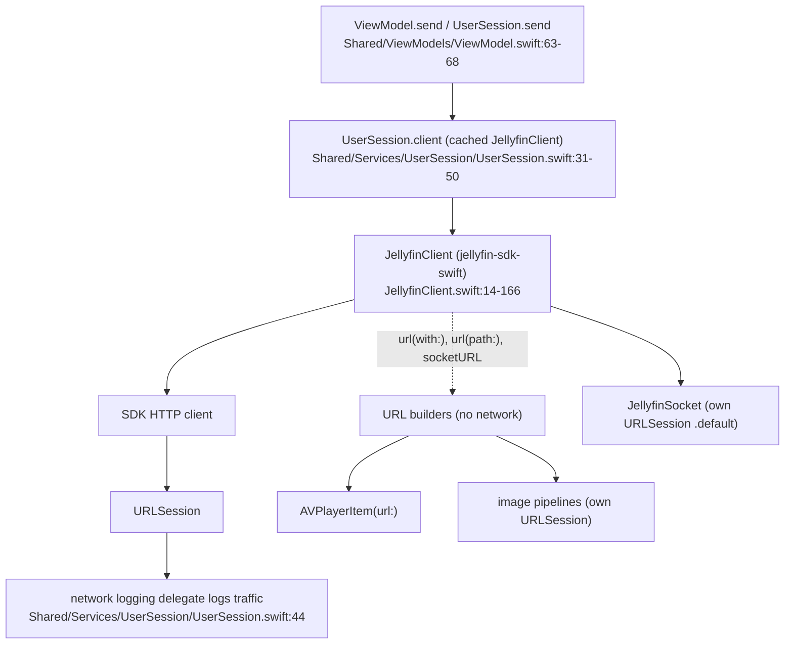
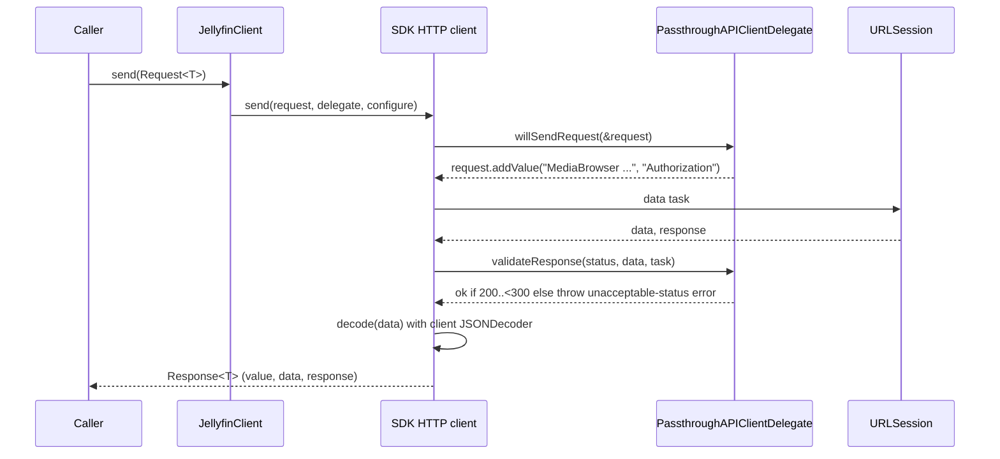
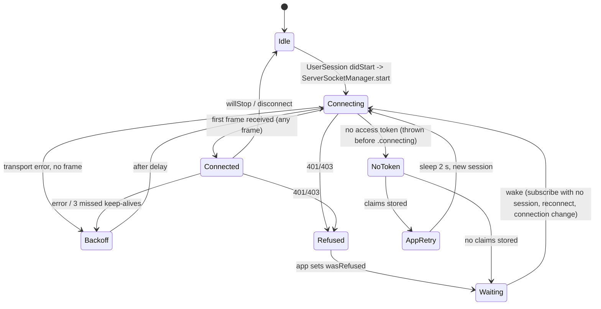

# 02 - Networking

> **Jellyfin SDK source.** A citation `jellyfin-sdk-swift@3.3.0:PATH:LINE` points into [jellyfin/jellyfin-sdk-swift](https://github.com/jellyfin/jellyfin-sdk-swift) at tag `3.3.0` (commit `8ce10a167ad0b4145b2bc005acf8bebcfe6ebe46`). Open it as `https://github.com/jellyfin/jellyfin-sdk-swift/blob/8ce10a167ad0b4145b2bc005acf8bebcfe6ebe46/PATH#LLINE`; for a range `A-B`, use `#LA-LB`. There is no local copy of the SDK.

Scope: how the Swiftfin client talks to a Jellyfin server over HTTP and WebSocket, and every place it touches the network outside the typed API. Companion files: [00-INDEX.md](00-INDEX.md), [01-endpoints.md](01-endpoints.md) (per-endpoint tables), [03-auth-session.md](03-auth-session.md), [04-models.md](04-models.md), [05-playback.md](05-playback.md), [06-vlc.md](06-vlc.md) (player engines; the app has no VLC), [07-reporting.md](07-reporting.md), [08-images-subtitles-audio.md](08-images-subtitles-audio.md), [09-state-cache-persistence.md](09-state-cache-persistence.md), [10-errors-edge-cases.md](10-errors-edge-cases.md), [11-sequence-flows.md](11-sequence-flows.md), [12-gaps.md](12-gaps.md).

Citation format: app files are repo-relative (`Shared/...:LINE`); the Jellyfin SDK is `jellyfin-sdk-swift@3.3.0:Sources/...:LINE`, with line numbers taken from a clean clone at the pinned commit (jellyfin-sdk-swift `8ce10a16`). `Swiftfin tvOS/` has a space in the path.

Header note: the brief mentions `X-Emby-*` headers. The client sends none. The only occurrence of the string is a code comment (`Shared/Objects/MediaPlayerManager/PlaybackTemporaryFiles.swift:100`). Authentication is the single `Authorization: MediaBrowser ...` header (`jellyfin-sdk-swift@3.3.0:Sources/PassthroughAPIClientDelegate.swift:19-27, 48-64`), plus an `ApiKey` query parameter on direct-stream URLs handed to players (`Shared/Objects/MediaPlayerManager/MediaPlayerItem/MediaPlayerItemResolver.swift:256, 274`; builder `jellyfin-sdk-swift@3.3.0:Sources/JellyfinClient.swift:262-263`) and on the socket URL (`jellyfin-sdk-swift@3.3.0:Sources/JellyfinClient.swift:330-333`). Section 4.3 lists every case.

---

## 1. Layering



Rules that follow from the code:

1. All typed Jellyfin REST calls use `Paths.*` request values (jellyfin-sdk-swift) sent through `JellyfinClient.send`, which forwards to the SDK's HTTP client (`jellyfin-sdk-swift@3.3.0:Sources/JellyfinClient.swift:123-158`). Per-endpoint verbs, paths and parameters live in [01-endpoints.md](01-endpoints.md).
2. Media bytes, images, subtitles and trickplay are NOT fetched through the client. The client only builds URLs; players, the image pipelines and a private `URLSession` do the fetching (section 8): `AVPlayerItem(url:)` (`Shared/Objects/MediaPlayerManager/Players/AVMediaPlayer.swift:107`), image pipelines (`Shared/Extensions/Nuke/ImagePipeline.swift:67-96`), and the temp-file session (`Shared/Objects/MediaPlayerManager/PlaybackTemporaryFiles.swift:32, 105`).
3. The WebSocket uses its own `URLSession(configuration: .default)`, not the client's session (`jellyfin-sdk-swift@3.3.0:Sources/JellyfinSocket/JellyfinSocket.swift:498`).

---

## 2. Client construction

### 2.1 `JellyfinClient.Configuration` fields

Struct at `jellyfin-sdk-swift@3.3.0:Sources/JellyfinClient.swift:67-121`.

| Field | Type | Role | App value (built at `Shared/Extensions/JellyfinAPI/JellyfinClient.swift:16-39`) |
|---|---|---|---|
| `url` | `URL` | server base URL and the HTTP client base URL (JellyfinClient.swift:44) | passed in; see section 9 for normalisation |
| `accessToken` | `String?` | `Token` in Authorization; `ApiKey` in query URLs; mutated by signIn/signOut (`internal(set)`, JellyfinClient.swift:73) | `nil` before sign-in; else keychain value |
| `client` | `String` | Authorization `Client` | `"Swiftfin \(UIDevice.platform)"` (JellyfinClient.swift:21 in app file) |
| `deviceName` | `String` | Authorization `Device` | `UIDevice.current.name`, `.folding(options: .diacriticInsensitive, locale: .current)`, unicode scalars filtered to `CharacterSet.urlQueryAllowed`, then `.description` (app file :22-27) |
| `deviceID` | `String` | Authorization `DeviceId`; socket query `deviceId` | `"\(UIDevice.platform)_\(UIDevice.vendorUUIDString)"` (app file :28); IDFV force-unwrapped (`Shared/Extensions/UIDevice.swift:13-15`) |
| `version` | `String` | Authorization `Version` | `Bundle.main.infoDictionary?["CFBundleShortVersionString"]` else `"0.0.1"` (app file :29) |

`UIDevice.platform` is `L10n.tvOS` on tvOS, else `L10n.iPadOS` on iPad, else `L10n.iOS` (`Shared/Extensions/UIDevice.swift:49-59`). Verified: `L10n.iOS == "iOS"`, `L10n.iPadOS == "iPadOS"`, `L10n.tvOS == "tvOS"` (`Shared/Strings/ProperNouns.swift:137-140`). So `Client` is `Swiftfin iOS`, `Swiftfin iPadOS` or `Swiftfin tvOS`, and `DeviceId` is `iOS_<IDFV>`, `iPadOS_<IDFV>` or `tvOS_<IDFV>`. `Device` sanitisation (`Shared/Extensions/JellyfinAPI/JellyfinClient.swift:22-27`): `UIDevice.current.name`, fold diacritics (`.diacriticInsensitive`, current locale), keep only unicode scalars in `CharacterSet.urlQueryAllowed`, then `.description` of the scalar view. Spaces are not URL-query-allowed, so they are dropped (`Jamie's iPhone` becomes `Jamie'siPhone`).

Consequences: `Device` loses spaces and the double quote (both are outside `urlQueryAllowed`; the apostrophe is inside it and is kept, e.g. `Jamie'siPhone`) (`Shared/Extensions/JellyfinAPI/JellyfinClient.swift:22-27`). `,` and `=` are inside `urlQueryAllowed`, so a device name containing them would corrupt the unquoted header (see unknowns, section 15).

### 2.2 `JellyfinClient.init`

`jellyfin-sdk-swift@3.3.0:Sources/JellyfinClient.swift:32-63`:

| Parameter | Default | Effect |
|---|---|---|
| `configuration` | required | stored; `url` becomes `baseURL` |
| `delegate` (optional client delegate) | `nil` | stored as `actualDelegate` of the passthrough delegate (:61). The app never passes one (no construction site in 2.3 passes `delegate:`) |
| `sessionConfiguration` | `.default` (:35) | handed to the SDK's HTTP client configuration (:46) |
| `sessionDelegate: URLSessionDelegate?` | `nil` | handed to the SDK's HTTP client (:47) |

Init body, in order: create `PassthroughAPIClientDelegate` (:40); build the HTTP client with `delegate = passthroughDelegate`, session config, session delegate, decoder, encoder (:44-59); set `actualDelegate` and weak back-reference `jellyfinClient` (:61-62).

### 2.3 Construction sites in the app

| # | Site | URL | Token | Session config | Delegate |
|---|---|---|---|---|---|
| 1 | `UserSession.client` (cached; rebuilt when `server.effectiveServerURL` differs from cached client's `configuration.url`) `Shared/Services/UserSession/UserSession.swift:31-50` | `server.effectiveServerURL` | `user.accessToken` (keychain) | `.swiftfin` (request timeout 20 s) | network logging delegate |
| 2 | `ServerState.client` (computed, a NEW client every access) `Shared/SwiftfinStore/SwiftfinStore+ServerState.swift:29-35` | `effectiveServerURL` | none | `.swiftfin` | same |
| 3 | `UserState.getUserData` `Shared/SwiftfinStore/SwiftinStore+UserState.swift:124-135` | `server.effectiveServerURL` | `accessToken` (keychain) | `.swiftfin` | same |
| 4 | `ServerConnectionManager.test` `Shared/Services/ServerConnectionManager.swift:69-96` | `connection.url` | optional | copy of `.swiftfin` with request 8 s, resource 12 s, `waitsForConnectivity = false` (:74-77) | same |
| 5 | `ConnectToServerViewModel.connectToServer` `Shared/ViewModels/ConnectToServerViewModel.swift:75-78` | typed URL, normalised | none | NOT passed, so SDK default `.default` (JellyfinClient.swift:35) | same |

`URLSessionConfiguration.swiftfin` is `.default` with `timeoutIntervalForRequest = 20` and nothing else (`Shared/Extensions/URLSessionConfiguration.swift:15-17`). So `timeoutIntervalForResource` and `waitsForConnectivity` stay at Foundation defaults for clients 1-3. Only the probe copy (client #4) overrides both (`Shared/Services/ServerConnectionManager.swift:74-77`).

Token lifetime: client #1 reads the keychain token once, when it builds the client (`accessToken: user.accessToken` at `Shared/Services/UserSession/UserSession.swift:42`), then caches that client and returns it while the URL is unchanged (:35-37, :47). The `UserState.accessToken` getter reads the keychain key `"<userID>-accessToken"` (`Shared/SwiftfinStore/SwiftinStore+UserState.swift:30-37`). The `Token` field in later requests is read live from `client.configuration.accessToken` at send time (`jellyfin-sdk-swift@3.3.0:Sources/JellyfinClient.swift:17-19`, `PassthroughAPIClientDelegate.swift:48-58`).

Resource note: `ServerState.client` allocates a new `URLSession` per access (`Shared/SwiftfinStore/SwiftfinStore+ServerState.swift:29`).

---

## 3. Request pipeline



| Step | Behaviour | Cite |
|---|---|---|
| Entry | `JellyfinClient.send<T>` / `send(Request<Void>)` / `data(for:)` / `download(for:)` forward to the SDK's HTTP client; the `configure` closure is wrapped `nonisolated(unsafe)` | `jellyfin-sdk-swift@3.3.0:Sources/JellyfinClient.swift:123-158` |
| Auth | the passthrough delegate's `willSendRequest` calls `request.addValue(authorizationHeaders, forHTTPHeaderField: "Authorization")` (add, not set) | `jellyfin-sdk-swift@3.3.0:Sources/PassthroughAPIClientDelegate.swift:19-27` |
| Validate | passthrough (no actualDelegate) accepts `200..<300` else throws an unacceptable-status-code error | PassthroughAPIClientDelegate.swift:29-37 |
| Retry | `shouldRetry` (passthrough: `false` when no actualDelegate) | PassthroughAPIClientDelegate.swift:39-41 |

SDK requests pass `path` + `method` as string literals, e.g. `Request(path: "/System/Info/Public", method: "GET", id: "GetPublicSystemInfo")` (`jellyfin-sdk-swift@3.3.0:Sources/Paths/GetPublicSystemInfoAPI.swift:15`).

The app reads `response.value`, and in two places `response.data` (`Shared/Services/UserSession/UserSession+Items.swift:52, 99`; a grep of `Shared`, `Views`, `Components`, `Extensions`, `Objects`, `App` and `Swiftfin tvOS` finds no others) plus one `response.response.url` (`Shared/ViewModels/ConnectToServerViewModel.swift:91`) (sections 6 and 9).

---

## 4. Headers

### 4.1 `Authorization` (all JellyfinClient requests)

Built by `JellyfinClient.authorizationHeaders` (`jellyfin-sdk-swift@3.3.0:Sources/PassthroughAPIClientDelegate.swift:48-64`):

```
Authorization: MediaBrowser DeviceId=<deviceID>, Device=<deviceName>, Client=<client>, Version=<version>[, Token=<accessToken>]
```

| Property | Value | Cite |
|---|---|---|
| Scheme literal | `MediaBrowser ` (one space) | PassthroughAPIClientDelegate.swift:63 |
| Field names | `DeviceId`, `Device`, `Client`, `Version`, and `Token` only when `accessToken != nil` | :49-58 |
| Separator | `, ` (comma space) | :60-61 |
| Quoting | none; values unquoted and unescaped | :60 |
| Field order | NOT stable: built from a Swift `Dictionary` then `.map` | :49-60 |
| Method | `addValue(_:forHTTPHeaderField:)`, so it appends to any existing `Authorization` value | :23 |
| Sent when no token | yes; the four device fields are always sent | :22, :56-58 |

Example (order arbitrary): `MediaBrowser DeviceId=iOS_<IDFV>, Device=<sanitized name>, Client=Swiftfin iOS, Version=<CFBundleShortVersionString>, Token=<token>`. `Client`/`DeviceId` literals are verified in section 2.1 (`Shared/Extensions/UIDevice.swift:49-59`; `Shared/Strings/ProperNouns.swift:137-140`; `Shared/Extensions/JellyfinAPI/JellyfinClient.swift:21, 28`).

A reimplementation should send the same four fields and the token; field order must not matter to the server (the original does not control it).

### 4.2 Other headers

| Header | Where | Value | Cite |
|---|---|---|---|
| `Authorization: MediaBrowser Token="<token>"` | trickplay/chapter downloads by `PlaybackTemporaryFiles` (private URLSession, Token ONLY, quoted, set via `setValue`) | comment: "X-Emby-Token is ignored when the server disables legacy authorization." | `Shared/Objects/MediaPlayerManager/PlaybackTemporaryFiles.swift:99-101` |
| `Authorization: MediaBrowser DeviceId..., Token...` | WebSocket handshake request | `client.authorizationHeaders` via `setValue` | `jellyfin-sdk-swift@3.3.0:Sources/JellyfinSocket/JellyfinSocket.swift:503-504` |
| none | image loads, AVPlayer media loads, WKWebView load | no headers set by app | `Shared/Extensions/Nuke/ImagePipeline.swift:67-96`; `Shared/Objects/MediaPlayerManager/Players/AVMediaPlayer.swift:107`; `Views/JellyfinWebView.swift:123` |

User-Agent: the app sets none (grep of the app source finds no `User-Agent`); URLSession's default applies. The only header app code sets itself is the temp-file `Authorization` (`Shared/Objects/MediaPlayerManager/PlaybackTemporaryFiles.swift:101`); a grep of `Shared`, `Views`, `Components`, `Extensions`, `Objects`, `App` and `Swiftfin tvOS` for `forHTTPHeaderField|httpAdditionalHeaders|allHTTPHeaderFields` finds only that line. The REST and socket `Authorization` values are built by the SDK (`jellyfin-sdk-swift@3.3.0:Sources/PassthroughAPIClientDelegate.swift:19-27, 48-64`) from the configuration the app supplies (`Shared/Extensions/JellyfinAPI/JellyfinClient.swift:21-29`).

### 4.3 Token in the URL (`ApiKey` query parameter)

| URL | `ApiKey` appended? | Mechanism | Cite |
|---|---|---|---|
| direct-play/stream `Paths.getVideoStream` / `getAudioStream` | yes | `client.url(with:queryAPIKey: true)` | `Shared/Objects/MediaPlayerManager/MediaPlayerItem/MediaPlayerItemResolver.swift:256, 274` |
| server `transcodingURL` (HLS) | no | `client.url(path:)` only | MediaPlayerItemResolver.swift:229-237 |
| `transcodingURL` for remote playback (AirPlay-style receivers; `profile.requiresHLS`) | yes if no `api_key`/`apikey` (case-insensitive, non-empty) already present | `RemotePlaybackURL.authenticated` appends `URLQueryItem(name: "ApiKey", ...)` | `Shared/Objects/MediaPlayerManager/RemotePlaybackURL.swift:15-28`; MediaPlayerItemResolver.swift:142-149 |
| WebSocket URL | yes, plus header | `JellyfinClient.socketURL` | `jellyfin-sdk-swift@3.3.0:Sources/JellyfinClient.swift:316-336` |
| images (item, user, splashscreen, chapter) | no | `client.url(with:)` with default `queryAPIKey: false` | item `Shared/Extensions/JellyfinAPI/BaseItemDto/BaseItemDto+Images.swift:54`; chapter `Shared/Extensions/JellyfinAPI/BaseItemDto/BaseItemDto.swift:514-517`; user avatar `Shared/SwiftfinStore/SwiftinStore+UserState.swift:159-166`; splashscreen `Shared/SwiftfinStore/SwiftfinStore+ServerState.swift:146` |
| trickplay sheet URL | no (header instead, section 4.2) | `client.url(with:)` | `Shared/Objects/MediaPlayerManager/PreviewImageProvider.swift:126-131` |
| external subtitle `deliveryURL` | no | `MediaStream.url(with:)` -> `client.url(path:)` | `Shared/Extensions/JellyfinAPI/MediaStream.swift:24-30` |

The parameter name is exactly `ApiKey` (`jellyfin-sdk-swift@3.3.0:Sources/JellyfinClient.swift:263`).

---

## 5. Encoding, decoding, URL construction

### 5.1 JSON

| Aspect | Value | Cite |
|---|---|---|
| Decoder | `JSONDecoder`, `dateDecodingStrategy = .formatted(OpenISO8601DateFormatter())`; no key strategy, so JSON keys must match each model's `CodingKeys` (PascalCase raw keys declared in the SDK models; see [04-models.md](04-models.md)) | `jellyfin-sdk-swift@3.3.0:Sources/JellyfinClient.swift:49-53` |
| Encoder | `JSONEncoder`, `dateEncodingStrategy = .formatted(OpenISO8601DateFormatter())`, `outputFormatting = .prettyPrinted` (bodies on the wire are pretty-printed JSON) | JellyfinClient.swift:55-58 |
| Date primary format | `yyyy-MM-dd'T'HH:mm:ss.SSSZZZZZ`, calendar `iso8601`, locale `en_US_POSIX`, time zone GMT+0 | `jellyfin-sdk-swift@3.3.0:Sources/OpenISO8601Formatter.swift:23-28` |
| Date fallback format | `yyyy-MM-dd'T'HH:mm:ssZZZZZ` (seconds, no fraction; the property is named `withoutSeconds` but has seconds) used when the primary parse returns nil | OpenISO8601Formatter.swift:14-21, 40-45 |
| Socket decoder | same date strategy, new `JSONDecoder` | `jellyfin-sdk-swift@3.3.0:Sources/JellyfinSocket/JellyfinSocket.swift:572-573` |
| Dual parse | `UserSession.send` and favourite/played mutations decode typed AND re-parse `response.data` with `JSONSerialization` to learn which JSON keys the server returned | `Shared/Services/UserSession/UserSession+Items.swift:50-60, 98-100` |
| Body override | playback start/progress reports replace `request.body` with `PlaybackStateReport` (SDK `PlaybackStateInfo` plus `"SecondarySubtitleStreamIndex"`) | `Shared/Objects/MediaPlayerManager/MediaProgressReporter.swift:139-161` |

Whether servers' 7-digit fractional seconds (e.g. `.0000000Z`) parse with `.SSS` is not asserted by the sources; it relies on `DateFormatter` behaviour (see gaps).

### 5.2 Query encoding (`URLQueryEncoder`)

SDK parameter structs build their query via `URLQueryEncoder` (`jellyfin-sdk-swift@3.3.0:Sources/Extensions/URLQueryEncoder.swift`), default `explode: true, delimiter: ","` (:68).

| Value kind | Wire form | Cite |
|---|---|---|
| `String` | as is | URLQueryEncoder.swift:119-121 |
| `Bool` | `true` / `false` | :123-125 |
| `Int` types | decimal | :127-165 |
| `Double`/`Float` | Swift `String(value)` | :167-173 |
| `URL` | `absoluteString` | :175-177 |
| `Date` | default ISO-8601 (`ISO8601DateFormatter`) | :22-23, :179-188 |
| `nil` | omitted | :115-117 |
| array (explode true, the default) | repeated key: `k=a&k=b` | :218-227 |
| array (explode false) | one key, values joined by delimiter | :237-243 |

So `POST /Sessions/Capabilities` sends `supportedCommands=DisplayContent&supportedCommands=Play&...` (repeated keys): `supportedCommands` goes through the default encoder (`jellyfin-sdk-swift@3.3.0:Sources/Paths/PostCapabilitiesAPI.swift:40-46`; `jellyfin-sdk-swift@3.3.0:Sources/Extensions/URLQueryEncoder.swift:68, 218-227`) with the app's command list (`Shared/Services/ServerSocketManager.swift:126-136`). This settles the explorer unknown about repeat versus comma list. Individual `Paths.*` functions may override `explode`; check per endpoint in [01-endpoints.md](01-endpoints.md).

### 5.3 URL builders (no network)

| Helper | Behaviour | Cite |
|---|---|---|
| `url(with: request, queryAPIKey: false)` | if `request.url?.path` is nil returns `configuration.url`; else `url(path:)` of the request path, then appends request query items (percent-encoded through `URLComponents`) and, when `queryAPIKey` and a token exist, `ApiKey=<token>`; returns `nil` if components fail | `jellyfin-sdk-swift@3.3.0:Sources/JellyfinClient.swift:254-274` |
| `url(path:uniquingQueryItemsWith:)` | split `path` with `URLComponents(string:)`; drop leading `/` characters; `configuration.url.appending(path:, directoryHint: .notDirectory)` (so a server base path such as `/jellyfin` is preserved); merge query items from `path` into the base URL's, keeping the existing item by default on a name clash | JellyfinClient.swift:285-311 |
| `socketURL` | see section 10.1 | JellyfinClient.swift:316-336 |
| `URLComponents.addingQueryItem(key:value:)` (app extension) | returns a copy with `URLQueryItem(name: key, value: value)` appended, creating `queryItems` first when it is `nil`. Dead code: a grep of `Shared`, `Views`, `Components`, `Extensions`, `Objects`, `App` and `Swiftfin tvOS` finds only the definition | `Shared/Extensions/URLComponents.swift:13-22` |

`url(path:)` and `url(with:)` use `appending(path:)` with leading slashes removed. They append to the base URL instead of resolving against it, so a base path such as `/jellyfin` is kept (`jellyfin-sdk-swift@3.3.0:Sources/JellyfinClient.swift:291-292`).

Chapter images: `imageIndex` is a QUERY key (`encoder.encode(imageIndex, forKey: "imageIndex")`, `jellyfin-sdk-swift@3.3.0:Sources/Paths/GetItemImageAPI.swift:85`), so the URL is `/Items/{itemID}/Images/Chapter?maxWidth=500&quality=90&tag=<imageTag>&imageIndex=<i>`, not `/Chapter/{i}`. Built at `Shared/Extensions/JellyfinAPI/BaseItemDto/BaseItemDto.swift:495-517`.

---

## 6. Response handling, errors, retry, timeout, cancellation

| Topic | Behaviour | Cite |
|---|---|---|
| Success | HTTP status in `200..<300` | `jellyfin-sdk-swift@3.3.0:Sources/PassthroughAPIClientDelegate.swift:33` |
| App mapping | none. The app never references the HTTP client's error type and never branches on Jellyfin response status codes (grep of app source: `statusCode` appears only at `Shared/Objects/MediaPlayerManager/PlaybackTemporaryFiles.swift:119-120`). The legacy mapping of URLError codes -1001 / -1003 / -1004 to strings is fully commented out | `Shared/Errors/NetworkError.swift:12-70` |
| 401 handling | no app-level interception; the error surfaces to whichever action called | no `statusCode` branching in the app except `Shared/Objects/MediaPlayerManager/PlaybackTemporaryFiles.swift:119-120` (a file download, not Jellyfin REST); see [10-errors-edge-cases.md](10-errors-edge-cases.md) |
| Retry | none. `shouldRetry` returns `false` when `actualDelegate == nil`; the app never supplies a delegate (no construction site in 2.3 passes `delegate:`) | PassthroughAPIClientDelegate.swift:39-41 |
| Request timeout | 20 s for clients 1-3 (`.swiftfin`); 8 s request / 12 s resource for probes; connect-to-server client uses the SDK default `.default` (Apple's default request timeout; Apple documents 60 s for `URLSessionConfiguration.default`, external fact not verifiable in repo) | `Shared/Extensions/URLSessionConfiguration.swift:16`; `Shared/Services/ServerConnectionManager.swift:74-77`; `Shared/ViewModels/ConnectToServerViewModel.swift:75-78`; `jellyfin-sdk-swift@3.3.0:Sources/JellyfinClient.swift:35` |
| Missing session | `ViewModel.send` throws `UserSessionError.missingCurrentSession` and logs `"Missing user session for authenticated view model"` | `Shared/ViewModels/ViewModel.swift:36-43` |
| Missing keychain token | `UserState.accessToken` hits `assertionFailure("access token missing in keychain")` and returns `""`, so requests send `Token=` empty | `Shared/SwiftfinStore/SwiftinStore+UserState.swift:30-37` |
| Playback reports | failure is logged `"Unable to report playback: ..."`; no retry; reports are serialised via a queue | `Shared/Objects/MediaPlayerManager/MediaProgressReporter.swift:130-134, 158-175` |

`UserSession.send` wrapper (all item-bearing requests): `items.validate()`; `token = items.beginRequest()`; `client.send(request)`; `items.validate()`; if the decoded value conforms to `BaseItemPatchProvider`, re-parse `response.data` and merge patches into the `ItemStore`; returns `(value, [ItemRecord])`. The `Request<Void>` variant validates, sends, validates (`Shared/Services/UserSession/UserSession+Items.swift:41-67`). `ViewModel.send` simply calls it (`Shared/ViewModels/ViewModel.swift:63-68`). On `Notifications[.didChangeServerConnection]` a view model resets its injected `userSession`, which picks up a rebuilt client for the new URL (ViewModel.swift:27-34; client rebuild at UserSession.swift:32-50). See [09-state-cache-persistence.md](09-state-cache-persistence.md).

---

## 7. Core API calls issued directly by the networking layer

Full per-endpoint documentation: [01-endpoints.md](01-endpoints.md). This table lists calls that define client behaviour.

| Purpose | Verb and path | Body / query | Sender | Cite |
|---|---|---|---|---|
| Server probe / connect | `GET /System/Info/Public` | none | connect VM, `ServerState.getPublicSystemInfo`, probe | `jellyfin-sdk-swift@3.3.0:Sources/Paths/GetPublicSystemInfoAPI.swift:15`; callers `Shared/ViewModels/ConnectToServerViewModel.swift:80`, `Shared/SwiftfinStore/SwiftfinStore+ServerState.swift:98-104`, `Shared/Services/ServerConnectionManager.swift:88` |
| Sign in (password) | `POST /Users/AuthenticateByName` | JSON `AuthenticateUserByName(pw:, username:)` (pretty-printed) | `JellyfinClient.signIn(username:password:)` | `jellyfin-sdk-swift@3.3.0:Sources/Paths/AuthenticateUserByNameAPI.swift:15`; JellyfinClient.swift:206-217; app `Shared/ViewModels/UserSignInViewModel.swift:130` |
| Sign in (Quick Connect) | `POST /Users/AuthenticateWithQuickConnect` | JSON `QuickConnectDto(secret:)` | `JellyfinClient.signIn(quickConnectSecret:)` | `jellyfin-sdk-swift@3.3.0:Sources/Paths/AuthenticateWithQuickConnectAPI.swift:15`; JellyfinClient.swift:229-240; app UserSignInViewModel.swift:158 |
| Quick Connect start | `POST /QuickConnect/Initiate` | none; response `secret`, `code` required else `QuickConnectError.retrievingCodeFailed` | `QuickConnect.connect()` | `jellyfin-sdk-swift@3.3.0:Sources/Paths/InitiateQuickConnectAPI.swift:15`; `jellyfin-sdk-swift@3.3.0:Sources/QuickConnect.swift:98-110` |
| Quick Connect poll | `GET /QuickConnect/Connect?secret=<secret>` | complete when `isAuthenticated == true` and `secret` present | same | `jellyfin-sdk-swift@3.3.0:Sources/Paths/GetQuickConnectStateAPI.swift:15`; QuickConnect.swift:141-149 |
| Revoke token (SDK sign-out) | `DELETE /Auth/Keys/{key}` | none | `JellyfinClient.signOut()` | JellyfinClient.swift:244-251 |
| Current user | `GET /Users/Me` | none | `UserState.getUserData` | `Shared/SwiftfinStore/SwiftinStore+UserState.swift:131-134` |
| Capabilities | `POST /Sessions/Capabilities` | query only (section 10.2) | socket session | `jellyfin-sdk-swift@3.3.0:Sources/Paths/PostCapabilitiesAPI.swift:14-45` |
| PlaybackInfo | `POST /Items/{itemID}/PlaybackInfo` | JSON `PlaybackInfoDto` body, no query (the app passes only the body) | `MediaPlayerItemResolver` | `jellyfin-sdk-swift@3.3.0:Sources/Paths/GetPostedPlaybackInfoAPI.swift:17-23`; `Shared/Objects/MediaPlayerManager/MediaPlayerItem/MediaPlayerItemResolver.swift:78-86` |
| Bitrate test | `GET /Playback/BitrateTest?size=<n>` | measured elapsed time gives bits/s, clamped between `PlaybackBitrate.kbps420.rawValue` and `Int32.max` | resolver | MediaPlayerItemResolver.swift:183-201 |
| Item fetch | `GET /Items/{id}?userId=<id>` | `userID` from `user.id` | `UserSession.getFullItem` | `Shared/Services/UserSession/UserSession+Items.swift:27-39` |
| Favourite / played | `POST /UserFavoriteItems/{id}` etc. | `userId` query | `UserSession.setFavorite/setPlayed` | UserSession+Items.swift:75-102 |
| Playback reports | `POST /Sessions/Playing`, `/Sessions/Playing/Progress`, `/Sessions/Playing/Stopped` | JSON | `MediaProgressReporter` | MediaProgressReporter.swift:67, 159; see [07-reporting.md](07-reporting.md) |
| Live stream close | `POST /LiveStreams/Close?liveStreamId=` | none | resolver on failure | MediaPlayerItemResolver.swift:204-215 |

Notes:

- The app does NOT call `JellyfinClient.signOut()`: `UserSessionManager.signOut` only clears local state (`Shared/Services/UserSession/UserSessionManager.swift:114-124`) and `Paths.revokeKey` is used only by the admin API-key screen (`Shared/ViewModels/AdminDashboard/APIKeysViewModel.swift:95`, per `endpoints-mechanical.json`). The server-side access token therefore stays valid after in-app sign-out. See [03-auth-session.md](03-auth-session.md).
- After a successful sign-in the SDK overwrites `configuration.accessToken` on that client instance (JellyfinClient.swift:211, 234). The app takes `AuthenticationResult.accessToken` out of the response and emits it with `events.send(.existingUser(...))` or `events.send(.connected(...))` (`Shared/ViewModels/UserSignInViewModel.swift:132-150`). It stores the token later: `savedUserState.accessToken = user.state.accessToken` for a new user (UserSignInViewModel.swift:228), and for an existing user only when `replaceForAccessToken` is true (:265-267). Both writes go to the keychain through the `UserState.accessToken` setter (`Shared/SwiftfinStore/SwiftinStore+UserState.swift:39-41`). The `server.client` used for sign-in is a throwaway (ServerState.client creates a new instance per access).
- QuickConnect defaults: `poll = 5` s, `max = 200` polls, `failureTolerance = 5` consecutive failures (`jellyfin-sdk-swift@3.3.0:Sources/QuickConnect.swift:52-56`). Other errors beyond tolerance rethrow; exceeding `max` throws `QuickConnectError.maxPollingHit` (QuickConnect.swift:121-138). Used from `Shared/Views/QuickConnectView.swift:63`.

---

## 8. Network use outside `JellyfinClient.send`

### 8.1 Playback URLs handed to players

| Case | URL construction | Notes | Cite |
|---|---|---|---|
| Transcode / HLS | `client.url(path: mediaSource.transcodingURL)` (server-relative path with its own query) | no `ApiKey` added; failure -> `ErrorMessage("Unable to make transcoding URL")` | `MediaPlayerItemResolver.swift:229-236` |
| Direct video | `Paths.getVideoStream(itemID:parameters:)` -> `GET /Videos/{itemID}/stream` with query `static=true`, `tag`, `playSessionId`, `mediaSourceId`, `liveStreamId`, then `ApiKey` | `tag = mediaSource.eTag ?? item.etag`; `mediaSourceId = mediaSource.id ?? itemID`; failure `"Unable to make video stream URL"` | MediaPlayerItemResolver.swift:239-260; query keys `jellyfin-sdk-swift@3.3.0:Sources/Paths/GetVideoStreamAPI.swift:177-216` |
| Direct audio | `GET /Audio/{itemID}/stream` same parameters | `"Unable to make audio stream URL"` | MediaPlayerItemResolver.swift:262-279; `jellyfin-sdk-swift@3.3.0:Sources/Paths/GetAudioStreamAPI.swift:171-208` |
| Other media type | none | `ErrorMessage("Unsupported playback media type")` | MediaPlayerItemResolver.swift:281 |
| AVPlayer load | `AVPlayerItem(url: item.url)` with no `AVURLAsset` options, so no headers | token must be in URL | `Shared/Objects/MediaPlayerManager/Players/AVMediaPlayer.swift:107` |

Swiftfin also has a second, non-AVPlayer engine that loads the same URLs; it is out of scope for this spec (`Shared/Objects/MediaPlayerManager/Players/MPVMediaPlayer.swift:102-106`).

External subtitle URLs come from `MediaStream.url(with:)`: eligible only if `type == .subtitle && deliveryMethod == .external && deliveryURL != nil && isTextSubtitleStream == true`; when the server URL string ends with `/`, `deliveryURL.removingFirst(if:)` drops the FIRST CHARACTER of `deliveryURL` whatever it is (it never checks that the character is `/`; the result equals stripping a leading `/` only when `deliveryURL` starts with `/`), then `client.url(path:)`; no token (`Shared/Extensions/JellyfinAPI/MediaStream.swift:20-30`, call at :27; `Shared/Extensions/String.swift:100-107`).

Remote playback (`profile.requiresHLS`): forces `enableDirectPlay = false`, `enableDirectStream = false`, `enableTranscoding = true`, requires `item.mediaType == .video`, requires `mediaSource.transcodingURL != nil`, path extension `m3u8` (lowercased), and an http/https URL with host; otherwise `ErrorMessage(L10n.remotePlaybackUnavailable)` (MediaPlayerItemResolver.swift:59-65, 142-149; RemotePlaybackURL.swift:15-28). See [05-playback.md](05-playback.md) and [06-vlc.md](06-vlc.md).

### 8.2 Trickplay and chapter thumbnails (private `URLSession`)

`PlaybackTemporaryFiles` owns an isolated session: `URLSessionConfiguration.ephemeral`, `urlCache = nil`, `timeoutIntervalForRequest = 20`, not the JellyfinClient stack and not logged by the network logging delegate (`Shared/Objects/MediaPlayerManager/PlaybackTemporaryFiles.swift:25-33`).

| Property | Value | Cite |
|---|---|---|
| Request | plain `GET` via `session.download(for:)`; `Authorization: MediaBrowser Token="<token>"` only if a token exists | PlaybackTemporaryFiles.swift:96-105 |
| Accept rule | status in `200..<300` and task not cancelled, else the file is deleted and `nil` returned | :104-122 |
| Storage | moved to `Folder.temporary/playback/<UUID>/<id>`, renamed to the numeric id | :16, :124-131 |
| Retry | none inline; failed ids are removed from the cache so a later lookup retries; preload loop stops at the first failure | :48-52, :88-91 |
| Teardown | `remove()` cancels preload and tasks, `session.invalidateAndCancel()`, deletes the folder; also in `isolated deinit` | :35-37, :143-155 |
| Trickplay URL | `GET /Videos/{itemID}/Trickplay/{width}/{index}.jpg?mediaSourceId=<id>` | `jellyfin-sdk-swift@3.3.0:Sources/Paths/GetTrickplayTileImageAPI.swift:14-28`; `PreviewImageProvider.swift:125-131` |
| Trickplay choice | resolutions for `item.trickplay[mediaSourceID]` sorted by ascending width; first with `width, height, tileWidth, tileHeight, interval` all valid (>0, no overflow of columns x rows) | PreviewImageProvider.swift:108-134 |
| Chapter URL | `GET /Items/{id}/Images/Chapter?maxWidth=500&quality=90&tag=<imageTag>&imageIndex=<i>` | BaseItemDto.swift:495-517 |

More on thumbnails and image caching in [08-images-subtitles-audio.md](08-images-subtitles-audio.md).

### 8.3 Image loading

| Aspect | Value | Cite |
|---|---|---|
| Pipelines | `posters` and `local`: a data loader on `.swiftfin` (20 s request timeout) with the network logging delegate; `other`: a pipeline with a URL cache, not logged | `Shared/Extensions/Nuke/ImagePipeline.swift:63-97` |
| Default pipeline | the shared default pipeline is `posters` | `Shared/App/SwiftfinApp+configure.swift:51` |
| Authentication | none: no `Authorization`, no `ApiKey`. The app relies on the server serving image URLs unauthenticated (inference: `client.url(with:)` default `queryAPIKey: false` and the pipeline sets no header) | BaseItemDto+Images.swift:54; ImagePipeline.swift:67-93 |
| Item image query | `maxWidth = Int(env.maxWidth * displayScale)`, `maxHeight` same, `quality = clamp(env.quality, 1, 100)`, `tag` (required, non-empty), `format = .png` only for `.logo` | BaseItemDto+Images.swift:38-52 |
| Tag source | explicit tag, else only when `itemID == id`: `backdropImageTags.first`, `screenshotImageTags.first`, or `imageTags[type.rawValue]` | BaseItemDto+Images.swift:23-33 |
| Cache key | drop query item `maxWidth`; key = SHA1(path + query, no `?`) + `-<maxWidth>`; host ignored so multi-URL servers share entries | ImagePipeline.swift:19-39; `Shared/Extensions/URL.swift:70-73` |
| Fallback chain | `loadFirstImage` tries `ImageSource` URLs in order, moving to the next on any error | ImagePipeline.swift:41-50 |
| Memory cache | shared image memory cache, cost limit `1024*1024*200` (200 MB), `ttl = 300` s | SwiftfinApp+configure.swift:42-43 |
| Posters disk cache | disk cache named `org.jellyfin.swiftfin/Posters`, `sizeLimit = 1024*1024*1000` | `Shared/Extensions/Nuke/DataCache.swift:24-35` |
| Local disk cache | `<Documents>/Caches/org.jellyfin.swiftfin.local`; splashscreens keyed `"<serverID>-splashscreen".sha1` when `url.path` contains `"Splashscreen"` (prefix trimmed by `"/Branding/Splashscreen?"`) | DataCache.swift:39-64 |
| User avatar | `GET /UserImage?userId=<id>&tag=<primaryImageTag>` (no format) | `Shared/SwiftfinStore/SwiftinStore+UserState.swift:155-167`; `jellyfin-sdk-swift@3.3.0:Sources/Paths/GetUserImageAPI.swift:15-35` |
| Splashscreen | `GET /Branding/Splashscreen` | `SwiftfinStore+ServerState.swift:145-147` |
| SVG | any response with mime type containing `svg` is decoded by an empty decoder (not rendered) | SwiftfinApp+configure.swift:45-49 |

### 8.4 Server discovery (UDP)

`JellyfinClient.discover(duration: .seconds(5))` (`jellyfin-sdk-swift@3.3.0:Sources/ServerDiscovery.swift:45-68`), called with defaults from `Shared/ViewModels/ConnectToServerViewModel.swift:175-192`.

| Item | Value | Cite |
|---|---|---|
| Port | `7359` | ServerDiscovery.swift:41 |
| Payload (ASCII) | `who is JellyfinServer?` | :43 |
| Targets | `255.255.255.255:7359` plus the broadcast address (port 7359) of every non-loopback IPv4 interface with nonzero index | :116-118, :153-173 |
| Socket | UDP datagram socket bound to `0.0.0.0:0`, `SO_REUSEADDR` and `SO_BROADCAST` | :89-96 |
| Reply | JSON `{"Id": String, "Name": String, "Address": URL}` -> `PublicServer`; undecodable datagrams ignored | :21-37, :138-140 |
| Duration | listens 5 s then stops | :144-150 |
| Errors | `noUsableNetworkInterface`, `noUsableChannel`; app logs `"Local server discovery failed: ..."` only | :15-18; ConnectToServerViewModel.swift:189-191 |
| App handling | appends `ServerState(urls: [server.url], currentURL: server.url, name:, id:, userIDs: [])` to `localServers`, an `OrderedSet<ServerState>` (:51). `OrderedSet` ignores an element equal to one already present, so identical replies collapse; replies differing in any `ServerState` field (urls, currentURL, name, id, userIDs) both appear | ConnectToServerViewModel.swift:178-187 |

### 8.5 Plugin config web view (iOS only)

`JellyfinWebView` loads `<serverURL path trimmed of trailing "/" + "/">#/<path>?<query>` in a `WKWebView` using `percentEncodedFragment` (`Views/JellyfinWebView.swift:24-39`). The route is `NavigationRoute.jellyfinWebPage(_ path:, queryItems: = [])`, presented as a sheet and gated `#if os(iOS)` (`Shared/Coordinators/Navigation/NavigationRoute/NavigationRoute+App.swift:22-38`; definition :31-38). Two callers: `PluginDetailsView` with `path` `configurationpage` and query item `name` (`Views/AdminDashboardView/Plugins/PluginDetailsView/PluginDetailsView.swift:44-47`), and `ServerLogsView` with `path` `"dashboard/logs/\(log.name)"` and no query items (`Views/AdminDashboardView/ServerLogs/ServerLogsView/ServerLogsView.swift:39`).

| Item | Value | Cite |
|---|---|---|
| Data store | `WKWebsiteDataStore.nonPersistent()`; `preferredContentMode = .mobile` | JellyfinWebView.swift:75-76 |
| Credential injection | `WKUserScript` at `.atDocumentStart`, main frame only; runs only if `window.location.origin` equals the origin of `serverURL` | :101-118 |
| localStorage keys written | `jellyfin_credentials` = `{"Servers":[{"Id","Name","ManualAddress"(serverURL without trailing "/"),"LastConnectionMode":2,"UserId","AccessToken"(client token or ""),"DateLastAccessed"(ms since 1970)}]}`; `_deviceId2` = deviceID; `layout` = `mobile` | :80-96, :110-112 |
| Load | `webView.load(URLRequest(url:))`, plain GET, no headers | :123 |
| Error | session or URL nil -> `ErrorView(ErrorMessage(L10n.unknownError))` | :43-51 |
| Open in Safari | toolbar `Button(L10n.openInSafari, systemImage: "safari")` calls `UIApplication.shared.open(url)` with the same `url` (server web-client URL with the `#/<path>?<query>` fragment). It opens in the system browser, so the `WKUserScript` localStorage injection (`jellyfin_credentials`, `_deviceId2`, `layout`) does not run and no credentials go with it | :58-63; URL built at :24-39 |

### 8.6 External trailers

Not Jellyfin traffic. `UIApplication.open` of `remoteTrailers.first.url` (iOS: `canOpenURL` first; tvOS: `ExternalTrailerURL` maps tv.apple.com, vimeo, youtube hosts to deep links) (`Shared/Services/UserSession/UserSessionManager+SocketCommands.swift:244-259`; `Swiftfin tvOS/Components/ExternalTrailerURL.swift:12-108`; hosts `tv.apple.com` :76, `vimeo.com` :84, `youtube.com`/`youtu.be`/`m.youtube.com` :98).

### 8.7 Hardcoded external URLs (not Jellyfin server calls)

Static `URL` constants (`Shared/Extensions/URL.swift:19-40`), each opened in the system browser with `UIApplication.shared.open`. No auth, no `JellyfinClient`. The server web-client URL is also opened externally by the `JellyfinWebView` "Open in Safari" button (`Views/JellyfinWebView.swift:59-62`; see section 8.5); that URL is not a constant and is not in the table.

| Constant | URL | Call sites |
|---|---|---|
| `swiftfinGithub` | `https://github.com/jellyfin/Swiftfin` | `Shared/Views/AboutAppView.swift:82` |
| `swiftfinGithubLicense` | `https://github.com/jellyfin/Swiftfin/blob/main/LICENSE.md` | AboutAppView.swift:91 |
| `swiftfinGithubIssues` | `https://github.com/jellyfin/Swiftfin/issues` | AboutAppView.swift:99 |
| `jellyfinDocsBackup` | `https://jellyfin.org/docs/general/administration/backup-and-restore/` | `Views/AdminDashboardView/ServerBackup/ServerBackupView/ServerBackupView.swift:26` |
| `jellyfinDocsDevices` | `https://jellyfin.org/docs/general/server/devices` | `Views/AdminDashboardView/ServerDevices/DevicesView/DevicesView.swift:118` |
| `jellyfinDocsTasks` | `https://jellyfin.org/docs/general/server/tasks` | `Views/AdminDashboardView/ServerTasks/ServerTasksView.swift:27` |
| `jellyfinDocsUsers` | `https://jellyfin.org/docs/general/server/users` | `Views/AdminDashboardView/ServerUsers/ServerUsersView/ServerUsersView.swift:177` |
| `jellyfinDocsTroubleshooting` | `https://jellyfin.org/docs/general/administration/troubleshooting` | `Views/AdminDashboardView/ServerLogs/ServerLogsView/ServerLogsView.swift:33` |
| `jellyfinDocsManagingUsers` | `https://jellyfin.org/docs/general/server/users/adding-managing-users` | `Views/AdminDashboardView/ServerUsers/ServerUserSettings/ServerUserAccessSchedule/EditAccessScheduleView/EditAccessScheduleView.swift:37`; `.../ServerUserAccessTags/EditServerUserAccessTagsView/EditServerUserAccessTagsView.swift:157` |
| `jellyfinDocsPlugins` | `https://jellyfin.org/docs/general/server/plugins/index.html` | `Views/AdminDashboardView/Plugins/PluginsView/PluginsView.swift:26` |
| `jellyfinDocsPluginRepositories` | `https://jellyfin.org/docs/general/server/plugins/index.html#repositories` | `Views/AdminDashboardView/Plugins/PluginRepositoriesView/PluginRepositoriesView.swift:26` |

---

## 9. Server URL handling and connection selection

### 9.1 Connect-to-server

`Shared/ViewModels/ConnectToServerViewModel.swift:56-113`:

1. Trim whitespace/newlines, trim U+FFFC (object replacement), trim `/` at both ends; prepend `http://` if the ORIGINAL input has no `://` (:59-62).
2. `URL(string:)` must succeed, else `ErrorMessage(L10n.invalidURL)` (:64-67).
3. `normalizedServerConnectionURL`: lowercase scheme and host, trim a trailing `/` from the path (`Shared/Extensions/URL.swift:89-100`); the host must be non-nil else `L10n.invalidURL` (:69-73).
4. `GET /System/Info/Public` with a default-config client (:75-80). `serverName` and `id` are required else `logger.critical("Missing server data from network call")` and `ErrorMessage(L10n.unknownError)` (:82-87).
5. Redirect handling: if the final `response.response.url` differs in scheme or host from the typed URL, the saved URL is the response URL with the suffix `Paths.getPublicSystemInfo.url?.absoluteString` trimmed, re-normalised (ConnectToServerViewModel.swift:116-132).
6. Duplicate server id -> `events.send(.duplicateServer(newServerState))`; the caller may `addConnection`; otherwise `save(server:)` re-fetches public info through `server.client` and stores it (:102-111, :134-143).

### 9.2 Multi-URL servers and auto-switch

| Item | Behaviour | Cite |
|---|---|---|
| Effective URL | `activeServerConnection?.url ?? currentURL` | `Shared/SwiftfinStore/SwiftfinStore+ServerState.swift:85-87` |
| Active connection | id in `StoredValues[.Server.activeConnectionID(id:)]`; else match `currentURL`; else first | SwiftfinStore+ServerState.swift:41-58 |
| Default connections | `[currentURL] + other urls sorted by absoluteString`; interface `.any`, `priority` = index | :149-165 |
| Probe | `ServerConnectionManager.test` = `GET /System/Info/Public` with 8 s / 12 s timeouts, optional token; throws `ErrorMessage(L10n.connectionServerMismatch)` if `publicInfo.id != serverID` | ServerConnectionManager.swift:69-96 |
| Evaluate | candidates = connections matching the network context; probe sequentially in order (stops if cancelled); first success becomes `activeServerConnection` | :98-148 |
| Triggers | `NWPathMonitor` updates; 1.5 s debounce; only if the UserDefaults setting `.Experimental.serverConnectionAutoSwitch` is on and `server.isAutoSwitchEnabled` | :156-165, :192-203, :246-250 |
| Notification | `.didChangeServerConnection` posted when the reachable connection differs, or when the network context changes to satisfied; also posted by connect VM and `ServerConnectionViewModel` | :221-225, :235-244; ConnectToServerViewModel.swift:172; `Shared/ViewModels/ServerConnectionViewModel.swift:95` |
| Effect | `UserSession.client` rebuilt; socket reconnects (section 10.3) | UserSession.swift:32-50; `Shared/Services/ServerSocketManager.swift:213-218` |
| Version gate | `isVersionCompatible` = server `version` major.minor >= SDK constant `12.1.0` major.minor; false if version nil | SwiftfinStore+ServerState.swift:120-128; `jellyfin-sdk-swift@3.3.0:Sources/Extensions/Info.swift:16-18` |

Detail: [03-auth-session.md](03-auth-session.md), [09-state-cache-persistence.md](09-state-cache-persistence.md).

---

## 10. WebSocket

### 10.1 Connection

Built from `JellyfinClient.socketURL` (`jellyfin-sdk-swift@3.3.0:Sources/JellyfinClient.swift:316-336`):

| Part | Value |
|---|---|
| Scheme | `wss` if the server scheme is exactly `https`, else `ws` (`jellyfin-sdk-swift@3.3.0:Sources/JellyfinClient.swift:322`) |
| Path | server base path with every trailing `/` stripped, plus `/socket` (JellyfinClient.swift:324-328) |
| Query (in this order) | `ApiKey=<accessToken>`, `deviceId=<configuration.deviceID>` (JellyfinClient.swift:330-333) |
| No token | throws `ClientError.noAccessToken` (`jellyfin-sdk-swift@3.3.0:Sources/JellyfinClient.swift:318`), mapped to `SocketError.missingAccessToken` (`jellyfin-sdk-swift@3.3.0:Sources/JellyfinSocket/JellyfinSocket.swift:487-491`), which `isFatal` marks fatal for the SDK session (JellyfinSocket.swift:108-115). The app manager still retries every 2 s while claims exist (section 10.3) |
| Handshake header | `Authorization: MediaBrowser ...` (same builder as REST), set with `setValue` (JellyfinSocket.swift:503-504) |
| URLSession | fresh `URLSession(configuration: .default)` per attempt, `finishTasksAndInvalidate()` on exit (:498, :501); no network logging delegate, not `.swiftfin` |
| Frames | JSON objects, one per frame; outgoing sent as `.data` (JellyfinSocket.swift:536, 609, 630); incoming `.string` or `.data` accepted (`extractData`, :652-661) |

Example: `wss://media.example.com/jellyfin/socket?ApiKey=<token>&deviceId=iOS_<IDFV>`.

The token therefore appears both in the URL (`ApiKey`, `jellyfin-sdk-swift@3.3.0:Sources/JellyfinClient.swift:330-331`) and in the handshake `Authorization` header (`Token` field, `jellyfin-sdk-swift@3.3.0:Sources/JellyfinSocket/JellyfinSocket.swift:503-504`; `jellyfin-sdk-swift@3.3.0:Sources/PassthroughAPIClientDelegate.swift:56-58`).

### 10.2 Capabilities

Before EVERY connection attempt (after yielding `.connecting`) the SDK sends `POST /Sessions/Capabilities`, errors ignored (`try?`) (JellyfinSocket.swift:493-496). After each close, if not rejected and not explicitly disconnected, it sends it again in a detached task ("The server drops the device from /Sessions once the socket closes", :511-519). The app never calls `postCapabilities` itself (grep of `Shared`, `Views`, `Components`, `Extensions`, `Objects`, `App` and `Swiftfin tvOS` finds no use; the only callers are `jellyfin-sdk-swift@3.3.0:Sources/JellyfinSocket/JellyfinSocket.swift:496, 517`).

Query keys (exact): `id`, `playableMediaTypes`, `supportedCommands`, `supportsMediaControl`, `supportsPersistentIdentifier` (`jellyfin-sdk-swift@3.3.0:Sources/Paths/PostCapabilitiesAPI.swift:39-45`). App values (`Shared/Services/ServerSocketManager.swift:124-137`):

| Key | Wire value |
|---|---|
| `supportsMediaControl` | `true` (app passes `supportsMediaControl: true`, `Shared/Services/ServerSocketManager.swift:125`; SDK copies it to `isSupportsMediaControl`, `jellyfin-sdk-swift@3.3.0:Sources/JellyfinSocket/JellyfinSocket.swift:181`; `Bool` encodes as `true`, `jellyfin-sdk-swift@3.3.0:Sources/Extensions/URLQueryEncoder.swift:123-125`) |
| `supportedCommands` (repeated key) | `DisplayContent`, `Play`, `PlayMediaSource`, `PlayState`, `PlayTrailers`, `SetAudioStreamIndex`, `SetMaxStreamingBitrate`, `SetSubtitleStreamIndex` (wire strings are the PascalCase raw values of `GeneralCommandType`, e.g. `"PlayState"`, `jellyfin-sdk-swift@3.3.0:Sources/Entities/GeneralCommandType.swift:36-54`; app list `Shared/Services/ServerSocketManager.swift:126-136`) |
| `playableMediaTypes` | `Video` (app passes `[.video]`, `Shared/Services/ServerSocketManager.swift:136`; raw value `"Video"`, `jellyfin-sdk-swift@3.3.0:Sources/Entities/MediaType.swift:14`) |
| `id`, `supportsPersistentIdentifier` | not sent: the SDK session never sets them (`jellyfin-sdk-swift@3.3.0:Sources/JellyfinSocket/JellyfinSocket.swift:179-183`), and `nil` values are omitted (`jellyfin-sdk-swift@3.3.0:Sources/Extensions/URLQueryEncoder.swift:115-117`) |

### 10.3 Lifecycle and reconnect

Diagram transitions map to `jellyfin-sdk-swift@3.3.0:Sources/JellyfinSocket/JellyfinSocket.swift:428-482` (SDK loop) and `Shared/Services/ServerSocketManager.swift:190-209` (app wake/backoff).



Both refusals end the SDK session: `isFatal` is true for `missingAccessToken` and `unauthorized` (JellyfinSocket.swift:108-115), and the event stream finishes throwing (:452-455). `missingAccessToken` is thrown when `client.socketURL` fails, before `.connecting` is yielded (:487-493). The app treats the two differently. It sets `wasRefused` only for `.unauthorized` (`Shared/Services/ServerSocketManager.swift:181-185`). After a missing-token end with stored claims, `hasClaims, !wasRefused` holds, so the app sleeps 2 s and builds a new session (:203-205). That repeats every 2 s while claims exist. It waits for a wake only when there are no claims (:206-208). Only a 401/403 is Refused-until-wake. Wake sources: `subscribe` when no session exists (:96-101) and `reconnect()` (:75-79), which `.didChangeServerConnection` calls (:213-218). An explicit `reconnect()` also ends the loop iteration in the wait branch (:200-202); its own wake was already yielded, so the next session starts at once.

SDK session (`jellyfin-sdk-swift@3.3.0:Sources/JellyfinSocket/JellyfinSocket.swift`):

| Parameter | SDK default | App override | Cite |
|---|---|---|---|
| `reconnectAttempts` | `nil` (unlimited) | none | :52 |
| `reconnectDelay` | 2 s, min clamp 100 ms | none | :53, :189 |
| `healthyUptime` | 30 s, min clamp 1 s | none | :54, :191 |
| `responseTimeout` | 5 s, min clamp 1 ms | `.seconds(10)` | :55, :190; ServerSocketManager.swift:138 |
| `keepAliveInterval` | 20 s, clamped to [1 s, 45 s] | none | :56, :192 |

- `connected(URL)` is yielded on the FIRST received frame (any frame, even undecodable), not on handshake completion (:584-588). `disconnected` is yielded only if a `connected` was seen (:445-450).
- Backoff delay = `reconnectDelay * (1 << min(max(unhealthyCycles - 1, 0), 4))`, i.e. 2, 4, 8, 16, 32, 32 ... s with the 2 s base (:361-363).
- After an exit: uptime >= `healthyUptime` resets counters; shorter uptime with a frame increments `unhealthyCycles` and resets `failedConnections`; no frame increments both (:459-474).
- Fatal errors: `missingAccessToken`, and `unauthorized(statusCode:)` from a 401 or 403 read off `webSocketTask.response` after any handshake failure (:95-122, :546-553). The event stream then finishes throwing (:452-455).
- Event buffer: `AsyncThrowingStream` `bufferingNewest(512)`; two `connected` in a row mean events were dropped (:124-126, :194-196).
- Undecodable frames are skipped (`try?`) (:591).

App manager (`Shared/Services/ServerSocketManager.swift`): one manager per `UserSession` (`UserSession.swift:55`), started on `didStart`, stopped on `willStop` (:221-234). `runConnection` loop: get `userSession.client` (so it follows URL changes), build session, connect, re-subscribe stored claims, iterate events (:115-179). On stream end: explicit reconnect -> wait for wake; claims exist and not refused -> sleep 2 s and loop; otherwise wait for wake (:190-209). "Refused" means only `SocketError.unauthorized` (:181-185), so a missing-token end with claims loops every 2 s. `.didChangeServerConnection` -> `reconnect()` kills the session and wakes the loop (:75-79, :213-218). Every stream error, a refusal included, is logged only at debug level as `"Socket error: ..."` (:187); the loop then logs `"Socket session ended"` at info level (:198).

### 10.4 Keep-alive

Client sends `{"MessageType":"KeepAlive"}` (`InboundWebSocketMessage.inboundKeepAliveMessage(WebSocketMessageTypeInfo(messageType: .keepAlive))`, JellyfinSocket.swift:619-621, sent at :630; JSON key `MessageType` at `jellyfin-sdk-swift@3.3.0:Sources/Entities/WebSocketMessageTypeInfo.swift:26-27`; raw value `"KeepAlive"` at `jellyfin-sdk-swift@3.3.0:Sources/Entities/SessionMessageType.swift:46`). Per iteration: record `ActivityClock.lastMessage`, send, sleep `responseTimeout`; if any frame arrived in that window then `misses = 0` and sleep `keepAliveInterval - responseTimeout`; else `misses += 1` and loop immediately; when `misses > 2` (third consecutive miss) throw `SocketError.connectionTimeout`, which tears down and retries (:623-641; `jellyfin-sdk-swift@3.3.0:Sources/JellyfinSocket/ActivityClock.swift:11-27`). With the app's 10 s `responseTimeout` (`Shared/Services/ServerSocketManager.swift:138`) and the SDK default 20 s `keepAliveInterval` (`jellyfin-sdk-swift@3.3.0:Sources/JellyfinSocket/JellyfinSocket.swift:56`): a keep-alive goes out every 20 s (10 s wait plus 10 s sleep) while frames arrive; with no inbound frames, three 10 s windows pass back to back, so the socket drops after about 30 s of silence (JellyfinSocket.swift:623-641). Server `ForceKeepAlive` / `KeepAlive` are decoded and yielded as `.message` events; the reader only touches the activity clock and yields (:578-593), and the only `webSocketTask.send` calls are the initial subscription start messages at connect (:535-537), the outbound writer (:609) and the keep-alive loop (:630); none replies to a server keep-alive. Whether the server answers client keep-alives with a frame is unknown (gaps).

### 10.5 Client-to-server messages

`InboundWebSocketMessage` (SDK naming, client -> server): `ActivityLogEntryStart`, `ActivityLogEntryStop`, `KeepAlive`, `ScheduledTasksInfoStart`, `ScheduledTasksInfoStop`, `SessionsStart`, `SessionsStop` (`jellyfin-sdk-swift@3.3.0:Sources/Entities/InboundWebSocketMessage.swift:12-19`; raw values `jellyfin-sdk-swift@3.3.0:Sources/Entities/SessionMessageType.swift:40-46`).

Subscriptions (topic cases and start/stop message constructors: `jellyfin-sdk-swift@3.3.0:Sources/JellyfinSocket/Subscription.swift:14-56`): start message `{"MessageType": "<Topic>Start", "Data": "<delayMs>,<intervalMs>"}` (JSON keys `Data`, `MessageType` at `jellyfin-sdk-swift@3.3.0:Sources/Entities/WebSocketDataMessageInfo.swift:31-33`); stop message `{"MessageType": "<Topic>Stop"}` (`jellyfin-sdk-swift@3.3.0:Sources/Entities/WebSocketMessageTypeInfo.swift:26-27`). Topics: `activityLog`, `scheduledTasks`, `sessions` (`jellyfin-sdk-swift@3.3.0:Sources/JellyfinSocket/Subscription.swift:16-18`). The payload is `"\(initialDelay.milliseconds),\(interval.milliseconds)"` (JellyfinSocket.swift:134-137). Subscribers are counted per topic; the topic runs at the minimum delay and minimum interval over all subscribers; the last release queues the stop message (:245-298, :317-331). After reconnect the SDK sends fresh start messages for active subscriptions (:405-416) and the app re-subscribes its claims on the new session (ServerSocketManager.swift:140-154).

| App publisher | Topic | delay / interval | Consumer | Cite |
|---|---|---|---|---|
| `sessions()` | `SessionsStart` | 2 s / 2 s | admin sessions VM, playback info supplement | ServerSocketManager.swift:278-287 |
| `scheduledTasks()` | `ScheduledTasksInfoStart` | 0 s / 5 s default; tasks VM overrides interval to 2 s | `ServerTasksViewModel` | ServerSocketManager.swift:300-309; `Shared/ViewModels/AdminDashboard/Tasks/ServerTasksViewModel.swift:59` |
| `activityLog()` | `ActivityLogEntryStart` | 0 s / 5 s | none found (grep of `Shared`, `Views`, `Components`, `Extensions`, `Objects`, `App` and `Swiftfin tvOS` for `activityLog` finds only the definition and its body at ServerSocketManager.swift:289, 293-294, plus two unrelated hits: the `L10n.activityLog` string at `Shared/Strings/Strings.swift:36` and its use at `Views/AdminDashboardView/ServerActivity/ServerActivityDetailsView/ServerActivityDetailsView.swift:79`) | ServerSocketManager.swift:289-298 |

### 10.6 Server-to-client messages

Discriminator field `MessageType`; decoded set (`jellyfin-sdk-swift@3.3.0:Sources/Entities/OutboundWebSocketMessage.swift:56-85`): `ActivityLogEntry`, `ForceKeepAlive`, `GeneralCommand`, `KeepAlive`, `LibraryChanged`, `PackageInstallationCancelled`, `PackageInstallationCompleted`, `PackageInstallationFailed`, `PackageInstalling`, `PackageUninstalled`, `Play`, `Playstate`, `RefreshProgress`, `RestartRequired`, `ScheduledTaskEnded`, `ScheduledTasksInfo`, `SeriesTimerCancelled`, `SeriesTimerCreated`, `ServerRestarting`, `ServerShuttingDown`, `Sessions`, `SyncPlayCommand`, `SyncPlayGroupUpdate`, `TimerCancelled`, `TimerCreated`, `UserDataChanged`, `UserDeleted`, `UserUpdated`. An unknown discriminator throws, and the frame is dropped silently (:86-90; JellyfinSocket.swift:591).

| Message | App behaviour | Cite |
|---|---|---|
| `UserDataChanged` | if `data.userID == user.id`, `items.mergeUserData` for each `UserDataList` entry (only while the item store is active) | `Shared/Services/UserSession/UserSession+ItemChanges.swift:24-29` |
| `LibraryChanged` | `items.libraryDidChange()`; delete each `ItemsRemoved` id; for each `ItemsUpdated` id already in the store with a value, refetch via `getFullItem` | UserSession+ItemChanges.swift:31-48 |
| `Sessions` | admin sessions view and playback info provider (only after the sessions subscription) | `Shared/ViewModels/AdminDashboard/Sessions/ActiveSessionsViewModel.swift:76-141`; `Shared/Objects/MediaPlayerManager/Supplements/PlaybackInfoSupplement.swift:290-304` |
| `ScheduledTasksInfo` | `ServerTasksViewModel.updateTasks` replaces tasks by matching id | ServerTasksViewModel.swift:59-77 |
| `Play` | `PlayNow` or nil: item = `itemIDs[startIndex ?? 0] ?? itemIDs.first`, `getFullItem`, media source by `MediaSourceId`, start = `.ticks(StartPositionTicks)`, route via `PlayMediaAction` (dropped if the session changed); `PlayNext` -> synthesized Playstate `NextTrack`; `PlayLast` -> synthesized Playstate `PreviousTrack` (as written; looks like a bug); `PlayInstantMix`, `PlayShuffle` -> TODO no-op | `Shared/Services/UserSession/UserSessionManager+SocketCommands.swift:56-85, 187-230` |
| `Playstate` | acts only on the current media session: `FastForward` seeks by `jumpForwardInterval`; `Rewind` by `-jumpBackwardInterval`; `NextTrack`/`PreviousTrack` play queue neighbour; `Pause`, `Unpause`, `PlayPause`; `Seek` to `.ticks(SeekPositionTicks)`; `Stop` | SocketCommands.swift:87-128 |
| `GeneralCommand` | `SetAudioStreamIndex` (`Arguments["Index"]` Int), `SetSubtitleStreamIndex` (`Index`), `SetMaxStreamingBitrate` (`Bitrate` Int), `DisplayContent` (`ItemId`), `PlayMediaSource` (`ItemId`, `MediaSourceId`), `PlayTrailers` (`ItemId`: `GET /Items/{id}/LocalTrailers?userId=` and play the first, else open first remote trailer externally); `DisplayMessage`, playback order/repeat/shuffle: TODO ignored; volume and navigation ignored; missing or non-Int arguments return silently | SocketCommands.swift:130-184, 232-267 |
| everything else | decoded, debug-logged `"Socket message"`, no consumer | ServerSocketManager.swift:174-176 |

Command publishers use only messages whose subscription is nil (`events` filter) and deliver on the main queue (ServerSocketManager.swift:34-38, 238-272). Note: `Play` and `PlayState` are advertised in `supportedCommands` but have no `GeneralCommand` handler (they fall to `default`, SocketCommands.swift:181-183). See also [07-reporting.md](07-reporting.md), [11-sequence-flows.md](11-sequence-flows.md).

---

## 11. Logging and redaction

- `LoggingSystem.bootstrap`: a persistent log handler plus `SwiftfinConsoleHandler` in DEBUG; log level `.trace` (`Shared/App/SwiftfinApp+configure.swift:21-33`).
- Every `JellyfinClient` and the posters/local image pipelines use the network logging delegate, so request/response traffic is recorded (UserSession.swift:44; ImagePipeline.swift:73-76). The WebSocket session, `PlaybackTemporaryFiles`, WKWebView, the `other` image pipeline and UDP discovery are not logged: the logging delegate appears only at the five `JellyfinClient` construction sites (`Shared/Services/UserSession/UserSession.swift:44`, `Shared/SwiftfinStore/SwiftfinStore+ServerState.swift:33`, `Shared/SwiftfinStore/SwiftinStore+UserState.swift:128`, `Shared/Services/ServerConnectionManager.swift:85`, `Shared/ViewModels/ConnectToServerViewModel.swift:77`), the two image pipelines (`Shared/Extensions/Nuke/ImagePipeline.swift:73-76, 88-91`) and the logger definition (`Shared/Logging/NetworkLogger.swift:15-55`); `PlaybackTemporaryFiles.swift:29-32` builds a plain `URLSession(configuration:)`, and `ImagePipeline.swift:96` builds `other` without a delegate.
- Redaction (`Shared/Logging/NetworkLogger.swift:13-55`, placeholder `"<Redacted by Swiftfin>"`): on `networkTaskCompleted`, when the last URL path component is `AuthenticateByName`, the request body is decoded as `AuthenticateUserByName` and `pw` is replaced; when the last component is `Password`, `UpdateUserPassword` is decoded and `currentPassword`, `currentPw`, `newPw` replaced and `isResetPassword = nil`; re-encoded with a plain `JSONEncoder`. NOT redacted by app code: the `Authorization` header (including `Token`), the `AuthenticateByName` response (`AccessToken`), the Quick Connect secret body. The logging library's own defaults are not in scope (gaps).
- The path match checks only the LAST path component (`url.pathComponents.last == "AuthenticateByName"`, and likewise `== "Password"`), not the full path (`Shared/Logging/NetworkLogger.swift:28-30, 39`). Any request URL whose last component is `AuthenticateByName` matches. The SDK sign-in path `/Users/AuthenticateByName` (`jellyfin-sdk-swift@3.3.0:Sources/Paths/AuthenticateUserByNameAPI.swift:15`) is one such URL.

---

## 12. Transport security

- No certificate pinning, trust override or challenge handler exists in app code (a grep of `Shared`, `Views`, `Components`, `Extensions`, `Objects`, `App` and `Swiftfin tvOS` for `serverTrust` and `URLCredential` finds nothing, and `didReceive` matches only `EpisodeMediaPlayerQueue.swift:43-56`, which is unrelated to URLSession).
- tvOS `Info.plist` sets `NSAppTransportSecurity/NSAllowsArbitraryLoads = true` (plain http allowed) (`Swiftfin tvOS/Resources/Info.plist:43-47`). The iOS target's plist path (`Swiftfin/Resources/Info.plist`, `Swiftfin.xcodeproj/project.pbxproj:1313`) does not exist in this checkout; iOS ATS settings are unverified. The connect flow prepends `http://` for scheme-less input (`Shared/ViewModels/ConnectToServerViewModel.swift:62`); whether the iOS build permits plain HTTP cannot be confirmed from this checkout (inference only).

---

## 13. Conflicts between explorers (and how they resolve)

1. **CONFLICT: connect-to-server timeout.** `topic-networking.json` says the connect client uses "URLSession default request timeout, not 20s"; `topic-raw-network.json` says "(60s URLSession default)". Source settles the repo part: no `sessionConfiguration` argument is passed (`Shared/ViewModels/ConnectToServerViewModel.swift:75-78`), so the SDK default `.default` applies (`jellyfin-sdk-swift@3.3.0:Sources/JellyfinClient.swift:35`). The 60 s figure is Apple's documented default for `URLSessionConfiguration.default` (external fact, no repo source), not set anywhere in the repo.
2. **CONFLICT: `deviceID` line.** `topic-websocket.json` cites `Shared/Extensions/JellyfinAPI/JellyfinClient.swift:25`; `topic-networking.json` and `topic-raw-network.json` cite `:28`. Source: `deviceID` is on line 28 (`Shared/Extensions/JellyfinAPI/JellyfinClient.swift:28`); line 25 is part of the `deviceName` chain.
3. **CONFLICT: chapter image path.** `topic-raw-network.json` documents `/Items/{id}/Images/Chapter/{imageIndex}` and notes placement unread. Source settles it: `imageIndex` is a query key (`jellyfin-sdk-swift@3.3.0:Sources/Paths/GetItemImageAPI.swift:85`, path `:15` has no index segment).
4. **CONFLICT: trickplay/chapter `Authorization` shape.** `topic-networking.json` describes one header format (REST); `topic-raw-network.json` also reports a second. Both are real and differ: REST is unquoted multi-field (PassthroughAPIClientDelegate.swift:60-63); temp-file downloads send quoted `Token` only (PlaybackTemporaryFiles.swift:101).
5. **CONFLICT: Quick Connect defaults citation.** `topic-networking.json` cites `QuickConnect.swift:46-49`; the defaults are declared at `jellyfin-sdk-swift@3.3.0:Sources/QuickConnect.swift:52-56` (values poll 5, max 200, failureTolerance 5 agree).
6. **Capabilities array wire form** (`topic-websocket.json` unknown): settled as repeated keys by `jellyfin-sdk-swift@3.3.0:Sources/Extensions/URLQueryEncoder.swift:68, 218-227`.

---

## 14. Constants

| Name | Value | Cite |
|---|---|---|
| Authorization scheme | `MediaBrowser` | PassthroughAPIClientDelegate.swift:63 |
| Authorization fields | `DeviceId`, `Device`, `Client`, `Version`, `Token` | :50-57 |
| Query token key | `ApiKey` | JellyfinClient.swift:263, :331 |
| Socket device key | `deviceId` | JellyfinClient.swift:332 |
| SDK API version constant | `12.1.0` | `jellyfin-sdk-swift@3.3.0:Sources/Extensions/Info.swift:16-18` |
| `.swiftfin` request timeout | 20 s | URLSessionConfiguration.swift:16 |
| Probe timeouts | request 8 s, resource 12 s, `waitsForConnectivity = false` | ServerConnectionManager.swift:75-77 |
| Temp download session | ephemeral, `urlCache = nil`, request 20 s | PlaybackTemporaryFiles.swift:28-30 |
| Probe debounce | 1.5 s | ServerConnectionManager.swift:198 |
| Socket responseTimeout (app) | 10 s | ServerSocketManager.swift:138 |
| Manager retry sleep | 2 s | ServerSocketManager.swift:205 |
| UDP discovery | port 7359, `who is JellyfinServer?`, broadcast `255.255.255.255`, 5 s | ServerDiscovery.swift:41-43, 49 |
| Image memory cache | 200 MB, ttl 300 s | SwiftfinApp+configure.swift:42-43 |
| Posters disk cache | 1000 MB (`1024*1024*1000`) | DataCache.swift:32 |
| Chapter image params | `maxWidth` 500, `quality` 90 | BaseItemDto.swift:501-506 |
| Web `LastConnectionMode` | 2 | JellyfinWebView.swift:89 |
| Redaction placeholder | `<Redacted by Swiftfin>` | NetworkLogger.swift:13 |

---

## 15. Unknowns and gaps (also see [12-gaps.md](12-gaps.md))

| Question | Evidence |
|---|---|
| Network logging delegate: does it handle auth challenges or redirects? | its package is not in pinned deps; constructed at UserSession.swift:44 |
| Do server-supplied `transcodingURL` and subtitle `deliveryURL` embed `ApiKey`/`api_key`? The app adds none for them | MediaPlayerItemResolver.swift:229-237; MediaStream.swift:24-30 |
| Does the server serve item/user images and splashscreen without authentication? The app relies on it | ImagePipeline.swift:70-77 |
| Does the Jellyfin server answer client `KeepAlive` frames? Liveness counts ANY inbound frame, so a silent server socket drops after about 30 s | JellyfinSocket.swift:582, 616-641 |
| `Device` containing `,` or `=` corrupts the unquoted header | `Shared/Extensions/JellyfinAPI/JellyfinClient.swift:22-27`; PassthroughAPIClientDelegate.swift:60 |
| 7-digit fractional seconds parsing | OpenISO8601Formatter.swift:19, 27, 40-45 |
| iOS ATS configuration | `Swiftfin.xcodeproj/project.pbxproj:1313` |
| `PlayLast` mapped to `PreviousTrack` looks like a placeholder | SocketCommands.swift:71-75 |
| No server-side token revoke on in-app sign-out | UserSessionManager.swift:114-124 |
| `JellyfinWebView` has no tvOS equivalent | NavigationRoute+App.swift:22 |
| Token-claim race in `ServerSocketManager.subscribe` (cancel between `Session.subscribe` and token assignment) | ServerSocketManager.swift:96-99, 146-154 |

---

## 16. Rebuild checklist

(Each item below restates facts cited in sections 2 to 12.)

1. One HTTP stack: a client object holding `url`, optional `accessToken`, `client`, `deviceName`, `deviceID`, `version`; JSON in and out; dates `yyyy-MM-dd'T'HH:mm:ss.SSSZZZZZ` GMT with a fallback without fraction; success is 2xx only; no retries.
2. Attach `Authorization: MediaBrowser DeviceId=..., Device=..., Client=..., Version=...[, Token=...]` to every API request, reading the token at send time.
3. Provide URL builders: base-path-preserving join, query merge, optional `ApiKey`; use `ApiKey` for direct stream URLs, remote-playback HLS URLs and the socket; images, subtitles and HLS from the server are fetched without the token in the original.
4. Build media/trickplay fetchers separately (ephemeral session, 20 s, `Authorization: MediaBrowser Token="..."`).
5. WebSocket: `wss`/`ws` + `<base>/socket?ApiKey=&deviceId=`, same Authorization header, post capabilities before connect and after close, JSON KeepAlive loop with 10 s response window and 3-miss drop, exponential backoff 2 s doubling to 32 s, fatal on 401/403, subscription start/stop messages with `"<delay>,<interval>"` millisecond payloads.
6. Connection management: normalise URL, probe `GET /System/Info/Public`, compare server `Id`, support several URLs per server with ordered probing (8 s / 12 s).
7. Local discovery: UDP broadcast of `who is JellyfinServer?` to port 7359 for 5 s.
