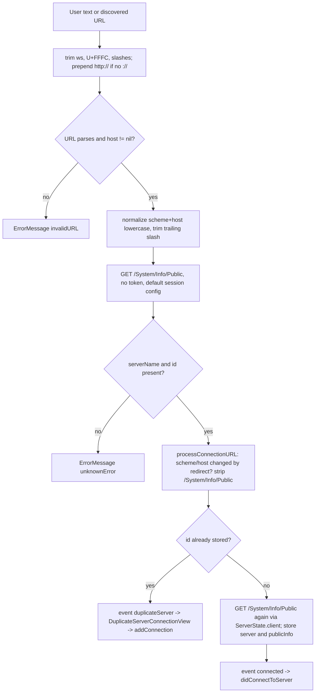
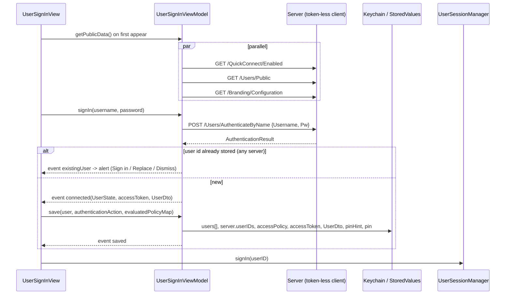
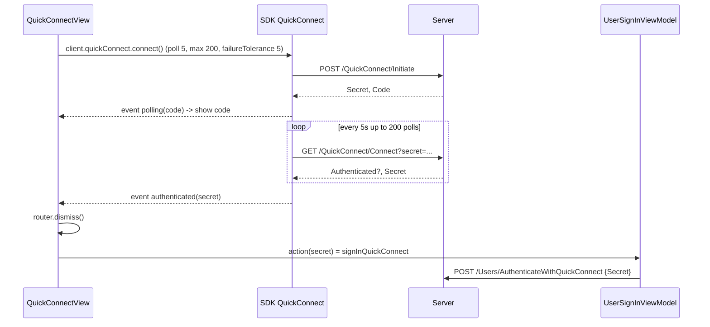
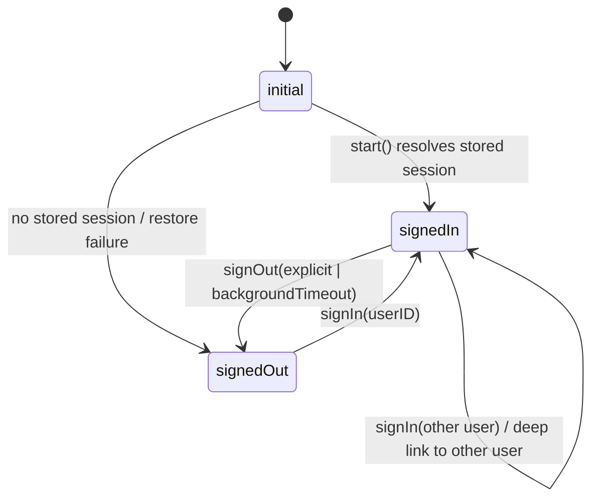

# 03 - Auth, Tokens, Server Discovery, Users, Quick Connect, Session Lifecycle

> **Jellyfin SDK source.** A citation `jellyfin-sdk-swift@3.3.0:PATH:LINE` points into [jellyfin/jellyfin-sdk-swift](https://github.com/jellyfin/jellyfin-sdk-swift) at tag `3.3.0` (commit `8ce10a167ad0b4145b2bc005acf8bebcfe6ebe46`). Open it as `https://github.com/jellyfin/jellyfin-sdk-swift/blob/8ce10a167ad0b4145b2bc005acf8bebcfe6ebe46/PATH#LLINE`; for a range `A-B`, use `#LA-LB`. There is no local copy of the SDK.

Scope: how the client identifies itself, finds and stores servers, signs a user in, keeps and transports the access token, and starts/stops the per-user session.
Related: [00-INDEX.md](00-INDEX.md), [01-endpoints.md](01-endpoints.md), [02-networking.md](02-networking.md), [04-models.md](04-models.md), [05-playback.md](05-playback.md), [07-reporting.md](07-reporting.md), [09-state-cache-persistence.md](09-state-cache-persistence.md), [10-errors-edge-cases.md](10-errors-edge-cases.md), [11-sequence-flows.md](11-sequence-flows.md), [12-gaps.md](12-gaps.md).

Citation format: `path:line` is repo-relative to the Swiftfin app root. The Jellyfin SDK source uses `jellyfin-sdk-swift@3.3.0:Sources/...:LINE`. There is no VLC in this app; engines are AVPlayer and a second, non-AVPlayer engine that is out of scope for this spec (see [05-playback.md](05-playback.md)). Evidence: `grep -rIl -E 'VLC|libvlc'` over the app tree, excluding `fastlane/`, `Tools/`, `SwiftfinMacros/`, `Translations/`, `docs/` and `.git/`, returns zero files.

Sources used: `docs/jellyfin-spec/_work/explorers/topic-auth.json` as the primary explorer, plus topic-networking, topic-errors, topic-persistence, topic-raw-network, topic-websocket. Every citation below was re-opened in source. Where an explorer disagreed with source, it is flagged **CONFLICT** and settled by source.

---

## 1. Client identity (sent on every request)

### 1.1 Configuration values

`JellyfinClient.Configuration.swiftfinConfiguration(url:accessToken:)` builds the identity used by every client in the app (`Shared/Extensions/JellyfinAPI/JellyfinClient.swift:16-39`).

| Field | Value | Source |
|---|---|---|
| `client` | `"Swiftfin \(UIDevice.platform)"` | `Shared/Extensions/JellyfinAPI/JellyfinClient.swift:21` |
| platform string | tvOS build: `L10n.tvOS`; else iPad idiom: `L10n.iPadOS`; else `L10n.iOS` | `Shared/Extensions/UIDevice.swift:49-59` |
| platform literals | `"iOS"`, `"iPadOS"`, `"tvOS"` | `Shared/Strings/ProperNouns.swift:137-140` |
| `deviceName` | `UIDevice.current.name`, diacritic-folded, then only unicode scalars in `CharacterSet.urlQueryAllowed` kept, then `.description` | `Shared/Extensions/JellyfinAPI/JellyfinClient.swift:22-27` |
| `deviceID` | `"\(UIDevice.platform)_\(UIDevice.vendorUUIDString)"` e.g. `iOS_<IDFV uuid>` | `Shared/Extensions/JellyfinAPI/JellyfinClient.swift:28` |
| vendor UUID | `UIDevice.current.identifierForVendor!.uuidString` (force unwrap) | `Shared/Extensions/UIDevice.swift:13-15` |
| `version` | `Bundle.main.infoDictionary["CFBundleShortVersionString"]`, fallback `"0.0.1"` | `Shared/Extensions/JellyfinAPI/JellyfinClient.swift:29` |
| `accessToken` | optional; `nil` unless caller passes it | `Shared/Extensions/JellyfinAPI/JellyfinClient.swift:18,33` |

Notes (derived from the filter at `Shared/Extensions/JellyfinAPI/JellyfinClient.swift:25-27`): `CharacterSet.urlQueryAllowed` is a platform set that excludes space, so spaces in the device name are dropped. This behavior is Foundation's, not in the repo.
The device ID is not persisted by the app. It is recomputed per client from the vendor ID (`Shared/Extensions/JellyfinAPI/JellyfinClient.swift:28`). The vendor ID resets if all vendor apps are removed (platform behavior, not in repo).

Explorer unknown resolved: the L10n platform strings are the constants above (explorer topic-auth listed "Strings.swift not read").

### 1.2 Authorization header

Built per request by the SDK delegate and added with `addValue` (appends if the header already exists):

- Injection: `request.addValue(headers, forHTTPHeaderField: "Authorization")` (`jellyfin-sdk-swift@3.3.0:Sources/PassthroughAPIClientDelegate.swift:19-24`).
- Format: `"MediaBrowser \(fields)"` where fields are `key=value` pairs joined by `", "` (`jellyfin-sdk-swift@3.3.0:Sources/PassthroughAPIClientDelegate.swift:60-63`).
- Keys: `DeviceId`, `Device`, `Client`, `Version`; plus `Token` only when `accessToken != nil` (`jellyfin-sdk-swift@3.3.0:Sources/PassthroughAPIClientDelegate.swift:49-58`).
- Values are not quoted or escaped. Field order is the iteration order of a Swift `Dictionary`, so it is unstable (`jellyfin-sdk-swift@3.3.0:Sources/PassthroughAPIClientDelegate.swift:49-61`).
- The token is read live from `configuration.accessToken` at send time (`jellyfin-sdk-swift@3.3.0:Sources/JellyfinClient.swift:17-19`, `jellyfin-sdk-swift@3.3.0:Sources/PassthroughAPIClientDelegate.swift:22`).

Example shape (derived from the key list and join format cited above; order arbitrary): `Authorization: MediaBrowser DeviceId=iOS_<uuid>, Device=<sanitized>, Client=Swiftfin iOS, Version=<x.y.z>, Token=<accessToken>`.

Request bodies are JSON with `.prettyPrinted` output formatting (`jellyfin-sdk-swift@3.3.0:Sources/JellyfinClient.swift:55-58`). See [02-networking.md](02-networking.md).

### 1.3 Response validation and retry (auth-relevant)

- The app creates `JellyfinClient` without a custom `delegate:` everywhere (`Shared/Services/UserSession/UserSession.swift:41-45`, `Shared/SwiftfinStore/SwiftfinStore+ServerState.swift:30-34`, `Shared/SwiftfinStore/SwiftinStore+UserState.swift:125-129`, `Shared/Services/ServerConnectionManager.swift:79-86`, `Shared/ViewModels/ConnectToServerViewModel.swift:75-78`). So the default validator applies: any status outside 200..<300 throws an unacceptable-status-code error carrying the code (`jellyfin-sdk-swift@3.3.0:Sources/PassthroughAPIClientDelegate.swift:29-37`).
- `shouldRetry` returns `false` when there is no actual delegate (`jellyfin-sdk-swift@3.3.0:Sources/PassthroughAPIClientDelegate.swift:39-41`), so there are no automatic retries.
- Errors shown by views go through `.errorMessage(...)`, an alert titled `L10n.error` whose body is `error.localizedDescription` (`Shared/Extensions/ViewExtensions/ViewExtensions.swift:103-118`). So any non-2xx sign-in response shows the description of that unacceptable-status-code error. Which status the server returns for a wrong password is server behavior and is not shown anywhere in the repo (a 401 is expected but unverified here). See [10-errors-edge-cases.md](10-errors-edge-cases.md).
- The legacy `NetworkError` 401 mapping is fully commented out (`Shared/Errors/NetworkError.swift:99-103`).

### 1.4 Client construction sites and timeouts

| Site | Token | URLSession config | Citation |
|---|---|---|---|
| `UserSession.client` (cached per `effectiveServerURL`) | user token from Keychain | `.swiftfin` (request timeout 20 s) | `Shared/Services/UserSession/UserSession.swift:31-50` |
| `ServerState.client` (computed, a NEW client every access) | none | `.swiftfin` | `Shared/SwiftfinStore/SwiftfinStore+ServerState.swift:29-35` |
| `UserState.getUserData` | Keychain token | `.swiftfin` | `Shared/SwiftfinStore/SwiftinStore+UserState.swift:124-135` |
| `ServerConnectionManager.test` | optional token passed in | copy of `.swiftfin` with request 8 s, resource 12 s, `waitsForConnectivity=false` | `Shared/Services/ServerConnectionManager.swift:69-96` |
| `ConnectToServerViewModel.connectToServer` | none | SDK default `.default` (no `sessionConfiguration:` passed) | `Shared/ViewModels/ConnectToServerViewModel.swift:75-78`, default at `jellyfin-sdk-swift@3.3.0:Sources/JellyfinClient.swift:35` |

- `.swiftfin` is `.default` with `timeoutIntervalForRequest = 20` (`Shared/Extensions/URLSessionConfiguration.swift:15-17`).
- The connect-probe client uses the system default request timeout: it passes no `sessionConfiguration:` (`Shared/ViewModels/ConnectToServerViewModel.swift:75-78`), so the SDK default `.default` applies (`jellyfin-sdk-swift@3.3.0:Sources/JellyfinClient.swift:35`). The 60 s figure is the Apple default for `URLSessionConfiguration.default` and is not in the repo (see Unknowns).
- All of these clients pass a network logging delegate as session delegate (same citations as above).
- The network logging delegate redacts `pw` in `AuthenticateByName` bodies and password fields in `.../Password` bodies (`Shared/Logging/NetworkLogger.swift:30-49`). It does not redact the `AccessToken` in responses, the Quick Connect `Secret`, or the `Authorization` header (no code for it in `Shared/Logging/NetworkLogger.swift:15-57`).

---

## 2. Token transport matrix

The token reaches the server in four different shapes depending on the call.

| Use | How the token is sent | Citation |
|---|---|---|
| Normal API calls via `JellyfinClient.send` | `Authorization: MediaBrowser ..., Token=<token>` | `jellyfin-sdk-swift@3.3.0:Sources/PassthroughAPIClientDelegate.swift:48-63` |
| Video stream URL | query item `ApiKey=<token>` via `client.url(with:queryAPIKey: true)` | `Shared/Objects/MediaPlayerManager/MediaPlayerItem/MediaPlayerItemResolver.swift:256`, `jellyfin-sdk-swift@3.3.0:Sources/JellyfinClient.swift:262-264` |
| Audio stream URL | same `ApiKey` query | `Shared/Objects/MediaPlayerManager/MediaPlayerItem/MediaPlayerItemResolver.swift:274` |
| Remote playback URLs (Swiftfin's Chromecast path, out of scope for this spec) | adds `ApiKey=<token>` unless an `api_key` or `apikey` query item (case-insensitive) with a non-empty value already exists; only `http`/`https` URLs with a host | `Shared/Objects/MediaPlayerManager/RemotePlaybackURL.swift:15-28`, caller `Shared/Objects/MediaPlayerManager/MediaPlayerItem/MediaPlayerItemResolver.swift:145` |
| Trickplay temp-file downloads | header `Authorization: MediaBrowser Token="<token>"` (Token field only, quoted); comment says `X-Emby-Token` is ignored when the server disables legacy authorization | `Shared/Objects/MediaPlayerManager/PlaybackTemporaryFiles.swift:99-102` |
| WebSocket | URL query `ApiKey=<token>&deviceId=<deviceID>` AND header `Authorization` from `authorizationHeaders` | `jellyfin-sdk-swift@3.3.0:Sources/JellyfinClient.swift:316-336`, `jellyfin-sdk-swift@3.3.0:Sources/JellyfinSocket/JellyfinSocket.swift:503-504` |

- The default `client.url(with:)` has `queryAPIKey: false`, so image and similar URLs built that way carry no token (`jellyfin-sdk-swift@3.3.0:Sources/JellyfinClient.swift:254`, `Shared/SwiftfinStore/SwiftinStore+UserState.swift:159-166`).
- The trickplay download session is `URLSessionConfiguration.ephemeral` with `urlCache = nil` and request timeout 20 (`Shared/Objects/MediaPlayerManager/PlaybackTemporaryFiles.swift:25-30`).

Cross-reference: [05-playback.md](05-playback.md) for stream URL parameters, [08-images-subtitles-audio.md](08-images-subtitles-audio.md) for image URLs.

---

## 3. Server discovery and adding a server

### 3.1 UDP LAN discovery

| Item | Value | Citation |
|---|---|---|
| Port | `7359` | `jellyfin-sdk-swift@3.3.0:Sources/ServerDiscovery.swift:41` |
| Broadcast address | `255.255.255.255` | `jellyfin-sdk-swift@3.3.0:Sources/ServerDiscovery.swift:42` |
| Payload | ASCII `"who is JellyfinServer?"` | `jellyfin-sdk-swift@3.3.0:Sources/ServerDiscovery.swift:43`, put in each datagram buffer at `:123`, written at `:127` |
| Listen duration | `.seconds(5)` default; app uses the default | `jellyfin-sdk-swift@3.3.0:Sources/ServerDiscovery.swift:49`, `Shared/ViewModels/ConnectToServerViewModel.swift:178` |
| Socket | UDP datagram socket bound `0.0.0.0` port `0`, options `SO_REUSEADDR` and `SO_BROADCAST` | `jellyfin-sdk-swift@3.3.0:Sources/ServerDiscovery.swift:89-96` |
| Targets | every non-loopback IPv4 interface broadcast address with port 7359, plus `255.255.255.255:7359` | `jellyfin-sdk-swift@3.3.0:Sources/ServerDiscovery.swift:116-118,153-173` |
| Loopback test | `127.0.0.0/8` | `jellyfin-sdk-swift@3.3.0:Sources/ServerDiscovery.swift:175-180` |
| Reply decode | JSON `PublicServer` with keys `Id`, `Name`, `Address`; undecodable datagrams ignored | `jellyfin-sdk-swift@3.3.0:Sources/ServerDiscovery.swift:21-37,138` |
| Errors | `noUsableNetworkInterface` (no interfaces), `noUsableChannel` (bind failed) | `jellyfin-sdk-swift@3.3.0:Sources/ServerDiscovery.swift:15-18,87,97-99` |

Reply JSON model:

| Field | JSON key | Type |
|---|---|---|
| `id` | `Id` | String |
| `name` | `Name` | String |
| `url` | `Address` | URL |

(`jellyfin-sdk-swift@3.3.0:Sources/ServerDiscovery.swift:21-37`)

App behavior:
- `searchForServers` appends each result to `localServers` as `ServerState(urls:[url], currentURL:url, name, id, userIDs:[])` (`Shared/ViewModels/ConnectToServerViewModel.swift:175-188`). Stale entries are never cleared (`Shared/ViewModels/ConnectToServerViewModel.swift:49`). Errors are logged only (`Shared/ViewModels/ConnectToServerViewModel.swift:189-191`).
- The view starts discovery on first appear and repeats every 12 s via a timer, skipped while `state == .connecting` (`Shared/Views/ConnectToServerView/ConnectToServerView.swift:33,154-162`).
- The discovered `Address` is decoded as a `URL` (`jellyfin-sdk-swift@3.3.0:Sources/ServerDiscovery.swift:30,35`). What the server puts in it (for example scheme, host and port) is server payload behavior and is not shown in the repo. It is stored as-is in `ServerState` with no normalization and no `/System/Info/Public` probe at discovery time (`Shared/ViewModels/ConnectToServerViewModel.swift:175-188`).
- Tapping a discovered server sets the URL field to `server.currentURL.absoluteString` and runs `connect` (`Shared/Views/ConnectToServerView/ConnectToServerView.swift:116-121`). So a discovered server goes through the full manual path in 3.2 (normalization, `/System/Info/Public` probe, duplicate check) via `viewModel.connect(url:)` at `:119`.
- `localServers` is an `OrderedSet<ServerState>` (`Shared/ViewModels/ConnectToServerViewModel.swift:50-51`); because `ServerState` is `Hashable` over all fields (`Shared/SwiftfinStore/SwiftfinStore+ServerState.swift:17`), a server reporting a changed name or URL appears as a second entry (inferred from the synthesized `Hashable`).
- The tvOS Info.plist sets `NSAppTransportSecurity` / `NSAllowsArbitraryLoads = true` (`Swiftfin tvOS/Resources/Info.plist:43-47`). No iOS `Info.plist` was found in the repo tree (`find . -name Info.plist`, excluding `docs/` and `.git/`, returns only `Swiftfin tvOS/Resources/Info.plist`), so iOS ATS and local-network permission strings are not documented here (see Unknowns).

### 3.2 Manual connect: URL normalization

Input string `url` is processed in `connectToServer` (`Shared/ViewModels/ConnectToServerViewModel.swift:56-113`):

1. Trim whitespace/newlines; trim U+FFFC (`CharacterSet.objectReplacement`); trim `"/"` from both ends; prepend `"http://"` if the ORIGINAL input does not contain `"://"` (`Shared/ViewModels/ConnectToServerViewModel.swift:59-62`, `Shared/Extensions/String.swift:251`).
2. `URL(string:)` failure -> `ErrorMessage(L10n.invalidURL)` ("Invalid URL") (`Shared/ViewModels/ConnectToServerViewModel.swift:64-67`, `Shared/Strings/Strings.swift:908`).
3. `normalizedServerConnectionURL`: lowercase scheme and host, strip trailing `"/"` from a non-empty path (`Shared/Extensions/URL.swift:89-100`). Host `nil` -> same invalid URL error (`Shared/ViewModels/ConnectToServerViewModel.swift:69-73`).
4. Build a token-less client and `GET /System/Info/Public` (`Shared/ViewModels/ConnectToServerViewModel.swift:75-80`).
5. Require `serverName` and `id` non-nil, else `logger.critical` and `ErrorMessage(L10n.unknownError)` (`Shared/ViewModels/ConnectToServerViewModel.swift:82-87`).
6. Redirect handling `processConnectionURL(initial:response:)` (`Shared/ViewModels/ConnectToServerViewModel.swift:89-92,116-132`): if the response URL's scheme or host differs from the normalized request URL, strip the suffix `Paths.getPublicSystemInfo.url?.absoluteString` (the path `/System/Info/Public`) from the response URL, re-normalize, and use that as the connection URL. Port-only or path-only differences are not compared (`Shared/ViewModels/ConnectToServerViewModel.swift:122-124`).
7. New `ServerState(urls:[connectionURL], currentURL:connectionURL, name, id, userIDs:[])` (`Shared/ViewModels/ConnectToServerViewModel.swift:94-100`).
8. If a stored server has the same `id`: emit `.duplicateServer` and stop (`Shared/ViewModels/ConnectToServerViewModel.swift:102-109`). Otherwise `save(server:)` then emit `.connected` (`Shared/ViewModels/ConnectToServerViewModel.swift:111-112`).
9. `save(server:)` calls `/System/Info/Public` a SECOND time through `ServerState.client` (20 s config), appends the server to `StoredValues[.Server.servers]`, and stores the response at `StoredValues[.Server.publicInfo(id:)]` (`Shared/ViewModels/ConnectToServerViewModel.swift:134-143`).

States: `connect` is `.loop(.connecting)`; `cancel` goes to `.initial` (`Shared/ViewModels/ConnectToServerViewModel.swift:29-35`). The Connect button is disabled when the URL field is empty (`Shared/Views/ConnectToServerView/ConnectToServerView.swift:102`). On `.connected` the view posts `Notifications[.didConnectToServer]` and dismisses (`Shared/Views/ConnectToServerView/ConnectToServerView.swift:37-40`); `SelectUserView` reacts by reloading servers and selecting the new one (`Shared/Views/SelectUserView/SelectUserView.swift:438-441`).



Diagram nodes restate the cited behaviour of `ConnectToServerViewModel` and `ServerState` in 3.1 to 3.3 and the citations there (`Shared/ViewModels/ConnectToServerViewModel.swift:29-35,75-83`, `Shared/Views/ConnectToServerView/ConnectToServerView.swift:37-40,169-175`); the diagram itself is derived.

### 3.3 Duplicate server: add a connection URL

- The view shows `DuplicateServerConnectionView`; confirming calls `viewModel.addConnection(serverState:)`, clears the sheet and dismisses (`Shared/Views/ConnectToServerView/ConnectToServerView.swift:169-175`).
- `_addConnection`: find stored server by id (else `logger.critical` and `ErrorMessage("An internal error has occurred")`) (`Shared/ViewModels/ConnectToServerViewModel.swift:146-151`); `ensureServerConnections()`; reuse the connection with an equal normalized URL or append `ServerConnection(id: UUID().uuidString, name: url string, url, interface: .any, priority: connections.count)`; save; set as active; post `Notifications[.didChangeServerConnection]` (`Shared/ViewModels/ConnectToServerViewModel.swift:153-172`).

### 3.4 Public server info and version gate

- Decoded model `PublicSystemInfo` JSON keys: `Id`, `StartupWizardCompleted`, `LocalAddress`, `OperatingSystem`, `ProductName`, `ServerName`, `Version` (`jellyfin-sdk-swift@3.3.0:Sources/Entities/PublicSystemInfo.swift:48-54`). The app reads `serverName`, `id`, `version` (`Shared/ViewModels/ConnectToServerViewModel.swift:82-83`, `Shared/SwiftfinStore/SwiftfinStore+ServerState.swift:123,173`).
- `isVersionCompatible` is true only when the stored `publicInfo.version` parsed as `JellyfinClient.Version` has `majorMinor >= client.version.majorMinor`; a nil version is false (`Shared/SwiftfinStore/SwiftfinStore+ServerState.swift:120-128`).
- `client.version` is the constant `"12.1.0"` (`jellyfin-sdk-swift@3.3.0:Sources/Extensions/Info.swift:16-18`). `Version` parsing returns `0.0.0` unless the string splits on `.` into exactly three integers (`jellyfin-sdk-swift@3.3.0:Sources/Extensions/Info.swift:46-65`). So a four-component server version string parses as `0.0.0`. The result only drives a warning icon in the UI (`Shared/Views/SettingsView/SettingsView.swift:65-67`, `Shared/Views/EditLocalServerView.swift:66`); it does not block use.
- Splash image URL for login backgrounds: `client.url(with: Paths.getSplashscreen())` with no tag or format (`Shared/SwiftfinStore/SwiftfinStore+ServerState.swift:145-147`); path `GET /Branding/Splashscreen` at `jellyfin-sdk-swift@3.3.0:Sources/Paths/GetSplashscreenAPI.swift:15`, with optional query keys `tag` (`:20`) and `format` (`:21`) built in `makeGetSplashscreenQuery` (`:18-22`).

---

## 4. Server connections (multi-URL, auto-switch)

### 4.1 Model

`ServerState` (type alias of `SwiftfinStore.State.Server`, `Shared/SwiftfinStore/SwiftfinStore.swift:17`) is `Hashable, Identifiable, Codable` with fields `urls: Set<URL>` (legacy), `currentURL: URL` (legacy), `name`, `id`, `userIDs: [String]` (`Shared/SwiftfinStore/SwiftfinStore+ServerState.swift:17-25`). The `urls` and `currentURL` fields are annotated "Use connections instead" (`Shared/SwiftfinStore/SwiftfinStore+ServerState.swift:19-22`).

`ServerConnection` (`Shared/Objects/ServerConnection.swift:11-115`):

| Field | Type | Notes | Citation |
|---|---|---|---|
| `id` | String | UUID string | `Shared/Objects/ServerConnection.swift:37`, created at `Shared/ViewModels/ConnectToServerViewModel.swift:159` |
| `name` | String | `displayTitle` falls back to the URL if blank | `Shared/Objects/ServerConnection.swift:38,60-62` |
| `url` | URL | declared at `Shared/Objects/ServerConnection.swift:39`; the type does not normalize. Callers pass normalized URLs (`Shared/ViewModels/ConnectToServerViewModel.swift:155,161`, `Shared/SwiftfinStore/SwiftfinStore+ServerState.swift:155,160`, `Shared/ViewModels/ServerConnectionViewModel.swift:74`, `Shared/Views/EditServerConnectionView.swift:356,373-380`) | `Shared/Objects/ServerConnection.swift:39` |
| `interface` | `any` / `wifi` / `cellular` (raw strings) | | `Shared/Objects/ServerConnection.swift:13-16,40` |
| `wifiSSIDs` | [String] | default `[]` | `Shared/Objects/ServerConnection.swift:41,49` |
| `priority` | Int | re-indexed `0..n` by `ordered()` | `Shared/Objects/ServerConnection.swift:42,95-103` |

Matching rules `matches(_ context)`: `.any` matches when `context.isSatisfied`; `.wifi` requires `context.interface == .wifi` and, when `wifiSSIDs` is non-empty, a case-insensitive SSID match against `context.wifiSSID ?? ""`; `.cellular` requires `context.interface == .cellular` (`Shared/Objects/ServerConnection.swift:64-80`).
Duplicate check: same URL, same interface, same SSID set after `localizedLowercase` on each SSID, different id (`Shared/Objects/ServerConnection.swift:82-93`).

Stored keys (`StoredValues`): `.Server.servers` (owner `swiftfinApp`, field `servers`, storage `.sql`, default `[]`), `.Server.publicInfo(id:)` (field `publicInfo`), `.Server.connections(id:)` (field `serverConnections`, default `[]`), `.Server.activeConnectionID(id:)` (field `activeServerConnectionID`, default empty string), `.Server.isAutoSwitchEnabled(id:)` (field `isAutoSwitchEnabled`, default `false`) (`Shared/SwiftfinStore/StoredValue/StoredValues+Server.swift:50-89`). See [09-state-cache-persistence.md](09-state-cache-persistence.md).

### 4.2 Resolution of the active URL

- Default connections when none stored: `[currentURL] + other legacy urls sorted by absoluteString`; name is `L10n.currentURL` when the un-normalized `url == currentURL`, else `normalizedURL.absoluteString` (the normalized URL string); interface `.any`; priority is the list index (`Shared/SwiftfinStore/SwiftfinStore+ServerState.swift:149-165`).
- `serverConnections` getter returns defaults if the stored list is empty, else the priority-ordered stored list; the setter stores with `preservingOrder: true` (`Shared/SwiftfinStore/SwiftfinStore+ServerState.swift:130-143`).
- `activeServerConnection`: stored `activeConnectionID` if non-empty and found; else the connection whose URL equals the normalized `currentURL`; else the first connection (`Shared/SwiftfinStore/SwiftfinStore+ServerState.swift:41-54`). Setting it stores the id or empty string (`Shared/SwiftfinStore/SwiftfinStore+ServerState.swift:55-57`).
- `effectiveServerURL = activeServerConnection?.url ?? currentURL` (`Shared/SwiftfinStore/SwiftfinStore+ServerState.swift:85-87`). Clients built from a stored server or session use this URL: `UserSession.client` (`Shared/Services/UserSession/UserSession.swift:33,42`), `ServerState.client` (`Shared/SwiftfinStore/SwiftfinStore+ServerState.swift:31`) and `UserState.getUserData` (`Shared/SwiftfinStore/SwiftinStore+UserState.swift:126`). Two clients do not: `ServerConnectionManager.test` uses the candidate `connection.url` (`Shared/Services/ServerConnectionManager.swift:79-83`), and `ConnectToServerViewModel` uses the typed, normalized URL (`Shared/ViewModels/ConnectToServerViewModel.swift:69,75-76`).
- `UserSession.client` is rebuilt only when `effectiveServerURL` differs from the cached client's URL. The user session and item store are kept (`Shared/Services/UserSession/UserSession.swift:31-50`).

### 4.3 Auto-switch (experimental)

Gate: the UserDefaults flag `.Experimental.serverConnectionAutoSwitch` AND `userSession.server.isAutoSwitchEnabled` (`Shared/Services/ServerConnectionManager.swift:246-250`). The UserDefaults flag is a per-user key `experimentalServerConnectionAutoSwitch`, default `false` (`Shared/Services/SwiftfinDefaults.swift:418-420`; `UserKey` uses the current user's `UserDefaults` suite, `Shared/Services/SwiftfinDefaults.swift:56-58`).

```mermaid
sequenceDiagram
    participant OS as NWPathMonitor
    participant M as ServerConnectionManager
    participant S as Server (candidate URLs)
    OS->>M: pathUpdateHandler(path)
    M->>M: NetworkConnectionContext(path) (isSatisfied, interface, wifiSSID)
    M->>M: schedule resolution (cancel previous, sleep 1.5s)
    M->>M: candidates = serverConnections.filter(matches(context))
    loop each candidate in priority order
        M->>S: GET /System/Info/Public (8s req / 12s resource, token if any)
        S-->>M: PublicSystemInfo
        M->>M: id must equal server.id else connectionServerMismatch
    end
    M->>M: first success becomes active; post didChangeServerConnection if changed
```

Diagram is derived from the bullets below. Step to citation: path update and context `Shared/Services/ServerConnectionManager.swift:150-165`; 1.5 s debounce `:192-203`; filter, probe, first success `:98-148`; id mismatch `:91-93`; change notification after a resolution picks a different connection `:221-225` (a network-context change posts separately at `:235-244`).

- Path monitoring: an `NWPathMonitor` started on a private queue in `didStart`; every path update builds a new context and calls `contextDidUpdate` (`Shared/Services/ServerConnectionManager.swift:150-165,261-263`).
- `contextDidUpdate`: if the context changed and is satisfied, post `didChangeServerConnection` with the current active connection; then schedule resolution (`Shared/Services/ServerConnectionManager.swift:235-244`).
- Debounce: `Task.sleep(for: .seconds(1.5))` after cancelling any pending evaluation (`Shared/Services/ServerConnectionManager.swift:192-203`).
- `NetworkConnectionContext`: `isSatisfied = path.status == .satisfied`; interface is `.wifi` if `usesInterfaceType(.wifi)`, else `.cellular` if cellular, else `.any`; SSID read with `NEHotspotNetwork.fetchCurrent()` on iOS only and `nil` otherwise (`Shared/Objects/NetworkConnectionContext.swift:32-39,70-88`). Blank SSIDs become `nil`; the `NWPath` init fetches the SSID only when the path is satisfied and on Wi-Fi, and `currentWifiSSID()` applies `.nilIfBlank` (`Shared/Objects/NetworkConnectionContext.swift:29,34,80-88`).
- `evaluate`: unsatisfied context -> `.unreachable([])`; no matching candidates -> `.unreachable([])`; none reachable -> `.unreachable(candidates)`; else set the active connection (if different) and return `.connected` (`Shared/Services/ServerConnectionManager.swift:98-119`).
- Probing is sequential and stops at the first success; failures are logged at info (`Shared/Services/ServerConnectionManager.swift:121-148`).
- Probe check: `publicInfo.id != serverID` -> `ErrorMessage(L10n.connectionServerMismatch)` ("This connection does not point to the current server.") (`Shared/Services/ServerConnectionManager.swift:91-93`, `Shared/Strings/Strings.swift:406`).
- The probe sends the user token when called from a session (`Shared/Services/ServerConnectionManager.swift:213-218`). The same endpoint is also called with no token: the connect probe builds its client with no `accessToken` (`Shared/ViewModels/ConnectToServerViewModel.swift:75-80`), and `ServerState.client` has none either (`Shared/SwiftfinStore/SwiftfinStore+ServerState.swift:27-35,98-104`). So the app treats `/System/Info/Public` as public; the server-side auth rule itself is not in the repo.
- Triggers: `willStart` of a session runs `resolveActiveConnection()` (`Shared/Services/ServerConnectionManager.swift:255-259`); every app foreground calls `scheduleServerConnectionResolution()` (`Shared/Services/UserSession/UserSessionManager.swift:181-184`); a settings view can also run it, skipped while there is active playback (`Shared/ViewModels/ServerConnectionViewModel.swift:147-166`).
- `stop` cancels the task, the monitor, and resets context to `.unavailable` (`Shared/Services/ServerConnectionManager.swift:179-190`).
- A `didChangeServerConnection` post makes `ViewModel` instances re-resolve their cached `userSession` (`Shared/ViewModels/ViewModel.swift:28-33`) and makes `ServerSocketManager` reconnect the socket (`Shared/Services/ServerSocketManager.swift:213-218`).
- Manual management: `saveConnection` tests first and upserts only on success; `setActiveConnectionIfValid` tests first; `deleteConnection` refuses when only one connection exists or it is the active one (`Shared/ViewModels/ServerConnectionViewModel.swift:98-118,168-175`). `testConnection` calls `ServerConnectionManager.test` with the session token (`Shared/ViewModels/ServerConnectionViewModel.swift:125-145`).

---

## 5. Authentication endpoints

All paths are relative to the server URL (which may contain a base path): the SDK passes `configuration.url` as the base URL of the SDK's HTTP client (`jellyfin-sdk-swift@3.3.0:Sources/JellyfinClient.swift:44`). Source of each path: the SDK `Paths` file.

| Purpose | Method and path | Query | Body (JSON keys) | Response | Token on request | Path source |
|---|---|---|---|---|---|---|
| Public info | `GET /System/Info/Public` | none | none | `PublicSystemInfo` | no, except auto-switch/test probes, which send the user token (`Shared/Services/ServerConnectionManager.swift:79-88,213-218`, `Shared/ViewModels/ServerConnectionViewModel.swift:131`) | `jellyfin-sdk-swift@3.3.0:Sources/Paths/GetPublicSystemInfoAPI.swift:15` |
| Public users | `GET /Users/Public` | none | none | `[UserDto]` | no | `jellyfin-sdk-swift@3.3.0:Sources/Paths/GetPublicUsersAPI.swift:15` |
| Branding | `GET /Branding/Configuration` | none | none | `BrandingOptionsDto` (`CustomCss`, `SplashscreenEnabled`, `LoginDisclaimer`) | no | `jellyfin-sdk-swift@3.3.0:Sources/Paths/GetBrandingOptionsAPI.swift:14-15`, keys `jellyfin-sdk-swift@3.3.0:Sources/Entities/BrandingOptionsDto.swift:29-31` |
| QC enabled | `GET /QuickConnect/Enabled` | none | none | JSON bool in `Data` | no | `jellyfin-sdk-swift@3.3.0:Sources/Paths/GetQuickConnectEnabledAPI.swift:15` |
| Password login | `POST /Users/AuthenticateByName` | none | `{"Username": String, "Pw": String}` | `AuthenticationResult` | no | `jellyfin-sdk-swift@3.3.0:Sources/Paths/AuthenticateUserByNameAPI.swift:15`, body keys `jellyfin-sdk-swift@3.3.0:Sources/Entities/AuthenticateUserByName.swift:31-32` |
| QC login | `POST /Users/AuthenticateWithQuickConnect` | none | `{"Secret": String}` | `AuthenticationResult` | no | `jellyfin-sdk-swift@3.3.0:Sources/Paths/AuthenticateWithQuickConnectAPI.swift:15`, key `jellyfin-sdk-swift@3.3.0:Sources/Entities/QuickConnectDto.swift:27` |
| QC initiate | `POST /QuickConnect/Initiate` | none | none | `QuickConnectResult` | no | `jellyfin-sdk-swift@3.3.0:Sources/Paths/InitiateQuickConnectAPI.swift:15` |
| QC poll | `GET /QuickConnect/Connect` | `secret=<String>` | none | `QuickConnectResult` | no | `jellyfin-sdk-swift@3.3.0:Sources/Paths/GetQuickConnectStateAPI.swift:15` |
| QC authorize (other device) | `POST /QuickConnect/Authorize` | `code=<String>`, `userId=<String>` | none | JSON bool in `Data` | yes | path `jellyfin-sdk-swift@3.3.0:Sources/Paths/AuthorizeQuickConnectAPI.swift:16`, method `:17`, query keys `code` `:25` and `userId` `:26` (built in `makeAuthorizeQuickConnectQuery`, `:23-28`) |
| Change password | `POST /Users/Password` | `userId=<String>` | `{"CurrentPw": String, "NewPw": String}` (other fields nil are omitted; initializer `UpdateUserPassword(currentPassword:currentPw:isResetPassword:newPw:)`, all optional: `jellyfin-sdk-swift@3.3.0:Sources/Entities/UpdateUserPassword.swift:22`) | empty | yes | `jellyfin-sdk-swift@3.3.0:Sources/Paths/UpdateUserPasswordAPI.swift:15`, query key `userId` at `:20` (built in `makeUpdateUserPasswordQuery`, `:18-22`), keys `jellyfin-sdk-swift@3.3.0:Sources/Entities/UpdateUserPassword.swift:39-42` |
| Current user | `GET /Users/Me` | none | none | `UserDto` | yes | `jellyfin-sdk-swift@3.3.0:Sources/Paths/GetCurrentUserAPI.swift:15` |
| Capabilities (socket) | `POST /Sessions/Capabilities` | `playableMediaTypes`, `supportedCommands`, `supportsMediaControl` (and `id`, `supportsPersistentIdentifier` unset) | none | empty | yes | `jellyfin-sdk-swift@3.3.0:Sources/Paths/PostCapabilitiesAPI.swift:13-45`, `jellyfin-sdk-swift@3.3.0:Sources/JellyfinSocket/JellyfinSocket.swift:179-185` |
| Revoke key (only app caller is the admin dashboard) | `DELETE /Auth/Keys/{key}` | none | none | empty | yes | `jellyfin-sdk-swift@3.3.0:Sources/Paths/RevokeKeyAPI.swift:15`, `Shared/ViewModels/AdminDashboard/APIKeysViewModel.swift:95` |

"Token on request" for the unauthenticated rows is derived from the clients used: `ServerState.client` and the connect-probe client are built without `accessToken` (`Shared/SwiftfinStore/SwiftfinStore+ServerState.swift:29-35`, `Shared/ViewModels/ConnectToServerViewModel.swift:75-78`).

Call sites:
- `/System/Info/Public`: `Shared/ViewModels/ConnectToServerViewModel.swift:80,136`, `Shared/SwiftfinStore/SwiftfinStore+ServerState.swift:98-104`, `Shared/Services/ServerConnectionManager.swift:88`.
- `/Users/Public`: `Shared/ViewModels/UserSignInViewModel.swift:272-277`.
- `/Branding/Configuration`: `Shared/ViewModels/UserSignInViewModel.swift:279-286`.
- `/QuickConnect/Enabled`: `Shared/ViewModels/UserSignInViewModel.swift:288-294`.
- `/Users/AuthenticateByName`: `Shared/ViewModels/UserSignInViewModel.swift:130` via `jellyfin-sdk-swift@3.3.0:Sources/JellyfinClient.swift:206-217`.
- `/Users/AuthenticateWithQuickConnect`: `Shared/ViewModels/UserSignInViewModel.swift:158` via `jellyfin-sdk-swift@3.3.0:Sources/JellyfinClient.swift:229-240`.
- `/QuickConnect/Initiate` and `/QuickConnect/Connect`: `jellyfin-sdk-swift@3.3.0:Sources/QuickConnect.swift:98-110,141-149`, driven from `Shared/Views/QuickConnectView.swift:63`.
- `/QuickConnect/Authorize`: `Shared/ViewModels/QuickConnectAuthorizeViewModel.swift:55`.
- `/Users/Password`: `Shared/ViewModels/ResetUserPasswordViewModel.swift:50-53`.
- `/Users/Me`: `Shared/SwiftfinStore/SwiftinStore+UserState.swift:131`.

Response models:

| Model | JSON keys | Citation |
|---|---|---|
| `AuthenticationResult` | `AccessToken`, `ServerId`, `SessionInfo`, `User` (all optional) | `jellyfin-sdk-swift@3.3.0:Sources/Entities/AuthenticationResult.swift:31-34` |
| `QuickConnectResult` | `AppName`, `AppVersion`, `Code`, `DateAdded`, `DeviceId`, `DeviceName`, `Authenticated`, `Secret` | `jellyfin-sdk-swift@3.3.0:Sources/Entities/QuickConnectResult.swift:52-59` |
| `UserDto` (fields the auth code reads) | `Id`, `Name`, `PrimaryImageTag`, `LastActivityDate`, `Policy`, others | `jellyfin-sdk-swift@3.3.0:Sources/Entities/UserDto.swift:80-93` |

The app reads: `accessToken`, `user`, `user.id`, `user.name` (`Shared/ViewModels/UserSignInViewModel.swift:132-135`); `loginDisclaimer` (`Shared/ViewModels/UserSignInViewModel.swift:283`); `isAuthenticated` and `secret` (`jellyfin-sdk-swift@3.3.0:Sources/QuickConnect.swift:146`). Full model detail is in [04-models.md](04-models.md); endpoint index is [01-endpoints.md](01-endpoints.md).

---

## 6. Sign-in flows

### 6.1 Select user screen (signed out)

- `UserSessionRootView` shows `SelectUserView` while state is `.signedOut` (`Shared/Coordinators/Root/UserSessionRootView.swift:27-30`).
- Users are grouped by `serverID`; servers sorted by name; users sorted by username (`Shared/ViewModels/SelectUserViewModel.swift:70-83`). The view can also sort by `data.lastActivityDate` (`Shared/Views/SelectUserView/SelectUserView.swift:114-126`).
- Selecting a user: evaluate the user's `accessPolicy` via `authenticationAction`; if a PIN was entered pass it, else `""`; then `viewModel.signIn(user, pin:)` (`Shared/Views/SelectUserView/SelectUserView.swift:139-159`).
- `SelectUserViewModel._signIn`: only when `user.accessPolicy == .requirePin` AND a keychain value for `"<userID>-pin"` exists, compare; mismatch -> `ErrorMessage(L10n.incorrectPinForUser(username))` ("Incorrect pin for %@"); then emit `.signedIn(user)` (`Shared/ViewModels/SelectUserViewModel.swift:85-94`, `Shared/Strings/Strings.swift:866-868`). If the policy is `.requirePin` but no stored PIN exists, sign-in proceeds without a PIN check (`Shared/ViewModels/SelectUserViewModel.swift:87`).
- On `.signedIn` the view calls `userSessionManager.signIn(userID:)` (`Shared/Views/SelectUserView/SelectUserView.swift:422-432`). `signIn(userID:)` itself makes no dedicated token-validation call and uses the stored token, but it does start network activity: the `Task` running `refreshServerInformationIfNeeded(.explicitSignIn)` sends `GET /System/Info/Public` and `GET /Users/Me` (`Shared/Services/UserSession/UserSessionManager.swift:103-111,235-250`), and session start opens the WebSocket (see 9.2 step 5).
- Deleting users: `user.delete()` per user, then reload (`Shared/ViewModels/SelectUserViewModel.swift:61-68`). See 8.4 for what delete removes.

### 6.2 Add user: password



Diagram is derived from the bullets below. Step to citation: parallel public GETs `Shared/ViewModels/UserSignInViewModel.swift:106-115`, triggered on first appear `Shared/Views/UserSignInView.swift:332-335`; `AuthenticateByName` `:130`; existing vs new user `:141-151`; `save` writes `:187-240`; `.saved` then `signIn(userID:)` `Shared/Views/UserSignInView.swift:79-88`.

- `getPublicData` is a background action; the three requests run with `async let` and ANY failure throws and fails the whole action (`Shared/ViewModels/UserSignInViewModel.swift:106-115`, background state at `:67-68`). It is called in `onFirstAppear` (`Shared/Views/UserSignInView.swift:332-335`).
- The Quick Connect button appears only when `/QuickConnect/Enabled` decoded to `true`; a decode failure counts as `false` (`Shared/ViewModels/UserSignInViewModel.swift:292-293`, `Shared/Views/UserSignInView.swift:195`).
- The login disclaimer is shown only when non-nil and non-empty, rendered as markdown (`Shared/ViewModels/UserSignInViewModel.swift:283-285`, `Shared/Views/UserSignInView.swift:225-230`).
- Tapping a public user sets the username field to `user.name ?? ""`, clears the password field (`password = ""`) and focuses the password field; it does not sign in (`Shared/Views/UserSignInView.swift:246-248,276-278`).
- There are two sign-in triggers, and both call `viewModel.signIn(username:password:)`: the Sign In button (`Shared/Views/UserSignInView.swift:172-176`) and submitting the password `SecureField` (`Shared/Views/UserSignInView.swift:119-130`, call at `:126-129`).
- Only the Sign In button is disabled when the username is empty (`Shared/Views/UserSignInView.swift:192`); an empty password is allowed. The password-field submit has no such guard (`Shared/Views/UserSignInView.swift:123-130`).
- `UserSignInViewModel._signIn` only trims the inputs and has no empty-username check before the request (`Shared/ViewModels/UserSignInViewModel.swift:117-130`). So submitting the password field with an empty username sends `POST /Users/AuthenticateByName` with an empty `Username`. The button guard tests the raw text, so a whitespace-only username also passes it and is trimmed to empty (`Shared/Views/UserSignInView.swift:192`, `Shared/ViewModels/UserSignInViewModel.swift:122-124`). How the server answers is not in the repo.
- Input cleanup: username and password are each trimmed of whitespace/newlines then of U+FFFC (`Shared/ViewModels/UserSignInViewModel.swift:122-128`). Intentional or not, passwords with leading or trailing whitespace cannot be sent.
- The call is `server.client.signIn(username:password:)` on a fresh token-less client (`Shared/ViewModels/UserSignInViewModel.swift:130`, `Shared/SwiftfinStore/SwiftfinStore+ServerState.swift:29-35`). The SDK sets the token on that throwaway client (`jellyfin-sdk-swift@3.3.0:Sources/JellyfinClient.swift:210-211`); the app ignores it and uses `response.accessToken`.
- A missing `AccessToken` throws `JellyfinClient.ClientError.noAccessToken` (`jellyfin-sdk-swift@3.3.0:Sources/JellyfinClient.swift:212-214`).
- Missing `accessToken`, `user`, `user.id` or `user.name` -> `logger.critical` and `ErrorMessage(L10n.unknownError)` ("Unknown error") (`Shared/ViewModels/UserSignInViewModel.swift:132-139`, `Shared/Strings/Strings.swift:1980`).
- Existing-user check: `StoredValues[.User.users].first { $0.id == id }`, ignoring the server (`Shared/ViewModels/UserSignInViewModel.swift:182-185`). Jellyfin user IDs are server-scoped GUIDs, so two servers could in theory collide (inference; no code handles it).
- States: `signIn` and `signInQuickConnect` are `.loop(.signingIn)`; `cancel` returns to `.initial` (`Shared/ViewModels/UserSignInViewModel.swift:61-72`).

`save` (new user) (`Shared/ViewModels/UserSignInViewModel.swift:187-240`):
1. Evaluate local access policy through `authenticationAction` (none / device auth / PIN modal) and map the evaluated policy (injects the PIN hint) (`:194-201`).
2. Replace/append the `UserState` in `StoredValues[.User.users]` (`:203-209`).
3. Append the user id to the server's `userIDs` (`:211-225`).
4. Write `accessPolicy`, `accessToken` (Keychain), `data` (`UserDto`) (`:227-229`).
5. If a PIN policy was evaluated: write `pinHint` when present and `pin` (Keychain) (`:231-237`).
6. Emit `.saved`; the view then calls `userSessionManager.signIn(userID:)` and dismisses (`:239`, `Shared/Views/UserSignInView.swift:79-88`).

`saveExisting` (`Shared/ViewModels/UserSignInViewModel.swift:242-270`): evaluates the EXISTING user's policy; for a PIN policy compares the entered PIN with `user.state.state.pin` (note: `pin` getter asserts if missing, `Shared/SwiftfinStore/SwiftinStore+UserState.swift:53-60`); mismatch -> `incorrectPinForUser`; if `replaceForAccessToken` overwrites the Keychain token with the new one; emits `.saved`. The alert offers "Sign in" (keep old token), "Replace" (store new token), "Dismiss" (`Shared/Views/UserSignInView.swift:336-378`). A TODO in the file notes password changes currently require delete and re-sign-in (`Shared/ViewModels/UserSignInViewModel.swift:19-22`).

### 6.3 Add user: Quick Connect (this device signs in)



Diagram is derived from the bullets below. Step to citation: `connect()` defaults `jellyfin-sdk-swift@3.3.0:Sources/QuickConnect.swift:52-56`; initiate `:98-110`; `polling` and `authenticated` events `:89-95`; poll loop `:112-149`; view handling and `router.dismiss()` `Shared/Views/QuickConnectView.swift:63-69`; action wired to `signInQuickConnect` `Shared/Views/UserSignInView.swift:198-203`; `AuthenticateWithQuickConnect` `Shared/ViewModels/UserSignInViewModel.swift:158`.

- The Quick Connect screen receives `viewModel.server.client`, a token-less client (`Shared/Views/UserSignInView.swift:198-203`).
- The app calls `connect()` with defaults: `poll: 5`, `max: 200`, `failureTolerance: 5` (`jellyfin-sdk-swift@3.3.0:Sources/QuickConnect.swift:52-56`, call at `Shared/Views/QuickConnectView.swift:63`). Preconditions: `poll > 0`, `max > 0`, `failureTolerance >= 0` (`jellyfin-sdk-swift@3.3.0:Sources/QuickConnect.swift:58-60`).
- `retrieveSecretAndCode`: `Secret` or `Code` nil -> `QuickConnectError.retrievingCodeFailed` (`jellyfin-sdk-swift@3.3.0:Sources/QuickConnect.swift:98-109`).
- Polling: for up to `max` iterations, call `checkAuthorization`; success returns `Secret` only when `Authenticated == true` and `Secret != nil` (`jellyfin-sdk-swift@3.3.0:Sources/QuickConnect.swift:141-149`). A non-authenticated result resets the consecutive-failure counter; an error increments it and rethrows once it exceeds `failureTolerance`; sleep `interval` seconds between polls; after `max` polls throw `QuickConnectError.maxPollingHit` (`jellyfin-sdk-swift@3.3.0:Sources/QuickConnect.swift:119-138`). Defaults are `poll: 5`, `max: 200` (`jellyfin-sdk-swift@3.3.0:Sources/QuickConnect.swift:52-55`) and each poll sleeps `interval` seconds (`:135`), so worst-case duration is about 200 x 5 s = 1000 s, plus request time (derived).
- Cancellation: stream termination cancels the task; `CancellationError` ends the stream cleanly (`jellyfin-sdk-swift@3.3.0:Sources/QuickConnect.swift:63-78`).
- The view shows the code with `tracking(10)` and three instruction strings; errors replace the content with `ErrorView` (`Shared/Views/QuickConnectView.swift:25-58,72-74`).
- The returned secret is the one the server reports at poll time (`authorizedSecret`), not necessarily the initiate secret (`jellyfin-sdk-swift@3.3.0:Sources/QuickConnect.swift:93,146-148`).
- After `.authenticated` the view dismisses itself first, then awaits the sign-in action (`Shared/Views/QuickConnectView.swift:67-69`).
- `signInQuickConnect` then follows the same existing/new user branching as the password flow (`Shared/ViewModels/UserSignInViewModel.swift:154-180`). Note it logs the missing-data case at `error`, not `critical` (`Shared/ViewModels/UserSignInViewModel.swift:165`).

### 6.4 Authorize another device's Quick Connect code (this device is signed in)

- `QuickConnectAuthorizeViewModel.authorize(code:)` sends `POST /QuickConnect/Authorize?code=<code>&userId=<UserDto.id>` through `ViewModel.send`, i.e. the authenticated session client (`Shared/ViewModels/QuickConnectAuthorizeViewModel.swift:47-56`, `Shared/ViewModels/ViewModel.swift:63-65`).
- A nil `user.id` -> `logger.critical` and `ErrorMessage(L10n.unknownError)` (`Shared/ViewModels/QuickConnectAuthorizeViewModel.swift:50-53`). So `userId` is always sent by this caller (the SDK parameter is optional, `jellyfin-sdk-swift@3.3.0:Sources/Paths/AuthorizeQuickConnectAPI.swift:14`).
- The response `Data` is decoded as a JSON `Bool`; decode failure or `false` -> `ErrorMessage("Authorization unsuccessful")` (hard-coded English) (`Shared/ViewModels/QuickConnectAuthorizeViewModel.swift:58-63`).
- UI: the code field is truncated to 6 characters and the button is disabled unless the code has exactly 6 characters (`Views/QuickConnectAuthorizeView.swift:110,119-121`).
- **CONFLICT (settled by source):** explorer topic-auth lists timeout for this call as "default". Source: the call goes through `UserSession.client`, built with `.swiftfin` (request timeout 20 s) (`Shared/Services/UserSession/UserSession.swift:41-45`, `Shared/Services/UserSession/UserSession+Items.swift:41-48`). The same applies to `/Users/Password`.

### 6.5 Change password

- `ResetUserPasswordViewModel.reset(current:new:)`: `UpdateUserPassword(currentPw: current, newPw: new)` -> `POST /Users/Password?userId=<userID>` via `ViewModel.send`; emits `.success` (`Shared/ViewModels/ResetUserPasswordViewModel.swift:48-56`). State goes `.resetting` then `.initial` (`Shared/ViewModels/ResetUserPasswordViewModel.swift:26-28`).
- The view submits the "confirm new password" field as the new password (`Views/ResetUserPasswordView.swift:97,158`).
- It does not touch the stored token or sign the user out. The old token stays in the Keychain (no code in `Shared/ViewModels/ResetUserPasswordViewModel.swift:48-56`).
- Server-side effect on other sessions or the old token after a password change is not determinable from the repo (see Unknowns).

---

## 7. Local user security (PIN and device auth)

This is a device-local gate: policy evaluation makes no network call, and the PIN is compared to the Keychain value locally (`Shared/Components/WithLocalUserAuthentication.swift:89-109`, `Shared/ViewModels/SelectUserViewModel.swift:85-88`).

| Policy | Raw string | Behavior | Citation |
|---|---|---|---|
| `none` | `"none"` | no check | `Shared/Objects/LocalUserAccessPolicy.swift:9-13`, `Shared/Components/WithLocalUserAuthentication.swift:94-95` |
| `requireDeviceAuthentication` | `"requireDeviceAuthentication"` | iOS: `LAContext().canEvaluatePolicy(.deviceOwnerAuthentication)` then `evaluatePolicy(.deviceOwnerAuthentication, localizedReason:)`; tvOS: throws `ErrorMessage(L10n.deviceAuthFailed)` ("Device authentication failed") | `Shared/Components/WithLocalUserAuthentication.swift:79-87,97-99`, `Shared/Strings/Strings.swift:586` |
| `requirePin` | `"requirePin"` | modal PIN request; length must be 4...30 else `ErrorMessage(L10n.invalidPin)` ("Invalid PIN") | `Shared/Components/WithLocalUserAuthentication.swift:101-107`, `Shared/Strings/Strings.swift:906` |

- The authentication action is injected into the SwiftUI environment by `WithLocalUserAuthentication`, wrapping `RootView` in the iOS and tvOS apps (`Shared/Components/WithLocalUserAuthentication.swift:111-116`, `App/SwiftfinApp.swift:30-31`, `Swiftfin tvOS/App/SwiftfinApp.swift:23`).
- PIN prompts use a checked continuation; a second concurrent PIN request or cancellation throws `CancellationError`; the view disappearing cancels (`Shared/Components/WithLocalUserAuthentication.swift:50-77,125-127`).
- Storage: PIN in Keychain key `"<userID>-pin"`; `pinHint` and `accessPolicy` in `StoredValues` (`Shared/SwiftfinStore/SwiftinStore+UserState.swift:53-83`, keys `Shared/SwiftfinStore/StoredValue/StoredValues+User.swift:90-96,134-140`).
- Changing policy in settings: for `.requirePin` writes the new PIN to Keychain, otherwise deletes the `-pin` item; then writes policy and hint (`Shared/ViewModels/LocalUserSecurityViewModel.swift:26-37`). `check(oldPin:)` compares against the Keychain PIN only when one exists (`Shared/ViewModels/LocalUserSecurityViewModel.swift:18-24`).
- The PIN is stored in clear text in the Keychain and compared as a plain string (`Shared/ViewModels/SelectUserViewModel.swift:87-88`).

---

## 8. Stored auth state

### 8.1 Keychain

- Service: the Keychain, accessed through a wrapper created with default options and held as a singleton in a shared dependency container; a TODO says "take a look at all security options" (`Shared/Services/Keychain.swift:15-18`). No access group, accessibility level, or sync option is set in app code (same lines; the wrapper's actual defaults are not verified, see Unknowns).
- Access token: Keychain key `"<userID>-accessToken"`. Getter asserts (`assertionFailure`) and returns `""` if missing; setter writes the key (`Shared/SwiftfinStore/SwiftinStore+UserState.swift:30-42`). A missing token therefore results in `Token=` with an empty value on release builds.
- PIN: Keychain key `"<userID>-pin"` (`Shared/SwiftfinStore/SwiftinStore+UserState.swift:53-65`).
- Migration: V1 data stored the token in the Core Data store; the V1 to V2 migration copies each token into Keychain `"<userID>-accessToken"` (`Shared/SwiftfinStore/SwiftfinStore.swift:175-183,211-224,359-371`).

### 8.2 StoredValues and UserDefaults

| What | Where | Key | Citation |
|---|---|---|---|
| Users list | StoredValues (SQL) | `.User.users`, owner `swiftfinApp`, field `users` | `Shared/SwiftfinStore/StoredValue/StoredValues+User.swift:78-86` |
| `UserState` | struct `{id, serverID, username}` Codable | | `Shared/SwiftfinStore/SwiftinStore+UserState.swift:19-23` |
| Cached `UserDto` | StoredValues | `.User.data(id:)`, field `userData` | `Shared/SwiftfinStore/StoredValue/StoredValues+User.swift:100-106` |
| Access policy | StoredValues | `.User.accessPolicy(id:)`, field `accessPolicy`, default `.none` | `Shared/SwiftfinStore/StoredValue/StoredValues+User.swift:90-96` |
| Pin hint | StoredValues | `.User.pinHint(id:)`, field `pinHint`, default `""` | `Shared/SwiftfinStore/StoredValue/StoredValues+User.swift:134-140` |
| Last signed-in user | UserDefaults suite `swiftfinApp` | `lastSignedInUserID`, `UserSessionState`, default `.signedOut` | `Shared/Services/SwiftfinDefaults.swift:28,83` |
| Background sign-out interval | UserDefaults app | `backgroundSignOutInterval` default `3600` (seconds) | `Shared/Services/SwiftfinDefaults.swift:81` |
| Background timestamp | UserDefaults app | `backgroundTimeStamp` default `Date.now` | `Shared/Services/SwiftfinDefaults.swift:82` |
| Last server-info refresh | UserDefaults app | `lastServerInformationRefreshDate` default `.distantPast` | `Shared/Services/SwiftfinDefaults.swift:84` |
| Sign out on background | UserDefaults app | `signOutOnBackground` default `true` | `Shared/Services/SwiftfinDefaults.swift:92` |
| Sign out on close | UserDefaults app | `signOutOnClose` default `false` | `Shared/Services/SwiftfinDefaults.swift:93` |
| Per-user settings | `UserDefaults(suiteName: <userID>)`, or `"default"` when signed out; suite resolved at key-access time (`UserKey` is called from computed `static var` keys such as `.Experimental.serverConnectionAutoSwitch`, and `currentUserSuite` reads `lastSignedInUserID` on each access) | | `Shared/Services/SwiftfinDefaults.swift:32-43,56-58,413-420` |

`UserSessionState` raw value: empty string = `.signedOut`; any other string = `.signedIn(userID:)` (`Shared/Services/UserSession/UserSessionState.swift:9-29`).
Server rows: see 4.1. Persistence internals: [09-state-cache-persistence.md](09-state-cache-persistence.md).

### 8.3 In-memory

- `UserSessionManager.currentSession` (`@Published`), `state`, `pendingDeepLink` (`Shared/Services/UserSession/UserSessionManager.swift:53-60`); the shared dependency container's `currentUserSession` entry is cached and reset on every session change (`Shared/Services/UserSession/UserSessionManager.swift:24-27,309`).
- `UserSession` holds `server`, `user`, lazy `ItemStore`, a cached `JellyfinClient`, `ServerConnectionManager`, `ServerSocketManager` (`Shared/Services/UserSession/UserSession.swift:14-61`).

### 8.4 Delete user / delete server

- `UserState.delete()`: remove from users list; `deleteSettings()` (all `AnyStoredData` owned by the user id plus the user's `UserDefaults` suite); remove the id from `server.userIDs`; delete Keychain `"<id>-pin"` (`Shared/SwiftfinStore/SwiftinStore+UserState.swift:86-120`).
- It does NOT delete `"<id>-accessToken"` from the Keychain (no such call in `Shared/SwiftfinStore/SwiftinStore+UserState.swift:90-120`). No `DELETE`/logout request is sent either (see 9.5).
- `ServerState.delete()`: removes users for the server, their stored data and suites, the server's own stored data/suite, and the server entry (`Shared/SwiftfinStore/SwiftfinStore+ServerState.swift:60-83`). The user access tokens and PINs in the Keychain are not touched there either (no Keychain call in that function).
- Triggers: `ServerConnectionViewModel.delete()` posts `didDeleteServer` (`Shared/ViewModels/ServerConnectionViewModel.swift:61-68`); `SelectUserView` reloads on it (`Shared/Views/SelectUserView/SelectUserView.swift:445-447`).

---

## 9. Session lifecycle

### 9.1 State machine



(`Shared/Services/UserSession/UserSessionManager.swift:32-37,83-124,281-318`.)

### 9.2 Launch

1. `RootCoordinator.start` runs `SwiftfinStore.setupDataStack()`; failure becomes `AppStartupError.dataStack` shown as `ErrorView` (`Shared/Coordinators/Root/RootCoordinator.swift:62-74`, `Shared/Coordinators/Root/RootView.swift:19-31`).
2. `UserSessionRootView` `.task` calls `userSessionManager.start()` (`Shared/Coordinators/Root/UserSessionRootView.swift:40-42`). `start()` is a no-op unless `state == .initial` (`Shared/Services/UserSession/UserSessionManager.swift:85`).
3. If the UserDefaults key `signOutOnClose` is true, then `lastSignedInUserID = .signedOut` first (`Shared/Services/UserSession/UserSessionManager.swift:88-90`).
4. `resolveStoredSession`: read `lastSignedInUserID`; look up the user in `StoredValues[.User.users]` and its server in `StoredValues[.Server.servers]`; either missing -> reset to `.signedOut` and throw `UserSessionError.invalidStoredSession(userID:)` (`Shared/Services/UserSession/UserSessionManager.swift:320-333`, `Shared/Services/UserSession/UserSessionError.swift:9-13`). `start()` catches, logs "Unable to restore launch session" and applies a `nil` session (`Shared/Services/UserSession/UserSessionManager.swift:93-100`).
5. The app makes no dedicated token-validation call, and no 401 signs the user out. Session start does still hit the network: `UserSession.didStart` calls `ServerSocketManager.start()` (`Shared/Services/UserSession/UserSession.swift:81-85`, `Shared/Services/ServerSocketManager.swift:227-229`), whose `runConnection` calls `client.socket(...).connect(responseTimeout: .seconds(10))` (`Shared/Services/ServerSocketManager.swift:60-67,115-138`). That sends `POST /Sessions/Capabilities` (errors ignored) and then opens the WebSocket with query `ApiKey=<token>` and `deviceId`, plus an `Authorization` header (`jellyfin-sdk-swift@3.3.0:Sources/JellyfinSocket/JellyfinSocket.swift:496,503-504`, `jellyfin-sdk-swift@3.3.0:Sources/JellyfinClient.swift:316-336`). A 401 or 403 there sets `wasRefused` (see 9.6). With auto-switch on, `ServerConnectionManager.willStart` also probes `GET /System/Info/Public` (`Shared/Services/ServerConnectionManager.swift:255-259`). A select-user `signIn` additionally refreshes server and user info (9.3, 9.4). An invalid token is otherwise discovered by the first authenticated request (see 9.6).
6. UI: `.initial` -> `ProgressView`; `.signedOut` -> `SelectUserView`; `.signedIn` -> `MainTabView` with `.id(userSessionManager.currentSession.map(ObjectIdentifier.init))`; the view identity changes with the session object, which makes SwiftUI treat it as a new view (inferred from SwiftUI `.id` semantics) (`Shared/Coordinators/Root/UserSessionRootView.swift:23-37`).

### 9.3 Applying a session (serialized)

`updateCurrentSession` chains each transition after the previous one's task; `applyCurrentSession` does, in order (`Shared/Services/UserSession/UserSessionManager.swift:281-318`):
1. `stopActivePlayback()` -> `mediaPlayerManager.stop()` (`:127-129,304`).
2. `previousSession?.willStop()` (`:305`).
3. `await newSession?.willStart()` (`:306`).
4. Publish `currentSession`; reset the shared dependency container's `currentUserSession` (`:308-309`).
5. Set `state` to `.signedOut` (nil) or `.signedIn` (`:311-315`).
6. `newSession?.didStart()` (`:317`).

`UserSession` hooks (`Shared/Services/UserSession/UserSession.swift:71-97`):
- `willStart`: `observeItemChanges()` then each service's `willStart` in order `[serverConnectionManager, serverSocketManager]` (`:57-61,72-78`).
- `didStart`: each service's `didStart` (`:81-85`) -> `ServerConnectionManager.start()` (path monitor) and `ServerSocketManager.start()` (`Shared/Services/ServerConnectionManager.swift:261-263`, `Shared/Services/ServerSocketManager.swift:227-229`).
- `willStop`: cancel item-change observation, services' `willStop` in reverse order, `items.invalidate()`, complete `itemActionErrors` (`:88-97`).
- `ServerConnectionManager.willStart` runs one connection resolution before the session is published (`Shared/Services/ServerConnectionManager.swift:255-259`), so a session start can wait up to about 12 s per candidate URL when auto-switch is enabled: `timeoutIntervalForRequest = 8` is an idle timeout and `timeoutIntervalForResource = 12` caps each probe (`Shared/Services/ServerConnectionManager.swift:74-77,121-148`).

`signIn(userID:)`: set `lastSignedInUserID`, resolve the stored session, apply it, then start an unstructured `Task { await refreshServerInformationIfNeeded(reason: .explicitSignIn) }` (not `Task.detached`; it inherits the `@MainActor` context and is not awaited) (`Shared/Services/UserSession/UserSessionManager.swift:103-111`).

### 9.4 Server information refresh

- `refreshServerInformationIfNeeded(reason:)`: `.explicitSignIn` always runs; `.stale` runs only if `lastServerInformationRefreshDate` is older than 24 hours (`Date.isStale`: `now - date > interval`) (`Shared/Services/UserSession/UserSessionManager.swift:235-244`, `Shared/Extensions/Date.swift:13-15`).
- It calls `server.updateServerInfo()` (re-fetch `GET /System/Info/Public`, update stored server name and `publicInfo`) then `user.updateUserData(server:)` (`GET /Users/Me` with the Keychain token, update stored username and `UserDto`), then stores `lastServerInformationRefreshDate = Date.now` (`Shared/Services/UserSession/UserSessionManager.swift:246-250`, `Shared/SwiftfinStore/SwiftfinStore+ServerState.swift:167-185`, `Shared/SwiftfinStore/SwiftinStore+UserState.swift:122-153`).
- Any error is logged ("Unable to refresh server and user information") and swallowed; a 401 here does not sign the user out (`Shared/Services/UserSession/UserSessionManager.swift:251-256`).
- Cost note: `lastServerInformationRefreshDate` is one global app default, not per server or user (`Shared/Services/SwiftfinDefaults.swift:84`).

### 9.5 Sign out is local only

- `signOut(reason:)` (`.backgroundTimeout` or `.explicit`): returns early if there is no session and no transition; sets `lastSignedInUserID = .signedOut`; applies a nil session; logs the reason (`Shared/Services/UserSession/UserSessionManager.swift:39-43,113-124`).
- It makes NO network call: no `POST /Sessions/Logout`, no token revocation. The SDK has `JellyfinClient.signOut()` which calls `Paths.revokeKey(key: accessToken)` (`DELETE /Auth/Keys/{key}`) (`jellyfin-sdk-swift@3.3.0:Sources/JellyfinClient.swift:244-251`), but the app never calls `.signOut()` on a client (grep finds no `signOut()` call in app code; the only match is the SDK declaration). The `userSessionManager.signOut(reason:)` call sites are `Shared/Views/SettingsView/SettingsView.swift:86`, `Views/AdminDashboardView/ServerBackup/ServerBackupDetailsView/ServerBackupDetailsView.swift:102`, and the automatic `appWillEnterForeground` path at `Shared/Services/UserSession/UserSessionManager.swift:194` (`.backgroundTimeout`, see 9.7).
- `SignOutReason` has exactly two cases: `.backgroundTimeout` (only from `appWillEnterForeground`) and `.explicit` (both UI callers) (`Shared/Services/UserSession/UserSessionManager.swift:39-43`). The reason is only logged (`Shared/Services/UserSession/UserSessionManager.swift:120-123`); it does not change behavior.
- **Policy decision for a rebuild (inference, not a code fact):** the app's sign-out is local-only (no revoke), the opposite of the SDK's `JellyfinClient.signOut()`, which revokes the token and clears `configuration.accessToken` (`jellyfin-sdk-swift@3.3.0:Sources/JellyfinClient.swift:242-251`). The spec documents what Swiftfin does (keep token for passwordless "Switch user"). An implementer must choose: shipping revoke would break the passwordless switch-user restore (6.1), because the stored token would be dead.
- The access token stays in the Keychain, so "Switch user" can later restore the user without a password. `signOut` has no Keychain call (`Shared/Services/UserSession/UserSessionManager.swift:113-124`). Selecting the user again checks only the local PIN policy, then emits `.signedIn` (`Shared/ViewModels/SelectUserViewModel.swift:85-94`). `signIn(userID:)` resolves the stored session (`Shared/Services/UserSession/UserSessionManager.swift:103-106`), and the session client reads the stored token (`Shared/Services/UserSession/UserSession.swift:42`) from Keychain key `"<userID>-accessToken"` (`Shared/SwiftfinStore/SwiftinStore+UserState.swift:30-42`). No dedicated token-validation call is sent (6.1, 9.2 step 5).
- Explicit callers: the "Switch user" button in settings (`Shared/Views/SettingsView/SettingsView.swift:82-90`) and the OK button after a server-backup restore (`Views/AdminDashboardView/ServerBackup/ServerBackupDetailsView/ServerBackupDetailsView.swift:96-107`).
- Consequence (inferred from the absence of any revoke call; server behavior is not verified in repo): the app leaves the server-side token unrevoked. `Paths.revokeKey` is used by the admin API keys screen only (`Shared/ViewModels/AdminDashboard/APIKeysViewModel.swift:95`).

### 9.6 Invalid or expired token handling

- No code inspects HTTP 401 for authenticated calls. The app has no `validateResponse` delegate (see 1.3). Failures surface as per-screen errors; the session is never cleared automatically. Verified by search: the only `401` or `unacceptableStatusCode` hit in app code is the commented `case 401:` at `Shared/Errors/NetworkError.swift:99`. `Shared/Services/ServerSocketManager.swift:181-185` has neither string; it matches the SDK's `SocketError.unauthorized`. The 401/403 literals live in the SDK at `jellyfin-sdk-swift@3.3.0:Sources/JellyfinSocket/JellyfinSocket.swift:119`.
- WebSocket: `SocketError.unauthorized(statusCode:)` and `.missingAccessToken` are fatal (`jellyfin-sdk-swift@3.3.0:Sources/JellyfinSocket/JellyfinSocket.swift:98-121`, `isFatal` at `:108-115`, `rejection(statusCode:)` returns it only for 401 or 403 at `:118-121`). The handshake mapping reads `webSocketTask.response`, calls `SocketError.rejection`, sets `isRejected` and throws (`jellyfin-sdk-swift@3.3.0:Sources/JellyfinSocket/JellyfinSocket.swift:546-554`). A fatal error is caught into `refusal`, then the event stream finishes with it and the loop returns `nil`, which stops reconnecting (`jellyfin-sdk-swift@3.3.0:Sources/JellyfinSocket/JellyfinSocket.swift:439-440,452-455`). The app sets `wasRefused = true` and then waits for a wake signal instead of retrying on a timer (`Shared/Services/ServerSocketManager.swift:180-185,203-209`). It does not sign out.
- The socket also sends `POST /Sessions/Capabilities` (errors ignored with `try?`) with `supportsMediaControl: true`, supported commands `displayContent, play, playMediaSource, playState, playTrailers, setAudioStreamIndex, setMaxStreamingBitrate, setSubtitleStreamIndex`, and `playableMediaTypes: [.video]` (`Shared/Services/ServerSocketManager.swift:124-137`, `jellyfin-sdk-swift@3.3.0:Sources/JellyfinSocket/JellyfinSocket.swift:496`). The app connects with `responseTimeout: .seconds(10)` (`Shared/Services/ServerSocketManager.swift:138`). Full socket spec: [02-networking.md](02-networking.md).

### 9.7 Background and foreground

- `UIApplication.didEnterBackgroundNotification` -> UserDefaults `backgroundTimeStamp` set to `Date.now` (`Shared/Services/Notifications.swift:168-170`, `Shared/Services/UserSession/UserSessionManager.swift:176-179,259-267`).
- `UIApplication.willEnterForegroundNotification` -> `appWillEnterForeground()` (`Shared/Services/Notifications.swift:172-174`, `Shared/Services/UserSession/UserSessionManager.swift:269-276`):
  1. `scheduleServerConnectionResolution()`.
  2. unstructured (not `Task.detached`, `@MainActor`-inheriting, not awaited) `Task` running the stale refresh (`.stale`, 24 h).
  3. return if there is no session, `signOutOnBackground` is false, or there is active playback.
  4. If `now - backgroundTimeStamp > backgroundSignOutInterval` (default 3600 s, `Shared/Services/SwiftfinDefaults.swift:81`), `signOut(reason: .backgroundTimeout)` (`Shared/Services/UserSession/UserSessionManager.swift:189-195`).
  (`Shared/Services/UserSession/UserSessionManager.swift:181-196`)
- Active playback blocks the timeout sign-out check (`Shared/Services/UserSession/UserSessionManager.swift:189`, `hasActivePlayback` at `:74-77`, `Shared/Objects/MediaPlayerManager/MediaPlayerManager.swift:41-43`).
- `backgroundTimeStamp` defaults to `Date.now` at first read and is a persisted UserDefaults key (`Shared/Services/SwiftfinDefaults.swift:82`).

### 9.8 Deep links

- Schemes: `swiftfin` and `jellyfin` registered for tvOS (`Swiftfin tvOS/Resources/Info.plist:24-27`); no iOS `Info.plist` was found (`find` evidence in 3.1; see Unknowns).
- Grammar: `^(?:swiftfin|jellyfin):\/\/(?<serverID>[A-Za-z0-9-]+)\/(?<userID>[A-Za-z0-9-]+)\/(?<destinationType>item|library)\/(?<destinationID>[A-Za-z0-9-]+)\/?$` (`Shared/Services/DeepLink.swift:24-27`). Even for `library`, the destination is always built as `.item(id:)` (`Shared/Services/DeepLink.swift:32`).
- `handleOpenURL`: parse; find the stored server by `id` and user by `id` with matching `serverID` (errors `DeepLinkError.missingServer` / `.missingUser`, logged "Failed to process deep link"); if the target differs from the current server+user, run local authentication for the target user's policy (PIN compared with the Keychain PIN if one exists) then `signIn(userID:)`; finally set `pendingDeepLink` (`Shared/Services/UserSession/UserSessionManager.swift:136-165,204-233`, `Shared/Services/DeepLink.swift:47-50`).
- The URL is only handled if `localUserAuthenticationAction` is in the environment (`Shared/Coordinators/Root/UserSessionRootView.swift:43-51`).
- `consumePendingDeepLink()` returns and clears it (`Shared/Services/UserSession/UserSessionManager.swift:167-174`).

---

## 10. CONFLICTS and discrepancies found

| # | Topic | Version A | Version B | Resolution |
|---|---|---|---|---|
| 1 | Timeout for `/QuickConnect/Authorize` and `/Users/Password` | explorer topic-auth: "default" (`topic-auth.json` endpoints entries) | session client uses `.swiftfin`, 20 s | **Settled by source:** `Shared/Services/UserSession/UserSession.swift:41-45`, `Shared/ViewModels/ViewModel.swift:63-68`, `Shared/Services/UserSession/UserSession+Items.swift:41-48,63-67` |
| 2 | What a failed sign-in shows | explorer topic-auth: "generic error per screen"; explorer topic-errors: alert reads `Response status code was unacceptable: 401.` | n/a | **Settled by source:** alert body is `error.localizedDescription` (`Shared/Extensions/ViewExtensions/ViewExtensions.swift:103-118`) |
| 3 | Explorer line anchors for `NetworkConnectionContext` | topic-auth cites `:76-82`, `:91-98` | actual interface logic is `:70-78`, SSID logic `:80-88` | Source used here; substance is the same |

---

## 11. Unknowns (not determinable from source in scope)

| Question | Evidence | Where to look |
|---|---|---|
| Keychain accessibility class and iCloud sync of the Keychain wrapper's defaults | app passes no options (`Shared/Services/Keychain.swift:17`); the wrapper's source is not covered by this spec | the Keychain wrapper's source |
| Default request timeout of `URLSessionConfiguration.default` used by the connect probe | app passes no config (`Shared/ViewModels/ConnectToServerViewModel.swift:75-78`); Apple documents 60 s | Apple docs |
| iOS `Info.plist` contents (ATS, local network usage, `CFBundleURLSchemes`, background modes) | only the tvOS plist exists in the repo tree: `find . -name Info.plist` (excluding `docs/`, `.git/`) returns only `Swiftfin tvOS/Resources/Info.plist` | Xcode project build settings |
| Whether a server invalidates the old token after `POST /Users/Password` | server behavior | Jellyfin server |
| Server-side effect of never revoking tokens on sign-out or delete | no revoke call in app (see 9.5, 8.4) | Jellyfin server `/Devices`, `/Auth/Keys` |
| Practical effect of `isVersionCompatible` comparing against `"12.1.0"` | constant at `jellyfin-sdk-swift@3.3.0:Sources/Extensions/Info.swift:16-18`; server version strings are not defined in repo | Jellyfin release versions |

Further gaps are tracked in [12-gaps.md](12-gaps.md); error catalog in [10-errors-edge-cases.md](10-errors-edge-cases.md); end-to-end sequences in [11-sequence-flows.md](11-sequence-flows.md).

---

## 12. Quick rebuild checklist

Each step restates the cited sections; the file:line evidence is in those sections. Key anchors: header and token (`jellyfin-sdk-swift@3.3.0:Sources/PassthroughAPIClientDelegate.swift:48-63`), socket (`jellyfin-sdk-swift@3.3.0:Sources/JellyfinClient.swift:316-336`), launch (`Shared/Services/UserSession/UserSessionManager.swift:83-100`), refresh (`:235-256`), sign-out and 3600 s timeout (`:113-124,181-196`, `Shared/Services/SwiftfinDefaults.swift:81`).

1. Compute `Client`, `Device`, `DeviceId`, `Version` once per request; add `Token` after sign-in (sections 1.1, 1.2).
2. Normalize the server URL, probe `GET /System/Info/Public`, require `ServerName` and `Id`, detect redirects by scheme/host, de-duplicate by `Id` (section 3.2).
3. Optional UDP discovery: broadcast `who is JellyfinServer?` to port 7359 for 5 s (section 3.1).
4. Fetch `/QuickConnect/Enabled`, `/Users/Public`, `/Branding/Configuration` in parallel before showing sign-in (section 6.2).
5. Sign in with `POST /Users/AuthenticateByName {Username, Pw}` or QC (`/QuickConnect/Initiate`, poll `/QuickConnect/Connect?secret=` every 5 s up to 200 times, then `POST /Users/AuthenticateWithQuickConnect {Secret}`) (sections 5, 6.2, 6.3).
6. Persist `{id, serverID, username}`, `UserDto`, token in secure storage under `<userID>-accessToken`, and remember `lastSignedInUserID` (section 8).
7. Use the token as a header for API calls, as `ApiKey` query for stream URLs, and as both for the WebSocket (section 2).
8. Restore the last session at launch with no dedicated token-validation call (the WebSocket still connects with the token; section 9.2 step 5); refresh public info and `/Users/Me` on sign-in and every 24 h at foreground (sections 9.2, 9.4).
9. Sign out locally; sign out automatically after 3600 s in background unless playing (sections 9.5, 9.7).
