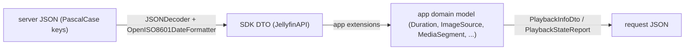

# 04 - Models: DTOs, Domain Models, JSON Mapping

> **Jellyfin SDK source.** A citation `jellyfin-sdk-swift@3.3.0:PATH:LINE` points into [jellyfin/jellyfin-sdk-swift](https://github.com/jellyfin/jellyfin-sdk-swift) at tag `3.3.0` (commit `8ce10a167ad0b4145b2bc005acf8bebcfe6ebe46`). Open it as `https://github.com/jellyfin/jellyfin-sdk-swift/blob/8ce10a167ad0b4145b2bc005acf8bebcfe6ebe46/PATH#LLINE`; for a range `A-B`, use `#LA-LB`. There is no local copy of the SDK.

Part of the Swiftfin Jellyfin client spec. See [00-INDEX.md](00-INDEX.md). Related: [01-endpoints.md](01-endpoints.md), [02-networking.md](02-networking.md), [03-auth-session.md](03-auth-session.md), [05-playback.md](05-playback.md), [06-vlc.md](06-vlc.md) (engine notes; the app has no VLC, engines are AVPlayer and a second, non-AVPlayer engine that is out of scope), [07-reporting.md](07-reporting.md), [08-images-subtitles-audio.md](08-images-subtitles-audio.md), [09-state-cache-persistence.md](09-state-cache-persistence.md), [10-errors-edge-cases.md](10-errors-edge-cases.md), [11-sequence-flows.md](11-sequence-flows.md), [12-gaps.md](12-gaps.md).

Citation formats: app files as `path:line` relative to the repo root; SDK as `jellyfin-sdk-swift@3.3.0:Sources/...:LINE`. SDK line numbers for request-body DTOs (marked "encode") point at the `encode(to:)` key lines; decode keys are the same strings a few lines above.

Conventions: Swift property names are camelCase. On the wire every SDK DTO uses explicit PascalCase keys through `StringCodingKey` (example: `jellyfin-sdk-swift@3.3.0:Sources/Entities/PublicSystemInfo.swift:48-54`). So the JSON key column below is authoritative; the Swift name is only for orientation. "opt" means the Swift type is `T?` and the decoder uses `decodeIfPresent`.

---

## 1. Wire-level rules shared by every DTO

| Rule | Value | Source |
|---|---|---|
| JSON decoder date strategy | `.formatted(OpenISO8601DateFormatter())` | `jellyfin-sdk-swift@3.3.0:Sources/JellyfinClient.swift:49-53` |
| JSON encoder date strategy | same formatter; `outputFormatting = .prettyPrinted` | `jellyfin-sdk-swift@3.3.0:Sources/JellyfinClient.swift:55-58` |
| Primary date format | `yyyy-MM-dd'T'HH:mm:ss.SSSZZZZZ`, calendar iso8601, locale `en_US_POSIX`, timezone GMT+0 | `jellyfin-sdk-swift@3.3.0:Sources/OpenISO8601Formatter.swift:23-28` |
| Fallback date format | `yyyy-MM-dd'T'HH:mm:ssZZZZZ` (has seconds, no fraction; the static is named `withoutSeconds`) tried when primary returns nil | `jellyfin-sdk-swift@3.3.0:Sources/OpenISO8601Formatter.swift:14-21`, `:40-45` |
| Missing optional keys | decode to `nil`, never throw | e.g. `jellyfin-sdk-swift@3.3.0:Sources/Entities/PublicSystemInfo.swift:48-54` |
| Required key exception | Most response keys use `decodeIfPresent`. Keys decoded with `decode` (decode throws if absent): `UserItemDataDto.Key` (`jellyfin-sdk-swift@3.3.0:Sources/Entities/UserItemDataDto.swift:68`); `UserPolicy.AuthenticationProviderId` and `UserPolicy.PasswordResetProviderId` (`jellyfin-sdk-swift@3.3.0:Sources/Entities/UserPolicy.swift:162`, `:201`), so a `UserDto.Policy` object without them makes the whole `UserDto` decode throw. Other DTOs with required keys: `UserDataChangeInfo.UserDataList` (`.../UserDataChangeInfo.swift:25`), all five `UploadSubtitleDto` fields (`.../UploadSubtitleDto.swift:34-38`), and `PublicServer` (non-optional `let` fields, plain `CodingKeys` enum, not `StringCodingKey`; `jellyfin-sdk-swift@3.3.0:Sources/ServerDiscovery.swift:32-36`) | `jellyfin-sdk-swift@3.3.0:Sources/Entities/UserItemDataDto.swift:68` |
| Ticks | 1 tick = 100 ns. `Duration.ticks(n)` = `Duration.microseconds(Int64(n) / 10)`; `Duration.ticks` getter = `Int(microseconds * 10)` | `Shared/Extensions/Duration.swift:19-20`, `Shared/Extensions/Duration.swift:55-57` |
| Legacy seconds helper | `PlayerStateInfo.positionSeconds = positionTicks / 10_000_000` (deprecated) | `Shared/Extensions/JellyfinAPI/PlayerStateInfo.swift:20-26` |
| SDK API version constant | `"12.1.0"`; `JellyfinClient.Version` parses `a.b.c`, anything not exactly 3 non-negative ints becomes `(0,0,0)` | `jellyfin-sdk-swift@3.3.0:Sources/Extensions/Info.swift:16-18`, `:46-65` |
| Server compatibility check | `server.majorMinor >= client.version.majorMinor`; false when `publicInfo.version` is nil | `Shared/SwiftfinStore/SwiftfinStore+ServerState.swift:120-128` |

---

## 2. Auth, server, and user models

### 2.1 PublicSystemInfo (SDK, response of public info endpoint)
Source: `jellyfin-sdk-swift@3.3.0:Sources/Entities/PublicSystemInfo.swift:12-54`. Also persisted per server (see 2.5).

| Swift | JSON key | Type | Opt | App use |
|---|---|---|---|---|
| id | `Id` | String | yes | server id; used as `ServerState.id` (`Shared/ViewModels/ConnectToServerViewModel.swift:94-100`) |
| isStartupWizardCompleted | `StartupWizardCompleted` | Bool | yes | not read (grep of app sources finds no `StartupWizardCompleted`/`isStartupWizardCompleted` use) |
| localAddress | `LocalAddress` | String | yes | not read (grep finds no `LocalAddress`/`localAddress` use in app sources) |
| operatingSystem | `OperatingSystem` | String | yes | deprecated in SDK (`@available(*, deprecated, message: "Deprecated")`, `jellyfin-sdk-swift@3.3.0:Sources/Entities/PublicSystemInfo.swift:19`) |
| productName | `ProductName` | String | yes | not read (grep finds no `ProductName`/`productName` use in app sources) |
| serverName | `ServerName` | String | yes | overwrites `ServerState.name` in `updateServerInfo` (`Shared/SwiftfinStore/SwiftfinStore+ServerState.swift:173`) |
| version | `Version` | String | yes | compatibility check (section 1) |

### 2.2 AuthenticationResult (SDK)
Source: `jellyfin-sdk-swift@3.3.0:Sources/Entities/AuthenticationResult.swift:12-44` (decode keys `:31-34`).

| Swift | JSON key | Type | Opt |
|---|---|---|---|
| accessToken | `AccessToken` | String | yes |
| serverID | `ServerId` | String | yes |
| sessionInfo | `SessionInfo` | SessionInfoDto | yes |
| user | `User` | UserDto | yes |

Sign-in builds `UserState` from `user.Id`, `server.id`, `user.Name`; the token comes from `AccessToken` (guard on `response.accessToken` at `Shared/ViewModels/UserSignInViewModel.swift:132` for password sign-in and `:160` for Quick Connect; `UserState` built at `:144-150`). See [03-auth-session.md](03-auth-session.md).

### 2.3 UserDto and UserConfiguration (SDK)
`UserDto` keys: `jellyfin-sdk-swift@3.3.0:Sources/Entities/UserDto.swift:80-93`.

| Swift | JSON key | Type |
|---|---|---|
| configuration | `Configuration` | UserConfiguration |
| enableAutoLogin | `EnableAutoLogin` | Bool |
| hasConfiguredEasyPassword | `HasConfiguredEasyPassword` | Bool |
| hasConfiguredPassword | `HasConfiguredPassword` | Bool |
| hasPassword | `HasPassword` | Bool |
| id | `Id` | String |
| lastActivityDate | `LastActivityDate` | Date |
| lastLoginDate | `LastLoginDate` | Date |
| name | `Name` | String |
| policy | `Policy` | UserPolicy |
| primaryImageAspectRatio | `PrimaryImageAspectRatio` | Double |
| primaryImageTag | `PrimaryImageTag` | String |
| serverID | `ServerId` | String |
| serverName | `ServerName` | String |

All opt. Playback relevant `UserPolicy` keys: `EnableMediaPlayback` (`jellyfin-sdk-swift@3.3.0:Sources/Entities/UserPolicy.swift:179`), `EnableContentDownloading` (`:174`), `IsAdministrator` (`:193`). `presentPlayButton` is false unless `user.data.policy?.enableMediaPlayback == true` and `type` is in a fixed list of kinds (`Shared/Extensions/JellyfinAPI/BaseItemDto/BaseItemDto.swift:527-538`). It does not check id or `isMissing`. `canShuffle` additionally requires a non-blank id and `!isMissing` (`:541-542`).

`UserConfiguration` keys: `jellyfin-sdk-swift@3.3.0:Sources/Entities/UserConfiguration.swift:73-88`.

| Swift | JSON key | Type | App use |
|---|---|---|---|
| audioLanguagePreference | `AudioLanguagePreference` | String | read and written by the language picker (`Shared/Views/SettingsView/VideoPlayerSettingsView.swift:284-286`) |
| subtitleLanguagePreference | `SubtitleLanguagePreference` | String | read and written by the language picker (`Shared/Views/SettingsView/VideoPlayerSettingsView.swift:322-324`) |
| subtitleMode | `SubtitleMode` | SubtitlePlaybackMode `Default`/`Always`/`OnlyForced`/`None`/`Smart` (`jellyfin-sdk-swift@3.3.0:Sources/Entities/SubtitlePlaybackMode.swift:13-17`) | settings picker, nil shown as `.default` (`Shared/Views/SettingsView/VideoPlayerSettingsView.swift:328-331`) |
| isPlayDefaultAudioTrack | `PlayDefaultAudioTrack` | Bool | settings toggle reads `== true`, so nil shows false (`Shared/Views/SettingsView/VideoPlayerSettingsView.swift:291-293`) |
| isRememberAudioSelections | `RememberAudioSelections` | Bool | gates `MediaPlaybackContinuation.audio` (`Shared/Objects/MediaPlayerManager/MediaPlaybackContinuation.swift:37-39`) |
| isRememberSubtitleSelections | `RememberSubtitleSelections` | Bool | gates continuation subtitle and subtitlesOff (`:40-43`) |
| enableNextEpisodeAutoPlay | `EnableNextEpisodeAutoPlay` | Bool | gates autoplay of next queue item (`Shared/Objects/MediaPlayerManager/MediaSession.swift:497`, `:516`; toggled in `Shared/Views/VideoPlayer/Components/Toolbar/ActionButtons/AutoPlayActionButton.swift:38`, `:60`) |
| others | `CastReceiverId`, `EnableLocalPassword`, `GroupedFolders`, `DisplayCollectionsView`, `DisplayMissingEpisodes`, `HidePlayedInLatest`, `LatestItemsExcludes`, `MyMediaExcludes`, `OrderedViews` (decode `jellyfin-sdk-swift@3.3.0:Sources/Entities/UserConfiguration.swift:74-86`) | mixed | not part of playback. `LatestItemsExcludes` filters home latest rows (`Shared/ViewModels/ContentGroupViewModel/DefaultContentGroupProvider.swift:28`); `MyMediaExcludes` filters user views (`Shared/Objects/Libraries/UserViewLibrary.swift:43`). A grep of app dirs (`Shared`, `Views`, `Components`, `Extensions`, `Objects`, `App`, `Swiftfin tvOS`) for `.castReceiverID`, `.enableLocalPassword`, `.groupedFolders`, `.isDisplayCollectionsView`, `.isDisplayMissingEpisodes`, `.isHidePlayedInLatest`, `.orderedViews` finds 0 hits |

### 2.4 ServerConnection (app, Storable/Codable, JSON keys are property names)
Source: `Shared/Objects/ServerConnection.swift:11-115`. Persisted by `StoredValues[.Server.connections(id:)]` (`Shared/SwiftfinStore/StoredValue/StoredValues+Server.swift:67-73`).

| Field | Type | Notes |
|---|---|---|
| id | String | UUID string when generated (`Shared/SwiftfinStore/SwiftfinStore+ServerState.swift:158`) |
| name | String | `displayTitle` = non-blank name else `url.absoluteString` (`ServerConnection.swift:60-62`); default `L10n.currentURL` for the current URL, else the normalized URL string (`SwiftfinStore+ServerState.swift:159`) |
| url | URL | normalized with `normalizedServerConnectionURL ?? url` (`Shared/SwiftfinStore/SwiftfinStore+ServerState.swift:155`, `:160`; lookup at `:52`; extension `Shared/Extensions/URL.swift:89`) |
| interface | enum raw strings `any`, `wifi`, `cellular` (`ServerConnection.swift:13-17`) | no default in init; `wifiSSIDs` defaults `[]` (`ServerConnection.swift:44-51`); default connections pass `.any` explicitly (`SwiftfinStore+ServerState.swift:161`) |
| wifiSSIDs | [String] | default `[]`; matching is case-insensitive (`:73-75`) |
| priority | Int | `ordered()` sorts by priority then re-indexes 0..n (`:95-103`) |

Match rule (`ServerConnection.swift:64-80`): `any` matches when path is satisfied; `wifi` requires `context.interface == .wifi` and, when SSIDs set, a case-insensitive SSID match (`context.wifiSSID ?? ""`); `cellular` requires `.cellular`. Duplicate = same url, interface and lowercased SSID set, different id (`:86-93`). Interface detection (`wifi` if path uses wifi, else `cellular`, else `any`; SSID from `NEHotspotNetwork.fetchCurrent()` on iOS only) is in `Shared/Objects/NetworkConnectionContext.swift:34`, `:71-73`, `:80-87` (see [02-networking.md](02-networking.md)).

### 2.5 ServerState and UserState (app, Codable, persisted)

`ServerState` (`SwiftfinStore.State.Server`): `Shared/SwiftfinStore/SwiftfinStore+ServerState.swift:17-25`.

| Field | JSON key | Type | Notes |
|---|---|---|---|
| urls | `urls` | Set<URL> | annotated `@available(*, message: "Use connections instead")` (no `deprecated:` argument, message only; `Shared/SwiftfinStore/SwiftfinStore+ServerState.swift:19-22`). New servers set `urls: [connectionURL]` which is a Set literal (`Shared/ViewModels/ConnectToServerViewModel.swift:94-100`) |
| currentURL | `currentURL` | URL | fallback when no connection (`:86`) |
| name | `name` | String | refreshed from `PublicSystemInfo.serverName` (`:173`) |
| id | `id` | String | server `Id`: `PublicSystemInfo.id` guarded non-nil and passed as `id:` (`Shared/ViewModels/ConnectToServerViewModel.swift:83`, `:98`) |
| userIDs | `userIDs` | [String] | appended on user save (`existingServer.userIDs.appending(savedUserState.id)` at `Shared/ViewModels/UserSignInViewModel.swift:214`, ServerState rebuilt at `:216-222`), filtered on user delete (`Shared/SwiftfinStore/SwiftinStore+UserState.swift:106`) |

Persisted lists: `StoredValues[.Server.servers]` (owner `"swiftfinApp"`, field `servers`, SQL storage, default `[]`) (`StoredValues+Server.swift:50-57`); per-server `publicInfo` (field `publicInfo`), `serverConnections`, `activeServerConnectionID`, `isAutoSwitchEnabled` (`:59-89`). Default connections when none stored: current URL first, then other URLs sorted by `absoluteString`, priority = index, interface `any` (`SwiftfinStore+ServerState.swift:149-165`). Active connection = stored id if still present, else connection matching normalized `currentURL`, else first (`:41-53`).

`UserState` (`SwiftfinStore.State.User`): `Shared/SwiftfinStore/SwiftinStore+UserState.swift:19-23`.

| Field | JSON key | Type |
|---|---|---|
| id | `id` | String |
| serverID | `serverID` | String |
| username | `username` | String (refreshed from `UserDto.name`, `:143`) |

Computed, not in the JSON blob (`SwiftinStore+UserState.swift:30-83`):

| Property | Backing store | Default |
|---|---|---|
| accessToken | keychain key `"<id>-accessToken"` | `""` with `assertionFailure` if missing (`:32-35`) |
| pin | keychain key `"<id>-pin"` | `""` with `assertionFailure` (`:55-58`) |
| data (UserDto) | `StoredValues[.User.data(id:)]`, owner = user id, field `userData` (`StoredValues+User.swift:100-106`) | `UserDto()` |
| pinHint | owner = id, field `pinHint` (`StoredValues+User.swift:134-140`) | `""` |
| accessPolicy | owner = id, field `accessPolicy` (`:90-96`) | `.none` |

`LocalUserAccessPolicy` raw strings: `none`, `requireDeviceAuthentication`, `requirePin` (`Shared/Objects/LocalUserAccessPolicy.swift:9-13`).

`UserSessionState`: `signedOut` <-> raw `""`, `signedIn(userID)` <-> raw userID (`Shared/Services/UserSession/UserSessionState.swift:14-29`). Stored in UserDefaults under key `"lastSignedInUserID"`, default `.signedOut` (`Shared/Services/SwiftfinDefaults.swift:83`).

### 2.6 UDP discovery PublicServer (SDK)
`jellyfin-sdk-swift@3.3.0:Sources/ServerDiscovery.swift:21-37`: `Id` -> id (String), `Name` -> name (String), `Address` -> url (URL). All required (non-optional). Decoded from the UDP reply with a plain `JSONDecoder()` (`jellyfin-sdk-swift@3.3.0:Sources/ServerDiscovery.swift:138`).

### 2.7 JellyfinClient.Configuration (SDK) and the Authorization header inputs
`jellyfin-sdk-swift@3.3.0:Sources/JellyfinClient.swift:67-121`; app builder `Shared/Extensions/JellyfinAPI/JellyfinClient.swift:16-39`.

| Field | Type | Source in app |
|---|---|---|
| url | URL | the server's `effectiveServerURL` = `activeServerConnection?.url ?? currentURL` (`Shared/SwiftfinStore/SwiftfinStore+ServerState.swift:85-87`); passed at `Shared/Services/UserSession/UserSession.swift:33`, `:42`, `Shared/SwiftfinStore/SwiftinStore+UserState.swift:126`, `SwiftfinStore+ServerState.swift:31` |
| accessToken | String? | default `nil` (`Shared/Extensions/JellyfinAPI/JellyfinClient.swift:18`); the server-only client passes none (`SwiftfinStore+ServerState.swift:31`); user clients pass `UserState.accessToken`, which reads keychain key `"<id>-accessToken"` (2.5) (`Shared/Services/UserSession/UserSession.swift:42`, `Shared/SwiftfinStore/SwiftinStore+UserState.swift:126`) |
| client | String | `"Swiftfin \(UIDevice.platform)"` (`Shared/Extensions/JellyfinAPI/JellyfinClient.swift:21`) |
| deviceName | String | `UIDevice.current.name` folded diacritic-insensitive, then only scalars in `CharacterSet.urlQueryAllowed` kept (`JellyfinClient.swift:22-27`) |
| deviceID | String | `"\(UIDevice.platform)_\(UIDevice.vendorUUIDString)"` (`JellyfinClient.swift:28`) |
| version | String | `CFBundleShortVersionString`, fallback `0.0.1` (`JellyfinClient.swift:29`) |

These feed the `Authorization` header (assembled in `jellyfin-sdk-swift@3.3.0:Sources/PassthroughAPIClientDelegate.swift:48-64` as `"MediaBrowser "` + comma-space-joined `DeviceId=`, `Device=`, `Client=`, `Version=` and, if a token exists, `Token=`; the fields come from a Dictionary `.map`, so their order is not fixed); full header assembly is in [02-networking.md](02-networking.md).

### 2.8 QuickConnect events (SDK)
`QuickConnect.Event` (`jellyfin-sdk-swift@3.3.0:Sources/QuickConnect.swift:26-32`): `polling(code:)` and `authenticated(secret:)`. The code comes from `Paths.initiateQuickConnect` (`code` and `secret` both required, `:100-108`) and is yielded at `:91`. The secret comes from `Paths.getQuickConnectState(secret:)` once `isAuthenticated == true` (`:143-146`) and is yielded at `:95`. The secret goes to `client.signIn(quickConnectSecret:)` (`Shared/ViewModels/UserSignInViewModel.swift:158`; token guard `:160`).

### 2.9 Deep link
`DeepLink` regex: `^(?:swiftfin|jellyfin):\/\/(?<serverID>[A-Za-z0-9-]+)\/(?<userID>[A-Za-z0-9-]+)\/(?<destinationType>item|library)\/(?<destinationID>[A-Za-z0-9-]+)\/?$`. The `item|library` group is matched but the destination is always `.item(id:)` (`Shared/Services/DeepLink.swift:24-33`).

### 2.10 Legacy SQLite store schemas (migration only)
| Schema | Entity | Fields | Source |
|---|---|---|---|
| V1 | Server | `uris` Set<String> (JSON coded, default `[]`), `currentURI`, `name`, `id`, `os`, `version`, `users` | `Shared/SwiftfinStore/V1Schema/V1ServerModel.swift:14` |
| V1 | User | `username`, `id`, `appleTVID`, `server`, `accessToken` relation | `Shared/SwiftfinStore/V1Schema/V1UserModel.swift:14` |
| V1 | AccessToken | `value` (moved to keychain on V1 to V2: `persistAccessTokenToKeychain` defined at `Shared/SwiftfinStore/SwiftfinStore.swift:367-371`, called in the V1 to V2 user copy loop at `:220-223`, migration entry `:82-92`), `user` | `Shared/SwiftfinStore/V1Schema/V1AccessTokenModel.swift:14` |
| V2 | Server | `urls` Set<URL> JSON coded default `[]`, `currentURL` default `URL(string: "/")`, `name`, `id`, `users` | `Shared/SwiftfinStore/V2Schema/V2ServerModel.swift:16` |
| V2 | User | `username`, `id`, `server` (state getter `fatalError`s if nil, `:27`) | `Shared/SwiftfinStore/V2Schema/V2UserModel.swift:15` |
| V2 | AnyData | `data` Data?, `domain`, `key`, `ownerID` | `Shared/SwiftfinStore/V2Schema/V2AnyData.swift:36` |
| V3 | AnyData (`AnyStoredData`) | `data` Data? (JSON via `JSONEncoder`, `SwiftfinStore+AnyData.swift:51`), `ownerID`, `field` (renamed from V2 `domain`), `key`; String defaults `""` | `Shared/SwiftfinStore/V3Schema/V3AnyData.swift:32` |

See [09-state-cache-persistence.md](09-state-cache-persistence.md).

### 2.11 StoredValues user-scoped keys that feed playback
All rows except `.User.users` use `CurrentUserKey`, which returns the default when there is no user session (`Shared/SwiftfinStore/StoredValue/StoredValues+User.swift:24-41`). `.User.users` is a plain `Key("users", ownerID: "swiftfinApp", field: "users", storage: .sql, default: [])` and always returns stored data (`:78-86`).

| Key | field | Type | Default | Line |
|---|---|---|---|---|
| `.User.customDeviceProfiles` | `customDeviceProfiles` | [CustomDeviceProfile] | `[]` | `:142-147` |
| `.User.previewImageScrubbing` | `previewImageScrubbing` | PreviewImageScrubbingOption | `.trickplay(fallbackToChapters: false)` | `:163-168` |
| `.User.forceDVTranscode` | `forceDVTranscode` | Bool | false | `:170-175` |
| `.User.forceHDRTranscode` | `forceHDRTranscode` | Bool | false | `:177-182` |
| `.User.forceSubtitleBurnIn` | `forceSubtitleBurnIn` | Bool | false | `:184-189` |
| `.User.libraryFilters(parentID:)` | `setting-libraryFilters` | ItemFilterCollection | `.default` | `:126-132` |
| `.User.libraryStyle(id:)` | `setting-libraryStyle` | LibraryStyle | `.default` | `:115-121` |
| `.User.enabledTrailers` | `enabledTrailers` | TrailerSelection | `.all` | `:149-154` |
| `.User.itemViewAttributes` | `itemViewAttributes` | [ItemViewAttribute] | all cases | `:156-161` |
| `.User.users` | `users`, owner `"swiftfinApp"`, SQL | [UserState] | `[]` | `:78-86` |

---

## 3. Library items

### 3.1 BaseItemDto (SDK)
Keys decoded at `jellyfin-sdk-swift@3.3.0:Sources/Entities/BaseItemDto.swift:606-760`. All optional. The full list is large; this table groups the keys by role. Every key below is a JSON key (PascalCase) at the line range given.

| Group | JSON keys (line) |
|---|---|
| Identity | `Id` (664), `ServerId` (741), `Name` (695), `OriginalTitle` (700), `SortName` (745), `ForcedSortName` (658), `Type` BaseItemKind (756), `MediaType` (692), `CollectionType` (637), `IsFolder` (670), `ParentId` (706), `Path` (715), `Etag` (653), `Container` (640) |
| Hierarchy and index | `SeriesId` (735), `SeriesName` (736), `SeasonId` (732), `SeasonName` (733), `IndexNumber` (668), `IndexNumberEnd` (669), `ParentIndexNumber` (707), `AlbumId` (615), `Album` (611), `AlbumArtist(s)` (612-613), `ArtistItems` (621), `ChildCount` (636), `RecursiveItemCount` (728), `EpisodeCount` (651) |
| Descriptive | `Overview` (701), `Taglines` (751), `Genres` (660), `GenreItems` (659), `Studios` (750), `Tags` (752), `People` [BaseItemPerson] (716), `OfficialRating` (698), `CommunityRating` (638), `CriticRating` (641), `ProductionYear` (724), `PremiereDate` (721), `EndDate` (650), `DateCreated` (645), `ProviderIds` (727), `RemoteTrailers` (729), `ExternalUrls` (655) |
| Playback | `RunTimeTicks` (730), `UserData` UserItemDataDto (757), `MediaSources` [MediaSourceInfo] (690), `MediaStreams` [MediaStream] (691), `MediaSourceCount` (689), `Chapters` [ChapterInfo] (635), `Trickplay` `[String: [String: TrickplayInfoDto]]` (755), `LocationType` (685), `PlayAccess` (717), `HasSubtitles` (662), `CanDownload` (629), `IsPlaceHolder` (676) |
| Images | `ImageTags` `[String:String]` (667), `BackdropImageTags` (625), `ScreenshotImageTags` (731), `ImageBlurHashes` (665), `PrimaryImageAspectRatio` (722), `ParentPrimaryImageItemId/Tag` (710-711), `ParentThumbItemId/ImageTag` (713, 712), `ParentBackdropItemId/ImageTags` (705, 704), `ParentLogoItemId/ImageTag` (709, 708), `ParentArtItemId/ImageTag` (703, 702), `SeriesPrimaryImageTag` (737), `SeriesThumbImageTag` (739), `AlbumPrimaryImageTag` (617), `ChannelPrimaryImageTag` (633) |
| Live TV | `ChannelId` (630), `ChannelName` (631), `ChannelNumber` (632), `ChannelType` TV/Radio (634), `CurrentProgram` (643), `StartDate` (748), `EndDate` (650), `ProgramId` (726), `TimerId` (753), `SeriesTimerId` (740), `IsLive` (673), `IsSeries` (679) |

Keys not in the table are not part of the playback paths documented here. Example: a grep of app dirs for `.isKids` / `.isSports` finds only query-parameter uses (`Shared/Objects/Libraries/ProgramsLibrary.swift:36`, `:40`; `Shared/Objects/Libraries/ItemLibrary.swift:243-244`), none on `BaseItemDto`.

Enum raw strings (all PascalCase, from SDK):
- `BaseItemKind`: `AggregateFolder`, `Audio`, `AudioBook`, `BasePluginFolder`, `Book`, `BoxSet`, `Channel`, `ChannelFolderItem`, `CollectionFolder`, `Episode`, `Folder`, `Genre`, `ManualPlaylistsFolder`, `Movie`, `LiveTvChannel`, `LiveTvProgram`, `MusicAlbum`, `MusicArtist`, `MusicGenre`, `MusicVideo`, `Person`, `Photo`, `PhotoAlbum`, `Playlist`, `PlaylistsFolder`, `Program`, `Recording`, `Season`, `Series`, `Studio`, `Trailer`, `TvChannel`, `TvProgram`, `UserRootFolder`, `UserView`, `Video`, `Year` (`jellyfin-sdk-swift@3.3.0:Sources/Entities/BaseItemKind.swift:13-49`).
- `MediaType`: `Unknown`, `Video`, `Audio`, `Photo`, `Book` (`.../MediaType.swift:13-17`).
- `LocationType`: `FileSystem`, `Remote`, `Virtual`, `Offline` (`.../LocationType.swift:13-16`).
- `ChannelType`: `TV`, `Radio` (`.../ChannelType.swift:13-14`).
- `ImageType`: `Primary`, `Art`, `Backdrop`, `Banner`, `Logo`, `Thumb`, `Disc`, `Box`, `Screenshot`, `Menu`, `Chapter`, `BoxRear`, `Profile` (`.../ImageType.swift:13-25`).

#### App-side derived semantics on BaseItemDto
All in `Shared/Extensions/JellyfinAPI/BaseItemDto/BaseItemDto.swift`.

| Property | Rule | Line |
|---|---|---|
| runtime | `Duration.ticks(RunTimeTicks)` only when ticks > 0 | `:299-303` |
| startSeconds | `Duration.ticks(UserData.PlaybackPositionTicks)`; nil if no data | `:305-309` |
| progressPercentage | uses `CurrentProgram` if present; else if airing, `clamp((now-start)/(end-start), 0, 1)`; else `UserData.PlayedPercentage / 100` only if > 0 | `:384-405` |
| isLiveStream | `ChannelType == tv || radio` | `:138-140` |
| isAiring | `CurrentProgram.isAiring`, else `StartDate <= now <= EndDate` | `:142-150` |
| isMissing | `LocationType == virtual` | `:429-431` |
| isPlayable | false if missing, or Type in series, season, boxSet, collectionFolder, userView, folder | `:157-166` |
| fullChapterInfo | enumerate chapters, drop those without `StartPositionTicks`, sort by it; chapter image only when `ImageTag` non-empty | `:490-519` |

Chapter image request: `Paths.getItemImage(itemID: id ?? "", imageType: "Chapter", parameters: maxWidth 500, quality 90, tag imageTag, imageIndex: i)` where `i` is the index in the ORIGINAL chapters array (enumerated before the sort) (`:495-512`).

`BaseItemDto.Grouping` (Codable, Storable): `displayTitle`, `id` with ids `"episodes"`, `"seasons"`, `"series"`; only `tvshows` collections have groupings, default `series` (`Shared/Extensions/JellyfinAPI/BaseItemDto/BaseItemDto+LibraryParent.swift:13-34`).

### 3.2 BaseItemPerson, NameIDPair, ChapterInfo, UserItemDataDto
`BaseItemPerson`: `Id`, `ImageBlurHashes`, `Name`, `PrimaryImageTag`, `Role`, `Type` PersonKind (`jellyfin-sdk-swift@3.3.0:Sources/Entities/BaseItemPerson.swift:44`). `PersonKind` strings: `Unknown`, `Actor`, `Director`, `Composer`, `Writer`, `GuestStar`, `Producer`, `Conductor`, `Lyricist`, `Arranger`, `Engineer`, `Mixer`, `Remixer`, `Creator`, `Artist`, `AlbumArtist`, `Author`, `Illustrator`, `Penciller`, `Inker`, `Colorist`, `Letterer`, `CoverArtist`, `Editor`, `Translator`, `Narrator` (`.../PersonKind.swift:13-38`). `NameIDPair`: `Id`, `Name` (`.../NameIDPair.swift:24`).

`ChapterInfo` keys: `ImageDateModified`, `ImagePath`, `ImageTag`, `Name`, `StartPositionTicks` (`jellyfin-sdk-swift@3.3.0:Sources/Entities/ChapterInfo.swift:38-42`). App wrapper `ChapterInfo.FullInfo`: `chapterInfo`, `displayTitle` = `name ?? .emptyDash`, `id` = `chapterInfo.hashValue`, `imageSource`, `preferredPosterDisplayType` default `.landscape`, `systemImage` `"film"` (`Shared/Extensions/JellyfinAPI/ChapterInfo.swift:16`, `:34-52`). `startSeconds` = `Duration.ticks(StartPositionTicks)` (nil when absent) is a property of the `ChapterInfo` extension, not of FullInfo (`:20-27`); FullInfo reads it as `chapterInfo.startSeconds` (`:69`).

`UserItemDataDto` (`jellyfin-sdk-swift@3.3.0:Sources/Entities/UserItemDataDto.swift:64-74`):

| Swift | JSON key | Type | Notes |
|---|---|---|---|
| isFavorite | `IsFavorite` | Bool? | |
| isLikes | `Likes` | Bool? | |
| isPlayed | `Played` | Bool? | |
| itemID | `ItemId` | String? | overwritten with local item id after write (`Shared/Objects/ItemStore/ItemStore.swift:213`) |
| key | `Key` | String | REQUIRED; app synthesizes `value.id ?? ""` when creating (`Shared/Objects/MediaPlayerManager/MediaPlayerItem/MediaPlayerItem.swift:108`) |
| lastPlayedDate | `LastPlayedDate` | Date? | |
| playCount | `PlayCount` | Int? | |
| playbackPositionTicks | `PlaybackPositionTicks` | Int? | resume position (`Shared/Extensions/JellyfinAPI/BaseItemDto/BaseItemDto.swift:306`, `:341`) |
| playedPercentage | `PlayedPercentage` | Double? | divided by 100 for progress (`BaseItemDto.swift:400-404`) |
| rating | `Rating` | Double? | |
| unplayedItemCount | `UnplayedItemCount` | Int? | count badge (`Shared/Components/PosterIndicators/PosterIndicatorsOverlay.swift:98`) |

`UserDataChangeInfo` (WebSocket payload): `UserDataList` [UserItemDataDto] (non-optional), `UserId` (`.../UserDataChangeInfo.swift:25-26`); app ignores messages unless `UserId == user.id` (`Shared/Services/UserSession/UserSession+ItemChanges.swift:25`). `LibraryUpdateInfo` keys: `CollectionFolders`, `FoldersAddedTo`, `FoldersRemovedFrom`, `IsEmpty`, `ItemsAdded`, `ItemsRemoved`, `ItemsUpdated` (`.../LibraryUpdateInfo.swift:46-52`). The app never writes the type name but consumes it: for `.libraryChangedMessage(message)` it reads `message.data` (`LibraryUpdateInfo?`), calls `items.libraryDidChange()` (`:34`), deletes each id in `itemsRemoved` (`:36-38`), and for each id in `itemsUpdated` re-fetches only ids already in the item store (`guard let record = self.items[id] else { continue }`, `:41`); the fetch task then returns early unless `itemChanges` is still set and `record.value` is non-nil (`:44`), and calls `getFullItem(id: record.id)` (`:46`) (`Shared/Services/UserSession/UserSession+ItemChanges.swift:31-48`). `ItemsRemoved` and `ItemsUpdated` are read; `CollectionFolders`, `FoldersAddedTo`, `FoldersRemovedFrom`, `IsEmpty`, `ItemsAdded` are unused. See [07-reporting.md](07-reporting.md).

### 3.3 Trickplay
`TrickplayInfoDto` keys: `Bandwidth`, `Height`, `Interval`, `ThumbnailCount`, `TileHeight`, `TileWidth`, `Width` (`jellyfin-sdk-swift@3.3.0:Sources/Entities/TrickplayInfoDto.swift:48-54`). Item field `Trickplay` has type `[String: [String: TrickplayInfoDto]]?` (`jellyfin-sdk-swift@3.3.0:Sources/Entities/BaseItemDto.swift:279`); the app uses the outer key as the media source id (`item.trickplay?[mediaSourceID]`, `Shared/Objects/MediaPlayerManager/PreviewImageProvider.swift:109`).

App selection (`Shared/Objects/MediaPlayerManager/PreviewImageProvider.swift:108-137`): look up `item.trickplay[mediaSourceID]`, sort resolutions by ascending `Width`, take the FIRST entry where `Width>0`, `Height>0`, `TileWidth>0`, `TileHeight>0`, `TileWidth*TileHeight` does not overflow, `Interval>0`. Derived: columns = `TileWidth` (`:114`), rows = `TileHeight` (`:115`), tileSize = `CGSize(width: Width, height: Height)` (`:123`), interval = `.milliseconds(Interval)` (`:124`); tilesPerSheet = columns*rows is a computed property of the private `Trickplay` struct (`:21-34`, property `:31-33`). Sheet URL = `client.url(with: Paths.getTrickplayTileImage(itemID:width:index:mediaSourceID:))`; thumbnail n lives in sheet `n / tilesPerSheet` at tile `n % tilesPerSheet` (`:100-104`, `:125-131`). Chapter-based scrubbing is used only when at least one chapter has an image URL (`:48`). Option enum values: `disabled`, `chapters`, `trickplay(fallbackToChapters:)` (`:50-58`).

### 3.4 Library page models
| Model | Fields | Source |
|---|---|---|
| LibraryPageState | `pageOffset` Int, `pageSize` Int, `userSession`, `itemRequest` (token from `userSession.items.beginRequest()`, throws) | `Shared/Objects/PagingLibrary/PagingLibrary.swift:15-30` |
| ItemLibrary.Environment | `grouping` (default `parent.groupings?.defaultSelection`), `filters` (default `.default`, merged `staticFilters.union(filters)`) | `Shared/Objects/Libraries/ItemLibrary.swift:17,48-49` |
| NextUpLibrary.Environment | `enableRewatching` Bool (default: UserDefaults setting `.Customization.Home.resumeNextUp`) -> query `enableRewatching`; `maxNextUp` TimeInterval (default: UserDefaults setting `.Customization.Home.maxNextUp`); when `maxNextUp > 0`, `nextUpDateCutoff = Date.now.addingTimeInterval(-maxNextUp)` | `Shared/Objects/Libraries/NextUpLibrary.swift:15-23` (fields `:17-18`, defaults `:20-23`), mapping `:38`, cutoff `:44-46`; wire keys `jellyfin-sdk-swift@3.3.0:Sources/Paths/GetNextUpAPI.swift:78`, `:81` |
| PeopleLibrary.Environment | `query` String? -> query `searchTerm` | `Shared/Objects/Libraries/PeopleLibrary.swift:15` (field), `:37` (`parameters.searchTerm = environment.query`); wire key `jellyfin-sdk-swift@3.3.0:Sources/Paths/GetPersonsAPI.swift:82` |
| RemoteImageLibrary.Environment | `includeAllLanguages` default false -> query `includeAllLanguages`; `provider` String? -> query `providerName` | `Shared/Objects/Libraries/RemoteImageLibrary.swift:14-15` (fields), `:37` (`parameters.isIncludeAllLanguages`), `:39` (`parameters.providerName`); wire keys `jellyfin-sdk-swift@3.3.0:Sources/Paths/GetRemoteImagesAPI.swift:44-45` |
| ServerActivityLibrary.Environment | `hasUserID` Bool? -> query `hasUserId`; `minDate` Date? -> query `minDate`; both default nil | `Shared/Objects/Libraries/ServerActivityLibrary.swift:15-16` (fields), `:30`, `:32` (mapping); wire keys `jellyfin-sdk-swift@3.3.0:Sources/Paths/GetLogEntriesAPI.swift:70`, `:72` |
| ItemStore.Change | cases `updated(Update)`, `deleted(String)`, `libraryChanged`, `invalidated` | `Shared/Objects/ItemStore/ItemStore.swift:24-31` |
| ItemFilterCollection (Storable) | `audioLanguages`, `categories`, `genres`, `itemTypes` [BaseItemKind], `letter`, `officialRatings`, `sortBy` default `[sortName]`, `sortOrder` default `[ascending]`, `subtitleLanguages`, `tags`, `traits` (`ItemTrait` = `typealias ItemTrait = JellyfinAPI.ItemFilter`, `Shared/Extensions/JellyfinAPI/ItemFilter+ItemTrait.swift:15`; the SDK enum has nine cases IsFolder, IsNotFolder, IsUnplayed, IsPlayed, IsFavorite, IsResumable, Likes, Dislikes, IsFavoriteOrLikes, `jellyfin-sdk-swift@3.3.0:Sources/Entities/ItemFilter.swift:13-21`; the app's `supportedCases` are only isUnplayed, isPlayed, isFavorite, likes, `ItemFilter+ItemTrait.swift:45-55`), `years`, `query` String?. Presets: `.default`, `.favorites` (traits `[isFavorite]`), `.recent` (`dateCreated` descending) | `Shared/Objects/ItemFilter/ItemFilterCollection.swift:12-37` |

---

## 4. Playback models

### 4.1 PlaybackInfoDto (SDK request body for the POST playback info call)
Keys: `jellyfin-sdk-swift@3.3.0:Sources/Entities/PlaybackInfoDto.swift:104-119` (encode). Request built in `Shared/Objects/MediaPlayerManager/MediaPlayerItem/MediaPlayerItemResolver.swift:56-81` via `Paths.getPostedPlaybackInfo(itemID:_:)` (endpoint in [01-endpoints.md](01-endpoints.md)).

| Swift | JSON key | Type | Value the app sets | Line |
|---|---|---|---|---|
| allowAudioStreamCopy | `AllowAudioStreamCopy` | Bool? | never (not assigned; key omitted by `encodeIfPresent`) | `Resolver:56-76` |
| allowVideoStreamCopy | `AllowVideoStreamCopy` | Bool? | never (not assigned; key omitted by `encodeIfPresent`) | `Resolver:56-76` |
| audioStreamIndex | `AudioStreamIndex` | Int? | `configuration.audioStreamIndex` | `Resolver:71` |
| deviceProfile | `DeviceProfile` | DeviceProfile? | built profile (4.5) | `:67` |
| enableDirectPlay | `EnableDirectPlay` | Bool? | `false` only when `profile.requiresHLS` (Chromecast path, out of scope), else unset | `:62` |
| enableDirectStream | `EnableDirectStream` | Bool? | `false` only for Chromecast (out of scope) | `:63` |
| enableTranscoding | `EnableTranscoding` | Bool? | `true` only for Chromecast (out of scope) | `:64` |
| isAlwaysBurnInSubtitleWhenTranscoding | `AlwaysBurnInSubtitleWhenTranscoding` | Bool? | never (not assigned; key omitted by `encodeIfPresent`) | `Resolver:56-76` |
| isAutoOpenLiveStream | `AutoOpenLiveStream` | Bool? | `true` always | `:57` |
| liveStreamID | `LiveStreamId` | String? | `initialMediaSource.liveStreamID` | `:68` |
| maxAudioChannels | `MaxAudioChannels` | Int? | never (not assigned; key omitted by `encodeIfPresent`) | `Resolver:56-76` |
| maxStreamingBitrate | `MaxStreamingBitrate` | Int? | computed max bitrate (4.7, "Max bitrate") | `:69` |
| mediaSourceID | `MediaSourceId` | String? | `initialMediaSource.id` unless item is live stream or source type is `Placeholder` | `:74-76` |
| startTimeTicks | `StartTimeTicks` | Int? | never (not assigned; key omitted by `encodeIfPresent`) | `Resolver:56-76` |
| subtitleStreamIndex | `SubtitleStreamIndex` | Int? | `configuration.subtitleStreamIndex` (-1 = off) | `:72` |
| userID | `UserId` | String? | `userSession.user.id` | `:70` |

"Never" rows: the whole body is built at `Resolver:56-76` and none of those properties is assigned there; `PlaybackInfoDto(` appears only at `Resolver:56` in app dirs (grep of `Shared`, `Views`, `Objects`, `Swiftfin tvOS`), and nil values are skipped by `encodeIfPresent` (`jellyfin-sdk-swift@3.3.0:Sources/Entities/PlaybackInfoDto.swift:104-119`).

### 4.2 PlaybackInfoResponse and MediaSourceInfo
`PlaybackInfoResponse`: `ErrorCode` (decoded at `jellyfin-sdk-swift@3.3.0:Sources/Entities/PlaybackInfoResponse.swift:28`; a grep of app dirs for `.errorCode` finds 0 hits), `MediaSources` [MediaSourceInfo], `PlaySessionId` (`jellyfin-sdk-swift@3.3.0:Sources/Entities/PlaybackInfoResponse.swift:28-30`, decode lines). `PlaybackErrorCode` strings: `NotAllowed`, `NoCompatibleStream`, `RateLimitExceeded` (`.../PlaybackErrorCode.swift:13-15`). Failure rules (`Resolver:94-132`):
1. match source: same `ETag` as the initial source (`:98-102`); else same `Id` (`:104-108`); else first source whose `OpenToken` contains its own `Id` (`:110-117`); else `mediaSources.first` with a logged warning (`:119-121`).
2. `MediaSources` nil (`:96`) or empty (`first` returns nil): `ErrorMessage("Unable to find media source for item")` (`:124-126`). A non-matching but non-empty list never reaches this error, because rule 1 falls back to the first source.
3. nil `PlaySessionId`: `ErrorMessage("No associated play session ID")` (`:130-132`).
4. `item.runTimeTicks = mediaSource.runTimeTicks ?? item.runTimeTicks` (`:128`).

`MediaSourceInfo` keys (`jellyfin-sdk-swift@3.3.0:Sources/Entities/MediaSourceInfo.swift:159-204`), all optional:

| JSON key | Type | App use |
|---|---|---|
| `Protocol` (159) | MediaProtocol | display only: shown uppercased as `L10n.source` (`Shared/Objects/MediaPlayerManager/Supplements/PlaybackInfoSupplement.swift:89-91`) |
| `Id` (172) | String | source match (`Resolver:104-117`), `MediaSourceId` in the request (`Resolver:74-75`) and reports (`Shared/Objects/MediaPlayerManager/MediaProgressReporter.swift:62`, `:78`), stream URL `mediaSourceID` (`Resolver:247`, `:269`) |
| `ETag` (166) | String | first match key (`Resolver:98-102`), stream URL `tag` (`Resolver:245`, `:267`) |
| `OpenToken` (188) | String | third match rule (`Resolver:110-117`) |
| `LiveStreamId` (184) | String | request `LiveStreamId` (`Resolver:68`), stream URL (`Resolver:248`, `:270`), reports (`MediaProgressReporter.swift:61`, `:77`); closed on discard (`MediaProgressReporter.swift:89-96`) |
| `Container` (163) | String | audio rebuild check `DeviceProfile.canPlay(type:audioCodec:container:)` (`Shared/Objects/MediaPlayerManager/MediaPlayerItem/MediaPlayerItem.swift:228`, `Shared/Extensions/JellyfinAPI/DeviceProfile.swift:130`) |
| `RunTimeTicks` (194) | Int | overrides item runtime (`Resolver:128`; `Shared/Objects/MediaPlayerManager/MediaPlayerItem/MediaPlayerItem.swift:135`) |
| `Bitrate` (161) | Int | limits selectable bitrates (`Shared/Extensions/JellyfinAPI/MediaSourceInfo.swift:21-35`) |
| `MediaStreams` (186) | [MediaStream] | track lists (`MediaPlayerItem.swift:145-156`) and track defaults (`Shared/Objects/MediaPlayerManager/MediaPlaybackConfiguration.swift:141-151`) |
| `MediaAttachments` (185) | [MediaAttachment] (`Codec`, `CodecTag`, `Comment`, `DeliveryUrl`, `FileName`, `Index`, `MimeType`, `.../MediaAttachment.swift:48-54`) | a grep of app dirs for `.mediaAttachments` finds 0 hits |
| `DefaultAudioStreamIndex` (164), `DefaultSubtitleStreamIndex` (165) | Int | server defaults, baseline for track choice (`MediaPlaybackConfiguration.swift:145-153`, `:162-163`) |
| `TranscodingUrl` (199) | String | non-nil means transcoding (`MediaPlayerItem.swift:146`); used as stream URL path (`Resolver:229-236`) |
| `TranscodingContainer` (197) | String | a grep of app dirs for `.transcodingContainer` finds 0 hits |
| `TranscodingSubProtocol` (198) | MediaStreamProtocol | display only: shown uppercased as `L10n.protocol` (`PlaybackInfoSupplement.swift:93-95`) |
| `Type` (200) | MediaSourceType `Default`/`Grouping`/`Placeholder` (`.../MediaSourceType.swift:13-15`) | `Placeholder` suppresses `MediaSourceId` (`Resolver:74-76`) |
| `Name` (187) | String | version picker title, `emptyDash` fallback (`MediaSourceInfo.swift:14-16`) |
| `SupportsDirectPlay` (179), `SupportsDirectStream` (180), `SupportsTranscoding` (182) | Bool | a grep of app dirs for `.supportsDirectPlay`, `.supportsDirectStream`, `.supportsTranscoding` finds 0 hits |
| `UseMostCompatibleTranscodingProfile` (202) | Bool, defaults `false` when absent | a grep of app dirs for `.useMostCompatibleTranscodingProfile` finds 0 hits |
| others: `AnalyzeDurationMs`, `BufferMs`, `EncoderPath`, `EncoderProtocol`, `FallbackMaxStreamingBitrate`, `Formats`, `HasSegments`, `GenPtsInput`, `IgnoreDts`, `IgnoreIndex`, `IsInfiniteStream`, `ReadAtNativeFramerate`, `IsRemote`, `SupportsProbing`, `IsoType`, `Path`, `RequiredHttpHeaders`, `RequiresClosing`, `RequiresLooping`, `RequiresOpening`, `Size`, `Timestamp`, `Video3DFormat`, `VideoType` | mixed | decoded (`jellyfin-sdk-swift@3.3.0:Sources/Entities/MediaSourceInfo.swift:159-204`); not used by the playback paths in this section, which read only the keys in the rows above |

Bitrate picker (`MediaSourceInfo.swift:21-35`): list = video bitrates if any video stream, else audio bitrates, else all; then keep `.max` and every value `<= source.Bitrate`.

### 4.3 MediaStream (SDK)
Keys at `jellyfin-sdk-swift@3.3.0:Sources/Entities/MediaStream.swift:278-344`, all optional:

`AspectRatio`, `AudioSpatialFormat`, `AverageFrameRate` (Float), `BitDepth`, `BitRate`, `BlPresentFlag`, `ChannelLayout`, `Channels`, `Codec`, `CodecTag`, `CodecTimeBase`, `ColorPrimaries`, `ColorRange`, `ColorSpace`, `ColorTransfer`, `Comment`, `DeliveryMethod`, `DeliveryUrl`, `DisplayTitle`, `DvBlSignalCompatibilityId`, `DvLevel`, `DvProfile`, `DvVersionMajor`, `DvVersionMinor`, `ElPresentFlag`, `Height`, `Index`, `IsAVC`, `IsAnamorphic`, `IsDefault`, `IsExternal`, `IsExternalUrl`, `IsForced`, `Hdr10PlusPresentFlag`, `IsHearingImpaired`, `IsInterlaced`, `IsOriginal`, `SupportsExternalStream`, `IsTextSubtitleStream`, `Language`, `Level` (Double), `LocalizedDefault`, `LocalizedExternal`, `LocalizedForced`, `LocalizedHearingImpaired`, `LocalizedLanguage`, `LocalizedOriginal`, `LocalizedUndefined`, `NalLengthSize`, `PacketLength`, `Path`, `PixelFormat`, `Profile`, `RealFrameRate` (Float), `RefFrames`, `ReferenceFrameRate`, `Rotation`, `RpuPresentFlag`, `SampleRate`, `Score`, `TimeBase`, `Title`, `Type`, `VideoDoViTitle`, `VideoRange`, `VideoRangeType`, `Width`.

Enums: `MediaStreamType` `Audio`, `Video`, `Subtitle`, `EmbeddedImage`, `Data`, `Lyric` (`.../MediaStreamType.swift:13-18`); `SubtitleDeliveryMethod` `Encode`, `Embed`, `External`, `Hls`, `Drop` (`.../SubtitleDeliveryMethod.swift:13-17`); `VideoRangeType` `Unknown`, `SDR`, `HDR10`, `HLG`, `DOVI`, `DOVIWithHDR10`, `DOVIWithHLG`, `DOVIWithSDR`, `DOVIWithEL`, `DOVIWithHDR10Plus`, `DOVIWithELHDR10Plus`, `DOVIInvalid`, `HDR10Plus` (`.../VideoRangeType.swift:13-25`).

App extension semantics (`Shared/Extensions/JellyfinAPI/MediaStream.swift`):

| Item | Rule | Line |
|---|---|---|
| `MediaStream.none` | sentinel with `index = -1`, title `L10n.none` | `:17` |
| isSidecarSubtitle | `type == .subtitle && deliveryMethod == .external && deliveryURL != nil && isTextSubtitleStream == true` | `:20-22` |
| url(with:) | strips the first character of `DeliveryUrl` when the client base URL string ends with `/`, then `client.url(path:)` | `:27-29` |
| is4kVideo / isHDVideo | `width > 3800` / `width > 1900` and video type | `:33`, `:45` |
| 5.1 / 7.1 | `ChannelLayout == "5.1"` / `"7.1"` | `:37`, `:41` |
| frame rate label | `RealFrameRate ?? AverageFrameRate` | `:273` |

Player-side filters (`MediaPlayerItem.swift:148-156`): `audioStreams` = type audio and `IsExternal != true` (TODO in source: external audio disabled); `subtitleStreams` = type subtitle and `DeliveryMethod != .drop`; `videoStreams` = type video.

`MediaTrackIndexMap` maps Jellyfin `Index` to a position in the engine's track list (`Shared/Objects/MediaPlayerManager/MediaTrackIndexMap.swift:12-60`). `playerIndex(for:)` returns `-1` for nil or `-1`, otherwise the dictionary value or nil (`:20-23`). Build rules (`:33-60`): when transcoding, only the selected non-external audio stream maps, to player index 0, and no subtitles are mapped; otherwise non-external audio streams map to `0..n` in order and non-external subtitle streams map to `0..m` in order. Sidecar subtitles are resolved after load (doc comment at `:32`, not a code path read here). Transcoding is detected as `mediaSource.transcodingURL != nil` (`MediaPlayerItem.swift:146`, `:158-162`).

### 4.4 DeviceProfile and children (SDK request sub-bodies)
Keys (encode lines):

| DTO | JSON keys | Source |
|---|---|---|
| DeviceProfile | `CodecProfiles`, `ContainerProfiles`, `DirectPlayProfiles`, `Id`, `MaxStaticBitrate`, `MaxStaticMusicBitrate`, `MaxStreamingBitrate`, `MusicStreamingTranscodingBitrate`, `Name`, `SubtitleProfiles`, `TranscodingProfiles` | `jellyfin-sdk-swift@3.3.0:Sources/Entities/DeviceProfile.swift:86-96` |
| DirectPlayProfile | `AudioCodec`, `Container`, `Type`, `VideoCodec` | `.../DirectPlayProfile.swift:39-42` |
| TranscodingProfile | `Protocol`, `AudioCodec`, `Conditions`, `Container`, `Context`, `EnableAudioVbrEncoding`, `EnableMpegtsM2TsMode`, `EnableSubtitlesInManifest`, `BreakOnNonKeyFrames`, `CopyTimestamps`, `EstimateContentLength`, `MaxAudioChannels` (String), `MinSegments`, `SegmentLength`, `TranscodeSeekInfo`, `Type`, `VideoCodec` | `.../TranscodingProfile.swift:113-129` |
| CodecProfile | `ApplyConditions`, `Codec`, `Conditions`, `Container`, `SubContainer`, `Type` | `.../CodecProfile.swift:54-59` |
| ProfileCondition | `Condition`, `IsRequired`, `Property`, `Value` | `.../ProfileCondition.swift:39-42` |
| SubtitleProfile | `Container`, `DidlMode`, `Format`, `Language`, `Method` | `.../SubtitleProfile.swift:49-53` |

TranscodingProfile Bool fields are non-optional (`jellyfin-sdk-swift@3.3.0:Sources/Entities/TranscodingProfile.swift:27-38`), so `encodeIfPresent` always writes them (`:118-123`). `EnableAudioVbrEncoding` defaults `true` (init `?? true`, `:76`; decode `?? true`, `:97`); `BreakOnNonKeyFrames` defaults `false` (`:79`). `EnableMpegtsM2TsMode`, `EnableSubtitlesInManifest`, `CopyTimestamps`, `EstimateContentLength` default `false` (init `:77-81`, decode `:98-102`).

Enum strings: `DlnaProfileType` `Audio`, `Video`, `Photo`, `Subtitle`, `Lyric` (`.../DlnaProfileType.swift:12-16`); `MediaStreamProtocol` raw `http`, `hls` lowercase (`.../MediaStreamProtocol.swift:14-15`); `EncodingContext` `Streaming`, `Static` (`.../EncodingContext.swift:13-14`); `CodecType` `Video`, `VideoAudio`, `Audio` (`.../CodecType.swift:13-15`); `ProfileConditionType` `Equals`, `NotEquals`, `LessThanEqual`, `GreaterThanEqual`, `EqualsAny` (`.../ProfileConditionType.swift:12-16`); `ProfileConditionValue` (all PascalCase, `.../ProfileConditionValue.swift:12-37`): `AudioChannels`, `AudioBitrate`, `AudioProfile`, `Width`, `Height`, `Has64BitOffsets`, `PacketLength`, `VideoBitDepth`, `VideoBitrate`, `VideoFramerate`, `VideoLevel`, `VideoProfile`, `VideoTimestamp`, `IsAnamorphic`, `RefFrames`, `NumAudioStreams`, `NumVideoStreams`, `IsSecondaryAudio`, `VideoCodecTag`, `IsAvc`, `IsInterlaced`, `AudioSampleRate`, `AudioBitDepth`, `VideoRangeType`, `NumStreams`, `VideoRotation`.

App string conventions:
- Codec and container lists are comma-joined `rawValue`s; empty list encodes as `nil` (`Shared/Extensions/JellyfinAPI/DirectPlayProfile.swift:20-29`, `Shared/Extensions/JellyfinAPI/TranscodingProfile.swift:33-55`).
- `ProfileCondition.value` with multiple values is joined with `|` (`Shared/Extensions/JellyfinAPI/ProfileCondition.swift:24`).
- `SubtitleProfile.build(method:)` produces one profile per format with `container: nil`, `format: rawValue` (`Shared/Extensions/JellyfinAPI/SubtitleProfile.swift:32-39`).
- Server bug workaround: a codec list longer than 40 characters is trimmed from the tail (keeping the first entry and the source stream's codec, case-insensitive); if even the essential entries exceed 40 the whole transcoding profile is dropped (`Shared/Extensions/JellyfinAPI/DeviceProfile+CodecLimits.swift:13-61`).

#### Enum raw values used inside profiles
| Enum | Raw values | Source |
|---|---|---|
| VideoCodec (rawValue = case name) | `av1`, `dv`, `dirac`, `ffv1`, `flv1`, `h261`, `h263`, `h264`, `hevc`, `mjpeg`, `mpeg1video`, `mpeg2video`, `mpeg4`, `msmpeg4v1`, `msmpeg4v2`, `msmpeg4v3`, `prores`, `theora`, `vc1`, `vp8`, `vp9`, `vvc`, `wmv1`, `wmv2`, `wmv3` | `Shared/Objects/MediaComponents/VideoCodec.swift:11-35` |
| AudioCodec | `aac`, `ac3`, `amr_nb`, `amr_wb`, `dts`, `dts_hd`, `eac3`, `flac`, `alac`, `mlp`, `mp1`, `mp2`, `mp3`, `nellymoser`, `opus`, `pcm_alaw`, `pcm_bluray`, `pcm_dvd`, `pcm_mulaw`, `pcm_s16be`, `pcm_s16le`, `pcm_s24be`, `pcm_s24le`, `pcm_u8`, `speex`, `truehd`, `vorbis`, `wavpack`, `wmalossless`, `wmapro`, `wmav1`, `wmav2` | `Shared/Objects/MediaComponents/AudoCodec.swift:11-42` |
| MediaContainer | `avi`, `flv`, `m4v`, `mkv`, `mov`, `mp4`, `mpegts`, `ts`, `3g2`, `3gp`, `webm` | `Shared/Objects/MediaComponents/MediaContainer.swift:11-21` |
| SubtitleFormat | `ass`, `cc_dec`, `dvdsub`, `dvbsub`, `libzvbi_teletextdec`, `mov_text`, `mpl2`, `pjs`, `pgssub`, `realtext`, `sami`, `ssa`, `subrip`, `subviewer`, `subviewer1`, `text`, `ttml`, `vplayer`, `vtt`, `xsub` (file extension and `isText` helpers: bitmap formats are `dvdsub`, `dvbsub`, `pgssub`, `xsub`) | `Shared/Objects/MediaComponents/SubtitleFormat.swift:13-32`, `:147-156` |
| H264Profile | `baseline`, `constrained baseline`, `main`, `high`, `high 10`, `high 422`, `high 444` | `Shared/Objects/MediaComponents/VideoProfiles/H264Profile.swift:9-16` |
| HEVCProfile | `main`, `main 10`, `main 12`, `main still picture`, `rext` | `Shared/Objects/MediaComponents/VideoProfiles/HEVCProfile.swift:10-14` |

The SubtitleFormat `rawValue` string for each case is the Swift case name (explicit mapping tables at `SubtitleFormat.swift:45-86` (display switch) and `:90-132` (fileExtension switch) hold display and file-extension strings; see [08-images-subtitles-audio.md](08-images-subtitles-audio.md)).

### 4.5 Profile assembly rules (what actually goes in the body)
Entry: `PlaybackProfile.deviceProfile(configuration:maxBitrate:mediaSource:)` (`Shared/Objects/MediaPlayerManager/PlaybackProfile.swift:39-92`). `PlaybackProfile` is `.local(MediaPlayerType)` or, iOS only, `.chromecast` (`:12-17`). `supportsSecondarySubtitles` is true only for `.local(.mpv)`, the second, non-AVPlayer engine, which is out of scope (`:19-26`); `requiresHLS` is true only for `.chromecast` (`:28-37`). `MediaPlayerType` raw strings: `avPlayer`, `mpv` (the out-of-scope second engine) (`Shared/Objects/MediaPlayerType/MediaPlayerType.swift:12-15`).

Local profile (`Shared/Extensions/JellyfinAPI/DeviceProfile.swift:14-125`):
1. `codecProfiles` = player-type codec profiles (4.6) (`:25`).
2. `subtitleProfiles` = all `SubtitleFormat.allCases` with method `.encode` when `forceSubtitleBurnIn`, else the player-type subtitle profiles (`:27-33`).
3. A Dolby Vision subtitle filter that applies only to the out-of-scope second engine (`:37-45`).
4. If `maxResolution` is not `.max`, append `maxResolution.codecProfile(for:)` (`:47-49`; see 4.7).
5. By `compatibilityMode` (`:53-90`): `auto` -> player-type direct-play + transcoding profiles; `mostCompatible` -> single mp4/h264/aac profile pair (4.8); `directPlay` -> only `DirectPlayProfile(type: .video)` with no codec/container restriction and NO transcoding profiles set; `custom` -> `add`: player profiles plus custom entries, `replace`: empty direct-play, and transcoding profiles cleared only if some custom entry has `useAsTranscodingProfile`; then each custom video entry appends a direct-play profile and, if flagged, a transcoding profile.
6. Audio profiles are re-added from the player type if the result has none; audio transcoding profiles re-added when mode is not `directPlay` and none exist (`:93-103`).
7. Codec-list limiting (4.4) using the selected audio stream codec and first video stream codec (`:105-114`).
8. If `maxBitrate` is given: `MaxStaticBitrate`, `MaxStreamingBitrate`, `MusicStreamingTranscodingBitrate` all = `maxBitrate` (`:118-122`). `Name`, `Id`, `ContainerProfiles`, `MaxStaticMusicBitrate` are never set for local profiles.

Swiftfin also has an iOS-only Chromecast path with its own profile (`PlaybackProfile.swift:49-86`); it is out of scope.

### 4.6 Per-engine profile content
AVPlayer (`Shared/Objects/MediaPlayerType/MediaPlayerType+AVPlayer.swift`). Capability flags `supportsAV1`, `supportsHEVC`, `supportsVP9`, `supportsDolbyVisionDecoding` come from `UIDevice.PlaybackCapabilities` (`Shared/Extensions/UIDevice+PlaybackCapabilities.swift:15`, `:55`).

| Kind | Content | Line |
|---|---|---|
| Direct play audio | `aac,alac,ac3,eac3` in `m4a,m4b,mp4,mov,aac,ac3,eac3`; `mp3` in `mp3`; `flac` in `flac`; `pcm_s16le,pcm_s24le,pcm_s16be,pcm_s24be,pcm_u8,pcm_alaw,pcm_mulaw` in `wav,aiff,aif,caf` | `:20-33` |
| Direct play video 1 | audio `aac,ac3,alac,eac3,flac`; video `h264,mpeg4` + `av1`/`hevc`/`vp9` if supported; containers `mp4,m4v` | `:35-61` |
| Direct play video 2 | audio `aac,ac3,alac,eac3,mp3,pcm_s16be,pcm_s16le,pcm_s24be,pcm_s24le`; video `h264,mjpeg,mpeg4` + `hevc` if supported; container `mov` | `:63-85` |
| Direct play video 3 / 4 | `aac,amr_nb` + `h264,mpeg4` in `3g2,3gp`; `pcm_mulaw,pcm_s16le` + `mjpeg` in `avi` | `:87-105` |
| Transcode audio | `Protocol http`, `AudioCodec mp3`, `Container mp3`, `Context Streaming`, `Type Audio` | `:113-119` |
| Transcode video | `Protocol hls`, `Type Video`, `Context Streaming`, `BreakOnNonKeyFrames true`, `EnableSubtitlesInManifest true`, `MaxAudioChannels "8"`, `MinSegments 2`, audio `aac,ac3,alac,eac3,flac`, video order `av1`? `hevc`? `h264,mpeg4`, container `mp4` | `:121-151` |
| Subtitles | `embed`: `cc_dec`, `ttml`; `encode`: `dvbsub`, `dvdsub`, `pgssub`, `xsub`; `hls`: `vtt` | `:159-173` |
| Codec profiles | h264 (base conditions + `VideoRangeType EqualsAny SDR|DOVIWithSDR` + `IsInterlaced NotEquals true`, both not required); hevc (base conditions + `VideoRangeType EqualsAny <HDR list>` + required `VideoCodecTag EqualsAny hvc1|dvh1` + required `VideoFramerate <= 60`); av1 (`IsAnamorphic NotEquals true`, `IsInterlaced NotEquals true`, `VideoRangeType EqualsAny <HDR list>`) | `:182-264` |
| HDR list | always `SDR`, `DOVIWithSDR`; if HEVC supported and not `forceHDRTranscode`: `HLG`, `DOVIWithHLG`, `HDR10`, `HDR10Plus`; if that or (DV decode and not `forceDVTranscode`): `DOVIWithHDR10`, `DOVIWithHDR10Plus`, `DOVIWithEL`, `DOVIWithELHDR10Plus`; if DV decode and not `forceDVTranscode`: `DOVI` | `:269-296` |

Shared base conditions (`Shared/Objects/MediaPlayerType/MediaPlayerType+Shared.swift:29-88`), all `IsRequired false`: h264 = `IsAnamorphic NotEquals true`, `VideoProfile EqualsAny high|main|baseline|constrained baseline`, `VideoLevel <= 80`; hevc = `IsAnamorphic NotEquals true`, `VideoProfile EqualsAny main|main 10`, `VideoLevel <= 175`, `IsInterlaced NotEquals true`.

Swiftfin also has a second, non-AVPlayer engine with its own profile (`Shared/Objects/MediaPlayerType/MediaPlayerType+MPV.swift`); it is out of scope.

### 4.7 Settings enums that shape the profile
| Enum | Values | Source |
|---|---|---|
| PlaybackBitrate (Int raw) | `auto` 0, `max` 360_000_000, 120_000_000, 80_000_000, 60_000_000, 40_000_000, 20_000_000, 15_000_000, 10_000_000, 8_000_000, 6_000_000, 4_000_000, 3_000_000, 2_000_000, 1_500_000, 1_000_000, 720_000, 420_000, 320_000, 256_000, 192_000, 128_000, 96_000, 64_000. Audio list: auto, 2M, 1.5M, 1M, 320k, 256k, 192k, 128k, 96k, 64k. Video list starts `auto, max, 120M ... 420k` | `Shared/Objects/PlaybackBitrate/PlaybackBitrate.swift:12-36`, `:50-81` |
| PlaybackBitrate nearest | largest selectable `<=` input, else smallest selectable, else `auto` | `PlaybackBitrate.swift:86-95` |
| PlaybackBitrateTestSize (Int raw) | `largest` 10_000_000, `larger` 7_500_000, `regular` 5_000_000, `smaller` 2_500_000, `smallest` 1_000_000 | `Shared/Objects/PlaybackBitrate/PlaybackBitrateTestSize.swift:13-18` |
| PlaybackResolution (Int raw) | `max` 0, 2160, 1440, 1080, 720, 480, 360, 240; title `"<n>p"` | `Shared/Objects/PlaybackResolution.swift:12-33` |
| PlaybackCompatibility (String raw) | `auto`, `mostCompatible`, `directPlay`, `custom` | `Shared/Objects/PlaybackCompatibility/PlaybackCompatibility.swift:12` |
| CustomDeviceProfileAction | `add`, `replace` | `Shared/Objects/CustomDeviceProfileAction.swift:9-12` |
| CustomDeviceProfile (Storable) | `type` DlnaProfileType (only `.video` supported, else `assertionFailure`), `useAsTranscodingProfile` default false, `audio` [AudioCodec], `video` [VideoCodec], `container` [MediaContainer] (default `[]`). Direct-play profile from it; transcode profile = hls, `BreakOnNonKeyFrames true`, `Streaming`, `MaxAudioChannels "8"`, `MinSegments 2`, `Video` | `Shared/Objects/PlaybackDeviceProfile.swift:11-72` |

Resolution profile (`PlaybackResolution.swift:35-66`): returns nil for `max`. Otherwise `CodecProfile(type: .video)` (no codec) with required conditions `Width <= maxWidth` and `Height <= rawValue`. `maxWidth` = `max(1, ceil(width * rawValue / height))` using the first video stream's real width and height when both > 0, else `rawValue * 16 / 9`.

"Most compatible" profiles (`Shared/Objects/PlaybackCompatibility/PlaybackCompatibility+Video.swift:18-52`): direct play video `aac` + `h264` in `mp4`; transcode `hls`, `BreakOnNonKeyFrames true`, `Streaming`, `MaxAudioChannels "8"`, `MinSegments 2`, `aac`/`h264`/`mp4`; forced direct play = `DirectPlayProfile(type: .video)` unrestricted.

Max bitrate (`Resolver:183-201`): if requested is not `auto` use its raw value; else GET the bitrate-test bytes of `testSize.rawValue`, measure `measured = size * 8 / max(seconds, 0.001)`, clamp to `420_000 ... Int32.max`.

### 4.8 Stream URL (domain model `MediaPlayerItem.url`)
`MediaPlayerItemResolver.streamURL` (`Resolver:217-282`):
1. If `MediaSource.TranscodingUrl` non-nil: `userSession.client.url(path: transcodingPath)`, the server string passed as a path; nil URL throws `ErrorMessage("Unable to make transcoding URL")` (`Resolver:229-236`).
2. Else if `item.mediaType == .video`: `Paths.getVideoStream(itemID, GetVideoStreamParameters(isStatic: true, tag: eTag ?? item.etag, playSessionID, mediaSourceID: source.id ?? itemID, liveStreamID))` and `client.url(with:, queryAPIKey: true)` (`Resolver:239-259`).
3. Else audio: same with `Paths.getAudioStream` and `GetAudioStreamParameters` (`:262-279`).
4. Else throw `ErrorMessage("Unsupported playback media type")` (`:281`).
Swiftfin also has a Chromecast URL path, which is out of scope (`:142-149`). Details in [05-playback.md](05-playback.md).

### 4.9 MediaPlayerItem (app, `@Observable` class)
`@MainActor @Observable final class` at `Shared/Objects/MediaPlayerManager/MediaPlayerItem/MediaPlayerItem.swift:14-16`; the properties and init in this table are at `:20-167`.

| Property | Type | Origin |
|---|---|---|
| baseItem (computed) | BaseItemDto | shared snapshot; `runTimeTicks = runtimeTicks ?? value.runTimeTicks`; if `configuration.startSeconds` set, replaces `userData.playbackPositionTicks` using `UserItemDataDto(key: id ?? "")` when no data (`:103-114`) |
| mediaSource | MediaSourceInfo | matched source (4.2) (`:43`, set `:136`) |
| playSessionID | String | `PlaybackInfoResponse.PlaySessionId` (`:44`, set `:137`) |
| url | URL | 4.8 (`:66`, set `:143`) |
| deviceProfile | DeviceProfile | profile sent (`:25`, set `:138`) |
| chapters | [ChapterInfo.FullInfo] | `item.fullChapterInfo(using:)` (`Resolver:153`) |
| audioStreams / subtitleStreams / videoStreams | [MediaStream] | 4.3 filters (`:20-22`, set `:149-156`) |
| indexMap | MediaTrackIndexMap | 4.3 (`:26`, set `:158-162`) |
| runtimeTicks | Int? | `mediaSource.runTimeTicks ?? baseItem.runTimeTicks` (`:135`) |
| effectiveSubtitleStreamIndex | Int | `temporarySubtitleTracks?.primary ?? selectedSubtitleStreamIndex ?? -1` (`:68-70`); secondary analog (`:72-74`) |
| secondarySubtitleStreams | [MediaStream] | subtitle streams with `Index >= 0`, not the selected primary, `DeliveryMethod != .encode`, and no rebuild required (`:93-100`) |
| configuration | MediaPlaybackConfiguration | init `preconditionFailure`s unless `audioStreamIndex`, `subtitleStreamIndex`, `secondarySubtitleStreamIndex`, `startSeconds`, `automaticTrackDefaults` are all non-nil (`:128-131`); secondary reset to -1 if not in `secondarySubtitleStreams` (`:164-166`) |

### 4.10 MediaPlaybackConfiguration, preferences, continuation, intent
`MediaPlaybackConfiguration` (`@MainActor` struct, `Shared/Objects/MediaPlayerManager/MediaPlaybackConfiguration.swift:15-41`):

| Field | Type | Default |
|---|---|---|
| mediaSourceID | String? | nil; reset by `selectMediaSource(id:)` (`:98-111`); forced to `initialSource.id` in `finish()` (`:159`) |
| audioStreamIndex | Int? | nil until resolved (`:18`); sent as `AudioStreamIndex` (`Resolver:71`) |
| subtitleStreamIndex | Int? | nil until resolved (`:19`); `-1` means off; sent as `SubtitleStreamIndex` (`Resolver:72`) |
| secondarySubtitleStreamIndex | Int? | nil; `-1` none; reported in progress as `SecondarySubtitleStreamIndex`; forced `-1` when profile lacks support (`:135-137`) |
| followsSystemAudioPreferences / followsSystemCaptionPreferences | Bool | true; set false by explicit `selectTracks` unless `preservingPreferences` (`:53-85`) |
| automaticTrackDefaults | `MediaPlaybackPreferences.Selection?` (`audio`, `subtitle` Int?) | nil; set once in `finish()` (`:143-155`) |
| requestedBitrate | PlaybackBitrate | UserDefaults `.VideoPlayer.Playback.appMaximumBitrate` (`:25`) |
| bitrateTestSize | PlaybackBitrateTestSize | UserDefaults `.VideoPlayer.Playback.appMaximumBitrateTest` (`:26`) |
| compatibilityMode | PlaybackCompatibility | UserDefaults `.VideoPlayer.Playback.compatibilityMode` (`:27`) |
| maxResolution | PlaybackResolution | UserDefaults `.VideoPlayer.Playback.appMaximumResolution` (`:28`) |
| forceSubtitleBurnIn / forceHDRTranscode / forceDVTranscode | Bool | `StoredValues[.User.forceSubtitleBurnIn]`, `[.User.forceHDRTranscode]`, `[.User.forceDVTranscode]` (2.11) (`:29-31`) |
| customDeviceProfileAction / customDeviceProfiles | | UserDefaults `.VideoPlayer.Playback.customDeviceProfileAction`, `StoredValues[.User.customDeviceProfiles]` (`:32-33`) |
| previewImageScrubbing | PreviewImageScrubbingOption | `StoredValues[.User.previewImageScrubbing]` (`:34`) |
| startSeconds | Duration? | nil; `prepare` sets `max(.zero, startSeconds ?? ((item.startSeconds ?? .zero) - resumeOffset))` (`:120`) |
| resumeOffset | Duration | `.seconds(...)` of UserDefaults `.VideoPlayer.resumeOffset` (`:36`) |
| audioOffset / subtitleOffset / secondarySubtitleOffset | Duration | `.zero` (`:37-39`) |
| disabledSubtitleTracks | SubtitleTrackSelection? | nil (`:40`) |
| continuation | MediaPlaybackContinuation? | nil; consumed in `prepare` (`:122-129`) |

`mediaSource(in:)`: if `mediaSourceID` is non-nil, `first { $0.id == mediaSourceID }` (nil when nothing matches, no fallback to first); only when `mediaSourceID` is nil, `item.mediaSources?.first` (`:45-51`). `selectTracks` also clears the secondary index if it equals a non-negative primary (`:82-84`). `finish()` track fallback: audio = chosen ?? `DefaultAudioStreamIndex` ?? first non-external audio `Index` ?? 0; subtitle = chosen ?? `DefaultSubtitleStreamIndex` ?? -1 (`:161-166`).

`SubtitleTrackSelection { primary: Int, secondary: Int }` and `SubtitleCue { text, track = -1, secondary = false }` (`Shared/Objects/MediaPlayerManager/SkipBackSubtitles.swift:11-22`).

`MediaPlaybackPreferences` (`Shared/Objects/MediaPlayerManager/MediaPlaybackPreferences.swift:15-29`): `captions` (the system caption preferences, `.current`), `audio` (the system audible-media preferences, `.current`), `languages` default `Locale.preferredLanguages`. `selection(in:audio:subtitle:)` considers only audio with `Index >= 0` and `IsExternal != true`, and subtitles with `Index >= 0` and `DeliveryMethod != .drop` (`:31-34`). Language and ranking rules are in [08-images-subtitles-audio.md](08-images-subtitles-audio.md).

`MediaPlaybackContinuation` (`MediaPlaybackContinuation.swift:14-55`): created only for episodes with non-empty `Id` and `SeriesId`, and only when it retains at least one of audio stream, subtitle stream, or subtitles-off. Audio retained only if `RememberAudioSelections == true` and the stream `Index >= 0`; subtitle similarly with `RememberSubtitleSelections`; `subtitlesOff` = remember-subtitles and `subtitleStreamIndex == -1`. `selection(for:in:)` applies only when the next item is an episode of the same series with a different id; matching candidates must share stream type, be non-external audio or non-drop subtitle, have equal forced flag, and match language (or, if untagged, title or displayTitle) (`:48-71`).

`PlaybackIntent` (`@MainActor`): `entry` (shared item entry), `queue`, `configuration` default `.init()`, `item` = `entry.snapshot`, `mediaSource` = `configuration.mediaSource(in: item)` (`Shared/Objects/MediaPlayerManager/PlaybackIntent.swift:12-34`).

`MediaSegment` (app, built from `MediaSegmentDto` keys `EndTicks`, `Id`, `ItemId`, `StartTicks`, `Type`, `jellyfin-sdk-swift@3.3.0:Sources/Entities/MediaSegmentDto.swift:34-38`): rejected (init returns nil) unless `ItemId` is nil or equals the item id, `Type` non-nil and not `Unknown`, both ticks present, `start >= 0`, `end > start` (`Shared/Objects/MediaPlayerManager/MediaSegment.swift:19-30`). `id = segment.Id ?? "\(type.rawValue):\(start):\(end)"` (`:25`). `start`/`end` = `Duration.ticks`. `skipTarget(at:duration:)` (`:33-40`) applies only to `Intro` and `Outro` (guard at `:34`). `MediaSegmentType` strings: `Unknown`, `Commercial`, `Preview`, `Recap`, `Outro`, `Intro` (`jellyfin-sdk-swift@3.3.0:Sources/Entities/MediaSegmentType.swift:13-18`).

### 4.11 Engine state snapshots
Defined in `Shared/Objects/MediaPlayerManager/PlaybackState.swift:12`, `Shared/Objects/MediaPlayerManager/Players/VideoPlaybackState.swift:11`; derivation details are in [05-playback.md](05-playback.md) and [06-vlc.md](06-vlc.md).

| Type | Fields | Notes |
|---|---|---|
| PlaybackState | `isReady`, `isPlaying`, `isSeekable`, `isSeeking`, `isWaitingForDisplay` (Bool, default false), `duration` Duration? (nil), `isBuffering` | AVPlayer: `isPlaying = timeControlStatus == .playing`; `isSeekable = duration != nil || seekableTimeRanges.isNotEmpty`; `isBuffering` = `waitingToPlayAtSpecifiedRate` with reason `toMinimizeStalls` or `evaluatingBufferingRate`; `isSeeking` never set (`Players/AVMediaPlayer.swift:501-510`) |
| PlaybackTimeline.Seek | `id` UUID, `target` Duration (struct only stores `id`/`target`, `PlaybackState.swift:27-31`); clamped `0...duration` in `requestSeek(to:duration:)`: `max(.zero, duration.map { min(position, $0) } ?? position)` | `PlaybackState.swift:46` |
| VideoPlaybackState | `videoSize` CGSize `.zero`, `droppedFrames` 0, `corruptedFrames` 0 (`Shared/Objects/MediaPlayerManager/Players/VideoPlaybackState.swift:13-15`). `droppedFrames` is written: AVPlayer sets `event.numberOfDroppedVideoFrames` (`AVMediaPlayer.swift:372-373`). `corruptedFrames` is never written: a grep of `Shared`, `Views`, `Objects`, `Components`, `Extensions`, `App`, `Swiftfin tvOS` finds only the declaration (`VideoPlaybackState.swift:15`), the display (`PlaybackInfoSupplement.swift:112`) and the string (`Shared/Strings/Strings.swift:428`) | Both are displayed (`PlaybackInfoSupplement.swift:111-112`) |
| MediaPlaybackLocation | `local` (protocol-extension default), `remote` (Chromecast path, out of scope) | `Shared/Objects/MediaPlayerManager/Players/MediaPlayer.swift:38-45`, `Objects/Chromecast/ChromecastMediaPlayer.swift:19` |

---

## 5. Reporting models

`PlaybackStateInfo` (SDK, used for start and progress): keys `AspectRatio`, `AudioStreamIndex`, `Brightness`, `CanSeek`, `IsMuted`, `IsPaused`, `Item`, `ItemId`, `LiveStreamId`, `MediaSourceId`, `NowPlayingQueue`, `PlayMethod`, `PlaySessionId`, `PlaybackOrder`, `PlaybackStartTimeTicks`, `PlaylistItemId`, `PositionTicks`, `RepeatMode`, `SessionId`, `SubtitleStreamIndex`, `VolumeLevel` (`jellyfin-sdk-swift@3.3.0:Sources/Entities/PlaybackStateInfo.swift:124-144`).

App fills only (`Shared/Objects/MediaPlayerManager/MediaProgressReporter.swift:73-82`):

| Key | Value |
|---|---|
| `AudioStreamIndex` | `item.selectedAudioStreamIndex` |
| `IsPaused` | `playbackRequestStatus == .paused` |
| `ItemId` | `baseItem.id` |
| `LiveStreamId` | `mediaSource.liveStreamID` |
| `MediaSourceId` | `mediaSource.id` |
| `PlaySessionId` | `playSessionID` |
| `PositionTicks` | `observedSeconds.ticks` |
| `SessionId` | `playSessionID` (same value) |
| `SubtitleStreamIndex` | `selectedSubtitleStreamIndex ?? -1` |
| `SecondarySubtitleStreamIndex` | extra key from `PlaybackStateReport`, `selectedSecondarySubtitleStreamIndex ?? -1` (`:84`, `:141-156`) |

`PlaybackStateReport` is an app `Encodable` that calls `info.encode(to:)` into the same keyed container, then encodes `SecondarySubtitleStreamIndex` (the SDK lacks it); the request is `Paths.reportPlaybackStart(info)` or `reportPlaybackProgress(info)` with `request.body = self` (`:141-163`). `PlayMethod` (`Transcode`, `DirectStream`, `DirectPlay`, `jellyfin-sdk-swift@3.3.0:Sources/Entities/PlayMethod.swift:13-15`) and `CanSeek` are never set.

`PlaybackStopInfo` (SDK) keys: `Failed`, `Item`, `ItemId`, `LiveStreamId`, `MediaSourceId`, `NextMediaType`, `NowPlayingQueue`, `PlaySessionId`, `PlaylistItemId`, `PositionTicks`, `SessionId` (`jellyfin-sdk-swift@3.3.0:Sources/Entities/PlaybackStopInfo.swift:76-86`). App sets `ItemId`, `LiveStreamId`, `MediaSourceId`, `PlaySessionId`, `PositionTicks`, `SessionId` (= playSessionID); never `Failed` (`MediaProgressReporter.swift:59-67`). Throttle and queue behavior: [07-reporting.md](07-reporting.md).

---

## 6. WebSocket and remote-control models

Cases and keys from the SDK: `JellyfinSocket.Session.Event` = `connecting`, `connected(URL)` (yielded on the FIRST received frame, even an undecodable one), `disconnected` (only if connected was seen), `message(OutboundWebSocketMessage)` (`jellyfin-sdk-swift@3.3.0:Sources/JellyfinSocket/JellyfinSocket.swift:80-93`, `:584-588`, `:448-450`). `SocketError` = `connectionTimeout`, `missingAccessToken` (fatal), `unauthorized(statusCode)` (fatal, 401/403), `reconnectAttemptsReached(Error?)` (`.../JellyfinSocket.swift:95-122`; `isFatal` true only for `missingAccessToken` and `unauthorized`, `:108-115`; 401/403 mapping `:118-122`). `connectionTimeout` is thrown on the 3rd consecutive unanswered keepalive (`missLimit = 2` at `jellyfin-sdk-swift@3.3.0:Sources/JellyfinSocket/JellyfinSocket.swift:623`; `misses > missLimit` throws at `:639-640`) and is not fatal. `reconnectAttemptsReached` is thrown only when `reconnectAttempts` is non-nil and exceeded (`:477-478`); `connect(reconnectAttempts:)` defaults to `nil` (`:52`) and the app calls `.connect(responseTimeout: .seconds(10))` without it (`Shared/Services/ServerSocketManager.swift:124-138`). Subscriptions: `activityLog` (`ActivityLogEntryStart` / `ActivityLogEntryStop`, Data `"<delayMs>,<intervalMs>"`, built as `"\(initialDelay.milliseconds),\(interval.milliseconds)"` by `Configuration.payload` (struct at `jellyfin-sdk-swift@3.3.0:Sources/JellyfinSocket/JellyfinSocket.swift:130-138`, literal at `:136`); `subscribe` defaults `delay: Duration = .seconds(5)` and `interval: Duration = .seconds(5)`, `:247-248`), `scheduledTasks` (`ScheduledTasksInfoStart/Stop`), `sessions` (`SessionsStart/Stop`) (`jellyfin-sdk-swift@3.3.0:Sources/JellyfinSocket/Subscription.swift:14-56`). Client-sent keepalive: `InboundWebSocketMessage.inboundKeepAliveMessage(WebSocketMessageTypeInfo(messageType: .keepAlive))`, built at `jellyfin-sdk-swift@3.3.0:Sources/JellyfinSocket/JellyfinSocket.swift:619-621` and sent with a plain `JSONEncoder` at `:617`, `:630`; the message type raw value is `"KeepAlive"` (case `keepAlive` at `jellyfin-sdk-swift@3.3.0:Sources/Entities/SessionMessageType.swift:46`); server may send `ForceKeepAlive` (`jellyfin-sdk-swift@3.3.0:Sources/Entities/SessionMessageType.swift:13`). Transport details: [02-networking.md](02-networking.md).

Server-driven playback payloads (`Data` of the message):

| Model | JSON keys | Line | App use |
|---|---|---|---|
| PlayRequest | `AudioStreamIndex`, `ControllingUserId`, `ItemIds`, `MediaSourceId`, `PlayCommand`, `StartIndex`, `StartPositionTicks`, `SubtitleStreamIndex` | `jellyfin-sdk-swift@3.3.0:Sources/Entities/PlayRequest.swift:48-55` | app picks `ItemIds[StartIndex ?? 0]`, falls back to first; `StartPositionTicks` -> `.ticks(n)`; `AudioStreamIndex`/`SubtitleStreamIndex` decoded but NOT used (`Shared/Services/UserSession/UserSessionManager+SocketCommands.swift:61-62`, `:204`) |
| PlaystateRequest | `Command`, `ControllingUserId`, `SeekPositionTicks` | `.../PlaystateRequest.swift:28-30` | handled in `onReceive(playstateCommand:)`: fastForward, nextTrack, pause, playPause, previousTrack, rewind, seek (`SeekPositionTicks` to `.ticks`), stop, unpause (sets request status `.playing`, `:122-123`); `.none` returns (`:125-126`) (`Shared/Services/UserSession/UserSessionManager+SocketCommands.swift:88-127`) |
| GeneralCommand | `Name`, `Arguments` (`[String:String]`, app `Int()`-parses `Index`, `Bitrate`), `ControllingUserId` | `.../GeneralCommand.swift:25-27` | `Index` and `Bitrate` parsed with `Int()` (`UserSessionManager+SocketCommands.swift:136`, `:141`) |

`PlayCommand`: `PlayNow`, `PlayNext`, `PlayLast`, `PlayInstantMix`, `PlayShuffle` (`.../PlayCommand.swift:13-17`). `PlaystateCommand`: `Stop`, `Pause`, `Unpause`, `NextTrack`, `PreviousTrack`, `Seek`, `Rewind`, `FastForward`, `PlayPause` (`.../PlaystateCommand.swift:13-21`).

---

## 7. Images and posters

`ImageSource { url: URL?, blurHash: String? }` (`Shared/Objects/ImageSource.swift:13-25`). `WithImageSourceOptions { maxWidth: CGFloat?, maxHeight: CGFloat?, quality: Int? }`; `ImageSourceOptions` defaults `quality = 90` (`Shared/Objects/ImageSourceOptions.swift:11-22`). `BaseItemDto.Environment` (poster options) has `maxWidth`, `maxHeight`, `quality` Int? (nil), `useParent` default false, `viewContext` default `.init()` (struct `Shared/Extensions/JellyfinAPI/BaseItemDto/BaseItemDto+Poster.swift:18`, fields `:20-24`).

Image URL mapping (`Shared/Extensions/JellyfinAPI/BaseItemDto/BaseItemDto+Images.swift:17-62`):

| Query / part | Value |
|---|---|
| tag | `BackdropImageTags[0]` for backdrop, `ScreenshotImageTags[0]` for screenshot, else `ImageTags[type.rawValue]`; an explicit `tag` argument wins; a tag from this item is used only when `itemID == id`; empty/nil tag returns no source |
| `maxWidth`, `maxHeight` | `Int(points * displayScale)` |
| `quality` | `clamp(quality, 1...100)` |
| `format` | `png` only for `ImageType.logo`, else omitted |
| path | `Paths.getItemImage(itemID:imageType: type.rawValue, parameters:)` via `client.url(with:)` |
| blurHash | `ImageBlurHashes[type][tag] ?? first value`, only when `itemID == id` and type is not `logo` |

`PosterDisplayType.Size` (`Shared/Objects/PosterDisplayType.swift:13-50`): `quality` 90 for every case; widths in points: `extraSmall` landscape 110, portrait/square 60; `small` 500 when presentation is `.large`, else landscape 300, portrait/square 200; `medium` 500; `custom(width)` as given. `RemoteSearchResult` image URL is the raw `ImageUrl` string, used only for portrait (`Shared/Extensions/JellyfinAPI/RemoteSearchResult.swift:27-28`); its `id` is `hashValue` (local only) (`Shared/Extensions/JellyfinAPI/RemoteSearchResult.swift:40-43`). Image endpoints themselves: [08-images-subtitles-audio.md](08-images-subtitles-audio.md).

---

## 8. Admin and server-management bodies the app builds

| Body | Keys and rules | Source |
|---|---|---|
| TaskTriggerInfo | `Type` (`DailyTrigger`, `WeeklyTrigger`, `IntervalTrigger`, `StartupTrigger`, `jellyfin-sdk-swift@3.3.0:Sources/Entities/TaskTriggerInfoType.swift:13-16`), `TimeOfDayTicks`, `DayOfWeek`, `IntervalTicks`, `MaxRuntimeTicks` (`jellyfin-sdk-swift@3.3.0:Sources/Entities/TaskTriggerInfo.swift:40-44`). Default constructors: daily `TimeOfDayTicks` 0; weekly `DayOfWeek` sunday, `TimeOfDayTicks` 0; interval `IntervalTicks = Duration.hours(1).ticks` = 36_000_000_000; startup only `Type`. Max runtime picker: 0 becomes nil, max 168 hours | `Shared/Extensions/JellyfinAPI/TaskTriggerInfo.swift:14-38` (startup case `:35-38`), `Views/AdminDashboardView/ServerTasks/ServerTaskTriggerView/ServerTaskTriggerView.swift:106-111` (picker `:104-112`, setter `$0 == 0 ? nil` at `:108`, `maximumHours: 168` at `:110`) |
| RepositoryInfo | `Name`, `Url`, `Enabled` (keys verified in SDK). App sends trimmed name and url strings, enabled `true` | `jellyfin-sdk-swift@3.3.0:Sources/Entities/RepositoryInfo.swift:28-30`, `Views/AdminDashboardView/Plugins/AddPluginRepositoryView/AddPluginRepositoryView.swift:115` |
| PluginInfo helpers | `normalizedID` = `Id` uppercased with `-` removed; `isInstalled` true for status active, restart, disabled, malfunctioned, notSupported; false for deleted, superseded, superceded or nil | `Shared/Extensions/JellyfinAPI/Plugins/PluginInfo.swift:18-31` |
| TimerInfoDto (create recording) | `ChannelId`, `EndDate`, `Name`, `StartDate` each `defaults.x ?? program.x` (`program.channelID`, `endDate`, `name`, `startDate`, `:206`, `:207`, `:213`, `:221`); `ProgramId` = `defaults.programID ?? programID` where `guard let programID = program.id` (`:200`, `:218`); other fields copied from the defaults: `ExternalChannelId`, `ExternalProgramId`, `IsPostPaddingRequired`, `IsPrePaddingRequired`, `KeepUntil`, `Overview`, `PostPaddingSeconds`, `PrePaddingSeconds`, `Priority`, `ServerId`, `ServiceName` | `Shared/ViewModels/RecordingTimerViewModel.swift:200-222` |
| UploadSubtitleDto | `Data` (base64 String), `Format` (`SubtitleFormat.fileExtension`), `IsForced`, `IsHearingImpaired`, `Language` (all required) | `jellyfin-sdk-swift@3.3.0:Sources/Entities/UploadSubtitleDto.swift:34-38`; app mapping: `data.base64EncodedString()`, `format.fileExtension` (`Shared/ViewModels/ItemAdministration/ItemSubtitlesViewModel.swift:176-182`) |
| RemoteSubtitleInfo | `Author`, `Comment`, `CommunityRating`, `DateCreated`, `DownloadCount`, `Format`, `FrameRate`, `Id`, `AiTranslated`, `Forced`, `IsHashMatch`, `HearingImpaired`, `MachineTranslated`, `Name`, `ProviderName`, `ThreeLetterISOLanguageName` | `jellyfin-sdk-swift@3.3.0:Sources/Entities/RemoteSubtitleInfo.swift:67-82` (decode), `:87-102` (encode) |
| RemoteSearchResult | `AlbumArtist`, `Artists`, `ImageUrl`, `IndexNumber`, `IndexNumberEnd`, `Name`, `Overview`, `ParentIndexNumber`, `PremiereDate`, `ProductionYear`, `ProviderIds`, `SearchProviderName` | `jellyfin-sdk-swift@3.3.0:Sources/Entities/RemoteSearchResult.swift:59-70` |
| Identify search query | `SearchInfo.Name`, `SearchInfo.OriginalTitle`, `SearchInfo.Year`, all optional; wrapper key `SearchInfo` (`jellyfin-sdk-swift@3.3.0:Sources/Entities/MovieInfoRemoteSearchQuery.swift:36`, `:44`), inner `Name`, `OriginalTitle`, `Year` (`.../MetadataLookupInfo.swift:64`, `:65`, `:70`) | app mapping `Shared/ViewModels/ItemAdministration/IdentifyItemViewModel.swift:116-120`; query struct `:19` |
| SessionViewModel | stores `SessionInfoDto` with `NowPlayingItem` stripped via `withoutUserData` (remote progress is not this user's data) and recombines in the getter | getter `Shared/ViewModels/AdminDashboard/Sessions/SessionViewModel.swift:58-63`, strip in setter `:64-70` (`nowPlayingItem = value.nowPlayingItem?.withoutUserData` `:67`, `value.nowPlayingItem = nil` `:68`) |

`SessionInfoDto` keys: `AdditionalUsers`, `ApplicationVersion`, `Capabilities`, `Client`, `DeviceId`, `DeviceName`, `DeviceType`, `HasCustomDeviceName`, `Id`, `IsActive`, `SupportsMediaControl`, `SupportsRemoteControl`, `LastActivityDate`, `LastPausedDate`, `LastPlaybackCheckIn`, `NowPlayingItem`, `NowPlayingQueue`, `NowViewingItem`, `PlayState`, `PlayableMediaTypes`, `PlaylistItemId`, `RemoteEndPoint`, `ServerId`, `SupportedCommands`, `TranscodingInfo`, `UserId`, `UserName`, `UserPrimaryImageTag` (decode `jellyfin-sdk-swift@3.3.0:Sources/Entities/SessionInfoDto.swift:132-159`).

---

## 9. Transport types from the SDK's HTTP client

Removed: this section described a third-party library, which this spec no longer covers.

---

## 10. CONFLICT and correction log

| # | Topic | Version A | Version B | Resolution |
|---|---|---|---|---|
| **CONFLICT** 1 | Which video HLS profiles set `BreakOnNonKeyFrames` | topic-playback-decisions (`_work/explorers/topic-playback-decisions.json`): "true in all video HLS profiles" (explorer note on `isBreakOnNonKeyFrames`, SDK `TranscodingProfile.swift:121`) | topic-remote-playback (`_work/explorers/topic-remote-playback.json`): the Chromecast profile is built with no such argument (`Shared/Objects/MediaPlayerManager/PlaybackProfile.swift:55-64`) | Source settles: AVPlayer, the out-of-scope second engine, most-compatible and custom video profiles pass `isBreakOnNonKeyFrames: true` (`MediaPlayerType+AVPlayer.swift:122`, `MediaPlayerType+MPV.swift:81`, `PlaybackCompatibility+Video.swift:32`, `PlaybackDeviceProfile.swift:54`); the Chromecast profile leaves the SDK default `false` (`jellyfin-sdk-swift@3.3.0:Sources/Entities/TranscodingProfile.swift:79`) |
| **CONFLICT** 2 | `ImageSource` quality default | topic-media-assets / images: `ImageSourceOptions.quality = 90` (`Shared/Objects/ImageSourceOptions.swift:21`) | `BaseItemDto.Environment.quality` is nil (`var quality: Int?`, `BaseItemDto+Poster.swift:22`) | Not a true conflict: two types. `PosterDisplayType.Size.quality` always supplies 90 (`PosterDisplayType.swift:20-22`); with nil the `quality` query is omitted (`BaseItemDto+Images.swift:43`) |
| **CONFLICT** 3 | Where `isPlayable` rejects virtual items | models explorer (`_work/explorers/topic-models.json`): "false if LocationType==virtual or Type in ..." | source: `guard !isMissing` where `isMissing` = `locationType == .virtual` | Source settles, they agree (`BaseItemDto.swift:157-166`, `:429-431`) |
| **CONFLICT** 4 | Wire keys "inferred" for MediaStream display fields, TranscodingProfile, RepositoryInfo | shard-extensions-1/2 and shard-admin-2: "JSON key names inferred / assumed / not verified" | SDK sources | Source settles: keys verified in 4.3, 4.4 and section 8 |
| **CONFLICT** 5 | `ServerState.urls` type | viewmodels explorer (`_work/explorers/shard-viewmodels-1.json`) lists `urls: [URL]` at construction | persisted type is `Set<URL>` | Source settles: `[connectionURL]` is a Set literal (`Shared/ViewModels/ConnectToServerViewModel.swift:94`, type at `SwiftfinStore+ServerState.swift:20`) |

No unresolved explorer disagreements remain among the models; open questions go to [12-gaps.md](12-gaps.md):
- `PlayMethod` is never sent in progress reports, so server-side session play method is whatever the server infers (`MediaProgressReporter.swift:73-82`).
