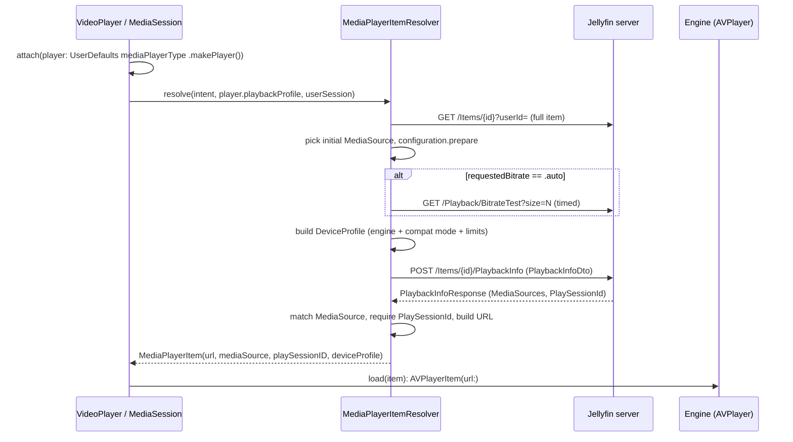

# 05 - Playback: PlaybackInfo, DeviceProfile, play-method decision, stream URLs

> **Jellyfin SDK source.** A citation `jellyfin-sdk-swift@3.3.0:PATH:LINE` points into [jellyfin/jellyfin-sdk-swift](https://github.com/jellyfin/jellyfin-sdk-swift) at tag `3.3.0` (commit `8ce10a167ad0b4145b2bc005acf8bebcfe6ebe46`). Open it as `https://github.com/jellyfin/jellyfin-sdk-swift/blob/8ce10a167ad0b4145b2bc005acf8bebcfe6ebe46/PATH#LLINE`; for a range `A-B`, use `#LA-LB`. There is no local copy of the SDK.

Scope: how the client turns an item into a playable URL. Covers the PlaybackInfo request, the DeviceProfile it carries, who decides direct play / direct stream / transcode, and how the final URL is built.

Related files: [00-INDEX.md](00-INDEX.md), [01-endpoints.md](01-endpoints.md), [02-networking.md](02-networking.md), [03-auth-session.md](03-auth-session.md), [04-models.md](04-models.md), [06-vlc.md](06-vlc.md) (player engines; the app has no VLC; this spec covers AVPlayer, and Swiftfin's second, non-AVPlayer engine is out of scope), [07-reporting.md](07-reporting.md), [08-images-subtitles-audio.md](08-images-subtitles-audio.md), [09-state-cache-persistence.md](09-state-cache-persistence.md), [10-errors-edge-cases.md](10-errors-edge-cases.md), [11-sequence-flows.md](11-sequence-flows.md), [12-gaps.md](12-gaps.md).

Citation format: repo-relative `path:line`; dependency sources as `jellyfin-sdk-swift@3.3.0:Sources/...:LINE`. All app paths below are under the Swiftfin repo root.

Short names used in tables:
- `Resolver` = `Shared/Objects/MediaPlayerManager/MediaPlayerItem/MediaPlayerItemResolver.swift`
- `Profile` = `Shared/Objects/MediaPlayerManager/PlaybackProfile.swift`
- `DevProfile` = `Shared/Extensions/JellyfinAPI/DeviceProfile.swift`
- `Config` = `Shared/Objects/MediaPlayerManager/MediaPlaybackConfiguration.swift`
- `PItem` = `Shared/Objects/MediaPlayerManager/MediaPlayerItem/MediaPlayerItem.swift`
- `AV+` = `Shared/Objects/MediaPlayerType/MediaPlayerType+AVPlayer.swift`
- `Shared+` = `Shared/Objects/MediaPlayerType/MediaPlayerType+Shared.swift`

---

## 1. Core fact: the client does not choose the play method

The client never picks direct play, direct stream or transcode. It sends a capability description (DeviceProfile) to the server in `POST /Items/{id}/PlaybackInfo`, and the server answers with a `MediaSourceInfo`. The client infers the outcome from one field only: `MediaSourceInfo.TranscodingUrl`. Citations: body and POST at `Shared/Objects/MediaPlayerManager/MediaPlayerItem/MediaPlayerItemResolver.swift:56-86`; the `TranscodingUrl` branch at `Shared/Objects/MediaPlayerManager/MediaPlayerItem/MediaPlayerItemResolver.swift:229`; the transcoding flag at `Shared/Objects/MediaPlayerManager/MediaPlayerItem/MediaPlayerItem.swift:146`.

| Observation | Evidence |
|---|---|
| Transcoding is inferred solely from `mediaSource.transcodingURL != nil` | `Shared/Objects/MediaPlayerManager/MediaPlayerItem/MediaPlayerItem.swift:146`, `Shared/Objects/MediaPlayerManager/MediaPlayerItem/MediaPlayerItemResolver.swift:229` |
| `SupportsDirectPlay`, `SupportsDirectStream`, `SupportsTranscoding`, `TranscodeReasons` and `PlaybackInfoResponse.ErrorCode` are never read from the PlaybackInfo response (a grep for `transcodeReasons`, case-insensitive, over `Shared`, `Objects`, `Views`, `Components`, `App` and `Swiftfin tvOS` finds only session `transcodingInfo` reads and the `Shared/Strings/Strings.swift:1922` label; `TranscodeReasons` from the server's session `transcodingInfo` is read for display only: `Shared/Objects/MediaPlayerManager/Supplements/PlaybackInfoSupplement.swift:206-212`, `Views/AdminDashboardView/ActiveSessions/ActiveSessionDetailsView/ActiveSessionDetailsView.swift:183`, `Views/AdminDashboardView/ActiveSessions/ActiveSessionsView/Components/ActiveSessionProgressSection.swift:52`) (the SDK models `ErrorCode` with values `NotAllowed`, `NoCompatibleStream`, `RateLimitExceeded`) | `jellyfin-sdk-swift@3.3.0:Sources/Entities/PlaybackInfoResponse.swift:12-18`, `jellyfin-sdk-swift@3.3.0:Sources/Entities/PlaybackErrorCode.swift:12-16`; the resolver only reads `mediaSources` and `playSessionID` at `Shared/Objects/MediaPlayerManager/MediaPlayerItem/MediaPlayerItemResolver.swift:96,130` |
| Direct stream (remux) is not distinguished from transcode: any `TranscodingUrl` yields the `.transcode` track map | `Shared/Objects/MediaPlayerManager/MediaPlayerItem/MediaPlayerItem.swift:158-162`, `Shared/Objects/MediaPlayerManager/MediaTrackIndexMap.swift:40-45` |
| No `PlayMethod` is sent by the playback path. The report builders set no `playMethod`: `PlaybackStopInfo` (`Shared/Objects/MediaPlayerManager/MediaProgressReporter.swift:59-65`) and `PlaybackStateInfo` (`Shared/Objects/MediaPlayerManager/MediaProgressReporter.swift:73-82`). A case-insensitive grep for `playMethod` over `Shared`, `Objects`, `Views`, `Components`, `App` and `Swiftfin tvOS` (Swift files, excluding `Shared/Strings`) finds no assignment: only the display reads cited here, the `PlayMethod: Displayable` extension (`Shared/Extensions/JellyfinAPI/PlayMethod.swift:13`) and `MediaTrackIndexMap.swift:35,40`. `PlayMethod` from the server's session info is only displayed: the in-player stats UI and the admin dashboard session views. The enum is also an input type of `MediaTrackIndexMap.build` | `Shared/Objects/MediaPlayerManager/MediaProgressReporter.swift:59-65,73-82`, `Shared/Extensions/JellyfinAPI/SessionInfoDto.swift:21-43`, `Shared/Objects/MediaPlayerManager/Supplements/PlaybackInfoSupplement.swift:85-86,120`, `Views/AdminDashboardView/ActiveSessions/ActiveSessionDetailsView/ActiveSessionDetailsView.swift:155-158`, `Views/AdminDashboardView/ActiveSessions/ActiveSessionsView/Components/ActiveSessionProgressSection.swift:51-65`, `Shared/Objects/MediaPlayerManager/MediaTrackIndexMap.swift:35,40` |
| On player failure, `fail()` falls back between players in two cases only: if a transfer failed and `handoffRecovery` is set, it re-resolves the transfer-time snapshot on the previous player (lines 447-451); if `canReturnToLocalPlayback` (remote playback with a retained local player, lines 106-108) is true, it calls `returnToLocalPlayback()`, which re-resolves `currentIntent()` on the local engine (lines 453-456, 288-293). There is no automatic fallback between engines and none from direct play to transcode. `retry()` re-resolves the same intent with the same engine profile | `Shared/Objects/MediaPlayerManager/MediaSession.swift:106-108`, `Shared/Objects/MediaPlayerManager/MediaSession.swift:288-293`, `Shared/Objects/MediaPlayerManager/MediaSession.swift:438-465`, `Shared/Objects/MediaPlayerManager/MediaSession.swift:551-555` |

Outcome table (what the client does with the response):

| Server response | Client URL | Track map |
|---|---|---|
| `TranscodingUrl` present (the client does not inspect what kind of stream it is; the only `pathExtension` check is on Swiftfin's out-of-scope Chromecast path, section 8.3) | `client.url(path: TranscodingUrl)`, no `ApiKey` added (`Shared/Objects/MediaPlayerManager/MediaPlayerItem/MediaPlayerItemResolver.swift:229-237`) | `.transcode`: only the selected non-external audio stream is mapped, to player index 0 (`Shared/Objects/MediaPlayerManager/MediaTrackIndexMap.swift:40-45`) |
| `TranscodingUrl` absent, item `mediaType == .video` | `/Videos/{id}/stream?static=true&...&ApiKey=` (`Shared/Objects/MediaPlayerManager/MediaPlayerItem/MediaPlayerItemResolver.swift:239-260`) | `.directPlay`: non-external audio and subtitle streams mapped by order (`Shared/Objects/MediaPlayerManager/MediaTrackIndexMap.swift:46-60`) |
| `TranscodingUrl` absent, item `mediaType == .audio` | `/Audio/{id}/stream?static=true&...&ApiKey=` (`Shared/Objects/MediaPlayerManager/MediaPlayerItem/MediaPlayerItemResolver.swift:262-279`) | `.directPlay` (`Shared/Objects/MediaPlayerManager/MediaPlayerItem/MediaPlayerItem.swift:158-162`) |
| `TranscodingUrl` absent, other media type | throws `"Unsupported playback media type"` (`Shared/Objects/MediaPlayerManager/MediaPlayerItem/MediaPlayerItemResolver.swift:281`) | n/a |

Citations: `Shared/Objects/MediaPlayerManager/MediaPlayerItem/MediaPlayerItemResolver.swift:229-281`, `Shared/Objects/MediaPlayerManager/MediaPlayerItem/MediaPlayerItem.swift:158-162`, `Shared/Objects/MediaPlayerManager/MediaTrackIndexMap.swift:40-60`.

**Open point** (see [12-gaps.md](12-gaps.md)): when the server returns no `TranscodingUrl` the client always builds `static=true`, which the server treats as direct play. What the server does when the container is not playable by the engine is not visible from the client. Evidence: `Shared/Objects/MediaPlayerManager/MediaPlayerItem/MediaPlayerItemResolver.swift:239-260`.

---

## 2. End-to-end resolution flow



Steps, in order:

| # | Step | Citation |
|---|---|---|
| 1 | Engine chosen from the UserDefaults key `"videoPlayerType"` when the player view appears; for AVPlayer, `makePlayer()` returns `AVMediaPlayer`. Swiftfin's default is its second, non-AVPlayer engine, which is out of scope | `Shared/Views/VideoPlayer/VideoPlayer.swift:65`, `Shared/Services/SwiftfinDefaults.swift:301-303`, `Shared/Objects/MediaPlayerType/MediaPlayerType.swift:54-60` |
| 2 | The AVPlayer engine exposes `playbackProfile` `.local(.avPlayer)`; Swiftfin's other engine and its Chromecast path (out of scope) expose other profile cases | `Shared/Objects/MediaPlayerManager/Players/AVMediaPlayer.swift:33`, `Shared/Objects/MediaPlayerManager/PlaybackProfile.swift:14-17` |
| 3 | `MediaSession.performResolve` waits for any pending remote transfer, lets the queue adjust the intent, then calls `resolveItem(resolvedIntent, player.playbackProfile, userSession)` (default resolver is `MediaPlayerItemResolver.resolve`) | `Shared/Objects/MediaPlayerManager/MediaSession.swift:381-409`, `Shared/Objects/MediaPlayerManager/MediaSession.swift:198-208` |
| 4 | Program items (`type == .program`) are swapped for their channel via `getChannel` (`GET /Items?ids=<channelID>`); a missing channel throws `ErrorMessage(L10n.unknownError)` | `Shared/Objects/MediaPlayerManager/MediaPlayerItem/MediaPlayerItemResolver.swift:25-31`, `Shared/Extensions/JellyfinAPI/BaseItemDto/BaseItemDto.swift:284-297` |
| 5 | Item `id` required, else throws `ErrorMessage(L10n.unknownError)` | `Shared/Objects/MediaPlayerManager/MediaPlayerItem/MediaPlayerItemResolver.swift:35-38` |
| 6 | Full item fetched with `getFullItem`: `Paths.getItem(itemID:userID:)` = `GET /Items/{itemID}` with query `userId` | `Shared/Objects/MediaPlayerManager/MediaPlayerItem/MediaPlayerItemResolver.swift:40`, `Shared/Services/UserSession/UserSession+Items.swift:27-39`, `jellyfin-sdk-swift@3.3.0:Sources/Paths/GetItemAPI.swift:14-21` |
| 7 | Initial media source: if `configuration.mediaSourceID` is set, the item source with that `Id` (no match returns nil, with no fallback to the first source); only when `mediaSourceID` is nil, `mediaSources.first`. nil throws `ErrorMessage("Unable to find media source for item")` | `Shared/Objects/MediaPlayerManager/MediaPlaybackConfiguration.swift:45-51`, `Shared/Objects/MediaPlayerManager/MediaPlayerItem/MediaPlayerItemResolver.swift:44-46` |
| 8 | `configuration.prepare(...)` resolves start position and audio/subtitle indexes before the request (section 3) | `Shared/Objects/MediaPlayerManager/MediaPlayerItem/MediaPlayerItemResolver.swift:48`, `Shared/Objects/MediaPlayerManager/MediaPlaybackConfiguration.swift:114-138` |
| 9 | Max bitrate resolved (section 4) | `Shared/Objects/MediaPlayerManager/MediaPlayerItem/MediaPlayerItemResolver.swift:49` |
| 10 | DeviceProfile built (section 6) | `Shared/Objects/MediaPlayerManager/MediaPlayerItem/MediaPlayerItemResolver.swift:50-54` |
| 11 | PlaybackInfoDto assembled and POSTed (section 5) | `Shared/Objects/MediaPlayerManager/MediaPlayerItem/MediaPlayerItemResolver.swift:56-86` |
| 12 | Response MediaSource matched; `PlaySessionId` required (section 5.3) | `Shared/Objects/MediaPlayerManager/MediaPlayerItem/MediaPlayerItemResolver.swift:94-132` |
| 13 | `item.runTimeTicks` overwritten with `mediaSource.runTimeTicks` when present | `Shared/Objects/MediaPlayerManager/MediaPlayerItem/MediaPlayerItemResolver.swift:128` |
| 14 | URL built (section 8) | `Shared/Objects/MediaPlayerManager/MediaPlayerItem/MediaPlayerItemResolver.swift:134-140` |
| 15 | `configuration.finish` resolves default tracks; chapters, `PlaybackTemporaryFiles(accessToken:)`, `PreviewImageProvider` created; `MediaPlayerItem` returned retaining the `deviceProfile` (used later for `canPlay` checks) | `Shared/Objects/MediaPlayerManager/MediaPlayerItem/MediaPlayerItemResolver.swift:151-176` |
| 16 | `performResolve` calls `player.stop()`, resets the timeline and installs the item (lines 415-421); the resolve task then calls `destinationPlayer.load(item)` (line 359), and the engine loads `item.url` | `Shared/Objects/MediaPlayerManager/MediaSession.swift:415-421`, `Shared/Objects/MediaPlayerManager/MediaSession.swift:351-359`, `Shared/Objects/MediaPlayerManager/Players/AVMediaPlayer.swift:103-107` |

Cancellation and cleanup:

| Behavior | Citation |
|---|---|
| `Task.checkCancellation()` before the request and again after the response | `Shared/Objects/MediaPlayerManager/MediaPlayerItem/MediaPlayerItemResolver.swift:22,89` |
| The PlaybackInfo request runs inside an unstructured `Task { try await client.send(request) }.value`, so it is not cancelled with the parent | `Shared/Objects/MediaPlayerManager/MediaPlayerItem/MediaPlayerItemResolver.swift:86` |
| `userSession.items.validate()` before the request, after the response, and entry-validity guards after the response | `Shared/Objects/MediaPlayerManager/MediaPlayerItem/MediaPlayerItemResolver.swift:83,90,92` |
| Any throw after the response closes every returned live stream (see 5.5) and rethrows | `Shared/Objects/MediaPlayerManager/MediaPlayerItem/MediaPlayerItemResolver.swift:177-180` |
| If resolution finished but the session was cancelled or stopped, the unstarted item is discarded with `MediaProgressReporter.discard`, which closes only `item.mediaSource.liveStreamID` (one stream, if set) and awaits the request (see 5.5) | `Shared/Objects/MediaPlayerManager/MediaSession.swift:410-413`, `Shared/Objects/MediaPlayerManager/MediaProgressReporter.swift:89-97` |

---

## 3. Inputs: `MediaPlaybackConfiguration`

A struct snapshotted from UserDefaults and per-user `StoredValues` when an intent is created, carried on `PlaybackIntent.configuration`, and copied to `MediaPlayerItem.configuration` (`Shared/Objects/MediaPlayerManager/MediaPlayerItem/MediaPlayerItemResolver.swift:170`, `Shared/Objects/MediaPlayerManager/MediaPlayerItem/MediaPlayerItem.swift:134`). Lifetime: one playback request; it is mutated by track, bitrate and resolution changes and then re-resolved. Cites: `Shared/Objects/MediaPlayerManager/MediaPlaybackConfiguration.swift:15-43`, `Shared/Objects/MediaPlayerManager/PlaybackIntent.swift:26-34`.

| Field | Source / default | Used for | Citation |
|---|---|---|---|
| `requestedBitrate` | UserDefaults key `"appMaximumBitrate"`, default `.auto` (0) | `MaxStreamingBitrate` and profile bitrates | `Shared/Services/SwiftfinDefaults.swift:365-367` |
| `bitrateTestSize` | key `"appMaximumBitrateTest"`, default `.regular` (5,000,000) | `GET /Playback/BitrateTest?size=` | `Shared/Services/SwiftfinDefaults.swift:369-371` |
| `compatibilityMode` | key `"compatibilityMode"`, default `.auto` | which Direct/Transcoding profile lists are sent | `Shared/Services/SwiftfinDefaults.swift:373-375` |
| `maxResolution` | key `"appMaximumResolution"`, default `.max` | resolution CodecProfile | `Shared/Services/SwiftfinDefaults.swift:361-363` |
| `customDeviceProfileAction` | key `"customDeviceProfileAction"`, default `.add` (`add` or `replace`) | custom mode | `Shared/Services/SwiftfinDefaults.swift:377-379`, `Shared/Objects/CustomDeviceProfileAction.swift:9-12` |
| `customDeviceProfiles` | per-user StoredValue `"customDeviceProfiles"`, default `[]` | custom mode | `Shared/SwiftfinStore/StoredValue/StoredValues+User.swift:142-147` |
| `forceSubtitleBurnIn` | per-user StoredValue, default `false` | all subtitle formats declared as `Encode` | `Shared/SwiftfinStore/StoredValue/StoredValues+User.swift:184-189` |
| `forceHDRTranscode` | per-user StoredValue, default `false` | AVPlayer: drops `HLG`, `DOVIWithHLG`, `HDR10`, `HDR10Plus`; the `DOVIWithHDR10`/`DOVIWithHDR10Plus`/`DOVIWithEL`/`DOVIWithELHDR10Plus` group and `DOVI` survive when DV decoding is supported and `forceDVTranscode` is false; `SDR` and `DOVIWithSDR` always survive (6.5) | default: `Shared/SwiftfinStore/StoredValue/StoredValues+User.swift:177-182`; effect: `Shared/Objects/MediaPlayerType/MediaPlayerType+AVPlayer.swift:271-296` |
| `forceDVTranscode` | per-user StoredValue, default `false` | AVPlayer: sets `supportsDolbyVision` to false, which always drops `DOVI`. What else goes depends on `supportsHDR` (`supportsHEVC && !forceHDRTranscode`): when `supportsHDR` is true, only `DOVI` is dropped and `DOVIWithHLG`, `DOVIWithHDR10`, `DOVIWithHDR10Plus`, `DOVIWithEL`, `DOVIWithELHDR10Plus` are still sent; when `supportsHDR` is false, `DOVIWithHDR10`, `DOVIWithHDR10Plus`, `DOVIWithEL` and `DOVIWithELHDR10Plus` are also dropped (they are gated by `supportsHDR \|\| supportsDolbyVision`). `DOVIWithSDR` is always sent whatever the flags (6.5) | default: `Shared/SwiftfinStore/StoredValue/StoredValues+User.swift:170-175`; effect: `Shared/Objects/MediaPlayerType/MediaPlayerType+AVPlayer.swift:271-272,274-275,287-296` |
| `resumeOffset` | UserDefaults setting `VideoPlayer.resumeOffset`, seconds | start position | `Shared/Objects/MediaPlayerManager/MediaPlaybackConfiguration.swift:36` |
| `mediaSourceID`, `audioStreamIndex`, `subtitleStreamIndex`, `secondarySubtitleStreamIndex`, `startSeconds` | set by selection / `prepare` / `finish` | PlaybackInfo body and player start | `Shared/Objects/MediaPlayerManager/MediaPlaybackConfiguration.swift:17-20,35` |

`prepare(for:source:profile:)`:
- `startSeconds = max(.zero, startSeconds ?? ((item.startSeconds ?? .zero) - resumeOffset))`. Citation: `Shared/Objects/MediaPlayerManager/MediaPlaybackConfiguration.swift:120`.
- Continuation and system-preference selection fill `audioStreamIndex` / `subtitleStreamIndex`. Citation: `Shared/Objects/MediaPlayerManager/MediaPlaybackConfiguration.swift:122-133`. Detail: [08-images-subtitles-audio.md](08-images-subtitles-audio.md).
- Secondary subtitle index is forced to `-1` unless `profile.supportsSecondarySubtitles` (false for `.local(.avPlayer)`; true only for Swiftfin's other engine). Citations: `Shared/Objects/MediaPlayerManager/MediaPlaybackConfiguration.swift:135-137`, `Shared/Objects/MediaPlayerManager/PlaybackProfile.swift:19-26`.

`finish(source:initialSource:)` (after the response): stores default tracks, sets `mediaSourceID = initialSource.id` (keeps the chosen source even if a live response uses an ephemeral id), and defaults audio to `audioStreamIndex ?? source.defaultAudioStreamIndex ?? first non-external audio index ?? 0` and subtitle to `subtitleStreamIndex ?? source.defaultSubtitleStreamIndex ?? -1`. Citation: `Shared/Objects/MediaPlayerManager/MediaPlaybackConfiguration.swift:140-167`.

---

## 4. Max bitrate and auto bitrate test

Function: `MediaPlayerItemResolver.getMaxBitrate`. Citation: `Shared/Objects/MediaPlayerManager/MediaPlayerItem/MediaPlayerItemResolver.swift:183-201`.

1. If `requestedBitrate != .auto`, `maxBitrate = requestedBitrate.rawValue` (no network call). Citation: `...MediaPlayerItemResolver.swift:187`.
2. If `.auto`: time `GET /Playback/BitrateTest?size=<bitrateTestSize.rawValue>` with `ContinuousClock`; response bytes discarded. Citation: `...MediaPlayerItemResolver.swift:189-191`.
3. `seconds = max(elapsed, 0.001)`; `measured = Double(size * 8) / seconds`; `maxBitrate = Int(clamp(measured, min: 420_000, max: Int32.max))`. Citation: `...MediaPlayerItemResolver.swift:193-200`.  The timer wraps the whole `userSession.send` call (`...MediaPlayerItemResolver.swift:190-193`), so the measurement is of the full request, not of transfer alone.
4. A failing test request throws and aborts the resolve; there is no fallback bitrate. Citation: `...MediaPlayerItemResolver.swift:191`.

Endpoint: `GET /Playback/BitrateTest`, query `size` (Int). SDK: `jellyfin-sdk-swift@3.3.0:Sources/Paths/GetBitrateTestBytesAPI.swift:14-22`. See [01-endpoints.md](01-endpoints.md).

`PlaybackBitrate` raw values (bits per second): `auto=0`, `max=360_000_000`, `120_000_000`, `80_000_000`, `60_000_000`, `40_000_000`, `20_000_000`, `15_000_000`, `10_000_000`, `8_000_000`, `6_000_000`, `4_000_000`, `3_000_000`, `2_000_000`, `1_500_000`, `1_000_000`, `720_000`, `420_000`, `320_000`, `256_000`, `192_000`, `128_000`, `96000`, `64000`. Citation: `Shared/Objects/PlaybackBitrate/PlaybackBitrate.swift:12-36`.

- Video choice list: auto, max, 120M, 80M, 60M, 40M, 20M, 15M, 10M, 8M, 6M, 4M, 3M, 1.5M, 720k, 420k. Audio list: auto, 2M, 1.5M, 1M, 320k, 256k, 192k, 128k, 96k, 64k. Citation: `Shared/Objects/PlaybackBitrate/PlaybackBitrate.swift:49-81`.
- `MediaSourceInfo.supportedBitrates` starts from the video list when the source has video streams, else the audio list when it has audio streams, else `PlaybackBitrate.allCases` (`Shared/Extensions/JellyfinAPI/MediaSourceInfo.swift:22-28`). When the source `bitrate` is nil it returns that list unfiltered (line 30). Otherwise it keeps `.max` and every option whose `rawValue <= bitrate` (lines 32-34); `.auto` (raw value 0) always passes this test. The UI uses this list: the in-player playback settings button (`Shared/Views/VideoPlayer/Components/Toolbar/ActionButtons/PlaybackSettingsActionButton.swift:26,31`) and the item-view playback button picker (`Shared/Views/ItemView/Components/ActionButtons/PlaybackActionButton.swift:42-43,94`).
- `PlaybackBitrate(for:in:)` picks the largest option `<=` an arbitrary bitrate, else the smallest (used for socket `SetBitrate`-style commands). Citations: `Shared/Objects/PlaybackBitrate/PlaybackBitrate.swift:87-95`, `Shared/Services/UserSession/UserSessionManager+SocketCommands.swift:143`.

`PlaybackBitrateTestSize` (bytes): `largest=10_000_000`, `larger=7_500_000`, `regular=5_000_000` (default), `smaller=2_500_000`, `smallest=1_000_000`. Citation: `Shared/Objects/PlaybackBitrate/PlaybackBitrateTestSize.swift:13-18`.

Changing bitrate or resolution in the player builds a new intent and re-resolves (new PlaybackInfo POST, new `PlaySessionId`). Citation: `Shared/Objects/MediaPlayerManager/MediaSession.swift:717-731`.

---

## 5. PlaybackInfo request

### 5.1 Endpoint

| Item | Value | Citation |
|---|---|---|
| Method and path | `POST /Items/{itemID}/PlaybackInfo` | `jellyfin-sdk-swift@3.3.0:Sources/Paths/GetPostedPlaybackInfoAPI.swift:22` |
| Path param `itemID` | `initialItem.id` (channel id for programs) | `Shared/Objects/MediaPlayerManager/MediaPlayerItem/MediaPlayerItemResolver.swift:25-38,78-81` |
| Query | none. The app omits the `parameters` argument (it calls `Paths.getPostedPlaybackInfo(itemID: itemID, playbackInfo)`), so the SDK default `parameters: GetPostedPlaybackInfoParameters? = nil` applies and `query: parameters?.asQuery` is nil; all fields go in the body | `Shared/Objects/MediaPlayerManager/MediaPlayerItem/MediaPlayerItemResolver.swift:78-81`, `jellyfin-sdk-swift@3.3.0:Sources/Paths/GetPostedPlaybackInfoAPI.swift:19-22` |
| Body | `PlaybackInfoDto`, PascalCase JSON keys | `jellyfin-sdk-swift@3.3.0:Sources/Entities/PlaybackInfoDto.swift:102-120` |
| Extra headers | none added by the app (the request is sent with `client.send(request)` and no `configure` closure). The SDK `PassthroughAPIClientDelegate.willSendRequest` adds the `Authorization` header from `jellyfinClient.authorizationHeaders`. The app passes no delegate for the SDK's HTTP client: `UserSession` builds `JellyfinClient(configuration:, sessionConfiguration: .swiftfin, sessionDelegate: ...)` with no `delegate:` argument, and `sessionDelegate` is a network logging delegate (`Shared/Services/UserSession/UserSession.swift:12` imports the logging module, line 44 builds it) passed to the SDK parameter typed `URLSessionDelegate?` (`jellyfin-sdk-swift@3.3.0:Sources/JellyfinClient.swift:36`), not a client delegate. So `actualDelegate` is nil, response validation falls back to the `200..<300` status check, and `shouldRetry` returns false. A grep for the HTTP client's delegate protocol in `Shared`, `Objects`, `Views`, `Components`, `App` and `Swiftfin tvOS` finds nothing ([02-networking.md](02-networking.md), [03-auth-session.md](03-auth-session.md)) | `Shared/Objects/MediaPlayerManager/MediaPlayerItem/MediaPlayerItemResolver.swift:84-86`, `Shared/Services/UserSession/UserSession.swift:12,41-45`, `jellyfin-sdk-swift@3.3.0:Sources/JellyfinClient.swift:34,36,40-45,61`, `jellyfin-sdk-swift@3.3.0:Sources/PassthroughAPIClientDelegate.swift:19-40` |
| Body encoding | JSON encoder configured in `JellyfinClient` with the OpenISO8601 date format | `jellyfin-sdk-swift@3.3.0:Sources/JellyfinClient.swift:49-58` |
| Retry / timeout | no automatic retry: with no app delegate, `PassthroughAPIClientDelegate.shouldRetry` returns `false` (`jellyfin-sdk-swift@3.3.0:Sources/PassthroughAPIClientDelegate.swift:39-41`; see Extra headers). The app sets `timeoutIntervalForRequest = 20` seconds on its URLSession configuration (not the Apple default of 60), used by the user-session client; the client is built with `sessionConfiguration: .swiftfin` (`UserSession.swift:43`), so the timeout applies to the PlaybackInfo POST (`client.send`, resolver line 86) and to the BitrateTest GET (resolver line 191 calls the public `userSession.send(_:)` at `Shared/Services/UserSession/UserSession+Items.swift:16-20`, which calls the private `send(request, itemScope: .partial)` overload at lines 41-48, which calls `client.send(request)` at line 47). User `retry()` re-resolves | `jellyfin-sdk-swift@3.3.0:Sources/PassthroughAPIClientDelegate.swift:39-41`, `Shared/Extensions/URLSessionConfiguration.swift:16`, `Shared/Services/UserSession/UserSession.swift:43`, `Shared/Services/UserSession/UserSession+Items.swift:16-20,41-48`, `Shared/Objects/MediaPlayerManager/MediaSession.swift:551-555` |
| Response | `PlaybackInfoResponse { ErrorCode?, MediaSources?, PlaySessionId? }` | `jellyfin-sdk-swift@3.3.0:Sources/Entities/PlaybackInfoResponse.swift:12-30` |

### 5.2 Body fields

| JSON key | Type | Value the app sends | Citation |
|---|---|---|---|
| `AutoOpenLiveStream` | Bool | always `true` | `Shared/Objects/MediaPlayerManager/MediaPlayerItem/MediaPlayerItemResolver.swift:57` |
| `DeviceProfile` | DeviceProfile | built profile (section 6) | `...MediaPlayerItemResolver.swift:67` |
| `LiveStreamId` | String? | `initialMediaSource.liveStreamID` | `...MediaPlayerItemResolver.swift:68` |
| `MaxStreamingBitrate` | Int | section 4 result | `...MediaPlayerItemResolver.swift:69` |
| `UserId` | String | `userSession.user.id` | `...MediaPlayerItemResolver.swift:70` |
| `AudioStreamIndex` | Int? | `configuration.audioStreamIndex` | `...MediaPlayerItemResolver.swift:71` |
| `SubtitleStreamIndex` | Int? | `configuration.subtitleStreamIndex` (-1 means none) | `...MediaPlayerItemResolver.swift:72` |
| `MediaSourceId` | String? | `initialMediaSource.id`, only when `!item.isLiveStream && initialMediaSource.type != .placeholder` | `...MediaPlayerItemResolver.swift:74-76` |
| `EnableDirectPlay` | Bool | omitted for local players; set only on Swiftfin's out-of-scope Chromecast path (`requiresHLS`) | `...MediaPlayerItemResolver.swift:59,62` |
| `EnableDirectStream` | Bool | omitted for local players; set only on the out-of-scope Chromecast path | `...MediaPlayerItemResolver.swift:63` |
| `EnableTranscoding` | Bool | omitted for local players; set only on the out-of-scope Chromecast path | `...MediaPlayerItemResolver.swift:64` |

Never set (omitted from the body because the SDK uses `encodeIfPresent`): `StartTimeTicks`, `MaxAudioChannels`, `AllowVideoStreamCopy`, `AllowAudioStreamCopy`, `AlwaysBurnInSubtitleWhenTranscoding`. Citations: `jellyfin-sdk-swift@3.3.0:Sources/Entities/PlaybackInfoDto.swift:104-119`; no assignment in `Shared/Objects/MediaPlayerManager/MediaPlayerItem/MediaPlayerItemResolver.swift:56-76`. Consequence: the start position is never requested from the server; the engine applies it after load (AVPlayer seeks to `baseItem.startSeconds` after load, `Shared/Objects/MediaPlayerManager/Players/AVMediaPlayer.swift:440-444`). Seeks never trigger a new PlaybackInfo with `StartTimeTicks` (section 9.1). See gaps.

`isLiveStream` is `channelType == .tv || channelType == .radio`. Citation: `Shared/Extensions/JellyfinAPI/BaseItemDto/BaseItemDto.swift:138-140`.

Minimal body example (local AVPlayer, auto bitrate measured at 25 Mbps, video item; profile arrays abbreviated, see section 6):

```json
{
  "AutoOpenLiveStream": true,
  "DeviceProfile": { "MaxStaticBitrate": 25000000, "MaxStreamingBitrate": 25000000,
                     "MusicStreamingTranscodingBitrate": 25000000, "DirectPlayProfiles": [ ... ],
                     "TranscodingProfiles": [ ... ], "CodecProfiles": [ ... ], "SubtitleProfiles": [ ... ] },
  "MaxStreamingBitrate": 25000000,
  "UserId": "<userID>",
  "AudioStreamIndex": 1,
  "SubtitleStreamIndex": -1,
  "MediaSourceId": "<mediaSourceID>"
}
```

(Illustrative composition; key names and optionality are from the cited SDK encoders. `LiveStreamId` appears only when the source has one.)

### 5.3 Response handling: choosing the MediaSource

Order of attempts over `response.MediaSources`. Citation: `Shared/Objects/MediaPlayerManager/MediaPlayerItem/MediaPlayerItemResolver.swift:94-122`.

1. Source whose `ETag` equals the initial source's `ETag`.
2. Source whose `Id` equals the initial source's `Id`.
3. First source where `OpenToken` contains its own `Id` (live/ephemeral sources).
4. Log `"Unable to find matching media source, defaulting to first media source"` and take `mediaSources.first`.

No source (`MediaSources` nil, which returns nil at line 96 with no warning, or an empty array): throws `ErrorMessage("Unable to find media source for item")` (`...:96,124-126`). Step 4 applies only to a non-nil array with no match. Missing `PlaySessionId`: throws `ErrorMessage("No associated play session ID")` (`...:130-132`).

Response fields the client reads: `MediaSources`, `PlaySessionId`; per source `ETag`, `Id`, `OpenToken`, `TranscodingUrl`, `LiveStreamId`, `RunTimeTicks`, `MediaStreams`, `DefaultAudioStreamIndex`, `DefaultSubtitleStreamIndex`, `Container`. (`Type` is not read from the response: resolver line 74 reads `initialMediaSource.type`, and `initialMediaSource` comes from the `GET /Items/{id}` full item via `configuration.mediaSource(in: item)` before the POST, `Shared/Objects/MediaPlayerManager/MediaPlayerItem/MediaPlayerItemResolver.swift:40-44,74`.) JSON keys: `jellyfin-sdk-swift@3.3.0:Sources/Entities/MediaSourceInfo.swift:163-200`. Per stream (used in playback decisions): `DeliveryMethod`, `DeliveryUrl`, `IsExternal`, `IsTextSubtitleStream`, `DvProfile`, `VideoRangeType`. Citation: `jellyfin-sdk-swift@3.3.0:Sources/Entities/MediaStream.swift:294-343`. App call sites for these reads: `Container` (`mediaSource.container`, `Shared/Objects/MediaPlayerManager/MediaPlayerItem/MediaPlayerItem.swift:231`); `MediaStreams` (stream lists, `MediaPlayerItem.swift:145-156`; device-profile source codecs, `Shared/Extensions/JellyfinAPI/DeviceProfile.swift:105-109`); `DefaultAudioStreamIndex` / `DefaultSubtitleStreamIndex` (`Shared/Objects/MediaPlayerManager/MediaPlaybackConfiguration.swift:145-163`); `TranscodingUrl` (`MediaPlayerItem.swift:146,209`, resolver line 229); `RunTimeTicks` (`MediaPlayerItem.swift:135`, resolver line 128). Per stream: `DeliveryMethod` (`.drop` filter, `MediaPlayerItem.swift:152-153`; `.encode` check, `MediaPlayerItem.swift:96,213`; sidecar test, `Shared/Extensions/JellyfinAPI/MediaStream.swift:21`); `DeliveryUrl` and `IsTextSubtitleStream` (`MediaStream.swift:21,25`); `IsExternal` (audio filter, `MediaPlayerItem.swift:149`); `DvProfile` and `VideoRangeType` (Dolby Vision detection, `Shared/Extensions/JellyfinAPI/DeviceProfile.swift:38-39`). Model detail: [04-models.md](04-models.md).

`MediaSourceType` values: `Default`, `Grouping`, `Placeholder`. Citation: `jellyfin-sdk-swift@3.3.0:Sources/Entities/MediaSourceType.swift:12-16`.

### 5.4 Session id reuse

`PlaySessionId` from this response is stored on `MediaPlayerItem.playSessionID` and put in the stream URL (direct play) and, as both `PlaySessionId` and `SessionId`, in start, progress and stop reports (`Shared/Objects/MediaPlayerManager/MediaProgressReporter.swift:63,65,79,81`; [07-reporting.md](07-reporting.md)). Any rebuild (track change needing the server, bitrate or resolution change) posts PlaybackInfo again and gets a new id. Citations: `Shared/Objects/MediaPlayerManager/MediaPlayerItem/MediaPlayerItem.swift:137`, `Shared/Objects/MediaPlayerManager/MediaSession.swift:734-738`.

### 5.5 Live stream cleanup: `POST /LiveStreams/Close`

| Item | Value | Citation |
|---|---|---|
| Request | `POST /LiveStreams/Close` with query `liveStreamId` | `jellyfin-sdk-swift@3.3.0:Sources/Paths/CloseLiveStreamAPI.swift:14-16` |
| `liveStreamId` source | Resolver failure: `MediaSourceInfo.liveStreamID` of every source in the PlaybackInfo response, deduplicated with a `Set`. Discard: only `item.mediaSource.liveStreamID` (one stream; nothing sent when nil) | `Shared/Objects/MediaPlayerManager/MediaPlayerItem/MediaPlayerItemResolver.swift:204-214`, `Shared/Objects/MediaPlayerManager/MediaProgressReporter.swift:89-90` |
| Triggers | resolve fails after PlaybackInfo succeeded; unstarted item discarded | `Shared/Objects/MediaPlayerManager/MediaPlayerItem/MediaPlayerItemResolver.swift:178`, `Shared/Objects/MediaPlayerManager/MediaProgressReporter.swift:89-97` |
| Error handling | Resolver failure: fire-and-forget `Task`, one request per id in sequence, errors swallowed with `try?`. Discard: `await Task { try? await client.send(...) }.value`, so the caller awaits the request; errors swallowed with `try?` | `Shared/Objects/MediaPlayerManager/MediaPlayerItem/MediaPlayerItemResolver.swift:210-213`, `Shared/Objects/MediaPlayerManager/MediaProgressReporter.swift:94-96` |

---

## 6. DeviceProfile construction

Entry point: `PlaybackProfile.deviceProfile(configuration:maxBitrate:mediaSource:)`. `.local(player)` calls `DeviceProfile.build(for:configuration:maxBitrate:mediaSource:)`. Citations: `Shared/Objects/MediaPlayerManager/PlaybackProfile.swift:39-92`, `Shared/Extensions/JellyfinAPI/DeviceProfile.swift:14-125`.

### 6.1 Wire shape (SDK)

| Object | JSON keys | Citation |
|---|---|---|
| DeviceProfile | `CodecProfiles`, `ContainerProfiles`, `DirectPlayProfiles`, `Id`, `MaxStaticBitrate`, `MaxStaticMusicBitrate`, `MaxStreamingBitrate`, `MusicStreamingTranscodingBitrate`, `Name`, `SubtitleProfiles`, `TranscodingProfiles` (all `encodeIfPresent`) | `jellyfin-sdk-swift@3.3.0:Sources/Entities/DeviceProfile.swift:84-98` |
| DirectPlayProfile | `AudioCodec`, `Container`, `Type`, `VideoCodec` (comma-separated strings) | `jellyfin-sdk-swift@3.3.0:Sources/Entities/DirectPlayProfile.swift:37-42` |
| TranscodingProfile | `Protocol`, `AudioCodec`, `Conditions`, `Container`, `Context`, `EnableAudioVbrEncoding`, `EnableMpegtsM2TsMode`, `EnableSubtitlesInManifest`, `BreakOnNonKeyFrames`, `CopyTimestamps`, `EstimateContentLength`, `MaxAudioChannels` (String), `MinSegments`, `SegmentLength`, `TranscodeSeekInfo`, `Type`, `VideoCodec` | `jellyfin-sdk-swift@3.3.0:Sources/Entities/TranscodingProfile.swift:111-130` |
| CodecProfile | `ApplyConditions`, `Codec`, `Conditions`, `Container`, `SubContainer`, `Type` | `jellyfin-sdk-swift@3.3.0:Sources/Entities/CodecProfile.swift:53-60` |
| ProfileCondition | `Condition`, `IsRequired`, `Property`, `Value` | `jellyfin-sdk-swift@3.3.0:Sources/Entities/ProfileCondition.swift:38-43` |
| SubtitleProfile | `Container`, `DidlMode`, `Format`, `Language`, `Method` | `jellyfin-sdk-swift@3.3.0:Sources/Entities/SubtitleProfile.swift:48-54` |

**Always-sent TranscodingProfile booleans.** `TranscodingProfile` stores these as non-optional Bools whose SDK init defaults are `EnableAudioVbrEncoding = true`, `EnableMpegtsM2TsMode = false`, `EnableSubtitlesInManifest = false`, `BreakOnNonKeyFrames = false`, `CopyTimestamps = false`, `EstimateContentLength = false`. Because they are encoded with `encodeIfPresent` on non-optional values they always appear on the wire with those defaults unless the app overrides them. Citations: `jellyfin-sdk-swift@3.3.0:Sources/Entities/TranscodingProfile.swift:76-81`, `jellyfin-sdk-swift@3.3.0:Sources/Entities/TranscodingProfile.swift:118-123`.

Enumerations on the wire:

| Enum | Raw values | Citation |
|---|---|---|
| `DlnaProfileType` | `Audio`, `Video`, `Photo`, `Subtitle`, `Lyric` | `jellyfin-sdk-swift@3.3.0:Sources/Entities/DlnaProfileType.swift:12-16` |
| `CodecType` | `Video`, `VideoAudio`, `Audio` | `jellyfin-sdk-swift@3.3.0:Sources/Entities/CodecType.swift:13-15` |
| `EncodingContext` | `Streaming`, `Static` | `jellyfin-sdk-swift@3.3.0:Sources/Entities/EncodingContext.swift:13-14` |
| `MediaStreamProtocol` | `http`, `hls` (lowercase) | `jellyfin-sdk-swift@3.3.0:Sources/Entities/MediaStreamProtocol.swift:14-15` |
| `ProfileConditionType` | `Equals`, `NotEquals`, `LessThanEqual`, `GreaterThanEqual`, `EqualsAny` | `jellyfin-sdk-swift@3.3.0:Sources/Entities/ProfileConditionType.swift:12-16` |
| `ProfileConditionValue` | `AudioChannels`, `AudioBitrate`, `AudioProfile`, `Width`, `Height`, `Has64BitOffsets`, `PacketLength`, `VideoBitDepth`, `VideoBitrate`, `VideoFramerate`, `VideoLevel`, `VideoProfile`, `VideoTimestamp`, `IsAnamorphic`, `RefFrames`, `NumAudioStreams`, `NumVideoStreams`, `IsSecondaryAudio`, `VideoCodecTag`, `IsAvc`, `IsInterlaced`, `AudioSampleRate`, `AudioBitDepth`, `VideoRangeType`, `NumStreams`, `VideoRotation` | `jellyfin-sdk-swift@3.3.0:Sources/Entities/ProfileConditionValue.swift:12-37` |
| `SubtitleDeliveryMethod` | `Encode`, `Embed`, `External`, `Hls`, `Drop` | `jellyfin-sdk-swift@3.3.0:Sources/Entities/SubtitleDeliveryMethod.swift:13-17` |
| `VideoRangeType` | `Unknown`, `SDR`, `HDR10`, `HLG`, `DOVI`, `DOVIWithHDR10`, `DOVIWithHLG`, `DOVIWithSDR`, `DOVIWithEL`, `DOVIWithHDR10Plus`, `DOVIWithELHDR10Plus`, `DOVIInvalid`, `HDR10Plus` | `jellyfin-sdk-swift@3.3.0:Sources/Entities/VideoRangeType.swift:13-25` |
| `PlayMethod` (server session info only) | `Transcode`, `DirectStream`, `DirectPlay` | `jellyfin-sdk-swift@3.3.0:Sources/Entities/PlayMethod.swift:13-15` |

### 6.2 Serialization helpers (how strings are joined)

| Helper | Rule | Citation |
|---|---|---|
| `DirectPlayProfile(type:audioCodecs:videoCodecs:containers:)` | each list `rawValue`s joined by `","`; empty list becomes `nil` (field omitted = matches anything) | `Shared/Extensions/JellyfinAPI/DirectPlayProfile.swift:14-30` |
| `TranscodingProfile(... audioCodecs:videoCodecs:containers:)` | same comma join, empty becomes `nil` | `Shared/Extensions/JellyfinAPI/TranscodingProfile.swift:33-55` |
| `ProfileCondition(... value: { ... })` | values joined by `"\|"` (pipe) | `Shared/Extensions/JellyfinAPI/ProfileCondition.swift:20-25` |
| `CodecProfile(codec:container:type:conditions:)` | empty condition list becomes `nil` | `Shared/Extensions/JellyfinAPI/CodecProfile.swift:21-30` |
| `SubtitleProfile.build(method:)` | one profile per format: `Container = nil`, `Format = <SubtitleFormat.rawValue>`, `Method = method` | `Shared/Extensions/JellyfinAPI/SubtitleProfile.swift:32-39` |

### 6.3 Build algorithm for local engines

Order of operations in `DeviceProfile.build`. Citation: `Shared/Extensions/JellyfinAPI/DeviceProfile.swift:14-125`.

1. `codecProfiles = playerType.codecProfiles(configuration:)` (engine list, 6.5). Lines 25, `Shared/Objects/MediaPlayerType/MediaPlayerType+Shared.swift:16-25`.
2. Subtitle profiles: if `configuration.forceSubtitleBurnIn`, every `SubtitleFormat.allCases` as `Encode`; else `playerType.subtitleProfiles`. Lines 27-33.
3. A Dolby Vision subtitle filter that applies only to Swiftfin's second, non-AVPlayer engine (out of scope); it does not change the AVPlayer profile. Lines 35-45.
4. If `maxResolution != .max`, append the resolution CodecProfile (6.7). Lines 47-49.
5. Direct play and transcoding lists by `compatibilityMode` (6.4). Lines 53-90.
6. Audio retention: if no `Audio` DirectPlayProfile exists, append the engine's audio direct play profiles (lines 93-96). Unless the mode is `.directPlay`, if no `Audio` TranscodingProfile exists, append the engine's audio transcoding profiles (lines 98-103).
7. 40-character codec list limiter (6.8). Lines 105-114.
8. Bitrates: if `maxBitrate` given, `MaxStaticBitrate = MaxStreamingBitrate = MusicStreamingTranscodingBitrate = maxBitrate`. Lines 118-122. The resolver always passes it (`...MediaPlayerItemResolver.swift:50-54`).

The profile is never given a `Name` or `Id` for local engines: `DeviceProfile.build` assigns no `name` or `id` (`Shared/Extensions/JellyfinAPI/DeviceProfile.swift:14-125`), and a grep for `.name = "` in the app finds only one assignment, on the out-of-scope Chromecast path (`Shared/Objects/MediaPlayerManager/PlaybackProfile.swift:50`).

### 6.4 Compatibility modes

| Mode (`PlaybackCompatibility`, raw strings) | DirectPlayProfiles | TranscodingProfiles | Citation |
|---|---|---|---|
| `auto` (default) | engine list | engine list | `Shared/Extensions/JellyfinAPI/DeviceProfile.swift:54-56` |
| `mostCompatible` | one `Video` profile: audio `aac`, video `h264`, container `mp4`; plus the engine's `Audio` direct play profiles (appended because none is `Audio`, lines 93-96) | two profiles: (1) the compat `Video` profile: protocol `hls`, container `mp4`, audio `aac`, video `h264`, `Context=Streaming`, `BreakOnNonKeyFrames=true`, `MaxAudioChannels="8"`, `MinSegments=2`; (2) the engine's `Audio` transcoding profile, appended because the mode is not `.directPlay` and the list has no `Audio` profile (lines 98-103): Type `Audio`, protocol `http`, container `mp3`, audio `mp3`, Context `Streaming` (AVPlayer `Shared/Objects/MediaPlayerType/MediaPlayerType+AVPlayer.swift:113-119`) | `Shared/Extensions/JellyfinAPI/DeviceProfile.swift:58-60,93-103`, `Shared/Objects/PlaybackCompatibility/PlaybackCompatibility+Video.swift:18-45` |
| `directPlay` | one `DirectPlayProfile(type: .video)` with no codec and no container (matches any video); plus the engine's `Audio` direct play profiles (lines 93-96) | left `nil` (omitted), no audio transcoding profile appended | `Shared/Extensions/JellyfinAPI/DeviceProfile.swift:62-63,93-103`, `Shared/Objects/PlaybackCompatibility/PlaybackCompatibility+Video.swift:49-52` |
| `custom` | see below | see below | `Shared/Extensions/JellyfinAPI/DeviceProfile.swift:65-90` |

In every mode (including `auto` and `custom`), if the list has no `Audio` direct play profile the engine's `Audio` direct play profiles are appended (`Shared/Extensions/JellyfinAPI/DeviceProfile.swift:93-96`; 6.3 step 6).

Enum raw values: `auto`, `mostCompatible`, `directPlay`, `custom`. Citation: `Shared/Objects/PlaybackCompatibility/PlaybackCompatibility.swift:14-17`.

**Custom mode details.** Source: `Shared/Extensions/JellyfinAPI/DeviceProfile.swift:65-90`.
- `action == .add`: start from the engine direct play and transcoding lists.
- `action == .replace`: direct play starts empty. Transcoding is cleared to `[]` only if any custom profile has `useAsTranscodingProfile == true`; otherwise the engine transcoding list is kept. When it is cleared, the engine's `Audio` transcoding profile (`mp3` over `http`) is appended again afterwards, because the list then has no `Audio` profile (`Shared/Extensions/JellyfinAPI/DeviceProfile.swift:76-77,98-103`).
- For every custom profile with `type == .video`: append `DirectPlayProfile(type, audio, video, container)`; if `useAsTranscodingProfile`, also append a `TranscodingProfile` with protocol `hls`, `Context=Streaming`, `BreakOnNonKeyFrames=true`, `MaxAudioChannels="8"`, `MinSegments=2`, the profile's audio/video/container lists. Citation: `Shared/Objects/PlaybackDeviceProfile.swift:34-72`.
- Non-video custom profiles are skipped in every build, debug and release. The only callers of `.directPlayProfile` and `.transcodingProfile` are inside `for profile in playbackDeviceProfile where profile.type == .video` (`Shared/Extensions/JellyfinAPI/DeviceProfile.swift:83-88`; a grep finds no other caller), so the `assertionFailure("Only Video is currently supported.")` branches (`Shared/Objects/PlaybackDeviceProfile.swift:44-46,68-70`) are unreachable. The editor only creates `.video` profiles (`Shared/Views/SettingsView/DeviceProfileSettings/EditDeviceProfileView.swift:46`).
- `CustomDeviceProfile` stored fields: `type`, `useAsTranscodingProfile` (default false), `audio`, `video`, `container`. Citation: `Shared/Objects/PlaybackDeviceProfile.swift:11-32`.

**Custom profile editing UI.** Storage is `StoredValues[.User.customDeviceProfiles]` and the UserDefaults setting `customDeviceProfileAction` (section 3).
- Entry: `PlaybackQualitySettingsView` routes to `.customDeviceProfilesSettings` (`Shared/Views/SettingsView/PlaybackQualitySettingsView.swift:86`), a push route to `CustomDeviceProfilesView` (`Shared/Coordinators/Navigation/NavigationRoute/NavigationRoute+Settings.swift:86-92`).
- `CustomDeviceProfilesView` (`Shared/Views/SettingsView/DeviceProfileSettings/CustomDeviceProfilesView.swift:13-186`): a Behavior section (lines 64-87) with a picker bound to `customDeviceProfileAction` (add or replace, picker at 66-70); a footer warning (`L10n.noDeviceProfileWarning`) when the action is `.replace` and the list is empty (`isValid`, lines 29-31; footer, lines 71-75); a list of stored profiles, each opening `.editDeviceProfile(profile:)`, with delete by swipe on iOS or context menu on tvOS (`customProfiles.removeFirst(equalTo:)`, `deleteButton` lines 39-43; `.swipeActions` / `.contextMenu` lines 107-115; profile rows 96-106); an Add button (`.createDeviceProfile`) in the toolbar when the list is non-empty, or in the section when empty (`addButton` lines 33-37; toolbar add 52-61; empty-list add 92-94); and, when the action is `.add`, a read-only Default section listing the current engine's video direct play and transcoding profiles (`mediaPlayerType.directPlayProfiles` / `.transcodingProfiles`, Default section, lines 120-149).
- `EditDeviceProfileView` (`Shared/Views/SettingsView/DeviceProfileSettings/EditDeviceProfileView.swift:13-153`): new profiles start as `CustomDeviceProfile(type: .video)` (line 46); a Toggle edits `useAsTranscodingProfile` (line 103); three chevron rows route to ordered multi-select screens for audio, video and containers. Save is enabled only when audio, video and container are all non-empty (`isValid`, lines 32-36); save appends (create) or writes through the binding (edit), then dismisses (lines 61-70). Closing (iOS close button, tvOS exit command) shows a "profile not saved" alert whose button dismisses without saving; interactive dismiss is disabled (lines 53-59, 88-97).
- Routes (`NavigationRoute+Settings.swift`): `createDeviceProfile` and `editDeviceProfile` are `.sheet` style hosting `EditDeviceProfileView` (lines 76-84, 112-120); `editDeviceProfileAudio`, `editDeviceProfileVideo`, `editDeviceProfileContainer` push `OrderedSectionSelectorView` over `AudioCodec.allCases`, `VideoCodec.allCases`, `MediaContainer.allCases` (lines 122-141).

### 6.5 AVPlayer profile

Source file `Shared/Objects/MediaPlayerType/MediaPlayerType+AVPlayer.swift`. `supportsX` values are hardware gates from `VTIsHardwareDecodeSupported` (section 6.9).

**DirectPlayProfiles** (lines 17-106):

| # | Type | Containers | Audio codecs | Video codecs | Lines |
|---|---|---|---|---|---|
| 1 | Audio | `m4a,m4b,mp4,mov,aac,ac3,eac3` | `aac,alac,ac3,eac3` | - | 20-24 |
| 2 | Audio | `mp3` | `mp3` | - | 26 |
| 3 | Audio | `flac` | `flac` | - | 27 |
| 4 | Audio | `wav,aiff,aif,caf` | `pcm_s16le,pcm_s24le,pcm_s16be,pcm_s24be,pcm_u8,pcm_alaw,pcm_mulaw` | - | 29-33 |
| 5 | Video | `mp4,m4v` | `aac,ac3,alac,eac3,flac` | `h264,mpeg4` + `av1` if supportsAV1 + `hevc` if supportsHEVC + `vp9` if supportsVP9 (in that append order) | 35-61 |
| 6 | Video | `mov` | `aac,ac3,alac,eac3,mp3,pcm_s16be,pcm_s16le,pcm_s24be,pcm_s24le` | `h264,mjpeg,mpeg4` + `hevc` if supportsHEVC | 63-85 |
| 7 | Video | `3g2,3gp` | `aac,amr_nb` | `h264,mpeg4` | 87-96 |
| 8 | Video | `avi` | `pcm_mulaw,pcm_s16le` | `mjpeg` | 98-105 |

**TranscodingProfiles** (lines 110-152):

| # | Fields |
|---|---|
| 1 | Type `Audio`, protocol `http`, container `mp3`, audio `mp3`, Context `Streaming` (lines 113-119) |
| 2 | Type `Video`, protocol `hls`, container `mp4`, Context `Streaming`, `BreakOnNonKeyFrames=true`, `EnableSubtitlesInManifest=true`, `MaxAudioChannels="8"`, `MinSegments=2`, audio `aac,ac3,alac,eac3,flac`, video in priority order: `av1` if supportsAV1, `hevc` if supportsHEVC, `h264`, `mpeg4` (lines 121-151; the file notes "Transcode Profiles prioritizes codecs by order") |

**SubtitleProfiles** (lines 156-174): `Embed`: `cc_dec`, `ttml`. `Encode`: `dvbsub`, `dvdsub`, `pgssub`, `xsub`. `Hls`: `vtt`. No `External`, so the server is never told AVPlayer can take sidecar files. The AVPlayer engine builds its subtitle track list only from the asset's legible `AVMediaSelectionGroup` and has no sidecar loading (`Shared/Objects/MediaPlayerManager/Players/AVMediaPlayer.swift:408,412,416`; section 9).

**CodecProfiles** (lines 178-265). Shared base conditions are at `Shared/Objects/MediaPlayerType/MediaPlayerType+Shared.swift:29-88`.

| Codec | Conditions (`Property` `Condition` `Value`, required?) |
|---|---|
| `h264` (Video) | `IsAnamorphic NotEquals true` (opt); `VideoProfile EqualsAny high\|main\|baseline\|constrained baseline` (opt); `VideoLevel LessThanEqual 80` (opt); `VideoRangeType EqualsAny SDR\|DOVIWithSDR` (opt); `IsInterlaced NotEquals true` (opt) |
| `hevc` (Video) | `IsAnamorphic NotEquals true` (opt); `VideoProfile EqualsAny main\|main 10` (opt); `VideoLevel LessThanEqual 175` (opt); `IsInterlaced NotEquals true` (opt); `VideoRangeType EqualsAny <avPlayerHDRProfiles>` (opt); `VideoCodecTag EqualsAny hvc1\|dvh1` (REQUIRED); `VideoFramerate LessThanEqual 60` (REQUIRED) |
| `av1` (Video) | `IsAnamorphic NotEquals true` (opt); `IsInterlaced NotEquals true` (opt); `VideoRangeType EqualsAny <avPlayerHDRProfiles>` (opt) |

`<avPlayerHDRProfiles>` (lines 267-297), in order: `SDR`, `DOVIWithSDR` always; `HLG`, `DOVIWithHLG`, `HDR10`, `HDR10Plus` when `supportsHDR`; `DOVIWithHDR10`, `DOVIWithHDR10Plus`, `DOVIWithEL`, `DOVIWithELHDR10Plus` when `supportsHDR || supportsDolbyVision`; `DOVI` when `supportsDolbyVision`. Where `supportsHDR = supportsHEVC && !configuration.forceHDRTranscode` and `supportsDolbyVision = supportsDolbyVisionDecoding && !configuration.forceDVTranscode`.

### 6.6 MPV profile

Removed: this section described a third-party library, which this spec no longer covers.

### 6.7 Resolution cap CodecProfile

`PlaybackResolution` raw values: `max=0`, `2160`, `1440`, `1080`, `720`, `480`, `360`, `240`; default `.max`. Citation: `Shared/Objects/PlaybackResolution.swift:12-21`, `Shared/Services/SwiftfinDefaults.swift:361-363`.

When `rawValue > 0` a `CodecProfile(type: .video)` (no codec, so it applies to all video codecs) is added with two REQUIRED conditions. Citation: `Shared/Objects/PlaybackResolution.swift:35-66`.

| Condition | Value |
|---|---|
| `Width LessThanEqual` | if the first video stream has `width > 0 && height > 0`: `max(1, ceil(width * rawValue / height))`; else `rawValue * 16 / 9` (integer division) |
| `Height LessThanEqual` | `rawValue` |

Reason (code comment): Jellyfin's bitrate normalizer can discard `MaxHeight` when it selects a width, so both dimensions are bounded. Citation: `Shared/Objects/PlaybackResolution.swift:40-41`.

### 6.8 40-character codec list limiter

Jellyfin bug workaround: transcoding profile `AudioCodec` / `VideoCodec` strings longer than 40 characters are shortened. Citation: `Shared/Extensions/JellyfinAPI/DeviceProfile+CodecLimits.swift:13-60`.

Algorithm (`LegacyCodecList.limit`):
1. If the string is `nil` or `count <= 40`, keep it.
2. Otherwise split on `,`; while the joined string is longer than 40, remove the last element (never index 0) whose lowercase value differs from the source codec.
3. If no removable element remains, throw `essentialCodecsTooLong`; `TranscodingProfile.limitingCodecLists` returns `nil` and the profile is dropped from `TranscodingProfiles`.

"Source codec" inputs (`DeviceProfile.build`): audio = codec of the media-source audio stream whose `index == configuration.audioStreamIndex`; video = codec of the first video stream. Citation: `Shared/Extensions/JellyfinAPI/DeviceProfile.swift:105-114`. Only transcoding profiles are limited; direct play lists and conditions are not.

### 6.9 Hardware capability gates

All from `UIDevice.PlaybackCapabilities`. Citation: `Shared/Extensions/UIDevice+PlaybackCapabilities.swift:13-91`.

| Gate | Definition | Line |
|---|---|---|
| `supportsH264` | `VTIsHardwareDecodeSupported(kCMVideoCodecType_H264)` | 41-43 |
| `supportsHEVC` | `VTIsHardwareDecodeSupported(kCMVideoCodecType_HEVC)` | 46-48 |
| `supportsAV1` | `VTIsHardwareDecodeSupported(kCMVideoCodecType_AV1)` (A17 Pro / M3 or newer, per comment) | 55-57 |
| `supportsVP9` | `VTIsHardwareDecodeSupported(kCMVideoCodecType_VP9)` (not available on iOS/tvOS, per comment) | 64-66 |
| `supportsDolbyVisionDecoding` | `VTIsHardwareDecodeSupported(kCMVideoCodecType_DolbyVisionHEVC)` | 84-86 |
| `isDeviceHDRCapable` | `AVPlayer.eligibleForHDRPlayback`. Not used in profile building: a grep finds its only uses at `Shared/Views/SettingsView/PlaybackQualitySettingsView.swift:129` and `Shared/Views/SettingsView/DebugSettingsView.swift:38` | 18-20 |

tvOS has no separate profile code; all profile logic is in `Shared/` with these gates. Evidence: `grep -rn "DeviceProfile\|PlaybackProfile\|codecProfiles\|directPlayProfiles" "Swiftfin tvOS"` returns no matches (absence claim, re-run to confirm); the gates are in the shared enum at `Shared/Extensions/UIDevice+PlaybackCapabilities.swift:13-91`.

### 6.10 Chromecast profile (iOS only)

Swiftfin also has a Chromecast path with its own inline profile, which is out of scope (`Shared/Objects/MediaPlayerManager/PlaybackProfile.swift:45-87`).

`SubtitleFormat` raw values (used for burn-in lists): `ass, cc_dec, dvdsub, dvbsub, libzvbi_teletextdec, mov_text, mpl2, pjs, pgssub, realtext, sami, ssa, subrip, subviewer, subviewer1, text, ttml, vplayer, vtt, xsub`. Citation: `Shared/Objects/MediaComponents/SubtitleFormat.swift:13-32`.

### 6.11 Codec / container vocabularies

Strings placed in profiles come from app enums (raw values):

| Enum | Raw values | Citation |
|---|---|---|
| `VideoCodec` | `av1, dv, dirac, ffv1, flv1, h261, h263, h264, hevc, mjpeg, mpeg1video, mpeg2video, mpeg4, msmpeg4v1, msmpeg4v2, msmpeg4v3, prores, theora, vc1, vp8, vp9, vvc, wmv1, wmv2, wmv3` | `Shared/Objects/MediaComponents/VideoCodec.swift:11-35` |
| `AudioCodec` | `aac, ac3, amr_nb, amr_wb, dts, dts_hd, eac3, flac, alac, mlp, mp1, mp2, mp3, nellymoser, opus, pcm_alaw, pcm_bluray, pcm_dvd, pcm_mulaw, pcm_s16be, pcm_s16le, pcm_s24be, pcm_s24le, pcm_u8, speex, truehd, vorbis, wavpack, wmalossless, wmapro, wmav1, wmav2` | `Shared/Objects/MediaComponents/AudoCodec.swift:11-42` |
| `MediaContainer` | `avi, flv, m4v, mkv, mov, mp4, mpegts, ts, 3g2, 3gp, webm` | `Shared/Objects/MediaComponents/MediaContainer.swift:11-21` |
| `H264Profile` | `baseline`, `constrained baseline`, `main`, `high`, `high 10`, `high 422`, `high 444` | `Shared/Objects/MediaComponents/VideoProfiles/H264Profile.swift:10-16` |
| `HEVCProfile` | `main`, `main 10`, `main 12`, `main still picture`, `rext` | `Shared/Objects/MediaComponents/VideoProfiles/HEVCProfile.swift:10-14` |

---

## 7. Track changes: in-place switch vs server rebuild

After playback starts, the retained `deviceProfile` is reused for `canPlay` checks to decide whether a track change needs a new PlaybackInfo POST. Citation: `Shared/Objects/MediaPlayerManager/MediaPlayerItem/MediaPlayerItem.swift:201-266`.

`isRebuildRequired(type:from:to:)`:

| Condition | Result | Line |
|---|---|---|
| `oldIndex == newIndex` | `false` | 203 |
| Remote playback and type is audio or subtitle | `true` | 205-207 |
| Subtitle, currently transcoding, and the old stream's `deliveryMethod == .encode` (removing burn-in) | `true` | 212-216 |
| New index nil or `-1` | `false` | 218 |
| Audio, transcoding | `true` | 222-224 |
| Audio, direct play | `true` unless `deviceProfile.canPlay(type: audio-or-video, audioCodec: stream.codec, container: mediaSource.container)`; stream not found also `true` | 226-232 |
| Subtitle `deliveryMethod`: `.encode` | `true` | 240-241 |
| Subtitle `.external` | `true` unless `isSidecarSubtitle` | 242-243 |
| Subtitle `.hls` | `true` if no player index mapped | 244-245 |
| Subtitle `.drop` | `false` | 246-247 |
| Subtitle `.embed` or nil, external stream | `true` unless profile allows the codec via `External` or `Hls` | 252-257 |
| Subtitle `.embed` or nil, embedded stream | `true` if transcoding or profile lacks `Embed` for the codec | 259-261 |

`canPlay` membership helper: CSV split, lowercased, trimmed; a `nil` profile field matches anything; a `nil` candidate never matches a non-nil list. Citation: `Shared/Extensions/JellyfinAPI/DeviceProfile.swift:129-166`.

A rebuild calls `mediaSession.reload(item)`, which re-runs the full resolve with `resumingIntent(at: seconds)` (same configuration, `startSeconds` = current position). Citations: `Shared/Objects/MediaPlayerManager/MediaPlayerItem/MediaPlayerItem+Tracks.swift:91-106`, `Shared/Objects/MediaPlayerManager/MediaSession.swift:734-738`, `Shared/Objects/MediaPlayerManager/MediaPlayerItem/MediaPlayerItem.swift:191-195`.

Track index maps (Jellyfin stream index to engine track position). Citation: `Shared/Objects/MediaPlayerManager/MediaTrackIndexMap.swift:12-64`.
- `.transcode`: only the selected non-external audio stream is mapped, to player index 0; no subtitle mapping.
- `.directPlay`: non-external audio and non-external subtitle streams are each mapped by their order in the media stream list.
- Index `nil` or `-1` maps to `-1` (off). Sidecar subtitles are resolved after loading (section 9).

Item track filters: audio streams exclude `isExternal == true` (code TODO: external audio disabled); subtitle streams exclude `deliveryMethod == .drop`. Citation: `Shared/Objects/MediaPlayerManager/MediaPlayerItem/MediaPlayerItem.swift:148-156`. Audio and subtitle selection UI: [08-images-subtitles-audio.md](08-images-subtitles-audio.md).

---

## 8. Stream URL building

Function: `MediaPlayerItemResolver.streamURL`. Citation: `Shared/Objects/MediaPlayerManager/MediaPlayerItem/MediaPlayerItemResolver.swift:217-282`. Branch order is fixed: transcoding URL, then video static, then audio static, then error.

### 8.1 Transcoding branch (`TranscodingUrl` present)

`url = userSession.client.url(path: mediaSource.transcodingURL)`. No `ApiKey` is added. Failure throws `ErrorMessage("Unable to make transcoding URL")`. Citation: `...MediaPlayerItemResolver.swift:229-237`.

`JellyfinClient.url(path:)` behavior (citation `jellyfin-sdk-swift@3.3.0:Sources/JellyfinClient.swift:285-311`):
- Parse `path` with `URLComponents(string:)`; drop leading `/` characters from `pathComponents.path`.
- Append to the configured server URL with `appending(path:directoryHint: .notDirectory)`, preserving any base path in the server URL.
- Merge the path's percent-encoded query items into the base URL's query; on duplicate names the base item wins (default `combine` closure `{ x, _ in x }`).
- Query items from the server string are kept percent-encoded as-is.

The value is a server-supplied string. The resolver passes it straight to `client.url(path:)` and returns the result, with no check of its own on the path or query (`Shared/Objects/MediaPlayerManager/MediaPlayerItem/MediaPlayerItemResolver.swift:229-237`). The client code gives no example value.

### 8.2 Direct play branches

Video (`item.mediaType == .video`): `Paths.getVideoStream(itemID:parameters:)` with `userSession.client.url(with: request, queryAPIKey: true)`. Failure throws `ErrorMessage("Unable to make video stream URL")`. Citation: `...MediaPlayerItemResolver.swift:239-260`.
Audio (`item.mediaType == .audio`): `Paths.getAudioStream`, same options, error `"Unable to make audio stream URL"`. Citation: `...MediaPlayerItemResolver.swift:262-279`.

| Part | Video | Audio | Citation |
|---|---|---|---|
| Path | `/Videos/{itemID}/stream` | `/Audio/{itemID}/stream` | `jellyfin-sdk-swift@3.3.0:Sources/Paths/GetVideoStreamAPI.swift:15`, `jellyfin-sdk-swift@3.3.0:Sources/Paths/GetAudioStreamAPI.swift:15` |
| `static` | literal `true` | literal `true` | `...MediaPlayerItemResolver.swift:244,266` |
| `tag` | `mediaSource.eTag ?? item.etag` | same | `...MediaPlayerItemResolver.swift:245,267` |
| `playSessionId` | `PlaybackInfoResponse.PlaySessionId` | same | `...MediaPlayerItemResolver.swift:246,268` |
| `mediaSourceId` | `mediaSource.id ?? itemID` | same | `...MediaPlayerItemResolver.swift:247,269` |
| `liveStreamId` | `mediaSource.liveStreamID`, omitted when nil | same | `...MediaPlayerItemResolver.swift:248,270` |
| `ApiKey` | `client.accessToken`, appended last when non-nil | same | `jellyfin-sdk-swift@3.3.0:Sources/JellyfinClient.swift:262-264` |

Resulting URL shape:

```
{server}/Videos/{itemID}/stream?static=true&tag={etag}&playSessionId={id}&mediaSourceId={sourceId}[&liveStreamId={id}]&ApiKey={accessToken}
{server}/Audio/{itemID}/stream?static=true&tag={etag}&playSessionId={id}&mediaSourceId={sourceId}[&liveStreamId={id}]&ApiKey={accessToken}
```

Details:
- Query order follows the SDK `asQuery` order: `static`, `tag`, `playSessionId`, `mediaSourceId`, `liveStreamId` (video: `jellyfin-sdk-swift@3.3.0:Sources/Paths/GetVideoStreamAPI.swift:177,179,181,185,216`; audio: `.../GetAudioStreamAPI.swift:171,173,175,179,208`), then `ApiKey`.
- Bools encode as the strings `true` / `false`. Citation: `jellyfin-sdk-swift@3.3.0:Sources/Extensions/URLQueryEncoder.swift:123-125`.
- `nil` parameters are not emitted: the SDK query encoder's `encodeNil` does nothing (`jellyfin-sdk-swift@3.3.0:Sources/Extensions/URLQueryEncoder.swift:115-117`). The app sets only `isStatic`, `tag`, `playSessionID`, `mediaSourceID`, `liveStreamID` (`Shared/Objects/MediaPlayerManager/MediaPlayerItem/MediaPlayerItemResolver.swift:243-249,265-271`), so no `container`, `audioStreamIndex`, `subtitleStreamIndex`, `startTimeTicks`, `deviceId` or `videoCodec` query items are sent.
- **Naming note**: the SDK key is lowercase `static` (`jellyfin-sdk-swift@3.3.0:Sources/Paths/GetVideoStreamAPI.swift:177`), not `Static`.
- `url(with:queryAPIKey:)`: takes `request.url?.path`, builds via `url(path:)`, appends the request query then `ApiKey` as percent-encoded items. If the request has no URL path it returns the bare server URL. Citation: `jellyfin-sdk-swift@3.3.0:Sources/JellyfinClient.swift:254-274`.
- The URL is built, never sent through the app's `JellyfinClient`: `url(with:queryAPIKey:)` only returns a `URL` (resolver lines 256, 274) and `MediaPlayerItem.url` is passed to `AVPlayerItem(url:)` (section 9). The engine receives no app-set headers (section 9: no header option in the call, and the grep for `http-header`, `user-agent`, `AVURLAssetHTTPHeaderFieldsKey` finds nothing), so authentication for direct play is the `ApiKey` query item only. Cross-check: [02-networking.md](02-networking.md), [03-auth-session.md](03-auth-session.md).

### 8.3 HLS-only profile (Chromecast) post-processing

Swiftfin also has a Chromecast path that requires an HLS `TranscodingUrl` and appends `ApiKey` to it; it is out of scope (`Shared/Objects/MediaPlayerManager/MediaPlayerItem/MediaPlayerItemResolver.swift:142-149`).

### 8.4 Sidecar subtitle URLs (MPV only)

`MediaStream.url(with:)`: `deliveryURL` with its first character removed when the server URL string ends with `/`, then `client.url(path:)`. No `ApiKey` is appended. Citation: `Shared/Extensions/JellyfinAPI/MediaStream.swift:24-30`. Sidecar test: `type == .subtitle && deliveryMethod == .external && deliveryURL != nil && isTextSubtitleStream == true`. Citation: `Shared/Extensions/JellyfinAPI/MediaStream.swift:19-22`. AVPlayer does not load sidecars (section 9); see also [08-images-subtitles-audio.md](08-images-subtitles-audio.md).

---

## 9. Hand-off to the engine

| Engine | Load call | Headers / options | Citation |
|---|---|---|---|
| AVPlayer | `AVPlayerItem(url: item.url)` | none: no `AVURLAsset` options, no header keys | `Shared/Objects/MediaPlayerManager/Players/AVMediaPlayer.swift:107` |

Swiftfin's second, non-AVPlayer engine has its own load, seek and sidecar paths, which are out of scope (`Shared/Objects/MediaPlayerManager/Players/MPVMediaPlayer.swift:102-106`).

AVPlayer has no sidecar loading: its tracks come from the legible selection group only (`Shared/Objects/MediaPlayerManager/Players/AVMediaPlayer.swift:408-416`) and its subtitle profile has no `External` entries (6.5).

### 9.1 Seeks and transcoded (HLS) sources

The app never sends `StartTimeTicks` (section 5.2) and a seek never creates a new PlaybackInfo request. A seek is handed to the engine. AVPlayer's `seek` completes with no position when the player is not ready or has no current item; otherwise it only calls `player.seek(to:toleranceBefore: .zero, toleranceAfter: .zero)` (`Shared/Objects/MediaPlayerManager/Players/AVMediaPlayer.swift:184-198`). For a transcoded source, what happens to seeks beyond the transcoded or buffered range is not determined by client code: a grep of `Shared` and `Swiftfin tvOS` for `StartTimeTicks` finds nothing, and the seek paths above only call the engine. Inference: the outcome rests on the server's HLS playlist and the engine. A rebuild that needs server-side offsets must add `StartTimeTicks` itself.

Initial resume position on a transcode (the case the app does handle): the position is `item.baseItem.startSeconds`, which is applied by the engine after load, never by the server. AVPlayer first loads the HLS item, then calls `player.seek(to: startSeconds, toleranceBefore: .zero, toleranceAfter: .zero)` and, if the seek does not finish, fails with `L10n.unableToSeek` (`Shared/Objects/MediaPlayerManager/Players/AVMediaPlayer.swift:440-456`). Rebuild rule: the server transcode starts at its own default offset (the app does not control it, section 13 item 4), so seeking to the resume position relies on the HLS playlist being seekable to that point; a client that wants the server to begin the transcode at the resume point must send `StartTimeTicks` in `PlaybackInfoDto`. Paths that re-resolve with the current position as start: bitrate and resolution changes, which use `currentIntent()` (`Shared/Objects/MediaPlayerManager/MediaSession.swift:717-731`), and track rebuilds, which use `item.resumingIntent(at: seconds)` (`Shared/Objects/MediaPlayerManager/MediaSession.swift:734-738`) (sections 4, 7). `retry()` re-resolves the stored `intent` (`Shared/Objects/MediaPlayerManager/MediaSession.swift:551-555`); that intent holds the current position only when `fail()` ran with `canControlPlayback` true, which sets `intent = currentIntent()` and `intent.configuration.startSeconds = observedSeconds` (`Shared/Objects/MediaPlayerManager/MediaSession.swift:458-461`); otherwise `retry()` uses the original intent's start position (section 11). Also re-resolving at the current position: `transfer(to:)` and `returnToLocalPlayback()`, which use `currentIntent()` = `playbackItem.resumingIntent(at: seconds)` (`Shared/Objects/MediaPlayerManager/MediaSession.swift:277,284,292,295-300`); and handoff recovery in `fail()`, which re-resolves the snapshot taken by `transfer(to:)` (`Shared/Objects/MediaPlayerManager/MediaSession.swift:447-451`).

### 9.2 Authenticating `TranscodingUrl` and sidecar URLs (rebuild rule)

Fact: for local engines the app appends no `ApiKey` and sets no header on `TranscodingUrl` or sidecar `DeliveryUrl` (`...MediaPlayerItemResolver.swift:229-237`, `Shared/Extensions/JellyfinAPI/MediaStream.swift:24-30`). Whether the server embeds a token in those strings is not verifiable from client code (section 13, item 1).

**Rule (decision for a rebuild):** copy the app first, meaning request `TranscodingUrl`, HLS child playlists and sidecar `DeliveryUrl` with no token added. If any of those requests returns 401, rebuild the URL with `ApiKey=<accessToken>` appended and retry; child playlist and segment URLs inherit the token only if the server writes it into the playlist, so for HLS prefer to append `ApiKey` to the master URL up front. This fallback is not in Swiftfin for local engines; it is a rule derived from the cited behavior. Direct-play stream URLs already carry `ApiKey` (section 8.2).

---

## 10. Points settled by source

Earlier explorer notes disagreed on three details; the one about Swiftfin's second, non-AVPlayer engine is out of scope. The explorer outputs are not citable, so only the source-verified outcome is stated.

| Topic | Verified outcome | Citation |
|---|---|---|
| Direct-play mode transcoding list | The profile is created with `DeviceProfile()` and `transcodingProfiles` is never assigned in `.directPlay`; the audio top-up is skipped for `.directPlay`, and the limiter maps `nil` to `nil`, so `TranscodingProfiles` is omitted from the body. | `Shared/Extensions/JellyfinAPI/DeviceProfile.swift:21,62-63,98-103`, `Shared/Extensions/JellyfinAPI/DeviceProfile+CodecLimits.swift:16` |
| Direct-play query key `static` | The key is lowercase `static`. | `jellyfin-sdk-swift@3.3.0:Sources/Paths/GetVideoStreamAPI.swift:177`, `jellyfin-sdk-swift@3.3.0:Sources/Paths/GetAudioStreamAPI.swift:171` |

---

## 11. Errors in the playback path

| Condition | Handling | Citation |
|---|---|---|
| Item has no media source | throw `ErrorMessage("Unable to find media source for item")` | `Shared/Objects/MediaPlayerManager/MediaPlayerItem/MediaPlayerItemResolver.swift:44-46` |
| Program with no channel, or no item id | throw `ErrorMessage(L10n.unknownError)` | `Shared/Objects/MediaPlayerManager/MediaPlayerItem/MediaPlayerItemResolver.swift:26-28,35-38` |
| Response `MediaSources` is nil | closure returns nil with no warning (line 96), then throws `ErrorMessage("Unable to find media source for item")` (lines 124-126) | `Shared/Objects/MediaPlayerManager/MediaPlayerItem/MediaPlayerItemResolver.swift:96,124-126` |
| Response `MediaSources` non-nil, no match | logs warning, takes `mediaSources.first`; an empty array gives nil and throws the same error | `Shared/Objects/MediaPlayerManager/MediaPlayerItem/MediaPlayerItemResolver.swift:119-126` |
| Response lacks `PlaySessionId` | throw `ErrorMessage("No associated play session ID")` | `Shared/Objects/MediaPlayerManager/MediaPlayerItem/MediaPlayerItemResolver.swift:130-132` |
| URL could not be built | `"Unable to make transcoding URL"`, `"Unable to make video stream URL"`, `"Unable to make audio stream URL"`, `"Unsupported playback media type"`, or `"No item ID while building online media player item!"` | `Shared/Objects/MediaPlayerManager/MediaPlayerItem/MediaPlayerItemResolver.swift:226,233,257,275,281` |
| Bitrate test request fails | error propagates, no fallback | `Shared/Objects/MediaPlayerManager/MediaPlayerItem/MediaPlayerItemResolver.swift:191` |
| Any failure after PlaybackInfo succeeded | close all returned live streams, rethrow | `Shared/Objects/MediaPlayerManager/MediaPlayerItem/MediaPlayerItemResolver.swift:177-180` |
| Resolve error | `MediaSession.performResolve` catches and calls `fail(error)` (if still current and not stopped) | `Shared/Objects/MediaPlayerManager/MediaSession.swift:424-428` |
| Engine fails to play the URL | `playerDidFail` then `fail`: handoff recovery on the previous player, or return to the local player, else error state (section 1); only when `canControlPlayback` is true, `intent.configuration.startSeconds = observedSeconds` is set first; user `retry()` re-resolves the same intent; no automatic transcode fallback | `Shared/Objects/MediaPlayerManager/MediaSession.swift:438-465` (condition at 458), `Shared/Objects/MediaPlayerManager/MediaSession.swift:551-555` |
| Transcoding profile whose codec list cannot fit in 40 characters | profile dropped; server may transcode with another profile or fail | `Shared/Extensions/JellyfinAPI/DeviceProfile+CodecLimits.swift:25-35,44-57` |

More: [10-errors-edge-cases.md](10-errors-edge-cases.md).

---

## 12. Constants quick reference

| Name | Value | Citation |
|---|---|---|
| Codec list length limit | 40 characters | `Shared/Extensions/JellyfinAPI/DeviceProfile+CodecLimits.swift:45,51` |
| Minimum auto bitrate | `420_000` (`PlaybackBitrate.kbps420`) | `Shared/Objects/MediaPlayerManager/MediaPlayerItem/MediaPlayerItemResolver.swift:198` |
| Maximum auto bitrate | `Int32.max` | `Shared/Objects/MediaPlayerManager/MediaPlayerItem/MediaPlayerItemResolver.swift:199` |
| Minimum bitrate measurement duration | `0.001` seconds | `Shared/Objects/MediaPlayerManager/MediaPlayerItem/MediaPlayerItemResolver.swift:193` |
| Bitrate test sizes | 10,000,000 / 7,500,000 / 5,000,000 (default) / 2,500,000 / 1,000,000 bytes | `Shared/Objects/PlaybackBitrate/PlaybackBitrateTestSize.swift:14-18` |
| H264 `VideoLevel` cap (engines) | `80` | `Shared/Objects/MediaPlayerType/MediaPlayerType+Shared.swift:49-54` |
| HEVC `VideoLevel` cap (AVPlayer) | `175` | `Shared/Objects/MediaPlayerType/MediaPlayerType+Shared.swift:75-80` |
| AVPlayer HEVC framerate / tag | `VideoFramerate <= 60`, `VideoCodecTag` `hvc1\|dvh1` (both required) | `Shared/Objects/MediaPlayerType/MediaPlayerType+AVPlayer.swift:220-234` |
| Stream token query name | `ApiKey` | `jellyfin-sdk-swift@3.3.0:Sources/JellyfinClient.swift:263` |

---

## 13. Known unknowns (also in [12-gaps.md](12-gaps.md))

1. **Authentication of server URLs for local engines.** The client adds no `ApiKey` and no header to `TranscodingUrl` or to sidecar `DeliveryUrl`. Whether the server embeds a token in them cannot be verified from client code. Evidence: `Shared/Objects/MediaPlayerManager/MediaPlayerItem/MediaPlayerItemResolver.swift:229-236`, `Shared/Objects/MediaPlayerManager/Players/AVMediaPlayer.swift:107`, `Shared/Extensions/JellyfinAPI/MediaStream.swift:24-30`.
2. **Remote HLS child requests.** Applies only to Swiftfin's Chromecast path, which is out of scope. Evidence: `Shared/Objects/MediaPlayerManager/RemotePlaybackURL.swift:23-25`.
3. **Actual play method.** Not visible at resolve time; the client ignores `SupportsDirectPlay`, `SupportsDirectStream`, `SupportsTranscoding`, `ErrorCode` and any `TranscodeReasons` in the PlaybackInfo response (reasons from session `transcodingInfo` are display only, section 1). Evidence: `Shared/Objects/MediaPlayerManager/MediaPlayerItem/MediaPlayerItem.swift:146`.
4. **Start offset on transcodes.** `StartTimeTicks` is never sent although `configuration.startSeconds` is computed; whether the server's `TranscodingUrl` carries a start offset by default is unknown. Evidence: `Shared/Objects/MediaPlayerManager/MediaPlayerItem/MediaPlayerItemResolver.swift:56-76`, `Shared/Objects/MediaPlayerManager/MediaPlaybackConfiguration.swift:120`.
