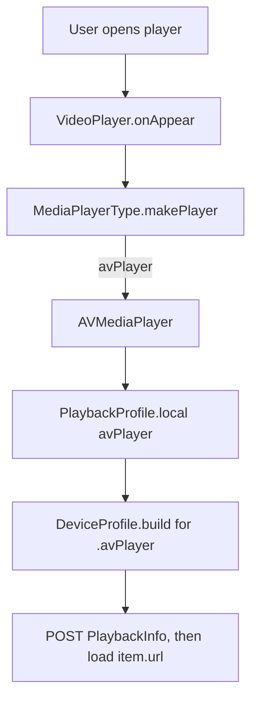
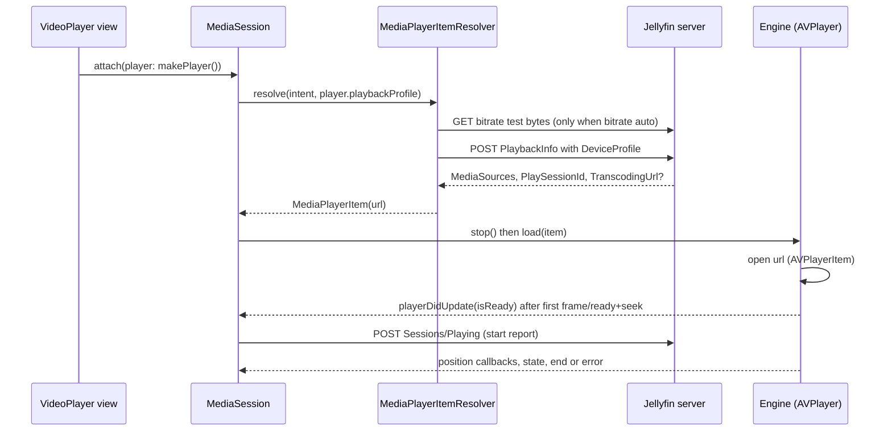

# 06 - Player engine (AVPlayer)

> **Jellyfin SDK source.** A citation `jellyfin-sdk-swift@3.3.0:PATH:LINE` points into [jellyfin/jellyfin-sdk-swift](https://github.com/jellyfin/jellyfin-sdk-swift) at tag `3.3.0` (commit `8ce10a167ad0b4145b2bc005acf8bebcfe6ebe46`). Open it as `https://github.com/jellyfin/jellyfin-sdk-swift/blob/8ce10a167ad0b4145b2bc005acf8bebcfe6ebe46/PATH#LLINE`; for a range `A-B`, use `#LA-LB`. There is no local copy of the SDK.

Part of the Jellyfin client spec. See `00-INDEX.md`. Related: `05-playback.md` (PlaybackInfo negotiation, session state), `07-reporting.md` (progress reports), `08-images-subtitles-audio.md` (track UX), `10-errors-edge-cases.md`, `11-sequence-flows.md`, `12-gaps.md`. Endpoint details live in `01-endpoints.md`; HTTP stack in `02-networking.md`; token and `ApiKey` in `03-auth-session.md`; DTOs in `04-models.md`.

Citation format: repo-relative `path:line` for the app; `jellyfin-sdk-swift@3.3.0:Sources/...:LINE` for the SDK. `WORK` = `docs/jellyfin-spec/_work`. This file is named `06-vlc.md` only to keep the numbering; the app has no VLC.

Swiftfin also has a second, non-AVPlayer engine (`MPVMediaPlayer`, `Shared/Objects/MediaPlayerType/MediaPlayerType.swift:15`, `:58-59`) and a Chromecast remote-playback path (`PlaybackProfile.chromecast`, `Shared/Objects/MediaPlayerManager/PlaybackProfile.swift:14-17`); both are out of scope for this spec.

---

## 1. There is no VLC

Evidence (run from the repo root, excluding `fastlane/`, `Tools/`, `SwiftfinMacros/`, `Translations/`, `docs/`, `.git/`):

```
grep -rIl "VLC\|libvlc\|MobileVLCKit\|TVVLCKit" <repo, with the excludes above>   -> no files
```

The search returned nothing when this spec was written (the `BRIEF.md` hard fact says the same: zero `VLC`/`libvlc` hits). No package, framework or import named VLC exists. The engine in scope is defined by one enum case:

| Engine | Enum case | Class | Citation |
|---|---|---|---|
| AVPlayer (system AVFoundation) | `MediaPlayerType.avPlayer` | `AVMediaPlayer` | `Shared/Objects/MediaPlayerType/MediaPlayerType.swift:14`, `:56-57` |

`MediaPlayerType` is a `String` raw-value enum (`"avPlayer"` for this engine) and is stored as a user default (`Shared/Objects/MediaPlayerType/MediaPlayerType.swift:12`). See `05-playback.md` for remote playback.

---

## 2. Engine selection rules

The engine comes from one per-user default key.

| Rule | Detail | Citation |
|---|---|---|
| Setting | UserDefaults key string `"videoPlayerType"`, type `MediaPlayerType`, user-scoped (`UserKey`). | `Shared/Services/SwiftfinDefaults.swift:301-303` |
| When read | Each time the `VideoPlayer` view appears and the session has no player and is not `.stopped`, the session attaches the player built by `makePlayer()` from the stored `MediaPlayerType`. | `Shared/Views/VideoPlayer/VideoPlayer.swift:63-67` |
| Builder | `makePlayer()` returns `AVMediaPlayer()` for `.avPlayer`. | `Shared/Objects/MediaPlayerType/MediaPlayerType.swift:53-61` |
| `PlayMediaAction` | Does not choose an engine. | `Shared/Coordinators/Navigation/PlayMediaAction.swift:24-29` |

There is no content-based, codec-based or failure-based fallback. If an engine fails, the session shows an error alert; it never retries with another engine (`Shared/Views/VideoPlayer/VideoPlayer.swift:83-95`; no engine switch appears in `Shared/Objects/MediaPlayerManager/MediaSession.swift`). Only one playback session exists at a time: `MediaPlayerManager.play` calls `stop()` first (`Shared/Objects/MediaPlayerManager/MediaPlayerManager.swift:72-77`).

The engine type then sets these things downstream for AVPlayer:

| Effect | AVPlayer | Citation |
|---|---|---|
| DeviceProfile (direct play, transcode, subtitle, codec profiles) | `_avPlayer*` sets | `Shared/Objects/MediaPlayerType/MediaPlayerType.swift:26-51`, `Shared/Objects/MediaPlayerType/MediaPlayerType+Shared.swift:16-25` |
| Secondary subtitle | not supported (`secondarySubtitleStreamIndex` forced to `-1`) | `Shared/Objects/MediaPlayerManager/PlaybackProfile.swift:19-26`, `Shared/Objects/MediaPlayerManager/MediaPlaybackConfiguration.swift:135-137` |
| Audio/subtitle offset | not supported | `Documentation/players.md:19` |



---

## 3. Shared contract between session and engine

The engine implements the `MediaPlayer` protocol and calls back into `MediaSession` (`Shared/Objects/MediaPlayerManager/Players/MediaPlayer.swift:16-36`). Optional capability protocols: `MediaPlayerTrackProviding` (`setStream`), `MediaPlayerMetadataProviding`, `MediaPlayerOffsetProviding`, `MediaPlayerSecondarySubtitleProviding`, `MediaPlayerSubtitleCueProviding`, `MediaPlayerPictureInPictureProviding` (`Shared/Objects/MediaPlayerManager/Players/MediaPlayer.swift:58-113`).

| Protocol member | Meaning | Citation |
|---|---|---|
| `supportedRates` default | `0.1 ... 5`; `grep -rn supportedRates --include='*.swift'` finds no declaration in `AVMediaPlayer.swift`, so AVPlayer uses the default | `Shared/Objects/MediaPlayerManager/Players/MediaPlayer.swift:49-51` |
| `playbackLocation` default | `.local` | `Shared/Objects/MediaPlayerManager/Players/MediaPlayer.swift:45-47` |
| `MediaSession.effectiveRate` | `rate` clamped to `player.supportedRates` (fallback `0.1 ... 5`) | `Shared/Objects/MediaPlayerManager/MediaSession.swift:97-100` |
| `MediaSession.rate` default | UserDefaults key `"playbackRate"`, default `1.0`; setting it persists and calls `player.setRate(effectiveRate)` | `Shared/Objects/MediaPlayerManager/MediaSession.swift:90-95`, `Shared/Services/SwiftfinDefaults.swift:385-387` |

Engine to session callbacks:

| Callback | Used for | Guard | Citation |
|---|---|---|---|
| `playerDidUpdate(_ PlaybackState)` | ready, playing, seekable, seeking, buffering, duration | only in `.preparing`/`.playback`; first `isReady == true` while `.preparing` starts playback and sends the Jellyfin start report | `Shared/Objects/MediaPlayerManager/MediaSession.swift:564-587` |
| `playerDidUpdatePosition(Duration)` | observed position | same state guard; feeds `PlaybackTimeline.observe` (clamped to >= 0) | `Shared/Objects/MediaPlayerManager/MediaSession.swift:595-601`, `Shared/Objects/MediaPlayerManager/PlaybackState.swift:41-43` |
| `playerDidRequestPlayback` | native control changed play/pause intent | requires `canControlPlayback` | `Shared/Objects/MediaPlayerManager/MediaSession.swift:557-562` |
| `playerDidCompleteSeek(request, position?)` | finishes one seek; `nil` position means failed | ignores stale request ids; `nil` with no pending seek sets toast `L10n.unableToSeek` | `Shared/Objects/MediaPlayerManager/MediaSession.swift:664-681` |
| `playerDidFail(error)` | fatal | engine must still be `session.player` and an item loaded | `Shared/Objects/MediaPlayerManager/MediaSession.swift:438-442` |
| `ended(from:)` | end of stream | ignored for live streams, when seeking, or when not controllable | `Shared/Objects/MediaPlayerManager/MediaSession.swift:495-528` |

`PlaybackState` fields: `isReady`, `isPlaying`, `isSeekable`, `isSeeking`, `isWaitingForDisplay`, `duration: Duration?`, `isBuffering` (`Shared/Objects/MediaPlayerManager/PlaybackState.swift:12-21`).

`MediaSession.canControlPlayback` = (`state == .preparing || .playback`) and `playbackState.isReady`; `canSeek` additionally needs `isSeekable` and not live (`Shared/Objects/MediaPlayerManager/MediaSession.swift:148-154`).

Video surface dispatch: engines that draw video conform to `VideoMediaPlayer` (`MediaPlayer` plus `MediaPlayerTrackProviding`), which requires `videoState` and `@ViewBuilder func videoPlayerBody(layout: VideoPlayer.VideoLayout)` (`Shared/Objects/MediaPlayerManager/Players/MediaPlayer.swift:59-67`). `VideoPlayer` casts `mediaSession.player as? any VideoMediaPlayer`, reads `videoState.videoSize` for layout, and renders `player.videoPlayerBody(layout: videoLayout).eraseToAnyView()`; otherwise it shows the remote-playback body on iOS when `isRemotePlayback`, else `Color.black` (`Shared/Views/VideoPlayer/VideoPlayer.swift:47-59`). AVPlayer returns `AVVideoPlayerView(player: self, layout: layout)` (`Shared/Objects/MediaPlayerManager/Players/AVMediaPlayer.swift:617-621`).

---

## 4. Time units and Jellyfin ticks

Jellyfin ticks are 100 ns units: 10,000,000 ticks per second (the app's own conversions are `Duration.microseconds(ticks / 10)` and `microseconds * 10`, `Shared/Extensions/Duration.swift:19-21`, `:55-57`). The session holds positions, durations and seek targets as Swift `Duration` (`Shared/Objects/MediaPlayerManager/MediaSession.swift:119-120`; `Shared/Objects/MediaPlayerManager/PlaybackState.swift:19`, `:33-50`) and converts at the engine and server edges listed below.

| Conversion | Formula | Citation |
|---|---|---|
| ticks to `Duration` | `Duration.microseconds(Int64(ticks) / 10)` (integer division, sub-microsecond ticks dropped) | `Shared/Extensions/Duration.swift:19-21` |
| `Duration` to ticks | `Int(microseconds * 10)`; `microseconds = attoseconds / 1_000_000_000_000 + seconds * 1_000_000` | `Shared/Extensions/Duration.swift:39-41`, `:55-57` |
| `Duration` to seconds | `Double(seconds) + Double(attoseconds) * 1e-18` | `Shared/Extensions/Duration.swift:43-45` |
| item resume position | `userData.playbackPositionTicks` to `Duration.ticks` (`startSeconds`) | `Shared/Extensions/JellyfinAPI/BaseItemDto/BaseItemDto.swift:306-309` |
| item runtime | `runTimeTicks` (> 0) to `Duration.ticks` (`runtime`) | `Shared/Extensions/JellyfinAPI/BaseItemDto/BaseItemDto.swift:299-303` |
| progress report position | `mediaSession.observedSeconds.ticks` (start/progress `PlaybackStateInfo.positionTicks`, stop `PlaybackStopInfo.positionTicks`) | `Shared/Objects/MediaPlayerManager/MediaProgressReporter.swift:64`, `:80` |
| server `Seek` playstate command | `guard let ticks = playstateCommand.seekPositionTicks else { return }`, then `mediaSession.seek(to: .ticks(ticks))` | `Shared/Services/UserSession/UserSessionManager+SocketCommands.swift:114-117` |

Engine-specific units:

| Engine | Native unit | Conversion to `Duration` | Citation |
|---|---|---|---|
| AVPlayer | `CMTime` | read: `.seconds(time.seconds)` only if `time.isNumeric`; write: `CMTime(seconds:, preferredTimescale: 600)` | `Shared/Objects/MediaPlayerManager/Players/AVMediaPlayer.swift:195`, `:267-268`, `:444` |

Resume offset: before negotiation `startSeconds = max(.zero, startSeconds ?? ((item.startSeconds ?? .zero) - resumeOffset))`, where `resumeOffset` is `Duration.seconds` of the UserDefaults value at key `"resumeOffset"` (default `0`) (`Shared/Objects/MediaPlayerManager/MediaPlaybackConfiguration.swift:36`, `:120`; `Shared/Services/SwiftfinDefaults.swift:290-291`). The item then reports that value as `userData.playbackPositionTicks` through `MediaPlayerItem.baseItem` (`Shared/Objects/MediaPlayerManager/MediaPlayerItem/MediaPlayerItem.swift:102-114`), and the engine reads `baseItem.startSeconds`.

Seek targets are clamped by the timeline: `max(.zero, min(position, duration))` when a duration is known (`Shared/Objects/MediaPlayerManager/PlaybackState.swift:45-50`).

---

## 5. How the media URL is built

The engine never builds URLs. `MediaPlayerItemResolver` builds the URL with `streamURL(...)` and stores it as `MediaPlayerItem.url` (`Shared/Objects/MediaPlayerManager/MediaPlayerItem/MediaPlayerItemResolver.swift:134-140`, `:169`). The AVPlayer engine loads `item.url` unchanged (`Shared/Objects/MediaPlayerManager/Players/AVMediaPlayer.swift:107`). Details of the PlaybackInfo POST are in `05-playback.md` and `01-endpoints.md`.

### 5.1 Resolution steps relevant to the engine

1. Pick the media source from the item, prepare the configuration, resolve `maxBitrate` (`Shared/Objects/MediaPlayerManager/MediaPlayerItem/MediaPlayerItemResolver.swift:44-49`).
2. Build the `DeviceProfile` for the engine: `profile.deviceProfile(configuration:maxBitrate:mediaSource:)` which for `.local(player)` calls `DeviceProfile.build(for:...)` (`Shared/Objects/MediaPlayerManager/PlaybackProfile.swift:89-90`; resolver `:50-54`).
3. Fill `PlaybackInfoDto`: `isAutoOpenLiveStream = true`, `deviceProfile`, `liveStreamID`, `maxStreamingBitrate = maxBitrate`, `userID`, `audioStreamIndex`, `subtitleStreamIndex`, and `mediaSourceID` unless live or placeholder (`:56-76`). Send `Paths.getPostedPlaybackInfo(itemID:, playbackInfo)` (`:78-86`).
4. Choose the returned `MediaSourceInfo`: match by `eTag`, then `id`, then `openToken` containing id, else first with a warning (`:94-122`).
5. Require `playSessionID` (`:130-132`), then `streamURL(...)` (`:134-140`).

### 5.2 `streamURL` branches

| Branch | URL | Auth | Citation |
|---|---|---|---|
| `mediaSource.transcodingURL` non-nil (server chose HLS or other transcode) | `client.url(path: transcodingPath)`: server base URL plus the server-provided path and query, unchanged | none added by the app (whatever the server put in the path) | `Shared/Objects/MediaPlayerManager/MediaPlayerItem/MediaPlayerItemResolver.swift:229-237`; `jellyfin-sdk-swift@3.3.0:Sources/JellyfinClient.swift:285-311` |
| video, direct play or direct stream | `Paths.getVideoStream(itemID:, parameters:)` with `isStatic: true`, `tag: mediaSource.eTag ?? item.etag`, `playSessionID`, `mediaSourceID: mediaSource.id ?? itemID`, `liveStreamID`; URL via `client.url(with:, queryAPIKey: true)` | query item `ApiKey=<accessToken>` appended | `...Resolver.swift:239-260`; `jellyfin-sdk-swift@3.3.0:Sources/JellyfinClient.swift:254-274` |
| audio item | `Paths.getAudioStream(itemID:, parameters:)` with the same four parameters and `isStatic: true`; `queryAPIKey: true` | `ApiKey` | `...Resolver.swift:262-279` |
| other media type | throws `ErrorMessage("Unsupported playback media type")` | n/a | `...Resolver.swift:281` |

Other `ErrorMessage` strings: `"No item ID while building online media player item!"` (`:226`), `"Unable to make transcoding URL"` (`:233`), `"Unable to make video stream URL"` (`:257`), `"Unable to make audio stream URL"` (`:275`).

`client.url(with:queryAPIKey:)` appends the Jellyfin query pairs from the SDK `Request`, then `ApiKey` last (`jellyfin-sdk-swift@3.3.0:Sources/JellyfinClient.swift:260-264`). The SDK encodes the query keys in lower camel case: `static`, `tag`, `playSessionId`, `mediaSourceId`, `liveStreamId` (`jellyfin-sdk-swift@3.3.0:Sources/Paths/GetVideoStreamAPI.swift:177`, `:179`, `:181`, `:185`, `:216`; audio: `jellyfin-sdk-swift@3.3.0:Sources/Paths/GetAudioStreamAPI.swift:171`, `:173`, `:175`, `:179`, `:208`). See `01-endpoints.md`.

### 5.3 What the engine adds

| Item | AVPlayer | Citation |
|---|---|---|
| Request headers (`Authorization`, `X-Emby-*`) | none set by the app | no `AVURLAssetHTTPHeaderFieldsKey` in app code (`grep -rn "AVURLAssetHTTPHeaderFieldsKey\|user-agent\|userAgent" Shared "Swiftfin tvOS" Views Objects Components Extensions App` returns no lines) |
| User agent | none set by the app | same |
| Asset construction | `AVPlayerItem(url: item.url)`: no `AVURLAsset`, no options dictionary, no `preferredForwardBufferDuration` | `Shared/Objects/MediaPlayerManager/Players/AVMediaPlayer.swift:107` |
| Auth on the wire | `ApiKey` query item (direct) or whatever the server embedded (transcode) | section 5.2 |

The tvOS target allows cleartext HTTP: `NSAppTransportSecurity` / `NSAllowsArbitraryLoads = true` (`Swiftfin tvOS/Resources/Info.plist:43-47`). The iOS `Info.plist` that the project references, `Swiftfin/Resources/Info.plist`, is not present in this checkout (`Swiftfin.xcodeproj/project.pbxproj:1313`, `:1353`), so the iOS ATS setting is unknown (see section 15 and the section 8 "Background audio" row).

**Open (see section 15):** whether `transcodingURL` carries its own auth, because the app only adds `ApiKey` for direct stream URLs.

---

## 6. Second engine (removed)

Removed: this section described a third-party library, which this spec no longer covers.

### 6.1 Library, version, linking

Removed: this section described a third-party library, which this spec no longer covers.

### 6.2 Construction and configuration

Removed: this section described a third-party library, which this spec no longer covers.

### 6.3 Option strings set at initialization

Removed: this section described a third-party library, which this spec no longer covers.

### 6.4 Codec and container support

Removed: this section described a third-party library, which this spec no longer covers.

### 6.5 Lifecycle and threading

Removed: this section described a third-party library, which this spec no longer covers.

### 6.6 Engine events and properties to app state

Removed: this section described a third-party library, which this spec no longer covers.

### 6.7 Seeking

Removed: this section described a third-party library, which this spec no longer covers. The session-level seek rules now live in section 7.5.

### 6.8 Rate

Removed: this section described a third-party library, which this spec no longer covers.

### 6.9 Errors and end of stream

Removed: this section described a third-party library, which this spec no longer covers. The session error handling now lives in section 7.8.

### 6.10 Audio and subtitle tracks

Removed: this section described a third-party library, which this spec no longer covers.

### 6.11 External (sidecar) subtitle loading

Removed: this section described a third-party library, which this spec no longer covers.

### 6.12 Text subtitle interception and rendering

Removed: this section described a third-party library, which this spec no longer covers.

### 6.13 PiP, AirPlay, audio session, background

Removed: this section described a third-party library, which this spec no longer covers. The AirPlay grep now lives in section 7.7.

---

## 7. AVPlayer

### 7.1 Framework and construction

The playback stack is system AVFoundation/AVKit only (`import AVFoundation`, `import AVKit`, `Shared/Objects/MediaPlayerManager/Players/AVMediaPlayer.swift:9-10`); no third-party player library is used. The file also imports `Combine`, `Foundation`, `Observation`, `SwiftUI` and the third-party SDK `@preconcurrency import JellyfinAPI` (`:11-15`, `JellyfinAPI` at `:13`).

| Step | Detail | Citation |
|---|---|---|
| Objects | `AVPlayer()` and `AVPlayerLayer(player:)` created in `init` | `...AVMediaPlayer.swift:85-89` |
| Flags | `appliesMediaSelectionCriteriaAutomatically = false` (app owns track selection); `allowsExternalPlayback = true` | `...AVMediaPlayer.swift:91-92` |
| Item | `AVPlayerItem(url: item.url)` only. No `AVURLAsset`, no `AVURLAssetHTTPHeaderFieldsKey`, no user agent, no `preferredForwardBufferDuration`, no cache options | `...AVMediaPlayer.swift:107` |
| Legible output | `AVPlayerItemLegibleOutput`, `suppressesPlayerRendering = false` (AVKit still draws captions), `output.setDelegate(self, queue: .main)`; torn down with `setDelegate(nil, queue: nil)` in `stop()` | `...AVMediaPlayer.swift:109-113`, `:146-148` |
| Metadata | `externalMetadata = item.baseItem.avMetadata`; later replaced with artwork-bearing metadata through `updateMetadata`; items use `extendedLanguageTag = "und"` | `...AVMediaPlayer.swift:115`, `:126-130`; `Shared/Objects/MediaPlayerManager/NowPlayable/NowPlayableMetadata.swift:64-92` |
| Load order | `stop()`, set `loadedItem`, create item, `replaceCurrentItem`, `observePlayback`, `setupPiP()`, tvOS display-mode observer | `...AVMediaPlayer.swift:103-124` |

### 7.2 Lifecycle and threading

| Aspect | Behavior | Citation |
|---|---|---|
| Isolation | all members `@MainActor`; KVO sinks, notification sinks and the periodic observer hop to the main actor and check `isCurrent(playerItem, generation:)` | `...AVMediaPlayer.swift:17-19`, `:248-250` |
| `stop()` | `loadedItem=nil`, `generation &+= 1` (invalidates in-flight callbacks), remove legible output, `isReady=false`, cancel prepare task and pending seeks, clear observations and cached selection groups, tear down PiP, `player.pause()`, `replaceCurrentItem(nil)`, reset video state; tvOS clears `preferredDisplayCriteria` | `...AVMediaPlayer.swift:144-176` |
| `deinit` | calls `stop()` | `...AVMediaPlayer.swift:99-101` |
| `play()` | requires `isReady`; sets `pendingPlaybackStatus=.playing`; `player.rate = Float(session.rate)` | `...AVMediaPlayer.swift:132-137` |
| `pause()` | `pendingPlaybackStatus=.paused`; `player.pause()` | `...AVMediaPlayer.swift:139-142` |
| `setRate` | only when ready and `player.rate != 0` (changing rate while paused must not start playback) | `...AVMediaPlayer.swift:178-182` |

### 7.3 Readiness (prepare) and start position

On `AVPlayerItem.status == .readyToPlay` the engine runs a one-time `prepare` (`...AVMediaPlayer.swift:390-397`):

1. Load `AVMediaSelectionGroup` for `.audible` and `.legible` (`try?`, failures swallowed) (`:407-408`).
2. Build the track index map (section 7.6) and `item.setTrackIndexes` (`:411-431`).
3. tvOS: set preferred display criteria (`:433-438`).
4. Unless live, `await player.seek(to: CMTime(seconds: startSeconds.seconds, preferredTimescale: 600), toleranceBefore: .zero, toleranceAfter: .zero)`. If not `finished`, `playerDidFail(ErrorMessage(L10n.unableToSeek))` (`:440-454`).
5. `isReady = true`, publish the position and state, and `play()` if the session request is `.playing` (`:456-469`).

Live items skip the start seek (`:442`).

### 7.4 Events observed and state mapping

| Source | Use | Citation |
|---|---|---|
| `addPeriodicTimeObserver(forInterval: CMTime(seconds: 1, preferredTimescale: 1000), queue: .main)` | position, about once per second while ready; also after seek completion and after prepare; removed through `player.removeTimeObserver(timeObserver)` in an `AnyCancellable` stored in `playbackObservations` | `...AVMediaPlayer.swift:258-273`, `:275` |
| KVO `player.timeControlStatus` | `.playing`/`.paused` to observed intent. Forwarded to the session (`playerDidRequestPlayback`) only when no pending seek, pending status nil or equal, and PiP (`isPiPActive`) or `player.isExternalPlaybackActive` is true (`:303-305`); otherwise app-initiated changes are not echoed | `...AVMediaPlayer.swift:278-307` |
| KVO `playerItem.seekableTimeRanges`, `playerItem.duration`, `player.reasonForWaitingToPlay` | recompute `PlaybackState` | `...AVMediaPlayer.swift:319-329` |
| KVO `playerItem.presentationSize` | video size | `...AVMediaPlayer.swift:331-342` |
| `AVPlayerItemDidPlayToEndTime` | end of stream (section 7.8) | `...AVMediaPlayer.swift:344-361` |
| `AVPlayerItem.newAccessLogEntryNotification` | `droppedFrames` = `playerItem.accessLog()?.events.last.numberOfDroppedVideoFrames` when >= 0; stored in `videoState.droppedFrames` only if it changed | `...AVMediaPlayer.swift:363-378` |
| KVO `playerItem.status` | `.failed` to `playerDidFail`; `.readyToPlay` to prepare | `...AVMediaPlayer.swift:380-403` |

`PlaybackState` built in `updatePlaybackState` (`...AVMediaPlayer.swift:498-517`): `isReady` = engine flag; `isPlaying = timeControlStatus == .playing`; `isSeekable = duration != nil || seekableTimeRanges.isNotEmpty`; `duration` = item duration when numeric and > 0; `isBuffering = timeControlStatus == .waitingToPlayAtSpecifiedRate && reasonForWaitingToPlay in {.toMinimizeStalls, .evaluatingBufferingRate}`; tvOS `isWaitingForDisplay = displayManager.isDisplayModeSwitchInProgress`.

### 7.5 Seeking (AVPlayer)

`player.seek(to: CMTime(seconds: target.seconds, preferredTimescale: 600), toleranceBefore: .zero, toleranceAfter: .zero)` (frame-exact). The completion handler hops to the main actor and acts only if the item and generation still match and `pendingSeek.id == request.id`; it then reports `playerDidCompleteSeek(request, position: finished && time.isNumeric ? .seconds(time.seconds) : nil)` using `player.currentTime()`. If the engine is not ready or has no item, it completes with `nil` immediately. `cancelSeek` clears the pending request and calls `currentItem.cancelPendingSeeks()` (`...AVMediaPlayer.swift:184-222`). The session coalesces seeks 80 ms and enforces an 8 s timeout (`Shared/Objects/MediaPlayerManager/MediaSession.swift:631-660`).

### 7.6 Audio and subtitle tracks (AVPlayer)

| Step | Detail | Citation |
|---|---|---|
| Groups | `cachedAudioGroup` (`.audible`), `cachedSubtitleGroup` (`.legible`) | `...AVMediaPlayer.swift:407-412` |
| Map building | for `(item.audioStreams, audioGroup)` and `(item.subtitleStreams, subtitleGroup)`: `internalStreams` = non-external; for each stream, `selectionOption(matching:)`; player index = `group.options.firstIndex(of: option)` | `...AVMediaPlayer.swift:414-429` |
| `selectionOption` rules, in order | (1) if `internalStreams.count == group.options.count`, option at the stream's position in `internalStreams`; (2) if the group has exactly one option, that option; (3) else `AVMediaSelectionGroup.mediaSelectionOptions(from:filteredAndSortedAccordingToPreferredLanguages: [stream.language]).first`; (4) else `nil` | `...AVMediaPlayer.swift:472-496` |
| Selecting | `setStream` picks the cached group, `group.options[safe: index]` where `index` is the player index (not the Jellyfin index), `item.select(option, in: group)`. A subtitle with no valid option selects `nil` (off). Audio with no option does nothing | `...AVMediaPlayer.swift:224-246`; caller `Shared/Objects/MediaPlayerManager/MediaPlayerItem/MediaPlayerItem.swift:268-286` |
| External audio | filtered out of `audioStreams` with a TODO | `Shared/Objects/MediaPlayerManager/MediaPlayerItem/MediaPlayerItem.swift:148-149` |
| Sidecar subtitles | none; AVPlayer has no external subtitle loader and its profile has no `.external` entry. Subtitles reach it embedded in the container (`.embed`: `cc_dec`, `ttml`, `:159-162`), through the HLS manifest (`.hls`: `vtt`, `:171-173`), or burned in by the server (`.encode`: bitmap `dvbsub`, `dvdsub`, `pgssub`, `xsub`, `:164-169`) | `Shared/Objects/MediaPlayerType/MediaPlayerType+AVPlayer.swift:156-174` |
| Cues | `AVPlayerItemLegibleOutput` strings become `SubtitleCue(text:)` set (no track id), the only consumer of `subtitleCues` in shared app code is the skip-back replay window (`Shared/Objects/MediaPlayerManager/MediaPlayerItem/MediaPlayerItemReplaySubtitles.swift:127`); each receive calls `loadedItem?.replaySubtitles?.refresh()`; `outputSequenceWasFlushed` clears the cues and calls `refresh()` too | `...AVMediaPlayer.swift:661-685` (`refresh` at `:676`, `:683`) |
| Secondary subtitle, offsets | not supported | `Documentation/players.md:18-19` |

### 7.7 PiP, AirPlay, audio session, display (AVPlayer)

| Topic | Behavior | Citation |
|---|---|---|
| PiP controller | `AVPictureInPictureController(playerLayer:)` created in `setupPiP` when an item exists, none exists yet, and `isPictureInPictureSupported()`; `requiresLinearPlayback = false`; iOS `canStartPictureInPictureAutomaticallyFromInline = allowsAutomaticPiP` | `...AVMediaPlayer.swift:524-534` |
| PiP availability | KVO `isPictureInPicturePossible` drives `isPiPAvailable` | `...AVMediaPlayer.swift:536-544` |
| PiP start, stop, teardown | `startPiP()` calls `pipController?.startPictureInPicture()`; `stopPiP()` calls `pipController?.stopPictureInPicture()`. `teardownPiP()` (called from `stop()`) sets `pipAvailableObserver = nil`, `pipController?.delegate = nil`, calls `stopPictureInPicture()`, sets `pipController = nil`, and resets `isPiPActive`, `isPiPAvailable`, `isPiPTransitioning` to `false` | `...AVMediaPlayer.swift:547-553`, `:555-563`; call site `:166` |
| PiP delegate | `willStart` sets transitioning; `didStart` sets active; `didStop` clears; `failedToStart` clears and logs `"Unable to start Picture in Picture: ..."`; `restoreUserInterface` completes `true` | `...AVMediaPlayer.swift:566-613` |
| Automatic PiP setting | UserDefaults key `"automaticPictureInPicture"`, default `false`, observed live (iOS) | `Shared/Objects/MediaPlayerManager/Players/MediaPlayer+AutomaticPictureInPicture.swift:13-26`; `Shared/Services/SwiftfinDefaults.swift:399-401` |
| Surface | `AVPlayerLayer` is owned by the engine and added to a `UIView`; `didMoveToWindow` calls `videoSurfaceDidMove(to:)` which re-runs `setupPiP()` (and on tvOS grabs `window.avDisplayManager`) | `Shared/Views/VideoPlayer/Components/AVVideoPlayerView.swift:25-64`; `...AVMediaPlayer.swift:623-629` |
| AirPlay | `allowsExternalPlayback = true`; no route picker in the app (grep of `Shared`, `Objects`, `Views`, `Components`, `Extensions`, `App`, `Swiftfin tvOS` for `AVRoutePickerView\|externalPlayback\|RoutePicker\|allowsExternalPlayback\|isExternalPlaybackActive` hits only `Shared/Objects/MediaPlayerManager/Players/AVMediaPlayer.swift:92`, `:303`); AirPlay streams the same negotiated URL; while `isExternalPlaybackActive`, native transport changes are reported to the session | `...AVMediaPlayer.swift:92`, `:303-305`; `Documentation/players.md:27` |
| tvOS display criteria | on ready: `displayManager.preferredDisplayCriteria = AVDisplayCriteria(refreshRate: nominalFrameRate, formatDescription: first video format description)`; cleared on stop; `isDisplayModeSwitchInProgress` becomes `PlaybackState.isWaitingForDisplay` (UI activity `.switchingDisplay`) | `...AVMediaPlayer.swift:645-657` (first video track via `playerItem.asset.loadTracks(withMediaType: .video).first` at `:649`, then its format description and `nominalFrameRate`), `:513`, `:173-174`, `:635-643`; `Shared/Objects/MediaPlayerManager/MediaSession.swift:184-185` (`if playbackState.isWaitingForDisplay { return .switchingDisplay }`; enum case declared at `:156-162`) |

### 7.8 Errors and end of stream (AVPlayer)

| Condition | Handling | Citation |
|---|---|---|
| `playerItem.status == .failed` | `playerDidFail(ErrorMessage("AVPlayer error: <playerItem.error ?? player.error ?? L10n.unknownError localizedDescription>"))`, session error alert (below) | `...AVMediaPlayer.swift:385-388` |
| initial seek not `finished` | `playerDidFail(ErrorMessage(L10n.unableToSeek))`, same alert | `...AVMediaPlayer.swift:443-453` |
| user seek `finished == false` or non numeric time | `playerDidCompleteSeek(.., position: nil)`, toast "unable to seek" if nothing pending | `...AVMediaPlayer.swift:206-210`; `MediaSession.swift:670-672` |
| selection group load failure | swallowed (`try?`), no groups so track switching is a no-op | `...AVMediaPlayer.swift:407-408` |
| PiP failure | log only | `...AVMediaPlayer.swift:594-605` |
| `AVPlayerItemDidPlayToEndTime` | if not live: send a final position (`item.baseItem.runtime`, else `playerItem.duration`) then `mediaSession.ended(from:)` | `...AVMediaPlayer.swift:344-361` |

`MediaSession.fail` stores `observedSeconds` as the retry start position (when controllable), logs `"Playback failed: ..."`, and moves to `.error`; `VideoPlayer` shows an alert titled `L10n.error`, message `L10n.unableToLoadThisItem`, with Retry (`mediaSession.retry()`) and Close (`Shared/Objects/MediaPlayerManager/MediaSession.swift:444-465`, `:551-555`; `Shared/Views/VideoPlayer/VideoPlayer.swift:83-95`). During a remote handoff or while remote playback, failure returns to the local player with a toast instead (`MediaSession.swift:447-457`).

---

## 8. Audio session, background and Now Playing (both engines)

`NowPlayableObserver` and `NowPlayableCommand` are the only app code that sets the `AVAudioSession` category or activation or touches `MPRemoteCommandCenter` (grep of `Shared`, `Swiftfin tvOS`, `Views`, `Components`, `Objects`, `Extensions`, `App`: `NowPlayableObserver.swift:313`, `:407`, `:452-457`; `NowPlayableCommand.swift:61`, `:156`, `:158`); the only other `AVAudioSession` uses are read-only (`outputVolume`, `Views/VideoPlayer/Gestures/VideoPlayerContainerView+PanGesture.swift:346`; the computed property `var audioMode: AVAudioSession.Mode` at `Shared/Extensions/JellyfinAPI/BaseItemKind.swift:436-437`; notification keys at `Shared/Services/Notifications.swift:154-211`). It is engine independent and is installed when the session reaches `.preparing`/`.playback` (`Shared/Objects/MediaPlayerManager/MediaPlayerManager.swift:96-100`).

| Topic | Behavior | Citation |
|---|---|---|
| Category | `setCategory(.playback, mode: isAudio ? .default : .moviePlayback)`, `setSupportsMultichannelContent(true)`, `setActive(true)` | `Shared/Objects/MediaPlayerManager/NowPlayable/NowPlayableObserver.swift:449-460` |
| Skipped when | remote playback | `...NowPlayableObserver.swift:450` |
| When configured | on playback item change, and again if the media type (audio/video) changes | `...NowPlayableObserver.swift:165`, `:180-182` |
| Deactivation | `setActive(false, options: .notifyOthersOnDeactivation)` in `stop()` if it owns the session | `...NowPlayableObserver.swift:405-409` |
| Interruption | `began`: remember request, pause; `ended`: resume only if previously `.playing` and `.shouldResume`; failures logged | `...NowPlayableObserver.swift:415-439`; subscription `:124-130` |
| Interruption decoding | `Notifications.Key.avAudioSessionInterruption` on `AVAudioSession.interruptionNotification`: reads `userInfo[AVAudioSessionInterruptionTypeKey] as? UInt` into `AVAudioSession.InterruptionType` (notification dropped if absent or invalid) and `userInfo[AVAudioSessionInterruptionOptionKey] as? UInt` into `InterruptionOptions` (default `[]`) | `Shared/Services/Notifications.swift:192-205` |
| Route change | `.oldDeviceUnavailable` (e.g. headphones unplugged) pauses, only when the observer owns the audio session | `...NowPlayableObserver.swift:132-141` |
| Route change decoding | `Notifications.Key.avAudioSessionRouteChange` on `AVAudioSession.routeChangeNotification`: `userInfo[AVAudioSessionRouteChangeReasonKey] as? UInt` into `AVAudioSession.RouteChangeReason` | `Shared/Services/Notifications.swift:207-211` |
| Dead key | `Notifications.Key.interruption` (`Key<Void>` on `AVAudioSession.interruptionNotification`) is never subscribed: grep of `Shared`, `Views`, `Objects`, `Swiftfin tvOS` for `.interruption]` finds no use; the live path is `avAudioSessionInterruption` | `Shared/Services/Notifications.swift:154-156` |
| Remote commands | `play`, `pause`, `stop`, `togglePausePlay`, `skipBackward`, `skipForward` (`preferredIntervals = [15.0]`), `changePlaybackPosition`, `nextTrack`, `previousTrack`, `changePlaybackRate`, `enableLanguageOption`, `disableLanguageOption` | `...NowPlayableObserver.swift:36-43`; `Shared/Objects/MediaPlayerManager/NowPlayable/NowPlayableCommand.swift:156-158` |
| Remote command setup | `setup()` first calls `isEnabled(false)` on every `NowPlayableCommand.allCases`, including the never-registered `changeRepeatMode`, `changeShuffleMode`, `seekBackward`, `seekForward`, `rating`, `like`, `dislike`, `bookmark`; then adds a handler only for `registeredCommands`, stored in `commandTargets`. On `stop()` each target is removed with `remoteCommand.removeTarget(target)` and the command is disabled | `...NowPlayableObserver.swift:66-74`, `:391-396`; cases `NowPlayableCommand.swift:28-58` |
| Remote command enablement (`updateRemoteCommands`) | `play`, `pause`, `stop`, `togglePausePlay`: `canControlPlayback`. `skipBackward`, `skipForward`, `changePlaybackPosition`: `canSeek`. `nextTrack` / `previousTrack`: `canControl` and `queue?.hasNextItem` / `hasPreviousItem`. `changePlaybackRate`: `canControl` and `item.isLiveStream == false`. `enableLanguageOption`: `playbackItem?.canSelectTracks` and non-empty `languageOptions.groups`; `disableLanguageOption` also needs a current option of type `.legible`. Re-run after each handled command and when the UserDefaults playback-rates value changes | `...NowPlayableObserver.swift:298-319`, `:378`, `:119-122` |
| Event decoding (`action(for:)`) | play, pause, stop, togglePausePlay, nextTrack, previousTrack map directly. Skip: needs `MPSkipIntervalCommandEvent` with finite `interval > 0`; `skipBackward` negates it, giving `.skip(.seconds(±interval))`. `changePlaybackPosition`: needs `MPChangePlaybackPositionCommandEvent` with finite `positionTime`, giving `.seek(.seconds(positionTime))`. `changePlaybackRate`: `MPChangePlaybackRateCommandEvent.playbackRate` as `Double`. Language: `MPChangeLanguageOptionCommandEvent.languageOption`, `enabled = (self == .enableLanguageOption)`. Every other case returns `nil` | `Shared/Objects/MediaPlayerManager/NowPlayable/NowPlayableCommand.swift:107-150` |
| Handler threading (`addHandler`) | `remoteCommand.addTarget` closure: on the main thread it runs `MainActor.assumeIsolated`, otherwise `DispatchQueue.main.sync`, so the status is returned synchronously. A `nil` decoded action returns `.commandFailed`. `isEnabled(_:)` sets `remoteCommand.isEnabled` | `...NowPlayableCommand.swift:152-183` |
| Command handling | every action needs `isActive` and `canControlPlayback`, else `.commandFailed`. Rate: `rate.isFinite`, `rate > 0`, item not live, and a match in `supportedRates` within `abs($0 - rate) < 0.0001`, else `.commandFailed`; on success `mediaSession.rate = supported`. Next/previous with no queue item return `.noSuchContent`. After any success: `updatePlaybackInfo()`, `updateRemoteCommands()`, return `.success` | `...NowPlayableObserver.swift:322-381` (rate `:364-368`) |
| Supported rates for the command | UserDefaults key `"videoPlayerPlaybackRates"` (default `[0.5, 1.0, 1.25, 1.5, 2.0]`) plus the current rate, filtered by `player.supportedRates` | `...NowPlayableObserver.swift:45-49`; `Shared/Services/SwiftfinDefaults.swift:381-383` |
| Now Playing info | `MPMediaItemPropertyPlaybackDuration` (seconds, nil for live), `MPNowPlayingInfoPropertyElapsedPlaybackTime = observedSeconds.seconds`, `PlaybackRate` = effective rate or `0` unless advancing (request `.playing`, `isPlaying`, not seeking, not buffering, not waiting for display), `DefaultPlaybackRate`, `CurrentLanguageOptions`, `AvailableLanguageOptions` (arrays of `MPNowPlayingInfoLanguageOption` and `MPNowPlayingInfoLanguageOptionGroup`, built by `NowPlayableLanguageOptions` from audio, subtitle and, when supported, secondary-subtitle streams) | `...NowPlayableObserver.swift:276-296`; `Shared/Objects/MediaPlayerManager/NowPlayable/NowPlayableMetadata.swift:127-132`; `Shared/Objects/MediaPlayerManager/NowPlayable/NowPlayableLanguageOptions.swift:34-62` (`init(item:)` builds from audio, subtitle and secondary-subtitle streams; `append` at `:64`; `select(_:enabled:on:)` at `:122` applies a chosen option, it is not the builder) |
| Static Now Playing keys | `MPNowPlayingInfoPropertyMediaType = mediaType.rawValue`, `MPNowPlayingInfoPropertyIsLiveStream`, then title, artist, artwork (`MPMediaItemArtwork(boundsSize:)` wrapping the loaded `UIImage`, `Shared/Extensions/JellyfinAPI/BaseItemDto/BaseItemDto.swift:72`), album artist, album title, genre (`MPMediaItemPropertyGenre`) | `Shared/Objects/MediaPlayerManager/NowPlayable/NowPlayableMetadata.swift:54-61` |
| Now Playing center API | `MPNowPlayingInfoCenter.default().nowPlayingInfo` is read, merged with the keys above and reassigned; it is set to `nil` on teardown. `MPRemoteCommandCenter.shared().changePlaybackRateCommand.supportedPlaybackRates` is set from the session's supported rates as `NSNumber` | `Shared/Objects/MediaPlayerManager/NowPlayable/NowPlayableObserver.swift:160`, `:218`, `:292-296`, `:313`, `:403` |
| Background audio | tvOS `Info.plist`: `UIBackgroundModes = [audio]`. The iOS `Swiftfin/Resources/Info.plist` referenced by the project does not exist in this checkout; the iOS background modes are unknown | `Swiftfin tvOS/Resources/Info.plist:48-51`; `Swiftfin.xcodeproj/project.pbxproj:1313`, `:1353` |
| Pause on background | UserDefaults key `"playInBackground"`, default `true`. On `applicationDidEnterBackground`: skip for remote playback and for audio items; skip if PiP is active; pause immediately if the engine cannot auto-PiP; otherwise poll up to 5 times every 300 ms for PiP to start, then pause | `Shared/Services/SwiftfinDefaults.swift:403-405`; `Shared/Objects/MediaPlayerManager/MediaPlaybackTransitions.swift:30-62`; `Shared/Objects/MediaPlayerManager/MediaPlayerManager.swift:57-65` |
| Manual PiP start | polls up to 5 times, 300 ms apart, calling `startPiP()` when available | `...MediaPlaybackTransitions.swift:68-93` |
| System volume gesture (iOS) | the pan-to-change-volume gesture retains one `MPVolumeView`, starts from `AVAudioSession.sharedInstance().outputVolume`, finds the inner `UISlider` in `volumeView.subviews`, and sets `slider.value` (start value plus translation / 300, clamped 0...1) after a 0.01 s dispatch. Engine independent; read-only use of the audio session | `Views/VideoPlayer/Gestures/VideoPlayerContainerView+PanGesture.swift:340-370` |

---

## 9. DeviceProfile versus what each engine decodes

`DeviceProfile.build(for:configuration:maxBitrate:mediaSource:)` is the single builder (`Shared/Extensions/JellyfinAPI/DeviceProfile.swift:11-125`). The resulting profile is sent in `PlaybackInfoDto.deviceProfile` (section 5.1; schema in `04-models.md`).

### 9.1 Build algorithm

1. `codecProfiles = playerType.codecProfiles(configuration:)` (`DeviceProfile.swift:25`; dispatch `Shared/Objects/MediaPlayerType/MediaPlayerType+Shared.swift:16-25`).
2. `subtitleProfiles`: if `forceSubtitleBurnIn`, `SubtitleProfile.build(method: .encode) { SubtitleFormat.allCases }`; else the engine's list (`:27-33`).
3. A Dolby Vision subtitle filter that applies only to the out-of-scope engine (`:35-45`).
4. Append the resolution codec profile from `maxResolution.codecProfile(for:)` when `maxResolution != .max` (`:47-49`; `Shared/Objects/PlaybackResolution.swift:35-66`).
5. Direct play and transcoding profiles by `compatibilityMode` (section 9.6) (`:53-90`).
6. Re-add the engine's audio direct-play profiles if none are present; re-add audio transcoding profiles unless mode is `.directPlay` (`:92-103`).
7. Limit transcoding codec lists to 40 characters (section 9.7) (`:105-114`).
8. If `maxBitrate` is given, set `maxStaticBitrate`, `maxStreamingBitrate`, `musicStreamingTranscodingBitrate` all to it (`:118-122`). Bitrate is `requestedBitrate.rawValue`, or when `.auto` a measured value `bytes*8/seconds` clamped to `PlaybackBitrate.kbps420 ... Int32.max` from `Paths.getBitrateTestBytes(size:)` (`MediaPlayerItemResolver.swift:183-201`).

Device capability probes (`Shared/Extensions/UIDevice+PlaybackCapabilities.swift`): `supportsH264`, `supportsHEVC`, `supportsAV1`, `supportsVP9`, `supportsDolbyVisionDecoding` are `VTIsHardwareDecodeSupported(kCMVideoCodecType_H264 / _HEVC / _AV1 / _VP9 / _DolbyVisionHEVC)` (`:41-66`, `:84-86`). `isDeviceHDRCapable = AVPlayer.eligibleForHDRPlayback` (`:18-20`) is not used by the AVPlayer profile builder: `grep -rn isDeviceHDRCapable --include='*.swift'` hits only the definition and two settings views (`Shared/Views/SettingsView/PlaybackQualitySettingsView.swift:129`, `Shared/Views/SettingsView/DebugSettingsView.swift:38`), none in `Shared/Objects/MediaPlayerType/MediaPlayerType+AVPlayer.swift`. AV1 needs A17 Pro or M3+ (comment `:54`); VP9 hardware decode is "not available on iOS/tvOS" (comment `:63`).

### 9.2 Direct play profiles

**AVPlayer** (`Shared/Objects/MediaPlayerType/MediaPlayerType+AVPlayer.swift:17-106`)

| Type | Containers | Audio codecs | Video codecs |
|---|---|---|---|
| audio | `m4a,m4b,mp4,mov,aac,ac3,eac3` | `aac,alac,ac3,eac3` | n/a |
| audio | `mp3` | `mp3` | n/a |
| audio | `flac` | `flac` | n/a |
| audio | `wav,aiff,aif,caf` | `pcm_s16le,pcm_s24le,pcm_s16be,pcm_s24be,pcm_u8,pcm_alaw,pcm_mulaw` | n/a |
| video | `mp4`, `m4v` | `aac,ac3,alac,eac3,flac` | `h264,mpeg4`, `av1` if HW AV1, `hevc` if HW HEVC, `vp9` if HW VP9 |
| video | `mov` | `aac,ac3,alac,eac3,mp3,pcm_s16be,pcm_s16le,pcm_s24be,pcm_s24le` | `h264,mjpeg,mpeg4`, `hevc` if HW HEVC |
| video | `3g2`, `3gp` | `aac,amr_nb` | `h264,mpeg4` |
| video | `avi` | `pcm_mulaw,pcm_s16le` | `mjpeg` |

### 9.3 Transcoding profiles

| | AVPlayer (`...+AVPlayer.swift:110-152`) |
|---|---|
| Audio profile | protocol `http`, container `mp3`, `audioCodec` `mp3`, context `streaming`, type `audio` |
| Video protocol / container | `hls` / `mp4`, context `streaming` |
| `isBreakOnNonKeyFrames` | `true` |
| `minSegments` | `2` |
| `maxAudioChannels` | `"8"` |
| `enableSubtitlesInManifest` | `true` |
| Audio codecs | `aac,ac3,alac,eac3,flac` |
| Video codecs (order = priority) | `av1` (HW), `hevc` (HW), `h264`, `mpeg4` |

### 9.4 Codec profiles (conditions)

All are `CodecProfile(codec:, type: .video, conditions:)`. `isRequired` false means optional.

| Engine | Codec | Conditions | Citation |
|---|---|---|---|
| AVPlayer | h264 | not anamorphic (opt); `videoProfile` in high/main/baseline/constrained baseline (opt); `videoLevel <= 80` (opt); `videoRangeType` in `SDR`,`DOVIWithSDR` (opt); not interlaced (opt) | `...+AVPlayer.swift:182-204`; `...+Shared.swift:29-55` |
| AVPlayer | hevc | not anamorphic (opt); profile main/main10 (opt); `videoLevel <= 175` (opt); not interlaced (opt); `videoRangeType` in the AV list (opt); `videoCodecTag` in `hvc1`,`dvh1` (required); `videoFramerate <= 60` (required) | `...+AVPlayer.swift:206-236`; `...+Shared.swift:57-88` |
| AVPlayer | av1 | not anamorphic, not interlaced, `videoRangeType` in the AV list (all opt) | `...+AVPlayer.swift:238-264` |

HDR range lists:

| List | Contents | Citation |
|---|---|---|
| `avPlayerHDRProfiles` | always `SDR`, `DOVIWithSDR`; if HEVC HW and not `forceHDRTranscode`: `HLG`, `DOVIWithHLG`, `HDR10`, `HDR10Plus`; if (that) or (DV decoding and not `forceDVTranscode`): `DOVIWithHDR10`, `DOVIWithHDR10Plus`, `DOVIWithEL`, `DOVIWithELHDR10Plus`; if DV decoding and not `forceDVTranscode`: `DOVI` | `...+AVPlayer.swift:267-297` |

The three flags `forceHDRTranscode`, `forceDVTranscode`, `forceSubtitleBurnIn` are stored values, default `false`, copied into `MediaPlaybackConfiguration` (`Shared/Objects/MediaPlayerManager/MediaPlaybackConfiguration.swift:29-31`; stored values at `Shared/SwiftfinStore/StoredValue/StoredValues+User.swift:170-189`).

### 9.5 Subtitle profiles

| Engine | `embed` | `external` | `encode` | `hls` | Citation |
|---|---|---|---|---|---|
| AVPlayer | `cc_dec`, `ttml` | none | `dvbsub`, `dvdsub`, `pgssub`, `xsub` | `vtt` | `...+AVPlayer.swift:156-174` |

### 9.6 Compatibility modes

`PlaybackCompatibility` cases: `auto`, `mostCompatible`, `directPlay`, `custom` (`Shared/Objects/PlaybackCompatibility/PlaybackCompatibility.swift:12-17`); default UserDefaults compatibility mode is `.auto` (`Shared/Services/SwiftfinDefaults.swift:373-379`).

| Mode | Direct play | Transcoding | Citation |
|---|---|---|---|
| `auto` | engine profiles | engine profiles | `DeviceProfile.swift:55-56` |
| `mostCompatible` | video `mp4` + `aac` + `h264` only | HLS `mp4`, `aac`, `h264`, `isBreakOnNonKeyFrames`, `minSegments 2`, `maxAudioChannels "8"` | `DeviceProfile.swift:58-60`; `Shared/Objects/PlaybackCompatibility/PlaybackCompatibility+Video.swift:18-45` |
| `directPlay` | `DirectPlayProfile(type: .video)` with no restrictions | none (transcoding profiles left nil) | `DeviceProfile.swift:62-63`; `...+Video.swift:49-52` |
| `custom` + action `.add` | engine profiles plus custom | engine profiles plus custom marked `useAsTranscodingProfile` | `DeviceProfile.swift:65-90` |
| `custom` + other action (replace) | empty, then only custom | cleared only if some custom profile is a transcoding profile | `DeviceProfile.swift:72-81` |

Audio direct-play profiles are always re-added from the engine when none are present (`DeviceProfile.swift:93-96`). Audio transcoding profiles are re-added only when `compatibilityMode != .directPlay` (`:98-103`), so in `directPlay` mode the profile has no audio transcoding profile.

`DeviceProfile.canPlay(...)` helpers (used for in-place track switch decisions): profile CSV fields are lowercased, split on `,`, trimmed; a nil profile field is a wildcard (true); a nil candidate against a non-nil profile is false; subtitle compares lowercased format and exact method (`DeviceProfile.swift:129-166`).

### 9.7 Forty character limit on transcoding codec lists

Jellyfin truncates codec lists at 40 characters (workaround comment `Shared/Extensions/JellyfinAPI/DeviceProfile+CodecLimits.swift:13`). `LegacyCodecList.limit(value, preserving: sourceCodec)` returns `value` unchanged if `value.count <= 40`; otherwise it repeatedly removes the last element that is not the first element and not the source codec (case-insensitive) until the joined string is <= 40; if none can be removed it throws and the whole transcoding profile is dropped (`compactMap`) (`...CodecLimits.swift:25-60`). `sourceAudioCodec` is the codec of the audio stream matching `configuration.audioStreamIndex`; `sourceVideoCodec` is the first video stream's codec (`DeviceProfile.swift:105-114`).

Worked case: the AVPlayer video transcoding audio list `aac,ac3,alac,eac3,flac` (`Shared/Objects/MediaPlayerType/MediaPlayerType+AVPlayer.swift:130-134`) is 22 characters, so `limit` returns it unchanged (`Shared/Extensions/JellyfinAPI/DeviceProfile+CodecLimits.swift:45`).

### 9.8 Track-switch rebuild rule (engine in place versus new server stream)

`MediaPlayerItem.isRebuildRequired(type:from:to:)` (`Shared/Objects/MediaPlayerManager/MediaPlayerItem/MediaPlayerItem.swift:202-266`) decides whether the engine can switch in place:

| Case | Rebuild (new PlaybackInfo, reload at current position) |
|---|---|
| Remote playback, audio or subtitle | always |
| Removing a burned-in (`.encode`) subtitle while transcoding | yes |
| Audio, transcoding | yes |
| Audio, direct play | yes unless `deviceProfile.canPlay(type:, audioCodec:, container:)` is true for the new stream |
| Subtitle `deliveryMethod == .encode` | yes |
| Subtitle `.external` | yes unless it is a sidecar (text with `deliveryURL`) |
| Subtitle `.hls` | yes unless the player already exposes a mapped track |
| Subtitle `.embed`/nil, `isExternal == true` | yes unless the profile allows `.external` or `.hls` for the codec |
| Subtitle `.embed`/nil, internal | yes if transcoding or the profile lacks `.embed` for the codec |

Rebuild calls `mediaSession.reload(item)` which re-resolves at `seconds` (`Shared/Objects/MediaPlayerManager/MediaSession.swift:734-738`). Streams with `deliveryMethod == .drop` are removed from `subtitleStreams` (`MediaPlayerItem.swift:151-154`).

---

## 10. Live streams

| Behavior | Citation |
|---|---|
| AVPlayer skips the start seek | `Shared/Objects/MediaPlayerManager/Players/AVMediaPlayer.swift:442` |
| End of stream ignored by AVPlayer | `...AVMediaPlayer.swift:349` |
| Seeking disallowed (`canSeek` false) | `Shared/Objects/MediaPlayerManager/MediaSession.swift:152-154` |
| `isAutoOpenLiveStream = true`, `liveStreamID` passed through; unstarted live streams closed with `Paths.closeLiveStream` | `Shared/Objects/MediaPlayerManager/MediaPlayerItem/MediaPlayerItemResolver.swift:57`, `:68`, `:203-215`; `Shared/Objects/MediaPlayerManager/MediaProgressReporter.swift:88-98` |

---

## 11. Feature matrix

| Feature | AVPlayer | Source |
|---|---|---|
| Audio track selection | yes | `Documentation/players.md:16` |
| Subtitle track selection | yes | `Documentation/players.md:17` |
| Secondary subtitle | no | `PlaybackProfile.swift:19-26` |
| Audio and subtitle offset | no | `Documentation/players.md:19` |
| External audio tracks | no | `MediaPlayerItem.swift:148-149` |
| Sidecar subtitle files | no | `MediaPlayerType+AVPlayer.swift:156-174` |
| PiP (iOS) | yes | `AVMediaPlayer.swift:522-613` |
| AirPlay video | yes (`allowsExternalPlayback`) | `Documentation/players.md:27`, `AVMediaPlayer.swift:92` |
| tvOS framerate matching | yes (`AVDisplayCriteria`) | `Documentation/players.md:24`, `AVMediaPlayer.swift:645-657` |
| Containers MKV, MPEG-TS, WebM | transcode/remux | `Documentation/players.md:40-46` |

---

## 12. Sequence: loading an item


Endpoint verbs and paths for the bitrate test, PlaybackInfo and session reports are in `01-endpoints.md` and `07-reporting.md`. Per message: `resolveItem(resolvedIntent, player.playbackProfile, userSession)` is at `Shared/Objects/MediaPlayerManager/MediaSession.swift:409`; the bitrate-test GET is at `Shared/Objects/MediaPlayerManager/MediaPlayerItem/MediaPlayerItemResolver.swift:183-201`; the PlaybackInfo POST is at `MediaPlayerItemResolver.swift:56-86`; `player.stop()` is at `MediaSession.swift:415`; `destinationPlayer.load(item)` is at `MediaSession.swift:359`; the ready callback and start report are at `MediaSession.swift:564-587`.

---

## 13. Constants

| Name | Value | Citation |
|---|---|---|
| Ticks per second | 10,000,000 (`Duration.ticks` = microseconds x 10) | `Shared/Extensions/Duration.swift:19-21`, `:55-57` |
| AVPlayer seek timescale | 600 | `Shared/Objects/MediaPlayerManager/Players/AVMediaPlayer.swift:195`, `:444` |
| AVPlayer periodic observer | `CMTime(seconds: 1, preferredTimescale: 1000)` | `...AVMediaPlayer.swift:259` |
| AVPlayer seek tolerance | `.zero` before and after | `...AVMediaPlayer.swift:196-197` |
| Default supported rates | `0.1 ... 5` | `Shared/Objects/MediaPlayerManager/Players/MediaPlayer.swift:50` |
| Session seek coalescing | 80 ms | `Shared/Objects/MediaPlayerManager/MediaSession.swift:634` |
| Session seek timeout | 8 s | `Shared/Objects/MediaPlayerManager/MediaSession.swift:647` |
| PiP and background wait | 5 polls x 300 ms | `Shared/Objects/MediaPlayerManager/MediaPlaybackTransitions.swift:45`, `:74`, `:86` |
| Remote skip interval | 15.0 s | `Shared/Objects/MediaPlayerManager/NowPlayable/NowPlayableCommand.swift:156`, `:158` |
| Transcoding codec list limit | 40 characters | `Shared/Extensions/JellyfinAPI/DeviceProfile+CodecLimits.swift:45`, `:51` |
| H264 level limit | 80 | `Shared/Objects/MediaPlayerType/MediaPlayerType+Shared.swift:53` |
| HEVC AVPlayer limits | level <= 175, framerate <= 60, tag in `hvc1`,`dvh1` | `...+Shared.swift:79`; `...+AVPlayer.swift:223-233` |

---

## 14. CONFLICT and reconciliation notes

No two explorers asserted contradictory facts about the engines. The following discrepancies were checked and settled by reading source:

| Item | Versions | Resolution |
|---|---|---|
| `isDeviceHDRCapable` | An earlier explorer noted doc comments imply display checks; the code does not use it | Settled: the AVPlayer profile builder does not read it (`MediaPlayerType+AVPlayer.swift:267-297`). |

---

## 15. Open questions and gaps (carry to `12-gaps.md`)

| Question | Evidence | Citation |
|---|---|---|
| User agent sent by AVPlayer | the app sets none | `AVMediaPlayer.swift:107` |
| Does the server `transcodingURL` include auth (`api_key`)? | the app uses `client.url(path:)` and adds `ApiKey` only for direct stream URLs | `...MediaPlayerItemResolver.swift:229-237` |
| iOS `UIBackgroundModes`, iOS ATS | `INFOPLIST_FILE = Swiftfin/Resources/Info.plist` does not exist in this checkout | `Swiftfin.xcodeproj/project.pbxproj:1313`, `:1353` |

---

## 16. Remote cast engine (removed)

Removed: this section described a third-party library, which this spec no longer covers.

### 16.1 Controller: setup and discovery

Removed: this section described a third-party library, which this spec no longer covers.

### 16.2 Destination picker

Removed: this section described a third-party library, which this spec no longer covers.

### 16.3 Engine

Removed: this section described a third-party library, which this spec no longer covers.
