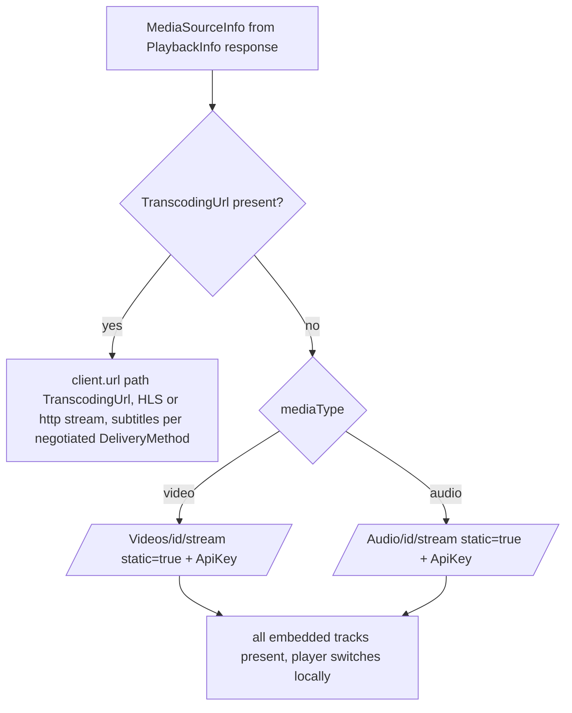
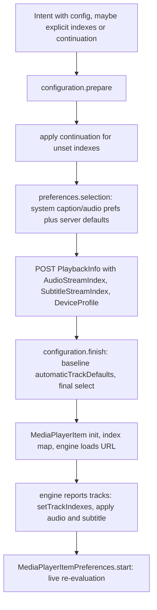
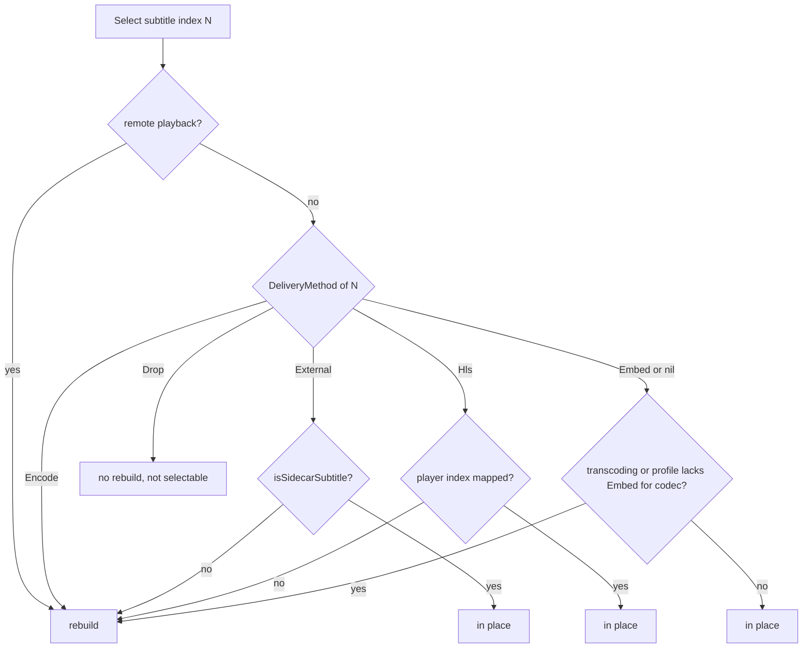

# 08 - Images, Subtitles, Audio Tracks, Delivery Methods

> **Jellyfin SDK source.** A citation `jellyfin-sdk-swift@3.3.0:PATH:LINE` points into [jellyfin/jellyfin-sdk-swift](https://github.com/jellyfin/jellyfin-sdk-swift) at tag `3.3.0` (commit `8ce10a167ad0b4145b2bc005acf8bebcfe6ebe46`). Open it as `https://github.com/jellyfin/jellyfin-sdk-swift/blob/8ce10a167ad0b4145b2bc005acf8bebcfe6ebe46/PATH#LLINE`; for a range `A-B`, use `#LA-LB`. There is no local copy of the SDK.

Scope: how the client builds image URLs and how it chooses, negotiates, delivers and switches audio and subtitle tracks. Related files: [00-INDEX.md](00-INDEX.md), [01-endpoints.md](01-endpoints.md), [02-networking.md](02-networking.md), [03-auth-session.md](03-auth-session.md), [04-models.md](04-models.md), [05-playback.md](05-playback.md), [06-vlc.md](06-vlc.md) (the app has no VLC; that file covers the playback engines), [07-reporting.md](07-reporting.md), [09-state-cache-persistence.md](09-state-cache-persistence.md), [10-errors-edge-cases.md](10-errors-edge-cases.md), [11-sequence-flows.md](11-sequence-flows.md), [12-gaps.md](12-gaps.md).

Citation format: `path:line` is repo-relative to the Swiftfin app root. Dependency sources use `jellyfin-sdk-swift@3.3.0:Sources/...:LINE`. Paths under `Shared/` are shared by iOS and tvOS. `Swiftfin tvOS/` has a space in its name.

Conventions used below:
- "Index" means a Jellyfin `MediaStream.Index` (global across audio, video and subtitle streams). "Player index" means the position inside one engine's own track array.
- `-1` as a subtitle index means "off" (`Shared/Extensions/JellyfinAPI/MediaStream.swift:17`, `Shared/Objects/MediaPlayerManager/MediaTrackIndexMap.swift:21`).

---

## 1. Engines and what they can do with tracks

| Capability | AVPlayer (`.local(.avPlayer)`) |
|---|---|
| Secondary subtitle | no (`Shared/Objects/MediaPlayerManager/PlaybackProfile.swift:23-24`) |
| Audio/subtitle offset | no offset provider (`AVMediaPlayer.swift:19,522,617,661` conform to no `MediaPlayerOffsetProviding`) |
| Sidecar subtitle loading | no (`AVMediaPlayer.swift:103-113` loads only `AVPlayerItem(url: item.url)`) |
| In-place track switch | yes via `AVMediaSelectionGroup` (`AVMediaPlayer.swift:224-246`) |

Swiftfin also has a second, non-AVPlayer engine and a remote-playback path; both are out of scope for this spec (`Shared/Objects/MediaPlayerManager/PlaybackProfile.swift:19-26`).

Citations: `Shared/Objects/MediaPlayerManager/Players/AVMediaPlayer.swift:224-246` (the `AVMediaPlayer` class declaration lists only `MediaPlayer, MediaPlayerMetadataProviding`, `AVMediaPlayer.swift:19`; extensions add `MediaPlayerPictureInPictureProviding` `:522`, `VideoMediaPlayer` `:617` (inherits `MediaPlayerTrackProviding`, `Shared/Objects/MediaPlayerManager/Players/MediaPlayer.swift:59`) and `MediaPlayerSubtitleCueProviding` `:661`; it has no `MediaPlayerOffsetProviding` or `MediaPlayerSecondarySubtitleProviding`).

AVPlayer has `player.appliesMediaSelectionCriteriaAutomatically = false`, so the app, not AVFoundation, picks tracks (`AVMediaPlayer.swift:91`).

---

## 2. Image URLs

All Jellyfin images are plain GET URLs built locally from fields already on the item. There is no separate call to discover images: the URL builder reads `imageTags`, `backdropImageTags`, `screenshotImageTags` and `imageBlurHashes` already present on the `BaseItemDto` (`Shared/Extensions/JellyfinAPI/BaseItemDto/BaseItemDto+Images.swift:25-29,56-60`). The URL is built with `JellyfinClient.url(with:)` with `queryAPIKey` left at its default `false`, so image URLs carry no `ApiKey` and no auth header is added by app code (`Shared/Extensions/JellyfinAPI/BaseItemDto/BaseItemDto+Images.swift:48-54`; `jellyfin-sdk-swift@3.3.0:Sources/JellyfinClient.swift:254-273`). See [02-networking.md](02-networking.md) for client construction and [03-auth-session.md](03-auth-session.md) for the token.

### 2.1 Item image: `GET /Items/{itemID}/Images/{imageType}`

Path template: `jellyfin-sdk-swift@3.3.0:Sources/Paths/GetItemImageAPI.swift:15`. The query keys are `maxWidth, maxHeight, width, height, quality, fillWidth, fillHeight, tag, format, percentPlayed, unplayedCount, blur, backgroundColor, foregroundLayer, imageIndex` (`jellyfin-sdk-swift@3.3.0:Sources/Paths/GetItemImageAPI.swift:69-87`). The app sets only the ones below.

| Query key | Type | Value source | Citation |
|---|---|---|---|
| `maxWidth` | Int | `Int(environment.maxWidth * UITraitCollection.current.displayScale)`; omitted when nil | `BaseItemDto+Images.swift:38,41` |
| `maxHeight` | Int | `Int(environment.maxHeight * displayScale)`; omitted when nil. Only set for logos: a grep of `Shared`, `Views`, `Components`, `Objects` and `Swiftfin tvOS` finds `maxHeight` set only by `.logo` image sources | `BaseItemDto+Images.swift:42`; writers `Shared/Views/ItemView/Components/Headers/RegularEnhancedHeaderContentGroup.swift:92`, `Shared/Views/ItemView/Components/Headers/CompactEnhancedHeaderContentGroup.swift:70`, `Swiftfin tvOS/Objects/CinematicSelectionContentGroup.swift:59,68` (pass-through copy at `Shared/Objects/Poster/AnyPoster.swift:22`) |
| `quality` | Int | `clamp(quality, min: 1, max: 100)`; omitted when environment quality is nil | `BaseItemDto+Images.swift:43` |
| `tag` | String | explicit tag argument, else own tag only when `itemID == self.id`; if no non-empty tag, no ImageSource is produced | `BaseItemDto+Images.swift:23-35,44` |
| `format` | `ImageFormat` | `Png` (raw string `"Png"`) only when `type == .logo`, otherwise omitted | `BaseItemDto+Images.swift:45` |
| `imageIndex` | Int | not set by the poster path. Set only by chapter images and the item image editor (see 2.6, 2.8) | `BaseItemDto.swift:505`; `Shared/Extensions/JellyfinAPI/ImageInfo.swift:19-22` |

All path files above are under `Shared/Extensions/JellyfinAPI/BaseItemDto/` when written as `BaseItemDto+Images.swift` / `BaseItemDto.swift`.

`ImageType` raw strings used as `{imageType}`: `Primary, Art, Backdrop, Banner, Logo, Thumb, Disc, Box, Screenshot, Menu, Chapter, BoxRear, Profile` (`jellyfin-sdk-swift@3.3.0:Sources/Entities/ImageType.swift:12-26`).

Tag selection by type (`BaseItemDto+Images.swift:23-30`):

| Type | Tag source |
|---|---|
| `.backdrop` | `backdropImageTags?.first` |
| `.screenshot` | `screenshotImageTags?.first` |
| other | `imageTags?[type.rawValue]` |

Item fields read (SDK keys `ImageTags`, `BackdropImageTags`, `ScreenshotImageTags`, `ImageBlurHashes`, `PrimaryImageAspectRatio`, `ParentPrimaryImageItemId`, `ParentPrimaryImageTag`, `ParentThumbItemId`, `ParentThumbImageTag`, `ParentBackdropItemId`, `ParentBackdropImageTags`, `ParentLogoItemId`, `ParentLogoImageTag`, `SeriesId`, `SeriesPrimaryImageTag`, `SeriesThumbImageTag`, `AlbumId`, `AlbumPrimaryImageTag`, `ChannelId`, `ChannelPrimaryImageTag`) are listed with line ranges at `jellyfin-sdk-swift@3.3.0:Sources/Entities/BaseItemDto.swift:615-739`. Parent, series, album and channel images always need an explicit tag argument; the own-tag shortcut applies only when `itemID == id` (`BaseItemDto+Images.swift:33`).

Failure to build: no `itemID`, empty `itemID`, empty tag, or no current user session returns nil (`BaseItemDto+Images.swift:32-35`).

### 2.2 Sizes and quality

The scale factor is read at URL build time from `UITraitCollection.current` (a `// TODO: put into environment?` marks it as fragile) (`BaseItemDto+Images.swift:37-38`).

| Size | Landscape | Portrait / square | Citation |
|---|---|---|---|
| `.extraSmall` | 110 | 60 | `Shared/Objects/PosterDisplayType.swift:29-35` |
| `.small` | 500 if presentation `.large`, else 300 | 500 if `.large`, else 200 | `PosterDisplayType.swift:37-42` |
| `.medium` | 500 | 500 | `PosterDisplayType.swift:44-45` |
| `.custom(width)` | width | width | `PosterDisplayType.swift:47-48` |
| quality | 90 for every size | | `PosterDisplayType.swift:20-22` |

Environment protocol: `maxWidth: CGFloat?`, `maxHeight: CGFloat?`, `quality: Int?`. `ImageSourceOptions` defaults `quality = 90`. `BaseItemDto.Environment` has `quality: Int?` with no default, so `Environment(maxWidth:)` sends NO `quality` key (`Shared/Objects/ImageSourceOptions.swift:11-22`; `BaseItemDto+Poster.swift:17-23`). `Poster.imageSources(for:size:environment:)` overwrites `maxWidth` and `quality` from the size (`Shared/Objects/Poster/Poster.swift:114-128`).

Literal sizes in call sites:

| Use | maxWidth / maxHeight | Quality sent | Citation |
|---|---|---|---|
| Library user-view tile | `maxWidth: 500` (Primary) | 90 (`ImageSourceOptions` default) | `Shared/Objects/Libraries/UserViewLibrary.swift:335` |
| Random-item library tile | `.custom(width: 200)`, landscape | 90 | `UserViewLibrary.swift:373` |
| Regular header backdrop | `maxWidth: 1920` | none | `Shared/Views/ItemView/Components/Headers/RegularEnhancedHeaderContentGroup.swift:202` |
| Compact header backdrop | `maxWidth: 1320` (passed as `ImageSourceOptions`, whose `quality` defaults to 90) | 90 | `Shared/Views/ItemView/Components/Headers/CompactEnhancedHeaderContentGroup.swift:160-163`; `Shared/Objects/ImageSourceOptions.swift:21` |
| Scroll-view backdrop | `maxWidth: 1920` | none | `Shared/Views/ItemView/Components/ScrollViews/ContentGroupScrollView.swift:53` |
| Compact logo | `maxHeight: 70` | 90 (ImageSourceOptions default) | `CompactEnhancedHeaderContentGroup.swift:70` |
| Regular logo | `maxHeight` 70 standard / 100 large | 90 | `RegularEnhancedHeaderContentGroup.swift:68-70,92` |
| tvOS cinematic logo | `maxWidth 450`, `maxHeight 100` | 90 | `Swiftfin tvOS/Objects/CinematicSelectionContentGroup.swift:58-59,192-193` |
| Now-playing artwork | `Size.small` portrait width, quality 90, rendered 400 pt wide | 90 | `Shared/Extensions/JellyfinAPI/BaseItemDto/BaseItemDto.swift:168-176,244,261` |

### 2.3 Fallback chain (`BaseItemDto.imageSources(for:environment:)`)

Returns an ordered, de-duplicated (`.uniqued()`) list of candidates. `ImageView` shows the first and, on error, drops it and shows the next (`BaseItemDto+Poster.swift:97-183`; `Shared/Components/ImageView.swift:28-51`).

Definitions (`BaseItemDto+Poster.swift:103-106`):
- `isLandscape = displayType == .landscape`
- `preferThumb = isLandscape && viewContext.contains(.isThumb)`
- `inheritLandscape = !isLandscape || type != .episode || environment.useParent`
- `isProgram = type == .program || .liveTvProgram || .tvProgram`
- `useParent = viewContext.contains(.isThumb) && posterConfiguration.useSeriesLandscapeBackdrop` (`BaseItemDto+Poster.swift:31-38`; default true at `Shared/Objects/PosterConfiguration.swift:14`)

Order of candidates:

| # | Condition | Candidate | Citation |
|---|---|---|---|
| 1 | landscape and `.isBackdrop` context | episode: parent Backdrop (`parentBackdropItemID`, `parentBackdropImageTags.first`); then own Backdrop | `BaseItemDto+Poster.swift:108-114` |
| 2 | square and program | Primary of channel (`channelID`, `channelPrimaryImageTag`) | `:116-119` |
| 3 | `preferThumb` | own Thumb; if `inheritLandscape`: series Thumb (`seriesID`, `seriesThumbImageTag`), parent Thumb (`parentThumbItemID`, `parentThumbImageTag`) | `:121-128` |
| 4 | landscape | `preferPrimary` = `primaryImageAspectRatio >= 1.33` when ratio > 0, else true for types collectionFolder, episode, folder, musicVideo, userView, video. If `preferThumb || !preferPrimary`: own Backdrop. If season, or episode with `useParent`: parent Backdrop | `:130-148` |
| 5 | not landscape and episode | Primary of `parentPrimaryImageItemID`/`parentPrimaryImageTag`, then Primary of `seriesID`/`seriesPrimaryImageTag` | `:149-153` |
| 6 | always | own Primary; unless (episode and landscape): series Primary, parent Primary; then album Primary | `:155-163` |
| 7 | season | own Thumb | `:165-167` |
| 8 | always | own Backdrop, own Thumb | `:169-170` |
| 9 | `inheritLandscape` | series Thumb, parent Thumb, parent Backdrop | `:172-176` |
| 10 | program | channel Primary | `:178-180` |

Preferred display type per item kind (`BaseItemKind.preferredPosterDisplayType`, used by `BaseItemDto.preferredPosterDisplayType`): square for audio, channel, liveTvChannel, musicAlbum, musicArtist, tvChannel; landscape for collectionFolder, episode, folder, musicVideo, program, userView, video; else portrait (`Shared/Extensions/JellyfinAPI/BaseItemKind.swift:195-203`; `BaseItemDto+Poster.swift:40-42`). A second, different mapping exists on `ImageType.posterDisplayType(for:)`: Primary becomes square for audio, channel, musicAlbum, tvChannel; landscape for collectionFolder, episode, folder, program, musicVideo, video, userView; else portrait; Disc square; every other type landscape (`Shared/Extensions/JellyfinAPI/ImageType.swift:76-94`). The explorer notes label the second one "preferred poster display type by ImageType"; both exist and they differ (liveTvChannel and musicArtist are only in the first).

`PosterImage` uses `element.systemImage` for every item type: as the placeholder when the image source has no blurHash and as the failure view when loading fails (`Shared/Components/PosterImage.swift:59-76`). `systemImage` maps item types (audio, musicAlbum, boxSet, channel, episode, movie, season, series, folder, person and others) to SF Symbol names with a default of `circle` (`BaseItemDto+Poster.swift:57-76`).

Now-playing artwork order: portrait sources first (episode: parent/series Primary; own Primary if aspect below 1, or if the ratio is missing and `preferredPosterDisplayType == .portrait`; non-episode non-square: series/parent Primary), then `imageSources(for: preferredPosterDisplayType, size: .small, useParent)`, then program fallback. Loaded with the `.other` image loader's `loadFirstImage` (`BaseItemDto.swift:168-264`).

Now-playing artwork load (`BaseItemDto.getNowPlayingImage()`, `BaseItemDto.swift:236-262`): `content` is `currentProgram ?? self`. It passes `nowPlayingImageSources` to the `.other` image loader's `loadFirstImage(from:)` (`Shared/Extensions/Nuke/ImagePipeline.swift:41`), which tries the sources in order and returns the first image that loads. Each source is a plain image URL GET (section 2.1); there is no other network path. If none loads, it renders a `SystemImageContentView(systemName: systemImage)` styled with `preferredPosterDisplayType` in a 400 pt wide `ImageRenderer` (`:239-247`). If one loads, `displayType` is `.portrait` when the loaded image is taller than wide, else `preferredPosterDisplayType`; the image is composited over `Color.secondarySystemFill`, passed through `content.transform(image:displayType:)`, given the poster aspect ratio (`.fit`), framed 400 pt wide and rendered with `ImageRenderer` (`:249-262`). The call is wired as the `thumbnailProvider` closure of the resolved `MediaPlayerItem` (`Shared/Objects/MediaPlayerManager/MediaPlayerItem/MediaPlayerItemResolver.swift:175`). `NowPlayableObserver` recomputes `baseItem.nowPlayingImageSources` and calls `item.thumbnailProvider` only when the source list changed, and drops the result if the item or sources changed meanwhile (`Shared/Objects/MediaPlayerManager/NowPlayable/NowPlayableObserver.swift:187-200`).

### 2.4 Blur hash

`blurHash = imageBlurHashes[type][tag] ?? first value for that type`, only when `itemID == id` and type is not Logo (`BaseItemDto+Images.swift:56-60`). `ImageBlurHashes` is subscripted by `ImageType` to `[tag: hash]` (`Shared/Extensions/JellyfinAPI/ImageBlurHashes.swift:14-43`). Decoded at 8x8 as the loading placeholder (`Shared/Components/ImageView.swift:144-150`; `Shared/Components/PosterImage.swift:58-70`).

### 2.5 Loading and caches

| Image loader | Used for | Store | Citation |
|---|---|---|---|
| `.posters` (installed as the shared default image loader, `SwiftfinApp+configure.swift:51`; `ImageView` defaults to `.shared`, `ImageView.swift:64`) | every `ImageView` without an explicit pipeline: posters, item and backdrop images, tvOS sign-in splashscreen (`Swiftfin tvOS/Components/SplitLoginWindowView.swift:62`), non-current-user avatars (`Shared/Components/UserProfileImage/UserProfileHeroImage.swift:42`) | disk image cache named `org.jellyfin.swiftfin/Posters`, size limit `1024 * 1024 * 1000` (1000 MB) | `Shared/Extensions/Nuke/ImagePipeline.swift:67-78`; `Shared/Extensions/Nuke/DataCache.swift:24-35`; `Shared/App/SwiftfinApp+configure.swift:51` |
| `.local` | user-picker avatars (`Shared/Components/UserButton.swift:148,169`; `Shared/Views/SelectUserView/Components/SelectUserView+ListView.swift:61`), current-user hero image (`UserProfileHeroImage.swift:42`), select-user splashscreen background (`Shared/Views/SelectUserView/SelectUserView.swift:168`), iOS settings bar button avatar (`Components/SettingsBarButton.swift:28`) | `<Documents>/Caches/org.jellyfin.swiftfin.local`, no size limit set | `ImagePipeline.swift:82-93`; `DataCache.swift:39-64` |
| `.other` | now-playing artwork (`BaseItemDto.swift:239`), iOS admin plugin row poster (`Views/AdminDashboardView/Plugins/PluginsView/Components/PluginRow.swift:28`), iOS item-image editor views (`Views/ItemEditorView/ItemImages/ItemImagesView.swift:226`, `Views/ItemEditorView/ItemImages/ItemImageDetailView.swift:42`, `Views/ItemEditorView/ItemImages/RemoteImageDetailView.swift:35`) | default image loader configuration backed by the URL cache | `ImagePipeline.swift:96` |

- `.posters` and `.local` only: the network loader uses the `.swiftfin` `URLSessionConfiguration` with `timeoutIntervalForRequest = 20` (`ImagePipeline.swift:70-72,85-87`; `Shared/Extensions/URLSessionConfiguration.swift:15-17`), and an app delegate supplies the cache key (`ImagePipeline.swift:67,82,99-105`). `.other` is the default configuration backed by the URL cache (`:96`): no delegate, no swiftfin session config, no custom cache key.
- Cache key (`.posters` and `.local` only): remove the `maxWidth` query item, take `sha1(path + query)` (host ignored so multi-URL servers share entries), then append `"-<maxWidth>"` if it was present (`ImagePipeline.swift:19-39`; header comment `DataCache.swift:15`). `maxHeight` is not part of the key (`// TODO: maxHeight`, `ImagePipeline.swift:24`).
- `ImageView` uses the image loader's lazy image view, supports SVG through `FastSVGView` when `container.data` is present, applies `.onDisappear(.lowerPriority)`, and on error calls `sources.removeFirstSafe()` (`Shared/Components/ImageView.swift:30-50`). There is no retry; failure advances to the next source.
- Cache removal for a URL clears the memory, data and disk cache entries (`ImagePipeline.swift:52-60`).

### 2.6 Other image endpoints

| Endpoint | Query | Notes | Citation |
|---|---|---|---|
| `GET /Items/{itemID}/Images/Chapter` | `maxWidth=500`, `quality=90`, `tag=<ChapterInfo.imageTag>`, `imageIndex=<i>` | `i` is the offset in `chapters.enumerated()` BEFORE sorting by `startPositionTicks`. Chapters without `startPositionTicks` are dropped; chapters with empty `imageTag` get no image source | `BaseItemDto.swift:490-519` |
| `GET /Items/{itemID}/Images` | none | returns `[ImageInfo]`; grouped by type, each group sorted by `imageIndex`, nil types dropped | `Shared/ViewModels/ImageViewModel/ItemImageViewModel.swift:68-83` |
| `GET /Items/{itemID}/Images/{imageType}` (editor thumbnail) | `tag`, `imageIndex` only, no `maxWidth`, no `quality` | `imageType` is `imageInfo.imageType?.rawValue ?? ""` | `Shared/Extensions/JellyfinAPI/ImageInfo.swift:18-32` |
| `GET /UserImage` | `userId`, `tag` | `tag` is `data.primaryImageTag`; `format` never set; no `maxWidth`/`quality` | `Shared/SwiftfinStore/SwiftinStore+UserState.swift:155-168`; `jellyfin-sdk-swift@3.3.0:Sources/Paths/GetUserImageAPI.swift:15,30-34` |
| `GET /Branding/Splashscreen` | none (SDK `tag`, `format` unused) | built from `ServerState.client`, a `JellyfinClient` with no user access token (`Shared/SwiftfinStore/SwiftfinStore+ServerState.swift:27-35`) | `Shared/SwiftfinStore/SwiftfinStore+ServerState.swift:145-147`; `jellyfin-sdk-swift@3.3.0:Sources/Paths/GetSplashscreenAPI.swift:15` |
| `GET /Plugins/{pluginID}/{version}/Image` | none | only when installed, `hasImage`, `id` and `version` non-nil; fallback `URL(string: package?.imageURL)` | `Shared/ViewModels/AdminDashboard/Plugins/PluginDetailsViewModel+Poster.swift:34-43`; `jellyfin-sdk-swift@3.3.0:Sources/Paths/GetPluginImageAPI.swift:15` |
| `GET /Videos/{itemID}/Trickplay/{width}/{index}.jpg` | `mediaSourceId` | see 2.7 | `jellyfin-sdk-swift@3.3.0:Sources/Paths/GetTrickplayTileImageAPI.swift:12-26` |

User-image caveat: `UserDto.profileImageSource(client:maxWidth:)` ignores `maxWidth` and builds a throwaway `UserState(id: id ?? "", serverID: "", username: "")`, so the `tag` comes from `StoredValues[.User.data(id:)]` for that id, not from the `UserDto` that was passed in (`Shared/Extensions/JellyfinAPI/UserDto.swift:14-26`; `SwiftinStore+UserState.swift:44-51,163`). `UserImageViewModel.cleanImageCache` loops widths `[60, 120, 150]` but all yield the same URL (`Shared/ViewModels/ImageViewModel/UserImageViewModel.swift:88-93`). Pipelines: `.local` for the current user in the hero image, `.posters` otherwise (`Shared/Components/UserProfileImage/UserProfileHeroImage.swift:28,42`).

Splashscreen cache key is `sha1("<server.id>-splashscreen")` when the cache filename URL path contains `Splashscreen` and a stored server matches (`DataCache.swift:50-59`). **CONFLICT** on reachability: `topic-images-subtitles-audio.json` states the key as written; `topic-media-assets.json` argues the branch may be unreachable because the image loader passes the delegate's sha1 hex string as the file name, which has no `Splashscreen` in `url.path`, and `trimmingSuffix("/Branding/Splashscreen?")` would not match a query-less URL (`DataCache.swift:46-62` versus `ImagePipeline.swift:99-105`). Source does not settle it without the image loader's source. Treated as unresolved in section 13.

### 2.7 Preview scrubbing images (chapters and trickplay)

Source selection by `PreviewImageScrubbingOption` (`Shared/Objects/MediaPlayerManager/PreviewImageProvider.swift:48-60`):
- `.disabled`: none.
- `.chapters`: chapter images if any chapter has an image URL.
- `.trickplay(fallbackToChapters)`: trickplay, else chapters when the flag is true.

Trickplay details (`PreviewImageProvider.swift:108-137`):
1. Info comes from `item.trickplay[mediaSourceID]` (a dictionary keyed by width).
2. Resolutions are sorted by ascending `width`; the FIRST valid one is used (the smallest). Valid means `width`, `height`, `tileWidth`, `tileHeight`, `interval` all greater than 0 and `tileWidth * tileHeight` does not overflow.
3. `columns = tileWidth`, `rows = tileHeight`, `tileSize = (width, height)`, `interval` is in milliseconds.
4. Sheet URL is `client.url(with: Paths.getTrickplayTileImage(itemID:, width:, index:, mediaSourceID:))`, so `/Videos/{itemID}/Trickplay/{width}/{sheet}.jpg?mediaSourceId=<MediaSourceInfo.id>`.
5. For time `t`: `thumb = floor(max(0,t) / interval)`, `sheet = thumb / (columns*rows)`, `tile = thumb % (columns*rows)`; crop `x = (tile % columns) * tileW`, `y = (tile / columns) * tileH` (`PreviewImageProvider.swift:96-104`; `Shared/Extensions/UIImage.swift:42-59`).

Download path: `PlaybackTemporaryFiles` uses an ephemeral `URLSession` (`urlCache = nil`, `timeoutIntervalForRequest = 20`) and sets the header `Authorization: MediaBrowser Token="<accessToken>"` (the code comment says `X-Emby-Token` is ignored when legacy authorization is disabled). Only 2xx responses are kept. Files are moved to `Folder.temporary/playback/<UUID>/<id>` with no extension. Preloading is sequential at `.utility` priority and stops at the first failed sheet. `remove()` deletes the folder, and it is called when `mediaSession` becomes nil (`Shared/Objects/MediaPlayerManager/PlaybackTemporaryFiles.swift:14-155`; `MediaPlayerItem.swift:28-39`). Searching app code under `Shared`, `Views`, `Components`, `Extensions`, `Objects` and `Swiftfin tvOS` for `Authorization`, `X-Emby`, `forHTTPHeaderField` and `httpAdditionalHeaders` finds one header write, `PlaybackTemporaryFiles.swift:101`, so chapter and trickplay downloads are the only image downloads that set an Authorization header in app code; see [02-networking.md](02-networking.md) for the standard header.

### 2.8 Item and user image editing (admin)

| Operation | Request | Details | Citation |
|---|---|---|---|
| Upload item image | `POST /Items/{itemID}/Images/{imageType}` | body = `imageData.base64EncodedData()` (base64 text bytes, not raw); header `Content-Type: image/png` if the CGImage has alpha (`alphaOnly, first, last, premultipliedFirst, premultipliedLast`) else `image/jpeg` with quality 1.0; max 30_000_000 bytes checked on the encoded PNG or JPEG data (before the base64 step) else `ErrorMessage("Image is too large (...)")`; after success refetch image list and emit `.updated` | `ItemImageViewModel.swift:85-121`; `Shared/Extensions/UIImage.swift:13-37` |
| Download remote image | `POST /Items/{itemID}/RemoteImages/Download` | query `type` (required), `imageUrl`; returns silently if either missing | `ItemImageViewModel.swift:123-135` |
| Delete item image | `DELETE /Items/{itemID}/Images/{imageType}/{imageIndex}` when `imageIndex` non-nil, else `DELETE /Items/{itemID}/Images/{imageType}` | then refetch the full item and the image list | `ItemImageViewModel.swift:137-161` |
| List remote images | `GET /Items/{itemID}/RemoteImages` | query `type`, `startIndex` (page offset), `limit` (page size), `providerName`, `includeAllLanguages` (default false, `:14`) | `Shared/Objects/Libraries/RemoteImageLibrary.swift:14,30-47` |
| Remote image providers | `GET /Items/{itemID}/RemoteImages/Providers` | returns `[ImageProviderInfo]` | `Shared/Objects/Libraries/RemoteImageProvidersLibrary.swift:21-30` |
| Upload user image | `POST /UserImage?userId=<id>` | same base64 body and content-type logic; then `cleanImageCache` and `Notifications[.didChangeUserProfile]` | `UserImageViewModel.swift:56-72,85-98` |
| Delete user image | `DELETE /UserImage?userId=<id>` | | `UserImageViewModel.swift:74-83` |

SDK path definitions (all `jellyfin-sdk-swift@3.3.0:Sources/Paths/`): `SetItemImageAPI.swift:14-15` (`POST /Items/{itemID}/Images/{imageType}`, id `SetItemImage`); `DeleteItemImageAPI.swift:14-26` (`DELETE .../Images/{imageType}`, query `imageIndex` at `:25`); `DeleteItemImageByIndexAPI.swift:14-15` (`DELETE .../Images/{imageType}/{imageIndex}`); `GetItemImageInfosAPI.swift:14-15` (`GET /Items/{itemID}/Images`); `GetRemoteImagesAPI.swift:14-15` (`GET /Items/{itemID}/RemoteImages`); `GetRemoteImageProvidersAPI.swift:14-15`; `DownloadRemoteImageAPI.swift:14-27` (`POST .../RemoteImages/Download`, query `type`, `imageUrl` at `:25-26`); `PostUserImageAPI.swift:14-15` (`POST /UserImage`, query `userId`); `DeleteUserImageAPI.swift:14-15` (`DELETE /UserImage`, query `userId`). The SDK also has `SetItemImageByIndexAPI.swift:14-15`; the app uploads with `Paths.setItemImage` (`ItemImageViewModel.swift:113-117`) and a grep for `setItemImageByIndex` over `Shared`, `Views`, `Components` and `Swiftfin tvOS` finds 0 hits.

External image-source link: the editor detail views show a `ChevronButton(L10n.imageSource, external: true)` that calls `UIApplication.shared.open(url)` with the image URL (`Views/ItemEditorView/ItemImages/ItemImageDetailView.swift:65-73`; `Views/ItemEditorView/ItemImages/RemoteImageDetailView.swift:72-78`). It opens the bare image URL in the system browser, which carries no app header.

### 2.9 What list calls return for images

Most list calls set `fields = PosterSubtitleField.itemFields` = `[.mediaStreams, .genres, .studios]` (`Shared/Objects/Libraries/ItemLibrary.swift:166`; `Shared/Objects/PosterSubtitleField.swift:24`). Exceptions: `EpisodeLibrary` sends `itemFields + [.overview]` (`Shared/Objects/Libraries/EpisodeLibrary.swift:33`); `SimilarItemsLibrary` sends `itemFields` (`SimilarItemsLibrary.swift:30`) or, in one branch, `itemFields + [.channelInfo]` (`:35`); `ProgramsLibrary`, `ChannelScheduleLibrary` and `RecommendedProgramsLibrary` send only `[.channelInfo]` (`ProgramsLibrary.swift:30`, `ChannelScheduleLibrary.swift:35`, `RecommendedProgramsLibrary.swift:21`). None sets `enableImages`, `enableImageTypes` or `imageTypeLimit`. The only `enableImages` write in the app is `false` for EPG programs (`Shared/ViewModels/EPGViewModel.swift:266`). So the client relies on the server's default for `ImageTags`, `BackdropImageTags` and `ImageBlurHashes` in list responses. Whether the server includes them is not visible in this repo (section 13). To rebuild image display from a list item a client needs only: the item's tag for the wanted type, the item id, and `maxWidth = Int(points * displayScale)` (`BaseItemDto+Images.swift:37-54`). No tag means no URL (section 2.1).

---

## 3. Getting a stream: PlaybackInfo and the playback URL

Full flow is in [05-playback.md](05-playback.md); only the track-relevant parts are here.

### 3.1 `POST /Items/{itemID}/PlaybackInfo`

Built in `Shared/Objects/MediaPlayerManager/MediaPlayerItem/MediaPlayerItemResolver.swift:56-86`. No query string; everything is in the JSON body (`PlaybackInfoDto`, keys at `jellyfin-sdk-swift@3.3.0:Sources/Entities/PlaybackInfoDto.swift:84-99`).

| Body key | Value | Citation |
|---|---|---|
| `AutoOpenLiveStream` | `true` | `MediaPlayerItemResolver.swift:57` |
| `DeviceProfile` | built per engine (section 4); contains `SubtitleProfiles` | `:50-54,67` |
| `LiveStreamId` | `initialMediaSource.liveStreamID` | `:68` |
| `MaxStreamingBitrate` | resolved max bitrate | `:69` |
| `UserId` | `userSession.user.id` | `:70` |
| `AudioStreamIndex` | `configuration.audioStreamIndex` | `:71` |
| `SubtitleStreamIndex` | `configuration.subtitleStreamIndex` (`-1` = none) | `:72` |
| `MediaSourceId` | `initialMediaSource.id`, only when the item is not a live stream and source type is not `.placeholder` | `:74-76` |
| `EnableDirectPlay`, `EnableDirectStream` | `false` for HLS-only profiles (Chromecast) | `:59-65` |
| `EnableTranscoding` | `true` for HLS-only profiles | `:64` |

The audio and subtitle choice therefore reaches the server only through this body and the device profile. The app reads `DeliveryMethod` and `DeliveryUrl` per `MediaStream` from the response's `MediaSources[].MediaStreams[]` (`jellyfin-sdk-swift@3.3.0:Sources/Entities/MediaStream.swift:294-295`; use at `Shared/Extensions/JellyfinAPI/MediaStream.swift:19-30`).

Response media-source matching, in order: `ETag` equal to the initial source's `eTag`; then `Id` equal; then a source whose `OpenToken` contains its `Id`; else the first source (with a warning log) (`MediaPlayerItemResolver.swift:94-122`). Missing `PlaySessionId` throws `ErrorMessage("No associated play session ID")` (`:130-132`).

Track-related response fields read: `MediaSourceInfo.DefaultAudioStreamIndex`, `DefaultSubtitleStreamIndex`, `TranscodingUrl`, `ETag`, `OpenToken`, `LiveStreamId`, `Id`, `Type`; and per `MediaStream`: `Index`, `Type`, `DeliveryMethod`, `DeliveryUrl`, `IsExternal`, `IsTextSubtitleStream`, `IsForced`, `IsDefault`, `IsHearingImpaired`, `Language`, `Title`, `DisplayTitle`, `Codec`, `Channels`, `ChannelLayout` (`jellyfin-sdk-swift@3.3.0:Sources/Entities/MediaSourceInfo.swift:164-200`; `jellyfin-sdk-swift@3.3.0:Sources/Entities/MediaStream.swift:284-340`). See [04-models.md](04-models.md).

`PlaybackInfoDto.AlwaysBurnInSubtitleWhenTranscoding` exists in the SDK (`jellyfin-sdk-swift@3.3.0:Sources/Entities/PlaybackInfoDto.swift:28,91,111`) but the app never sets it: the body built at `MediaPlayerItemResolver.swift:56-76` omits `isAlwaysBurnInSubtitleWhenTranscoding`, and a grep for `alwaysBurnInSubtitleWhenTranscoding` (case-insensitive) over `Shared`, `Views`, `Components` and `Swiftfin tvOS` finds 0 hits. Burn-in is steered only by the device profile (section 4.3).

### 3.2 Playback URL choice (`MediaPlayerItemResolver.streamURL`)

| Case | URL | Citation |
|---|---|---|
| `mediaSource.transcodingURL != nil` | `userSession.client.url(path: transcodingURL)`; no `ApiKey` added by the app | `MediaPlayerItemResolver.swift:229-237` |
| no transcoding URL and `mediaType == .video` | `GET /Videos/{itemID}/stream?static=true&tag=<mediaSource.eTag ?? item.etag>&playSessionId=<id>&mediaSourceId=<mediaSource.id ?? itemID>&liveStreamId=<liveStreamID>&ApiKey=<accessToken>` | `:239-260` |
| no transcoding URL and `mediaType == .audio` | same keys on `/Audio/{itemID}/stream` | `:262-279` |
| otherwise | `ErrorMessage("Unsupported playback media type")` | `:281` |

Query keys `static, tag, playSessionId, mediaSourceId, liveStreamId` come from `jellyfin-sdk-swift@3.3.0:Sources/Paths/GetVideoStreamAPI.swift:177-216`; `ApiKey` is appended by `client.url(with:queryAPIKey: true)` (`jellyfin-sdk-swift@3.3.0:Sources/JellyfinClient.swift:262-264`). The audio and subtitle index are NOT in the static stream URL; direct play exposes all embedded tracks and the player switches locally. AVPlayer receives only the URL and no headers (`AVMediaPlayer.swift:107`).

The remote-playback path (`requiresHLS`) is out of scope for this spec (`MediaPlayerItemResolver.swift:59-65,142-149`).

---

## 4. Subtitle delivery methods and device profiles

`SubtitleDeliveryMethod` raw strings: `Encode`, `Embed`, `External`, `Hls`, `Drop` (`jellyfin-sdk-swift@3.3.0:Sources/Entities/SubtitleDeliveryMethod.swift:12-18`). `SubtitleProfile` JSON keys: `Container`, `DidlMode`, `Format`, `Language`, `Method` (`jellyfin-sdk-swift@3.3.0:Sources/Entities/SubtitleProfile.swift:38-54`). The app always sends `Format = SubtitleFormat.rawValue`, `Method`, `Container = nil` (`Shared/Extensions/JellyfinAPI/SubtitleProfile.swift:32-39`).

Meaning of each method as the app uses it:

| Method | Meaning to the client | Client behavior |
|---|---|---|
| `Embed` | player reads the subtitle track inside the source container | switch in place if direct playing and the profile lists the codec under Embed; otherwise rebuild (`MediaPlayerItem.swift:248-261`) |
| `External` | server hands over a sidecar file at `DeliveryUrl` | in place only if `isSidecarSubtitle`, else rebuild (`MediaPlayerItem.swift:242-243`). AVPlayer never loads sidecars: `load` builds only `AVPlayerItem(url: item.url)` plus a legible output (`AVMediaPlayer.swift:103-113`) and its profile has no `.external` entry (`MediaPlayerType+AVPlayer.swift:156-174`) |
| `Hls` | subtitle comes in the HLS manifest | in-place if the player already has a mapped track, else rebuild (`MediaPlayerItem.swift:244-245`) |
| `Encode` | server burns the subtitle into the video | always rebuild when selected (`MediaPlayerItem.swift:240-241`); never a secondary track (`MediaPlayerItem.swift:94-96`) |
| `Drop` | server discards the stream | excluded from the player's subtitle list (`MediaPlayerItem.swift:151-154`); `isRebuildRequired` returns false for it (`:246-247`) |

Citations: `MediaPlayerItem.swift:94-96,151-154,234-261`.

### 4.1 `SubtitleFormat` strings

Profile format strings (enum raw values): `ass, cc_dec, dvdsub, dvbsub, libzvbi_teletextdec, mov_text, mpl2, pjs, pgssub, realtext, sami, ssa, subrip, subviewer, subviewer1, text, ttml, vplayer, vtt, xsub` (`Shared/Objects/MediaComponents/SubtitleFormat.swift:11-32`).

| Format | File extension | Text or bitmap | Citation |
|---|---|---|---|
| ass | `ass` | text | `SubtitleFormat.swift:92-93` |
| cc_dec | `608` | text | `:94-95` |
| dvdsub | `sub` | bitmap | `:96-97` |
| dvbsub | `dvbsub` | bitmap | `:98-99` |
| libzvbi_teletextdec | `txt` | text | `:100-101` |
| mov_text | `tx3g` | text | `:102-103` |
| mpl2 | `mpl` | text | `:104-105` |
| pjs | `pjs` | text | `:106-107` |
| pgssub | `sup` | bitmap | `:108-109` |
| realtext | `rt` | text | `:110-111` |
| sami | `smi` | text | `:112-113` |
| ssa | `ssa` | text | `:114-115` |
| subrip | `srt` | text | `:116-117` |
| subviewer | `sub` | text | `:118-119` |
| subviewer1 | `sub` | text | `:120-121` |
| text | `txt` | text | `:122-123` |
| ttml | `ttml` | text | `:124-125` |
| vplayer | `txt` | text | `:126-127` |
| vtt | `vtt` | text | `:128-129` |
| xsub | `xsub` | bitmap | `:130-131` |

Text/bitmap split: `isText` is true for `ass, cc_dec, libzvbi_teletextdec, mov_text, mpl2, pjs, realtext, sami, ssa, subrip, subviewer, subviewer1, text, ttml, vplayer, vtt`; false for `dvdsub, dvbsub, pgssub, xsub` (`SubtitleFormat.swift:145-156`, flagged `// TODO: correct` at `:145`). `SubtitleFormat(url:)` picks the FIRST case whose extension equals the file extension, so `.sub` resolves to `dvdsub` and `.txt` to `libzvbi_teletextdec` (`SubtitleFormat.swift:34-42`, case order `:13-32`).

### 4.2 Subtitle profiles per engine

| Engine | Embed | External | Hls | Encode | Citation |
|---|---|---|---|---|---|
| AVPlayer | `cc_dec, ttml` | none | `vtt` | `dvbsub, dvdsub, pgssub, xsub` | `Shared/Objects/MediaPlayerType/MediaPlayerType+AVPlayer.swift:156-174` |

AVPlayer lists no `External` method: `_avPlayerSubtitleProfiles` builds only `.embed`, `.encode` and `.hls` profiles (`MediaPlayerType+AVPlayer.swift:156-174`).

The AVPlayer HLS transcoding profile sets `enableSubtitlesInManifest: true` with `protocol: hls`, `minSegments: 2`, `maxAudioChannels: "8"`, audio codecs `aac, ac3, alac, eac3, flac`, containers `mp4` (`MediaPlayerType+AVPlayer.swift:121-151`).

### 4.3 Profile modifiers (`DeviceProfile.build`)

1. `forceSubtitleBurnIn` (per-user stored value, default false) replaces all subtitle profiles with `Encode` for every `SubtitleFormat` (`Shared/Extensions/JellyfinAPI/DeviceProfile.swift:27-33`; `Shared/SwiftfinStore/StoredValue/StoredValues+User.swift:184-189`; copied into `MediaPlaybackConfiguration.swift:29`). Settings toggle: `Shared/Views/SettingsView/VideoPlayerSettingsView.swift:342-345` with message "Forces subtitles to be burned into the video by the server instead of being rendered by the player. This requires transcoding whenever subtitles are enabled." (`Shared/Strings/Strings.swift:776`).
2. Transcoding codec lists are capped at 40 characters per list (work around a Jellyfin bug). Lower-priority codecs are dropped from the end, never the first and never the source codec; if the essential codecs still exceed 40 the whole profile is dropped. `sourceAudioCodec` is the codec of the audio stream whose index equals `configuration.audioStreamIndex` (`Shared/Extensions/JellyfinAPI/DeviceProfile+CodecLimits.swift:13-60`; `DeviceProfile.swift:105-114`).

Capability queries used later by the rebuild logic: `canPlay(type:audioCodec:container:)` matches `directPlayProfiles` by type, CSV audio codec and CSV container (a nil profile field matches anything); `canPlay(subtitleFormat:method:)` lowercases only the format (`subtitleFormat` and `profile.format`) and compares `method` as the `SubtitleDeliveryMethod` enum with no lowercasing (`DeviceProfile.swift:129-166`, `canPlay(subtitleFormat:method:)` at `:148-155`).

---

## 5. Track model

### 5.1 Stream filtering

| List | Filter | Citation |
|---|---|---|
| `audioStreams` | `type == .audio && isExternal != true` (external audio is disabled; `// TODO: Fix External Audio Tracks & Re-Enable`) | `MediaPlayerItem.swift:148-149` |
| `subtitleStreams` | `type == .subtitle && deliveryMethod != .drop` | `MediaPlayerItem.swift:151-154` |
| `videoStreams` | `type == .video` | `:156` |
| `secondarySubtitleStreams` | subtitleStreams with `index >= 0`, `!= selected primary`, `deliveryMethod != .encode`, and no rebuild needed from `-1` | `:92-100` |

The item-view play menu uses its own filters: audio excludes `isExternal`, but subtitles come straight from `mediaSource.subtitleStreams` (no `.drop` filter) and prepend `MediaStream.none` (index -1) (`Shared/Views/ItemView/Components/ActionButtons/PlaybackActionButton.swift:34-42,148-154`). This is a difference between the pre-play pickers and the in-player pickers.

`MediaStream.isSidecarSubtitle = type == .subtitle && deliveryMethod == .external && deliveryURL != nil && isTextSubtitleStream == true`. The doc comment says delivery, not `isExternal`, decides it (`Shared/Extensions/JellyfinAPI/MediaStream.swift:19-22`). Image-based externals are excluded "because the player silently drops them" (`MediaStream.swift:366-369`).

### 5.2 Sidecar URL

`MediaStream.url(with:)`: take `deliveryURL`, remove its first character if the client base URL string ends with `/`, then `client.url(path:)`. The app appends no `ApiKey` (`MediaStream.swift:24-30`). Whether the server's `DeliveryUrl` already holds a token is not visible in source; see section 13.

### 5.3 Jellyfin index to player index (`MediaTrackIndexMap`)

`playerIndex(for:)` returns `-1` for nil or `-1`, otherwise the dictionary lookup (nil when unmapped) (`MediaTrackIndexMap.swift:20-24`).

Initial estimate in `MediaPlayerItem.init` (`MediaTrackIndexMap.build`, `MediaTrackIndexMap.swift:33-64`; call at `MediaPlayerItem.swift:158-162`):

| Play method | Mapping |
|---|---|
| transcode (`transcodingURL != nil`) | only the selected non-external audio maps, to player index 0; no subtitles mapped |
| direct play | non-external audio enumerated in stream order to 0..n; non-external subtitles enumerated likewise |

After the engine loads, it reports real tracks and `setTrackIndexes` replaces the map, then re-applies the audio selection and the subtitle selection (`MediaPlayerItem.swift:289-293`).

AVPlayer mapping (`AVMediaPlayer.swift:406-431,472-496`): after ready, load groups `.audible` and `.legible`; per stream, pick an `AVMediaSelectionOption` by: (1) if internal stream count equals group option count, same position; (2) if the group has 1 option, that one; (3) else `AVMediaSelectionGroup.mediaSelectionOptions(from:filteredAndSortedAccordingToPreferredLanguages: [stream.language]).first`. The player index is the option's position in `group.options`. For duplicate same-language tracks the first sorted match wins.

---

## 6. Initial selection (before and after PlaybackInfo)

### 6.1 `prepare` (`MediaPlaybackConfiguration.swift:114-138`)

1. `startSeconds = max(0, startSeconds ?? (item.startSeconds - resumeOffset))`.
2. If `continuation` gives a match, apply its audio and subtitle only where the index is still nil, via `selectTracks` (which clears the follows-system flags).
3. `continuation = nil`.
4. `preferences.selection(in: source, audio:, subtitle:)`, then `selectTracks(audio:subtitle:preservingPreferences: true)` (flags remain "follows system").
5. If the profile lacks secondary support, `secondarySubtitleStreamIndex = -1`.

### 6.2 `MediaPlaybackPreferences.selection` (`MediaPlaybackPreferences.swift:31-148`)

Inputs: `captions` (the system caption preferences, current values), `audio` (the system audio preferences), `languages = Locale.preferredLanguages` (`:15-23`). The type's doc comment: "System accessibility preferences augment server defaults, but explicit track choices always take precedence" (`:14`).

Server-default fallback: with no usable preference, audio is `source.defaultAudioStreamIndex` (`MediaPlaybackPreferences.swift:39`) and subtitle is `source.defaultSubtitleStreamIndex` when the stream list is empty (`:73`), when `.unknown` (`:106-107`), or when language codes cannot be derived (`:98-100`). When the session starts, `MediaPlaybackConfiguration.finish` fixes the baseline `automaticTrackDefaults`: audio = initial source `defaultAudioStreamIndex`, else the response's when no audio index was chosen, else the first non-external audio stream with `isDefault == true`, else the first non-external audio stream; subtitle = initial source `defaultSubtitleStreamIndex`, else the response's when none was chosen (else `-1`). Selection then falls to `audioStreamIndex ?? source.defaultAudioStreamIndex ?? first audio ?? 0` and `subtitleStreamIndex ?? source.defaultSubtitleStreamIndex ?? -1` (`Shared/Objects/MediaPlayerManager/MediaPlaybackConfiguration.swift:140-167`).

Audio:
1. Candidates: `type == .audio`, not external, `index >= 0` (`:33`).
2. `defaultAudio` = candidate with `index == source.defaultAudioStreamIndex` (`:35`).
3. `preferredAudio` only if `defaultAudio` exists and `audio.preferredCharacteristics` contains `MAMediaCharacteristicDescribesVideoForAccessibility`: among candidates labelled as audio description whose language ranks in `[default stream's language]` (or `languages` if that is nil), pick `best` (`:38,50-59`).
4. `audioIndex = explicitAudio ?? preferredAudio?.index ?? source.defaultAudioStreamIndex` (`:39`).

Audio-description label regex (case-insensitive, over `title` and `displayTitle`): `\b(audio[ -]?description[s]?|audio[ -]?described|descriptive[ -]?audio|described[ -]?video)\b|(?:^|[\[(]| - )(?:AD|DVS)(?:$|[\])]| - )` (`:158-168`).

Subtitle: candidates `type == .subtitle`, `deliveryMethod != .drop`, `index >= 0` (`:34`). `subtitle = explicitSubtitle ?? preferredSubtitle(...)` (`:44-46`).

`preferredSubtitle` (`:71-109`):
- No candidate streams: return `source.defaultSubtitleStreamIndex`.
- `preferredLanguages = captions.selectedLanguages` if non-empty, else `languages`.
- `forcedIndex` = best forced stream whose language ranks in `[audioLanguage]` (or preferred languages if the audio language is nil), else `-1`.
- Switch on `captions.displayType`:

| displayType | Result |
|---|---|
| `.forcedOnly` | `forcedIndex` |
| `.alwaysOn` | `best(in: streams.filter { $0.isForced != true }, ...)` over ALL non-forced streams, with NO language filter (`MediaPlaybackPreferences.swift:88-90`); language rank is only the first sort key, so a non-forced stream in a non-preferred language (rank `Int.max`) still wins if it is the only one. `forcedIndex` is used only when there are no non-forced streams |
| `.automatic` | `defaultIndex` if it is among candidates; else if audio language code equals first preferred language code: `forcedIndex`; else best of the non-forced streams that DO rank in the preferred languages (`languageRank != nil`; the only branch that pre-filters by language, `:103`), else `forcedIndex`; if language codes cannot be derived: `defaultIndex` |
| `.unknown` | `defaultIndex` |

`best()` ranking, lexicographic on `[languageRank, SDH, isDefaultIndex, isDefault flag, original order]` (`:111-131`):
- `languageRank`: exact canonical match `index*2`; same base-language code `index*2+1`; none `Int.max` (`:133-147`).
- SDH preferred (rank 0) when `captions.displayType == .alwaysOn` or caption characteristics contain `MAMediaCharacteristicTranscribesSpokenDialogForAccessibility` or `MAMediaCharacteristicDescribesMusicAndSoundForAccessibility`, and the stream `isHearingImpaired == true`.
- `stream.index == defaultIndex` then `stream.isDefault == true`.
- Language code: `Locale.Language(identifier:).languageCode`, rejecting `und` and `zxx`, returning alpha2 else alpha3 (Jellyfin supplies ISO 639-2; Apple supplies BCP-47) (`:149-155`).

The app does not apply `AudioLanguagePreference`, `SubtitleLanguagePreference`, `SubtitleMode` or `PlayDefaultAudioTrack` itself (grep of `Shared`, `Views`, `Components`, `Extensions`, `Objects`, `App`, `Swiftfin tvOS` for those names finds only `VideoPlayerSettingsView.swift`, `Strings.swift` and `Shared/Extensions/JellyfinAPI/SubtitlePlaybackMode.swift`, no selection code). The server turns those into `DefaultAudioStreamIndex` and `DefaultSubtitleStreamIndex` in the PlaybackInfo response, and the client layers system caption/audio preferences on top (`MediaPlaybackPreferences.swift:37,72`; `Shared/Views/SettingsView/VideoPlayerSettingsView.swift:281-345`). Server-side logic is outside this repo.

Rebuild contract for the system-preference inputs. The app consumes exactly these members and nothing else: from the system caption preferences, `displayType` (cases `.forcedOnly`, `.alwaysOn`, `.automatic`, `.unknown`), `selectedLanguages` (BCP-47 strings, empty means fall back to `Locale.preferredLanguages`), `preferredCharacteristics` (string set), static `showOnSkipBack` (Bool?), static async `updates`; from the system audio preferences, `preferredCharacteristics` and `updates` (`MediaPlaybackPreferences.swift:17-18,51,66,75,84,112`; `MediaPlayerItemReplaySubtitles.swift:30`; `MediaPlayerItemPreferences.swift:29,41`). A rebuild may supply any equivalent source (on Apple platforms these map to the Media Accessibility settings) as long as it provides those values; the selection rules in this section, the `best()` ranking and the `finish` baseline are fully specified here. Initial audio and subtitle choice, forced-subtitle choice and skip-back replay (7.2) are therefore reproducible given those inputs.

### 6.3 `finish` (`MediaPlaybackConfiguration.swift:140-167`)

1. Once only (`automaticTrackDefaults == nil`), capture the baseline: `audio = initialSource.defaultAudioStreamIndex ?? (audioStreamIndex == nil ? source.defaultAudioStreamIndex : nil) ?? first isDefault internal initial audio ?? first initial audio`, falling back to `source.defaultAudioStreamIndex ?? first isDefault ?? first audio`; `subtitle = initialSource.defaultSubtitleStreamIndex ?? (subtitleStreamIndex == nil ? source.defaultSubtitleStreamIndex : -1)` (`:143-155`).
2. `mediaSourceID = initialSource.id` (a live stream response can carry an ephemeral id absent from the item's source list) (`:157-159`).
3. Final select (preserving preferences): `audio = audioStreamIndex ?? source.defaultAudioStreamIndex ?? first non-external audio index ?? 0`; `subtitle = subtitleStreamIndex ?? source.defaultSubtitleStreamIndex ?? -1`; `secondary = secondarySubtitleStreamIndex ?? -1` (`:161-166`).

`MediaPlayerItem.init` preconditions that audio, subtitle, secondary, `startSeconds` and `automaticTrackDefaults` are all resolved (`MediaPlayerItem.swift:128-131`), and resets the secondary index to `-1` if it is not in `secondarySubtitleStreams` (`:164-166`).

### 6.4 `selectTracks` on the configuration (`MediaPlaybackConfiguration.swift:53-85`)

Sets the indexes. Unless `preservingPreferences`, an explicit audio choice sets `followsSystemAudioPreferences = false`, and an explicit subtitle or secondary choice sets `followsSystemCaptionPreferences = false`. If the primary subtitle is `>= 0` and equals the secondary, the secondary becomes `-1` (`:82-84`). `selectMediaSource(id:)` resets indexes, flags, `automaticTrackDefaults`, offsets, `disabledSubtitleTracks` and `continuation` (`:98-111`). `followSystemPreferences(audio:subtitles:)` re-enables the flags (`:87-95`).

### 6.5 Live re-evaluation (`MediaPlayerItemPreferences`)

Started in `MediaPlayerItem.activate()` (`MediaPlayerItem.swift:186-188`). Triggers: system audio preference updates; system caption preference updates (not for audio items); `applicationWillEnterForeground`; and when `canSelectTracks` becomes true (`MediaPlayerItemPreferences.swift:27-76`). `apply()` rebuilds a source copy with `defaultAudioStreamIndex` and `defaultSubtitleStreamIndex` replaced by `automaticTrackDefaults` (the baseline), then runs `selection(...)` passing the current explicit index only when the matching `followsSystem...` flag is false. It calls `selectTracks(audio:subtitle:preservingTrackPreferences: true)` only if either index changed (`:78-101`). For audio items the subtitle index stays as is (`:94`).

### 6.6 Continuation across episodes

At an item transition `MediaSession` snapshots `MediaPlaybackContinuation(item:source:audioStreamIndex:subtitleStreamIndex:configuration:)` using `userSession.user.data.configuration` (`Shared/Objects/MediaPlayerManager/MediaSession.swift:256-265`). It exists only for episodes with an id and `seriesID` and only keeps the audio stream if `RememberAudioSelections == true`, the subtitle stream if `RememberSubtitleSelections == true`, and `subtitlesOff` if that flag is true and the index is `-1` (`MediaPlaybackContinuation.swift:22-46`). Applying it requires a different episode id in the same series (`:48-55`). Matching rules (`:57-92`): same stream type; not external audio; not `.drop` subtitles; same forced flag; same language code (canonicalized with `Locale.canonicalLanguageIdentifier`, `und`/`zxx` rejected, alpha2 else alpha3; `MediaPlaybackContinuation.swift:101-110`) or, for untagged streams, an untagged candidate with equal `title` or `displayTitle`. Ranked lexicographically by: same `title`, same `displayTitle`, same SDH flag, same `language`, same `channels`, same `codec`, equals default index, `isDefault`, original order. `subtitlesOff` yields `-1`.

---

## 7. Switching tracks during playback

`MediaPlayerItem.selectTracks(audio:subtitle:secondary:preservingTrackPreferences:)` (`MediaPlayerItem+Tracks.swift:75-120`):

1. Silently returns unless `canSelectTracks` (session's `playbackItem === self` and `canControlPlayback`), the audio index exists in `audioStreams`, the subtitle is `-1` or in `subtitleStreams`, and the secondary is `-1` or (`supportsSecondarySubtitles` and in `secondarySubtitleStreams`) (`:81-86`; `canSelectTracks` at `MediaPlayerItem.swift:197-199`).
2. `needsRebuild = isRebuildRequired(.audio, old, new) || isRebuildRequired(.subtitle, old, new)` (`:88-92`).
3. If a `subtitle` or `secondary` argument is supplied (`subtitle != nil || secondary != nil`, whether or not it differs from the current value), end any skip-back replay window (`:94-96`).
4. Update the configuration (`:98-103`).
5. If rebuild: `mediaSession.reload(self)`, which calls `resolve(item.resumingIntent(at: seconds))`, i.e. a new `POST PlaybackInfo` with the new indexes and `startSeconds` = current position (`:105-107`; `MediaSession.swift:733-738`; `MediaPlayerItem.swift:191-195`).
6. Else in place: audio via `switchTrack(.audio)`; subtitle or secondary via `setTemporarySubtitleTracks(nil)`; an explicit audio change without `preservingTrackPreferences` calls `mediaPreferences.apply()` (`:108-119`).

`isRebuildRequired(type:from:to:)` (`MediaPlayerItem.swift:202-266`):

| Step | Rule |
|---|---|
| 1 | same index: false |
| 2 | remote playback (Chromecast) and type audio or subtitle: true |
| 3 | subtitle, transcoding, and OLD stream had `deliveryMethod == .encode`: true (removing burn-in) |
| 4 | new index nil or `-1`: false |
| audio | transcoding: true. Direct: true if new stream missing, or `deviceProfile.canPlay(type: audio-or-video, audioCodec: newStream.codec, container: mediaSource.container)` is false |
| subtitle, unknown index | false |
| subtitle `.encode` | true |
| subtitle `.external` | true unless `isSidecarSubtitle` |
| subtitle `.hls` | true iff `indexMap.playerIndex(for:)` is nil |
| subtitle `.drop` | false |
| subtitle `.embed` or nil, `isExternal == true` | rebuild unless the profile allows the codec via External OR Hls |
| subtitle `.embed` or nil, embedded | rebuild if transcoding, or profile lacks Embed for the codec |

`switchTrack(type:index:)`: audio with no mapped player index does nothing; subtitle with no mapped player index sends player index `-1` (subtitles off until available) (`MediaPlayerItem.swift:268-286`).

Engine-level switch:
- AVPlayer: option = `group.options[index]`, `item.select(option, in: group)`; a missing subtitle option selects nil (off); a missing audio option is a no-op (`AVMediaPlayer.swift:224-246`).

### 7.1 Subtitle on/off, remembered tracks

- `subtitleTrackIndex(secondary:)`: if subtitles are enabled, the effective index; else the `disabledSubtitleTracks` memory; else secondary `-1` / primary `defaultSubtitleTrackIndex`. The result must exist in the relevant stream list (and for secondary: supported and different from the primary) else `-1` (`MediaPlayerItem+Tracks.swift:134-149`).
- `defaultSubtitleTrackIndex` = `mediaSource.defaultSubtitleStreamIndex` if `>= 0` and present, else the first subtitle stream with `index >= 0`, else `-1` (`:151-159`).
- `setSubtitlesEnabled(false)` stores `disabledSubtitleTracks`, then selects `-1/-1`; `(true)` re-selects the remembered or default tracks (`:193-212`).
- `setSubtitleTrack(index:secondary:)` always stores the choice in `disabledSubtitleTracks` and only selects now if subtitles are currently on; choosing a primary equal to the secondary clears the secondary (`:161-191`).
- `effectiveSubtitleStreamIndex` and `effectiveSecondarySubtitleStreamIndex` prefer the temporary skip-back tracks (`MediaPlayerItem.swift:68-74`).

### 7.2 Skip-back captions

Enabled when the system caption preference `showOnSkipBack == true` (`MediaPlayerItemReplaySubtitles.swift:30`). Created in `activate()` only for non-audio items that have subtitle streams (`MediaPlayerItem.swift:182-184`). A backward seek (`target < origin`) records an origin; on `seekCompleted` with no pending seek and landing before the origin, `begin` runs (`MediaPlayerItemReplaySubtitles.swift:47-62`). `begin` only acts if subtitles are off (or already temporary) and the engine can report cues; it uses the remembered disabled tracks, each kept only if the cues are observable and no rebuild is needed, else `MediaPlaybackPreferences.subtitleForReplay` (non-forced first, preferred languages, else all) (`:68-106`; `MediaPlaybackPreferences.swift:61-69`). Window end is `landing + clamp(origin - landing, 10s...30s)`; it finishes when position `>= end` and (`>= end + 5s` or all cues present at the end have cleared) (`Shared/Objects/MediaPlayerManager/SkipBackSubtitles.swift:24-45`). Temporary tracks are never persisted nor reported (`MediaPlayerItem.swift:60-61`).

Cue observation: AVPlayer for any index in the legible group, via `AVPlayerItemLegibleOutput` (`suppressesPlayerRendering = false`, delegate on the main queue) (`AVMediaPlayer.swift:109-113,661-685`).

---

## 8. MPV sidecar loading and text presentation

Removed: this section described a third-party library, which this spec no longer covers.

---

## 9. Offsets

Audio, subtitle and secondary subtitle offsets are held on `MediaPlaybackConfiguration` (so they survive a rebuild) (`MediaPlayerItem+Tracks.swift:36-73`). AVPlayer has no offset provider, so it does not apply them (section 1). UI slider: `-5000...5000` ms, step 50, presets `[-1000, -500, 0, 500, 1000]`, reset value 0 (`Shared/Objects/MediaPlayerManager/Supplements/PlaybackAdjustmentSupplement.swift:120-143`).

---

## 10. Player UI for tracks

- Audio menu: `Picker` bound to `selectedAudioStreamIndex` over `playbackItem.audioStreams`, labelled by `displayTitle ?? L10n.unknown` (`Shared/Views/VideoPlayer/Components/Toolbar/ActionButtons/AudioActionButton.swift:33-50`).
- Subtitle menu: inline On/Off picker (On disabled when no streams); a track picker (`None` tag `-1` plus streams with `index >= 0`), titled `primarySubtitles` when secondary is supported else `subtitleTrack`; a secondary picker only if `supportsSecondarySubtitles`, excluding the current primary; a text style menu from the system caption style profile updates (iOS 26/tvOS 26) (`.../SubtitleActionButton.swift:34-176`). The whole menu is disabled when `!mediaSession.canControlPlayback` (`:46`).
- Item detail play menu (before playback): audio selection falls back `configuration.audioStreamIndex ?? mediaSource.defaultAudioStreamIndex ?? audioStreams.first?.index`; subtitle `configuration.subtitleStreamIndex ?? defaultSubtitleStreamIndex ?? -1` (`PlaybackActionButton.swift:34-66`).
- Item-level subtitle management: iOS routes `.editSubtitles(item:)`; tvOS routes `.searchSubtitle(...)` directly (`Shared/Views/ItemView/Components/ActionButtons/SubtitlesActionButton.swift:21-27`).

---

## 11. Server-side language preferences and subtitle administration

### 11.1 `POST /Users/Configuration`

Edited in `VideoPlayerSettingsView`; every toggle or picker change sends the whole `UserConfiguration` (`Shared/Views/SettingsView/VideoPlayerSettingsView.swift:79-84,281-345`; `Shared/ViewModels/AdminDashboard/Users/ServerUserAdminViewModel.swift:113-130`). Query `userId` (`jellyfin-sdk-swift@3.3.0:Sources/Paths/UpdateUserConfigurationAPI.swift:24-26`); on success `user.configuration = configuration` is set (`ServerUserAdminViewModel.swift:122`) and, when `userID == currentUser.id`, `currentUser.data.configuration = configuration` (`ServerUserAdminViewModel.swift:125-127`).

| UI control | `UserConfiguration` key | Type | Citation |
|---|---|---|---|
| audio preferred language | `AudioLanguagePreference` | three-letter ISO string or nil | `VideoPlayerSettingsView.swift:283-288` |
| play default track | `PlayDefaultAudioTrack` | Bool (UI shows false when nil) | `:290-295` |
| remember audio selection | `RememberAudioSelections` | Bool | `:297-302` |
| subtitle preferred language | `SubtitleLanguagePreference` | three-letter ISO string or nil | `:321-326` |
| subtitle mode | `SubtitleMode` | `Default, Always, OnlyForced, None, Smart` (UI default `.default`) | `:328-333`; `jellyfin-sdk-swift@3.3.0:Sources/Entities/SubtitlePlaybackMode.swift:13-17` |
| remember subtitle selection | `RememberSubtitleSelections` | Bool | `:335-340` |

SDK key list: `jellyfin-sdk-swift@3.3.0:Sources/Entities/UserConfiguration.swift:73-88`. `EnableNextEpisodeAutoPlay` is also on that model and is read at `MediaSession.swift:497,516`. `forceSubtitleBurnIn` is NOT part of the server config; it is a local per-user stored value (section 4.3).

### 11.2 Language list

`GET /Localization/Cultures` returns `[CultureDto]` (read: `TwoLetterISOLanguageName`, `ThreeLetterISOLanguageName`, `DisplayName`, `ThreeLetterISOLanguageNames`). Display name resolves via `Locale.current.localizedString(forLanguageCode:)` using the two-letter code, then any three-letter code, then `DisplayName` (`Shared/Objects/Libraries/CultureLibrary.swift:20`; `Shared/Extensions/JellyfinAPI/CultureDto.swift:12-30`). The picker is disabled unless `viewModel.state == .content` (`CulturePicker.swift:85`). The value stored is `threeLetterISOLanguageName` (`Shared/Components/Localization/CulturePicker.swift:32-33,43,57-58`).

### 11.3 Subtitle search, download, upload, delete (admin)

| Operation | Request | Details | Citation |
|---|---|---|---|
| Search | `GET /Items/{itemID}/RemoteSearch/Subtitles/{language}?isPerfectMatch=<bool>` | `language` default `Locale.current.language.languageCode?.identifier(.alpha3)`; changes debounced 0.5 s with `removeDuplicates`; nil or empty language yields `[]` with no request. Rows read: `Id` (selection), `Name`, `ThreeLetterISOLanguageName`, `DownloadCount`, `CommunityRating`, `Author`, `Format` (`Shared/Views/ItemEditorView/ItemSubtitleSearchView/ItemSubtitleSearchView.swift:120-124`; `Shared/Views/ItemEditorView/ItemSubtitleSearchView/Components/ItemSubtitlesSearchResultRow.swift:29-48`) | `Shared/ViewModels/ItemAdministration/ItemSubtitlesViewModel.swift:65-93,113-140` |
| Download | `POST /Items/{itemID}/RemoteSearch/Subtitles/{subtitleID}` | one request per selected id, concurrently in a throwing task group; then refetch the item and emit `.uploaded` | `:142-162` |
| Upload | `POST /Videos/{itemID}/Subtitles` | JSON `UploadSubtitleDto`: `Data` = file bytes `base64EncodedString()`, `Format` = `SubtitleFormat(url:).fileExtension`, `IsForced`, `IsHearingImpaired`, `Language` (three-letter). Non-file URL or unknown extension throws `ErrorMessage(L10n.invalidFormat)`; missing id/language throws `ErrorMessage(L10n.unknownError)`; no size limit enforced | `:164-190`; `jellyfin-sdk-swift@3.3.0:Sources/Entities/UploadSubtitleDto.swift:34-38` |
| Delete | `DELETE /Videos/{itemID}/Subtitles/{index}` | indices sorted descending (`sorted(by: >)`) and sent sequentially so later indices do not shift; a failure throws `ErrorMessage(L10n.failedDeletionAtIndexError(index, error))` and stops the rest; success refetches and emits `.deleted` | `:192-213` |

SDK paths (`jellyfin-sdk-swift@3.3.0:Sources/Paths/`): `SearchRemoteSubtitlesAPI.swift:14-30` (path `:20`, query `isPerfectMatch` `:29`), `DownloadRemoteSubtitlesAPI.swift:14-15`, `UploadSubtitleAPI.swift:14-15`, `DeleteSubtitleAPI.swift:14-15`.

The file picker is restricted to text formats: `SubtitleFormat.allCases.filter(\.isText).compactMap(\.utType)` (`Views/ItemEditorView/ItemSubtitles/ItemSubtitleUploadView.swift:66`). Internal versus external split in the view model: `isExternal == false` versus `== true` across all media sources (`ItemSubtitlesViewModel.swift:77-82`). Only external subtitles are selectable for deletion (`Views/ItemEditorView/ItemSubtitles/ItemSubtitlesView/ItemSubtitlesView.swift:132,189`).

---

## 12. Remote control, Now Playing, reporting

- WebSocket supported commands include `setAudioStreamIndex` and `setSubtitleStreamIndex` (`Shared/Services/ServerSocketManager.swift:126-136`). `GeneralCommand` `SetAudioStreamIndex` / `SetSubtitleStreamIndex` parse `arguments["Index"]` as Int and assign `playbackItem.selectedAudioStreamIndex` / `selectedSubtitleStreamIndex`, which route through `selectTracks` and may rebuild (`Shared/Services/UserSession/UserSessionManager+SocketCommands.swift:135-148`). Setting the subtitle property passes `newValue ?? -1` (`MediaPlayerItem+Tracks.swift:23-30`). See [07-reporting.md](07-reporting.md).
- Now Playing / Control Center language options: groups are built from audio, subtitle and secondary subtitle streams with `index >= 0`; identifier `"<playSessionID>:<kind>:<index>"`; `languageTag` is the alpha2 code, else the raw string, else `"und"`; characteristics: `isDefault` main program content, `isForced` only forced subtitles, hearing impaired (non-audio) transcribes dialog plus describes music and sound, audio-description label describes video; subtitle groups `allowEmptySelection: true`, audio groups false (`Shared/Objects/MediaPlayerManager/NowPlayable/NowPlayableLanguageOptions.swift:34-120`).
- Now Playing / Control Center language selection: the remote command `.language(option, enabled)` builds a fresh `NowPlayableLanguageOptions(item:)` and calls `select(option, enabled:, on:)`; a `false` result returns `.commandFailed`, otherwise the language options are refreshed (`Shared/Objects/MediaPlayerManager/NowPlayable/NowPlayableObserver.swift:370-374`). `select` (`NowPlayableLanguageOptions.swift:122-159`), in order:
  1. Returns false unless `item.canSelectTracks` and the player is `MediaPlayerTrackProviding` (`:123`).
  2. Enabling an automatic audible or legible option calls `configuration.followSystemPreferences(audio: audible, subtitles: !audible)` then `mediaPreferences?.update(.current)` (`:125-130`).
  3. A legible option with a nil `languageTag` calls `setSubtitlesEnabled(false)` (`:132-135`).
  4. Otherwise it matches the option by `identifier` and `languageOptionType`; no match returns false (`:137-139`).
  5. Audio: disabling is rejected (returns false); enabling calls `selectTracks(audio: index)` (`:142-145`).
  6. Subtitle or secondary subtitle: disabling is allowed only when it is the current `effectiveSubtitleStreamIndex` / `effectiveSecondarySubtitleStreamIndex`, and selects `-1`; enabling selects the matched index via `selectTracks(subtitle:)` / `selectTracks(secondary:)` (`:147-155`).
- Progress reports: `PlaybackStateInfo.AudioStreamIndex = item.selectedAudioStreamIndex`, `SubtitleStreamIndex = item.selectedSubtitleStreamIndex ?? -1`, plus the custom key `SecondarySubtitleStreamIndex` (= selected secondary ?? -1) (`Shared/Objects/MediaPlayerManager/MediaProgressReporter.swift:74,82,84,148`). Reported values are the configuration choice, not the temporary skip-back track. Stop reports carry no stream indexes (`MediaProgressReporter.swift:59-67`).

---

## 13. Conflicts, corrections, unknowns

**Corrected explorer claim.** `topic-images-subtitles-audio.json` lists an unknown that the SDK `GetItemImageParameters.init` self-assigns `width`/`height` (so they would not be stored). Source settles it: the init parameters are named `width` and `height` and are assigned with `self.width = width`, so they ARE stored and encoded as `width`/`height` (`jellyfin-sdk-swift@3.3.0:Sources/Paths/GetItemImageAPI.swift:35-67,69-87`). The app never passes them anyway.

**CONFLICT: splashscreen cache key reachability.** See section 2.6: `DataCache.swift:50-59` (key `sha1("<serverID>-splashscreen")`) versus the argument in `topic-media-assets.json` that the branch may never run (`DataCache.swift:46-62` and `ImagePipeline.swift:99-105`). Unresolved without the image loader's source.

**Duplicate poster-type mappings.** `BaseItemKind.preferredPosterDisplayType` (`BaseItemKind.swift:195-203`) and `ImageType.posterDisplayType(for:)` (`ImageType.swift:76-94`) disagree on liveTvChannel and musicArtist. Both are live code.

**Unknowns (not answerable from this repo):**

| Question | Evidence | Citation |
|---|---|---|
| Does the server's `MediaStream.DeliveryUrl` (sidecar) or `MediaSourceInfo.TranscodingUrl` already include `ApiKey`/`api_key`? The app appends none for these two; only static `/Videos`/`/Audio` stream URLs and Chromecast get one | players receive bare URLs and no headers | `Shared/Extensions/JellyfinAPI/MediaStream.swift:24-30`; `MediaPlayerItemResolver.swift:229-237` |
| Semantics of the system caption and audio language preferences (caption `displayType`, `selectedLanguages`, `showOnSkipBack`, `updates`, caption style and style profiles) | implemented outside the app; source not in the pinned deps | `Swiftfin.xcodeproj/project.xcworkspace/xcshareddata/swiftpm/Package.resolved:176-182`; `MediaPlaybackPreferences.swift:84-108` |
| Server-side default track logic (`AudioLanguagePreference`, `SubtitleLanguagePreference`, `SubtitleMode`, `PlayDefaultAudioTrack`) | only observable through `DefaultAudioStreamIndex`/`DefaultSubtitleStreamIndex` | `VideoPlayerSettingsView.swift:281-345` |
| Do list endpoints return `ImageTags`/`ImageBlurHashes` by default for all item types? The app sets no `enableImageTypes` or `imageTypeLimit` anywhere; `enableImages = false` appears only for EPG programs | grep of the app | `Shared/ViewModels/EPGViewModel.swift:266` |
| Does an HLS subtitle path ever map for AVPlayer? No app code adds HLS subtitle URLs; the player index for `Hls` streams comes only from engine-reported tracks | | `MediaPlayerItem.swift:244-245` |
| Is `tag` required by the server on image requests, or is it only a cache buster? | not asserted in app code | `BaseItemDto+Images.swift:44` |
| `UserDto.profileImageSource` for other users (admin lists) reads `primaryImageTag` from stored data for that id, which may be empty for non-local users, giving a nil `tag` | `UserDto.swift:14-26`; `SwiftinStore+UserState.swift:44-51,163` | |
| RESOLVED, not unknown: `PreviewImageScrubbingOption` is `trickplay(fallbackToChapters: Bool = true)`, `chapters`, `disabled`; picker cases `[.trickplay(), .chapters, .disabled]`; stored per user as `StoredValues[.User.previewImageScrubbing]` (default `.trickplay(fallbackToChapters: false)`), copied to `MediaPlaybackConfiguration.previewImageScrubbing`, and set by a `PlatformPicker` in the video player settings | n/a | `Shared/Objects/PreviewImageScrubbingOption.swift:9-30`; `Shared/SwiftfinStore/StoredValue/StoredValues+User.swift:163-165`; `Shared/Objects/MediaPlayerManager/MediaPlaybackConfiguration.swift:34`; `Shared/Views/SettingsView/VideoPlayerSettingsView.swift:237-248` |
| External audio tracks are disabled app-wide, so their handling cannot be rebuilt from this repo | the only `TODO: Fix External Audio Tracks & Re-Enable` markers are at `MediaPlayerItem.swift:148` and `PlaybackActionButton.swift:33` (filter `:34-36`); `MediaTrackIndexMap.swift:41,47` and `MediaPlaybackConfiguration.swift:141` hold the same plain `isExternal != true` filter without a TODO | `MediaPlayerItem.swift:148`; `PlaybackActionButton.swift:33-36`; `MediaTrackIndexMap.swift:41,47`; `MediaPlaybackConfiguration.swift:141` |

Error and edge handling for this area is summarized in [10-errors-edge-cases.md](10-errors-edge-cases.md); persistence of `forceSubtitleBurnIn`, `captionProfileID` and the image caches is summarized in [09-state-cache-persistence.md](09-state-cache-persistence.md).
