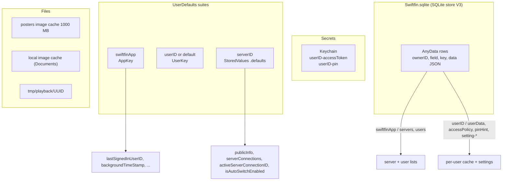
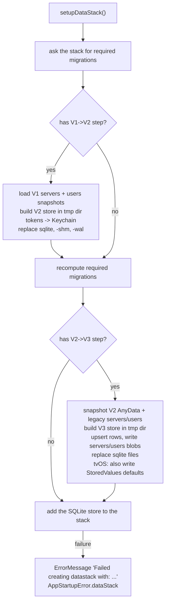
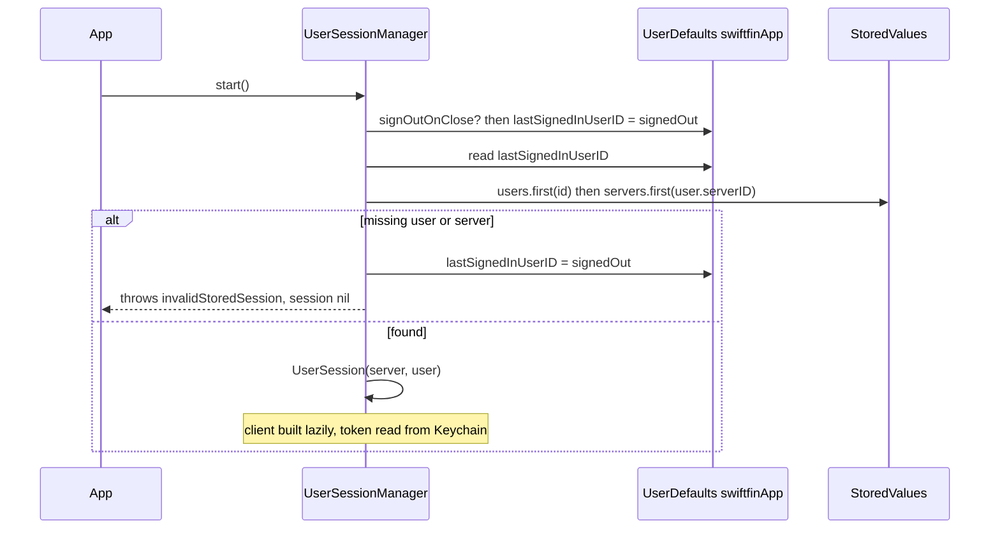

# 09 - State, Cache, Persistence

> **Jellyfin SDK source.** A citation `jellyfin-sdk-swift@3.3.0:PATH:LINE` points into [jellyfin/jellyfin-sdk-swift](https://github.com/jellyfin/jellyfin-sdk-swift) at tag `3.3.0` (commit `8ce10a167ad0b4145b2bc005acf8bebcfe6ebe46`). Open it as `https://github.com/jellyfin/jellyfin-sdk-swift/blob/8ce10a167ad0b4145b2bc005acf8bebcfe6ebe46/PATH#LLINE`; for a range `A-B`, use `#LA-LB`. There is no local copy of the SDK.

Scope: everything the client keeps outside a single screen. That is the Keychain, `UserDefaults` suites, the SQLite database, the image caches, temporary playback files, in-memory caches, logging stores, and what the app does (and does not do) when offline.

Citation format: `path:line` is repo-relative to the Swiftfin app root. Dependency citations are `jellyfin-sdk-swift@3.3.0:Sources/...:LINE`. Where a behaviour lives in a dependency whose source is not pinned (only the Jellyfin SDK is pinned), the spec says so and the item is listed in section 18 (Unknowns).

Cross-links: auth and session lifecycle in `03-auth-session.md`; HTTP client construction in `02-networking.md`; model shapes in `04-models.md`; trickplay and chapter images in `08-images-subtitles-audio.md`; playback options in `05-playback.md`; failure handling in `10-errors-edge-cases.md`; gaps in `12-gaps.md`. Index: `00-INDEX.md`. Endpoint table: `01-endpoints.md`. Sequences: `11-sequence-flows.md`.

## 1. Summary

- There is **no VLC** (grep for `VLC` and `libvlc` over the app targets finds no Swift hit) and **no offline media store** (grep for `downloadTask`, `URLSessionDownload`, `DownloadManager`, `DownloadQueue` finds no Swift hit in the app targets). The only offline-capable data are cached server records, the cached `UserDto`, a local image cache, and the Keychain token. The `Experimental.downloads` flag exists as a `UserDefaults` key but has no consumer in app code (`Shared/Services/SwiftfinDefaults.swift:414-416`; grep for `Experimental.downloads` across `Shared`, `Swiftfin tvOS`, `Views`, `Components`, `Objects` finds no use besides the declaration).
- The storage map (section 2) has eleven rows: ten persistent or process-wide stores plus the in-process objects row, each for a different job.
- Secrets live only in the Keychain: the Jellyfin access token and the optional local PIN, under keys `"<userID>-accessToken"` and `"<userID>-pin"` (`Shared/SwiftfinStore/SwiftinStore+UserState.swift:32`, `:55`).
- The server list and user list are one JSON blob each, stored as a row in a generic key/value SQLite table (`AnyData`) on iOS, and in `UserDefaults` on tvOS. Both keys declare `storage: .sql` with owner `"swiftfinApp"` (`Shared/SwiftfinStore/StoredValue/StoredValues+Server.swift:50-57`, field `"servers"`; `Shared/SwiftfinStore/StoredValue/StoredValues+User.swift:78-86`, field `"users"`), and tvOS forces `.defaults` (`Shared/SwiftfinStore/StoredValue/StoredValue.swift:107-111`).
- The access token is **not deleted** when a user is deleted or signs out. Only the PIN is deleted (`Shared/SwiftfinStore/SwiftinStore+UserState.swift:112-113`).
- API (non-image) HTTP calls have no app-level cache. No `requestCachePolicy`, `urlCache`, or `URLCache` setting exists in app code except the playback temp-file session (`urlCache = nil`) and the `.other` image pipeline (`Shared/Objects/MediaPlayerManager/PlaybackTemporaryFiles.swift:29`; `Shared/Extensions/Nuke/ImagePipeline.swift:96`).

## 2. Storage map

| Mechanism | Holds | Scope key | Where defined |
|---|---|---|---|
| Keychain (default options) | access token, local PIN | `"<userID>-accessToken"`, `"<userID>-pin"` | `Shared/Services/Keychain.swift:16-18` |
| `UserDefaults` suite `"swiftfinApp"` | app-wide settings, last signed-in user, background timestamp, refresh timestamp | `AppKey(...)` | `Shared/Services/SwiftfinDefaults.swift:28`, `:48-54` |
| `UserDefaults` suite `<userID>` (or `"default"` when signed out) | per-user UI/player settings | `UserKey(...)` | `Shared/Services/SwiftfinDefaults.swift:32-43`, `:56-58` |
| `UserDefaults` suite `<serverID>` via `StoredValues` | per-server public info, connections, active connection ID, auto-switch flag | `StoredValues.Keys.Server.*` | `Shared/SwiftfinStore/StoredValue/StoredValues+Server.swift:59-89` |
| SQLite `Swiftfin.sqlite` (SQLite store, entity `AnyData`) | server list, user list, per-user cached `UserDto`, access policy, PIN hint, per-user settings | `(ownerID, field, key)` | `Shared/SwiftfinStore/SwiftfinStore.swift:63-67`; `Shared/SwiftfinStore/V3Schema/V3AnyData.swift:32-45` |
| Image disk cache `org.jellyfin.swiftfin/Posters` | poster, backdrop and general images | sha1 of path+query | `Shared/Extensions/Nuke/DataCache.swift:24-35` |
| Image disk cache `Documents/Caches/org.jellyfin.swiftfin.local` | user avatars, server splashscreens | sha1 of path+query | `Shared/Extensions/Nuke/DataCache.swift:39-64` |
| Shared image memory cache | decoded images | image cache key | `Shared/App/SwiftfinApp+configure.swift:42-43` |
| `Folder.temporary/playback/<UUID>/` | trickplay and chapter sheets for the item being played | integer sheet ID | `Shared/Objects/MediaPlayerManager/PlaybackTemporaryFiles.swift:16`, `:125-127` |
| In-process objects | `UserSessionManager.currentSession`, `UserSession.cachedClient`, `ItemStore` records, player state (section 11) | n/a | `Shared/Services/UserSession/UserSessionManager.swift:56-57`; `Shared/Services/UserSession/UserSession.swift:29`; `Shared/Objects/ItemStore/ItemStore.swift:60` |
| Network logging store | swift-log app log messages through a persistent log handler, and network task events through the app's network logger, attached to each session through a logging session delegate | store default | `Shared/App/SwiftfinApp+configure.swift:25`; `Shared/Logging/NetworkLogger.swift:17-55`; `Shared/Services/UserSession/UserSession.swift:44`; `Shared/Extensions/Nuke/ImagePipeline.swift:73-76` |

On tvOS every `StoredValues` key is forced to `.defaults` storage, so the SQL branch is never used for new reads and writes: `#if os(tvOS) self.storage = .defaults #else self.storage = storage #endif` (`Shared/SwiftfinStore/StoredValue/StoredValue.swift:107-111`).

## 3. Keychain

### 3.1 Service object

| Item | Value | Citation |
|---|---|---|
| Storage | the Keychain, through a Keychain wrapper | `Shared/Services/Keychain.swift:11` |
| Construction | wrapper built with no arguments (no key prefix, no access group, no accessibility or sync option) | `Shared/Services/Keychain.swift:17` |
| Lifetime | singleton `keychainService` in a shared dependency container | `Shared/Services/Keychain.swift:16-18` |
| Author note | `// TODO: take a look at all security options` | `Shared/Services/Keychain.swift:15` |

Accessibility class and iCloud sync are whatever the Keychain wrapper defaults to, because the app passes no options (`Shared/Services/Keychain.swift:17`). The wrapper's source is not pinned. See section 18.

### 3.2 Keys

| Key (exact string) | Value | Written at | Read at | Deleted at |
|---|---|---|---|---|
| `"\(id)-accessToken"` | Jellyfin access token string | `UserState.accessToken` setter, `Shared/SwiftfinStore/SwiftinStore+UserState.swift:40`; V1 migration, `Shared/SwiftfinStore/SwiftfinStore.swift:370` | `UserState.accessToken` getter, `Shared/SwiftfinStore/SwiftinStore+UserState.swift:32` | **never** (no `delete("...-accessToken")` exists; grep for `keychain.*delete` finds only the two `-pin` deletes) |
| `"\(id)-pin"` | local PIN, plain string | `UserState.pin` setter, `Shared/SwiftfinStore/SwiftinStore+UserState.swift:63`; `LocalUserSecurityViewModel.set`, `Shared/ViewModels/LocalUserSecurityViewModel.swift:30` | `Shared/SwiftfinStore/SwiftinStore+UserState.swift:55`; `Shared/Services/UserSession/UserSessionManager.swift:228`; `Shared/ViewModels/SelectUserViewModel.swift:87`; `Shared/ViewModels/LocalUserSecurityViewModel.swift:21` | `UserState.delete`, `Shared/SwiftfinStore/SwiftinStore+UserState.swift:112-113`; `LocalUserSecurityViewModel.set` when new policy is not `.requirePin`, `Shared/ViewModels/LocalUserSecurityViewModel.swift:32` |

`id` is the Jellyfin user ID string (`UserState.id`, `Shared/SwiftfinStore/SwiftinStore+UserState.swift:20`).

### 3.3 Behaviour

| Condition | Behaviour | Citation |
|---|---|---|
| Token missing at read | `assertionFailure("access token missing in keychain")`, then returns `""`. In release the request goes out with an empty token. | `Shared/SwiftfinStore/SwiftinStore+UserState.swift:32-35` |
| PIN missing at read in `UserState.pin` | `assertionFailure("pin missing in keychain")`, returns `""` | `Shared/SwiftfinStore/SwiftinStore+UserState.swift:55-58` |
| PIN missing in sign-in check | check is skipped: `if user.accessPolicy == .requirePin, let storedPin = ...` | `Shared/ViewModels/SelectUserViewModel.swift:87` |
| Wrong PIN | `throw ErrorMessage(L10n.incorrectPinForUser(user.username))` | `Shared/ViewModels/SelectUserViewModel.swift:88-90`; `Shared/Services/UserSession/UserSessionManager.swift:229-231`; `Shared/ViewModels/LocalUserSecurityViewModel.swift:21-23` |
| Replace token for an existing user | `if replaceForAccessToken { user.state.state.accessToken = user.state.accessToken }` | `Shared/ViewModels/UserSignInViewModel.swift:265-267` |
| Sign-out | no Keychain call; token stays | `Shared/Services/UserSession/UserSessionManager.swift:113-124` |
| Server delete | deletes AnyData and suites; **no** Keychain call, so each of its users' `-accessToken` and `-pin` entries remain | `Shared/SwiftfinStore/SwiftfinStore+ServerState.swift:62-83` |

**Settled by source.** The token lifetime is not tied to user delete or sign-out. `UserState.delete()` calls `keychain.delete` only for `"\(id)-pin"` (`Shared/SwiftfinStore/SwiftinStore+UserState.swift:112-113`), and `UserSessionManager.signOut` touches only the `lastSignedInUserID` key (`Shared/Services/UserSession/UserSessionManager.swift:117`).

`UserSessionManager.swift` contains no `Paths.*` call, so sign-out makes no server-side token revocation request (`Shared/Services/UserSession/UserSessionManager.swift:113-124`); `UserState.delete()` makes only the Keychain PIN delete (`Shared/SwiftfinStore/SwiftinStore+UserState.swift:105-114`). The only `revokeKey` call in app code is the admin API-key screen (`Shared/ViewModels/AdminDashboard/APIKeysViewModel.swift:95`).

## 4. `UserDefaults`

### 4.1 Suites

| Suite | Accessor | Resolution | Citation |
|---|---|---|---|
| `"swiftfinApp"` | `UserDefaults.appSuite` | fixed | `Shared/Services/SwiftfinDefaults.swift:28` |
| `<userID>` or `"default"` | `UserDefaults.currentUserSuite` | switch on the `lastSignedInUserID` key: `.signedOut` gives `userSuite(id: "default")`, `.signedIn(userID)` gives `userSuite(id: userID)` | `Shared/Services/SwiftfinDefaults.swift:32-39` |
| `<id>` | `UserDefaults.userSuite(id:)` = `UserDefaults(suiteName: id)!` | any ID (user ID or server ID) | `Shared/Services/SwiftfinDefaults.swift:41-43` |
| `"swiftfinstore-debug-defaults"` (DEBUG only) | `UserDefaults.debugSuite` | declared but unused: `DebugKey` is built with `suite: .appSuite` | `Shared/Services/SwiftfinDefaults.swift:446`, `:451-453` |

Key factories: `AppKey(name)` (optional value), `AppKey(name, default:)`, `UserKey(name, default:)` (`Shared/Services/SwiftfinDefaults.swift:48-58`).

Per-user keys are declared as computed `static var` so `.currentUserSuite` is read on **every access**. After a user switch the same key therefore points at the new user's suite with no reload (`Shared/Services/SwiftfinDefaults.swift:102-104` and the pattern repeats through the file). `accentColor` is a `static var` stored property bound to the app suite once (`:69`).

### 4.2 App-suite keys (`swiftfinApp`)

| Key string | Type | Default | Meaning | Citation |
|---|---|---|---|---|
| `accentColor` | `Color` | `.jellyfinPurple` | effective accent, written by `RootCoordinator` | `Shared/Services/SwiftfinDefaults.swift:69`; `Shared/Coordinators/Root/RootCoordinator.swift:114-121`, `:138-141`, `:163-180` |
| `appearance` | `AppAppearance` | `.system` | effective appearance, written by `RootCoordinator` | `Shared/Services/SwiftfinDefaults.swift:75`; `Shared/Coordinators/Root/RootCoordinator.swift:123-130`, `:143-159`, `:182-196` |
| `appAppearance` | `AppAppearance` | `.system` | non-user context appearance (set only) | `Shared/Services/SwiftfinDefaults.swift:79` |
| `backgroundSignOutInterval` | `TimeInterval` | `3600` | seconds backgrounded before sign-out | `Shared/Services/SwiftfinDefaults.swift:81` |
| `backgroundTimeStamp` | `Date` | `Date.now` | set on `applicationDidEnterBackground` | `Shared/Services/SwiftfinDefaults.swift:82`; `Shared/Services/UserSession/UserSessionManager.swift:178` |
| `lastSignedInUserID` | `UserSessionState` (raw `String`; `""` is signed out) | `.signedOut` | session to restore at launch | `Shared/Services/SwiftfinDefaults.swift:83`; `Shared/Services/UserSession/UserSessionState.swift:14-29` |
| `lastServerInformationRefreshDate` | `Date` | `.distantPast` | gates the 24 h refresh | `Shared/Services/SwiftfinDefaults.swift:84` |
| `selectUserDisplayType` | `LibraryDisplayType` | `.grid` | user picker layout | `Shared/Services/SwiftfinDefaults.swift:86` |
| `selectUserServerSelection` | `SelectUserServerSelection` | `.all` | server filter on user picker | `Shared/Services/SwiftfinDefaults.swift:87` |
| `selectUserSortOrder` | `SelectUserSortOrder` | `.name` | user picker sort | `Shared/Services/SwiftfinDefaults.swift:88` |
| `selectUserAllServersSplashscreen` | `SelectUserServerSelection` | `.all` | which server's splashscreen when "all" | `Shared/Services/SwiftfinDefaults.swift:89` |
| `selectUserUseSplashscreen` | `Bool` | `true` | show splashscreen background | `Shared/Services/SwiftfinDefaults.swift:90` |
| `signOutOnBackground` | `Bool` | `true` | enable timed sign-out | `Shared/Services/SwiftfinDefaults.swift:92` |
| `signOutOnClose` | `Bool` | `false` | clear last user at launch | `Shared/Services/SwiftfinDefaults.swift:93` |
| `sendProgressReports` (DEBUG builds only) | `Bool` | `true` | gate for playback reports (`07-reporting.md`) | `Shared/Services/SwiftfinDefaults.swift:455`; `Shared/Objects/MediaPlayerManager/MediaProgressReporter.swift:100-102` |

### 4.3 Per-user keys (suite `<userID>` or `default`)

Customization:

| Key string | Type | Default | Citation |
|---|---|---|---|
| `userAccentColor` | `Color` | `.jellyfinPurple` | `Shared/Services/SwiftfinDefaults.swift:102-104` |
| `userAppearance` | `AppAppearance` | `.system` | `Shared/Services/SwiftfinDefaults.swift:108-110` |
| `mediaItemViewType` | `ItemViewType` | `.enhanced` | `Shared/Services/SwiftfinDefaults.swift:114-116` |
| `itemBarActionButtons` | `[ItemActionButton]` | `ItemActionButton.defaultBarActionButtons` | `Shared/Services/SwiftfinDefaults.swift:118-123` |
| `itemMenuActionButtons` | `[ItemActionButton]` | `ItemActionButton.defaultMenuActionButtons` | `Shared/Services/SwiftfinDefaults.swift:125-130` |
| `nextUpPosterType` | `PosterDisplayType` | `.portrait` | `Shared/Services/SwiftfinDefaults.swift:132-134` |
| `recentlyAddedPosterType` | `PosterDisplayType` | `.portrait` | `Shared/Services/SwiftfinDefaults.swift:136-138` |
| `latestInLibraryPosterType` | `PosterDisplayType` | `.portrait` | `Shared/Services/SwiftfinDefaults.swift:140-142` |
| `shouldShowRecommendations` | `Bool` | `true` | `Shared/Services/SwiftfinDefaults.swift:144-146` |
| `shouldShowMissingSeasons` | `Bool` | `true` | `Shared/Services/SwiftfinDefaults.swift:148-150`; read at `Shared/Objects/Libraries/SeasonLibrary.swift:55` |
| `shouldShowMissingEpisodes` | `Bool` | `true` | `Shared/Services/SwiftfinDefaults.swift:152-154`; read at `Shared/Objects/Libraries/EpisodeLibrary.swift:34` |
| `similarPosterType` | `PosterDisplayType` | `.portrait` | `Shared/Services/SwiftfinDefaults.swift:156-158` |
| `searchPosterType` | `PosterDisplayType` | `.portrait` | `Shared/Services/SwiftfinDefaults.swift:161-163` |
| `tabBarPlacement` | `TabBarPlacement` | `.sidebar` | `Shared/Services/SwiftfinDefaults.swift:165-167` |
| `posterConfiguration` | `PosterConfiguration` | `.default` | `Shared/Services/SwiftfinDefaults.swift:171-173` |
| `libraryCinematicBackground` | `Bool` | `true` | `Shared/Services/SwiftfinDefaults.swift:178-180` |
| `libraryEnabledDrawerFilters` | `[ItemFilterType]` | `ItemFilterType.allCases` | `Shared/Services/SwiftfinDefaults.swift:182-187` |
| `letterPickerOrientation` | `LetterPickerOrientation` | `.disabled` | `Shared/Services/SwiftfinDefaults.swift:189-191` |
| `libraryStyle` | `LibraryStyle` | `.init(displayType: .grid, posterDisplayType: .portrait, listColumnCount: 1)` | `Shared/Services/SwiftfinDefaults.swift:193-202` |
| `libraryRandomImage` | `Bool` | `true` | `Shared/Services/SwiftfinDefaults.swift:204-206`; read at `Shared/Objects/Libraries/UserViewLibrary.swift:166` |
| `libraryShowFavorites` | `Bool` | `true` | `Shared/Services/SwiftfinDefaults.swift:208-210`; read at `Shared/Objects/Libraries/UserViewLibrary.swift:60` |
| `libraryRememberLayout` | `Bool` | `false` | `Shared/Services/SwiftfinDefaults.swift:212-214` |
| `libraryRememberSort` | `Bool` | `false` | `Shared/Services/SwiftfinDefaults.swift:216-218`; gates stored sort at `Shared/Objects/Libraries/ItemLibrary.swift:40-45`, `:345-354` |
| `showRecentlyAdded` | `Bool` | `true` | `Shared/Services/SwiftfinDefaults.swift:223-225` |
| `homeResumeNextUp` | `Bool` | `false` | `Shared/Services/SwiftfinDefaults.swift:227-229`; read at `Shared/Objects/Libraries/NextUpLibrary.swift:21` and sent as `enableRewatching` at `:38` |
| `homeMaxNextUp` | `TimeInterval` | `366 * 86400` | `Shared/Services/SwiftfinDefaults.swift:231-236` |
| `showRecentlyPlayed` | `Bool` | `false` | `Shared/Services/SwiftfinDefaults.swift:238-240` |
| `searchEnabledDrawerFilters` | `[ItemFilterType]` | `ItemFilterType.allCases` | `Shared/Services/SwiftfinDefaults.swift:245-250` |

Video player:

| Key string | Type | Default | Citation |
|---|---|---|---|
| `appMaximumBitrate` | `PlaybackBitrate` | `.auto` via `VideoPlayer.Playback` (see CONFLICT below) | `Shared/Services/SwiftfinDefaults.swift:365-367` |
| `appMaximumBitrateTest` | `PlaybackBitrateTestSize` | `.regular` | `Shared/Services/SwiftfinDefaults.swift:369-371` |
| `appMaximumResolution` | `PlaybackResolution` | `.max` | `Shared/Services/SwiftfinDefaults.swift:361-363` |
| `compatibilityMode` | `PlaybackCompatibility` | `.auto` | `Shared/Services/SwiftfinDefaults.swift:373-375` |
| `customDeviceProfileAction` | `CustomDeviceProfileAction` | `.add` | `Shared/Services/SwiftfinDefaults.swift:377-379` |
| `videoPlayerPlaybackRates` | `[Double]` | `[0.5, 1.0, 1.25, 1.5, 2.0]` | `Shared/Services/SwiftfinDefaults.swift:381-383`; read at `Shared/Objects/MediaPlayerManager/NowPlayable/NowPlayableObserver.swift:46` |
| `playbackRate` | `Double` | `1.0` (written on every `MediaSession.rate` change) | `Shared/Services/SwiftfinDefaults.swift:385-387`; `Shared/Objects/MediaPlayerManager/MediaSession.swift:90-95` |
| `autoPlayEnabled` | `Bool` | `true` | `Shared/Services/SwiftfinDefaults.swift:264-266` |
| `barActionButtons` | `[VideoPlayerActionButton]` | `VideoPlayerActionButton.defaultBarActionButtons` | `Shared/Services/SwiftfinDefaults.swift:268-273` |
| `menuActionButtons` | `[VideoPlayerActionButton]` | `VideoPlayerActionButton.defaultMenuActionButtons` | `Shared/Services/SwiftfinDefaults.swift:283-288` |
| `jumpBackwardLength` | `MediaJumpInterval` | `.fifteen` | `Shared/Services/SwiftfinDefaults.swift:275-277` |
| `jumpForwardLength` | `MediaJumpInterval` | `.fifteen` | `Shared/Services/SwiftfinDefaults.swift:279-281` |
| `resumeOffset` | `Int` (seconds) | `0` | `Shared/Services/SwiftfinDefaults.swift:290-292`; snapshotted at `Shared/Objects/MediaPlayerManager/MediaPlaybackConfiguration.swift:36` |
| `videoPlayerSupplements` | `[VideoPlayerSupplementType]` | `VideoPlayerSupplementType.supportedCases` | `Shared/Services/SwiftfinDefaults.swift:294-299` |
| `videoPlayerHorizontalPanGesture` | `PanGestureAction` | `.none` | `Shared/Services/SwiftfinDefaults.swift:307-309` |
| `videoPlayerhorizontalSwipeAction` | `SwipeGestureAction` | `.none` | `Shared/Services/SwiftfinDefaults.swift:311-313` |
| `videoPlayerLongPressGesture` | `LongPressGestureAction` | `.gestureLock` | `Shared/Services/SwiftfinDefaults.swift:315-317` |
| `videoPlayerLongPressSpeedMultiplier` | `PlaybackSpeed` | `.two` | `Shared/Services/SwiftfinDefaults.swift:319-324` |
| `videoPlayerMultiTapGesture` | `MultiTapGestureAction` | `.none` | `Shared/Services/SwiftfinDefaults.swift:326-328` |
| `videoPlayerDoubleTouchGesture` | `DoubleTouchGestureAction` | `.none` | `Shared/Services/SwiftfinDefaults.swift:330-332` |
| `videoPlayerSwipeGesture` (pinch) | `PinchGestureAction` | `.aspectFill` | `Shared/Services/SwiftfinDefaults.swift:334-336` |
| `videoPlayerverticalPanLeftAction` | `PanGestureAction` | `.none` | `Shared/Services/SwiftfinDefaults.swift:338-340` |
| `videoPlayerverticalPanRightAction` | `PanGestureAction` | `.none` | `Shared/Services/SwiftfinDefaults.swift:342-344` |
| `chapterSlider` | `Bool` | `true` | `Shared/Services/SwiftfinDefaults.swift:349-351` |
| `trailingTimestamp` | `TrailingTimestampType` | `.timeLeft` | `Shared/Services/SwiftfinDefaults.swift:354-356` |
| `captionProfileID` | `String` | `""` (no profile matches, so the overlay falls back to the system `CaptionStyle.current`) | `Shared/Services/SwiftfinDefaults.swift:392-394`; `Shared/Views/VideoPlayer/Components/Toolbar/ActionButtons/SubtitleActionButton.swift:60-61`, `:89-97`; `Shared/Views/VideoPlayer/Components/TextSubtitleOverlay.swift:46`, `:71` |
| `automaticPictureInPicture` | `Bool` | `false` (iOS use) | `Shared/Services/SwiftfinDefaults.swift:399-401`; `Shared/Objects/MediaPlayerManager/Players/MediaPlayer+AutomaticPictureInPicture.swift:18-24` |
| `playInBackground` (property named `pauseOnBackground`) | `Bool` | `true` | `Shared/Services/SwiftfinDefaults.swift:403-405`; `Shared/Objects/MediaPlayerManager/MediaPlaybackTransitions.swift:34` |
| `confirmClose` (tvOS) | `Bool` | `false` | `Shared/Services/SwiftfinDefaults.swift:435-437` |

Experimental:

| Key string | Default | Citation |
|---|---|---|
| `L10n.download` (localized string used as the key name, "to not lose translations") | `false`; no consumer found | `Shared/Services/SwiftfinDefaults.swift:412-416` |
| `experimentalServerConnectionAutoSwitch` | `false`; gates `ServerConnectionManager` | `Shared/Services/SwiftfinDefaults.swift:418-420`; `Shared/Services/ServerConnectionManager.swift:249` |
| `experimentalVideoPlayerEPG` | `false`; gates EPG for live streams | `Shared/Services/SwiftfinDefaults.swift:428-430`; `Shared/Views/VideoPlayer/Container/VideoPlayer+ViewState.swift:229` |

**Settled by source: duplicate `appMaximumBitrate` key.** Two declarations share one string and suite but have different defaults. `VideoPlayer.appMaximumBitrate` defaults to `.max` (`Shared/Services/SwiftfinDefaults.swift:256-258`). `VideoPlayer.Playback.appMaximumBitrate` defaults to `.auto` (`Shared/Services/SwiftfinDefaults.swift:365-367`). Every consumer uses the `Playback` one: `Shared/Objects/MediaPlayerManager/MediaPlaybackConfiguration.swift:25`, `Shared/Objects/MediaPlayerManager/Supplements/EpisodeMediaPlayerQueue.swift:173`, `Shared/Views/SettingsView/PlaybackQualitySettingsView.swift:23`, `Shared/Views/ItemView/Components/ActionButtons/PlaybackActionButton.swift:23`. The `.max` declaration has no consumer. Effective default is `.auto`. Same for `appMaximumBitrateTest` (both `.regular`, `:260-262` and `:369-371`).

### 4.4 Side-effects and quirks

- `SwizzleDefaults` swizzles `UserDefaults.object/bool/string/integer/double(forKey:)` to return in-memory overrides (`Shared/Objects/SwizzleDefaults.swift:50-56`). A grep for `SwizzleDefaults` across the repo (excluding `_work`) finds hits only inside `Shared/Objects/SwizzleDefaults.swift` (declaration `enum SwizzleDefaults {` at `:11`; the queue label string `"SwizzleDefaults.overrides"` at `:14`; internal calls `:63`, `:71`, `:84`, `:97`, `:110`), so treat it as dormant tooling.
- The `sendProgressReports` key exists only under `#if DEBUG` (`Shared/Services/SwiftfinDefaults.swift:442`, `:455`), and the check in the reporter is also compiled only for DEBUG (`Shared/Objects/MediaPlayerManager/MediaProgressReporter.swift:100-102`). Release builds always report.
- Effective accent colour and appearance are derived values that `RootCoordinator` writes back into `accentColor` and `appearance` whenever app or user preference changes. Signed-in uses `userAccentColor` and `userAppearance`; signed-out uses `.jellyfinPurple` and `appAppearance`, forced `.dark` when `selectUserUseSplashscreen` is on (`Shared/Coordinators/Root/RootCoordinator.swift:114-121`, `:123-130`, `:143-159`, `:163-196`).

## 5. `StoredValues`: the typed key/value layer

`StoredValues` is the second settings system. It stores `Codable` values that are too large or structured for plain `UserDefaults` keys (an author comment says to use those keys only for basic single-value settings, and `StoredValue` for larger data types and collections, `Shared/Services/SwiftfinDefaults.swift:18-19`).

### 5.1 Key anatomy

`StoredValues.Key<Value: Storable>` fields (`Shared/SwiftfinStore/StoredValue/StoredValue.swift:66-123`):

| Field | Type | Meaning |
|---|---|---|
| `name` | `String` | row `key` column (SQL) or part of the `UserDefaults` key |
| `field` | `String?` | row `field` column; `nil` means use `name` |
| `ownerID` | `String` | row `ownerID` column, or `UserDefaults` suite name |
| `storage` | `.defaults` or `.sql` | forced to `.defaults` on tvOS (`:107-111`) |
| `defaultValue` | `() -> Value` | returned when nothing is stored |

`Storable` = `Codable` + a `UserDefaults` serialization protocol (`Shared/Objects/Storable.swift:15`).

Read/write rules (`StoredValues` subscript, `Shared/SwiftfinStore/StoredValue/StoredValue.swift:125-157`):

| Case | Behaviour |
|---|---|
| `name` or `ownerID` empty | getter returns the default; setter does nothing (`:127`, `:143`) |
| `.defaults` | `key._defaultKey`, a `UserDefaults` key in suite `UserDefaults(suiteName: ownerID)!` (`:79-92`, `:131`, `:147`) |
| `.defaults` key name | `name` if `field == name` or `field == nil`, else `"\(field!)-\(name)"` (`:81-85`) |
| `.sql` get | `try? AnyStoredData.fetch(ownerID:, field: key.field ?? key.name, key: key.name)`, falling back to default (`:133-139`) |
| `.sql` set | `try? AnyStoredData.store(...)`; failures are silent (`:149-154`) |
| `Key(always:)` | `name = "always"`, `ownerID = ""`, `.defaults`: reads give the default, writes are dropped (`:116-122`) |

SwiftUI wrapper `@StoredValue(key)` observes the value. `.sql` uses `SQLObservable`, `.defaults` uses `DefaultsObservable` (`Shared/SwiftfinStore/StoredValue/_Observable/_GenericValueObservation.swift:41-51`; `Shared/SwiftfinStore/StoredValue/_Observable/DefaultsObservable.swift:25-48`). Side effect: `SQLObservable.observe()` **inserts a default-valued row** if none exists so it can attach an object publisher (`Shared/SwiftfinStore/StoredValue/_Observable/SQLObservable.swift:87-107`; the author's TODO at `:91-92` notes the unnecessary write).

### 5.2 Server keys (default storage `.defaults`, `ownerID = serverID`)

| Accessor | `ownerID` | `field` / key name | Type | Default | Storage | Citation |
|---|---|---|---|---|---|---|
| `Server.servers` | `"swiftfinApp"` | `"servers"` | `[ServerState]` | `[]` | `.sql` | `Shared/SwiftfinStore/StoredValue/StoredValues+Server.swift:50-57` |
| `Server.publicInfo(id:)` | server ID | `"publicInfo"` | `PublicSystemInfo` | `.init()` | `.defaults` | `Shared/SwiftfinStore/StoredValue/StoredValues+Server.swift:59-65` |
| `Server.connections(id:)` | server ID | `"serverConnections"` | `[ServerConnection]` | `[]` | `.defaults` | `Shared/SwiftfinStore/StoredValue/StoredValues+Server.swift:67-73` |
| `Server.activeConnectionID(id:)` | server ID | `"activeServerConnectionID"` | `String` | `""` | `.defaults` | `Shared/SwiftfinStore/StoredValue/StoredValues+Server.swift:75-81` |
| `Server.isAutoSwitchEnabled(id:)` | server ID | `"isAutoSwitchEnabled"` | `Bool` | `false` | `.defaults` | `Shared/SwiftfinStore/StoredValue/StoredValues+Server.swift:83-89` |

Default for `ServerKey`'s `storage` parameter is `.defaults` (`Shared/SwiftfinStore/StoredValue/StoredValues+Server.swift:22`).

### 5.3 User keys

Non-current-user keys are built with `UserKey(ownerID:field:default:)` and default to `.sql` (`Shared/SwiftfinStore/StoredValue/StoredValues+User.swift:43-55`; `Key.init` default `storage: .sql`, `Shared/SwiftfinStore/StoredValue/StoredValue.swift:98`). Current-user keys use `CurrentUserKey`. It reads the current user session's `user` from the shared dependency container. With no session it returns `Key(always: defaultValue)`, so reads give the default and writes are dropped (`Shared/SwiftfinStore/StoredValue/StoredValues+User.swift:24-41`).

| Accessor | `ownerID` | `field` | row `key` | Type | Default | Citation |
|---|---|---|---|---|---|---|
| `User.users` | `"swiftfinApp"` | `"users"` | `"users"` | `[UserState]` | `[]` | `Shared/SwiftfinStore/StoredValue/StoredValues+User.swift:78-86` |
| `User.accessPolicy(id:)` | user ID | `"accessPolicy"` | same | `LocalUserAccessPolicy` | `.none` | `Shared/SwiftfinStore/StoredValue/StoredValues+User.swift:90-96` |
| `User.data(id:)` | user ID | `"userData"` | same | `UserDto` | `.init()` | `Shared/SwiftfinStore/StoredValue/StoredValues+User.swift:100-106` |
| `User.pinHint(id:)` | user ID | `"pinHint"` | same | `String` | `""` | `Shared/SwiftfinStore/StoredValue/StoredValues+User.swift:134-140` |
| `User.accessPolicy` (current user) | current user ID | `"currentUserAccessPolicy"` | same | `LocalUserAccessPolicy` | `.none` | `Shared/SwiftfinStore/StoredValue/StoredValues+User.swift:108-113` |
| `User.libraryStyle(id:)` | current user ID | `"setting-libraryStyle"` | `id` (or field if `id` nil) | `LibraryStyle` | `.default` | `Shared/SwiftfinStore/StoredValue/StoredValues+User.swift:115-121` |
| `User.libraryFilters(parentID:)` | current user ID | `"setting-libraryFilters"` | `parentID` (or field) | `ItemFilterCollection` | `ItemFilterCollection.default` | `Shared/SwiftfinStore/StoredValue/StoredValues+User.swift:126-132` |
| `User.customDeviceProfiles` | current user ID | `"customDeviceProfiles"` | same | `[CustomDeviceProfile]` | `[]` | `Shared/SwiftfinStore/StoredValue/StoredValues+User.swift:142-147` |
| `User.enabledTrailers` | current user ID | `"enabledTrailers"` | same | `TrailerSelection` | `.all` | `Shared/SwiftfinStore/StoredValue/StoredValues+User.swift:149-154` |
| `User.itemViewAttributes` | current user ID | `"itemViewAttributes"` | same | `[ItemViewAttribute]` | `ItemViewAttribute.allCases` | `Shared/SwiftfinStore/StoredValue/StoredValues+User.swift:156-161` |
| `User.previewImageScrubbing` | current user ID | `"previewImageScrubbing"` | same | `PreviewImageScrubbingOption` | `.trickplay(fallbackToChapters: false)` | `Shared/SwiftfinStore/StoredValue/StoredValues+User.swift:163-168` |
| `User.forceDVTranscode` | current user ID | `"forceDVTranscode"` | same | `Bool` | `false` | `Shared/SwiftfinStore/StoredValue/StoredValues+User.swift:170-175` |
| `User.forceHDRTranscode` | current user ID | `"forceHDRTranscode"` | same | `Bool` | `false` | `Shared/SwiftfinStore/StoredValue/StoredValues+User.swift:177-182` |
| `User.forceSubtitleBurnIn` | current user ID | `"forceSubtitleBurnIn"` | same | `Bool` | `false` | `Shared/SwiftfinStore/StoredValue/StoredValues+User.swift:184-189` |

The playback ones (`forceSubtitleBurnIn`, `forceHDRTranscode`, `forceDVTranscode`, `customDeviceProfiles`, `previewImageScrubbing`) are copied into `MediaPlaybackConfiguration` at construction (`Shared/Objects/MediaPlayerManager/MediaPlaybackConfiguration.swift:29-34`), so a settings change applies from the next playback request, not live (`05-playback.md`).

Two different "access policy" fields exist for the same user: `"accessPolicy"` (by ID, written at sign-in save and read in `authenticate(user:authenticationAction:)` at `Shared/Services/UserSession/UserSessionManager.swift:219`) and `"currentUserAccessPolicy"` (current-user accessor). Do not conflate them.

### 5.4 tvOS storage differences

On tvOS the same keys map to `UserDefaults` suite `ownerID`, key `name` (when `field == name`) or `"\(field)-\(name)"`. Examples: `servers` lives in suite `"swiftfinApp"` key `"servers"`; `libraryStyle(id:)` for user U lives in suite `U`, key `"setting-libraryStyle-<id>"` (`Shared/SwiftfinStore/StoredValue/StoredValue.swift:79-92`, `:107-111`). V2 to V3 migration copies legacy servers and users into these defaults on tvOS only (`Shared/SwiftfinStore/SwiftfinStore.swift:119-124`). The user suite therefore holds both `UserKey` settings and tvOS `StoredValues` rows. Deleting a user or server calls `UserDefaults.userSuite(id:).removeAll()` which wipes both (`Shared/SwiftfinStore/SwiftinStore+UserState.swift:119`; `Shared/SwiftfinStore/SwiftfinStore+ServerState.swift:70`, `:81`). `removeAll()` on `UserDefaults` is not defined in the app (grep `extension UserDefaults` finds only `SwiftfinDefaults.swift:23`, `:444` and the private swizzle extension); it comes from a dependency (section 18).

## 6. Database (SQLite)

### 6.1 Stack

| Item | Value | Citation |
|---|---|---|
| Storage | a SQLite store | `Shared/SwiftfinStore/SwiftfinStore.swift:9` |
| Store stack | schemas V1, V2, V3 with migration chain `["V1", "V2", "V3"]` | `Shared/SwiftfinStore/SwiftfinStore.swift:54-61` |
| Store | SQLite file name `"Swiftfin.sqlite"` | `Shared/SwiftfinStore/SwiftfinStore.swift:63-67` |
| Default stack registered | `SwiftfinStore.dataStack` is set as the process-wide default stack | `Shared/App/SwiftfinApp+configure.swift:37` |
| Setup entry point | `SwiftfinStore.setupDataStack()` awaited in `RootCoordinator._start()` | `Shared/Coordinators/Root/RootCoordinator.swift:66-73` |
| App owner ID constant | `appOwnerID = "swiftfinApp"` | `Shared/SwiftfinStore/SwiftfinStore.swift:69` |
| Typealiases | `AnyStoredData = SwiftfinStore.V3.AnyData`; `ServerState`, `UserState` = `SwiftfinStore.State.Server/User` | `Shared/SwiftfinStore/SwiftfinStore.swift:15-18` |

The SQLite store is given only a file name, no directory (`Shared/SwiftfinStore/SwiftfinStore.swift:63-67`). The on-disk directory is therefore chosen by the store library, whose source is not pinned (section 18).

### 6.2 Schemas

| Version | Entities | Citation |
|---|---|---|
| V1 | `AccessToken`, `Server`, `User` (an `AccessToken` entity exists; `User.accessToken` is a relationship named `"accessToken"` to the `AccessToken` entity, and the V1 to V2 step reads `$0.accessToken?.value`) | `Shared/SwiftfinStore/V1Schema/SwiftfinStore+V1.swift:14-42`; `Shared/SwiftfinStore/V1Schema/V1UserModel.swift:28-29`; `Shared/SwiftfinStore/SwiftfinStore.swift:181` |
| V2 | `Server`, `User`, `AnyData` (`data`, `domain`, `key`, `ownerID`) | `Shared/SwiftfinStore/V2Schema/SwiftfinStore+V2.swift:16-44`; `Shared/SwiftfinStore/V2Schema/V2AnyData.swift:36-49` |
| V3 | `AnyData` only | `Shared/SwiftfinStore/V3Schema/SwiftfinStore+V3.swift:14-28` |

V3 `AnyData` columns (`Shared/SwiftfinStore/V3Schema/V3AnyData.swift:32-45`):

| Column | Swift type | Default | Role |
|---|---|---|---|
| `data` | `Data?` | nil | JSON of the `Codable` value (`JSONEncoder().encode`, `Shared/SwiftfinStore/SwiftfinStore+AnyData.swift:51`) |
| `ownerID` | `String` | `""` | user ID, server ID, or `"swiftfinApp"` |
| `field` | `String` | `""` | V2 called this `domain` |
| `key` | `String` | `""` | sub-key (e.g. library ID) |

V3 version lock hash: `0xEB43_50DC_85D9_95A4, 0x1466_51A3_9170_C397, 0x86C4_769B_AAE9_9CB8, 0x513A_EBB8_CCC8_D48C` (`Shared/SwiftfinStore/V3Schema/SwiftfinStore+V3.swift:19-26`).

Uniqueness: logical key `(ownerID, field, key)`. The V3 entity declares four plain stored columns and no uniqueness constraint (`Shared/SwiftfinStore/V3Schema/V3AnyData.swift:32-45`; `Shared/SwiftfinStore/V3Schema/SwiftfinStore+V3.swift:14-28`), and the code only `assert`s fewer than two matches (debug only) (`Shared/SwiftfinStore/SwiftfinStore+AnyData.swift:32`, `:49`). Fetch uses the first match, store edits the first match or creates one.

### 6.3 `AnyStoredData` operations

| Operation | Behaviour | Citation |
|---|---|---|
| `fetch(ownerID:field:key:)` | fetch all rows with the three-way filter, `compactMap(\.data)`, JSON-decode each, return first | `Shared/SwiftfinStore/SwiftfinStore+AnyData.swift:14-35` |
| `store(value:ownerID:field:key:)` | inside a write transaction on the stack: edit existing row's `data`, else create a row with all four fields | `Shared/SwiftfinStore/SwiftfinStore+AnyData.swift:37-65` |
| `deleteAll(ownerID:)` | delete every row for the owner | `Shared/SwiftfinStore/SwiftfinStore+AnyData.swift:96-102` |
| `deleteAll(ownerID:field:)` | delete rows for owner and field | `Shared/SwiftfinStore/SwiftfinStore+AnyData.swift:108-114` |
| `delete(ownerID:field:key:)` | delete one row | `Shared/SwiftfinStore/SwiftfinStore+AnyData.swift:120-126` |

A JSON decode failure on `fetch` throws and, through `try?` in `StoredValues`, becomes the default value (`Shared/SwiftfinStore/StoredValue/StoredValue.swift:133-139`). In `SQLObservable`'s change handler the same failure is `fatalError()` (`Shared/SwiftfinStore/StoredValue/_Observable/SQLObservable.swift:79`).

### 6.4 Migration

Steps and exact behaviour (`Shared/SwiftfinStore/SwiftfinStore.swift`):

| Step | Detail | Line |
|---|---|---|
| Detect | ask the stack for the required migrations of the store; a step is present if any heavyweight or lightweight migration has matching `source == "V1"`, `destination == "V2"` (and V2 to V3) | `:72`, `:142-156` |
| V1 to V2 | read all V1 `StoredServer` (id, name, currentURI, uris) and `StoredUser` (id, username, server id, `accessToken?.value`, relationship only) into plain structs | `:158-186` |
| V1 to V2 build | in a fresh V2-schema stack at a temp store URL, create `StoredServer` (`urls` = `uris` compacted through `URL(string:)` (`transformServerURLs`, `:373-375`); `currentURL` = `URL(string: currentURI)` else first URL else `URL(string: "/")!` (`transformCurrentServerURL`, `:377-379`)) and `StoredUser`; link `user.server` | `:188-226`, `:370-379` |
| V1 token move | `persistAccessTokenToKeychain(userID:accessToken:)` sets Keychain `"\(userID)-accessToken"` | `:220-223`, `:367-371` |
| V1 to V2 swap | `replaceSQLiteStore` removes `Swiftfin.sqlite`, `-shm`, `-wal`, then moves the temp files in | `:300-331` |
| After V1 to V2 | migrations recomputed | `:74-76` |
| V2 to V3 | snapshot V2 `AnyData` (data, ownerID, domain, key) and legacy `StoredServer.state`/`StoredUser.state` | `:228-242`, `:333-344` |
| V2 to V3 build | each V2 `AnyData` row upserted with `field = domain`; then two extra rows: `(ownerID "swiftfinApp", field "servers", key "servers")` = JSON of servers sorted by `name`; `(ownerID "swiftfinApp", field "users", key "users")` = JSON of users sorted by `username` | `:244-298` |
| V2 to V3 tvOS | `StoredValues[.Server.servers] = legacyStates.servers` and `StoredValues[.User.users] = legacyStates.users` under `#if os(tvOS)` | `:119-124` |
| Temp dir | `URL.temporaryDirectory/<UUID>`, removed in `defer` | `:128-140` |
| Failure | only the add-store failure is wrapped: `ErrorMessage("Failed creating datastack with: \(error.localizedDescription)")` (`:346-357`). Other errors propagate unwrapped: the required-migrations query (`:72`, `:75`), the write transaction blocks (`:197`, `:254`), and file remove/move in `replaceSQLiteStore` (`:300-331`) | `:72`, `:75`, `:197`, `:254`, `:300-331`, `:346-357` |
| Dead helper | `accessToken(for:)` (attribute-or-relationship reader) has no caller anywhere in the app (grep for `accessToken(for` finds only the declaration), so it is dead code. The live token read is the relationship read `$0.accessToken?.value` at `:181` | `:359-365`, `:181` |

Failure at launch becomes `AppStartupError.dataStack(error)` and `RootCoordinator` goes to its error state (`Shared/Coordinators/Root/RootCoordinator.swift:68-73`). Details of the error screen are in `10-errors-edge-cases.md`.

## 7. Server and user records

### 7.1 Shapes (persisted JSON)

`ServerState` (`Shared/SwiftfinStore/SwiftfinStore+ServerState.swift:17-26`, `Hashable, Identifiable, Codable`):

| Field | Type | Note |
|---|---|---|
| `urls` | `Set<URL>` | deprecated by `@available(*, message: "Use connections instead")` |
| `currentURL` | `URL` | deprecated, same message; `effectiveServerURL` falls back to it when `activeServerConnection` is nil (`:85-87`) |
| `name` | `String` | `updateServerInfo()` refreshes it from `PublicSystemInfo.serverName`, keeping the old name when nil (`:173`) |
| `id` | `String` | Jellyfin server ID |
| `userIDs` | `[String]` | users saved for this server |

`UserState` (`Shared/SwiftfinStore/SwiftinStore+UserState.swift:19-23`): `id: String`, `serverID: String`, `username: String`. Computed properties `accessToken`, `pin` (Keychain), and `data`, `pinHint`, `accessPolicy` (StoredValues) are declared in a separate `extension UserState` (`Shared/SwiftfinStore/SwiftinStore+UserState.swift:26-84`; `accessToken` `:30`, `data` `:44`, `pin` `:53`, `pinHint` `:67`, `accessPolicy` `:76`). Computed properties are not encoded by synthesized `Codable`, so they are not part of the JSON.

`ServerConnection` (`Shared/Objects/ServerConnection.swift:11-58`, `Storable`):

| Field | Type | Note |
|---|---|---|
| `id` | `String` | `UUID().uuidString` when created (`Shared/ViewModels/ConnectToServerViewModel.swift:159`; `Shared/SwiftfinStore/SwiftfinStore+ServerState.swift:158`) |
| `name` | `String` | display name; `displayTitle` falls back to the URL (`:60-62`) |
| `url` | `URL` | callers normalize with `URL.normalizedServerConnectionURL` (`Shared/Extensions/URL.swift:85-100`; e.g. `Shared/SwiftfinStore/SwiftfinStore+ServerState.swift:155`): `URLComponents(url:resolvingAgainstBaseURL: false)`, lowercase scheme and host, strip a trailing `/` via `trimmingSuffix("/")` from a non-empty path (query, port and user info untouched), return `components.url` or nil |
| `interface` | `Interface` | raw strings `"any"`, `"wifi"`, `"cellular"` (`:13-17`) |
| `wifiSSIDs` | `[String]` | default `[]`; matched case-insensitively (`:73-75`) |
| `priority` | `Int` | order index: `connections.count` on append (`Shared/ViewModels/ConnectToServerViewModel.swift:163`), enumeration index in `ensureServerConnections()` (`Shared/SwiftfinStore/SwiftfinStore+ServerState.swift:162`), re-indexed by `ServerConnection.ordered` (`:95-103`) |

`String.url` is plain `URL(string: self)` (`Shared/Extensions/String.swift:219-221`). `ServerConnection.ordered` sorts by `priority` (unless `preservingOrder`) then renumbers `0...n` (`:95-103`). Duplicates are same `url`, `interface` and lowercased SSID set under a different `id` (`:86-93`).

### 7.2 Create and update flows

| Event | Writes | Citation |
|---|---|---|
| Add server | `getPublicSystemInfo()`, then append `ServerState` to `[.Server.servers]` and set `[.Server.publicInfo(id:)]` | `Shared/ViewModels/ConnectToServerViewModel.swift:134-143` |
| Add a URL to a known server | `ensureServerConnections()`; find a connection with the normalized URL or append `ServerConnection(id: UUID().uuidString, name: normalizedURL.absoluteString, url:, interface: .any, priority: connections.count)`; set `serverConnections`; set `activeServerConnection`; post `.didChangeServerConnection` | `Shared/ViewModels/ConnectToServerViewModel.swift:146-173` |
| Default connections (when none stored) | `[currentURL] + urls.subtracting([currentURL]).sorted(using: \.absoluteString)`; name is `L10n.currentURL` for the current one else the normalized URL string; `interface: .any`; `priority: index`; fresh `UUID` IDs each call | `Shared/SwiftfinStore/SwiftfinStore+ServerState.swift:149-165` |
| Active connection read | stored `activeServerConnectionID` if non-empty and found; else connection matching normalized `currentURL`; else first | `Shared/SwiftfinStore/SwiftfinStore+ServerState.swift:41-54` |
| Effective URL | `activeServerConnection?.url ?? currentURL` | `Shared/SwiftfinStore/SwiftfinStore+ServerState.swift:85-87` |
| Save user after sign-in | remove any same-ID user, append, write `[.User.users]`; append ID to `server.userIDs` and write `[.Server.servers]`; then `accessPolicy`, `accessToken` (Keychain), `data` (`UserDto`); if PIN policy: `pinHint` (if provided), `pin` (Keychain) | `Shared/ViewModels/UserSignInViewModel.swift:187-240` |
| Existing user re-sign-in | PIN compared to stored `pin`; token replaced only if `replaceForAccessToken` | `Shared/ViewModels/UserSignInViewModel.swift:242-268` |
| Duplicate user lookup | by user ID across **all** servers: `StoredValues[.User.users].first { $0.id == id }` | `Shared/ViewModels/UserSignInViewModel.swift:182-185` |
| Change PIN / policy | `.requirePin`: Keychain `set(newPin)`; any other policy: Keychain `delete`; then write `accessPolicy` and `pinHint` | `Shared/ViewModels/LocalUserSecurityViewModel.swift:26-37` |
| Mirror admin edits | after a policy or configuration edit, `currentUser.data.policy` / `.configuration` is rewritten only when the edited user is the signed-in user (`if userID == currentUser.id`); editing any other user does not touch the cached `UserDto` | `Shared/ViewModels/AdminDashboard/Users/ServerUserAdminViewModel.swift:105-108`, `:113-130` (checks at `:106-108`, `:125-127`) |

### 7.3 Delete flows

| Operation | Removes | Does **not** remove | Citation |
|---|---|---|---|
| `UserState.delete()` | user from `[.User.users]`; all `AnyData` for `ownerID = user.id`; the user's `UserDefaults` suite (`removeAll()`); user ID from its server's `userIDs`; Keychain `"<id>-pin"` | Keychain `"<id>-accessToken"` | `Shared/SwiftfinStore/SwiftinStore+UserState.swift:90-120` |
| `ServerState.delete()` | `AnyData` for each of the server's users and for the server ID; the server suite and each user suite; users and server from the lists | all users' Keychain tokens and PINs | `Shared/SwiftfinStore/SwiftfinStore+ServerState.swift:62-83` |

`SelectUserViewModel._deleteUsers` calls `user.delete()` per user then reloads (`Shared/ViewModels/SelectUserViewModel.swift:61-68`). Image caches are not purged on delete (the only `removeItem(for:)` callers are `Shared/ViewModels/ImageViewModel/UserImageViewModel.swift:90-91`).

## 8. Session restore, sign-out, refresh

| Behaviour | Detail | Citation |
|---|---|---|
| Launch | `start()` runs once (`state == .initial`). If `signOutOnClose` is on it first sets `.signedOut`. Then `resolveStoredSession()`. Any error is logged ("Unable to restore launch session") and the session is set to nil. | `Shared/Services/UserSession/UserSessionManager.swift:83-101` |
| Resolve | If `lastSignedInUserID` is not `.signedIn`, returns nil (no session, no reset, no throw; `:321`). If signed in but the user or server record is missing from `StoredValues`, resets to `.signedOut` and throws `UserSessionError.invalidStoredSession(userID:)` (`:322-326`). No network. | `Shared/Services/UserSession/UserSessionManager.swift:320-333` |
| Sign in | write `lastSignedInUserID = .signedIn(userID:)`, resolve, update session, then background refresh (reason `.explicitSignIn`) | `Shared/Services/UserSession/UserSessionManager.swift:103-111` |
| Sign out | write `.signedOut`, session nil. No-op if no session and no transition pending. Keychain and DB untouched. | `Shared/Services/UserSession/UserSessionManager.swift:113-124` |
| Apply session | stop playback, `previousSession.willStop()`, `newSession.willStart()`, set `currentSession`, reset the cached `currentUserSession` entry in the shared dependency container, set `state`, `didStart()`. Transitions are serialized by chaining on the previous task. | `Shared/Services/UserSession/UserSessionManager.swift:281-318` |
| Enter background | `backgroundTimeStamp = Date.now` | `Shared/Services/UserSession/UserSessionManager.swift:176-179` |
| Enter foreground | schedule connection resolution; refresh if stale; then if signed in, `signOutOnBackground` is on, and no active playback: sign out when `Date.now - backgroundTimeStamp > backgroundSignOutInterval` (strict `>`, default 3600) | `Shared/Services/UserSession/UserSessionManager.swift:181-196` |
| Refresh | `.explicitSignIn` always runs; `.stale` runs only if `lastServerInformationRefreshDate` is older than 24 h (`Date.isStale`, strict `>`, `Shared/Extensions/Date.swift:13-15`). Runs `updateServerInfo()` then `updateUserData(server:)`, then writes `lastServerInformationRefreshDate = Date.now`. Failure is logged only ("Unable to refresh server and user information"); the date is not advanced and stale data is kept. | `Shared/Services/UserSession/UserSessionManager.swift:235-257` |
| `updateServerInfo` | `GET /System/Info/Public` (`Paths.getPublicSystemInfo`); rewrite the server record with `serverName ?? existing name`; store `publicInfo` | `Shared/SwiftfinStore/SwiftfinStore+ServerState.swift:98-104`, `:167-185` |
| `updateUserData` | `GET /Users/Me` (`Paths.getCurrentUser`); rewrite the user record with `userData.name ?? username`; store `User.data(id:)` | `Shared/SwiftfinStore/SwiftinStore+UserState.swift:124-153` |

Endpoint details are in `01-endpoints.md`. Auth flows are in `03-auth-session.md`.

**Cached `UserSession.client`.** `UserSession.client` returns a cached `JellyfinClient` unless `server.effectiveServerURL` differs from the cached client's `configuration.url`. It is built with `.swiftfinConfiguration(url:, accessToken: user.accessToken)`, `sessionConfiguration: .swiftfin`, and a network-logging session delegate (`Shared/Services/UserSession/UserSession.swift:29-50`). `user.accessToken` is evaluated only inside the build branch, after the cached-client early return (`:31-42`). So a Keychain token change does not affect a client already cached for the same URL (reading of that control flow).

## 9. Image caches

### 9.1 Pipelines

| Pipeline | Disk cache | Loader | Used by | Citation |
|---|---|---|---|---|
| `posters` pipeline (also set as the shared default pipeline) | posters disk cache | image loader on the `.swiftfin` session configuration with the network-logging session delegate | `ImageView` default (shared pipeline), posters, admin user list avatars (`UserProfileImage` defaults to the posters pipeline) | `Shared/Extensions/Nuke/ImagePipeline.swift:63-78`; `Shared/App/SwiftfinApp+configure.swift:51`; `Shared/Components/ImageView.swift:64`; `Shared/Components/UserProfileImage/UserProfileImage.swift:23`, `:48-49`; `Views/AdminDashboardView/ServerUsers/ServerUsersView/Components/ServerUsersRow.swift:63-70` |
| `local` pipeline | local disk cache | same as above | user buttons, select-user list/grid and splashscreen, settings bar button, own profile hero image | `Shared/Extensions/Nuke/ImagePipeline.swift:80-93`; `Shared/Components/UserButton.swift:148`, `:169`; `Shared/Views/SelectUserView/SelectUserView.swift:168`; `Shared/Views/SelectUserView/Components/SelectUserView+ListView.swift:61`; `Components/SettingsBarButton.swift:28`; `Shared/Components/UserProfileImage/UserProfileHeroImage.swift:42` |
| `other` pipeline | none; a URL-cache configuration | library default | now-playing artwork, item image editor, plugin rows | `Shared/Extensions/Nuke/ImagePipeline.swift:95-96`; `Shared/Extensions/JellyfinAPI/BaseItemDto/BaseItemDto.swift:239`; `Views/AdminDashboardView/Plugins/PluginsView/Components/PluginRow.swift:28`; `Views/ItemEditorView/ItemImages/ItemImagesView.swift:226` |

The image loader has no header injection (`Shared/Extensions/Nuke/ImagePipeline.swift:70-77`), and image URLs are built with `client.url(with:)` (`Shared/Extensions/JellyfinAPI/BaseItemDto/BaseItemDto+Images.swift:54`; `Shared/SwiftfinStore/SwiftfinStore+ServerState.swift:146`). App code adds no `Authorization` header or `ApiKey` query item to these requests (see `08-images-subtitles-audio.md`). `JellyfinClient.url(with:queryAPIKey:)` defaults `queryAPIKey` to `false`, so no `ApiKey` query item is added unless a caller opts in (`jellyfin-sdk-swift@3.3.0:Sources/JellyfinClient.swift:254`; the `if queryAPIKey, let accessToken` branch follows at `:262`). Inference (not asserted from code): image loading therefore works only if the server serves these GETs without auth; see section 18.

### 9.2 Disk caches

| Cache | Location | Size limit | Filename key | Failure | Citation |
|---|---|---|---|---|---|
| Posters | disk cache named `"org.jellyfin.swiftfin/Posters"`; base directory chosen by the image library (unpinned, section 18) | `sizeLimit = 1024 * 1024 * 1000` (1000 MB) | the app cache key (section 9.3) of the name's URL | `try?` yields nil; pipeline then has no disk cache | `Shared/Extensions/Nuke/DataCache.swift:24-35` |
| Local | `<Documents>/Caches/org.jellyfin.swiftfin.local` (`FileManager.default.urls(for: .documentDirectory, ...)`) | none set | the app cache key (section 9.3), or `"\(server.id)-splashscreen".sha1` for URLs whose path contains `"Splashscreen"` | nil if no Documents dir or the disk cache init at that path throws | `Shared/Extensions/Nuke/DataCache.swift:39-64` |

The local cache is placed under `.documentDirectory` rather than a caches directory (`Shared/Extensions/Nuke/DataCache.swift:40-44`). The local cache is intended to be "usable without an active connection" (`Shared/Extensions/Nuke/DataCache.swift:37-38`).

### 9.3 Cache key (exact algorithm)

The app's `cacheKey(for url:)` function (`Shared/Extensions/Nuke/ImagePipeline.swift:19-39`):

1. Parse into `URLComponents`; nil gives no key.
2. If a query item named `maxWidth` exists, remember its value and remove it from the query.
3. Rebuild the URL and take `pathAndQuery` (host ignored on purpose so multi-URL servers share entries, comment at `Shared/Extensions/Nuke/DataCache.swift:14-15`).
4. `sha1` of that string. If a `maxWidth` was removed, append `"-<maxWidth>"`.

The app's pipeline delegate returns this same key, or nil when the request has no URL (`Shared/Extensions/Nuke/ImagePipeline.swift:99-106`). Whether the image library applies this one key to both the memory and data caches is library behaviour, not pinned (section 18). Consequences: images that differ only by `maxWidth` get separate entries; items whose URL includes the image `tag` query item are cache-busted by tag change, because `tag` is part of the hashed query (`Shared/Extensions/JellyfinAPI/BaseItemDto/BaseItemDto+Images.swift:44` places the tag in the URL; app code does not assert the server requires it). Author TODOs: `maxHeight` and "cache reset" are unhandled (`Shared/Extensions/Nuke/ImagePipeline.swift:24-25`).

### 9.4 Memory cache and decoding

- Shared memory image cache: cost limit `1024 * 1024 * 200` (200 MB) and TTL `300` (5 min) (`Shared/App/SwiftfinApp+configure.swift:42-43`).
- A decoder is registered that returns an empty (no-op) decoder when the response MIME type contains `"svg"`, so the raw data is kept for the SVG view (`Shared/App/SwiftfinApp+configure.swift:45-49`).

### 9.5 Invalidation

- The app's `removeItem(for:)` pipeline helper removes the memory image, the memory data, and the disk entry under `cacheKey(for:)` (`Shared/Extensions/Nuke/ImagePipeline.swift:52-60`).
- After a profile image upload (`POST /UserImage` with query key `userId`, `Paths.postUserImage(userID:_:)` with a `Data` body, path, method and body at `jellyfin-sdk-swift@3.3.0:Sources/Paths/PostUserImageAPI.swift:14-15`, query key set by `makePostUserImageQuery` at `:18-22` (`encoder.encode(userID, forKey: "userId")` at `:20`); the app base64-encodes the body and sets the `Content-Type` header from the image, `Shared/ViewModels/ImageViewModel/UserImageViewModel.swift:61-66`) or delete, `cleanImageCache()` loops over `maxWidth` in `[60, 120, 150]`, removes the resulting URL from **both** the `local` and `posters` pipelines, then posts `Notifications[.didChangeUserProfile]` with the user ID (`Shared/ViewModels/ImageViewModel/UserImageViewModel.swift:60-98`). **Quirk:** `UserDto.profileImageSource(client:maxWidth:)` ignores its `maxWidth` argument and builds the URL through `UserState.profileImageSource(client:)`, which has no width parameter (`Shared/Extensions/JellyfinAPI/UserDto.swift:14-26`; `Shared/SwiftfinStore/SwiftinStore+UserState.swift:155-168`). The three iterations therefore remove the same width-less URL. Every avatar URL is built through the width-less `UserState.profileImageSource` (the only `Paths.getUserImage` call in app code, `Shared/SwiftfinStore/SwiftinStore+UserState.swift:160`; `UserDto.profileImageSource` forwards to it, `Shared/Extensions/JellyfinAPI/UserDto.swift:14-26`), even where callers pass a width (`Shared/Components/UserButton.swift:165-168` passes `240`; `Views/AdminDashboardView/ServerUsers/ServerUsersView/Components/ServerUsersRow.swift:67-70` passes `60`). So no `-<maxWidth>` avatar variants are created and nothing is left uncleaned.
- `UserState.profileImageSource` puts `data.primaryImageTag` (from the cached `UserDto`) in the URL as `tag`, so an offline avatar uses the cached tag (`Shared/SwiftfinStore/SwiftinStore+UserState.swift:155-168`).
- Nothing evicts caches on sign-out, user delete, or server delete: the only `removeItem(for:)` callers in app code are the two lines in `cleanImageCache()` (`Shared/ViewModels/ImageViewModel/UserImageViewModel.swift:90-91`).

Failure to load an image: `ImageView` shows its `failure` view (default `EmptyView()`), so the area is blank (`Shared/Components/ImageView.swift:39-40`, `:66`); `loadFirstImage` swallows each error and tries the next source (`Shared/Extensions/Nuke/ImagePipeline.swift:41-50`).

**Open.** The local cache key branch for splashscreens (`"<serverID>-splashscreen"` sha1) is at `Shared/Extensions/Nuke/DataCache.swift:51-59`. Whether it is reachable is unverified: it needs the filename generator to receive a string whose path contains `"Splashscreen"` and ending in `/Branding/Splashscreen?` (`:51`, `:54`), and what the image library passes the generator is not pinned (section 18). The splashscreen does use the local pipeline (`Shared/Views/SelectUserView/SelectUserView.swift:163-168`; `splashScreenImageSource` is `client.url(with: Paths.getSplashscreen())`, `Shared/SwiftfinStore/SwiftfinStore+ServerState.swift:145-147`). `UserSignInView` passes the source to a tvOS split-login view (`Shared/Views/UserSignInView.swift:316`) whose pipeline was not traced.

## 10. Temporary files for playback

`PlaybackTemporaryFiles` caches trickplay sheets and chapter images for one playback item. It downloads the IDs a `PreviewImageProvider` gives, whose source is either chapter images or trickplay sheets (`Shared/Objects/MediaPlayerManager/PlaybackTemporaryFiles.swift:39-53`; `Shared/Objects/MediaPlayerManager/PreviewImageProvider.swift:17-18`, `:80-84`). Each `MediaPlayerItem` owns one instance (`Shared/Objects/MediaPlayerManager/MediaPlayerItem/MediaPlayerItem.swift:63-64`, `:28-41`; built per item at `Shared/Objects/MediaPlayerManager/MediaPlayerItem/MediaPlayerItemResolver.swift:154`). See also `08-images-subtitles-audio.md`.

| Item | Value | Citation |
|---|---|---|
| Directory | `Folder.temporary` + `"playback/\(UUID().uuidString)"` (one new UUID per instance) | `Shared/Objects/MediaPlayerManager/PlaybackTemporaryFiles.swift:16`, `:125` |
| File name | `"\(id)"` (integer ID, no extension: `rename(to: "\(id)", keepExtension: false)`) | `Shared/Objects/MediaPlayerManager/PlaybackTemporaryFiles.swift:127` |
| Session | `URLSessionConfiguration.ephemeral`, `urlCache = nil`, `timeoutIntervalForRequest = 20` | `Shared/Objects/MediaPlayerManager/PlaybackTemporaryFiles.swift:28-32` |
| Auth header | `Authorization: MediaBrowser Token="<accessToken>"` (set only when a token exists; code comment: `X-Emby-Token` is ignored when the server disables legacy authorization) | `Shared/Objects/MediaPlayerManager/PlaybackTemporaryFiles.swift:99-102` |
| Accepted responses | HTTP status in `200..<300` and task not cancelled; otherwise the download is deleted and the result is nil | `Shared/Objects/MediaPlayerManager/PlaybackTemporaryFiles.swift:109-122` |
| Dedup | `files: [Int: Task<URL?, Never>]`; one download per ID is shared; a nil result removes the entry so a later lookup retries | `Shared/Objects/MediaPlayerManager/PlaybackTemporaryFiles.swift:82-94` |
| Preload | in order, one at a time, `Task(priority: .utility)`; stops at the first failure ("trickplay doesn't say how many sheets exist") | `Shared/Objects/MediaPlayerManager/PlaybackTemporaryFiles.swift:39-53` |
| Decoded image | only the latest ID stays decoded (`latestImage`) | `Shared/Objects/MediaPlayerManager/PlaybackTemporaryFiles.swift:55-79` |
| Cleanup | `remove()`: cancel tasks, `session.invalidateAndCancel()`, delete the folder; also in `deinit` | `Shared/Objects/MediaPlayerManager/PlaybackTemporaryFiles.swift:35-37`, `:142-155` |
| Owner lifecycle | download starts when `mediaSession` goes from nil to set and a `previewImageProvider` exists; `remove()` when it is set to nil | `Shared/Objects/MediaPlayerManager/MediaPlayerItem/MediaPlayerItem.swift:28-41` |
## 11. In-memory state

| State | Holder | Lifetime | Citation |
|---|---|---|---|
| Current session | `UserSessionManager.currentSession` (`@Published`), plus a cached `currentUserSession` entry in the shared dependency container (reset in `applyCurrentSession`) | until sign-out or switch | `Shared/Services/UserSession/UserSessionManager.swift:24-27`, `:53-57`, `:308-309` |
| Auth state | `UserSessionManager.state` (`initial`, `signedOut`, `signedIn`) | process | `Shared/Services/UserSession/UserSessionManager.swift:32-37`, `:53-54` |
| `JellyfinClient` | `UserSession.cachedClient` | until effective URL changes | `Shared/Services/UserSession/UserSession.swift:29-50` |
| Item records | `ItemStore`: `records: [String: WeakBox<ItemRecord>]`, `deletedIDs: Set<String>`, revision counter, pending mutations | session; `UserSession.willStop()` calls `items.invalidate()` which cancels mutations, invalidates and drops records, clears `deletedIDs`, completes the change stream | `Shared/Objects/ItemStore/ItemStore.swift:58-64`, `:251-270`; `Shared/Services/UserSession/UserSession.swift:95` |
| Merge scopes | `ItemPatch.Scope`: `.partial` preserves omitted fields; `.fullItem` replaces metadata, user data and current program including omitted fields; `.metadataSnapshot` replaces metadata but keeps user data and the current program. Field presence comes from the raw JSON keys (`Set(object.keys)`, user-data keys, raw `CurrentProgram` object), so an explicit JSON `null` clears a stored value. See section 11.1 | per patch | `Shared/Objects/ItemStore/ItemPatch.swift:12-24`, `:47-60` |
| Item deletion block | `ItemStore.delete(id:)` inserts into `deletedIDs`, cancels mutations, invalidates the record; later responses for that ID return nil | until `invalidate()` | `Shared/Objects/ItemStore/ItemStore.swift:239-248`, `:287-289` |
| Per-request ordering | `beginRequest()` increments `revision`; snapshot data seeds at revision 0 so any request token overrides it | per session | `Shared/Objects/ItemStore/ItemStore.swift:73-79`, `:86-100` |
| Playback options | `MediaPlaybackConfiguration` (audio/subtitle indexes, `followsSystem*`, `automaticTrackDefaults`, offsets, `disabledSubtitleTracks`, `continuation`), carried through reloads via `MediaPlayerItem.resumingIntent(at:)` | one item | `Shared/Objects/MediaPlayerManager/MediaPlaybackConfiguration.swift:15-41`; `Shared/Objects/MediaPlayerManager/MediaPlayerItem/MediaPlayerItem.swift:191`; `Shared/Objects/MediaPlayerManager/MediaSession.swift:298` |
| Temporary subtitle tracks (skip-back replay captions) | `MediaPlayerItem.temporarySubtitleTracks`; never persisted or reported | set by `setTemporarySubtitleTracks` (`:77`); cleared when the replay window ends (`Shared/Objects/MediaPlayerManager/MediaPlayerItem/MediaPlayerItemReplaySubtitles.swift:108-114`) or `mediaSession` becomes nil (`:33`) | `Shared/Objects/MediaPlayerManager/MediaPlayerItem/MediaPlayerItem.swift:60-61`, `:33`, `:77` |
| AV media selection groups | `AVMediaPlayer.cachedAudioGroup`, `cachedSubtitleGroup` | per item; cleared in `stop()` | `Shared/Objects/MediaPlayerManager/Players/AVMediaPlayer.swift:44-83`, `:144-176` |
| Tag trie | `TagComponentEditor.trie` of server tags (admin editor) | editor instance | `Shared/ViewModels/ItemAdministration/ItemEditorViewModel/TagComponentEditor.swift:16` |
| View-model lists (users, devices, API keys, sessions) | `@Published` fields: `apiKeys`, `devices`, `users`, `sessions` | view model | `Shared/ViewModels/AdminDashboard/APIKeysViewModel.swift:48-49`; `Shared/ViewModels/AdminDashboard/DevicesViewModel.swift:52-53`; `Shared/ViewModels/AdminDashboard/Users/ServerUsersViewModel.swift:62-63`; `Shared/ViewModels/AdminDashboard/Sessions/ActiveSessionsViewModel.swift:70-71` |

The per-session `UserSession.server` and `.user` are value snapshots taken at session creation: both are `let` properties of struct types set in `init` (`Shared/Services/UserSession/UserSession.swift:16-17`, `:63-69`; `Shared/SwiftfinStore/SwiftfinStore+ServerState.swift:17`; `Shared/SwiftfinStore/SwiftinStore+UserState.swift:19`), and the session is built from the `StoredValues` lists read at that moment (`Shared/Services/UserSession/UserSessionManager.swift:322-332`). `server.activeServerConnection` and `.serverConnections` re-read `StoredValues` on every access (`Shared/SwiftfinStore/SwiftfinStore+ServerState.swift:41-58`, `:130-143`), so connection changes show up without rebuilding the session.

### 11.1 ItemStore merge semantics

How item data reaches `ItemStore` (`Shared/Services/UserSession/UserSession+Items.swift`):

- `send(_:)` (any request returning `BaseItemDto`, a query result, a session list, and so on) uses scope `.partial` (`:16-20`). `getFullItem` uses `.fullItem` (`:32`). A common helper takes a revision token with `items.beginRequest()` **before** sending, decodes the typed value, re-parses the raw JSON, asks the response for `patches(from:scope:)`, and merges each patch with that token (`:41-61`). Query results patch each element of `Items` (`Shared/Extensions/JellyfinAPI/BaseItemDtoQueryResult+BaseItemPatchProvider.swift:14-20`).
- Consequence: responses sent through `send(_:)` (lists, resume and next-up) use `.partial` (`Shared/Services/UserSession/UserSession+Items.swift:19`), so metadata candidates are only the fields present in the response (`replacing: patch.scope != .partial`, `Shared/Objects/ItemStore/ItemRecord.swift:92-106`; `candidates = replacing ? presentFields.union(current.keys) : presentFields`, `Shared/Objects/ItemStore/FieldRevisions.swift:42-48`). They therefore do not wipe fields that only a full-item response carries. `getFullItem` uses `.fullItem` (`UserSession+Items.swift:32`), which also takes every existing key as a candidate and so clears fields the response omitted.
- `ItemRecord.merge` (`Shared/Objects/ItemStore/ItemRecord.swift:76-170`) works in three independent parts:
  1. Metadata. The excluded keys `Id`, `UserData`, `CurrentProgram`, `PlaylistItemId` never take part (`:86-87`). Metadata is merged when at least one metadata key is present or the scope is not `.partial` (`:92`). `FieldRevisions.merge` writes `incoming[field]` for every candidate field, so a field present in the response but missing in the encoded DTO (a JSON `null`) is cleared; a `.fullItem` or `.metadataSnapshot` patch also adds every existing key as a candidate, clearing omitted fields (`Shared/Objects/ItemStore/FieldRevisions.swift:31-55`).
  2. User data. Merged only for `.fullItem`, or `.partial` when the raw keys include `UserData` (`:115`). For `.partial`, only keys present in `userDataFields` are written, so a partial `UserData` object with only `PlaybackPositionTicks` leaves `IsFavorite` alone (`:120-123`). For `.fullItem` the merge passes `replacing: true` (`:124`), and `FieldRevisions.merge` then also takes every existing key as a candidate (`Shared/Objects/ItemStore/FieldRevisions.swift:42`, `:44-47`), so a full-item response clears user-data fields it omits. A response with no usable `UserData` clears the stored user data only when its revision is not older than the newest field revision (`:130-134`). `.metadataSnapshot` never touches user data.
  3. Current program (live TV). Replaced for `.fullItem`, or `.partial` when `CurrentProgram` is a raw key, and only if `revision >= programRevision` (`:139-145`). A program that would create a retention cycle is dropped (`:143`, `:181-183`).
- Nested `CurrentProgram` is merged as its own record with the **same token and scope** as its parent, except `.metadataSnapshot`, which skips the nested merge (`Shared/Objects/ItemStore/ItemStore.swift:117-124`). A program whose ID equals the parent ID is not nested (`:121`, `:95`).
- Revision tokens order concurrent responses. `beginRequest()` increments a counter at send time (`ItemStore.swift:73-79`). `FieldRevisions` keeps a per-field revision and a replacement revision; a patch is ignored for a field when `revision < fields[field]`, and entirely when `revision < replacement` (`FieldRevisions.swift:22-24`, `:38`, `:44`). Seed snapshots from `record(for:)` use revision 0 so any request overrides them (`ItemStore.swift:86-100`). A late, older response therefore cannot restore stale data.
- `ItemStore.merge` returns nil for an unusable ID or a deleted item, and publishes `.updated` only for an already-existing record with real changes (`ItemStore.swift:104-134`). Records are created through `acquireRecord`; a deleted ID returns an unavailable record that is never updated (`:292-299`).
- `acceptMetadataDraft` (admin item editors) merges the edited DTO as `.metadataSnapshot` with a fresh token, then calls `libraryDidChange()` (`ItemStore.swift:166-173`; callers `Shared/ViewModels/ItemAdministration/ItemEditorViewModel/ItemEditorViewModel.swift:138`, `ItemComponentEditorViewModel.swift:122` in the same folder).
- Optimistic user-data writes: `mutateUserData` layers pending favorite/played values over confirmed data (`ItemRecord.value`, `:33-51`), serializes writes per item by awaiting the previous task, and on completion merges the server's `UserItemDataDto` with a **new** token so reads that started during the write cannot overwrite it (`ItemStore.swift:176-230`, comment at `:215`). The pending overlay is removed when the task ends, success or failure (`:192-199`).
- Resume position freshness. `MediaProgressReporter` has no `ItemStore` reference (it enqueues `Paths.reportPlaybackStart`/`Paths.reportPlaybackProgress` (`Shared/Objects/MediaPlayerManager/MediaProgressReporter.swift:159`, `:85`) and `Paths.reportPlaybackStopped` as a fire-and-forget enqueue (`:67`), and sends `Paths.closeLiveStream` directly (`:95`)), so a Stopped report does not locally patch the record. The only refresh path found is the server's `UserDataChanged` socket message, merged per entry with a new token (`Shared/Services/UserSession/UserSession+ItemChanges.swift:24-29`), and `LibraryChanged` messages that delete removed IDs and re-fetch updated retained records with `getFullItem` (`:31-48`). Whether the server sends `UserDataChanged` after every Stopped report is a server behaviour not verified here.

## 12. HTTP-level caching

- API calls go through `JellyfinClient` with `sessionConfiguration: .swiftfin`, which is `URLSessionConfiguration.default` with `timeoutIntervalForRequest = 20` (`Shared/Extensions/URLSessionConfiguration.swift:15-17`). Nothing else is set: no cache policy, no `urlCache`, no `timeoutIntervalForResource`, so Apple defaults apply (section 18).
- Server probes copy that configuration and set `timeoutIntervalForRequest = 8`, `timeoutIntervalForResource = 12`, `waitsForConnectivity = false` (`Shared/Services/ServerConnectionManager.swift:74-77`).
- Playback temp downloads use their own ephemeral session with no URL cache and a 20 s request timeout (`Shared/Objects/MediaPlayerManager/PlaybackTemporaryFiles.swift:28-32`; section 10).
- Of the `StoredValues` keys, only two hold server response types: `Server.publicInfo(id:)` as `PublicSystemInfo` (`Shared/SwiftfinStore/StoredValue/StoredValues+Server.swift:59-65`) and `User.data(id:)` as `UserDto` (`Shared/SwiftfinStore/StoredValue/StoredValues+User.swift:100-106`). Basis: a grep for `-> Key<` and `: Key<` over `Shared/SwiftfinStore/StoredValue/` lists every other key with an app-defined value type. API items are also held in memory by `ItemStore` (`Shared/Objects/ItemStore/ItemStore.swift:60`).

## 13. Offline behaviour

There is no offline mode: no download queue exists (grep for `downloadTask`, `URLSessionDownload`, `DownloadManager`, `DownloadQueue` over app code finds no hit), and the downloads flag has no consumer (`Shared/Services/SwiftfinDefaults.swift:414-416`). What works without connectivity:

| Capability | Why | Citation |
|---|---|---|
| App launch and session restore | `resolveStoredSession()` reads only local stores | `Shared/Services/UserSession/UserSessionManager.swift:320-333` |
| Select-user screen, avatars, splashscreens | `StoredValues` server/user lists and the `local` image pipeline | `Shared/Views/SelectUserView/SelectUserView.swift:163-168`; `Shared/Extensions/Nuke/DataCache.swift:37-38` |
| Avatar of the signed-in user | cached `UserDto.primaryImageTag` in the URL, hit in the local cache | `Shared/SwiftfinStore/SwiftinStore+UserState.swift:155-168` |
| Previously fetched posters | posters disk cache (1000 MB), host-independent key | `Shared/Extensions/Nuke/DataCache.swift:24-35` |
| Server version compatibility check | uses the persisted `publicInfo.version`; false when missing | `Shared/SwiftfinStore/SwiftfinStore+ServerState.swift:120-128` |

What does not work: browsing libraries, playback, and anything that calls `Paths.*`. Item fetches go through `client.send` with no local fallback (`Shared/Services/UserSession/UserSession+Items.swift:41-61`, send at `:47`). No download queue exists (grep for `downloadTask`, `URLSessionDownload`, `DownloadManager`, `DownloadQueue` over app code finds nothing), there is no offline metadata store beyond sections 5 to 7 (the session's `ItemStore` holds records in an in-memory dictionary, `Shared/Objects/ItemStore/ItemStore.swift:60`, and `invalidate()` clears it, `:251-270`, called from `UserSession.willStop()`, `Shared/Services/UserSession/UserSession.swift:95`), and no reachability gate sits in front of requests (the only `NWPathMonitor` constructions are `Shared/Services/ServerConnectionManager.swift:156` and `Shared/Objects/NetworkConnectionContext.swift:42`). `ServerConnectionManager` starts its monitor for every session, whether auto-switch is on or off: `_start()` creates it (`Shared/Services/ServerConnectionManager.swift:150-165`) and `didStart` calls `start()` (`:261-263`). Only connection resolution is gated by `isAutoSwitchEnabled` (`:194`, `:207`, `:246-250`). `contextDidUpdate` is not gated: it posts `.didChangeServerConnection` with the active connection whenever the context changes and is satisfied (`:235-241`). The monitor never blocks requests: its path handler only builds a `NetworkConnectionContext` and calls `contextDidUpdate` (`:159-165`), which only posts the notification and calls `scheduleConnectionResolution()` (`:235-244`). `NetworkConnectionContext` builds its own monitor at `Shared/Objects/NetworkConnectionContext.swift:42`. `Shared/Errors/NetworkError.swift` has only two live lines, `import Foundation` and `import JellyfinAPI` (`Shared/Errors/NetworkError.swift:9-10`); every type and mapping in the rest of the file is commented out (`:12-116`), so it defines no live transport-error mapping (see `10-errors-edge-cases.md`). The culture picker is disabled unless its load state is `.content` (`Shared/Components/Localization/CulturePicker.swift:85`); its TODO notes `None` only shows when offline or with no server connection (`:12`).

Connection resolution details (all persisted via section 5.2 keys): enabled only when the `Experimental.serverConnectionAutoSwitch` key **and** `server.isAutoSwitchEnabled` (`Shared/Services/ServerConnectionManager.swift:246-250`); a path change schedules a resolution after `Task.sleep(for: .seconds(1.5))` (`:192-203`); candidates are connections whose `matches(context)` is true, probed in order with `GET /System/Info/Public` and a check that `publicInfo.id == serverID` else `L10n.connectionServerMismatch`; the first success becomes `activeServerConnection` (`:98-148`, `:69-96`); `.didChangeServerConnection` is posted when the resolved connection differs from the current one (`:221-225`) and also from `contextDidUpdate` when the network context changed and is satisfied, using the stored active connection (`:235-241`).

## 14. Logging stores

- `LoggingSystem.bootstrap` installs a `MultiplexLogHandler` of a persistent log handler (plus a console handler in DEBUG) with `logLevel = .trace` (`Shared/App/SwiftfinApp+configure.swift:25-33`). Store location and retention are defaults of the network logging store (section 18).
- The app's network logger rewrites completed task events: for URLs whose last path component is `AuthenticateByName`, `pw` in the body becomes `"<Redacted by Swiftfin>"`; for `Password`, `currentPassword`, `currentPw`, `newPw` are replaced and `isResetPassword` is set to nil (`Shared/Logging/NetworkLogger.swift:13`, `:28-49`). Request headers, the `AccessToken` in authenticate responses, and QuickConnect secrets are not redacted by app code (`Shared/Logging/NetworkLogger.swift:20-53`).

## 15. Web view storage

The embedded Jellyfin web UI uses `WKWebsiteDataStore.nonPersistent()` and injects, at document start and only on the server's origin, `localStorage` keys `jellyfin_credentials` (a `Servers` array with `Id`, `Name`, `ManualAddress`, `LastConnectionMode: 2`, `UserId`, `AccessToken`, `DateLastAccessed` in ms), `_deviceId2`, and `layout = "mobile"`. Nothing survives the web view instance (`Views/JellyfinWebView.swift:75`, `:78-115`; `injectionTime: .atDocumentStart` at `:115`).

## 16. Errors and edge cases

| Condition | Handling | User-visible effect | Citation |
|---|---|---|---|
| SQLite store add or migration fails | add-store failures become `ErrorMessage("Failed creating datastack with: ...")` (`Shared/SwiftfinStore/SwiftfinStore.swift:346-357`); other migration errors propagate unwrapped (`:72`, `:75`, `:197`, `:254`, `:300-331`); `RootCoordinator` wraps every one as `AppStartupError.dataStack` | root error state | `Shared/SwiftfinStore/SwiftfinStore.swift:72`, `:75`, `:197`, `:254`, `:300-331`, `:346-357`; `Shared/Coordinators/Root/RootCoordinator.swift:68-73` |
| Stored session user/server missing | reset to signed out and throw `invalidStoredSession` (`:320-327`); `start()` catches, logs "Unable to restore launch session", sets session nil (`:93-99`) | back to select-user | `Shared/Services/UserSession/UserSessionManager.swift:320-327`, `:93-99` |
| Keychain token missing | assert (debug), `""` (release) | requests with empty token | `Shared/SwiftfinStore/SwiftinStore+UserState.swift:32-35` |
| `StoredValues` `.sql` fetch/store throws | `try?` swallow | default value, or silent write loss | `Shared/SwiftfinStore/StoredValue/StoredValue.swift:133-154` |
| Observed row fails JSON decode | `fatalError()` | crash | `Shared/SwiftfinStore/StoredValue/_Observable/SQLObservable.swift:79` |
| Observer cannot create default row | log `"Unable to store and create publisher for: ..."`, return nil | no live updates | `Shared/SwiftfinStore/StoredValue/_Observable/SQLObservable.swift:101-105` |
| Duplicate `(ownerID, field, key)` rows | `assert` (debug only) | none in release | `Shared/SwiftfinStore/SwiftfinStore+AnyData.swift:32`, `:49` |
| Server/user info refresh fails | log only | none | `Shared/Services/UserSession/UserSessionManager.swift:251-256` |
| Wrong PIN | `ErrorMessage(L10n.incorrectPinForUser(username))` | alert | `Shared/ViewModels/SelectUserViewModel.swift:88-90` |
| Image disk cache init fails | nil cache; pipeline runs without disk cache | no disk caching | `Shared/Extensions/Nuke/DataCache.swift:26`, `:46` |
| Splashscreen URL matches no stored server | key nil | not cached | `Shared/Extensions/Nuke/DataCache.swift:54-57` |
| Trickplay/chapter download non-2xx or error | delete partial file, nil result, retry later | no scrub image | `Shared/Objects/MediaPlayerManager/PlaybackTemporaryFiles.swift:105-122`, `:88-91` |
| Image load failure | next source, else blank | blank image | `Shared/Extensions/Nuke/ImagePipeline.swift:41-50`; `Shared/Components/ImageView.swift:39-40` |

## 17. Constants

| Name | Value | Citation |
|---|---|---|
| SQLite file | `Swiftfin.sqlite` | `Shared/SwiftfinStore/SwiftfinStore.swift:65` |
| Migration chain | `["V1", "V2", "V3"]` | `Shared/SwiftfinStore/SwiftfinStore.swift:59` |
| SQLite sidecars | `-shm`, `-wal` | `Shared/SwiftfinStore/SwiftfinStore.swift:309-310` |
| App owner ID / app suite | `"swiftfinApp"` | `Shared/SwiftfinStore/SwiftfinStore.swift:69`; `Shared/Services/SwiftfinDefaults.swift:28` |
| Signed-out user suite | `"default"` | `Shared/Services/SwiftfinDefaults.swift:35` |
| Keychain keys | `"<userID>-accessToken"`, `"<userID>-pin"` | `Shared/SwiftfinStore/SwiftinStore+UserState.swift:32`, `:55` |
| Posters cache | name `org.jellyfin.swiftfin/Posters`, limit `1024 * 1024 * 1000` | `Shared/Extensions/Nuke/DataCache.swift:26`, `:32` |
| Local cache path | `Documents/Caches/org.jellyfin.swiftfin.local` | `Shared/Extensions/Nuke/DataCache.swift:44` |
| Memory cache | cost `1024 * 1024 * 200`, ttl `300` s | `Shared/App/SwiftfinApp+configure.swift:42-43` |
| Cache key `maxWidth` handling | stripped, appended as `-<value>` | `Shared/Extensions/Nuke/ImagePipeline.swift:27-36` |
| Splashscreen cache key | `"<server.id>-splashscreen".sha1` | `Shared/Extensions/Nuke/DataCache.swift:59` |
| Cache-clear widths (loop values; ignored by the URL builder, section 9.5) | `[60, 120, 150]` | `Shared/ViewModels/ImageViewModel/UserImageViewModel.swift:88` |
| API request timeout | `20` s | `Shared/Extensions/URLSessionConfiguration.swift:16` |
| Probe timeouts | request `8` s, resource `12` s | `Shared/Services/ServerConnectionManager.swift:75-76` |
| Connection resolve debounce | `1.5` s | `Shared/Services/ServerConnectionManager.swift:198` |
| Temp download timeout | `20` s | `Shared/Objects/MediaPlayerManager/PlaybackTemporaryFiles.swift:30` |
| Background sign-out default | `3600` s | `Shared/Services/SwiftfinDefaults.swift:81` |
| Info refresh staleness | `24` h | `Shared/Services/UserSession/UserSessionManager.swift:243` |
| Redaction text | `"<Redacted by Swiftfin>"` | `Shared/Logging/NetworkLogger.swift:13` |

## 18. Unknowns and gaps

Dependency behaviour with no pinned source (not the Jellyfin SDK), so not asserted:

| Question | Evidence | Citation |
|---|---|---|
| Keychain accessibility class and iCloud sync of items | Keychain wrapper built with no options | `Shared/Services/Keychain.swift:17` |
| Directory of the SQLite store file and whether the file is excluded from backup | store library default | `Shared/SwiftfinStore/SwiftfinStore.swift:63-67` |
| Base directory and sweep interval of the named posters disk cache | image library default | `Shared/Extensions/Nuke/DataCache.swift:26` |
| String the image library passes to the disk cache filename generator, hence whether the Splashscreen branch is reachable | see section 9.5 | `Shared/Extensions/Nuke/DataCache.swift:46-62` |
| Where `UserDefaults.removeAll()` is defined and whether it clears the whole persistent domain | used in delete paths | `Shared/SwiftfinStore/SwiftinStore+UserState.swift:119` |
| Network logging store path, size cap and retention | persistent log handler default | `Shared/App/SwiftfinApp+configure.swift:25` |
| Whether the image library uses the delegate's cache key for both memory and data caches | image library not pinned | `Shared/Extensions/Nuke/ImagePipeline.swift:99-106` |
| Whether the server serves image GETs without auth (app adds no token, see 9.1) | server behaviour | `Shared/Extensions/Nuke/ImagePipeline.swift:70-77`; `jellyfin-sdk-swift@3.3.0:Sources/JellyfinClient.swift:254` |
| `timeoutIntervalForResource` and cache behaviour of `.swiftfin` configuration | only request timeout set, rest is Apple default | `Shared/Extensions/URLSessionConfiguration.swift:16` |

Code-level open questions:

- `DefaultsObservable` builds a `UserDefaults` key in `UserDefaults(suiteName: ownerID)!` without the empty-owner guard that the `StoredValues` subscript has. For `Key(always:)` (`ownerID = ""`) the behaviour of `UserDefaults(suiteName: "")` is not confirmed here (`Shared/SwiftfinStore/StoredValue/StoredValue.swift:79-92`, `:116-122`; `Shared/SwiftfinStore/StoredValue/_Observable/DefaultsObservable.swift:25-32`).
- Whether a deleted server or user's orphaned Keychain entries are ever reclaimed: none found (`Shared/SwiftfinStore/SwiftfinStore+ServerState.swift:62-83`).
- `UserDto.profileImageSource` builds a bare `UserState` and reads the tag from `StoredValues[.User.data(id:)]` for that ID, so for users other than locally saved ones the tag is likely nil and cache busting depends on `removeItem` after upload (`Shared/Extensions/JellyfinAPI/UserDto.swift:14-26`; `Shared/SwiftfinStore/SwiftinStore+UserState.swift:163`).
- Whether the server-side token should be revoked at sign-out is untested: no network call exists (`Shared/Services/UserSession/UserSessionManager.swift:113-124`).

## 19. Rebuild checklist

1. Keychain: one generic-password store; entries `"<userID>-accessToken"` and `"<userID>-pin"`. Decide your own deletion policy; the reference client leaves tokens behind (section 3).
2. A server list and a user list as two JSON blobs, plus per-user and per-server key/value records. Reference storage: SQLite `AnyData(ownerID, field, key, data JSON)` on iOS, `UserDefaults` on tvOS (section 5).
3. Per-server connection list with active connection ID and auto-switch flag (section 7).
4. App suite: `lastSignedInUserID` (`""` = signed out), `backgroundTimeStamp`, `backgroundSignOutInterval = 3600`, `signOutOnBackground = true`, `signOutOnClose = false`, `lastServerInformationRefreshDate` (section 4.2 and 8).
5. Per-user settings namespaced by user ID, with a `"default"` namespace while signed out (section 4.1).
6. Two disk image caches (general 1000 MB; local without limit in Documents), key = `sha1(path + query minus maxWidth) + "-" + maxWidth`, memory cache 200 MB / 300 s (section 9).
7. Temp folder for trickplay and chapter sheets, deleted at end of playback (section 10).
8. Refresh `PublicSystemInfo` and `UserDto` on sign-in and when older than 24 h; keep old data on failure (section 8).
9. Migrations: V1 to V2 to V3 only if you must read legacy Swiftfin stores (section 6.4).
