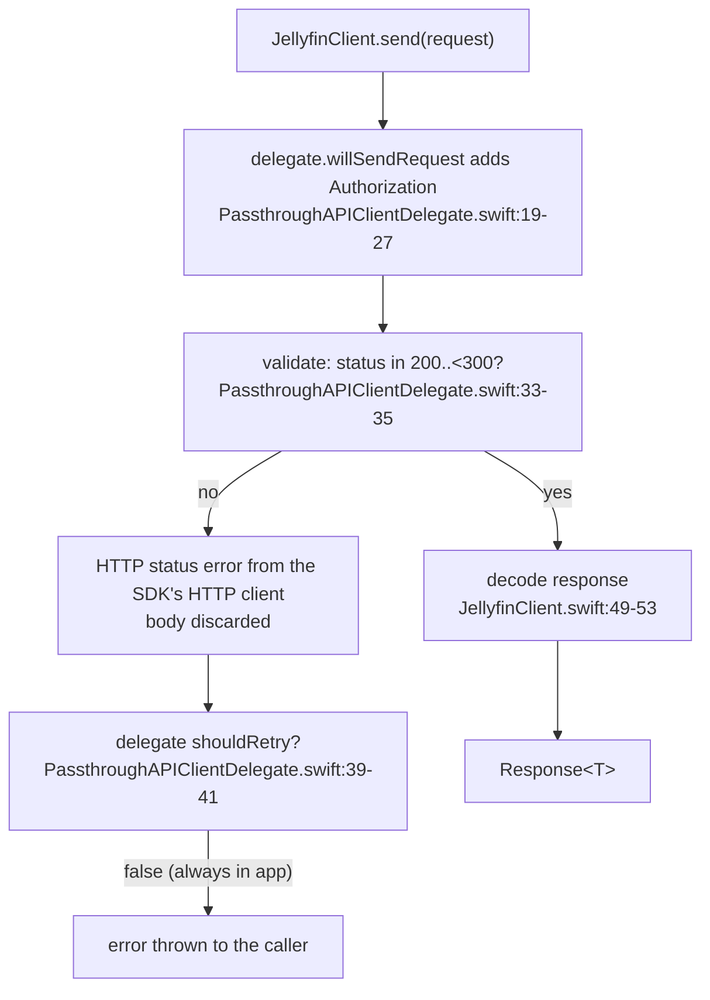
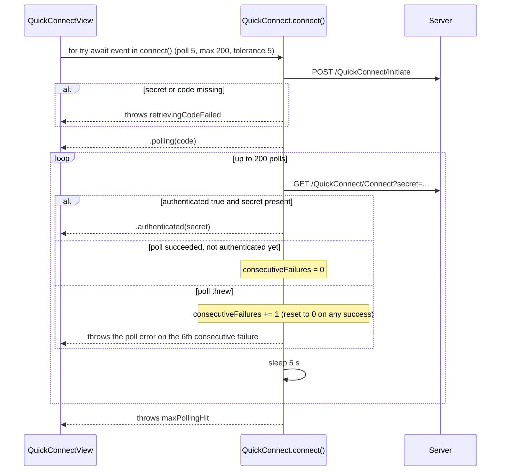
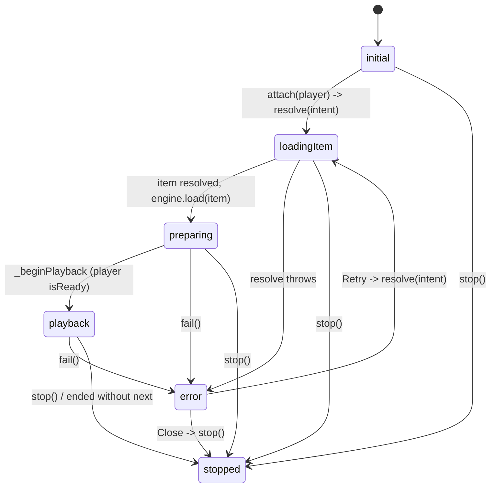
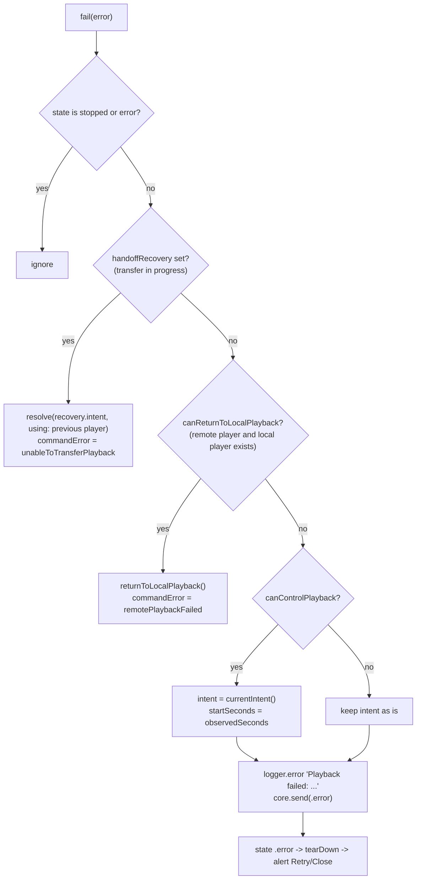

# 10 - Errors, Retries, Timeouts, Cancellation, Edge Cases

> **Jellyfin SDK source.** A citation `jellyfin-sdk-swift@3.3.0:PATH:LINE` points into [jellyfin/jellyfin-sdk-swift](https://github.com/jellyfin/jellyfin-sdk-swift) at tag `3.3.0` (commit `8ce10a167ad0b4145b2bc005acf8bebcfe6ebe46`). Open it as `https://github.com/jellyfin/jellyfin-sdk-swift/blob/8ce10a167ad0b4145b2bc005acf8bebcfe6ebe46/PATH#LLINE`; for a range `A-B`, use `#LA-LB`. There is no local copy of the SDK.

Scope: every error path, retry, timeout and cancellation in the Swiftfin client's Jellyfin API use and media playback. Companion files: [00-INDEX.md](00-INDEX.md), [01-endpoints.md](01-endpoints.md), [02-networking.md](02-networking.md), [03-auth-session.md](03-auth-session.md), [04-models.md](04-models.md), [05-playback.md](05-playback.md), [06-vlc.md](06-vlc.md) (player engines; the app has no VLC; this spec covers AVPlayer only), [07-reporting.md](07-reporting.md), [08-images-subtitles-audio.md](08-images-subtitles-audio.md), [09-state-cache-persistence.md](09-state-cache-persistence.md), [11-sequence-flows.md](11-sequence-flows.md), [12-gaps.md](12-gaps.md).

Citation format: app files are repo-relative (`Shared/...:LINE`); the Jellyfin SDK is `jellyfin-sdk-swift@3.3.0:Sources/...:LINE`. `Swiftfin tvOS/` has a space in the path. Every citation resolves to an existing file and line (checked mechanically); behavior rows were opened at source, and rows taken from explorers are called out as such where they were not re-opened.

How to read this file: section 1 is the vocabulary (error types and how they reach the screen). Sections 2-5 are the cross-cutting matrices (HTTP, timeouts, retries, cancellation). Sections 6-12 walk each subsystem. Section 13 lists every crash path. Section 14 is the silent-failure inventory. Section 15 lists explorer conflicts and how the source settled them. Inputs reviewed: every explorer JSON (errors arrays, plus the `endpoints[].retry/timeout/cancellation/status_codes_handled` fields), `endpoints-mechanical.json` (a verb/path/body/query table with no retry or timeout fields, so it adds nothing here) and `shards.json` (scope list). tvOS uses the shared player error UI: the load-failure alert sits outside any `#if os(...)` block in `Shared/Views/VideoPlayer/VideoPlayer.swift:83-95` (the only guards are at `:22-41` and `:53-57`); a grep for `unableToLoadThisItem` across `Shared`, `Views`, `Objects` and `Swiftfin tvOS` finds two hits: the generated L10n definition at `Shared/Strings/Strings.swift:1954` and the only use site, `Shared/Views/VideoPlayer/VideoPlayer.swift:94`; the only `.alert(` in `Swiftfin tvOS/` is the close-player confirmation at `Swiftfin tvOS/Views/VideoPlayer/PlaybackControls/PlaybackControls.swift:64` (see section 16 item 6). Section 16 lists unknowns. Section 17 is a rebuild checklist.

The headline facts, so nothing below surprises you:

1. The client has NO retry anywhere in the HTTP layer (`jellyfin-sdk-swift@3.3.0:Sources/PassthroughAPIClientDelegate.swift:39-41`).
2. The client NEVER branches on an HTTP status code for Jellyfin calls. The one exception is the trickplay downloader, which has its own `URLSession` (`Shared/Objects/MediaPlayerManager/PlaybackTemporaryFiles.swift:119-122`).
3. A 401 never signs the user out and never refreshes a token (section 6.6; the only status handling is the SDK delegate throwing an HTTP status error from the SDK's HTTP client, `jellyfin-sdk-swift@3.3.0:Sources/PassthroughAPIClientDelegate.swift:29-37`).
4. The playback failure alert never shows the underlying error text; it always says `Unable to load this item.` (`Shared/Views/VideoPlayer/VideoPlayer.swift:83-95`).
5. Playback reports (start, progress, stopped) are fire-and-forget with a warning log on failure (`Shared/Objects/MediaPlayerManager/MediaProgressReporter.swift:130-134`).

---

## 1. Error vocabulary and how errors reach the user

### 1.1 Error types in play

| Type | Defined at | `LocalizedError`? | What `localizedDescription` yields |
|---|---|---|---|
| `URLError` (and any other URLSession error) | Foundation | n/a | system text, e.g. "The request timed out." The legacy mapping to friendly strings is entirely commented out (`Shared/Errors/NetworkError.swift:12-14`) |
| `ErrorMessage` | `Shared/Errors/ErrorMessage.swift:15-26` | yes (`errorDescription` returns the stored message) | the string passed to `init`. Documented as "useful for debugging" (:11-14) |
| `JellyfinClient.ClientError.noAccessToken` | `jellyfin-sdk-swift@3.3.0:Sources/JellyfinClient.swift:172-174` | no | Foundation generic text |
| `QuickConnect.QuickConnectError` (`maxPollingHit`, `retrievingCodeFailed`) | `jellyfin-sdk-swift@3.3.0:Sources/QuickConnect.swift:35-38` | no | Foundation generic text |
| `JellyfinSocket.Session.SocketError` (`connectionTimeout`, `missingAccessToken`, `unauthorized(statusCode:)`, `reconnectAttemptsReached`) | `jellyfin-sdk-swift@3.3.0:Sources/JellyfinSocket/JellyfinSocket.swift:95-105` | no | never shown; logged at debug only (`Shared/Services/ServerSocketManager.swift:187`) |
| `UserSessionError` (`invalidStoredSession(userID:)`, `missingCurrentSession`) | `Shared/Services/UserSession/UserSessionError.swift:9-13` | no | Foundation generic text |
| `DeepLinkError` (`missingServer`, `missingUser`) | `Shared/Services/DeepLink.swift:47-50` | no | logged only |
| `AppStartupError.dataStack(Error)` | `Shared/Coordinators/Root/RootCoordinator.swift:16-19` | no | Foundation generic text on the startup ErrorView |
| `ItemStore.StoreError` (`invalidItemID`, `invalidSession`, `itemUnavailable`) | `Shared/Objects/ItemStore/ItemStore.swift:45-50` | no | Foundation generic text |

Consequence: of the types in the table, only `ErrorMessage` produces authored text. It is the only `LocalizedError` type in the table (`Shared/Errors/ErrorMessage.swift:15-26`), and a grep for `LocalizedError` across `Shared`, `Views`, `Objects`, `Components`, `Extensions`, `App` and `Swiftfin tvOS` finds only the `ErrorMessage` conformance and the `ErrorView` cast at `Shared/Components/ErrorView.swift:67`. Both surfaces render `error.localizedDescription` on an erased `Error` (`Shared/Extensions/ViewExtensions/ViewExtensions.swift:117`; `Shared/Components/ErrorView.swift:40`). `URLError` shows Foundation's own text (row above). Every other thrown error that reaches an alert or `ErrorView` shows whatever Foundation makes of a plain `Error`. The exact generic text is Foundation behavior, not in the repo (see section 16). No type in the app defines `recoverySuggestion` (grep finds only the reader at `Shared/Components/ErrorView.swift:68`), so `ErrorView`'s caption line (`Shared/Components/ErrorView.swift:67-75`) is dead for app-defined errors.

### 1.2 Presentation surfaces

| Surface | Mechanics | Strings | Cite |
|---|---|---|---|
| Modal error alert | `.errorMessage($binding)`: alert title `L10n.error`, message `error.localizedDescription`, one button `L10n.dismiss` (role cancel) that nils the binding; plays `UIDevice.feedback(.error)` when the binding becomes non-nil | `"Error"` / `"Dismiss"` | `Shared/Extensions/ViewExtensions/ViewExtensions.swift:103-124`; `Translations/en.lproj/Localizable.strings:1013`, `:893` |
| Full-screen `ErrorView` | red `xmark.circle` (or the error's `SystemImageable.systemImage`), headline `localizedDescription` (2 lines max), a `Retry` button ONLY when the SwiftUI `\.refresh` environment action is set, optional `recoverySuggestion` caption | `"Retry"` | `Shared/Components/ErrorView.swift:20-21`, `:25-31`, `:40-45`, `:47-65`; `Translations/en.lproj/Localizable.strings:2273` |
| Playback load-failure alert | `isPresented: .constant(mediaSession.state == .error)`, buttons Retry (`mediaSession.retry()`) and Close (`mediaSession.stop()` then `router.dismiss()`); the message is ALWAYS `L10n.unableToLoadThisItem` | `"Unable to load this item."` | `Shared/Views/VideoPlayer/VideoPlayer.swift:83-95`; `Translations/en.lproj/Localizable.strings:2804` |
| Playback toast | `mediaSession.commandError` non-nil triggers `toastProxy.present(message, systemName: "exclamationmark.triangle")` | see section 8.10 | `Shared/Views/VideoPlayer/VideoPlayer.swift:69-73` |
| Log only | `logger.error/warning/info/debug`; no UI | various | per row below |
| Silent | error discarded (`try?`, unobserved `Task`, no subscriber) | none | section 14 |

Notes:

- The alert bindings are `.constant(...)`, so the playback alert cannot be dismissed any way except its two buttons (`Shared/Views/VideoPlayer/VideoPlayer.swift:85`).
- The toast fires from `onChange(of: mediaSession.commandError, initial: true)` (`Shared/Views/VideoPlayer/VideoPlayer.swift:69`). SwiftUI `onChange` fires on value change, so an identical message set twice in a row without an intervening clear would not re-fire. `commandError` is cleared only on `resolve` and on `seek` (`Shared/Objects/MediaPlayerManager/MediaSession.swift:319`, `:616`). This is an inference from SwiftUI semantics; the repo has no test for it.
- Where `ErrorView`'s Retry can appear: the `\.refresh` environment is set by `.refreshable`. Files containing `.refreshable` include `Shared/Views/ItemView/ItemView.swift:154-156`, `Shared/Views/ContentGroupView.swift:75`, `:159`, `Shared/Views/EPGView/EPGView.swift:46`, `Shared/Objects/MediaPlayerManager/Supplements/EPGSupplement.swift:75`, `Shared/Views/VideoPlayer/Queue/QueueErrorView.swift:68`, `Views/ItemEditorView/ItemEditorView.swift:41`, and admin views such as `Views/AdminDashboardView/ServerUsers/ServerUsersView/ServerUsersView.swift:57`, `Views/AdminDashboardView/ServerDevices/DevicesView/DevicesView.swift:54` and `Views/AdminDashboardView/APIKeyView/APIKeysView.swift:68` (a grep for `.refreshable` under `Views/AdminDashboardView` finds 19 hits). `RootView` and `QuickConnectView` set none, so their ErrorViews have no Retry (`Shared/Coordinators/Root/RootView.swift:22-23`, `Shared/Views/QuickConnectView.swift:51-52`). `PagingLibraryView` uses a custom `.onRefresh` (`Shared/Objects/PagingLibrary/PagingLibraryView/PagingLibraryView.swift:133-135`); whether that sets `\.refresh` is not established (section 16).

### 1.3 Which screens use which surface

| Screen / state | Surface | Cite |
|---|---|---|
| Item detail `.error` | `ErrorView`; plus `.errorMessage` for delete and for favorite/played failures. The favorite/played buttons on the item screen are the only callers of the provider toggles (`PlayedActionButton.swift:27`, `FavoritedActionButton.swift:35` under `Shared/Views/ItemView/Components/ActionButtons/`); poster context menus use a different path (section 9) | `Shared/Views/ItemView/ItemView.swift:130-131`, `:179-180`; `Shared/Views/ItemContentGroupView/ItemContentGroupProvider.swift:298-314` |
| Library list `.error` | `ErrorView` AND the same `viewModel.error` drives `.errorMessage` alert | `Shared/Objects/PagingLibrary/PagingLibraryView/PagingLibraryView.swift:200-201`, `:242` |
| Search `.error` | `ErrorView` | `Shared/Views/SearchView.swift:79-80` |
| EPG `.error` | `ErrorView` | `Shared/Views/EPGView/EPGContentView.swift:33-36` |
| Content groups `.error` | `ErrorView` | `Shared/Views/ContentGroupView.swift:105-106` |
| App startup `.error` | `ErrorView(error: rootCoordinator.error ?? ErrorMessage(L10n.unknownError))` | `Shared/Coordinators/Root/RootView.swift:22-23` |
| Quick Connect sheet | `ErrorView(error:)` replacing the code | `Shared/Views/QuickConnectView.swift:51-52` |
| Connect to server, sign in, PIN, admin actions | `.errorMessage` alert | sections 6 and 11 |
| Queue panel in player | `QueueErrorView`: text `L10n.unknownError` ("Unknown error") plus Retry wired to `queue.refresh` | `Shared/Views/VideoPlayer/Queue/QueueErrorView.swift:43-72`, `Shared/Views/VideoPlayer/Queue/MediaQueueView.swift:71`; `Translations/en.lproj/Localizable.strings:2840` |

---

## 2. The HTTP error pipeline

Facts behind the diagram:

| Step | Behavior | Cite |
|---|---|---|
| Header injection | `Authorization` is added in `willSendRequest` (see [02-networking.md](02-networking.md) section 4 for the value) | `jellyfin-sdk-swift@3.3.0:Sources/PassthroughAPIClientDelegate.swift:19-27` |
| Status validation | with `actualDelegate == nil` (the app never passes a delegate), the only rule is `(200 ..< 300).contains(statusCode)`, else an HTTP status error from the SDK's HTTP client carrying the status code | `jellyfin-sdk-swift@3.3.0:Sources/PassthroughAPIClientDelegate.swift:29-37` |
| Body on failure | never parsed; no Jellyfin error message is extracted | same lines (validate receives `data` but ignores it) |
| Retry hook | the SDK delegate's `shouldRetry` returns `false` when no actual delegate exists | `jellyfin-sdk-swift@3.3.0:Sources/PassthroughAPIClientDelegate.swift:39-41` |
| Date decoding | `.formatted(OpenISO8601DateFormatter())`; one unparsable date fails the whole response decode | `jellyfin-sdk-swift@3.3.0:Sources/JellyfinClient.swift:49-53` |
| Missing token at sign-in | `ClientError.noAccessToken` when `AuthenticationResult.accessToken` is nil | `jellyfin-sdk-swift@3.3.0:Sources/JellyfinClient.swift:210-214` |
| Missing token for socket URL | `ClientError.noAccessToken` | `jellyfin-sdk-swift@3.3.0:Sources/JellyfinClient.swift:316-318` |

Behavior of the dead legacy mapping (reference only): the whole `NetworkError` enum and its URLError parsing sits in comments with the note "only kept as reference until more strongly-typed errors are implemented" (`Shared/Errors/NetworkError.swift:12-14`). A rebuild that wants friendlier text must add its own mapping; the original has none.

---

## 3. Timeout matrix

All `URLSessionConfiguration` timeouts set anywhere in the app: `Shared/Extensions/URLSessionConfiguration.swift:16`, `Shared/Services/ServerConnectionManager.swift:75-76`, `Shared/Objects/MediaPlayerManager/PlaybackTemporaryFiles.swift:30` (grep of `timeoutInterval` across app sources finds only these; the `ServerConnectionManager.swift:75-76` pair is 8 s request / 12 s resource). `timeoutIntervalForRequest` is Apple's inactivity timer between data arrivals, not a cap on total duration (Apple documentation, not in the repo; the same applies to the unstated Apple default used at section 6 and the WebSocket note).

| Operation | Timeout | Where set | Cite |
|---|---|---|---|
| Default API client (`.swiftfin`): user session client, server client, user-data client | request 20 s; resource default | `.default.mutating(\.timeoutIntervalForRequest, with: 20)` | `Shared/Extensions/URLSessionConfiguration.swift:15-17`; used at `Shared/Services/UserSession/UserSession.swift:41-45`, `Shared/SwiftfinStore/SwiftfinStore+ServerState.swift:29-35`, `Shared/SwiftfinStore/SwiftinStore+UserState.swift:125-129` |
| Connect-to-server probe from the Add Server screen | none set; SDK default `.default` (Apple default, not in repo) | no `sessionConfiguration` argument | `Shared/ViewModels/ConnectToServerViewModel.swift:75-78`; `jellyfin-sdk-swift@3.3.0:Sources/JellyfinClient.swift:35` |
| Server connection probe (`ServerConnectionManager.test`) | request 8 s, resource 12 s, `waitsForConnectivity = false` | copy of `.swiftfin` with overrides | `Shared/Services/ServerConnectionManager.swift:74-77` |
| Image loaders (`posters`, `local`) | request 20 s via `.swiftfin` | the image loader's data loader built with `.swiftfin` | `Shared/Extensions/Nuke/ImagePipeline.swift:67-93` |
| Trickplay and chapter thumbnail downloads | request 20 s on an ephemeral session with `urlCache = nil` | private session | `Shared/Objects/MediaPlayerManager/PlaybackTemporaryFiles.swift:28-32` |
| WebSocket handshake and socket session | `URLSession(configuration: .default)`; no explicit value | SDK | `jellyfin-sdk-swift@3.3.0:Sources/JellyfinSocket/JellyfinSocket.swift:498` |
| WebSocket keep-alive response | SDK default 5 s; app passes 10 s; 3 consecutive silent windows drop the link (about 30 s with the app value) | `connect(responseTimeout: .seconds(10))` | `Shared/Services/ServerSocketManager.swift:138`; `jellyfin-sdk-swift@3.3.0:Sources/JellyfinSocket/JellyfinSocket.swift:55`, `:616-644` |
| WebSocket keep-alive period | 20 s default, clamped to 1...45 s | SDK | `jellyfin-sdk-swift@3.3.0:Sources/JellyfinSocket/JellyfinSocket.swift:56`, `:192` |
| Seek (session level) | 8 s then forced completion with nil position | `Task.sleep(for: .seconds(8))` | `Shared/Objects/MediaPlayerManager/MediaSession.swift:645-656` |
| Seek dispatch debounce | 80 ms | | `Shared/Objects/MediaPlayerManager/MediaSession.swift:634` |
| Connection resolution debounce | 1.5 s after a network path change | | `Shared/Services/ServerConnectionManager.swift:192-203` |
| Quick Connect poll interval | 5 s, max 200 polls | | `jellyfin-sdk-swift@3.3.0:Sources/QuickConnect.swift:52-56` |
| UDP server discovery listen | 5 s default | | `jellyfin-sdk-swift@3.3.0:Sources/ServerDiscovery.swift:49` |
| Local discovery rescan | every 12 s while the Add Server screen is open | | `Shared/Views/ConnectToServerView/ConnectToServerView.swift:33` |
| Server info refresh staleness | 24 h | | `Shared/Services/UserSession/UserSessionManager.swift:243` |
| Playback progress report cadence | 5 s (`PokeIntervalTimer` default) | | `Shared/Objects/PokeIntervalTimer.swift:21`; `Shared/Objects/MediaPlayerManager/MediaProgressReporter.swift:26` |
| Live program refresh | first run 1 s minimum then 30 s minimum, or program end + 1 s | | `Shared/Objects/MediaPlayerManager/NowPlayable/NowPlayableObserver.swift:244-247` |
| Background pause wait for PiP | 5 polls x 300 ms | | `Shared/Objects/MediaPlayerManager/MediaPlaybackTransitions.swift:44-60` |
| PiP start attempts | 5 tries x 300 ms | | `Shared/Objects/MediaPlayerManager/MediaPlaybackTransitions.swift:73-92` |
| Library store-change refresh spacing | at least 5 s between automatic refreshes, 0.35 s floor | | `Shared/Objects/PagingLibrary/PagingLibraryViewModel.swift:285` |
| Library search debounce | 350 ms | | `Shared/Objects/PagingLibrary/PagingLibraryViewModel.swift:213` |
| Subtitle search debounce | 0.5 s | `debounce(for: 0.5)` on language and query | `Shared/ViewModels/ItemAdministration/ItemSubtitlesViewModel.swift:86-93` |
| Admin create-user event delay | fixed 5 s sleep after the response | | `Shared/ViewModels/AdminDashboard/Users/AddServerUserViewModel.swift:47` |

There is NO timeout the app sets on: PlaybackInfo, bitrate test (both ride the 20 s default client: PlaybackInfo is sent on `userSession.client` at `Shared/Objects/MediaPlayerManager/MediaPlayerItem/MediaPlayerItemResolver.swift:84-86`, the bitrate test through `userSession.send` at `:191`, which goes to `client.send` at `Shared/Services/UserSession/UserSession+Items.swift:16-19`, `:41-47`; that client is built with `.swiftfin` at `Shared/Services/UserSession/UserSession.swift:41-45`), AVPlayer item loading, or the `getFullItem` fetch. If the network stalls, those wait for the underlying engine or URLSession. Evidence is negative: grep of app sources for `timeoutInterval` and `network-timeout` finds only four lines, in three files: `Shared/Extensions/URLSessionConfiguration.swift:16`, `Shared/Services/ServerConnectionManager.swift:75` and `:76`, `Shared/Objects/MediaPlayerManager/PlaybackTemporaryFiles.swift:30`; the playback fetch is `let storedItem = try await userSession.getFullItem(initialItem)` with no timeout wrapper (`Shared/Objects/MediaPlayerManager/MediaPlayerItem/MediaPlayerItemResolver.swift:40`), and it rides the same `.swiftfin` client (`Shared/Services/UserSession/UserSession+Items.swift:41-48`; `Shared/Services/UserSession/UserSession.swift:41-45`).

---

## 4. Retry matrix

"Retry" here means any automatic or user-driven re-attempt. The list is exhaustive for the code read.

| Operation | Automatic retry | User-driven retry | Notes | Cite |
|---|---|---|---|---|
| Any `Paths.*` request | NONE | per screen | `shouldRetry` is false | `jellyfin-sdk-swift@3.3.0:Sources/PassthroughAPIClientDelegate.swift:39-41` |
| Playback item resolution (PlaybackInfo etc.) | none | alert Retry re-runs `resolve(intent)` with saved position | only valid in `.error` state | `Shared/Objects/MediaPlayerManager/MediaSession.swift:551-555` |
| Player engine failure | none; no automatic transcode fallback; Retry re-sends the SAME device profile and bitrate | alert Retry | `intent.configuration.startSeconds = observedSeconds` only when `canControlPlayback` was true at failure | `Shared/Objects/MediaPlayerManager/MediaSession.swift:458-461` |
| Playback progress reports | none (a failed report is dropped; the next tick sends a fresh one) | none | skipped while another progress report is pending | `Shared/Objects/MediaPlayerManager/MediaProgressReporter.swift:107-111`, `:130-134` |
| Playback Stopped report | none | none | still sent after `stop()` clears the pending progress marker | `Shared/Objects/MediaPlayerManager/MediaProgressReporter.swift:50-68` |
| WebSocket | unlimited reconnect with exponential backoff (section 7) | none | | `jellyfin-sdk-swift@3.3.0:Sources/JellyfinSocket/JellyfinSocket.swift:361-363` |
| Quick Connect poll | tolerates up to 5 consecutive failed polls | none | the 6th consecutive failure throws | `jellyfin-sdk-swift@3.3.0:Sources/QuickConnect.swift:119-133` |
| Quick Connect initiate | none | none (sheet shows ErrorView with no Retry) | | `jellyfin-sdk-swift@3.3.0:Sources/QuickConnect.swift:98-110` |
| Server connection probe | tries the next candidate connection in priority order; no retry of the same one | automatic on next network path change | candidates are `server.serverConnections` filtered by network context (`Shared/Services/ServerConnectionManager.swift:106`); stored connections come back sorted by `priority` (`Shared/SwiftfinStore/SwiftfinStore+ServerState.swift:130-139`; `Shared/Objects/ServerConnection.swift:95-103`) | `Shared/Services/ServerConnectionManager.swift:121-148` |
| Server/user info refresh | none; re-attempted on next foreground when stale (24 h) or on explicit sign-in | none | | `Shared/Services/UserSession/UserSessionManager.swift:235-257` |
| Trickplay/chapter image download | none inline; a failed entry is dropped from the cache so a LATER lookup retries it | none | preload stops at the first failure | `Shared/Objects/MediaPlayerManager/PlaybackTemporaryFiles.swift:48-52`, `:74-76`, `:88-91` |
| Poster images (image loader) | falls through to the next candidate image source | none | | `Shared/Components/ImageView.swift:39-45`, `Shared/Extensions/Nuke/ImagePipeline.swift:41-50` |
| Adjacent episodes (prev/next) | none | none (queue state mirrors the season library; its refresh is user-driven) | | `Shared/Objects/MediaPlayerManager/Supplements/EpisodeMediaPlayerQueue.swift:65-69` |
| Shuffle queue refill | none automatic after failure (auto-refill is suppressed while state is `.error`) | `QueueErrorView` Retry calls `queue.refresh` | | `Shared/Objects/MediaPlayerManager/Supplements/ShuffleMediaPlayerQueue.swift:117`, `:131-138` |
| Library paging | none | pull-to-refresh / ErrorView Retry where wired | duplicate/filtered-out pages keep fetching until something visible is added | `Shared/Objects/PagingLibrary/PagingLibraryViewModel.swift:344-379` |
| Local server discovery | rescan every 12 s | | | `Shared/Views/ConnectToServerView/ConnectToServerView.swift:33` |
| Live program metadata | loops; minimum delay 1 s on the first iteration and 30 s after; with a program end date the delay is max(end + 1 s, minimum), with no end date a flat 30 s (`Shared/Objects/MediaPlayerManager/NowPlayable/NowPlayableObserver.swift:245-246`) | | failure only logged at debug | `Shared/Objects/MediaPlayerManager/NowPlayable/NowPlayableObserver.swift:238-266` |
| Favorite/played write | none; optimistic value rolled back | user taps again | later writes for the same item are queued serially and are not blocked by an earlier failure | `Shared/Objects/ItemStore/ItemStore.swift:176-204` |

---

## 5. Cancellation matrix

The app's `catch is CancellationError` blocks match locally generated cancellations (the complete list of `CancellationError()` creation sites in app sources: `Shared/Objects/MediaPlayerManager/Supplements/ShuffleMediaPlayerQueue.swift:189`, `Shared/Components/WithLocalUserAuthentication.swift:56`, `:64`, `:126`, `Shared/Components/PinEntry.swift:69`, `:80`, `:84`, `:172`, `Objects/Chromecast/ChromecastMediaPlayer.swift:195`, `:242`, plus the SDK Quick Connect stream at `jellyfin-sdk-swift@3.3.0:Sources/QuickConnect.swift:128-129`; local PIN/device auth, Quick Connect stream, shuffle queue). Whether a cancelled request surfaces to users as `NSURLErrorCancelled` (-999) is open: `Shared/ViewModels/UserSignInViewModel.swift:23-24` carries a TODO "ignore NSURLErrorDomain Code=-999 cancelled error on sign in" and nothing in the app handles it.

| Operation | Cancelled by | Effect | Cite |
|---|---|---|---|
| PlaybackInfo POST | NOT cancelled by outer task: wrapped as `Task { try await client.send(request) }.value` | request completes; `Task.checkCancellation()` right after discards the result; live streams then closed | `Shared/Objects/MediaPlayerManager/MediaPlayerItem/MediaPlayerItemResolver.swift:86-92`, `:177-180` |
| Playback resolution as a whole | `core.cancelAll()`, `resolutionID` change, `resolutionTask = nil` on every new `resolve`; a superseded or stopped session returns without calling `fail` | stale results are discarded, and `MediaProgressReporter.discard(item)` closes any opened live stream | `Shared/Objects/MediaPlayerManager/MediaSession.swift:305-327`, `:381-429` |
| `/LiveStreams/Close` | never (unstructured `Task { }`) | `closeLiveStreams` and `discardUnstartedItem` spawn an unawaited `Task` (fire-and-forget); the superseded-item path awaits `MediaProgressReporter.discard`. Errors swallowed with `try?` in all three (the `try?` is at `Shared/Objects/MediaPlayerManager/MediaProgressReporter.swift:95`, reached from the `MediaSession.swift:411` and `:713` callers, and at `MediaPlayerItemResolver.swift:212`) | `Shared/Objects/MediaPlayerManager/MediaProgressReporter.swift:89-97`; `Shared/Objects/MediaPlayerManager/MediaPlayerItem/MediaPlayerItemResolver.swift:204-215`; `Shared/Objects/MediaPlayerManager/MediaSession.swift:707-714` |
| Seek | new seek, `cancelSeek()`, `resetPlayback()`, `tearDown()`; timeout task cancelled on completion | pending seek discarded | `Shared/Objects/MediaPlayerManager/MediaSession.swift:645-657`, `:664-681`, `:697-705` |
| Playback transfer to another player | superseded by a later resolve; the barrier `transferTask` still runs; a previous transfer failure is rethrown | `unableToStopRemotePlayback` toast | `Shared/Objects/MediaPlayerManager/MediaSession.swift:329-345`, `:388-397` |
| Quick Connect stream | stream termination cancels the task; `CancellationError` finishes the stream without error | no error shown | `jellyfin-sdk-swift@3.3.0:Sources/QuickConnect.swift:69-78`, `:128-129` |
| Connect-to-server | Cancel button sends `.cancel` (state back to `.initial`) | state returns to `.initial`; whether the running task is cancelled depends on the view-model state-machine runtime (section 16 item 2). The Cancel button shows only while `.connecting` (`Shared/Views/ConnectToServerView/ConnectToServerView.swift:62-65`); the close button and interactive dismiss are disabled while `.connecting` (`:134`, `:153`) | `Shared/ViewModels/ConnectToServerViewModel.swift:29-35`; `Shared/Views/ConnectToServerView/ConnectToServerView.swift:62-65`, `:134`, `:153` |
| Sign-in | `.cancel` action to `.initial` | state returns to `.initial`; task cancellation depends on the view-model state-machine runtime (section 16 item 2); -999 handling absent | `Shared/ViewModels/UserSignInViewModel.swift:61-72` |
| Connection resolution | each new network path update cancels the prior `evaluationTask`; loop checks `Task.isCancelled` before each candidate | | `Shared/Services/ServerConnectionManager.swift:196-203`, `:127` |
| Session switch/sign-out | `UserSession.willStop` stops services in reverse, `items.invalidate()` cancels every in-flight item mutation, finishes `itemActionErrors` | in-flight requests discard results on `validate()` | `Shared/Services/UserSession/UserSession.swift:87-97`; `Shared/Objects/ItemStore/ItemStore.swift:81-84`, `:250-260` |
| Library paging | `invalidateItems` bumps generations and calls `cancel()`; stale pages rejected by generation check | | `Shared/Objects/PagingLibrary/PagingLibraryViewModel.swift:257-271`, `:353-355` |
| Local user PIN prompt | view disappear or Task cancel resumes the continuation with `CancellationError`; `SelectUserView` swallows it | no alert | `Shared/Components/WithLocalUserAuthentication.swift:50-77`, `:125-127`; `Shared/Views/SelectUserView/SelectUserView.swift:153-154` |
| Favorite/played mutation | `withTaskCancellationHandler` cancels the mutation task | optimistic overlay removed in `defer` | `Shared/Objects/ItemStore/ItemStore.swift:191-199`, `:225-229` |
| Trickplay downloads | `remove()` cancels tasks, `invalidateAndCancel()`, deletes the temp folder; a download finishing after removal is discarded | later lookups return nil | `Shared/Objects/MediaPlayerManager/PlaybackTemporaryFiles.swift:118-122`, `:142-155` |
| Media segments request | released with the observer (`AnyCancellable` wraps `Task.cancel`) | | `Shared/Objects/MediaPlayerManager/MediaSegmentObserver.swift:44-61`; `Shared/Extensions/Task.swift:15-17` |
| Adjacent episodes | `currentAdjacentEpisodesTask = nil` on any item change; `guard !Task.isCancelled` before publish | | `Shared/Objects/MediaPlayerManager/Supplements/EpisodeMediaPlayerQueue.swift:56-69`, `:182` |
| WebSocket | `disconnect()`, task cancellation, `explicitlyDisconnected` | loop exits without reconnect | `jellyfin-sdk-swift@3.3.0:Sources/JellyfinSocket/JellyfinSocket.swift:429`, `:457` |

---

## 6. Connecting, signing in, and session lifecycle

### 6.1 Connect to server

Flow: `ConnectToServerViewModel.connect(url:)` (`.loop(.connecting)` transition, `Shared/ViewModels/ConnectToServerViewModel.swift:33`) -> format URL (`:56-73`) -> `GET /System/Info/Public` (`:80`) -> store via `save(server:)` (`:111`, `:134-143`). See [03-auth-session.md](03-auth-session.md) for the success path.

| Condition | Handling | User effect | Cite |
|---|---|---|---|
| Input does not parse as a URL | `ErrorMessage(L10n.invalidURL)` | alert "Invalid URL"; error haptic; URL field refocused | `Shared/ViewModels/ConnectToServerViewModel.swift:64-67`; `Shared/Views/ConnectToServerView/ConnectToServerView.swift:46-49`; `Translations/en.lproj/Localizable.strings:1298` |
| Parsed URL has no host | `ErrorMessage(L10n.invalidURL)` | same | `Shared/ViewModels/ConnectToServerViewModel.swift:71-73` |
| Input has no `://` | `http://` is prepended before parsing (string trimmed of whitespace, object-replacement characters and `/`) | none | `Shared/ViewModels/ConnectToServerViewModel.swift:59-62` |
| `GET /System/Info/Public` fails (transport or non-2xx) | error propagates | alert with the HTTP status error text or a URLError text | `Shared/ViewModels/ConnectToServerViewModel.swift:80` |
| Response lacks `ServerName` or `Id` | `logger.critical("Missing server data from network call")`; `ErrorMessage(L10n.unknownError)` | alert "Unknown error" | `Shared/ViewModels/ConnectToServerViewModel.swift:82-87` |
| Server id already stored | not an error: `.duplicateServer` event, nothing saved | sheet offers adding the URL as a new connection | `Shared/ViewModels/ConnectToServerViewModel.swift:102-109`; `Shared/Views/ConnectToServerView/ConnectToServerView.swift:42-45` |
| Redirect changed scheme or host | the final response URL, minus the `System/Info/Public` suffix, becomes the stored URL | transparent | `Shared/ViewModels/ConnectToServerViewModel.swift:116-132` |
| `save` makes a second `getPublicSystemInfo()` call; failure | error propagates; server not stored | alert | `Shared/ViewModels/ConnectToServerViewModel.swift:134-143` |
| `addConnection` cannot find the existing server | `logger.critical`; `ErrorMessage("An internal error has occurred")` | alert (English only) | `Shared/ViewModels/ConnectToServerViewModel.swift:146-151` |
| UDP discovery fails | `logger.error("Local server discovery failed: ...")` | UI shows no local servers | `Shared/ViewModels/ConnectToServerViewModel.swift:175-192` |
| Discovery: no usable interface / channel | `ServerDiscoveryError.noUsableNetworkInterface` / `.noUsableChannel` | same as above | `jellyfin-sdk-swift@3.3.0:Sources/ServerDiscovery.swift:15-18`, `:87`, `:97-99` |

Note: the connect call for a new server builds its `JellyfinClient` with no `sessionConfiguration` argument (`Shared/ViewModels/ConnectToServerViewModel.swift:75-78`), so the SDK default `sessionConfiguration: URLSessionConfiguration = .default` applies (`jellyfin-sdk-swift@3.3.0:Sources/JellyfinClient.swift:35`) instead of the `.swiftfin` 20 s config (section 3). Its timeout is therefore Apple's default (Apple behavior, not in the repo).

### 6.2 Add or edit a server connection (multi-URL)

| Condition | Handling | Cite |
|---|---|---|
| Name empty | `ErrorMessage(L10n.invalidName)`; save blocked | `Shared/Views/EditServerConnectionView.swift:137-140` |
| URL invalid or no host | `ErrorMessage(L10n.invalidURL)` | `Shared/Views/EditServerConnectionView.swift:359-362` |
| Wi-Fi interface chosen with SSID matching on and no SSID | `ErrorMessage(L10n.invalidWifiName)` | `Shared/Views/EditServerConnectionView.swift:364-371` |
| Duplicate connection | `ErrorMessage(L10n.connectionAlreadyExists)` | `Shared/Views/EditServerConnectionView.swift:144-146` |
| Test connection fails | red text of `error.localizedDescription`, fallback `L10n.connectionFailed` ("Connection Failed") when that text is blank | `Shared/ViewModels/ServerConnectionViewModel.swift:139-142` (stores `.failure(error.localizedDescription)`); `Shared/Views/EditServerConnectionView.swift:266-268`; `Translations/en.lproj/Localizable.strings:578` |
| Test reaches a DIFFERENT server | `ErrorMessage(L10n.connectionServerMismatch)` ("This connection does not point to the current server.") shown as the test failure text | `Shared/Services/ServerConnectionManager.swift:91-93`; `Translations/en.lproj/Localizable.strings:584` |
| Server version older than the client requires | footer `L10n.serverVersionWarning(<major.minor>)` ("Swiftfin requires Jellyfin version %@ or higher."), orange; advisory only; a missing stored `publicInfo.version` counts as incompatible | `Shared/Views/EditLocalServerView.swift:65-73`; `Shared/SwiftfinStore/SwiftfinStore+ServerState.swift:120-128`; `Translations/en.lproj/Localizable.strings:2411` |

### 6.3 Sign in (password and Quick Connect)

| Condition | Handling | User effect | Cite |
|---|---|---|---|
| Non-2xx from `POST /Users/AuthenticateByName` (wrong credentials, disabled user, etc.) | HTTP status error from the SDK's HTTP client | alert "Response status code was unacceptable: <code>." The app never maps 401 to a friendlier message and the response body is discarded (the SDK delegate throws on the status code alone, `jellyfin-sdk-swift@3.3.0:Sources/PassthroughAPIClientDelegate.swift:29-37`, called from `Shared/ViewModels/UserSignInViewModel.swift:117-131`), so the client cannot tell bad credentials from a disabled or locked-out user, and a rebuild that wants distinct messages must read the response body itself; which code the server returns for bad credentials is server behavior, not shown in the repo | `Shared/ViewModels/UserSignInViewModel.swift:130`; `Shared/Views/UserSignInView.swift:379` |
| Response has no `AccessToken` | `JellyfinClient.ClientError.noAccessToken` | alert (Foundation generic text) | `jellyfin-sdk-swift@3.3.0:Sources/JellyfinClient.swift:210-214` |
| Response lacks `User`, `User.Id` or `User.Name` (password) | `logger.critical("Missing user data from network call")`; `ErrorMessage(L10n.unknownError)` | alert "Unknown error" | `Shared/ViewModels/UserSignInViewModel.swift:132-139` |
| Same on Quick Connect secret exchange | `logger.error(...)` (note: `error`, not `critical`); same message | alert | `Shared/ViewModels/UserSignInViewModel.swift:158-167` |
| Username/password | both trimmed of whitespace and object-replacement characters before sending | none | `Shared/ViewModels/UserSignInViewModel.swift:122-128` |
| User already stored | `.existingUser` event, not an error: alert `L10n.duplicateUser` offering Sign In (keep token) / Replace (use new token) / Dismiss | alert | `Shared/ViewModels/UserSignInViewModel.swift:141-143`; `Shared/Views/UserSignInView.swift:75-78`, `:336-378`; `Translations/en.lproj/Localizable.strings:920` |
| `getPublicData` (public users, branding disclaimer, Quick Connect enabled) | three `async let` fetches awaited in order; the FIRST throw aborts the action and any later assignments are skipped | alert; Quick Connect flag decode failure yields `false` via `try?` | `Shared/ViewModels/UserSignInViewModel.swift:106-115`, `:288-294` |
| PIN mismatch on re-saving an existing user | `ErrorMessage(L10n.incorrectPinForUser(username))` ("Incorrect pin for %@") | alert | `Shared/ViewModels/UserSignInViewModel.swift:259-263`; `Translations/en.lproj/Localizable.strings:1238` |
| `userSessionManager.signIn(userID:)` throws after save | `viewModel.error(error)` | alert | `Shared/Views/UserSignInView.swift:85-87` |

### 6.4 Quick Connect

Sequence edges are drawn from the cited rows below: poll loop `jellyfin-sdk-swift@3.3.0:Sources/QuickConnect.swift:121-138`, failure tolerance `:131-133`, initiate and its `retrievingCodeFailed` check `:98-110`, and the authenticated test (`isAuthenticated == true` and a non-nil `secret`, else `nil` and the loop continues) `:141-148`.

| Condition | Handling | Cite |
|---|---|---|
| Initiate fails or response lacks `Secret`/`Code` | stream throws; the view stores `error` and shows `ErrorView` | `jellyfin-sdk-swift@3.3.0:Sources/QuickConnect.swift:98-110`; `Shared/Views/QuickConnectView.swift:72-74`, `:51-52` |
| One to five consecutive poll failures | swallowed; sleep 5 s; next poll | `jellyfin-sdk-swift@3.3.0:Sources/QuickConnect.swift:130-135` |
| Sixth consecutive failure | the poll's error is thrown (`consecutiveFailures <= failureTolerance` is the test, tolerance 5) | `jellyfin-sdk-swift@3.3.0:Sources/QuickConnect.swift:131-133` |
| 200 polls elapsed | `QuickConnectError.maxPollingHit`. First poll is immediate, then a 5 s sleep after each, and the sleep also runs after the 200th poll before `maxPollingHit` is thrown after the loop, so 200 x 5 s = 1000 s (about 16.7 min) | `jellyfin-sdk-swift@3.3.0:Sources/QuickConnect.swift:121-138` |
| Authenticated | the app calls `router.dismiss()` then `action(secret)` (which runs sign-in) | `Shared/Views/QuickConnectView.swift:67-69` |
| Cancellation | `CancellationError` rethrown and the stream finishes WITHOUT error | `jellyfin-sdk-swift@3.3.0:Sources/QuickConnect.swift:69-71`, `:128-129` |

Authorize side (a second device approving a code): `POST /QuickConnect/Authorize`; a non-2xx throws; a body that is not `true` (or does not decode as `Bool`) throws `ErrorMessage("Authorization unsuccessful")`, a hard-coded English string; success sends `.authorized`. Missing `user.id` throws `ErrorMessage(L10n.unknownError)` after `logger.critical("User ID is nil")` (`Shared/ViewModels/QuickConnectAuthorizeViewModel.swift:47-66`). The view shows the error haptic and alert and refocuses the code field (`Views/QuickConnectAuthorizeView.swift:128-130`, `:147-149`).

### 6.5 Local device and PIN authentication

| Condition | Handling | User effect | Cite |
|---|---|---|---|
| Policy `.none` | returns `Empty()` | none | `Shared/Components/WithLocalUserAuthentication.swift:94-95` |
| PIN length outside 4...30 | `ErrorMessage(L10n.invalidPin)` ("Invalid PIN") | alert | `Shared/Components/WithLocalUserAuthentication.swift:101-105`; `Translations/en.lproj/Localizable.strings:1295` |
| Device authentication on iOS | `LAContext.canEvaluatePolicy` / `evaluatePolicy(.deviceOwnerAuthentication)`; `LAError` propagates | alert | `Shared/Components/WithLocalUserAuthentication.swift:79-83` |
| Device authentication on tvOS | always throws `ErrorMessage(L10n.deviceAuthFailed)` ("Device authentication failed") | alert | `Shared/Components/WithLocalUserAuthentication.swift:84-86`; `Translations/en.lproj/Localizable.strings:839` |
| Stored PIN differs from entered PIN | `ErrorMessage(L10n.incorrectPinForUser(username))`, compared only when `accessPolicy == .requirePin` AND a keychain PIN exists | alert | `Shared/ViewModels/SelectUserViewModel.swift:85-91` |
| Auth prompt cancelled (user dismisses, view disappears) | `CancellationError`, ignored | none | `Shared/Views/SelectUserView/SelectUserView.swift:153-154`; `Shared/Components/WithLocalUserAuthentication.swift:125-127` |
| Second PIN prompt while one is open | the second is resumed with `CancellationError` | none | `Shared/Components/WithLocalUserAuthentication.swift:55-58` |
| Keychain PIN missing | `assertionFailure("pin missing in keychain")` (crash in debug) then returns `""` | release: empty PIN | `Shared/SwiftfinStore/SwiftinStore+UserState.swift:53-60` |

### 6.6 401, expired tokens, and sign-out

There is NO 401 handling. Evidence: the only status-code inspection in app sources is the trickplay downloader (`Shared/Objects/MediaPlayerManager/PlaybackTemporaryFiles.swift:119-122`); the app never references the HTTP client's status error type; no `Paths.logout` call exists (case-insensitive grep for `logout` across `Shared`, `Views`, `Objects`, `Components`, `Extensions`, `Swiftfin tvOS` finds nothing; the SDK delegate only throws an HTTP status error on non-2xx, `jellyfin-sdk-swift@3.3.0:Sources/PassthroughAPIClientDelegate.swift:29-37`). Inference, not shown in the repo: a server that rejects a revoked token with HTTP 401 would surface through the SDK check above as `"Response status code was unacceptable: 401."` on each data load, and nothing in the app prompts re-authentication, so the user would have to switch user manually. The restore path loads the stored user and server with no token validation (`Shared/Services/UserSession/UserSessionManager.swift:320-333`). `start()` does not call the server-info refresh (`:84-101`); the refresh runs only from `signIn(userID:)` (`:108-110`) and `appWillEnterForeground` (`:185-187`), and its failure is merely logged (`:246-256`). At launch, `applyCurrentSession` calls `newSession.willStart()` (`:306`), which starts the session services: `ServerConnectionManager.willStart` runs `resolveActiveConnection` (`Shared/Services/ServerConnectionManager.swift:255-258`), which probes candidates only when auto-switch is on (`:205-218`, `:246-250`), and the socket connect POSTs capabilities and opens the WebSocket (`jellyfin-sdk-swift@3.3.0:Sources/JellyfinSocket/JellyfinSocket.swift:496-507`). None of these calls reacts to a 401 beyond what is listed here. The WebSocket sets `wasRefused = true` on a `.unauthorized` socket error and nothing else reacts in the code read (`Shared/Services/ServerSocketManager.swift:180-185`). Rebuild requirement: on 401 from any authenticated call, clear the session and route to sign-in with a message; Swiftfin does not.

Sign-out happens only in these places. Evidence: a grep for `signOut(reason` across `Shared`, `Views`, `Objects`, `Components`, `Extensions`, `App` and `Swiftfin tvOS` finds exactly three calls: `Shared/Views/SettingsView/SettingsView.swift:86`, `Views/AdminDashboardView/ServerBackup/ServerBackupDetailsView/ServerBackupDetailsView.swift:102` and `Shared/Services/UserSession/UserSessionManager.swift:194`. The last two rows below reset `lastSignedInUserID` without calling `signOut`.

| Trigger | Mechanism | Cite |
|---|---|---|
| Settings "Switch User" button | `signOut(reason: .explicit)` then `router.dismiss()` | `Shared/Views/SettingsView/SettingsView.swift:82-90` |
| After a server backup restore, on the OK button | `signOut(reason: .explicit)` | `Views/AdminDashboardView/ServerBackup/ServerBackupDetailsView/ServerBackupDetailsView.swift:96-107` |
| Returning to foreground when `signOutOnBackground` is set, no active playback, and the time in background exceeds `backgroundSignOutInterval` | `signOut(reason: .backgroundTimeout)`; timestamp written on background | `Shared/Services/UserSession/UserSessionManager.swift:176-196` |
| Launch with `signOutOnClose` | `lastSignedInUserID` reset to `.signedOut` before restore | `Shared/Services/UserSession/UserSessionManager.swift:87-90` |
| Stored session cannot be restored | see below | `Shared/Services/UserSession/UserSessionManager.swift:93-100`, `:320-327` |

`signOut` sets `lastSignedInUserID = .signedOut` and swaps the session to nil; it does not call the server, so the token stays valid server-side (`Shared/Services/UserSession/UserSessionManager.swift:113-124`). It returns immediately if there is neither a session nor a pending transition (:115).

Restore errors:

| Condition | Handling | User effect | Cite |
|---|---|---|---|
| `lastSignedInUserID` is `.signedIn(id)` but the user or its server is missing from the store | `lastSignedInUserID` reset to `.signedOut`; `UserSessionError.invalidStoredSession(userID:)` thrown | `start()` logs `"Unable to restore launch session"` at error and applies a nil session, landing on user selection with no message | `Shared/Services/UserSession/UserSessionManager.swift:320-327`, `:93-100` |
| `signIn(userID:)` same failure | thrown to the caller (alert in the view) | alert | `Shared/Services/UserSession/UserSessionManager.swift:103-106` |
| Deep link: unknown server or user | `DeepLinkError.missingServer/missingUser`; logged `"Failed to process deep link"` | none | `Shared/Services/UserSession/UserSessionManager.swift:204-213`, `:143-164` |
| Deep link for another user and PIN wrong or auth cancelled | thrown inside `handleOpenURL`; caught and logged; `pendingDeepLink` not set | none | `Shared/Services/UserSession/UserSessionManager.swift:215-233`, `:149-164` |
| Open URL without a local-auth action in the environment | guard returns, URL ignored | none | `Shared/Coordinators/Root/UserSessionRootView.swift:44` |
| Server/user info refresh fails | logged `"Unable to refresh server and user information"` at error; `lastServerInformationRefreshDate` NOT updated; session unaffected | none | `Shared/Services/UserSession/UserSessionManager.swift:246-256` |
| Keychain token missing | `assertionFailure("access token missing in keychain")` (crash in debug) then returns `""`; requests send `Token=` empty and the server decides | likely 401 text | `Shared/SwiftfinStore/SwiftinStore+UserState.swift:30-37` |

Sessions switch serially: `updateCurrentSession` makes each transition await the previous one; `applyCurrentSession` stops active playback first, then `willStop` on the old session and `willStart` on the new (`Shared/Services/UserSession/UserSessionManager.swift:281-318`).

Gap, expired or revoked token (non-blocking): the passwordless "Switch user" restore uses the stored token with no validation (`Shared/Services/UserSession/UserSessionManager.swift:84-101`, `:320-333`), the server refresh failure is only logged (`:246-256`), and the socket records `wasRefused` on `.unauthorized` (`Shared/Services/ServerSocketManager.swift:180-185`). No recovery flow exists in the app; a rebuild must define one (see the rebuild requirement above).

### 6.7 Connection auto-switch and probes

Gated by the experimental `serverConnectionAutoSwitch` setting AND the server's `isAutoSwitchEnabled` (`Shared/Services/ServerConnectionManager.swift:246-250`).

| Condition | Handling | User effect | Cite |
|---|---|---|---|
| Network not satisfied, or no candidate matches the network context | `.unreachable([])` | state only | `Shared/Services/ServerConnectionManager.swift:104-107` |
| Candidate probe fails (transport, non-2xx, or id mismatch) | logged at info (`"Server connection probe failed"` with url and error); next candidate tried | none | `Shared/Services/ServerConnectionManager.swift:136-144` |
| All candidates fail | `.unreachable(candidates)` | none (no error UI) | `Shared/Services/ServerConnectionManager.swift:108-112` |
| A probe succeeds on a different connection | `server.activeServerConnection` updated; `.didChangeServerConnection` posted; `ViewModel` resets `userSession` and the socket reconnects | transparent | `Shared/Services/ServerConnectionManager.swift:114-118`, `:221-225`; `Shared/ViewModels/ViewModel.swift:27-34`; `Shared/Services/ServerSocketManager.swift:213-218` |
| Probe request | uses the stored `accessToken` if one is supplied; 8 s/12 s | | `Shared/Services/ServerConnectionManager.swift:69-96` |

---

### 6.8 State-machine error mapping (view-model state machines)

What the repo shows. `ConnectToServerViewModel` declares actions `addConnection`, `cancel`, `connect(url:)`, `searchForServers`; `cancel` transitions `.to(.initial)`, `connect` is `.loop(.connecting)`, the others `.none`; states are `connecting`, `initial`; events `connected`, `duplicateServer`, `error` (`Shared/ViewModels/ConnectToServerViewModel.swift:19-47`). The `connect` body is a state-machine action function that `throws` (`:56-57`). `MediaSession` declares `cancel` (`.to(.stopped)`), `error` (`.none`), `_resolve` (`.to(.loadingItem, then: .preparing).invalid(.stopped).onRepeat(.cancel)`) and `_beginPlayback` (`.to(.playback).required(.preparing)`) (`Shared/Objects/MediaPlayerManager/MediaSession.swift:23-45`; action function bindings at `:381`, `:580`). `MediaSession.stop()` calls `cancel()`, which per the source comment "commits synchronously and invalidates late completions" (`:430-436`), and entering `.error` or `.stopped` runs `tearDown()` (`:211-219`). The view-model state-machine annotations come from an external package re-exported at `Shared/Objects/Utilities.swift:12`.

Not established: that package's source is not among the pinned dependency sources, so how a thrown error maps to the `.error` state or to the view model's `error` property, and whether concurrent actions run serially, is inferred only from call sites (views bind `viewModel.error`; section 11). Consequence: what happens to a `connect` cancelled mid-flight is specified only by the `.to(.initial)` transition and the comment above, not by app code. A rebuild must define: error from an action leads to an error state or published error; cancel invalidates late results; a repeated `_resolve` cancels the previous one (`.onRepeat(.cancel)`).

## 7. WebSocket and remote commands

Handshake, parameters and the state diagram are in [02-networking.md](02-networking.md) section 10; this section records only failure handling.

| Condition | Handling | User effect | Cite |
|---|---|---|---|
| No access token | `SocketError.missingAccessToken` (fatal); stream finishes throwing | none | `jellyfin-sdk-swift@3.3.0:Sources/JellyfinSocket/JellyfinSocket.swift:487-491`, `:439-455` |
| 401 or 403 on handshake | read off `webSocketTask.response` after any handshake failure; `SocketError.unauthorized(statusCode:)` (fatal); the post-close capabilities POST is skipped | none; app sets `wasRefused`, logs at debug, waits for a wake signal | `jellyfin-sdk-swift@3.3.0:Sources/JellyfinSocket/JellyfinSocket.swift:546-553`, `:515-519`; `Shared/Services/ServerSocketManager.swift:181-185`, `:206-208` |
| Transport error or 3 silent keep-alive windows | `connectionTimeout` or transport error; SDK backs off and reconnects without limit (`reconnectAttempts: nil`) | `isConnected` false; features relying on live data stop silently | `jellyfin-sdk-swift@3.3.0:Sources/JellyfinSocket/JellyfinSocket.swift:476-481`, `:639-641`; `Shared/Services/ServerSocketManager.swift:197` |
| Backoff schedule | `base * (1 << min(max(unhealthyCycles - 1, 0), 4))` with base 2 s: 2, 4, 8, 16, 32, 32, 32 ... s | | `jellyfin-sdk-swift@3.3.0:Sources/JellyfinSocket/JellyfinSocket.swift:361-363` |
| Connection lasted at least `healthyUptime` (30 s) | counters reset | | `jellyfin-sdk-swift@3.3.0:Sources/JellyfinSocket/JellyfinSocket.swift:459-463` |
| Connection lasted less than 30 s but delivered a frame | `unhealthyCycles += 1`, `failedConnections = 0` (backoff grows without spending the attempt budget) | | `jellyfin-sdk-swift@3.3.0:Sources/JellyfinSocket/JellyfinSocket.swift:465-469` |
| Never delivered a frame | both counters incremented | | `jellyfin-sdk-swift@3.3.0:Sources/JellyfinSocket/JellyfinSocket.swift:471-473` |
| Frame not decodable as `OutboundWebSocketMessage` | silently skipped (`try?`) | none | `jellyfin-sdk-swift@3.3.0:Sources/JellyfinSocket/JellyfinSocket.swift:590-591` |
| Capabilities POST fails | ignored: `try?` before connect, detached unobserved `try` after close | none | `jellyfin-sdk-swift@3.3.0:Sources/JellyfinSocket/JellyfinSocket.swift:495-496`, `:515-519` |
| App loop after the SDK stream ends (not refused, claims exist) | sleeps 2 s and creates a new SDK session | | `Shared/Services/ServerSocketManager.swift:203-205` |
| Stream ended, no claims, or an explicit reconnect | waits on the wake stream until a new subscription, `reconnect()`, or a server-connection change | | `Shared/Services/ServerSocketManager.swift:200-209`, `:75-79` |
| Event buffer overflow | bounded `bufferingNewest(512)`; "two `connected` in a row means events were dropped" | | `jellyfin-sdk-swift@3.3.0:Sources/JellyfinSocket/JellyfinSocket.swift:124-126`, `:194-196` |
| SDK clamps | `reconnectDelay >= 100 ms`, `responseTimeout >= 1 ms`, `healthyUptime >= 1 s`, `keepAliveInterval` in 1...45 s | | `jellyfin-sdk-swift@3.3.0:Sources/JellyfinSocket/JellyfinSocket.swift:189-192` |

Server-initiated commands (`Shared/Services/UserSession/UserSessionManager+SocketCommands.swift`):

| Condition | Handling | Cite |
|---|---|---|
| No current session or no current media session | command ignored | `:57`, `:89`, `:132` |
| `Play` fetch (`getFullItem`) fails | `logger.error("Unable to play item from socket command")` | `:223-228` |
| `PlayTrailers` fetch fails | `logger.error("Unable to play trailers from socket command")` | `:260-265` |
| `PlayMediaSource` with a `MediaSourceId` that matches nothing | `first { $0.id == mediaSourceID }` yields nil, so `selectMediaSource(id: nil)` runs (default source) with no error | `:198-203` |
| Session changed while the item was being fetched | `guard currentSession === userSession` returns silently | `:215-216` |
| Missing or non-integer `Index`, `Bitrate`, `ItemId` argument | `guard` returns, no log | `:136`, `:141`, `:146`, `:151`, `:156`, `:165` |
| Unimplemented commands (instant mix, shuffle, display message, repeat/shuffle queue, volume, navigation) | return | `:77-83`, `:169-183` |
| `Seek` without `SeekPositionTicks` | return | `:114-115` |

---

## 8. Playback

Read [05-playback.md](05-playback.md) and [06-vlc.md](06-vlc.md) first for the success path. Engine covered here: AVPlayer (`Shared/Objects/MediaPlayerManager/Players/AVMediaPlayer.swift`).

### 8.1 Session state machine

Transitions drawn from `MediaSession`: initial to loading item via `attach(player:)` which calls `resolve(intent)` (`Shared/Objects/MediaPlayerManager/MediaSession.swift:231-243`); see the section 8.3 cites for failure edges.

States: `initial, loadingItem, preparing, playback, error, stopped` (`Shared/Objects/MediaPlayerManager/MediaSession.swift:47-55`). `tearDown()` runs on entering `.error` or `.stopped` (`:213-219`). On `.error` the player object is kept (so Retry can reuse it); on `.stopped` the player and local player are released (`:488-492`). `hasActivePlayback` is false in `.error` and `.stopped`, which is what lets background sign-out proceed (`:144-146`). `UserSessionManager.hasActivePlayback` forwards to `mediaPlayerManager.hasActivePlayback` (`Shared/Services/UserSession/UserSessionManager.swift:75-76`) and the foreground sign-out guard reads it (`:189`).

Retry is valid only in `.error` (`:551-555`). `_resolve` is declared `.invalid(.stopped).onRepeat(.cancel)` so resolving a stopped session is rejected (`:39-40`).

### 8.2 `fail(_:)` decision tree

Cite: `Shared/Objects/MediaPlayerManager/MediaSession.swift:444-465`. Entry points:

| Entry | Guard | Cite |
|---|---|---|
| Resolve threw (item resolver, queue resolve, PlaybackInfo) | only if `resolutionID == id`, task not cancelled, state not stopped | `Shared/Objects/MediaPlayerManager/MediaSession.swift:424-428` |
| Engine reports failure via `playerDidFail` | only if the reporting player is the current player AND `playbackItem != nil` | `Shared/Objects/MediaPlayerManager/MediaSession.swift:438-442` |
| Auto-advance `queue.next()` threw | only if not cancelled, `resolutionID` unchanged, state not stopped | `Shared/Objects/MediaPlayerManager/MediaSession.swift:521-525` |

What the user sees on a final failure: the alert in section 1.2, the Stopped report for the failed stream is still sent (`stop()` on the reporter during `tearDown`, `Shared/Objects/MediaPlayerManager/MediaSession.swift:477`, `Shared/Objects/MediaPlayerManager/MediaProgressReporter.swift:50-68`) only if playback had started, and the underlying error text is only in the log (`:463`).

### 8.3 Item resolution errors

`MediaPlayerItemResolver.resolve` (`Shared/Objects/MediaPlayerManager/MediaPlayerItem/MediaPlayerItemResolver.swift:17-181`). Each `throw` below reaches `performResolve`'s `catch`, which runs `guard resolutionID == id, !Task.isCancelled, state != .stopped else { return }` before `fail(error)` (`Shared/Objects/MediaPlayerManager/MediaSession.swift:424-428`). So a throw lands in `MediaSession.fail` only when the resolution is still current, not cancelled, and the session is not stopped; cancellation throws (rows 1 and 11) and throws from a superseded resolution return silently.

| # | Condition | Error | Cite |
|---|---|---|---|
| 1 | Task already cancelled at entry | `CancellationError` (not a failure; `performResolve` ignores it) | `:22` |
| 2 | Entry's item record is gone | `ItemStore.StoreError.itemUnavailable` | `:23`, `:41` |
| 3 | Live TV program with no resolvable channel | `ErrorMessage(L10n.unknownError)` | `:25-28` |
| 4 | Item has no `id` | `logger.critical("No item ID!")`; `ErrorMessage(L10n.unknownError)` | `:35-38` |
| 5 | `getFullItem` fails (blank id, unavailable, network) | `StoreError.invalidItemID` / `.itemUnavailable` / transport or HTTP status error | `Shared/Services/UserSession/UserSession+Items.swift:27-39` |
| 6 | Configuration cannot select a media source in the item | `ErrorMessage("Unable to find media source for item")` | `:44-46` |
| 7 | `GET /Playback/BitrateTest` fails (only when requested bitrate is `.auto`) | error propagates; no fallback bitrate | `:49`, `:183-201` |
| 8 | HLS-required profile (Chromecast) and item is not video | `ErrorMessage(L10n.remotePlaybackUnavailable)` | `:59-61` |
| 9 | Item store invalidated, or session ended, before the PlaybackInfo request | `StoreError.invalidSession` | `:83`, `Shared/Objects/ItemStore/ItemStore.swift:81-84` |
| 10 | `POST /Items/{id}/PlaybackInfo` fails | error propagates; nothing was opened server side so no live-stream close | `:86` |
| 11 | Cancelled or store invalid or item deleted after the response | `CancellationError` / `StoreError`; live streams in the response ARE closed | `:88-92`, `:177-180` |
| 12 | Response has no `MediaSources`, or none usable | `ErrorMessage("Unable to find media source for item")` | `:94-126` |
| 13 | Response has no `PlaySessionId` | `ErrorMessage("No associated play session ID")` | `:130-132` |
| 14 | Stream URL cannot be built | `ErrorMessage("Unable to make transcoding URL")`, `"Unable to make video stream URL"`, `"Unable to make audio stream URL"`, `"Unsupported playback media type"`, or `"No item ID while building online media player item!"` | `:225-226`, `:232-234`, `:256-258`, `:274-276`, `:281` |
| 15 | HLS profile and the source has no `TranscodingUrl`, the path is not `.m3u8`, or the URL is not http(s) with a host | `ErrorMessage(L10n.remotePlaybackUnavailable)` | `:142-146`; `Shared/Objects/MediaPlayerManager/RemotePlaybackURL.swift:15-17` |

The PlaybackInfo response's own `ErrorCode` field is never read (conflict 8 in section 15; grep for `errorCode` across app sources finds no hits); an unplayable verdict from the server only surfaces through the media-source and `PlaySessionId` checks above. `SupportsDirectPlay` and `SupportsDirectStream` are not read either (a case-insensitive grep for `supportsDirectPlay` and `supportsDirectStream` across `Shared`, `Views`, `Objects`, `Components`, `Extensions`, `App` and `Swiftfin tvOS` finds no hits). `transcodeReasons` is read, but only from the session's `TranscodingInfo` for display, not from the PlaybackInfo response (`Shared/Objects/MediaPlayerManager/Supplements/PlaybackInfoSupplement.swift:206`; `Views/AdminDashboardView/ActiveSessions/ActiveSessionDetailsView/ActiveSessionDetailsView.swift:183`).

Edge case: server answers PlaybackInfo with `ErrorCode` (for example `NoCompatibleStream`) and `MediaSources` empty or absent. The client ignores `ErrorCode`, finds no source and throws `ErrorMessage("Unable to find media source for item")` (`Shared/Objects/MediaPlayerManager/MediaPlayerItem/MediaPlayerItemResolver.swift:124-126`; the `mediaSource` closure starts at `:94`). The playback alert still shows only `Unable to load this item.` (headline 4). If `MediaSources` is non-empty, the source chosen is the match by `eTag`, then by `id`, then by `openToken` containing the id, else the FIRST source with a warning log `Unable to find matching media source, defaulting to first media source`, even when the server flagged the stream as unplayable (`:94-126`). A rebuild should read `ErrorCode` before this fallback if it wants a specific message.

Non-fatal degradations during resolution:

| Condition | Handling | Cite |
|---|---|---|
| No source matches by `ETag`, then `Id`, then `OpenToken` contains `Id` | `logger.warning("Unable to find matching media source, defaulting to first media source")`; plays the first source, which may be a different version than the one chosen | `:94-122` |
| A transcoding profile's codec list stays over 40 characters after dropping all non-essential codecs | that `TranscodingProfile` is dropped (`compactMap`) from the device profile; the server may pick another profile or fail to find one. The 40-character limit works around a Jellyfin bug (per the code comment) | `Shared/Extensions/JellyfinAPI/DeviceProfile+CodecLimits.swift:13-61` |
| Bitrate test result | clamped to `PlaybackBitrate.kbps420` (420_000) ... `Int32.max`; elapsed floored at 0.001 s | `:193-200`; `Shared/Objects/PlaybackBitrate/PlaybackBitrate.swift:30` |
| `Task.checkCancellation` inside `performResolve` | three `try Task.checkCancellation()` sites: at entry before the transfer barrier (`:386`), after the barrier (`:398`), after the queue resolve (`:405`). After the item resolve there is NO `checkCancellation`; instead `guard !Task.isCancelled, resolutionID == id, state != .stopped` (`:410`) and, if stale, `await MediaProgressReporter.discard(item, session:)` then return (`:411-412`) | `Shared/Objects/MediaPlayerManager/MediaSession.swift:386`, `:398`, `:405`, `:410-413` |

Playback resolve ordering inside `performResolve`: (1) await any previous transfer barrier (a failure there sets `playbackRequestStatus = .paused` and the toast `unableToStopRemotePlayback`, but resolution continues), (2) `queue?.resolve(intent)`, (3) `resolveItem`, (4) `player.stop()`, timeline reset, install item (`Shared/Objects/MediaPlayerManager/MediaSession.swift:382-423`).

### 8.4 Live stream release

PlaybackInfo is sent with `isAutoOpenLiveStream = true` (`Shared/Objects/MediaPlayerManager/MediaPlayerItem/MediaPlayerItemResolver.swift:57`), so the server may open a live stream before any player loads. The client releases it with `POST /LiveStreams/Close` in three situations. Errors are always swallowed with `try?`. Two spawn an unawaited `Task` (fire-and-forget); the superseded-item case is awaited:

| Situation | Cite |
|---|---|
| Resolution throws after the PlaybackInfo response: every distinct `LiveStreamId` in the response is closed | `Shared/Objects/MediaPlayerManager/MediaPlayerItem/MediaPlayerItemResolver.swift:177-180`, `:204-215` |
| A finished item is discarded because resolution was superseded or the session stopped. NOT fire-and-forget: `await MediaProgressReporter.discard` awaits `Task { _ = try? await client.send(...) }.value`, so `performResolve` waits for the close before returning | `Shared/Objects/MediaPlayerManager/MediaSession.swift:410-413`; `Shared/Objects/MediaPlayerManager/MediaProgressReporter.swift:89-97` |
| `resolve` or `tearDown` replaces an item that never reported start (`discardUnstartedItem`) | `Shared/Objects/MediaPlayerManager/MediaSession.swift:322`, `:478`, `:707-715` |

Items that did start are closed through the normal Stopped report (carries `LiveStreamId`) (`Shared/Objects/MediaPlayerManager/MediaProgressReporter.swift:59-67`). If the app is killed, nothing closes the stream (negative claim: the only `Paths.closeLiveStream` uses are `MediaProgressReporter.swift:95` and `MediaPlayerItemResolver.swift:212`; the Stopped report carries `LiveStreamId`); see [07-reporting.md](07-reporting.md) section 6.

### 8.5 Reporting failures

| Condition | Handling | Cite |
|---|---|---|
| Any start/progress/stopped request fails | `logger.warning("Unable to report playback: <localizedDescription>")`; queue proceeds to the next report | `Shared/Objects/MediaPlayerManager/MediaProgressReporter.swift:130-134` |
| A progress tick arrives while a previous progress report is still pending | dropped | `Shared/Objects/MediaPlayerManager/MediaProgressReporter.swift:107-111` |
| Stop/replace clears the pending marker | queued progress reports no-op; the Stopped report still goes out | `Shared/Objects/MediaPlayerManager/MediaProgressReporter.swift:50-53`, `:119-122` |
| Reports are serialized | `MediaPlaybackReportQueue` chains each report after the previous task, so a failure does not block later ones | `Shared/Objects/MediaPlayerManager/MediaProgressReporter.swift:166-179` |
| Debug builds | start/progress/stop are suppressed unless the `sendProgressReports` setting is on | `Shared/Objects/MediaPlayerManager/MediaProgressReporter.swift:100-103` |
| App terminates | `Notifications[.applicationWillTerminate]` calls `stop()`, which enqueues a Stopped report that may not complete before exit (inference; no wait exists in code) | `Shared/Objects/MediaPlayerManager/MediaPlayerManager.swift:52-55` |
| No `Stopped` for an item that never reached `_beginPlayback` | by design | `Shared/Objects/MediaPlayerManager/MediaSession.swift:580-587` |

### 8.6 AVPlayer failure handling

| Condition | Handling | Cite |
|---|---|---|
| `AVPlayerItem.status == .failed` | `playerDidFail(ErrorMessage("AVPlayer error: <playerItem.error ?? player.error ?? L10n.unknownError localizedDescription>"))`; text is only logged | `Shared/Objects/MediaPlayerManager/Players/AVMediaPlayer.swift:385-388` |
| Start-position seek after `.readyToPlay` returns `finished == false` (non-live only) | `playerDidFail(ErrorMessage(L10n.unableToSeek))`; `isReady` stays false; user sees the load-failure alert | `Shared/Objects/MediaPlayerManager/Players/AVMediaPlayer.swift:440-453` |
| Audio/subtitle selection group fails to load | `try?`, group nil. Effects: that type gets no entries in the track index map (`guard let group else { continue }`, `:417`) and `setStream` returns without selecting (`guard ... let group else { return }`, `:236`); no error is raised | `Shared/Objects/MediaPlayerManager/Players/AVMediaPlayer.swift:406-412`, `:417`, `:236` |
| Seek while not ready or without an item | completes immediately with nil position | `Shared/Objects/MediaPlayerManager/Players/AVMediaPlayer.swift:184-188` |
| Seek callback `finished == false` or time not numeric | completes with nil position (toast `Unable to seek. Please try again.` when nothing else is pending) | `Shared/Objects/MediaPlayerManager/Players/AVMediaPlayer.swift:206-210`; `Shared/Objects/MediaPlayerManager/MediaSession.swift:670-672` |
| Stale callbacks after `stop()` or item change | a `generation` counter incremented on `stop()` and `isCurrent(item, generation)` guard every callback | `Shared/Objects/MediaPlayerManager/Players/AVMediaPlayer.swift:144-146`, `:248-250` |
| PiP fails to start | flags reset; `logger.error("Unable to start Picture in Picture: ...")` | `Shared/Objects/MediaPlayerManager/Players/AVMediaPlayer.swift:594-605` |
| No stall watchdog or buffering timeout | buffering is only reflected as `isBuffering` = `timeControlStatus == .waitingToPlayAtSpecifiedRate && (reasonForWaitingToPlay == .toMinimizeStalls || reasonForWaitingToPlay == .evaluatingBufferingRate)`; the app never gives up on a stalled stream | `Shared/Objects/MediaPlayerManager/Players/AVMediaPlayer.swift:508-509` |

`AVPlayerItem(url:)` carries no custom headers (`Shared/Objects/MediaPlayerManager/Players/AVMediaPlayer.swift:107`), so the stream URL's `ApiKey` query is its only credential (see [02-networking.md](02-networking.md) section 4.3).

### 8.7 MPV failure handling

Removed: this section described a third-party library, which this spec no longer covers.

### 8.8 Chromecast failure handling (iOS)

Removed: this section described a third-party library, which this spec no longer covers.

Toast strings (`Shared/Strings/ProperNouns.swift`): `remotePlaybackFailed` = "Remote playback failed. Returning to this device." (:177); `remotePlaybackUnavailable` = "This media could not be prepared for remote playback." (:178); `unableToStopRemotePlayback` = "The remote player did not confirm it stopped. Playback on this device is paused." (:179); `unableToTransferPlayback` = "Unable to transfer playback. Returning to the previous player." (:180).

### 8.9 Seeking

| Step | Behavior | Cite |
|---|---|---|
| Guard | `canSeek` = controllable AND `isSeekable` AND not live; otherwise returns false and does nothing | `Shared/Objects/MediaPlayerManager/MediaSession.swift:152-154`, `:604-605` |
| Coalescing | requests within 80 ms are merged; at most one seek is in flight | `Shared/Objects/MediaPlayerManager/MediaSession.swift:628-637` |
| Deadline | 8 s timer; on expiry `player.cancelSeek()` then complete with nil position | `Shared/Objects/MediaPlayerManager/MediaSession.swift:645-656` |
| Engine says not possible | immediate completion with nil position (`!canSeek` re-check) | `Shared/Objects/MediaPlayerManager/MediaSession.swift:640-643` |
| nil position and no newer request pending | `commandError = L10n.unableToSeek` ("Unable to seek. Please try again.") | `Shared/Objects/MediaPlayerManager/MediaSession.swift:670-672` |
| New seek while one is pending | the pending target is replaced; the old completion is ignored by id | `Shared/Objects/MediaPlayerManager/MediaSession.swift:664-666`, `:678-680` |
| Remote command seek when `canSeek` false | `.commandFailed` to the system | `Shared/Objects/MediaPlayerManager/NowPlayable/NowPlayableObserver.swift:358-362` |

### 8.10 `commandError` values (toast)

`commandError` is declared `var commandError: String?` (`Shared/Objects/MediaPlayerManager/MediaSession.swift:78`). Each non-nil value is shown as a toast by `onChange(of: mediaSession.commandError, initial: true)` (`Shared/Views/VideoPlayer/VideoPlayer.swift:69-73`). It is set to nil in `resolve` (`MediaSession.swift:319`) and in `seek` (`:616`).

| Value | Set when | Cite |
|---|---|---|
| `L10n.unableToStopRemotePlayback` | transfer barrier throws during resolve | `Shared/Objects/MediaPlayerManager/MediaSession.swift:394-395` |
| `L10n.unableToTransferPlayback` | `fail()` with `handoffRecovery` | `Shared/Objects/MediaPlayerManager/MediaSession.swift:447-451` |
| `L10n.remotePlaybackFailed` | `fail()` while remote with a local player | `Shared/Objects/MediaPlayerManager/MediaSession.swift:453-456` |
| `L10n.unableToSeek` | failed seek | `Shared/Objects/MediaPlayerManager/MediaSession.swift:670-672` |

### 8.11 Queues and auto-advance

| Condition | Handling | Cite |
|---|---|---|
| Playback ends, auto-play disabled or no queue | `stop()` | `Shared/Objects/MediaPlayerManager/MediaSession.swift:495-500` |
| Playback ends, queue has `nextItem` | `playNewItem(next)` | `Shared/Objects/MediaPlayerManager/MediaSession.swift:502-505` |
| `queue.next()` throws (not cancelled) | `fail(error)`, i.e. the load-failure alert | `Shared/Objects/MediaPlayerManager/MediaSession.swift:521-525` |
| Episode adjacent fetch (`GET /Shows/{seriesID}/Episodes` with `adjacentTo`, `limit: 3`) fails, or the session is gone | error lost: the `Task<Void, Error>` is stored via `asAnyCancellable()` and never awaited; `nextItem`/`previousItem` stay nil | `Shared/Objects/MediaPlayerManager/Supplements/EpisodeMediaPlayerQueue.swift:65-69`, `:132-145` |
| Episode adjacent response has 1 item | no previous or next | `Shared/Objects/MediaPlayerManager/Supplements/EpisodeMediaPlayerQueue.swift:153-154` |
| Episode queue UI state | mirrors the season library state (`refreshing` -> loading, `error` -> error) | `Shared/Objects/MediaPlayerManager/Supplements/EpisodeMediaPlayerQueue.swift:105-118` |
| Shuffle `loadMore` fails | `state = .error` and rethrow; a `CancellationError` instead resets `state = .content` | `Shared/Objects/MediaPlayerManager/Supplements/ShuffleMediaPlayerQueue.swift:187-193` |
| Shuffle: empty result | `ErrorMessage(L10n.noItems)` ("No items") | `Shared/Objects/MediaPlayerManager/Supplements/ShuffleMediaPlayerQueue.swift:90`; `Translations/en.lproj/Localizable.strings:1682` |
| Shuffle: no user session | `UserSessionError.missingCurrentSession` | `Shared/Objects/MediaPlayerManager/Supplements/ShuffleMediaPlayerQueue.swift:157` |
| Shuffle exhausted and emptied | state reset and the library is refetched on the next resolve | `Shared/Objects/MediaPlayerManager/Supplements/ShuffleMediaPlayerQueue.swift:78-84` |
| Shuffle refill error | `refresh()` stores the refill in `refillTask` and its `defer` sets `refillTask = nil` when it ends (`:131-138`). `next()` runs `try await refillTask?.value` (`:100`), so a refill still in flight when auto-advance calls `queue.next()` rethrows its error, which reaches `fail` and the load-failure alert (`Shared/Objects/MediaPlayerManager/MediaSession.swift:513`, `:521-525`). An error from a refill that already finished is lost, apart from `state == .error` (`:187-193`) | `Shared/Objects/MediaPlayerManager/Supplements/ShuffleMediaPlayerQueue.swift:100`, `:131-138` |
| Shuffle page size / refill threshold | 20 / 10 | `Shared/Objects/MediaPlayerManager/Supplements/ShuffleMediaPlayerQueue.swift:20-21` |

### 8.12 Enhancements that fail silently

| Feature | Failure handling | User effect | Cite |
|---|---|---|---|
| Skip segments (`GET /MediaSegments/{id}`) | any error logged at debug `"Media segments unavailable: ..."`; segments empty | no Skip button | `Shared/Objects/MediaPlayerManager/MediaSegmentObserver.swift:50-55` |
| Malformed segment (nil type, `.unknown`, nil ticks, start < 0, end <= start, foreign `ItemId`) | dropped | that segment is missing | `Shared/Objects/MediaPlayerManager/MediaSegment.swift:19-31` |
| Not requested for | live streams and audio items | | `Shared/Objects/MediaPlayerManager/MediaSegmentObserver.swift:39-41` |
| Trickplay info invalid (zero dimensions, overflow, no interval) | resolution skipped; if none valid, nil provider, or chapters when the option is `trickplay(fallbackToChapters: true)` | no or chapter previews | `Shared/Objects/MediaPlayerManager/PreviewImageProvider.swift:50-58`, `:108-118` |
| Trickplay/chapter download | non-2xx, thrown error, or `remove()` returns nil; the partial file is deleted; the entry is dropped so a later lookup retries; preload stops at the first failure ("trickplay doesn't say how many sheets exist") | no scrub preview | `Shared/Objects/MediaPlayerManager/PlaybackTemporaryFiles.swift:39-53`, `:104-123` |
| Selecting a track with an invalid index or when playback is not controllable | `selectTracks` guard returns | no change | `Shared/Objects/MediaPlayerManager/MediaPlayerItem/MediaPlayerItem+Tracks.swift:81-86` |
| Live program metadata refresh fails | logged at debug unless cancelled; loop continues | stale program info | `Shared/Objects/MediaPlayerManager/NowPlayable/NowPlayableObserver.swift:256-262` |
| Audio session activation fails | `configureAudioSession` logs warning; remote Play returns `.commandFailed`; interruption resume logs error | system shows failure | `Shared/Objects/MediaPlayerManager/NowPlayable/NowPlayableObserver.swift:334-338`, `:429-434`, `:441-447` |
| Remote command while not controllable or inactive | `.commandFailed` | system | `Shared/Objects/MediaPlayerManager/NowPlayable/NowPlayableObserver.swift:323` |
| Remote next/previous with no queue item or no new session | `.noSuchContent` | system | `Shared/Objects/MediaPlayerManager/NowPlayable/NowPlayableObserver.swift:349-356` |
| Autoplay toggle: server update fails | local configuration was already mutated and the toast "Auto Play on/off" (hard-coded English) already shown; no revert | misleading success | `Shared/Views/VideoPlayer/Components/Toolbar/ActionButtons/AutoPlayActionButton.swift:57-68` |
| Play tapped with no `playbackIntent` | button is `.disabled` when nil; if reached, `logger.error("Play selected with no playback intent")` | none | `Shared/Views/ItemView/Components/PlayButton.swift:32-35`, `:84` |
| `PlayMediaAction` with no current session | returns silently | none | `Shared/Coordinators/Navigation/PlayMediaAction.swift:22` |
| Trailer intent cannot be built | `logger.error("Unable to build playback intent")`; `ErrorMessage(L10n.unknownError)` alert | alert | `Shared/Views/ItemView/Components/ActionButtons/TrailersActionButton.swift:49-54` |
| External trailer cannot be opened | `ErrorMessage(L10n.unableToOpenTrailer)` ("Unable to open trailer"), tvOS also `unableToOpenTrailerApp(source)` | alert | `Shared/Views/ItemView/Components/ActionButtons/TrailersActionButton.swift:59-85`; `Translations/en.lproj/Localizable.strings:2810` |

### 8.13 Background, PiP, termination

| Event | Handling | Cite |
|---|---|---|
| Scene enters background | pauses (non-remote, non-audio, `pauseOnBackground` on) unless PiP is active; if automatic PiP is allowed or transitioning it waits 5 x 300 ms for PiP to become active, then pauses | `Shared/Objects/MediaPlayerManager/MediaPlaybackTransitions.swift:30-62` |
| Foreground | pending background pause cancelled | `Shared/Objects/MediaPlayerManager/MediaPlayerManager.swift:62-65` |
| App will terminate | `MediaPlayerManager.stop()` | `Shared/Objects/MediaPlayerManager/MediaPlayerManager.swift:52-55` |
| Starting new playback | any current session is stopped first | `Shared/Objects/MediaPlayerManager/MediaPlayerManager.swift:72-77` |
| Sign-out while playing | `stopActivePlayback()` runs first in every session transition; background sign-out is skipped while playback is active | `Shared/Services/UserSession/UserSessionManager.swift:126-129`, `:189`, `:304` |

---

## 9. Library, item store, and paging

| Condition | Handling | User effect | Cite |
|---|---|---|---|
| Any `UserSession.send` after the session ended | `items.validate()` throws `StoreError.invalidSession` before and after the call; results discarded | none or generic error | `Shared/Services/UserSession/UserSession+Items.swift:44-48`; `Shared/Objects/ItemStore/ItemStore.swift:81-84` |
| `validate()` also checks `Task.checkCancellation()` | cancellation surfaces as `CancellationError` | | `Shared/Objects/ItemStore/ItemStore.swift:82` |
| `getFullItem` blank id | `StoreError.invalidItemID` | item screen error | `Shared/Services/UserSession/UserSession+Items.swift:27-28` |
| `getFullItem` returns no usable record | `StoreError.itemUnavailable` | item screen error | `Shared/Services/UserSession/UserSession+Items.swift:34-36` |
| Item deleted or session invalidated while the item screen is open | `ItemView` dismisses when `provider.$item.value == nil` | screen closes | `Shared/Views/ItemView/ItemView.swift:174-178` |
| Late response for an item (stale revision) | not applied: each request gets a revision; older data cannot overwrite newer | none | `Shared/Objects/ItemStore/ItemStore.swift:73-79` |
| `mergeUserData` with blank `ItemId` | `StoreError.invalidItemID`; the WebSocket path swallows it with `try?` | none | `Shared/Objects/ItemStore/ItemStore.swift:144-146`; `Shared/Services/UserSession/UserSession+ItemChanges.swift:28` (`_ = try? self.items.mergeUserData(...)`) |
| Library page request throws | propagates from the action function to the view-model state machine; state `.error`; `ErrorView` AND alert | | `Shared/Objects/PagingLibrary/PagingLibraryViewModel.swift:315-328`; `Shared/Objects/PagingLibrary/PagingLibraryView/PagingLibraryView.swift:200-201`, `:242` |
| Stale page (generation or offset changed, invalidated) | returned without applying | none | `Shared/Objects/PagingLibrary/PagingLibraryViewModel.swift:353-355` |
| Page adds nothing visible (filtered or duplicates) | keeps fetching the next page until something is added or there are no more | | `Shared/Objects/PagingLibrary/PagingLibraryViewModel.swift:376-377` |
| No user session when building page state | `requireUserSession()` throws `UserSessionError.missingCurrentSession`, logging `"Missing user session for authenticated view model"` | error state | `Shared/Objects/PagingLibrary/PagingLibraryViewModel.swift:472-478`; `Shared/ViewModels/ViewModel.swift:36-43` |
| Season/episode library: parent id nil | `ErrorMessage(L10n.unknownError)` | error | `Shared/Objects/Libraries/EpisodeLibrary.swift:27-29`; `Shared/Objects/Libraries/SeasonLibrary.swift:49-51` |
| Local trailers library: parent id nil | returns `[]` | empty | `Shared/Objects/Libraries/LocalTrailersLibrary.swift:25` |
| Random image fetch with no session | `randomItemImageSources()` throws `UserSessionError.missingCurrentSession`; both callers swallow it with `return await (try? randomItemImageSources()) ?? []` | placeholder | `Shared/Objects/Libraries/UserViewLibrary.swift:341-343` (throw); `:329`, `:332` (`try?` callers) |
| Season episodes `.error` | becomes an error card element | | `Shared/Objects/ContentGroup/SeriesEpisodeContentGroup/SeriesEpisodeContentGroup+EpisodeCollection.swift:89-90` |
| Favorite/played toggle from item screen | optimistic overlay rolled back; `provider.actionError` set; shown by `.errorMessage($provider.actionError)` | alert | `Shared/Views/ItemContentGroupView/ItemContentGroupProvider.swift:298-314`; `Shared/Views/ItemView/ItemView.swift:180` |
| Favorite/played toggle from the poster context menu | optimistic overlay rolled back; the error is sent to `session.itemActionErrors`, which has NO subscriber anywhere in the app (grep finds two `send` calls, the declaration, and one `finished` completion only) | NO message; only the visible revert | `Shared/Extensions/JellyfinAPI/BaseItemDto/BaseItemDto+Poster.swift:265-285`; `Shared/Services/UserSession/UserSession.swift:23`, `:96` |
| Optimistic overlay | `item.beginChange` before the request; `endChange` in `defer` on success or failure; per-item writes serialized, a failed write does not block the next | | `Shared/Objects/ItemStore/ItemStore.swift:186-204` |
| Item deleted during a write | `StoreError.itemUnavailable`; write result discarded; in-flight mutations cancelled | | `Shared/Objects/ItemStore/ItemStore.swift:182-184`, `:206-212`, `:239-248` |
| Automatic collection refresh after store changes | coalesced, at least 5 s apart (0.35 s floor); a change arriving during a refresh triggers one more pass | | `Shared/Objects/PagingLibrary/PagingLibraryViewModel.swift:277-313` |
| EPG page load | after the channel and program fetches it returns without applying if cancelled, the generation changed, or the offset moved; then validates the store | | `Shared/ViewModels/EPGViewModel.swift:196-209` |
| Store invalidated while the EPG is open | channels and programs cleared, paging stops | empty guide | `Shared/ViewModels/EPGViewModel.swift:125-131` |
| `getChannel` for a program | `GET /Items` throwing propagates | caller dependent | `Shared/Extensions/JellyfinAPI/BaseItemDto/BaseItemDto.swift:283-297` |
| `UserDto.id` nil in `getFullUser` | `ErrorMessage(L10n.unknownError)` | generic | `Shared/Extensions/JellyfinAPI/UserDto.swift:29-31` |
| No current session for permission checks | permission properties return false; poster favorite/played toggles return early without a message | buttons hidden | `Shared/Extensions/JellyfinAPI/BaseItemDto/BaseItemDto+Permissions.swift:17`, `:24`, `:38`, `:50` (false returns); `Shared/Extensions/JellyfinAPI/BaseItemDto/BaseItemDto+Poster.swift:267`, `:278` (toggle early returns) |

---

## 10. Images, subtitles, uploads

| Condition | Handling | User effect | Cite |
|---|---|---|---|
| Image source cannot be built (empty item id, missing/empty tag, no session client) | `imageSource` returns nil; the candidate is skipped | falls to the next candidate; with no candidate left the view shows its failure content (default `EmptyView`, `Shared/Components/ImageView.swift:48-50`, `:54-68`) | `Shared/Extensions/JellyfinAPI/BaseItemDto/BaseItemDto+Images.swift:32-35` |
| Image loader fails for the current source | `failure` view appears and its `onAppear` removes the failing source, advancing to the next URL | blank area (default failure is `EmptyView`) when all fail | `Shared/Components/ImageView.swift:39-50`, `:54-68` |
| `loadFirstImage` | on error drops to the next source; returns nil when all fail | | `Shared/Extensions/Nuke/ImagePipeline.swift:41-50` |
| Disk cache cannot be created | `try?` yields nil; the pipeline runs without a data cache | no disk caching | `Shared/Extensions/Nuke/DataCache.swift:24-35`, `:46` |
| Splashscreen URL matches no stored server | cache key nil; not cached | | `Shared/Extensions/Nuke/DataCache.swift:51-57` |
| `MediaStream.deliveryURL` nil | `url(with:)` nil; subtitle not loaded | | `Shared/Extensions/JellyfinAPI/MediaStream.swift:25` |
| Image upload > 30_000_000 bytes | `ErrorMessage("Image is too large (<size> / <max>")`. Note the message string is missing its closing parenthesis in source | alert (English only) | `Shared/Extensions/UIImage.swift:13-25` |
| Image encode fails | `ErrorMessage(L10n.unknownError)` | alert | `Shared/Extensions/UIImage.swift:34-36` |
| Upload file inaccessible or not an image | logged; `ErrorMessage(L10n.unknownError)` | alert | `Shared/ViewModels/ImageViewModel/ItemImageViewModel.swift:95-105` |
| Image file picker failure | stored in `@State uploadError`, `.errorMessage` | alert | `Views/ItemEditorView/ItemImages/ItemImagesView.swift:84-85` |
| Subtitle search with language "None" (empty) | `results = []`, no request | empty results | `Shared/ViewModels/ItemAdministration/ItemSubtitlesViewModel.swift:126-130` |
| Subtitle upload with a non-file URL or unknown extension | `ErrorMessage(L10n.invalidFormat)` ("Invalid format") | alert | `Shared/ViewModels/ItemAdministration/ItemSubtitlesViewModel.swift:170-172`; `Translations/en.lproj/Localizable.strings:1289` |
| Subtitle upload succeeds but the follow-up `refreshItem()` fails | the error is thrown after the file was uploaded, so the user sees an error for a completed upload | alert | `Shared/ViewModels/ItemAdministration/ItemSubtitlesViewModel.swift:184-189` |
| Subtitle delete fails at an index | loop aborts; `ErrorMessage(L10n.failedDeletionAtIndexError(index, error))`; earlier deletions stay applied; `refreshItem` is skipped; indices processed in descending order | alert | `Shared/ViewModels/ItemAdministration/ItemSubtitlesViewModel.swift:198-213` |
| Culture list unavailable (offline or no server connection) | the language picker is disabled unless its state is `.content`; a code comment says it then only offers `None` | picker disabled | `Shared/Components/Localization/CulturePicker.swift:12-13`, `:85` |
| Item component editor `item.id` nil (add, remove, reorder; all route through private `updateItem`) | `guard let itemID = item.id else { return }`: silent return, no request, no event. Delete, refresh and apply paths in other editor view models were not checked | none | `Shared/ViewModels/ItemAdministration/ItemEditorViewModel/ItemComponentEditorViewModel.swift:99`, `:105`, `:110`, `:113-114` |

---

## 11. Admin dashboard and settings

Pattern: view models are view-model state machines; a throwing action stores `error`; views bind `.errorMessage($viewModel.error)` (alert) or render `ErrorView` for list-load failures. Examples: `Views/AdminDashboardView/Plugins/PluginDetailsView/PluginDetailsView.swift:154`, `Views/AdminDashboardView/ServerDevices/DevicesView/DevicesView.swift:38-41`, `Views/AdminDashboardView/ServerUsers/ServerUsersView/ServerUsersView.swift:47-48`.

| Condition | Handling | Cite |
|---|---|---|
| Create user succeeds | the view model then sleeps a fixed 5 s (`Task.sleep(for: .seconds(5))`) before emitting `.created`; cancelling during the sleep throws `CancellationError` and the user still exists server side | `Shared/ViewModels/AdminDashboard/Users/AddServerUserViewModel.swift:41-50` |
| Delete several users | `withThrowingTaskGroup`, one child per id (self id filtered out); the first failing delete throws, which cancels the sibling deletes still running, and `users` is NOT updated even for deletes that already succeeded; every action starts with `await cancel()` of any in-flight user load (`:82`, `:98`, `:113`, `:149`) | `Shared/ViewModels/AdminDashboard/Users/ServerUsersViewModel.swift:111-136` |
| Revoke API key with nil `accessToken` | `logger.error("Access token is nil")`; `ErrorMessage(L10n.unknownError)`. This is the ONLY use of `Paths.revokeKey` in the app | `Shared/ViewModels/AdminDashboard/APIKeysViewModel.swift:88-96` |
| Replace API key with nil `appName` | `logger.error("App name is nil")`; `unknownError`. Replace is delete then create, non-atomic: a failed create leaves the key deleted | `Shared/ViewModels/AdminDashboard/APIKeysViewModel.swift:77-86` |
| Add plugin repository: invalid input | Pure view-side validation, no request. `repositoryURL` is nil unless `URL(string: trimmedURL)` parses, the scheme lowercased is `http` or `https`, and `host` is non-empty; the URL is then compared after `normalizedServerConnectionURL`. `isDuplicateURL` checks `viewModel.repositories` by normalized URL; `isDuplicateName` by case-insensitive trimmed name | `Views/AdminDashboardView/Plugins/AddPluginRepositoryView/AddPluginRepositoryView.swift:33-55` |
| Plugin id/version/name missing | `logger.error`; `unknownError` | `Shared/ViewModels/AdminDashboard/Plugins/PluginDetailsViewModel.swift:123-126`, `:139-142`, `:155-158` |
| User id nil on policy/configuration/name update | `ErrorMessage("User ID is missing")` (English only) | `Shared/ViewModels/AdminDashboard/Users/ServerUserAdminViewModel.swift:94-98`, `:113-117`, `:132-136` |
| Task start/stop request fails | state set optimistically (`.running` / `.cancelling`) and NOT rolled back; the error is thrown | `Shared/ViewModels/AdminDashboard/Tasks/ServerTaskViewModel.swift:48-66` |
| Task trigger update fails | `task.triggers` restored to the previous value, error rethrown | `Shared/ViewModels/AdminDashboard/Tasks/ServerTaskViewModel.swift:84-97` |
| Server restart/shutdown error | not surfaced (a `TODO` notes it) | `Shared/ViewModels/AdminDashboard/Tasks/ServerTasksViewModel.swift:16-17` |
| Delete own device (single selection) | no request; alert `L10n.deleteDeviceFailed` / `deleteDeviceSelfDeletion(deviceName)` | `Views/AdminDashboardView/ServerDevices/DevicesView/DevicesView.swift:98-106`, `:240-242` |
| Delete own user (single selection) | no request: the self-id check sets `isPresentingSelfDeleteError` (`:259-262`); alert title `L10n.deleteUserFailed`, message `L10n.deleteUserSelfDeletion(username)`, button OK (`:158-162`) | `Views/AdminDashboardView/ServerUsers/ServerUsersView/ServerUsersView.swift:158-162`, `:259-262` |
| Activity detail item/user fetch fails | `try?`; detail shows without them | `Shared/ViewModels/AdminDashboard/ServerActivityDetailViewModel.swift:60-63` |
| Plugin config web view cannot build a URL or has no session | `ErrorView(ErrorMessage(L10n.unknownError))` | `Views/JellyfinWebView.swift:41-52` |
| Settings cannot open | `ErrorMessage(L10n.unableToOpenSettings)` ("Unable to open Settings") | `Shared/Services/SystemSettings.swift:18-32`; `Translations/en.lproj/Localizable.strings:2807` |
| Local security policy change throws | error haptic; alert; `CancellationError` ignored | `Shared/Views/SettingsView/LocalUserSettings/LocalUserSecurityView.swift:64-69` |
| User configuration update with nil user id or configuration | helper returns silently; setting not saved | `Shared/Views/SettingsView/VideoPlayerSettingsView.swift:79-84` |
| Device profile editor dismissed unsaved | alert `L10n.profileNotSaved`; interactive dismiss disabled | `Shared/Views/SettingsView/DeviceProfileSettings/EditDeviceProfileView.swift:53-59`, `:90-96` |
| Backup restore succeeded | alert then forced sign-out | `Views/AdminDashboardView/ServerBackup/ServerBackupDetailsView/ServerBackupDetailsView.swift:96-107` |

The remaining admin view models follow the same pattern; they were not individually re-read for this file (section 16).

---

## 12. Startup and persistence

| Condition | Handling | User effect | Cite |
|---|---|---|---|
| Persistent storage cannot be added | `ErrorMessage("Failed creating datastack with: <localizedDescription>")` thrown from `setupDataStack`, wrapped as `AppStartupError.dataStack` | full-screen `ErrorView` with no Retry. `started` is set before the attempt, so a second `start()` is a no-op | `Shared/SwiftfinStore/SwiftfinStore.swift:346-357`; `Shared/Coordinators/Root/RootCoordinator.swift:62-74`; `Shared/Coordinators/Root/RootView.swift:22-23` |
| `StoredValues` SQL fetch or store throws | `try?`; fetch returns the key's default, store is silently dropped | settings silently not persisted | `Shared/SwiftfinStore/StoredValue/StoredValue.swift:125-157` |
| `SQLObservable` fetch/store throws | `try?`; getter returns the default | silent | `Shared/SwiftfinStore/StoredValue/_Observable/SQLObservable.swift:22-32` |
| Default row cannot be created for a publisher | `Logger.swiftfin().error("Unable to store and create publisher for: ...")`; returns nil | no live updates | `Shared/SwiftfinStore/StoredValue/_Observable/SQLObservable.swift:94-105` |
| More than one `AnyData` row for the same owner/field/key | `assert` (debug only) | none in release | `Shared/SwiftfinStore/SwiftfinStore+AnyData.swift:32` |

---

## 13. Crash paths (deliberate traps)

| Trap | Condition | Cite |
|---|---|---|
| `fatalError()` | observed stored JSON fails to decode as the key's type | `Shared/SwiftfinStore/StoredValue/_Observable/SQLObservable.swift:79` |
| `fatalError("No server associated with user")` | V2 `StoredUser.state` with no server relationship (migration) | `Shared/SwiftfinStore/V2Schema/V2UserModel.swift:26-27` |
| `preconditionFailure("MediaPlayerItem requires a resolved playback configuration")` | `MediaPlayerItem.init` with an unresolved configuration (audio index, subtitle indexes, start seconds or track defaults nil) | `Shared/Objects/MediaPlayerManager/MediaPlayerItem/MediaPlayerItem.swift:128-131` |
| `precondition` in Quick Connect | `poll <= 0`, `max <= 0`, `failureTolerance < 0` | `jellyfin-sdk-swift@3.3.0:Sources/QuickConnect.swift:58-60` |
| `assertionFailure` (debug only) | keychain access token or PIN missing | `Shared/SwiftfinStore/SwiftinStore+UserState.swift:33`, `:56` |

---

## 14. Silent-failure inventory

A rebuild that wants parity must knowingly keep or fix each of these. Items marked (log) at least log.

| # | What is swallowed | Cite |
|---|---|---|
| 1 | HTTP 401 on every authenticated call (generic status text only) | `jellyfin-sdk-swift@3.3.0:Sources/PassthroughAPIClientDelegate.swift:29-37`; section 6.6 |
| 2 | Playback report failures (log) | `Shared/Objects/MediaPlayerManager/MediaProgressReporter.swift:130-134` |
| 3 | `/LiveStreams/Close` failures | `Shared/Objects/MediaPlayerManager/MediaPlayerItem/MediaPlayerItemResolver.swift:212` |
| 4 | Adjacent-episode fetch failures (no previous/next) | `Shared/Objects/MediaPlayerManager/Supplements/EpisodeMediaPlayerQueue.swift:65-69` |
| 5 | Media segment fetch failures (log, debug) | `Shared/Objects/MediaPlayerManager/MediaSegmentObserver.swift:50-55` |
| 6 | Trickplay/chapter download failures | `Shared/Objects/MediaPlayerManager/PlaybackTemporaryFiles.swift:105-122` |
| 7 | Poster context-menu favorite/played errors | `Shared/Extensions/JellyfinAPI/BaseItemDto/BaseItemDto+Poster.swift:272`, `:283` |
| 8 | WebSocket auth refusal and drops (log, debug) | `Shared/Services/ServerSocketManager.swift:187` |
| 9 | Socket-driven play/trailer fetch failures (log) | `Shared/Services/UserSession/UserSessionManager+SocketCommands.swift:223-228`, `:260-265` |
| 10 | Capabilities POST failures | `jellyfin-sdk-swift@3.3.0:Sources/JellyfinSocket/JellyfinSocket.swift:496`, `:516-518` |
| 11 | Undecodable WebSocket frames | `jellyfin-sdk-swift@3.3.0:Sources/JellyfinSocket/JellyfinSocket.swift:591` |
| 12 | Server info/user refresh failures (log) | `Shared/Services/UserSession/UserSessionManager.swift:251-256` |
| 13 | Deep link failures (log) | `Shared/Services/UserSession/UserSessionManager.swift:159-164` |
| 14 | Local server discovery failures (log) | `Shared/ViewModels/ConnectToServerViewModel.swift:189-191` |
| 15 | Connection probe failures (log, info) | `Shared/Services/ServerConnectionManager.swift:136-144` |
| 16 | AVPlayer selection group load failures | `Shared/Objects/MediaPlayerManager/Players/AVMediaPlayer.swift:407-408` |
| 17 | Failed playback underlying error text (log only) | `Shared/Objects/MediaPlayerManager/MediaSession.swift:463` |
| 18 | Persisted-setting write failures | `Shared/SwiftfinStore/StoredValue/StoredValue.swift:149-154` |
| 19 | Server restart/shutdown errors | `Shared/ViewModels/AdminDashboard/Tasks/ServerTasksViewModel.swift:16` |
| 20 | Autoplay toggle server failure (toast shows success) | `Shared/Views/VideoPlayer/Components/Toolbar/ActionButtons/AutoPlayActionButton.swift:57-68` |
| 21 | Task start/stop optimistic state not rolled back | `Shared/ViewModels/AdminDashboard/Tasks/ServerTaskViewModel.swift:52`, `:62` |

---

## 15. Conflicts between explorers (and how they resolve)

1. **CONFLICT: WebSocket reconnect backoff sequence.** `topic-errors.json` (flow `websocket-error-handling`) says "2s,2s,4s,8s,16s,32s cap". `topic-websocket.json` says "2,4,8,16,32,32...". Source settles it: delay = `base * (1 << min(max(unhealthyCycles - 1, 0), 4))` (`jellyfin-sdk-swift@3.3.0:Sources/JellyfinSocket/JellyfinSocket.swift:361-363`). `unhealthyCycles` is already 1 after the first failure (`:471-473`), giving 2 s, then 4, 8, 16, 32, 32. The sequence in this file and in [02-networking.md](02-networking.md) section 10.3 is the `topic-websocket.json` one.
2. **CONFLICT: how many Quick Connect poll failures end the flow.** `topic-auth.json` says "5 consecutive poll failures"; `shard-views-misc-3.json` says ">5 consecutive poll failures"; `topic-errors.json` says "failures > failureTolerance (5)". Source: the test is `consecutiveFailures <= failureTolerance` after incrementing (`jellyfin-sdk-swift@3.3.0:Sources/QuickConnect.swift:131-133`), so the SIXTH consecutive failure throws; five are tolerated.
3. **CONFLICT: does anything display `UserSession.itemActionErrors`?** `shard-extensions-1.json` says the poster-menu error is "surfaced via shared error publisher"; `topic-reporting.json` says "error surfaced by views observing itemActionErrors/actionError"; [07-reporting.md](07-reporting.md) section 10 repeats "views observing those show the error". `topic-errors.json` (error entry and `state` entry for `UserSession.itemActionErrors`) says there is no subscriber. Source settles it: the only references to `itemActionErrors` in app sources are the declaration (`Shared/Services/UserSession/UserSession.swift:23`), the completion (`:96`) and two `send` calls (`Shared/Extensions/JellyfinAPI/BaseItemDto/BaseItemDto+Poster.swift:272`, `:283`). Nothing subscribes, so poster-menu failures are invisible apart from the visual revert. The item-screen path (`ItemContentGroupProvider.actionError`) does show an alert. [07-reporting.md](07-reporting.md) section 10 should be read with this correction.
4. **No conflict (wording differs): keep-alive "3 misses".** `topic-websocket.json` says "3 missed keepalives"; `topic-errors.json` says "more than missLimit 2". These agree: `missLimit = 2`, the throw is on `misses > missLimit`, i.e. the third consecutive silent window (`jellyfin-sdk-swift@3.3.0:Sources/JellyfinSocket/JellyfinSocket.swift:623-641`). Because a missed window loops immediately without the extra sleep (:636-642), total silence before drop is `3 x responseTimeout` (30 s with the app's 10 s).
5. **CONFLICT: connect-to-server timeout** (also in [02-networking.md](02-networking.md) section 13 item 1). `topic-networking.json` and `topic-raw-network.json` disagree on whether it is 20 s or 60 s. Source: no `sessionConfiguration` is passed (`Shared/ViewModels/ConnectToServerViewModel.swift:75-78`) so the SDK default `.default` applies (`jellyfin-sdk-swift@3.3.0:Sources/JellyfinClient.swift:35`); 60 s is Apple's documented default and is not set in the repo.
6. **No conflict (anchors differ): keychain assert lines.** `shard-services-store-2.json` cites the token assert at `SwiftinStore+UserState.swift:33` and the PIN assert at `:56`; other explorers cite `:32-35` and `:32`. Source: token getter spans `Shared/SwiftfinStore/SwiftinStore+UserState.swift:30-37` with the assert at `:33`; PIN getter spans `:53-60` with the assert at `:56`.
7. **No conflict (extent differs): legacy `NetworkError`.** `topic-errors.json` cites `Shared/Errors/NetworkError.swift:12-116` and [02-networking.md](02-networking.md) cites `:12-70`. Both are partial views of one fully commented file (header comment at `:12-14`).
8. **No conflict (single-explorer claim, confirmed by source): `PlaybackInfoResponse.ErrorCode`.** `topic-playback-decisions.json` says the response `ErrorCode` is never read; no other explorer mentions it. Source settles it: a grep for `errorCode` across app sources (`Shared`, `Views`, `Objects`, `Extensions`, `Components`, `Swiftfin tvOS`) returns no hits, so server-side refusals reported in the body (for example an incompatible stream) are never inspected; the client only fails later at `MediaSources`/`PlaySessionId` checks (`Shared/Objects/MediaPlayerManager/MediaPlayerItem/MediaPlayerItemResolver.swift:94-132`).
9. **Unverified in one explorer, settled by source: timeout of the `/Sessions/Capabilities` and `/Users/{id}` calls.** `shard-extensions-2.json` could not confirm a 20 s timeout for the getUserData client ("not verified in shard"); `shard-services-store-1.json` and `topic-errors.json` say 20 s. Source settles it for user data: `UserState.getUserData` builds its client with `sessionConfiguration: .swiftfin` (`Shared/SwiftfinStore/SwiftinStore+UserState.swift:125-129`). The socket's Capabilities POST goes through the session client passed to `JellyfinSocket`, which the app obtains from `userSession.client` (`Shared/Services/ServerSocketManager.swift:121-124`), also `.swiftfin` (`Shared/Services/UserSession/UserSession.swift:41-45`). Capabilities is re-sent on every connect cycle (`jellyfin-sdk-swift@3.3.0:Sources/JellyfinSocket/JellyfinSocket.swift:496`).

---

## 16. Unknowns and gaps

(Also see [12-gaps.md](12-gaps.md).)

| # | Question | Evidence | Cite |
|---|---|---|---|
| 1 | Exact Foundation text shown for plain `Error` types (`UserSessionError`, `StoreError`, `QuickConnectError`, `SocketError`, `ClientError`, `AppStartupError`) when they reach an alert or `ErrorView` | none of them conform to `LocalizedError`; only `ErrorMessage` and the HTTP client's status error do. The generic text is a Foundation behavior not shown in the repo | `Shared/Services/UserSession/UserSessionError.swift:9-13`; `Shared/Objects/ItemStore/ItemStore.swift:45-50` |
| 2 | Semantics of the view-model state-machine package: how a thrown action-function error maps to state `.error` versus only the `error` property, and whether `.loop`/background actions keep the prior state | that package is not among the pinned dependency sources | `Shared/Objects/Utilities.swift:12` |
| 3 | Whether the server returns a useful error body the client could show | the client discards bodies on non-2xx | `jellyfin-sdk-swift@3.3.0:Sources/PassthroughAPIClientDelegate.swift:29-37` |
| 4 | Whether a user-cancelled URLSession call surfaces as `NSURLErrorCancelled` (-999) in an alert | TODO says it should be ignored; no handling exists | `Shared/ViewModels/UserSignInViewModel.swift:23-24` |
| 5 | Whether `PagingLibraryView`'s `.onRefresh` sets the `\.refresh` environment so the Retry button appears on library errors | `.onRefresh` is a custom modifier not read here | `Shared/Objects/PagingLibrary/PagingLibraryView/PagingLibraryView.swift:133-135` |
| 6 | tvOS-specific player error UI differences | settled by grep: the shared alert is outside any `#if os(...)` block, `unableToLoadThisItem` is used only in the shared file (its other hit is the L10n definition, `Shared/Strings/Strings.swift:1954`), and the only `.alert(` in `Swiftfin tvOS/` is the close-player confirmation. Not read in full: other tvOS views for non-alert error presentation | `Shared/Views/VideoPlayer/VideoPlayer.swift:83-95`, `:94`; `Swiftfin tvOS/Views/VideoPlayer/PlaybackControls/PlaybackControls.swift:64` |
| 7 | Per-action error handling in the remaining admin and item-editor view models | assumed to follow the alert pattern in section 11; not read individually | `Views/AdminDashboardView/APIKeyView/APIKeysView.swift:111` |
| 8 | Whether the server answers 401 or another status for bad credentials | server behavior, not in client source | `Shared/ViewModels/UserSignInViewModel.swift:130` |
| 9 | Whether `Stopped` is delivered when the app is terminated during playback | `stop()` only enqueues the report; no wait on termination exists | `Shared/Objects/MediaPlayerManager/MediaPlayerManager.swift:52-55` |

---

## 17. Rebuild checklist (behavioral requirements)

Every item below restates behavior cited in sections 1-16 and carries its own citations.

A reimplementation matches the original's failure behavior if it does all of the following.

HTTP and auth

1. Send one request per call; no automatic retry; treat only `200..<300` as success; on anything else throw an error whose description is `"Response status code was unacceptable: <code>."` and discard the body (`jellyfin-sdk-swift@3.3.0:Sources/PassthroughAPIClientDelegate.swift:29-41`).
2. Removed: this item described a third-party library, which this spec no longer covers.
3. Do not sign out on 401 (the only status check is `jellyfin-sdk-swift@3.3.0:Sources/PassthroughAPIClientDelegate.swift:29-37`; sign-out call sites are listed in section 6.6). If you choose to improve this, treat it as a deliberate deviation.
4. Use 20 s request timeout for the API client (`Shared/Extensions/URLSessionConfiguration.swift:16`), 8 s request / 12 s resource for connection probes (`Shared/Services/ServerConnectionManager.swift:75-76`), 20 s for image loads (`Shared/Extensions/Nuke/ImagePipeline.swift:70-72`, which uses `.swiftfin`) and trickplay downloads (`Shared/Objects/MediaPlayerManager/PlaybackTemporaryFiles.swift:30`).
5. A missing keychain token reads as an empty string (`Shared/SwiftfinStore/SwiftinStore+UserState.swift:32-35`); the session client is built with that value (`Shared/Services/UserSession/UserSession.swift:41-42`), and the SDK adds `Token` whenever the token is non-nil (`jellyfin-sdk-swift@3.3.0:Sources/PassthroughAPIClientDelegate.swift:56-58`), so it sends `Token=` empty.

Playback

6. On any resolution or engine failure that passes the entry guards (section 8.2): if a transfer is in progress, restore the previous player and toast `unableToTransferPlayback`; else if remote with a local player, return local and toast `remotePlaybackFailed`; else remember `observedSeconds` (only if the player was controllable), log, enter `error` (`Shared/Objects/MediaPlayerManager/MediaSession.swift:444-465`), tear down (`:211-219`), and show an alert with the fixed message `Unable to load this item.` and Retry/Close (`Shared/Views/VideoPlayer/VideoPlayer.swift:83-95`).
7. Retry re-resolves with the same intent, bitrate and device profile; there is no automatic fallback to transcode (`Shared/Objects/MediaPlayerManager/MediaSession.swift:551-555`, `:458-461`).
8. Close PlaybackInfo-opened live streams (`POST /LiveStreams/Close`, errors ignored) when resolution fails (`Shared/Objects/MediaPlayerManager/MediaPlayerItem/MediaPlayerItemResolver.swift:177-180`, `:204-215`), is superseded (`Shared/Objects/MediaPlayerManager/MediaSession.swift:410-413`), or its item never starts (`:707-715`).
9. PlaybackInfo must not be cancelled by the surrounding task; discard its result afterward if cancelled (`Shared/Objects/MediaPlayerManager/MediaPlayerItem/MediaPlayerItemResolver.swift:86-92`).
10. Resolve choice order for the media source: `ETag`, then `Id`, then `OpenToken` containing the id; else the first source with a warning (`Shared/Objects/MediaPlayerManager/MediaPlayerItem/MediaPlayerItemResolver.swift:94-122`).
11. Seeks: 80 ms debounce, single in flight, 8 s deadline (`Shared/Objects/MediaPlayerManager/MediaSession.swift:628-656`), toast `Unable to seek. Please try again.` on nil completion with nothing pending (`:670-672`).
12. Reports: fire and forget; log a warning on failure (`Shared/Objects/MediaPlayerManager/MediaProgressReporter.swift:130-134`); skip a progress tick while one is pending (`:107-111`); serialize reports (`:166-179`); send Stopped only if start was reported (`stop()` returns unless `item` is set, `:50-68`; `item` is set only by `start`, `:35-38`, called from `_beginPlayback`, `Shared/Objects/MediaPlayerManager/MediaSession.swift:580-587`).
13. Segments, trickplay and adjacent episodes degrade silently (`Shared/Objects/MediaPlayerManager/MediaSegmentObserver.swift:50-55`; `Shared/Objects/MediaPlayerManager/PlaybackTemporaryFiles.swift:39-53`; `Shared/Objects/MediaPlayerManager/Supplements/EpisodeMediaPlayerQueue.swift:65-69`).

Connectivity

14. WebSocket: backoff 2, 4, 8, 16, 32, 32 s from a 2 s base (`jellyfin-sdk-swift@3.3.0:Sources/JellyfinSocket/JellyfinSocket.swift:361-363`); unlimited reconnects (`:476-481`); keep-alive every 20 s with 10 s response windows and a drop after 3 silent windows (`:56`, `:616-644`; `Shared/Services/ServerSocketManager.swift:138`). A 401 or 403 (`SocketError.unauthorized`) ends the SDK stream (`JellyfinSocket.swift:546-553`) and is the only error that sets `wasRefused` (`Shared/Services/ServerSocketManager.swift:181-185`); the app then waits for a wake signal (`:206-208`). A `missingAccessToken` failure also ends the SDK stream (`JellyfinSocket.swift:487-491`), but when claims exist the app sleeps 2 s and creates a new SDK session (`ServerSocketManager.swift:203-205`); it waits for a wake signal only when there are no claims or a reconnect was requested (`:200-208`).
15. Quick Connect: poll every 5 s up to 200 times (`jellyfin-sdk-swift@3.3.0:Sources/QuickConnect.swift:52-56`, `:121-138`); tolerate 5 consecutive poll failures (`:131-133`); cancellation ends the stream quietly (`:69-71`, `:128-129`).
16. Connection auto-switch: debounce 1.5 s on network change (`Shared/Services/ServerConnectionManager.swift:196-203`); probe candidates in priority order (`:106`; `Shared/SwiftfinStore/SwiftfinStore+ServerState.swift:130-139`); log and continue on failure (`Shared/Services/ServerConnectionManager.swift:121-148`); surface nothing to the user when all fail (`:104-112`).

UI

17. Use a single modal alert (title "Error", button "Dismiss", error haptic; `Shared/Extensions/ViewExtensions/ViewExtensions.swift:103-124`) and a full-screen error view (Retry only where a refresh action exists; `Shared/Components/ErrorView.swift:20-21`, `:47-65`) as the two general-purpose surfaces.
18. Tolerate the documented crash traps only if you keep the same invariants (section 13, each row cited there); otherwise convert them to handled errors.

---

## 18. Constants

| Name | Value | Cite |
|---|---|---|
| `.swiftfin` request timeout | 20 s | `Shared/Extensions/URLSessionConfiguration.swift:16` |
| Connection probe timeouts | request 8 s, resource 12 s | `Shared/Services/ServerConnectionManager.swift:75-76` |
| Connection resolution debounce | 1.5 s | `Shared/Services/ServerConnectionManager.swift:198` |
| Socket response timeout (app / SDK default) | 10 s / 5 s | `Shared/Services/ServerSocketManager.swift:138`; `jellyfin-sdk-swift@3.3.0:Sources/JellyfinSocket/JellyfinSocket.swift:55` |
| Socket reconnect delay base, healthy uptime, keep-alive interval, miss limit | 2 s, 30 s, 20 s, 2 | `jellyfin-sdk-swift@3.3.0:Sources/JellyfinSocket/JellyfinSocket.swift:53-56`, `:623` |
| App-level socket sleep after a lost session with claims | 2 s | `Shared/Services/ServerSocketManager.swift:205` |
| Quick Connect poll / max / tolerance | 5 s / 200 / 5 | `jellyfin-sdk-swift@3.3.0:Sources/QuickConnect.swift:52-56` |
| Seek debounce / timeout | 80 ms / 8 s | `Shared/Objects/MediaPlayerManager/MediaSession.swift:634`, `:647` |
| Trickplay session request timeout | 20 s | `Shared/Objects/MediaPlayerManager/PlaybackTemporaryFiles.swift:30` |
| Progress report cadence | 5 s | `Shared/Objects/PokeIntervalTimer.swift:21` |
| Server info refresh staleness | 24 h | `Shared/Services/UserSession/UserSessionManager.swift:243` |
| Library refresh spacing | 5 s (0.35 s floor) | `Shared/Objects/PagingLibrary/PagingLibraryViewModel.swift:285` |
| Library search debounce | 350 ms | `Shared/Objects/PagingLibrary/PagingLibraryViewModel.swift:213` |
| Local PIN length | 4...30 | `Shared/Components/WithLocalUserAuthentication.swift:103` |
| Image upload cap | 30_000_000 bytes | `Shared/Extensions/UIImage.swift:13` |
| Codec list limit | 40 characters | `Shared/Extensions/JellyfinAPI/DeviceProfile+CodecLimits.swift:45`, `:51` |
| Bitrate test clamp | 420_000 ... `Int32.max` | `Shared/Objects/MediaPlayerManager/MediaPlayerItem/MediaPlayerItemResolver.swift:196-200`; `Shared/Objects/PlaybackBitrate/PlaybackBitrate.swift:30` |
| Shuffle page size / refill threshold | 20 / 10 | `Shared/Objects/MediaPlayerManager/Supplements/ShuffleMediaPlayerQueue.swift:20-21` |
| Local discovery rescan / listen | 12 s / 5 s | `Shared/Views/ConnectToServerView/ConnectToServerView.swift:33`; `jellyfin-sdk-swift@3.3.0:Sources/ServerDiscovery.swift:49` |
| UDP discovery port / payload | 7359 / `"who is JellyfinServer?"` | `jellyfin-sdk-swift@3.3.0:Sources/ServerDiscovery.swift:41`, `:43` |
