# 11 - Sequence Flows

> **Jellyfin SDK source.** A citation `jellyfin-sdk-swift@3.3.0:PATH:LINE` points into [jellyfin/jellyfin-sdk-swift](https://github.com/jellyfin/jellyfin-sdk-swift) at tag `3.3.0` (commit `8ce10a167ad0b4145b2bc005acf8bebcfe6ebe46`). Open it as `https://github.com/jellyfin/jellyfin-sdk-swift/blob/8ce10a167ad0b4145b2bc005acf8bebcfe6ebe46/PATH#LLINE`; for a range `A-B`, use `#LA-LB`. There is no local copy of the SDK.

Scope: end to end Mermaid sequence diagrams for the seven client journeys: login, browse, play, seek, track switch, resume and stop. Every numbered diagram message has a row in the table under it with a `file:line` citation. Mermaid `autonumber` numbers only arrows (messages inside `loop`, `alt` and `opt` included), never `Note` lines, and the `#` column uses those numbers. Detail lives in the topic files: `01-endpoints.md` (endpoint index), `02-networking.md` (client, headers, pipeline), `03-auth-session.md` (sessions and storage of credentials), `04-models.md` (DTOs and `DeviceProfile`), `05-playback.md` (resolver, engines, device profiles), `06-vlc.md` (player engine notes; the app has no VLC: `makePlayer()` builds only `AVMediaPlayer` or a second, non-AVPlayer engine that this spec does not cover (`Shared/Objects/MediaPlayerType/MediaPlayerType.swift:53-61`), and a case insensitive grep for `vlc` over the app, excluding `docs/`, `fastlane/`, `Tools/`, `SwiftfinMacros/` and `Translations/`, finds zero files (negative by grep)), `07-reporting.md` (start, progress, stop bodies), `08-images-subtitles-audio.md` (track defaults, subtitles, trickplay), `09-state-cache-persistence.md` (stores and caches), `10-errors-edge-cases.md` (failure paths), `12-gaps.md` (open questions). Index: `00-INDEX.md`.

Citation format: `path:line` is repo-relative to the Swiftfin app root. Dependency citations are `jellyfin-sdk-swift@3.3.0:Sources/...:LINE`. A range `a-b` means the behaviour spans those lines.

## 0. Cast and shared rules

| Participant | Real type | Role | Cite |
|---|---|---|---|
| View | SwiftUI views and view models | Starts every flow | `Shared/Views/UserSignInView.swift:58-89` |
| SessionMgr | `UserSessionManager` | Owns the signed-in `UserSession`, serialises transitions | `Shared/Services/UserSession/UserSessionManager.swift:281-318` |
| UserSession | `UserSession` | Holds `server`, `user`, lazily built `JellyfinClient`, `ItemStore` | `Shared/Services/UserSession/UserSession.swift:16-20, 32-50` (`server` and `user` at 16-17, `private(set) lazy var items = ItemStore()` at 20, cached `client` at 32-50) |
| Client | `JellyfinClient` (SDK) on the SDK HTTP client | Builds and sends every REST request | `jellyfin-sdk-swift@3.3.0:Sources/JellyfinClient.swift:123-158` |
| Server | Jellyfin server | Decides direct play versus transcode. The app only infers the outcome from `mediaSource.transcodingURL != nil`. | `Shared/Objects/MediaPlayerManager/MediaPlayerItem/MediaPlayerItem.swift:146, 209`, `Shared/Objects/MediaPlayerManager/MediaPlayerItem/MediaPlayerItemResolver.swift:229-237` |
| PlayerMgr | `MediaPlayerManager` | Creates one `MediaSession` per play request | `Shared/Objects/MediaPlayerManager/MediaPlayerManager.swift:73-89` |
| MediaSession | `MediaSession` | Owns one play request: resolve (305-379), seek (603-681), stop and state sink (213-219, 431-436), queue advance | `Shared/Objects/MediaPlayerManager/MediaSession.swift:213-219, 305-379, 431-436, 603-681` |
| Resolver | `MediaPlayerItemResolver` | Item fetch, `PlaybackInfo` POST, URL build | `Shared/Objects/MediaPlayerManager/MediaPlayerItem/MediaPlayerItemResolver.swift:17-181` |
| Engine | `AVMediaPlayer` (Swiftfin also has a second, non-AVPlayer engine, out of scope) | Decodes and renders | `Shared/Objects/MediaPlayerType/MediaPlayerType.swift:53-61` |
| Reporter | `MediaProgressReporter` | Sends start, progress, stop | `Shared/Objects/MediaPlayerManager/MediaProgressReporter.swift:35-68` |
| Socket | `ServerSocketManager` and SDK `JellyfinSocket` | WebSocket, receives `UserDataChanged` and remote commands | `Shared/Services/ServerSocketManager.swift:115-138` |

Rules that hold in all diagrams.

| Rule | Value | Cite |
|---|---|---|
| Auth on REST | `Authorization: MediaBrowser DeviceId=..., Device=..., Client=..., Version=..., Token=...` added in `willSendRequest`, `Token` only when an access token exists, field order not stable | `jellyfin-sdk-swift@3.3.0:Sources/PassthroughAPIClientDelegate.swift:19-27, 48-64` |
| Auth on stream URL | query `ApiKey=<accessToken>` instead of a header | `jellyfin-sdk-swift@3.3.0:Sources/JellyfinClient.swift:254-274` |
| Signed-in client config | `.swiftfinConfiguration(url:accessToken:)` plus `.swiftfin` session configuration (20 s request timeout) | `Shared/Services/UserSession/UserSession.swift:41-45`, `Shared/Extensions/URLSessionConfiguration.swift:16` |
| Client rebuild | the client is rebuilt only when `server.effectiveServerURL` changes | `Shared/Services/UserSession/UserSession.swift:33-37` |
| Status validation | No retry: the SDK passthrough delegate's `shouldRetry` returns `false` when no `actualDelegate` is set. All five `JellyfinClient(` constructions in app code pass `sessionDelegate` and no `delegate:` (negative by grep of `JellyfinClient(` over the app) | `jellyfin-sdk-swift@3.3.0:Sources/PassthroughAPIClientDelegate.swift:29-41`, `jellyfin-sdk-swift@3.3.0:Sources/JellyfinClient.swift:34, 61`, `Shared/Services/UserSession/UserSession.swift:41-45`, `Shared/SwiftfinStore/SwiftinStore+UserState.swift:125-129`, `Shared/SwiftfinStore/SwiftfinStore+ServerState.swift:30-34`, `Shared/ViewModels/ConnectToServerViewModel.swift:75-78`, `Shared/Services/ServerConnectionManager.swift:79-86` |
| No 401 handling | any non 2xx throws an unacceptable status code error (positive fact). A grep of the app for 401 or unauthorized finds a commented out `case 401` block, a socket `.unauthorized` flag, and `L10n.unauthorized` as a permission status label (not HTTP), so an expired token gives per screen errors, never an automatic sign-out. Negative claim by grep, not by a single line | `jellyfin-sdk-swift@3.3.0:Sources/PassthroughAPIClientDelegate.swift:29-37`, `Shared/Errors/NetworkError.swift:99` (commented out), `Shared/Services/ServerSocketManager.swift:181-184` (socket sets `wasRefused`), `Shared/Services/Permissions/PermissionStatus.swift:20` (permission label, unrelated to HTTP) |
| Ticks | 1 tick = 100 ns. `Duration.ticks(n)` = `n / 10` microseconds, `.ticks` = `microseconds * 10` | `Shared/Extensions/Duration.swift:19-21, 55-57` |

## 1. Login

Login has three parts: add a server (1.1), authenticate a user (1.2 password, 1.3 Quick Connect), then start the session (1.4).

### 1.1 Connect to a server

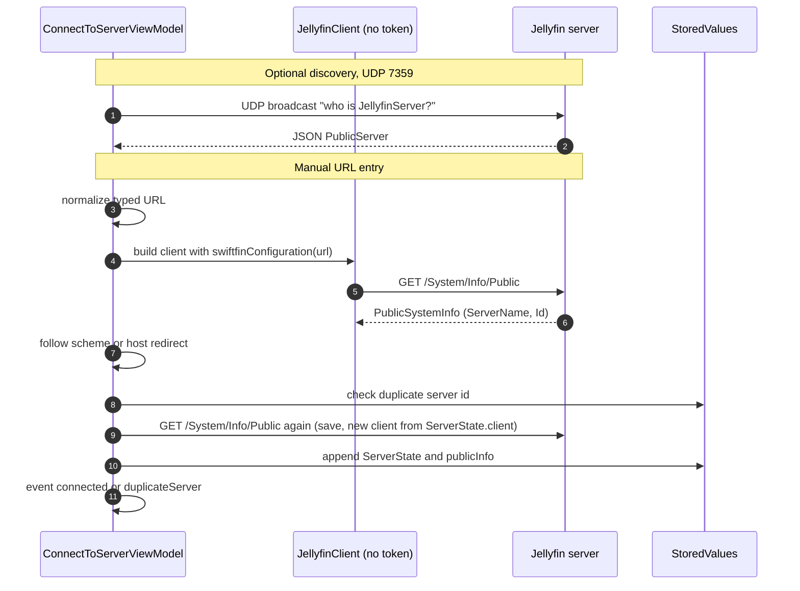

| # | Step | Cite |
|---|---|---|
| 1-2 | `searchForServers` iterates `JellyfinClient.discover()`. Discovery runs 5 s, enumerates non loopback IPv4 interfaces with a broadcast address, sends ASCII `who is JellyfinServer?` to each broadcast address and `255.255.255.255`, port 7359, and JSON decodes `PublicServer` replies. Results are appended to `localServers` as `ServerState(urls:[url], currentURL:url, name, id, userIDs:[])`. Before any datagram is sent the SDK can throw two errors: `ServerDiscoveryError.noUsableNetworkInterface` when no non loopback IPv4 interface with a broadcast address exists, and `ServerDiscoveryError.noUsableChannel` when the UDP datagram bind on `0.0.0.0:0` with `SO_REUSEADDR` and `SO_BROADCAST` fails. The app catches every discovery error and only logs `Local server discovery failed: ...`. | `Shared/ViewModels/ConnectToServerViewModel.swift:175-192` (catch and log at 189-191), `jellyfin-sdk-swift@3.3.0:Sources/ServerDiscovery.swift:15-18, 41-49, 85-98, 111-173` (error cases at 15-18, port, broadcast address and payload at 41-43, `discover(duration: Duration = .seconds(5))` at 49, interface guard 87, bind 89-96, throw 98) |
| 3 | Normalize: trim whitespace and newlines, trim U+FFFC (`.objectReplacement`), trim `/` both ends, prepend `http://` when the original string lacks `://`. `URL(string:)` failure or nil host throws `ErrorMessage(L10n.invalidURL)`. | `Shared/ViewModels/ConnectToServerViewModel.swift:59-73` |
| 3 | `normalizedServerConnectionURL` lowercases scheme and host and strips a trailing `/` from the path. | `Shared/Extensions/URL.swift:89-100` |
| 4-5 | The client uses `.swiftfinConfiguration(url:)` and a network logging proxy session delegate and passes no `sessionConfiguration`, so the SDK default session applies, not `.swiftfin`. Request: `GET /System/Info/Public`. | `Shared/ViewModels/ConnectToServerViewModel.swift:75-80`, `jellyfin-sdk-swift@3.3.0:Sources/Paths/GetPublicSystemInfoAPI.swift:15` |
| 6 | `serverName` and `id` are required. Missing either throws `ErrorMessage(L10n.unknownError)`. | `Shared/ViewModels/ConnectToServerViewModel.swift:82-87` |
| 7 | Redirects: if the response URL scheme or host differs from the request, the `/System/Info/Public` suffix is trimmed from the response URL and the result is re-normalized. | `Shared/ViewModels/ConnectToServerViewModel.swift:116-132` |
| 8 | A stored server with the same `id` emits `.duplicateServer(newServerState)` and stops. | `Shared/ViewModels/ConnectToServerViewModel.swift:102-109` |
| 9-11 | `save(server:)` re-fetches public info through `server.getPublicSystemInfo()`. That uses `ServerState.client`, a new `JellyfinClient` built with `.swiftfinConfiguration(url: effectiveServerURL)` and `sessionConfiguration: .swiftfin` (20 s timeout), so it is not the no-token client of steps 4-5, which used the default session configuration. It then appends the server to `StoredValues[.Server.servers]`, stores `StoredValues[.Server.publicInfo(id:)]`, then emits `.connected`. | `Shared/ViewModels/ConnectToServerViewModel.swift:111-143`, `Shared/SwiftfinStore/SwiftfinStore+ServerState.swift:29-35, 98-104` |

Optional multi URL handling and auto switching of the active connection are in `03-auth-session.md` and `02-networking.md`. Gate: `UserDefaults[.Experimental.serverConnectionAutoSwitch] && server.isAutoSwitchEnabled`, candidates are looped in `Shared/Services/ServerConnectionManager.swift:99-148, 246-250`, and each is probed by `test(connection:accessToken:matchingServerID:)`: a new `JellyfinClient` on a copy of `.swiftfin` with an 8 s request and 12 s resource timeout and `waitsForConnectivity = false` sends `Paths.getPublicSystemInfo` (`GET /System/Info/Public`) and throws `ErrorMessage(L10n.connectionServerMismatch)` when the returned `id` differs from the server id (`Shared/Services/ServerConnectionManager.swift:69-96`, send at 88, `jellyfin-sdk-swift@3.3.0:Sources/Paths/GetPublicSystemInfoAPI.swift:15`).

#### 1.1.1 Discovery to connect

Discovery is a convenience list, not storage. A discovered server is held only in the in memory `@Published localServers` set until `connect` succeeds; only `save(server:)` writes `StoredValues[.Server.servers]` (`Shared/ViewModels/ConnectToServerViewModel.swift:49-51, 134-143`).

| Fact | Cite |
|---|---|
| The connect view runs `searchForServers()` on first appear and again every 12 s (skipped while state is `.connecting`). | `Shared/Views/ConnectToServerView/ConnectToServerView.swift:33, 154-162` |
| Discovery needs the same IPv4 broadcast domain (UDP broadcast, see steps 1-2). Each reply is appended to `localServers` as `ServerState(urls: [server.url], currentURL: server.url, ...)`. The reply URL is used as is, with no normalisation at this point. | `Shared/ViewModels/ConnectToServerViewModel.swift:175-192` |
| `localServers` is an `OrderedSet<ServerState>`. Entries no longer found are never removed (code comment). `ServerState` is a synthesised `Hashable` over all fields, so a server whose name or URL changed between scans appears as a second entry. | `Shared/ViewModels/ConnectToServerViewModel.swift:49-51`, `Shared/SwiftfinStore/SwiftfinStore+ServerState.swift:17` |
| Tapping a result copies `currentURL` into the URL field and calls `connect(url:)`, which re-runs the whole manual flow: normalise (step 3), `GET /System/Info/Public` (steps 4-5), duplicate check (step 8), `save` (steps 9-11). Only then is the server stored. | `Shared/Views/ConnectToServerView/ConnectToServerView.swift:116-120`, `Shared/ViewModels/ConnectToServerViewModel.swift:56-113` |

### 1.2 Password sign in

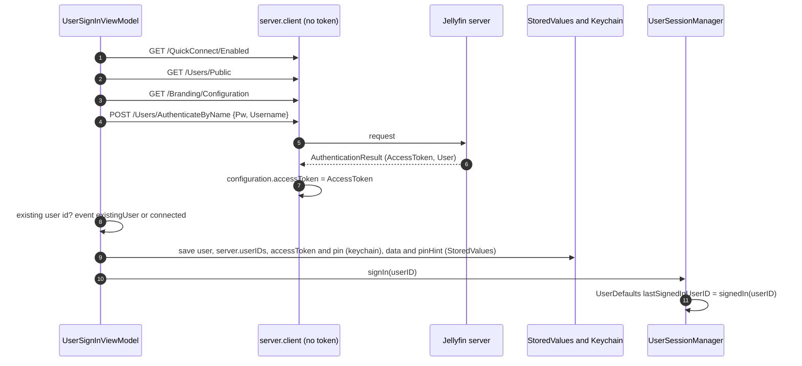

| # | Step | Cite |
|---|---|---|
| 1-3 | `getPublicData` runs three calls concurrently with `async let`: `GET /QuickConnect/Enabled` (body decoded with `try? JSONDecoder().decode(Bool.self)`; only a decode failure of the body gives `false`, while an HTTP or network failure is thrown by `client.send` and fails the whole `getPublicData` action), `GET /Users/Public`, `GET /Branding/Configuration` (field `loginDisclaimer`, empty string treated as nil). | `Shared/ViewModels/UserSignInViewModel.swift:106-115, 272-294` (decode at 288-294), `jellyfin-sdk-swift@3.3.0:Sources/Paths/GetQuickConnectEnabledAPI.swift:15`, `jellyfin-sdk-swift@3.3.0:Sources/Paths/GetPublicUsersAPI.swift:15`, `jellyfin-sdk-swift@3.3.0:Sources/Paths/GetBrandingOptionsAPI.swift:15` |
| 4-5 | Username and password are each trimmed of whitespace and U+FFFC. `client.signIn(username:password:)` builds `Paths.authenticateUserByName(.init(pw:, username:))`, `POST /Users/AuthenticateByName`. | `Shared/ViewModels/UserSignInViewModel.swift:117-130`, `jellyfin-sdk-swift@3.3.0:Sources/JellyfinClient.swift:205-217`, `jellyfin-sdk-swift@3.3.0:Sources/Paths/AuthenticateUserByNameAPI.swift:15` |
| 6, 8 | `accessToken`, `user.id` and `user.name` are required, else `ErrorMessage(L10n.unknownError)`. A user id already in `StoredValues[.User.users]` (any server) emits `.existingUser`, otherwise `.connected` with a new `UserState(id:, serverID:, username:)`. | `Shared/ViewModels/UserSignInViewModel.swift:132-151, 182-185` |
| 7 | The SDK stores `accessToken` into the client configuration. A response without a token throws `ClientError.noAccessToken`. Later requests on the same client carry `Token=`. | `jellyfin-sdk-swift@3.3.0:Sources/JellyfinClient.swift:210-214, 17-19` |
| 9 | `save`: evaluate the local access policy (none, device auth, pin), replace the user in `users`, append the id to `server.userIDs`, set `accessToken`, `data`, `pinHint`, `pin`, then emit `.saved`. Storage: `accessToken` is keychain key `<id>-accessToken` and `pin` is keychain key `<id>-pin`; `data` goes to `StoredValues[.User.data(id:)]` and `pinHint` to `StoredValues[.User.pinHint(id:)]`. `saveExisting` compares a stored pin and may replace the token. | `Shared/ViewModels/UserSignInViewModel.swift:187-270`, `Shared/SwiftfinStore/SwiftinStore+UserState.swift:30-41, 44-51, 53-65, 67-74` |
| 10-11 | On `.saved` the view calls `userSessionManager.signIn(userID:)`, which sets `UserDefaults[.lastSignedInUserID] = .signedIn(userID:)` and builds the session (see 1.4). | `Shared/Views/UserSignInView.swift:58-89`, `Shared/Services/UserSession/UserSessionManager.swift:103-111` |

### 1.3 Quick Connect sign in

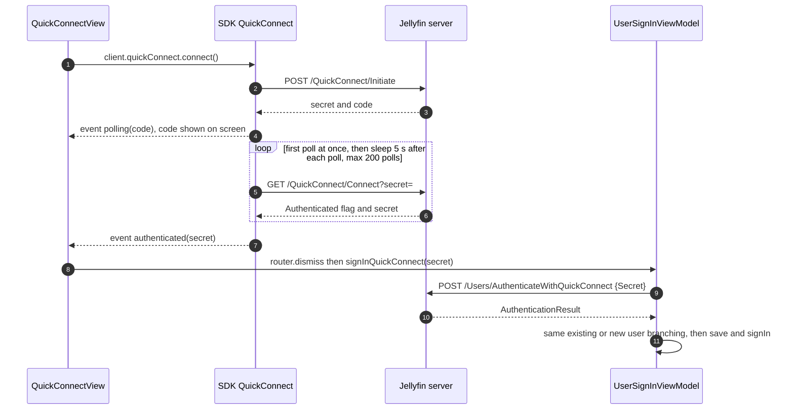

| # | Step | Cite |
|---|---|---|
| 0 | The Quick Connect button shows only when `/QuickConnect/Enabled` returned true. It routes to `.quickConnect(client: server.client)` with a closure calling `viewModel.signInQuickConnect(secret:)`. | `Shared/Views/UserSignInView.swift:195-204` |
| 1 | `.task` iterates `client.quickConnect.connect()`. | `Shared/Views/QuickConnectView.swift:61-63` |
| 2-3 | `POST /QuickConnect/Initiate` returns `secret` and `code`, either missing throws `QuickConnectError.retrievingCodeFailed`. | `jellyfin-sdk-swift@3.3.0:Sources/QuickConnect.swift:98-110`, `jellyfin-sdk-swift@3.3.0:Sources/Paths/InitiateQuickConnectAPI.swift:15` |
| 4 | `.polling(code:)` stores `self.code`; the view shows it with `.tracking(10)`, `.font(.largeTitle)` and `.monospacedDigit()` (digits only, not a monospaced font). | `Shared/Views/QuickConnectView.swift:36-39, 65-66` |
| 5-6 | Default values: poll 5 s, max 200 polls, failure tolerance 5 consecutive failures. The first `GET /QuickConnect/Connect` goes out right after Initiate with no sleep first (t = 0); the 5 s sleep comes after each poll, so polls are at t = 0, 5 s, 10 s and so on. Each poll is `GET /QuickConnect/Connect` with query `secret`. Done when `isAuthenticated == true` and `secret` is present. A failed poll counts toward the tolerance; 200 polls without success throws `QuickConnectError.maxPollingHit`. | `jellyfin-sdk-swift@3.3.0:Sources/QuickConnect.swift:52-56, 89-95, 112-150` (Initiate then `.polling` at 89-91, loop at 121, `checkAuthorization` at 123, failure count at 131-132, `Task.sleep` at 135, `maxPollingHit` at 138), `jellyfin-sdk-swift@3.3.0:Sources/Paths/GetQuickConnectStateAPI.swift:15` |
| 7-8 | On `.authenticated` the view dismisses, then runs the action with the secret. | `Shared/Views/QuickConnectView.swift:67-69` |
| 9 | `signIn(quickConnectSecret:)` posts `POST /Users/AuthenticateWithQuickConnect`, overrides the client token. | `jellyfin-sdk-swift@3.3.0:Sources/JellyfinClient.swift:229-240`, `jellyfin-sdk-swift@3.3.0:Sources/Paths/AuthenticateWithQuickConnectAPI.swift:15` |
| 10-11 | Message 10 is the `AuthenticationResult`. Message 11: same token, user id and user name checks and `.existingUser` or `.connected` branching as password sign in. | `Shared/ViewModels/UserSignInViewModel.swift:154-180` |

### 1.4 Session start (explicit sign in or launch restore)

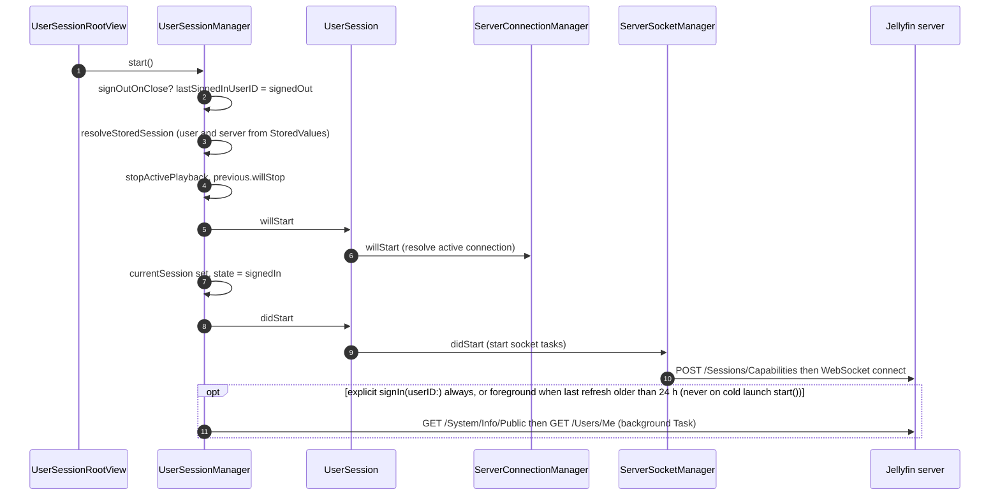

| # | Step | Cite |
|---|---|---|
| 1 | `UserSessionRootView` `.task` calls `userSessionManager.start()` after the data store is set up. | `Shared/Coordinators/Root/UserSessionRootView.swift:40-42`, `Shared/Coordinators/Root/RootCoordinator.swift:62-74` |
| 2-3 | `signOutOnClose` resets the last user. `resolveStoredSession` needs `UserDefaults[.lastSignedInUserID] == .signedIn(userId)`, then finds `UserState` by id and `ServerState` by `user.serverID` in `StoredValues`. Missing data resets to `.signedOut` and throws `invalidStoredSession`. Failure is logged and the session becomes nil. | `Shared/Services/UserSession/UserSessionManager.swift:84-101, 320-333` |
| 4-8 | `applyCurrentSession` is serialised through `updateCurrentSession`: stop active playback, `previous.willStop`, `new.willStart`, set `currentSession`, reset the shared current user session dependency, set `state` (`.signedIn` or `.signedOut`), `new.didStart`. | `Shared/Services/UserSession/UserSessionManager.swift:281-318` |
| 5-9 | Services run in the order `[serverConnectionManager, serverSocketManager]` and stop in reverse. `willStop` also calls `items.invalidate()`. | `Shared/Services/UserSession/UserSession.swift:57-97` |
| 9-10 | Socket loop builds `client.socket(supportsMediaControl: true, supportedCommands: [displayContent, play, playMediaSource, playState, playTrailers, setAudioStreamIndex, setMaxStreamingBitrate, setSubtitleStreamIndex], playableMediaTypes: [.video])` and connects with `responseTimeout` 10 s. The SDK posts `/Sessions/Capabilities` (result ignored with `try?`) before opening the socket. | `Shared/Services/ServerSocketManager.swift:115-138`, `jellyfin-sdk-swift@3.3.0:Sources/JellyfinSocket/JellyfinSocket.swift:484-506` |
| 11 | Launch restore `start()` never calls `refreshServerInformationIfNeeded`. Explicit `signIn(userID:)` always refreshes, in an unstructured `Task { }`. `appWillEnterForeground` refreshes with reason `.stale`, which returns unless `lastServerInformationRefreshDate` is older than 24 h. A cold launch therefore skips the refresh until a foreground event passes the 24 h gate. | `Shared/Services/UserSession/UserSessionManager.swift:84-101, 103-111, 181-187, 235-246` |
| 11 | The refresh runs `server.updateServerInfo()` (`getPublicSystemInfo`, `GET /System/Info/Public`) then `user.updateUserData(server:)`, which calls `getUserData` with `Paths.getCurrentUser`, i.e. `GET /Users/Me`, on a new token bearing client. Success sets `lastServerInformationRefreshDate = now`; failure is logged only. | `Shared/Services/UserSession/UserSessionManager.swift:247-257`, `Shared/SwiftfinStore/SwiftfinStore+ServerState.swift:168-172`, `Shared/SwiftfinStore/SwiftinStore+UserState.swift:124-142`, `jellyfin-sdk-swift@3.3.0:Sources/Paths/GetCurrentUserAPI.swift:15` |

Foreground sign out: on foreground, if `signOutOnBackground` is set, nothing is playing and the time since `backgroundTimeStamp` exceeds `backgroundSignOutInterval` (default 3600 s), the app signs out (`Shared/Services/UserSession/UserSessionManager.swift:176-196`, `Shared/Services/SwiftfinDefaults.swift:81`). Sign out is local only: it sets `.signedOut`, swaps the session to nil and never calls a server logout, so the token stays valid (`Shared/Services/UserSession/UserSessionManager.swift:113-124`).

## 2. Browse

Browse is a paging pipeline over `PagingLibraryViewModel`, each `PagingLibrary` supplying one REST request. Items are merged into the per session `ItemStore` (`userSession.items.merge(patch, token:)`), which keeps one weakly held `ItemRecord` per item id and returns the existing record when one is live, so screens that hold the same id share one record (`Shared/Services/UserSession/UserSession.swift:20`, `Shared/Objects/Libraries/ItemLibrary.swift:199`, `Shared/Objects/ItemStore/ItemStore.swift:104-134, 292-308`).

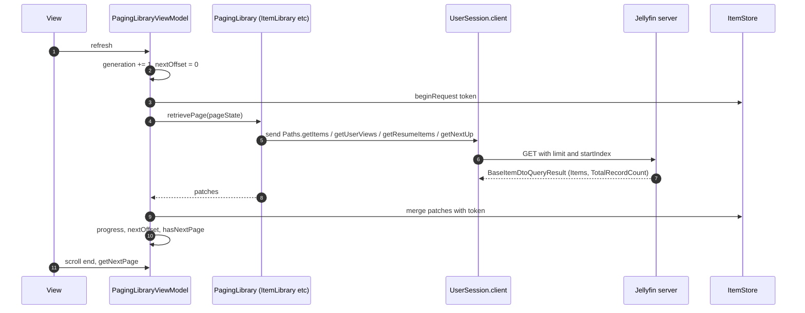

| # | Step | Cite |
|---|---|---|
| 1-2 | `refresh` bumps `generation`, sets `hasNextPage = true`, `nextOffset = 0`, clears `elements` unless a background refresh, then `loadPage(replacing: true)`. | `Shared/Objects/PagingLibrary/PagingLibraryViewModel.swift:315-328` |
| 3 | Page size default `defaultPagingLibraryPageSize = 50`. Overrides: 100 (`SeriesEpisodeContentGroup`), 20 (`PosterGroup`, tvOS `CinematicSelectionContentGroup`). | `Shared/Objects/PagingLibrary/PagingLibraryViewModel.swift:15`, `Shared/Objects/ContentGroup/SeriesEpisodeContentGroup/SeriesEpisodeContentGroup.swift:32`, `Shared/Objects/ContentGroup/PosterGroup.swift:49`, `Swiftfin tvOS/Objects/CinematicSelectionContentGroup.swift:163` |
| 3-5 | `LibraryPageState` begins an item request token. `loadPage` calls `library.retrievePage`, then drops the result if cancelled, generation differs or invalidated, or, for a non replacing (next page) load only, `offset != nextOffset` (guard is `replacing || offset == nextOffset`; a replacing load is never dropped for offset mismatch). | `Shared/Objects/PagingLibrary/PagingLibrary.swift:22-31`, `Shared/Objects/PagingLibrary/PagingLibraryViewModel.swift:344-355` (guard at 354-355) |
| 6 | Generic item pages: base parameters `enableUserData = true`, `fields = PosterSubtitleField.itemFields`, `includeItemTypes` and `isRecursive` from the parent and grouping, `sortBy = [.name]`, `sortOrder = [.ascending]`, plus `parentID` (or `personIDs`/`studioIDs`; folder collections set `parentID` and clear `isRecursive`). `attachFilters` then overwrites `sortBy`, `sortOrder` and `filters` with the filter values and adds languages, genres, ratings, tags, years, categories, search term, item types and letter. Then `parameters.limit = pageSize`, `parameters.startIndex = pageOffset`, `parameters.userID = user.id`, and `Paths.getItems`, i.e. `GET /Items`. Full composition: `01-endpoints.md` "Library browse query composition". | `Shared/Objects/Libraries/ItemLibrary.swift:110-119, 163-192, 225-263, 265-273`, `jellyfin-sdk-swift@3.3.0:Sources/Paths/GetItemsAPI.swift:15` |
| 8 | `items(from:)` stores `serverItemCount = items.count` and `totalRows = totalRecordCount`. | `Shared/Objects/PagingLibrary/PagingLibrary.swift:36-40` |
| 9 | `loadPage` calls `materialize`; the view model's `materialize` runs `library.materialize(response, pageState:)` and then filters by `library.includes`. `ItemLibrary.materialize` also drops items whose `collectionType` is not in `CollectionType.supportedCases`. | `Shared/Objects/PagingLibrary/PagingLibraryViewModel.swift:273-274, 360-363`, `Shared/Objects/Libraries/ItemLibrary.swift:194-204` |
| 10 | `nextOffset = pageOffset + serverItemCount`. No next page when `serverItemCount == 0`. If `totalRows >= nextOffset` then `hasNext = nextOffset < totalRows`, else `hasNext = serverItemCount >= pageSize`. The loop continues while filtered or duplicate rows added nothing visible and `hasNextPage` is true. | `Shared/Objects/PagingLibrary/PagingLibrary.swift:49-58`, `Shared/Objects/PagingLibrary/PagingLibraryViewModel.swift:376-377` |
| 11 | Scroll end calls `getNextPage`, which needs `hasNextPage`, not invalidated, not background refreshing. | `Shared/Objects/PagingLibrary/PagingLibraryViewModel.swift:330-342` |

### 2.1 Home rows (library tab, Continue Watching, Next Up)

| Row | Request | Query keys set by the app | Cite |
|---|---|---|---|
| My Media (libraries tab) | `GET /UserViews` and `GET /Users/Me` in parallel, offset 0 only | `userID` (`GetUserViewsParameters(userID:)`) | `Shared/Objects/Libraries/UserViewLibrary.swift:35-41`, `Shared/Coordinators/Tabs/TabItem.swift:111`, `jellyfin-sdk-swift@3.3.0:Sources/Paths/GetUserViewsAPI.swift:15`, `jellyfin-sdk-swift@3.3.0:Sources/Paths/GetCurrentUserAPI.swift:15` |
| My Media filter | keep `CollectionType.supportedCases`, drop ids in `configuration.myMediaExcludes`, prepend `.favorites` when `UserDefaults[.Customization.Library.showFavorites]` | none | `Shared/Objects/Libraries/UserViewLibrary.swift:43-61` |
| Continue Watching | `GET /UserItems/Resume` | `enableUserData=true`, `fields=PosterSubtitleField.itemFields`, `limit=pageSize`, `mediaTypes`, `startIndex=pageOffset`, `userID` | `Shared/Objects/Libraries/ResumeItemsLibrary.swift:32-44`, `Shared/ViewModels/ContentGroupViewModel/DefaultContentGroupProvider.swift:50-57`, `jellyfin-sdk-swift@3.3.0:Sources/Paths/GetResumeItemsAPI.swift:15` |
| Continue Watching include | client side keeps items unless `confirmedUserData?.matches([.isResumable]) == false`, so items with nil `confirmedUserData` are kept | none | `Shared/Objects/Libraries/ResumeItemsLibrary.swift:46-48` |
| Next Up | `GET /Shows/NextUp` | `enableRewatching`, `enableUserData=true`, `fields`, `limit`, `startIndex`, `nextUpDateCutoff = now - maxNextUp` only when `maxNextUp > 0` | `Shared/Objects/Libraries/NextUpLibrary.swift:37-48`, `Shared/ViewModels/ContentGroupViewModel/DefaultContentGroupProvider.swift:65`, `jellyfin-sdk-swift@3.3.0:Sources/Paths/GetNextUpAPI.swift:15` |

### 2.1.1 Home screen composition

`DefaultContentGroupProvider.makeGroups` fetches `GET /UserViews` (`userID`), then keeps views whose id is not in `user.data.configuration?.latestItemsExcludes` and whose `collectionType` is one of `homevideos`, `movies`, `musicvideos`, `tvshows` (`Shared/ViewModels/ContentGroupViewModel/DefaultContentGroupProvider.swift:22-42`). Row order, top to bottom:

| Order | Row | Condition | Cite |
|---|---|---|---|
| 1 | Continue Watching: `ResumeItemsLibrary(mediaTypes: [.video])`, landscape medium `PosterGroup` on iOS; tvOS uses `CinematicSelectionContentGroup(resumeLibrary:, recentlyAddedLibrary: RecentlyAddedLibrary())` | always | `Shared/ViewModels/ContentGroupViewModel/DefaultContentGroupProvider.swift:48-62` |
| 2 | Next Up: `NextUpLibrary()` | always | `Shared/ViewModels/ContentGroupViewModel/DefaultContentGroupProvider.swift:64-66` |
| 3 | Recently Added: `ItemLibrary` filters `itemTypes [.movie, .series]`, `sortBy [.dateCreated]`, descending (tvOS: `CinematicRecentlyAddedContentGroup`) | `UserDefaults[.Customization.Home.showRecentlyAdded]`, default true | `Shared/ViewModels/ContentGroupViewModel/DefaultContentGroupProvider.swift:68-85`, `Shared/Services/SwiftfinDefaults.swift:223-224` |
| 4 | Recently Played: `ItemLibrary` filters `itemTypes [.movie, .series]`, `sortBy [.datePlayed]`, descending, `traits [.isPlayed]` | `UserDefaults[.Customization.Home.showRecentlyPlayed]`, default false | `Shared/ViewModels/ContentGroupViewModel/DefaultContentGroupProvider.swift:87-99`, `Shared/Services/SwiftfinDefaults.swift:238-239` |
| 5 | Recommended programs: `RecommendedProgramsLibrary()`, id `programs-recommended`, landscape small | always | `Shared/ViewModels/ContentGroupViewModel/DefaultContentGroupProvider.swift:101-106` |
| 6+ | One `LatestInLibrary` row per surviving user view, landscape | one per view from the filter above | `Shared/ViewModels/ContentGroupViewModel/DefaultContentGroupProvider.swift:108-116`, `Shared/Objects/Libraries/LatestInLibrary.swift:11-26` |

Views that host the rows. Each row is a `ContentGroup` whose `body(with:)` returns its view (`Shared/Objects/ContentGroup/ContentGroup.swift:16-27`). Every `PosterGroup` row (iOS Continue Watching, Next Up, iOS Recently Added, Recently Played, Recommended programs, Latest in each library) renders `PosterHStackLibrarySection` on both platforms (`Shared/Objects/ContentGroup/PosterGroup.swift:70-76`, `Shared/Components/PosterHStackLibrarySection.swift:11`). On tvOS, Continue Watching is `CinematicSelectionContentGroup`, whose body is its private `SelectionView`. Recently Added is `CinematicRecentlyAddedContentGroup`, which also renders `PosterHStackLibrarySection` over the shared view model's recently added group (`Swiftfin tvOS/Objects/CinematicSelectionContentGroup.swift:13, 32-36, 105, 114-119`, `Shared/ViewModels/ContentGroupViewModel/DefaultContentGroupProvider.swift:48-62, 68-85`).

### 2.2 Item detail and the playback intent it prepares

Opening an item page prepares a `PlaybackIntent` before the user taps Play: `makeGroups` awaits `resolvePlaybackIntent` and stores it in `playbackIntent` (`Shared/Views/ItemContentGroupView/ItemContentGroupProvider.swift:77-94`).

Play gate (`BaseItemDto.getPlaybackIntent(userSession:)`): returns nil, so no Play, only when `type == .program` and either the program is not airing or `userSession` is nil (`if type == .program, !isAiring || userSession == nil`). A non program item always gets an intent. Otherwise it returns `PlaybackIntent(item: self, configuration: .init())`, a fresh `MediaPlaybackConfiguration()` whose fields snapshot UserDefaults and `StoredValues` at creation (`Shared/Extensions/JellyfinAPI/BaseItemDto/BaseItemDto.swift:267-281`, `Shared/Objects/MediaPlayerManager/MediaPlaybackConfiguration.swift:15-43`). `isAiring` is `currentProgram.isAiring` when present, else `startDate <= now <= endDate`, false when a date is missing (`Shared/Extensions/JellyfinAPI/BaseItemDto/BaseItemDto.swift:142-150`).

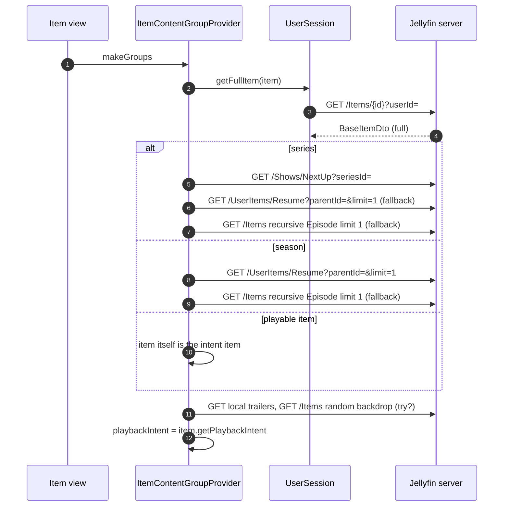

| # | Step | Cite |
|---|---|---|
| 1-4 | `makeGroups` fetches the full item with `getFullItem`, which is `Paths.getItem(itemID:userID:)` = `GET /Items/{id}` with `userId`, sent with `itemScope: .fullItem`. A blank id throws `invalidItemID`. | `Shared/Views/ItemContentGroupView/ItemContentGroupProvider.swift:77-80`, `Shared/Services/UserSession/UserSession+Items.swift:22-39`, `jellyfin-sdk-swift@3.3.0:Sources/Paths/GetItemAPI.swift:15` |
| 5 | Series: `GetNextUpParameters.seriesID = item.id` and `GET /Shows/NextUp`, first item unless `isMissing`. Then resume, then first episode. | `Shared/Views/ItemContentGroupView/ItemContentGroupProvider.swift:345-353, 380-392` |
| 6, 8 | Resume query (series fallback 6, season 8): `GetResumeItemsParameters` with `limit = 1`, `parentID = item.id`. | `Shared/Views/ItemContentGroupView/ItemContentGroupProvider.swift:394-403` |
| 7, 9 | First available (series fallback 7, season 9): `GET /Items` with `includeItemTypes=[.episode]`, `isMissing=false`, `isRecursive=true`, `limit=1`, `parentID`, `sortOrder=[.ascending]`. | `Shared/Views/ItemContentGroupView/ItemContentGroupProvider.swift:405-418` |
| 8-10 | Season: resume (8) then first episode (9). Other types (10): the item itself if `isPlayable`. | `Shared/Views/ItemContentGroupView/ItemContentGroupProvider.swift:355-364` |
| 11-12 | Series or season picks re-fetch the chosen episode with `getFullItem` before `getPlaybackIntent`. Local trailers and a random backdrop are fetched with `try?`, so failure is ignored. | `Shared/Views/ItemContentGroupView/ItemContentGroupProvider.swift:87-88, 368-377` |
| after 12 (no diagram message) | The UI can edit the intent before play: media source id, audio index, subtitle index, bitrate. | `Shared/Views/ItemContentGroupView/ItemContentGroupProvider.swift:324-339` |

## 3. Play

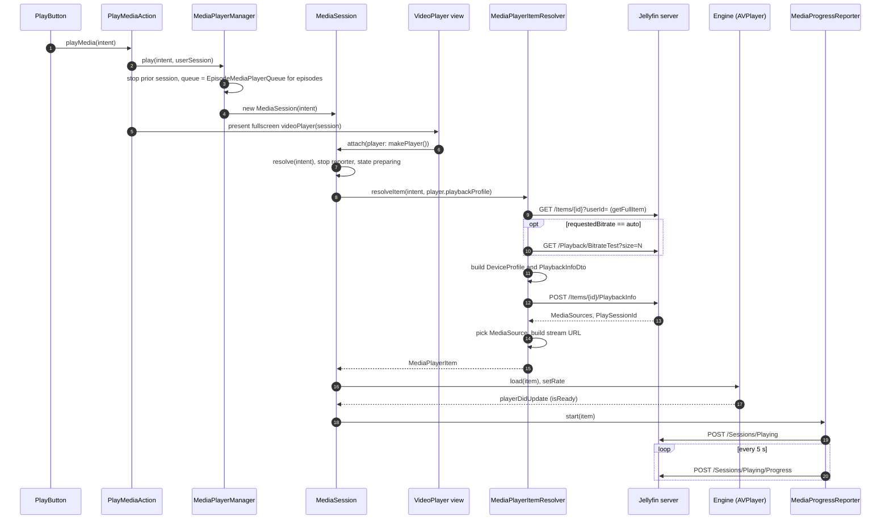

### 3.1 Intent to session

| # | Step | Cite |
|---|---|---|
| 1-2 | `PlayMediaAction.callAsFunction(intent:)` reads the current user session from the shared dependency container and returns silently if nil. It calls `mediaPlayerManager().play(intent:userSession:)`, which returns a `MediaSession` synchronously (no network yet). | `Shared/Coordinators/Navigation/PlayMediaAction.swift:21-27` |
| 3-4 | `play` first calls `stop()`, sets `queue = EpisodeMediaPlayerQueue()` if the intent has no queue and `item.type == .episode`, builds the `MediaSession`. | `Shared/Objects/MediaPlayerManager/MediaPlayerManager.swift:73-89` |
| 5 | Route `NavigationRoute.videoPlayer(session:)` presents `VideoPlayer(mediaSession: session).id(session.id)` fullscreen. | `Shared/Coordinators/Navigation/PlayMediaAction.swift:29`, `Shared/Coordinators/Navigation/NavigationRoute/NavigationRoute+Media.swift:49-58` |
| 6 | On appear, if the session has no player and is not stopped, it attaches `UserDefaults[.VideoPlayer.mediaPlayerType].makePlayer()`. `.avPlayer` gives `AVMediaPlayer()`. The default case builds Swiftfin's second, non-AVPlayer engine, which is out of scope. | `Shared/Views/VideoPlayer/VideoPlayer.swift:63-66`, `Shared/Objects/MediaPlayerType/MediaPlayerType.swift:53-61`, `Shared/Services/SwiftfinDefaults.swift:301-303` |
| 6-7 | `attach` guards not stopped and no other session on the player, sets `player.mediaSession = self`, calls `resolve(intent)`. | `Shared/Objects/MediaPlayerManager/MediaSession.swift:231-246` |
| 7 | `resolve`: cancel work, new `resolutionID`, `progressReporter.stop()`, `discardUnstartedItem()`, `hasReportedPlayback = false`, pause the player, then a Task sends `_resolve` (state `.preparing`). | `Shared/Objects/MediaPlayerManager/MediaSession.swift:305-354` |
| 8 | `performResolve` awaits a pending transfer task, lets `queue.resolve` adjust the intent (the shuffle queue swaps it, section 3.6), then `resolveItem(resolvedIntent, player.playbackProfile, userSession)`. Errors call `fail(error)` if still current. | `Shared/Objects/MediaPlayerManager/MediaSession.swift:381-428` |

### 3.2 Resolution against the server

| # | Step | Cite |
|---|---|---|
| 8-9 | Program items are replaced by their channel (`getChannel`). A missing item id throws `ErrorMessage(L10n.unknownError)`. | `Shared/Objects/MediaPlayerManager/MediaPlayerItem/MediaPlayerItemResolver.swift:25-38` |
| 8-9 | Channel lookup for programs uses `getItems(ids:[channelID])`. | `Shared/Extensions/JellyfinAPI/BaseItemDto/BaseItemDto.swift:290-296` |
| 9 | The full item comes from `userSession.getFullItem` (`GET /Items/{id}`). Initial media source: if `configuration.mediaSourceID` is set, the source with that id (no fallback to the first source when it is missing); only when the id is nil, the first source. A nil result throws `ErrorMessage("Unable to find media source for item")`. | `Shared/Objects/MediaPlayerManager/MediaPlayerItem/MediaPlayerItemResolver.swift:40-46`, `Shared/Objects/MediaPlayerManager/MediaPlaybackConfiguration.swift:45-51` |
| 8-11 (inside `resolveItem`, no message of its own) | `configuration.prepare`: `startSeconds = max(.zero, startSeconds ?? ((item.startSeconds ?? .zero) - resumeOffset))`, continuation tracks from the previous episode, system preference tracks, secondary subtitle forced to `-1` unless the profile supports it (AVPlayer does not). | `Shared/Objects/MediaPlayerManager/MediaPlaybackConfiguration.swift:114-138`, `Shared/Objects/MediaPlayerManager/PlaybackProfile.swift:19-26` |
| 10 | Max bitrate: `requestedBitrate.rawValue` unless `.auto`. Auto times `GET /Playback/BitrateTest` with query `size`, then `bps = size*8 / max(seconds, 0.001)`, clamped to `[420_000, Int32.max]`. Default key `appMaximumBitrate = .auto`. | `Shared/Objects/MediaPlayerManager/MediaPlayerItem/MediaPlayerItemResolver.swift:183-201`, `Shared/Services/SwiftfinDefaults.swift:365-367`, `jellyfin-sdk-swift@3.3.0:Sources/Paths/GetBitrateTestBytesAPI.swift:15` |
| 11 | `DeviceProfile` comes from `profile.deviceProfile(configuration:maxBitrate:mediaSource:)`. Full construction rules (direct play lists, subtitle profiles) are in `05-playback.md` and `04-models.md`. Near the end the profile calls `limitingTranscodingCodecLists` (111-114); after it, when `maxBitrate` is given, `maxStaticBitrate`, `maxStreamingBitrate` and `musicStreamingTranscodingBitrate` are set to it (118-122). `limitingTranscodingCodecLists` works around a server bug: any transcoding profile codec list longer than 40 characters is trimmed (lower priority alternatives dropped, preferred and source codec kept), and a profile whose essential codecs still exceed 40 is removed. | `Shared/Objects/MediaPlayerManager/MediaPlayerItem/MediaPlayerItemResolver.swift:50-54`, `Shared/Extensions/JellyfinAPI/DeviceProfile.swift:25-122` (call at 111-114, bitrates at 118-122), `Shared/Extensions/JellyfinAPI/DeviceProfile+CodecLimits.swift:13-60` |
| 11 | `PlaybackInfoDto` body fields: `AutoOpenLiveStream = true`, `DeviceProfile`, `LiveStreamId`, `MaxStreamingBitrate`, `UserId`, `AudioStreamIndex`, `SubtitleStreamIndex`, and `MediaSourceId` (not for live streams or placeholder sources). HLS only profiles (remote playback) also set `EnableDirectPlay=false`, `EnableDirectStream=false`, `EnableTranscoding=true` and require `mediaType == .video`. | `Shared/Objects/MediaPlayerManager/MediaPlayerItem/MediaPlayerItemResolver.swift:56-76` |
| 12 | Request: `Paths.getPostedPlaybackInfo(itemID:, playbackInfo)` is `POST /Items/{itemID}/PlaybackInfo`, sent through `userSession.client` in an unstructured `Task`. | `Shared/Objects/MediaPlayerManager/MediaPlayerItem/MediaPlayerItemResolver.swift:78-86`, `jellyfin-sdk-swift@3.3.0:Sources/Paths/GetPostedPlaybackInfoAPI.swift:22` |
| 13-14 | Response media source choice, in order: `eTag` equal to the initial source's eTag, `id` equal to the initial id, source whose `openToken` contains its own `id`, else the first source (warning logged). `PlaySessionId` is required, else `ErrorMessage("No associated play session ID")`. | `Shared/Objects/MediaPlayerManager/MediaPlayerItem/MediaPlayerItemResolver.swift:94-132` |
| 14-15 | Stream URL, see 3.3. `configuration.finish` records `automaticTrackDefaults` and selects tracks. Chapters, `PlaybackTemporaryFiles` and `PreviewImageProvider` are built. | `Shared/Objects/MediaPlayerManager/MediaPlayerItem/MediaPlayerItemResolver.swift:134-176`, `Shared/Objects/MediaPlayerManager/MediaPlaybackConfiguration.swift:140-167` |
| 13-15 | Failure after the response closes every returned `liveStreamID` with `POST /LiveStreams/Close?liveStreamId=`. | `Shared/Objects/MediaPlayerManager/MediaPlayerItem/MediaPlayerItemResolver.swift:177-180, 204-215`, `jellyfin-sdk-swift@3.3.0:Sources/Paths/CloseLiveStreamAPI.swift:15` |

The app does not decide direct play versus transcode. The server decides from the `DeviceProfile`. The app infers transcoding only from `mediaSource.transcodingURL != nil` (`Shared/Objects/MediaPlayerManager/MediaPlayerItem/MediaPlayerItem.swift:146, 209`, `Shared/Objects/MediaPlayerManager/MediaPlayerItem/MediaPlayerItemResolver.swift:229`).

### 3.3 Stream URL

| Case | URL | Cite |
|---|---|---|
| `mediaSource.transcodingURL != nil` | `client.url(path: transcodingURL)`: server base plus server supplied path and query, no `ApiKey` added by the resolver. Failure throws `Unable to make transcoding URL`. | `Shared/Objects/MediaPlayerManager/MediaPlayerItem/MediaPlayerItemResolver.swift:229-237` |
| video, no transcoding URL | `GET {server}/Videos/{id}/stream?static=true&tag=..&playSessionId=..&mediaSourceId=..[&liveStreamId=..]&ApiKey=<accessToken>` (query key is lowercase `static`) | `Shared/Objects/MediaPlayerManager/MediaPlayerItem/MediaPlayerItemResolver.swift:239-260`, `jellyfin-sdk-swift@3.3.0:Sources/Paths/GetVideoStreamAPI.swift:15` (path), `jellyfin-sdk-swift@3.3.0:Sources/Paths/GetVideoStreamAPI.swift:177-216` (query keys: `static` 177, `tag` 179, `playSessionId` 181, `mediaSourceId` 185, `liveStreamId` 216), `jellyfin-sdk-swift@3.3.0:Sources/JellyfinClient.swift:254-274` |
| audio | same shape on `/Audio/{id}/stream` | `Shared/Objects/MediaPlayerManager/MediaPlayerItem/MediaPlayerItemResolver.swift:262-279` |
| other media type | throws `Unsupported playback media type` | `Shared/Objects/MediaPlayerManager/MediaPlayerItem/MediaPlayerItemResolver.swift:281` |
| HLS only profile | needs `transcodingURL`, path extension `m3u8`, and `RemotePlaybackURL.authenticated` appends `ApiKey` unless `api_key` or `apikey` already present (non empty, name compared lowercase) and returns nil for a non http(s) URL | `Shared/Objects/MediaPlayerManager/MediaPlayerItem/MediaPlayerItemResolver.swift:142-149`, `Shared/Objects/MediaPlayerManager/RemotePlaybackURL.swift:14-24` |

### 3.4 Load and first report

| # | Step | Cite |
|---|---|---|
| 15 | Resolution installs the item: `player.stop()`, `timeline.reset(position: item.baseItem.startSeconds ?? .zero)`, `playbackItem = item`, `intent.configuration = item.configuration`, `item.mediaSession = self`. A result that arrives after supersession is discarded (live stream closed). | `Shared/Objects/MediaPlayerManager/MediaSession.swift:410-423` |
| 16 | The `baseItem` seen by engines overlays `userData.playbackPositionTicks = configuration.startSeconds.ticks` locally. Reports do not carry it: `Started`, `Progress` and `Stopped` set `PositionTicks` from `mediaSession.observedSeconds`, not from `baseItem.userData`. | `Shared/Objects/MediaPlayerManager/MediaPlayerItem/MediaPlayerItem.swift:103-114`, `Shared/Objects/MediaPlayerManager/MediaProgressReporter.swift:64, 80` |
| 16 | `destinationPlayer.load(item)`, `setRate(effectiveRate)`, then `beginPlayback()` if already ready, then `item.activate()`. | `Shared/Objects/MediaPlayerManager/MediaSession.swift:351-374` |
| 16 (AVPlayer) | `AVPlayerItem(url: item.url)` with no asset options or headers. On `readyToPlay` it loads selection groups, seeks to `startSeconds` (timescale 600, zero tolerance, skipped for live), then `isReady = true` and `play()` when the request is `.playing`. A failed seek calls `playerDidFail(unableToSeek)`. | `Shared/Objects/MediaPlayerManager/Players/AVMediaPlayer.swift:107-115, 390, 440-470` |
| 17 | `playerDidUpdate` calls `beginPlayback` when state is `.preparing`, `isReady` is true and `resolutionTask == nil` (571). While the resolve task still runs, it is the resolve task that calls `beginPlayback` after `resolutionTask = nil`, if the player is already ready (367-371). The action `reportPlaybackStarted` runs once per item (`hasReportedPlayback`) and calls `progressReporter.start(item)`. | `Shared/Objects/MediaPlayerManager/MediaSession.swift:367-371, 564-587` |
| 18-19 | `start(item)`: `stop()` any prior, store the item, `report(isStart: true)` sends `POST /Sessions/Playing`. | `Shared/Objects/MediaPlayerManager/MediaProgressReporter.swift:35-39`, `jellyfin-sdk-swift@3.3.0:Sources/Paths/ReportPlaybackStartAPI.swift:15` |
| 20 | A `PokeIntervalTimer` with default 5 s fires `report()` then `poke()` again, sending `POST /Sessions/Playing/Progress`. A progress report is dropped if one is still queued or in flight. All reports run on one chained task queue shared across sessions, so the Stopped for the old item precedes the Started for the new one. | `Shared/Objects/MediaPlayerManager/MediaProgressReporter.swift:41-47, 99-135, 166-179`, `Shared/Objects/PokeIntervalTimer.swift:21`, `jellyfin-sdk-swift@3.3.0:Sources/Paths/ReportPlaybackProgressAPI.swift:15` |

The report body keys are listed in `07-reporting.md` section 3. In code: `AudioStreamIndex`, `IsPaused`, `ItemId`, `LiveStreamId`, `MediaSourceId`, `PlaySessionId`, `PositionTicks`, `SessionId` (equal to `PlaySessionId`), `SubtitleStreamIndex` (`-1` when none), plus the app only `SecondarySubtitleStreamIndex` (`Shared/Objects/MediaPlayerManager/MediaProgressReporter.swift:70-86`). `IsPaused` reflects the requested transport state, not engine state (`Shared/Objects/MediaPlayerManager/MediaProgressReporter.swift:75`). Reports are fire and forget: errors are logged `Unable to report playback` and never retried (`Shared/Objects/MediaPlayerManager/MediaProgressReporter.swift:130-134`). In DEBUG builds only, `enqueue` skips every report unless `UserDefaults[.sendProgressReports]` is true (default true) (`Shared/Objects/MediaPlayerManager/MediaProgressReporter.swift:100-103`, `Shared/Services/SwiftfinDefaults.swift:455`).

Parallel after item activation: for non audio, non live items `MediaSegmentObserver` calls `GET /MediaSegments/{itemID}` once. Failure is logged at debug. An intro or outro segment gives a Skip action whose seek target is `min(end, duration)` (`Shared/Objects/MediaPlayerManager/MediaSegmentObserver.swift:35-57`, `Shared/Objects/MediaPlayerManager/MediaSegment.swift:33-40`, `jellyfin-sdk-swift@3.3.0:Sources/Paths/GetItemSegmentsAPI.swift:19`).

### 3.5 Progress report behaviour

There is no dedicated progress diagram: section 3.4 steps 17-20 are the whole flow. Consequences an implementer must keep.

| Behaviour | Cite |
|---|---|
| `start` sends `Started` immediately, then arms the timer with `poke()`. The first `Progress` therefore arrives 5 s after `Started`. | `Shared/Objects/MediaPlayerManager/MediaProgressReporter.swift:35-48`, `Shared/Objects/PokeIntervalTimer.swift:21-42` |
| The timer re-arms after every tick and does not look at pause or buffering state. A paused or buffering player keeps sending `Progress` every 5 s, with `IsPaused` taken from the requested transport state. | `Shared/Objects/MediaPlayerManager/MediaProgressReporter.swift:41-45, 75` |
| Pause, resume, seek, rate change and in place track switch send nothing immediately. `IsPaused`, `PositionTicks` and track indexes reach the server on the next tick (at most 5 s later). A rebuild sends `Stopped` then `Started` (sections 5 and 7). | `Shared/Objects/MediaPlayerManager/MediaProgressReporter.swift:41-47, 70-86`, `Shared/Objects/MediaPlayerManager/MediaSession.swift:321, 576-587` |

### 3.6 Shuffle play variant

Shuffle uses the same pipeline as section 3, with a `ShuffleMediaPlayerQueue` on the intent. Because the intent already has a queue, `MediaPlayerManager.play` does not add an `EpisodeMediaPlayerQueue` (`Shared/Objects/MediaPlayerManager/MediaPlayerManager.swift:73-89`).

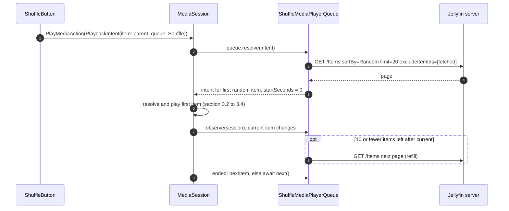

| # | Step | Cite |
|---|---|---|
| pre | The button shows only when `canShuffle`: non blank id, not missing, user policy `enableMediaPlayback == true`, and type `.series`, `.season`, `.boxSet`, or `.collectionFolder`/`.userView`/`.folder` with collection type nil, `movies`, `tvshows`, `boxsets`, `homevideos`, `musicvideos` or `folders`. | `Shared/Views/ItemView/Components/ShuffleButton.swift:20`, `Shared/Extensions/JellyfinAPI/BaseItemDto/BaseItemDto.swift:540-559` |
| 1 | Tap calls `playMedia(intent: PlaybackIntent(item: item, queue: ShuffleMediaPlayerQueue(parent: item)))`. A parent with `collectionType == .boxsets` turns on collection paging. | `Shared/Views/ItemView/Components/ShuffleButton.swift:22`, `Shared/Objects/MediaPlayerManager/Supplements/ShuffleMediaPlayerQueue.swift:60-72` |
| 2 | `performResolve` passes the intent through `queue.resolve`. `resolve` returns the intent unchanged unless its item id is the parent id. If the queue is empty and exhausted it clears `excludedIDs` and the collection state first. | `Shared/Objects/MediaPlayerManager/MediaSession.swift:404`, `Shared/Objects/MediaPlayerManager/Supplements/ShuffleMediaPlayerQueue.swift:74-84` |
| 3 | Page query (`GET /Items`): `userId`, `parentId = parent id`, `recursive=true`, `mediaTypes=[Video]`, `includeItemTypes=[Episode, Movie, Video, MusicVideo, Trailer]`, `collapseBoxSetItems=false`, `isMissing=false`, `isPlaceHolder=false`, `enableUserData=true`, `fields=PosterSubtitleField.itemFields`, `sortBy=[Random]`, `limit=20`, `excludeItemIds` = every id fetched so far (random results have no stable offset). | `Shared/Objects/MediaPlayerManager/Supplements/ShuffleMediaPlayerQueue.swift:20, 62-65, 162-177`, wire keys `jellyfin-sdk-swift@3.3.0:Sources/Paths/GetItemsAPI.swift:290-362` |
| 3-4 | New ids are added to `excludedIDs`. Only items with `mediaType == .video`, `isPlayable` and `isFolder != true` are queued. The loop repeats until an item is added or the source is exhausted. Without collections, exhausted means a page shorter than 20; an empty new set also marks it exhausted. | `Shared/Objects/MediaPlayerManager/Supplements/ShuffleMediaPlayerQueue.swift:179-185, 197-200` |
| 3-4 (box sets) | Box set parents page through collections first: same query with `recursive=false`, `mediaTypes=nil`, `includeItemTypes=[BoxSet]`, own exclude list, keeping only `.boxSet` items. Then each collection is queried as `parentId` in turn with the video query. A collection whose page had exactly 20 items, at least one of them new, is re-appended for another page. Collections are exhausted when a collection page is shorter than 20 or adds no new collection. | `Shared/Objects/MediaPlayerManager/Supplements/ShuffleMediaPlayerQueue.swift:203-240` |
| 5 | An empty queue after loading throws `ErrorMessage(L10n.noItems)`, which reaches `fail` (section 7 steps 5-6). Otherwise the intent is swapped for the first random item, keeping the caller's configuration but forcing `startSeconds = .zero`. | `Shared/Objects/MediaPlayerManager/Supplements/ShuffleMediaPlayerQueue.swift:90-94`, `Shared/Objects/MediaPlayerManager/MediaSession.swift:381-428` |
| 6 | The swapped intent is resolved and played like any other: `PlaybackInfo` POST, stream URL, engine load, `Started` report (sections 3.2 to 3.4). | `Shared/Objects/MediaPlayerManager/MediaSession.swift:381-428` |
| 7-8 | After resolution installs the item, the session calls `observeSessionIfNeeded()`, which calls `queue.observe(self)` once. On each change of the playing item id the queue updates `currentIndex` and, when 10 or fewer items remain after it and state is not `.error`, starts one background `loadMore` refill. | `Shared/Objects/MediaPlayerManager/MediaSession.swift:423, 589-593`, `Shared/Objects/MediaPlayerManager/Supplements/ShuffleMediaPlayerQueue.swift:21, 108-138` |
| 9 | `nextItem` and `previousItem` are neighbours of `currentIndex`, each with a fresh `MediaPlaybackConfiguration()`, `startSeconds = .zero` and the session's `playbackBitrate`. `next()` awaits any refill, then loads more when `nextItem` is nil and the queue is not exhausted. End of media follows section 7 step 4, including the `enableNextEpisodeAutoPlay` gate. | `Shared/Objects/MediaPlayerManager/Supplements/ShuffleMediaPlayerQueue.swift:48-58, 97-106, 146-154`, `Shared/Objects/MediaPlayerManager/MediaSession.swift:495-528` |

## 4. Seek

Seek is local. The seek path (`seek(to:)`, `scheduleSeek`, `playerDidCompleteSeek`) makes no `client` or `userSession` request; besides `timeline` and `player.seek`/`player.cancelSeek` it only calls `publishTimeline()` and sends `.seekRequested`/`.seekCompleted` on `playbackEventSubject` (`Shared/Objects/MediaPlayerManager/MediaSession.swift:603-681`). The only subscriber of `playbackEvents` outside `MediaSession` is `MediaPlayerItemReplaySubtitles`, which has no client or `Paths` use (`Shared/Objects/MediaPlayerManager/MediaPlayerItem/MediaPlayerItem.swift:183`, `Shared/Objects/MediaPlayerManager/MediaPlayerItem/MediaPlayerItemReplaySubtitles.swift:47-54`). The next progress tick, at most 5 s later, carries the new position: the timer sink calls `report()`, which sets `PositionTicks` from `mediaSession.observedSeconds` (`Shared/Objects/MediaPlayerManager/MediaProgressReporter.swift:41-47, 80`).

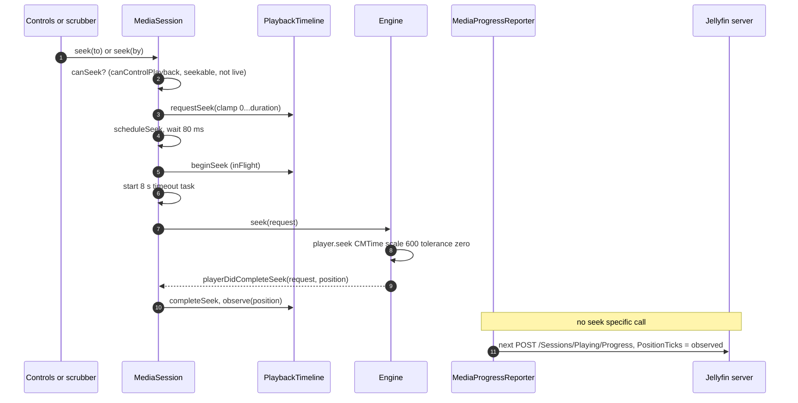

| # | Step | Cite |
|---|---|---|
| 1-2 | `canSeek` is `canControlPlayback && playbackState.isSeekable && !item.isLiveStream`, and `canControlPlayback` is state `.preparing` or `.playback` with `playbackState.isReady` (`MediaSession.swift:148-154`). `seek(to:)` returns false if `!canSeek`. It records the origin, calls `timeline.requestSeek(to:duration:)` with `playbackState.duration ?? item.runtime`, emits `.seekRequested`, clears `commandError`, publishes the timeline, `scheduleSeek()`. `seek(by:)` is `seek(to: seconds + offset)`. | `Shared/Objects/MediaPlayerManager/MediaSession.swift:603-626` |
| 3 | `requestSeek`: `target = max(.zero, min(position, duration))` (no upper clamp when `duration` is nil), ignored if it equals `displayed` (`pending?.target ?? observed`). | `Shared/Objects/MediaPlayerManager/PlaybackState.swift:37-50` |
| 4-6 | `scheduleSeek` sleeps 80 ms to coalesce bursts, `beginSeek()` copies `pending` into `inFlight` (only when nothing is in flight) and does not clear `pending`. `completeSeek(id)` returns `false` and changes nothing when `inFlight?.id != id` (guard at 63). Otherwise it observes the position, clears `pending` only when `pending?.id == id` (69-71), and clears `inFlight` (73). It then starts an 8 s timeout task. On timeout it calls `player.cancelSeek()` and completes with nil position. | `Shared/Objects/MediaPlayerManager/MediaSession.swift:628-662`, `Shared/Objects/MediaPlayerManager/PlaybackState.swift:52-58, 62-76` |
| 7-8 | Guard `isReady` and a current item. `player.seek(to: CMTime(seconds:, preferredTimescale: 600), toleranceBefore: .zero, toleranceAfter: .zero)`. `finished == false` or a non numeric time reports nil position. Swiftfin's second, non-AVPlayer engine has its own seek path, out of scope. | `Shared/Objects/MediaPlayerManager/Players/AVMediaPlayer.swift:184-217`, `Shared/Objects/MediaPlayerType/MediaPlayerType.swift:53-61` |
| 9-10 | `playerDidCompleteSeek` completes the timeline entry (position becomes `observed`), clears the timeout, sets `commandError = L10n.unableToSeek` when position is nil and nothing is pending, emits `.seekCompleted`, and reschedules when a newer request is pending. | `Shared/Objects/MediaPlayerManager/MediaSession.swift:664-681`, `Shared/Objects/MediaPlayerManager/PlaybackState.swift:60-76` |
| 11 | The reported position is `observedSeconds.ticks`, fed by engine position updates (AVPlayer periodic observer, interval 1 s). | `Shared/Objects/MediaPlayerManager/MediaProgressReporter.swift:80`, `Shared/Objects/MediaPlayerManager/Players/AVMediaPlayer.swift:258` |

Scrub previews use trickplay sheets. `PreviewImageProvider` picks `item.trickplay[mediaSourceID]`, the smallest valid width, sheet URL from `client.url(with: Paths.getTrickplayTileImage(itemID:width:index:mediaSourceID:))`, i.e. `/Videos/{itemID}/Trickplay/{width}/{sheet}.jpg?mediaSourceId=..` (`Shared/Objects/MediaPlayerManager/PreviewImageProvider.swift:95-134`, `jellyfin-sdk-swift@3.3.0:Sources/Paths/GetTrickplayTileImageAPI.swift:14-18, 23-26`). `PlaybackTemporaryFiles` owns its own `URLSession` built from `URLSessionConfiguration.ephemeral` with `urlCache = nil` and a 20 s request timeout (`Shared/Objects/MediaPlayerManager/PlaybackTemporaryFiles.swift:17, 28-32`). It pre-downloads sheets in order, one at a time, and stops at the first failure (`Shared/Objects/MediaPlayerManager/PlaybackTemporaryFiles.swift:39-53`). Each request carries header `Authorization: MediaBrowser Token="<token>"` (`Shared/Objects/MediaPlayerManager/PlaybackTemporaryFiles.swift:101`). Details are in `08-images-subtitles-audio.md`.

## 5. Track switch (audio and subtitle)

The switch is either in place on the engine or a full re-resolve (new `PlaybackInfo` POST at the current position). `isRebuildRequired` for audio or subtitle decides: true calls `mediaSession.reload(self)`, false switches in place (`Shared/Objects/MediaPlayerManager/MediaPlayerItem/MediaPlayerItem+Tracks.swift:91-119`).

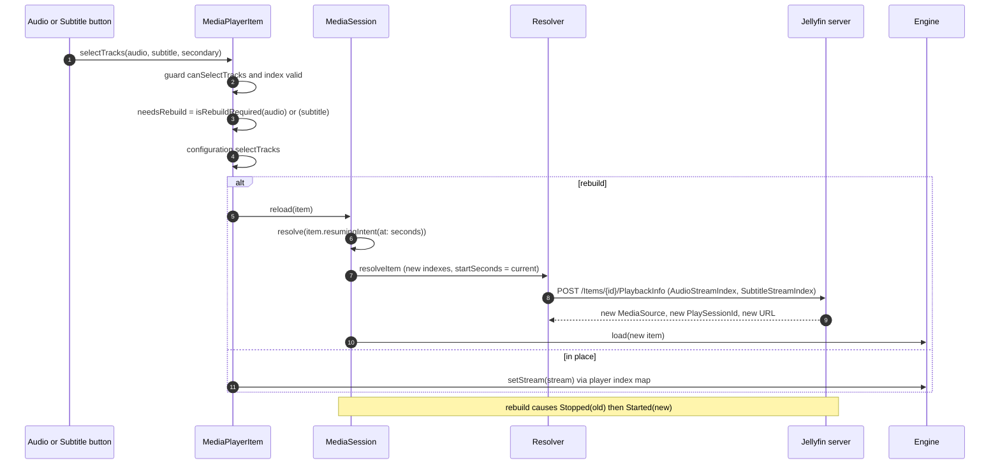

| # | Step | Cite |
|---|---|---|
| 1 | Audio picker binds `playbackItem.selectedAudioStreamIndex` over `audioStreams`. Subtitle picker uses `setSubtitleTrack(index:secondary:)`, `-1` means none. | `Shared/Views/VideoPlayer/Components/Toolbar/ActionButtons/AudioActionButton.swift:38-42`, `Shared/Views/VideoPlayer/Components/Toolbar/ActionButtons/SubtitleActionButton.swift:82-86, 102-103` |
| 2 | Guards, silently returning on failure: `canSelectTracks` (session `playbackItem === self` and `canControlPlayback`), audio exists in `audioStreams`, subtitle is `-1` or in `subtitleStreams`, secondary is `-1` or (supported and in `secondarySubtitleStreams`). | `Shared/Objects/MediaPlayerManager/MediaPlayerItem/MediaPlayerItem+Tracks.swift:75-86` |
| 3-4 | `needsRebuild` for audio OR subtitle (3), then `configuration.selectTracks` updates the configuration (4), then reload or in place. | `Shared/Objects/MediaPlayerManager/MediaPlayerItem/MediaPlayerItem+Tracks.swift:88-120` |
| 2 (lists used by the guard) | Stream filters: `audioStreams` exclude `isExternal`, `subtitleStreams` exclude `deliveryMethod == .drop`. | `Shared/Objects/MediaPlayerManager/MediaPlayerItem/MediaPlayerItem.swift:148-156` |
| 5-9 | Rebuild: `mediaSession.reload(item)` = `resolve(item.resumingIntent(at: seconds))` where `resumingIntent` sets `configuration.startSeconds = max(.zero, position)`. A new PlaybackInfo POST and a new `PlaySessionId` follow. | `Shared/Objects/MediaPlayerManager/MediaSession.swift:733-738`, `Shared/Objects/MediaPlayerManager/MediaPlayerItem/MediaPlayerItem.swift:191-195` |
| 6, 10 | The old item is reported stopped by `progressReporter.stop()` inside `resolve`, then the new item reports started when ready (section 3.4). | `Shared/Objects/MediaPlayerManager/MediaSession.swift:321, 576-587` |
| 11 | In place: audio uses `switchTrack(.audio)`, subtitle and secondary use `setTemporarySubtitleTracks(nil)`, then `mediaPreferences.apply()` when audio changed without preserving preferences. | `Shared/Objects/MediaPlayerManager/MediaPlayerItem/MediaPlayerItem+Tracks.swift:108-119`, `Shared/Objects/MediaPlayerManager/MediaPlayerItem/MediaPlayerItem.swift:76-90` |

### 5.1 Rebuild decision (`isRebuildRequired`)

| Condition | Result | Cite |
|---|---|---|
| `from == to` | no rebuild | `Shared/Objects/MediaPlayerManager/MediaPlayerItem/MediaPlayerItem.swift:202-218` |
| transcoding and the old subtitle was `Encode` (burned in) | rebuild | `Shared/Objects/MediaPlayerManager/MediaPlayerItem/MediaPlayerItem.swift:202-218` |
| new index nil or `-1` | no rebuild | `Shared/Objects/MediaPlayerManager/MediaPlayerItem/MediaPlayerItem.swift:202-218` |
| audio, transcoding | rebuild (server sends only the selected audio) | `Shared/Objects/MediaPlayerManager/MediaPlayerItem/MediaPlayerItem.swift:222-232` |
| audio, direct play | rebuild if the new stream is missing or `deviceProfile.canPlay(type, audioCodec, container)` is false | `Shared/Objects/MediaPlayerManager/MediaPlayerItem/MediaPlayerItem.swift:222-232`, `Shared/Extensions/JellyfinAPI/DeviceProfile.swift:130-136, 158-166` |
| subtitle `deliveryMethod` `.encode` | rebuild | `Shared/Objects/MediaPlayerManager/MediaPlayerItem/MediaPlayerItem.swift:239-250` |
| subtitle `.external` | rebuild unless sidecar (`type == subtitle`, `deliveryMethod == .external`, `deliveryURL != nil`, `isTextSubtitleStream == true`) | `Shared/Objects/MediaPlayerManager/MediaPlayerItem/MediaPlayerItem.swift:239-250`, `Shared/Extensions/JellyfinAPI/MediaStream.swift:19-22, 366-369` |
| subtitle `.hls` | rebuild if no player index is mapped | `Shared/Objects/MediaPlayerManager/MediaPlayerItem/MediaPlayerItem.swift:239-250` |
| subtitle `.drop` or unknown stream index | no rebuild | `Shared/Objects/MediaPlayerManager/MediaPlayerItem/MediaPlayerItem.swift:235-250` |
| subtitle `.embed` or nil | external stream: rebuild unless profile allows the codec via External or Hls. Embedded stream: rebuild if transcoding or the profile cannot Embed the codec | `Shared/Objects/MediaPlayerManager/MediaPlayerItem/MediaPlayerItem.swift:252-261` |

Swiftfin also has a Chromecast path with its own rebuild rule, out of scope (`Shared/Objects/MediaPlayerManager/MediaPlayerItem/MediaPlayerItem.swift:202-218`).

### 5.2 In place switch on each engine

The Jellyfin stream index is mapped to a player position by `MediaTrackIndexMap`. This is true of `MediaTrackIndexMap.build`: transcode maps only the selected non external audio (to player index 0), no subtitles; direct play enumerates non external audio and non external subtitle streams in `mediaStreams` order; `-1` or nil maps to `-1` (off) (`Shared/Objects/MediaPlayerManager/MediaTrackIndexMap.swift:20-24, 33-64`). AVPlayer builds its own map from the selection groups (`Shared/Objects/MediaPlayerManager/Players/AVMediaPlayer.swift:414-431`). Swiftfin's second, non-AVPlayer engine uses its own map and is out of scope (`Shared/Objects/MediaPlayerManager/Players/MPVMediaPlayer.swift:394, 468-508`).

| Engine | Audio | Subtitle | Cite |
|---|---|---|---|
| AVPlayer | option `group.options[index]` selected with `AVPlayerItem.select(_:in:)`. Missing option: no op. | same, missing option selects nil (off). No secondary subtitles (see the two checks below) and no sidecar loading (`setStream` only selects an option in a selection group, no sidecar path). | `Shared/Objects/MediaPlayerManager/Players/AVMediaPlayer.swift:224-246, 406-431, 472-496`, `Shared/Objects/MediaPlayerManager/PlaybackProfile.swift:19-26` |

Secondary subtitle support is checked in two separate places. `PlaybackProfile.supportsSecondarySubtitles` is true only for the non-AVPlayer local engine, and `configuration.prepare` uses it to force the secondary index to `-1` (`Shared/Objects/MediaPlayerManager/PlaybackProfile.swift:19-26`, `Shared/Objects/MediaPlayerManager/MediaPlaybackConfiguration.swift:114-138`). `MediaPlayerItem.selectTracks` instead guards with `MediaPlayerItem.supportsSecondarySubtitles`, which is `mediaSession?.player is MediaPlayerSecondarySubtitleProviding` (`Shared/Objects/MediaPlayerManager/MediaPlayerItem/MediaPlayerItem+Tracks.swift:84-86, 122-124`). The two agree today only because the non-AVPlayer engine type is the only type that conforms to `MediaPlayerSecondarySubtitleProviding` (`Shared/Objects/MediaPlayerManager/Players/MPVMediaPlayer.swift:18`, protocol at `Shared/Objects/MediaPlayerManager/Players/MediaPlayer.swift:89`). A new engine must keep both in step.

Sidecar URL resolution is in `08-images-subtitles-audio.md`. The device profile `SubtitleProfiles` per engine and the Dolby Vision filter are in `05-playback.md`.

### 5.3 Remote and automatic track changes

A remote `GeneralCommand` `SetAudioStreamIndex` or `SetSubtitleStreamIndex` with `Arguments["Index"]` writes `playbackItem.selectedAudioStreamIndex` or `selectedSubtitleStreamIndex` (`Shared/Services/UserSession/UserSessionManager+SocketCommands.swift:130-168`). `MediaPlayerItemPreferences.apply()` re-runs selection when system audio or caption preferences change, on foreground, and when `canSelectTracks` becomes true (`Shared/Objects/MediaPlayerManager/MediaPlayerItem/MediaPlayerItemPreferences.swift:27-101`). Mid playback bitrate and resolution changes go through `setBitrate` and `setResolution`, which call `resolve` with a changed intent (`Shared/Objects/MediaPlayerManager/MediaSession.swift:717-731`, `Shared/Views/VideoPlayer/Components/Toolbar/ActionButtons/PlaybackSettingsActionButton.swift:74, 96`). A media source (version) change instead calls `mediaSession.playNewItem(intent:)` with `resumingIntent(at:)`, which snapshots a `MediaPlaybackContinuation` before `resolve` (`Shared/Views/VideoPlayer/Components/Toolbar/ActionButtons/PlaybackSettingsActionButton.swift:41-53`, `Shared/Objects/MediaPlayerManager/MediaSession.swift:248-269`).

## 6. Resume

The client sends no resume point write. It reads the server's value, offsets it, plays from there, and reports the observed position in `Progress` and `Stopped` (`Shared/Objects/MediaPlayerManager/MediaProgressReporter.swift:50-86`). The SDK's user data write is `Paths.updateItemUserData` (`POST /UserItems/{itemId}/UserData`, `jellyfin-sdk-swift@3.3.0:Sources/Paths/UpdateItemUserDataAPI.swift:14-25`); a grep of app code finds no `updateItemUserData` call (negative by grep). The only `playbackPositionTicks` writes are the local overlay at `Shared/Objects/MediaPlayerManager/MediaPlayerItem/MediaPlayerItem.swift:109` and a settings preview sample at `Shared/Views/SettingsView/CustomizeSettings/Components/PosterSection.swift:75`. How the server turns these reports into a resume point is listed in section 10.

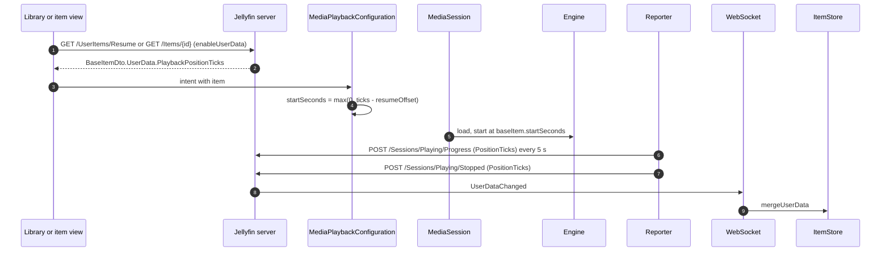

| # | Step | Cite |
|---|---|---|
| 1-2 | Resume ticks come from `item.userData.playbackPositionTicks` (`BaseItemDto.startSeconds`, nil when absent). List requests set `enableUserData = true`. | `Shared/Extensions/JellyfinAPI/BaseItemDto/BaseItemDto.swift:305-309`, `Shared/Objects/Libraries/ResumeItemsLibrary.swift:33` |
| 3-4 | `startSeconds = max(.zero, startSeconds ?? ((item.startSeconds ?? .zero) - resumeOffset))`. `resumeOffset` is `Duration.seconds(UserDefaults[.VideoPlayer.resumeOffset])`, default `0`, stepper range `0...30`, step 1. | `Shared/Objects/MediaPlayerManager/MediaPlaybackConfiguration.swift:36, 120`, `Shared/Services/SwiftfinDefaults.swift:290-291`, `Shared/Views/SettingsView/VideoPlayerSettingsView.swift:211` |
| 3 | Explicit start overrides: `PlayButton` "play from beginning" sets `startSeconds = .zero` (menu only when `playbackPositionTicks > 0`). A remote `Play` command sets `startSeconds = .ticks(startPositionTicks)`. Track switch and retry use the current or last observed position (`resumingIntent`, `fail`). | `Shared/Views/ItemView/Components/PlayButton.swift:37-39, 78-80`, `Shared/Services/UserSession/UserSessionManager+SocketCommands.swift:187-230`, `Shared/Objects/MediaPlayerManager/MediaSession.swift:458-461` |
| 5 | The overlay in `MediaPlayerItem.baseItem` writes `configuration.startSeconds.ticks` into `userData.playbackPositionTicks` locally. | `Shared/Objects/MediaPlayerManager/MediaPlayerItem/MediaPlayerItem.swift:103-114` |
| 5 | AVPlayer seeks to `startSeconds` once `readyToPlay`. | `Shared/Objects/MediaPlayerManager/Players/AVMediaPlayer.swift:440-447` |
| 6-7 | Progress `PositionTicks = observedSeconds.ticks` each 5 s. No extra report at seek, pause, rate change or in place track switch; the new position and `IsPaused` reach the server on the next tick. A rebuild track change (and bitrate change) is the exception: `resolve` calls `progressReporter.stop()`, which sends `Stopped`, and the new item sends `Started` (section 5). | `Shared/Objects/MediaPlayerManager/MediaProgressReporter.swift:41-47, 75, 80`, `Shared/Objects/MediaPlayerManager/MediaSession.swift:321, 576-587` |
| 7 | `Stopped` carries `PositionTicks = observedSeconds.ticks`, `ItemId`, `LiveStreamId`, `MediaSourceId`, `PlaySessionId`, `SessionId`. There is no "played" flag and no call to mark played at the end of playback (negative by grep: the only `markPlayedItem` use in app code is the manual toggle). | `Shared/Objects/MediaPlayerManager/MediaProgressReporter.swift:50-67`, `Shared/Services/UserSession/UserSession+Items.swift:86` |
| 8-9 | The server pushes WebSocket `UserDataChanged`. `UserSession` filters `data.userID == user.id` and calls `items.mergeUserData` for each `UserItemDataDto`. This is how resume, played and play count changes appear locally. | `jellyfin-sdk-swift@3.3.0:Sources/Entities/OutboundWebSocketMessage.swift:83`, `Shared/Services/UserSession/UserSession+ItemChanges.swift:20-29`, `Shared/Objects/ItemStore/ItemStore.swift:137` |

Manual watched toggling (not part of playback): `POST /UserPlayedItems/{id}?userId=` to mark played, `DELETE /UserPlayedItems/{id}?userId=` to mark unplayed, applied optimistically in `ItemStore.mutateUserData` (`Shared/Services/UserSession/UserSession+Items.swift:83-87`, `jellyfin-sdk-swift@3.3.0:Sources/Paths/MarkPlayedItemAPI.swift:16-17`, `jellyfin-sdk-swift@3.3.0:Sources/Paths/MarkUnplayedItemAPI.swift:15`, `Shared/Objects/ItemStore/ItemStore.swift:176-216`). Details are in `07-reporting.md`.

## 7. Stop

All stop paths converge on `MediaSession.stop()` (a `cancel` action, state `.stopped`) or on `fail` (an `.error` action), and the state sink calls `tearDown()` for both states (`Shared/Objects/MediaPlayerManager/MediaSession.swift:213-219, 431-436, 444-465`).

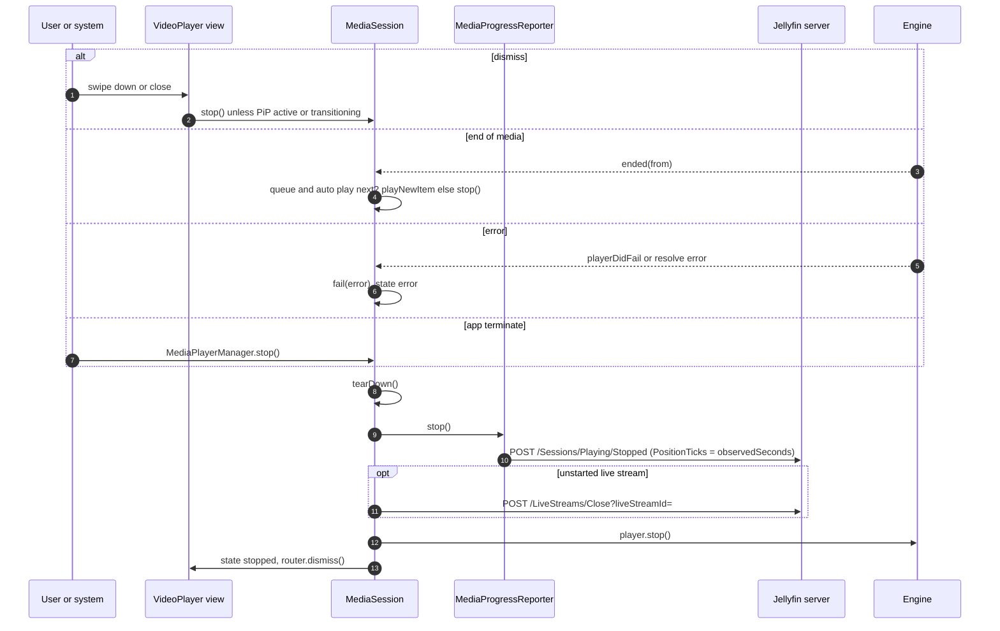

| # | Step | Cite |
|---|---|---|
| 1-2 | `viewWillDisappear` walks ancestors for `isBeingDismissed` or `isMovingFromParent`. `viewDidDisappear` then calls `didDismiss`, which calls `mediaSession.stop()` unless PiP is active or transitioning. A full screen sheet over the player does not end playback. | `Shared/Views/VideoPlayer/Container/VideoPlayer+Container.swift:886-924` |
| 1-2 (Close button) | The toolbar Close button (`closePlayerButton`) has two branches. When a supplement panel is open (`viewState.isPresentingSupplement`), it only sets `selectedSupplementID = nil`, which collapses the panel; playback goes on and nothing is reported. Otherwise it calls `mediaSession.stop()` and then `router.dismiss()`. | `Shared/Views/VideoPlayer/Components/Toolbar/VideoPlayer+Toolbar.swift:29-44` |
| 1-2 (tvOS Menu) | On tvOS, the Menu press handler cancels a scrub, else collapses an open supplement, else hides visible controls. Only with controls hidden does it stop: when `UserDefaults[.confirmClose]` is true it shows the close-player alert, else it calls `mediaSession.stop()`. | `Shared/Views/VideoPlayer/Container/VideoPlayer+Container.swift:935, 1165-1181` |
| 1-2 (tvOS alert) | The close-player alert (`L10n.closePlayer`, message `L10n.closePlayerWarning`) has Cancel, which does nothing, and OK (destructive), which calls `mediaSession.stop()`. Dismissal then follows step 13. | `Swiftfin tvOS/Views/VideoPlayer/PlaybackControls/PlaybackControls.swift:64-72` |
| 2, 8 | `stop()` guards `state != .stopped` and commits `cancel()` synchronously. The state sink calls `tearDown()` on `.error` or `.stopped`. | `Shared/Objects/MediaPlayerManager/MediaSession.swift:213-219, 431-436` |
| 3 | End of media: AVPlayer `AVPlayerItemDidPlayToEndTime` reports the runtime as the final position and calls `mediaSession.ended` unless the item is live. Swiftfin's second, non-AVPlayer engine has its own end detection, out of scope. | `Shared/Objects/MediaPlayerManager/Players/MPVMediaPlayer.swift:418-421`, `Shared/Objects/MediaPlayerManager/Players/AVMediaPlayer.swift:344-357` |
| 4 | `ended(from:)` needs `canControlPlayback`, not seeking, not live. Without a queue, or unless `user.data.configuration.enableNextEpisodeAutoPlay == true`, it calls `stop()`. Else it plays `queue.nextItem`, or awaits `queue.next()` and calls `playNewItem` (or `stop()` when none). Queue errors call `fail`. | `Shared/Objects/MediaPlayerManager/MediaSession.swift:495-528` |
| 4 | The episode queue fetches neighbours with `GET /Shows/{seriesID}/Episodes` with `userId`, `adjacentTo=<id>`, `limit=3`. Only for `type == .episode` with a `seriesID`. | `Shared/Objects/MediaPlayerManager/Supplements/EpisodeMediaPlayerQueue.swift:132-145`, `jellyfin-sdk-swift@3.3.0:Sources/Paths/GetEpisodesAPI.swift:15` |
| 4 | Response rules: `items.count <= 1` (or nil) means no neighbours. Count 2: if `items[0].id == current.id` then next = `items[1]`, else previous = `items[0]`. Count 3 (or more): previous = `items[0]`, next = `items[2]`. Both intents get a fresh `MediaPlaybackConfiguration()` with `startSeconds = .zero` and `requestedBitrate = mediaSession.playbackBitrate` (fallback `UserDefaults[.VideoPlayer.Playback.appMaximumBitrate]`). Results are dropped if the task was cancelled. | `Shared/Objects/MediaPlayerManager/Supplements/EpisodeMediaPlayerQueue.swift:154-186` |
| 4 | `playNewItem` snapshots a `MediaPlaybackContinuation` (previous audio and subtitle choice) before resolving, so the old item gets `Stopped` and the new item `Started`. | `Shared/Objects/MediaPlayerManager/MediaSession.swift:248-269` |
| 5-6 | Failure: `fail` is ignored when already stopped or error. A `handoffRecovery` re-resolves on the previous player. A remote session that can return goes back to local. Otherwise `intent.configuration.startSeconds = observedSeconds` is stored (when controllable), `Playback failed: ...` is logged, and an `.error` action fires. | `Shared/Objects/MediaPlayerManager/MediaSession.swift:438-465` |
| 6 | Error UI: alert `L10n.error`, message always `L10n.unableToLoadThisItem`, buttons Retry (`mediaSession.retry()` re-runs `resolve(intent)` with the saved position, only in `.error`) and Close (`stop()` then `router.dismiss()`). `fail` recovers only through `handoffRecovery` (re-resolve on the previous player of a transfer) or return to local playback; it has no branch that swaps one engine for another. | `Shared/Views/VideoPlayer/VideoPlayer.swift:83-95`, `Shared/Objects/MediaPlayerManager/MediaSession.swift:444-465, 551-555` |
| 7 | App termination posts `applicationWillTerminate`, which calls `MediaPlayerManager.stop()`. A new `play` also calls `stop()` first. | `Shared/Objects/MediaPlayerManager/MediaPlayerManager.swift:52-55, 77` |
| 8, 12 | `tearDown`: cancel transfer, new `resolutionID`, `progressReporter.stop()`, `discardUnstartedItem()`, reset playback, `player?.stop()`, clear `playbackItem`. On `.stopped` it also detaches and nils the player. | `Shared/Objects/MediaPlayerManager/MediaSession.swift:467-493` |
| 9-10 | `stop()` on the reporter cancels the timer, clears `pendingProgressID` (which invalidates queued progress), builds `PlaybackStopInfo` (`ItemId`, `LiveStreamId`, `MediaSourceId`, `PlaySessionId`, `PositionTicks`, `SessionId`) and enqueues `POST /Sessions/Playing/Stopped`. If no item was ever reported started, nothing is sent here. | `Shared/Objects/MediaPlayerManager/MediaProgressReporter.swift:50-68`, `jellyfin-sdk-swift@3.3.0:Sources/Paths/ReportPlaybackStoppedAPI.swift:15` |
| 11 | An item resolved but never reported started has its live stream closed with `POST /LiveStreams/Close?liveStreamId=` (result discarded with `try?`). | `Shared/Objects/MediaPlayerManager/MediaSession.swift:707-715`, `Shared/Objects/MediaPlayerManager/MediaProgressReporter.swift:88-97` |
| 13 | `VideoPlayer` observes `state == .stopped` and dismisses the route unless a dismissal is already in progress. | `Shared/Views/VideoPlayer/VideoPlayer.swift:78-82` |

Session change while playing: `applyCurrentSession` calls `stopActivePlayback()` first, so sign out, user switch and deep link switches stop playback and send `Stopped` (`Shared/Services/UserSession/UserSessionManager.swift:301-306`). Background behaviour: `pauseOnBackground` (key `playInBackground`, default true) pauses on scene background. It does nothing when the session is remote playback, the item is audio, or PiP is already active. When the player allows automatic PiP or is transitioning to PiP, a `backgroundPause` task checks 5 times, 300 ms apart, and calls `setPlaybackRequestStatus(.paused)` if PiP is still not active after about 1.5 s. In every other case it pauses at once (key and default `Shared/Services/SwiftfinDefaults.swift:403-405`, checks `Shared/Objects/MediaPlayerManager/MediaPlaybackTransitions.swift:30-60`).

### 7.1 Stop ordering and termination

Reporter `stop()` only enqueues `Stopped` and returns; nothing awaits it, so nothing in the code orders its delivery before teardown or process exit (`Shared/Objects/MediaPlayerManager/MediaProgressReporter.swift:50-68, 116-118, 166-179`, `Shared/Objects/MediaPlayerManager/MediaPlayerManager.swift:52-55`). Its errors are only logged (`Shared/Objects/MediaPlayerManager/MediaProgressReporter.swift:130-134`).

| Fact | Cite |
|---|---|
| Reporter `stop()` only enqueues the request on the shared chained task queue. It does not await it. The client is captured at enqueue time (`userSession.client`), before any teardown. | `Shared/Objects/MediaPlayerManager/MediaProgressReporter.swift:50-68, 116-118, 166-179` |
| `stopActivePlayback()` is `mediaPlayerManager.stop()`, which returns without waiting for the `Stopped` request. `applyCurrentSession` then calls `previousSession.willStop()` (stops services in reverse, `items.invalidate()`) straight after. | `Shared/Services/UserSession/UserSessionManager.swift:127-129, 301-306`, `Shared/Services/UserSession/UserSession.swift:87-97` |
| At termination the `applicationWillTerminate` sink calls `stop()` synchronously and nothing in the code holds the process open (no background task, no await) for the queued request. Nothing in the code guarantees `Stopped` is sent at termination or sign out. | `Shared/Objects/MediaPlayerManager/MediaPlayerManager.swift:52-55` |
| Rebuild guidance, not app behaviour: to guarantee delivery, await the `Stopped` request before teardown, or wrap it in a background task. | n/a (recommendation) |

### 7.2 Sign out

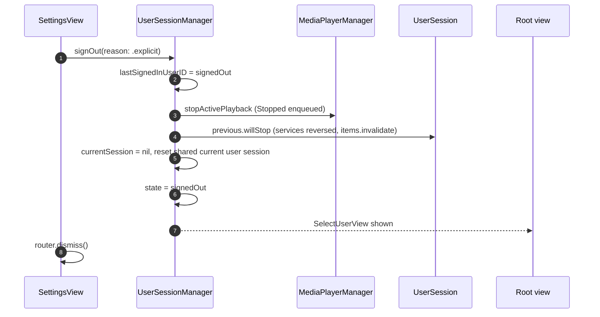

| # | Step | Cite |
|---|---|---|
| 1, 8 | The Switch user button runs `signOut(reason: .explicit)`, then `router.dismiss()`. | `Shared/Views/SettingsView/SettingsView.swift:82-90` |
| 2 | `signOut` returns when there is no session or transition, sets `UserDefaults[.lastSignedInUserID] = .signedOut`, then `updateCurrentSession(with: nil)`. | `Shared/Services/UserSession/UserSessionManager.swift:113-124` |
| 3-6 | `applyCurrentSession(nil)`: stop playback, `willStop`, `currentSession = nil`, reset the shared current user session dependency, `state = .signedOut`. | `Shared/Services/UserSession/UserSessionManager.swift:301-315` |
| 7 | No server logout call is made. `signOut` does not delete the keychain entry, so the access token stays under keychain key `<id>-accessToken` and the next session start for that user can reuse it (section 1.4, `03-auth-session.md`). | `Shared/Services/UserSession/UserSessionManager.swift:113-124`, `Shared/SwiftfinStore/SwiftinStore+UserState.swift:30-41` |

## 8. Remote control entering the same pipeline

Another Jellyfin client can drive this one over the WebSocket. Commands enter at the same `PlayMediaAction` and `MediaSession` methods as local input: `Playstate` calls `seek(by:)`, `seek(to:)`, `setPlaybackRequestStatus`, `togglePlayPause`, `playNewItem` and `stop()` on `mediaPlayerManager.currentSession`, and `Play` builds a `PlayMediaAction` and calls it with the intent (`Shared/Services/UserSession/UserSessionManager+SocketCommands.swift:87-128, 218-222`).

| Message | Effect | Cite |
|---|---|---|
| `Play` (`PlayNow` or nil) | take `itemIDs[startIndex ?? 0] ?? first`, `getFullItem`, pick `MediaSourceId`, `startSeconds = .ticks(StartPositionTicks)`, drop if the session changed, route via `PlayMediaAction` | `Shared/Services/UserSession/UserSessionManager+SocketCommands.swift:56-85, 187-230` |
| `Play` (`PlayNext`, `PlayLast`) | synthesised `Playstate` `NextTrack` and `PreviousTrack` | `Shared/Services/UserSession/UserSessionManager+SocketCommands.swift:71-76` |
| `Play` (`PlayInstantMix`, `PlayShuffle`) | ignored (`TODO` in code), no effect | `Shared/Services/UserSession/UserSessionManager+SocketCommands.swift:77-83` |
| `Playstate` | `FastForward`/`Rewind` use `jumpForwardInterval`/`jumpBackwardInterval`; `Seek` uses `SeekPositionTicks`; `Pause`, `Unpause`, `PlayPause`, `Stop`, `NextTrack`, `PreviousTrack`. No-op without a current session. | `Shared/Services/UserSession/UserSessionManager+SocketCommands.swift:87-128` |
| `GeneralCommand` | `SetAudioStreamIndex`, `SetSubtitleStreamIndex`, `SetMaxStreamingBitrate`, `DisplayContent`, `PlayMediaSource`, `PlayTrailers` handled. Mute, volume, `DisplayMessage` and others ignored. | `Shared/Services/UserSession/UserSessionManager+SocketCommands.swift:130-184, 232-267` |

## 9. CONFLICT and clarification log

| # | Topic | Version A | Version B | Resolution | Cite |
|---|---|---|---|---|---|
| **CONFLICT** 1 | Resume start formula (explorer files `_work/explorers/topic-media-assets.json` and `topic-reporting.json`; no line numbers in them, the source line is the evidence) | `topic-media-assets.json` writes `startSeconds ?? (item.startSeconds - resumeOffset)` | `topic-reporting.json` writes `(item.startSeconds ?? 0) - resumeOffset` | Source settles: the `?? .zero` form, clamped by `max(.zero, ...)` | `Shared/Objects/MediaPlayerManager/MediaPlaybackConfiguration.swift:120` |
| **CONFLICT** 2 | Client used for connect to server (explorer files `_work/explorers/topic-auth.json`, `shard-viewmodels-1.json`; evidence is the source line) | `topic-auth.json`: default `URLSessionConfiguration`, not `.swiftfin` | `shard-viewmodels-1.json`: built with a network logging proxy session delegate | Not a conflict: both apply. No `sessionConfiguration` argument, a proxy delegate. | `Shared/ViewModels/ConnectToServerViewModel.swift:75-78` |
No other explorer disagreement was found for these flows. Three points an implementer could misread are settled by source here. They are clarifications, not explorer conflicts.

| # | Topic | Source says | Cite |
|---|---|---|---|
| Note A | Where the stream URL gets `ApiKey` | The direct stream URL adds `ApiKey` through `queryAPIKey: true`. A server supplied transcoding URL gets none from the resolver. Only an HLS only profile (remote playback) appends it through `RemotePlaybackURL.authenticated`. | `Shared/Objects/MediaPlayerManager/MediaPlayerItem/MediaPlayerItemResolver.swift:142-149, 229-260` |
| Note B | `PlaySessionId` versus `SessionId` in reports | Both keys are set from `item.playSessionID`. | `Shared/Objects/MediaPlayerManager/MediaProgressReporter.swift:79-81` |
| Note C | When `Stopped` is sent | `stop()` on the reporter sends `Stopped` only if `start()` stored an item (`guard let item`). An item resolved but never reported started only gets its live stream closed. | `Shared/Objects/MediaPlayerManager/MediaProgressReporter.swift:55-57`, `Shared/Objects/MediaPlayerManager/MediaSession.swift:707-715` |

## 10. Unknowns carried to `12-gaps.md`

| Question | Evidence | Cite |
|---|---|---|
| Wire content of the `PlaybackInfoDto` JSON beyond the fields the app sets (SDK encodes nil as omitted) | app sets only the fields in section 3.2 step 11 (`PlaybackInfoDto` row) | `Shared/Objects/MediaPlayerManager/MediaPlayerItem/MediaPlayerItemResolver.swift:56-76` |
| How the server derives the stored resume point (`UserData.PlaybackPositionTicks`) from `Progress`/`Stopped` reports; the client sends no direct resume write | `Stopped` carries `PositionTicks = observedSeconds.ticks` | `Shared/Objects/MediaPlayerManager/MediaProgressReporter.swift:50-68` |
| Whether the server accepts or ignores the app only `SecondarySubtitleStreamIndex` key | key is added by the app wrapper, not by the SDK type | `Shared/Objects/MediaPlayerManager/MediaProgressReporter.swift:84` |
| AirPlay and other remote playback sequences (handoff recovery, return to local, HLS only profile with `ApiKey`) are not diagrammed here; the Chromecast path is out of scope. Only the failure branches are covered (section 7 steps 5-6). Whether the receiver authenticates child playlists with the `ApiKey` appended to the master URL is unverified | see `05-playback.md`; recovery and return to local are in `fail` | `Shared/Objects/MediaPlayerManager/MediaSession.swift:444-457`, `Shared/Objects/MediaPlayerManager/RemotePlaybackURL.swift:14-24` |
